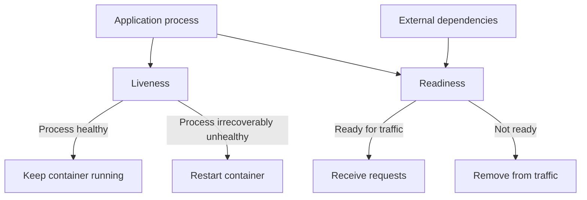
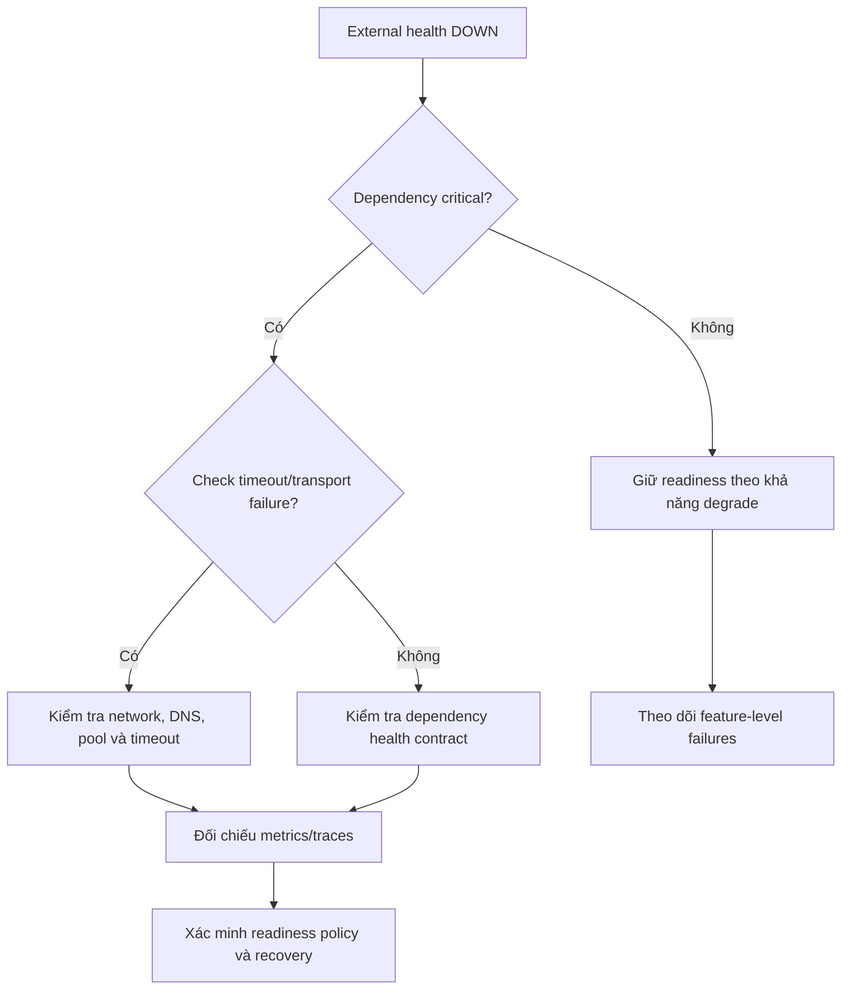

# External service health trong Spring Boot

Một Spring Boot service thường phụ thuộc vào database, message broker, identity provider hoặc HTTP APIs bên ngoài. Khi một dependency gặp sự cố, operator cần biết dependency đó có đang reachable hay không và sự cố có ảnh hưởng tới khả năng phục vụ request của ứng dụng hay không.

Spring Boot Actuator cho phép tích hợp trạng thái dependency vào health endpoint thông qua HealthIndicator hoặc ReactiveHealthIndicator. Tuy nhiên, **external service health không đồng nghĩa mọi dependency phải luôn healthy để ứng dụng được xem là ready**. Một dependency không thiết yếu có thể tạm thời lỗi trong khi service vẫn phục vụ phần lớn chức năng; đưa mọi dependency vào readiness một cách máy móc có thể làm giảm capacity và gây cascading failures.

Bài **“External service health”** thuộc chương **Health và readiness** của module **SPRING_BOOT_OBSERVABILITY**. Module hướng dẫn thiết lập observability cho Spring Boot bằng Micrometer Observation, metrics, logs và distributed tracing; học propagation ngữ cảnh, tag/cardinality, exporter, sampling và liên kết tín hiệu để điều tra lỗi, độ trễ và hành vi ứng dụng trên môi trường thực.

## 1. External service health là gì?

External service health là trạng thái quan sát được của các hệ thống mà ứng dụng cần gọi hoặc sử dụng. Ví dụ:

- Database phục vụ đọc/ghi dữ liệu nghiệp vụ.
- Kafka/RabbitMQ nhận và gửi events.
- Identity provider cấp token hoặc xác minh danh tính.
- Payment gateway xử lý thanh toán.
- Search service phục vụ truy vấn tìm kiếm.
- HTTP API của đối tác.

Một health check thường thực hiện một thao tác nhỏ để xác nhận dependency có thể phản hồi trong giới hạn thời gian. Kết quả có thể được hiển thị qua Actuator health endpoint và dùng cho vận hành.

Health check không thay thế monitoring đầy đủ. Một lần ping thành công không chứng minh dependency đáp ứng mọi truy vấn nghiệp vụ, throughput hay latency mục tiêu.

## 2. HealthIndicator và ReactiveHealthIndicator

Spring Boot Actuator cung cấp các extension points chính:

| Interface | Dùng cho |
| --- | --- |
| HealthIndicator | Kiểm tra đồng bộ |
| ReactiveHealthIndicator | Kiểm tra reactive/non-blocking |
| CompositeHealthContributor | Gom nhiều health contributors |
| HealthContributor | Abstraction chung cho contributor |

Ví dụ một health indicator đồng bộ cho external HTTP service:

```java
import org.springframework.boot.actuate.health.Health;
import org.springframework.boot.actuate.health.HealthIndicator;
import org.springframework.stereotype.Component;
import org.springframework.web.client.RestClient;

@Component
public class PartnerApiHealthIndicator implements HealthIndicator {

    private final RestClient restClient;

    public PartnerApiHealthIndicator(RestClient.Builder builder) {
        this.restClient = builder
                .baseUrl("https://partner.example")
                .build();
    }

    @Override
    public Health health() {
        try {
            restClient.get()
                    .uri("/health")
                    .retrieve()
                    .toBodilessEntity();

            return Health.up()
                    .withDetail("dependency", "partner-api")
                    .build();
        }
        catch (Exception ex) {
            return Health.down()
                    .withDetail("dependency", "partner-api")
                    .withDetail("reason", ex.getClass().getSimpleName())
                    .build();
        }
    }
}
```

Đây là ví dụ minh họa; endpoint health của đối tác và chính sách status phải được xác nhận theo contract thực tế. Không trả exception message, URL có credentials hoặc response body nhạy cảm trong health details.

Với reactive application, dùng ReactiveHealthIndicator và reactive client tương ứng. Không gọi blocking RestClient từ reactive event loop.

## 3. Readiness và liveness có mục đích khác nhau

Kubernetes và Spring Boot phân biệt hai câu hỏi:

- **Liveness:** process có còn hoạt động đủ để tiếp tục chạy không? Nếu liveness fail, orchestrator có thể restart container.
- **Readiness:** instance có sẵn sàng nhận traffic mới không? Nếu readiness fail, orchestrator thường loại instance khỏi service endpoints.

External dependency health thường có liên quan tới readiness, nhưng không phải dependency nào cũng nên làm readiness fail. Liveness thường không nên phụ thuộc vào remote services: một database outage không có nghĩa JVM/process bị hỏng và cần restart.

Spring Boot có thể cung cấp health groups cho readiness và liveness, ví dụ các nhóm actuator health tương ứng. Kiểm tra cấu hình và version của ứng dụng trước khi tùy chỉnh.



Không đưa external dependency vào liveness group chỉ vì nó quan trọng với một số business operations.

## 4. Dependency criticality: dependency nào ảnh hưởng readiness?

Phân loại dependency theo vai trò nghiệp vụ:

| Dependency | Ví dụ tác động khi unavailable | Cách cân nhắc readiness |
| --- | --- | --- |
| Critical | Service không thể phục vụ phần lớn request | Có thể ảnh hưởng readiness |
| Feature-specific | Chỉ một nhóm chức năng bị lỗi | Cân nhắc readiness theo service/traffic model |
| Optional | Có fallback/cache hoặc chức năng degrade gracefully | Thường không nên làm toàn instance unready |
| Background-only | Chỉ phục vụ async job | Có thể có health group riêng |
| Observability backend | Telemetry export bị gián đoạn | Thường không nên làm business service unready |

Ví dụ, nếu payment gateway unavailable nhưng checkout service vẫn có thể đọc order, hiển thị trạng thái và xử lý các thao tác không cần payment, đánh dấu toàn instance DOWN có thể loại bỏ capacity không cần thiết.

Readiness policy cần trả lời: nếu dependency này down, instance có thể phục vụ request nào? Có fallback không? Có queue/buffer không? Có thể trả lỗi có kiểm soát cho đúng feature không?

## 5. Tích hợp health contributor có sẵn

Spring Boot Actuator có health contributors auto-configured cho nhiều công nghệ khi dependency tương ứng có mặt. Ví dụ database, Redis, messaging hoặc Elasticsearch có thể có indicator riêng tùy starter và version.

Trước khi viết custom indicator:

1. Kiểm tra Actuator đã tự đăng ký contributor nào.
2. Xem contributor có phù hợp với health semantics cần đo không.
3. Kiểm tra nó có nằm trong readiness group không.
4. Chỉ viết custom indicator khi cần thao tác kiểm tra khác hoặc metadata riêng.
5. Tránh tạo hai check cùng gọi một dependency liên tục.

Auto-configured indicator có thể được bật/tắt qua configuration properties tương ứng. Tên property phụ thuộc contributor; tra tài liệu đúng version thay vì tự đoán.

## 6. Timeout và bounded health checks

Health endpoint có thể bị gọi thường xuyên bởi orchestrator, load balancer và monitoring system. Nếu mỗi lần check tạo HTTP call chậm không giới hạn, chính health check có thể tiêu thụ thread/connection và làm ứng dụng tệ hơn.

Nguyên tắc:

- Đặt connect/read/overall timeout ngắn và hữu hạn.
- Giới hạn concurrency của health checks.
- Không retry nhiều lần trong một probe.
- Dùng request nhẹ, không chạy full business workflow.
- Không tải dữ liệu lớn hoặc scan toàn database.
- Dùng bulkhead nếu health check có thể cạnh tranh tài nguyên với traffic.
- Cân nhắc cache kết quả trong khoảng ngắn nếu probe frequency cao.
- Đặt health check budget thấp hơn timeout của orchestrator/probe.

Một timeout 1-2 giây chỉ là ví dụ; chọn giá trị theo network, dependency SLO và probe interval. Không dùng timeout quá dài khiến readiness endpoint treo và tạo nhiều probe chồng nhau.

## 7. Caching và tần suất kiểm tra

Nếu nhiều probes gọi health endpoint mỗi vài giây và mỗi lần endpoint lại gọi 5 dependencies, lượng check traffic có thể đáng kể.

Có thể cache kết quả health trong thời gian ngắn hoặc chạy periodic check riêng. Cần cân bằng:

- Cache lâu làm trạng thái stale.
- Cache quá ngắn làm dependency nhận quá nhiều probes.
- Periodic check cần cập nhật trạng thái khi app startup/recovery.
- Health response nên thể hiện timestamp/age nếu cần đánh giá độ mới.
- Cần tránh nhiều replicas đồng loạt tạo thundering herd vào dependency.

Không cache một trạng thái DOWN quá lâu nếu dependency đã phục hồi và service cần trở lại readiness. Cũng không đánh dấu UP chỉ vì lần check cũ thành công khi đã quá hạn.

## 8. Status mapping và health details

Health API dùng các status như UP, DOWN, OUT_OF_SERVICE và UNKNOWN. Status aggregator quyết định status tổng hợp khi có nhiều contributors.

Ví dụ một health response có thể bao gồm:

```json
{
  "status": "UP",
  "components": {
    "partnerApi": {
      "status": "UP",
      "details": {
        "dependency": "partner-api"
      }
    }
  }
}
```

Không expose details nhạy cảm ra public health endpoint. Management endpoint có thể có một representation chi tiết hơn cho operator, trong khi public/lb probe chỉ cần status tổng hợp.

Nếu custom status được dùng, cấu hình status order/HTTP mapping phù hợp để load balancer và orchestrator hiểu đúng. Không giả định mọi status khác UP đều được map thành HTTP code giống nhau trong mọi cấu hình.

## 9. Health groups cho readiness và dependency checks

Có thể định nghĩa health groups để tách probe concerns. Ví dụ khái niệm:

```yaml
management:
  endpoint:
    health:
      group:
        readiness:
          include: readinessState,db,partnerApi
        liveness:
          include: livenessState
```

Đây là cấu hình minh họa. Contributor IDs phải khớp tên thực tế trong Actuator context; không copy nguyên ví dụ nếu app không có db hoặc partnerApi contributor.

Chỉ đưa partnerApi vào readiness nếu service không thể nhận traffic hợp lệ khi partner API down. Nếu chỉ một endpoint phụ thuộc partner, cân nhắc để readiness của toàn service vẫn UP và để request cụ thể trả lỗi/degrade.

## 10. Tránh cascading failures

Khi một dependency chậm, health checks có thể đồng loạt timeout. Nếu readiness fail trên mọi replica, orchestrator loại toàn bộ instances khỏi traffic. Điều này có thể làm service không còn khả năng phục vụ những requests vẫn có thể xử lý.

Một số biện pháp:

- Chỉ đưa critical dependencies vào readiness.
- Dùng timeout ngắn và concurrency bounded.
- Có circuit breaker để ngừng gọi dependency đang lỗi.
- Dùng fallback/cache/queue nếu semantics nghiệp vụ cho phép.
- Tách health của background worker khỏi HTTP serving readiness nếu cần.
- Tránh liveness phụ thuộc remote dependency.
- Theo dõi số replica ready và dependency failure đồng thời.

Health check không nên tự tạo một vòng lặp: dependency down → probe down → mọi replica bị loại → traffic dồn lên ít instance còn lại → overload → thêm probe fail.

## 11. Circuit breaker và health status

Circuit breaker bảo vệ application calls bằng cách mở circuit khi dependency có failure/latency vượt ngưỡng. Health indicator có thể quan sát trạng thái circuit, nhưng không nên coi circuit OPEN luôn đồng nghĩa process unhealthy.

| Circuit state | Ý nghĩa | Health interpretation |
| --- | --- | --- |
| CLOSED | Calls được phép đi qua | Dependency path đang được thử sử dụng |
| OPEN | Calls bị chặn tạm thời | Dependency đang có vấn đề; service có thể vẫn phục vụ fallback |
| HALF_OPEN | Cho phép một số probe calls | Đang kiểm tra phục hồi |

Nếu readiness gắn với circuit OPEN, hãy xác định service có thể phục vụ traffic khác không. Circuit breaker và readiness có mục tiêu khác nhau: một cái bảo vệ dependency call; cái kia quyết định instance có nhận traffic hay không.

## 12. Health check và dependency SLO

Health endpoint thường là tín hiệu nhị phân/coarse-grained, không thay thế SLO dashboards.

Để quan sát dependency tốt hơn, theo dõi:

- Request rate tới dependency.
- Error rate theo status/error type.
- Latency histogram/percentiles.
- Connection pool active/idle/pending.
- Timeout và circuit breaker state.
- Retry count và retry exhaustion.
- Broker lag hoặc queue depth nếu dependency là messaging.
- Health status và thời gian gần nhất check thành công.

Metrics/traces cho biết mức ảnh hưởng và nguyên nhân; health endpoint hỗ trợ orchestration quyết định traffic placement. Không dùng một probe đơn lẻ làm bằng chứng dependency đạt SLO.

## 13. Bảo mật health endpoint

Health details có thể làm lộ topology, tên host, database type, broker names hoặc thông tin lỗi nội bộ.

- Expose public endpoint với status tối thiểu nếu cần cho load balancer.
- Bảo vệ management endpoint chi tiết bằng authentication/authorization.
- Không trả credential, connection string, raw exception message hoặc internal IP nếu không cần.
- Giới hạn network access.
- Dùng TLS cho management traffic.
- Kiểm tra response khi dependency DOWN để không lộ thông tin nhạy cảm.

Không nhầm health endpoint với diagnostic endpoint đầy đủ. Operator có thể dùng logs/traces/metrics trong hệ thống có kiểm soát để điều tra sâu.

## 14. Kiểm thử external service health

Một bộ test nên bao phủ trạng thái và tác động lên readiness:

1. Dependency phản hồi thành công trong timeout.
2. Dependency trả lỗi HTTP hoặc protocol error.
3. DNS resolution thất bại.
4. Connection refused và connect timeout.
5. Dependency phản hồi chậm hơn health timeout.
6. Dependency không thiết yếu DOWN nhưng readiness vẫn UP theo policy.
7. Dependency critical DOWN làm readiness OUT_OF_SERVICE/DOWN theo policy.
8. Liveness vẫn UP khi external dependency down.
9. Health check không retry vô hạn hoặc tạo request chồng lấn.
10. Cached result hết hạn và được refresh.
11. Recovery của dependency đưa readiness trở lại UP.
12. Security rules che details khỏi caller không có quyền.

Dùng mock server/test container hoặc stub dependency. Không phụ thuộc hệ thống production thật trong unit/integration tests.

## 15. Chẩn đoán khi external service health sai

| Triệu chứng | Nguyên nhân có thể | Cách kiểm tra |
| --- | --- | --- |
| Readiness DOWN dù service vẫn phục vụ được | Dependency optional bị đưa vào readiness | Rà soát criticality và group membership |
| Liveness DOWN khi database outage | Liveness phụ thuộc remote service | Chỉ kiểm tra trạng thái process/local |
| Health endpoint chậm | Probe gọi dependency không timeout | Đặt bounded timeout và concurrency |
| Dependency bị probe quá tải | Probe frequency cao hoặc nhiều replicas đồng thời | Cache/periodic check/jitter |
| Status vẫn UP khi dependency down | Contributor không được đăng ký hoặc lỗi bị swallow | Kiểm tra contributor và error mapping |
| Status vẫn DOWN sau recovery | Cached state stale hoặc refresh lỗi | Kiểm tra cache age và refresh mechanism |
| Public health lộ details | Show-details policy quá rộng | Tách public/management health groups |
| Mọi replica bị loại khỏi traffic | Readiness phụ thuộc quá nhiều dependencies | Chỉ include critical dependencies |
| Circuit OPEN nhưng readiness DOWN | Gắn hai khái niệm không đúng | Đánh giá fallback và chức năng còn phục vụ |
| Probe tạo retry storm | Health indicator tự retry | Bỏ retry hoặc giới hạn attempts |

Quy trình điều tra:

1. Xem health group nào đang fail.
2. Xác định contributor cụ thể và dependency criticality.
3. Kiểm tra timeout, error mapping và thời điểm check.
4. Đối chiếu dependency metrics/traces.
5. Xem circuit breaker, pool metrics và retry counts.
6. Kiểm tra readiness/liveness membership.
7. Xác minh recovery và cache freshness.
8. Kiểm tra response details/security.



## 16. Bài thực hành: external health indicator

Thực hiện trong local/test:

1. Tạo Spring Boot application có Actuator.
2. Tạo mock external HTTP service với endpoint health.
3. Implement HealthIndicator có connect/read timeout ngắn và hữu hạn.
4. Expose health endpoint và xem component status.
5. Tạo readiness group có dependency critical.
6. Để dependency optional DOWN và xác minh readiness vẫn theo policy mong muốn.
7. Dừng dependency critical và xác minh readiness thay đổi; liveness vẫn UP.
8. Khởi động lại dependency và xác minh readiness recovery.
9. Thêm cache ngắn hoặc periodic check nếu probe frequency yêu cầu; test cache freshness.
10. Bảo vệ health details và xác minh caller không có quyền chỉ thấy status phù hợp.
11. Theo dõi request count của health checks để bảo đảm không tạo probe storm.

Kết quả mong đợi: health contributor phản ánh đúng dependency, readiness thể hiện khả năng nhận traffic, liveness độc lập với remote outage và check có timeout/budget rõ ràng.

## 17. Câu hỏi tự kiểm tra

1. External service health khác health của chính process thế nào?
2. HealthIndicator và ReactiveHealthIndicator khác nhau ra sao?
3. Vì sao external dependency thường liên quan readiness hơn liveness?
4. Dependency optional DOWN có nên làm toàn service unready không?
5. Health check timeout cần được giới hạn như thế nào?
6. Vì sao probe retry có thể tạo tải lên dependency đang lỗi?
7. Khi nào cần cache hoặc periodic health check?
8. configured status và HTTP status mapping có liên quan thế nào?
9. Circuit breaker OPEN có luôn đồng nghĩa application unhealthy không?
10. Queue residence time/latency có được health check đo đầy đủ không?
11. Làm sao tránh readiness cascade khi một dependency down?
12. Health details có thể tiết lộ thông tin gì?
13. Metrics/traces bổ sung gì so với health endpoint?
14. Những test nào chứng minh liveness vẫn UP khi external dependency down?
15. Làm sao xác minh readiness phục hồi sau khi dependency trở lại?

## Tài liệu tham khảo

- [Spring Boot — Actuator Health Endpoint](https://docs.spring.io/spring-boot/reference/actuator/endpoints.html#actuator.endpoints.health): health contributors, status và health groups.
- [Spring Boot — Kubernetes Probes](https://docs.spring.io/spring-boot/reference/actuator/endpoints.html#actuator.endpoints.kubernetes-probes): liveness/readiness integration.
- [Spring Boot — Health Groups](https://docs.spring.io/spring-boot/reference/actuator/endpoints.html#actuator.endpoints.health.groups): cấu hình group và component membership.
- [Spring Framework — WebClient](https://docs.spring.io/spring-framework/reference/web/webflux-webclient.html): reactive HTTP client.
- [Micrometer Observation](https://docs.micrometer.io/micrometer/reference/observation.html): metrics/tracing correlation để điều tra dependency.
- [Resilience4j — CircuitBreaker](https://resilience4j.readme.io/docs/circuitbreaker): circuit breaker states và failure/slow-call thresholds.

## Kết luận

**External service health cho biết các dependency mà ứng dụng cần sử dụng có đang đáp ứng health check hay không.** Spring Boot Actuator cho phép bổ sung HealthIndicator/ReactiveHealthIndicator và nhóm chúng vào readiness hoặc health groups phù hợp. Readiness quyết định instance có nên nhận traffic; liveness quyết định process có cần restart.

Chọn dependency theo criticality, đặt timeout và concurrency hữu hạn, tránh retry storm, bảo vệ health details và kiểm thử cả outage lẫn recovery. Không để một dependency optional làm toàn service unready hoặc remote outage khiến liveness restart dây chuyền. Kết hợp health status với dependency metrics, traces, pool signals và logs để hiểu mức ảnh hưởng thực tế và khôi phục traffic an toàn.

