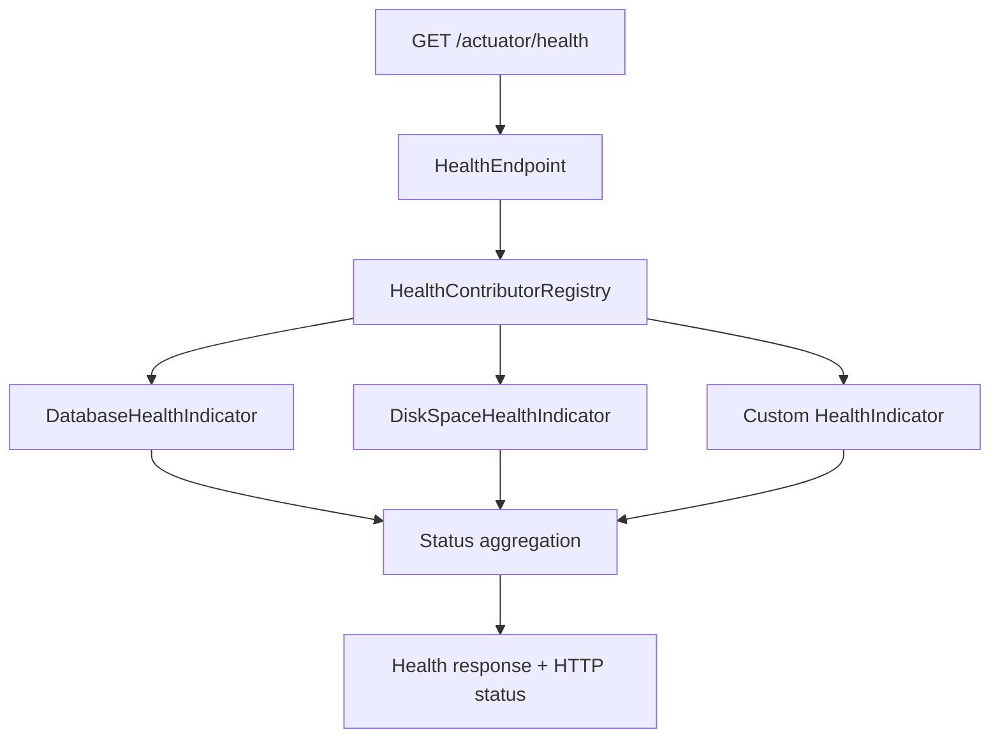

# Health endpoint detail trong Spring Boot Actuator

## 1. Mục tiêu và bối cảnh

Health endpoint cho biết ứng dụng có đang ở trạng thái phù hợp để tiếp tục nhận traffic hay không. Trong Spring Boot Actuator, endpoint `/actuator/health` tổng hợp kết quả từ các `HealthIndicator` và `ReactiveHealthIndicator`, rồi trả về trạng thái tổng thể cùng thông tin component tùy theo cấu hình hiển thị.

Health endpoint có thể phục vụ nhiều đối tượng: load balancer, orchestrator, monitoring system và người vận hành. Mỗi đối tượng cần mức thông tin khác nhau. Probe của Kubernetes thường chỉ cần trạng thái UP/DOWN; dashboard nội bộ có thể cần component details; người dùng công khai không nên nhìn thấy tên database, host, bucket hoặc exception nội bộ.

Bài thuộc chương **Health và readiness** của module **SPRING_BOOT_OBSERVABILITY**. Module hướng dẫn thiết lập observability cho Spring Boot bằng Micrometer Observation, metrics, logs và distributed tracing; học context propagation, tag/cardinality, exporter, sampling và liên kết tín hiệu để điều tra lỗi, độ trễ và hành vi ứng dụng trên môi trường thực.

Sau bài học, bạn có thể:
1. Hiểu cách Actuator tổng hợp health contributors.
2. Phân biệt aggregate status với component details.
3. Cấu hình mức hiển thị details theo quyền truy cập.
4. Tổ chức health groups và các endpoint liveness/readiness.
5. Viết custom HealthIndicator an toàn.
6. Tránh đưa dependency ngoài không cần thiết vào liveness probe.
7. Kiểm thử response, status mapping và security.

**Baseline:** Spring Boot 3.5.x, Java 17+, Spring Boot Actuator. Một số health contributors tự động xuất hiện khi dependency tương ứng có mặt; property cụ thể cần đối chiếu version đang dùng.

## 2. Health endpoint hoạt động thế nào?

Endpoint mặc định:

```text
GET /actuator/health
```

Actuator thu thập kết quả từ các health contributors đã đăng ký. Mỗi contributor trả một `Status` như UP, DOWN, OUT_OF_SERVICE hoặc UNKNOWN, có thể kèm details. `HealthEndpoint` tổng hợp chúng thành health result cuối cùng theo status aggregator và HTTP mapping.



Health endpoint không tự kiểm tra mọi chức năng nghiệp vụ. Nó chỉ tổng hợp những contributors được đăng ký và đưa vào group đang được truy vấn.

## 3. Aggregate status và component details

Response đơn giản có thể như sau:

```json
{
  "status": "UP"
}
```

Khi details được phép hiển thị, response có thể chứa components:

```json
{
  "status": "UP",
  "components": {
    "db": {
      "status": "UP",
      "details": {
        "database": "PostgreSQL"
      }
    },
    "diskSpace": {
      "status": "UP"
    }
  }
}
```

Đây là ví dụ rút gọn; nội dung thực tế phụ thuộc contributors, version và show-details policy.

Aggregate status trả lời câu hỏi tổng thể. Component details giải thích thành phần nào đóng góp vào kết quả đó. Không nên phụ thuộc vào thứ tự components hoặc coi tên component là API contract cố định nếu ứng dụng có thể thêm/bớt dependencies.

## 4. Kiểm soát hiển thị health details

Spring Boot hỗ trợ cấu hình mức hiển thị details:

```yaml
management:
  endpoint:
    health:
      show-details: when-authorized
      show-components: when-authorized
```

Các giá trị thường dùng cho show-details/show-components gồm:

| Giá trị | Hành vi |
| --- | --- |
| `never` | Không hiển thị details/components |
| `when-authorized` | Chỉ hiển thị khi request được xác thực/ủy quyền theo cấu hình security |
| `always` | Hiển thị cho mọi caller có thể truy cập endpoint |

`always` chỉ phù hợp với môi trường được kiểm soát, nơi endpoint không thể truy cập công khai và thông tin được phép tiết lộ. Trong production, ưu tiên `never` hoặc `when-authorized` cùng security policy cụ thể.

Ví dụ security cần cho phép một nhóm vận hành xem details trong khi probe chỉ đọc status. Tích hợp matcher vào `SecurityFilterChain` hiện có; không tạo chain mới làm mất policy khác.

Không cho rằng `when-authorized` tự tạo authentication. Ứng dụng phải có Spring Security hoặc cơ chế authorization tương ứng, và principal cần thỏa điều kiện được cấu hình.

## 5. Health groups

Health groups cho phép tạo các tập contributors và chính sách hiển thị riêng. Ví dụ group dành cho readiness:

```yaml
management:
  endpoint:
    health:
      group:
        readiness:
          include: readinessState,db
          show-details: never
```

Group endpoint có thể được truy cập theo dạng `/actuator/health/{group}`; ví dụ `/actuator/health/readiness`. Group mặc định `liveness` và `readiness` có thể được cung cấp khi bật probes integration theo cấu hình phù hợp.

Group cho phép:
- Chỉ đưa các contributors phù hợp vào một probe.
- Dùng show-details/show-components policy riêng.
- Đặt status mapping riêng khi có nhu cầu.
- Tách health tổng thể với health dùng để quyết định traffic.

Đừng đưa mọi dependency vào mọi group. Liveness và readiness trả lời các câu hỏi khác nhau, nên tập contributors cũng khác.

## 6. Liveness và readiness

**Liveness** trả lời: process còn sống và có khả năng tiếp tục chạy không? Nếu liveness thất bại liên tục, orchestrator có thể restart container.

**Readiness** trả lời: instance hiện đã sẵn sàng nhận traffic chưa? Nếu readiness thất bại, orchestrator/load balancer nên ngừng gửi traffic tới instance đó nhưng không nhất thiết restart process.

| Probe | Mục tiêu | Ví dụ contributors |
| --- | --- | --- |
| Liveness | Phát hiện process không thể tự phục hồi | `livenessState` |
| Readiness | Phát hiện instance chưa thể nhận request | `readinessState`, dependency thật sự bắt buộc theo policy |
| Overall health | Bức tranh tổng hợp của contributors | DB, disk, messaging, custom indicators |

Không đưa database, remote API hoặc message broker vào liveness probe theo mặc định. Nếu database tạm thời down, restart tất cả instances có thể tạo restart loop và tăng tải lên dependency đang gặp sự cố. Liveness nên tập trung vào trạng thái nội tại của process.

Readiness có thể bao gồm dependency bắt buộc để xử lý traffic, nhưng cần cân nhắc failure mode. Nếu mọi instance đồng loạt chuyển NOT_READY do một dependency chung, hệ thống có thể ngừng phục vụ hoàn toàn; điều đó có thể đúng hoặc có thể làm sự cố rộng hơn.

## 7. Bật Kubernetes probes trong Spring Boot

Spring Boot có thể expose liveness/readiness health groups qua Actuator khi bật probes:

```yaml
management:
  endpoint:
    health:
      probes:
        enabled: true
  health:
    livenessstate:
      enabled: true
    readinessstate:
      enabled: true
```

Trong môi trường Kubernetes, các đường dẫn thường dùng:

```text
/actuator/health/liveness
/actuator/health/readiness
```

Ví dụ cấu hình probe trong Pod:

```yaml
livenessProbe:
  httpGet:
    path: /actuator/health/liveness
    port: 8080
  periodSeconds: 10
  failureThreshold: 3

readinessProbe:
  httpGet:
    path: /actuator/health/readiness
    port: 8080
  periodSeconds: 5
  failureThreshold: 3
```

Đây là snippet cho phần container spec; điều chỉnh port/path theo ứng dụng. Nếu management endpoint nằm trên port riêng, Kubernetes probe cần truy cập được port đó và network policy phải cho phép.

Spring Boot có thể expose probe paths trên main server port trong một số cấu hình để kiểm tra cả web server path. Xem xét dùng main port khi muốn probe phản ánh khả năng xử lý HTTP thực tế, thay vì chỉ management server riêng.

## 8. Viết custom HealthIndicator

Khi cần kiểm tra một dependency hoặc trạng thái nghiệp vụ, có thể viết `HealthIndicator`:

```java
import org.springframework.boot.actuate.health.Health;
import org.springframework.boot.actuate.health.HealthIndicator;
import org.springframework.stereotype.Component;

@Component
public class SearchIndexHealthIndicator implements HealthIndicator {
    private final SearchIndexClient client;

    public SearchIndexHealthIndicator(SearchIndexClient client) {
        this.client = client;
    }

    @Override
    public Health health() {
        try {
            boolean available = client.isAvailable();
            if (available) {
                return Health.up()
                        .withDetail("service", "search-index")
                        .build();
            }
            return Health.down()
                    .withDetail("reason", "not available")
                    .build();
        } catch (Exception ex) {
            return Health.down(ex).build();
        }
    }
}
```

HealthIndicator cần nhanh, có timeout và không tạo tải lớn. Nếu `client.isAvailable()` có thể chờ vô hạn hoặc thực hiện query nặng, chính health endpoint có thể bị treo và làm probe thất bại hàng loạt.

Không đưa exception message, hostname nội bộ, credentials hoặc payload nhạy cảm vào details. Khi details bị ẩn, vẫn nên tránh tạo dữ liệu nhạy cảm trong Health object nếu không cần thiết.

### 8.1. Reactive HealthIndicator

Với reactive dependency, dùng `ReactiveHealthIndicator` để health check không block event loop:

```java
import org.springframework.boot.actuate.health.Health;
import org.springframework.boot.actuate.health.ReactiveHealthIndicator;
import reactor.core.publisher.Mono;

public class ReactiveSearchHealthIndicator
        implements ReactiveHealthIndicator {

    private final ReactiveSearchClient client;

    public ReactiveSearchHealthIndicator(ReactiveSearchClient client) {
        this.client = client;
    }

    @Override
    public Mono<Health> health() {
        return client.ping()
                .timeout(Duration.ofSeconds(2))
                .map(ok -> ok
                        ? Health.up().build()
                        : Health.down().build())
                .onErrorResume(ex -> Mono.just(Health.down().build()));
    }
}
```

Ví dụ cần import Duration và dùng client có API reactive thực tế. Chọn timeout ngắn, có chủ đích; không log exception đầy đủ ở mỗi lần probe nếu probe được gọi liên tục.

## 9. Status aggregation và HTTP status mapping

Actuator tổng hợp statuses từ các contributors theo `StatusAggregator`. Mặc định, status nghiêm trọng hơn có thể chi phối kết quả tổng hợp. Thứ tự ưu tiên và mapping có thể tùy chỉnh.

HTTP status mapping quyết định response code của health endpoint dựa trên aggregate status. Thông thường UP trả 200; DOWN hoặc OUT_OF_SERVICE trả 503; UNKNOWN thường có mapping mặc định riêng. Kiểm tra tài liệu đúng version nếu thay đổi status codes hoặc order.

Có thể cấu hình thứ tự status:

```yaml
management:
  endpoint:
    health:
      status:
        order: DOWN, OUT_OF_SERVICE, UNKNOWN, UP
```

Không đổi status mapping tùy tiện. Orchestrator thường dựa vào HTTP status để quyết định restart hoặc ngừng route traffic; mapping sai có thể biến dependency degradation thành restart loop hoặc cho traffic đi vào instance không sẵn sàng.

## 10. Health check không phải deep diagnostic

Health endpoint thường được gọi thường xuyên. Nó nên trả lời câu hỏi trạng thái nhanh, ổn định và có chi phí thấp. Tránh:
- Chạy full database query hoặc scan dữ liệu lớn.
- Gọi nhiều remote APIs tuần tự không có timeout.
- Tạo transaction ghi dữ liệu chỉ để kiểm tra.
- Lấy secrets hoặc trả chi tiết cấu hình.
- Ghi stack trace cho mọi probe failure.
- Đưa các dependency tùy chọn vào readiness mà không có lý do.

Deep diagnostics có thể dùng endpoint nội bộ riêng, dashboard, logs, traces hoặc synthetic checks với lịch chạy ít thường xuyên hơn. Health probe cần đủ nhẹ để không trở thành một nguồn sự cố.

## 11. Kiểm thử health endpoint

### 11.1. Kiểm tra HTTP response

Dùng integration test với Spring context và Actuator:

```java
mockMvc.perform(get("/actuator/health"))
        .andExpect(status().isOk())
        .andExpect(jsonPath("$.status").value("UP"));
```

Ví dụ cần static imports MockMvcRequestBuilders.get, MockMvcResultMatchers.* và cấu hình test phù hợp. Khi health DOWN, xác nhận status mapping mong muốn (thường 503).

### 11.2. Test details policy

- Anonymous caller không nhìn thấy component details khi policy yêu cầu authorization.
- Principal có authority phù hợp có thể xem details khi được cho phép.
- Không có password, token, SQL, host nhạy cảm hoặc exception message trong response.
- Group endpoint chỉ chứa contributors được cấu hình.

### 11.3. Test probes

- Liveness vẫn UP khi database tạm thời down, nếu database không phải điều kiện sống của process.
- Readiness DOWN khi dependency bắt buộc không thể phục vụ traffic, theo policy.
- Probe có timeout hữu hạn và không block request threads vô hạn.
- Custom indicator không gọi remote dependency quá thường xuyên hoặc gây tải lớn.

## 12. Troubleshooting

| Triệu chứng | Nguyên nhân có thể | Cách xử lý |
| --- | --- | --- |
| `/actuator/health` trả 404 | Actuator thiếu hoặc endpoint chưa expose | Kiểm tra dependency và web exposure |
| Chỉ thấy status, không thấy components | show-details/show-components đang ẩn | Kiểm tra policy và quyền caller |
| Details luôn hiện công khai | show-details=always hoặc security matcher quá rộng | Chuyển sang when-authorized/never và thu hẹp access |
| Health DOWN dù app xử lý request được | Một contributor phụ/không bắt buộc đang DOWN | Xem component details và thiết kế groups |
| Liveness thất bại khi database down | Dependency ngoài được đưa vào liveness | Giữ liveness tập trung vào process |
| Readiness luôn UP dù service chưa warm up | Chưa có readiness state/contributor phù hợp | Bật readiness probes và cập nhật state đúng lifecycle |
| Probe timeout | HealthIndicator gọi dependency chậm hoặc không timeout | Đặt timeout và giảm công việc probe |
| Reactive health làm block event loop | Dùng blocking indicator/client trong reactive stack | Dùng ReactiveHealthIndicator/non-blocking client |
| Kubernetes restart liên tục | Liveness path/status mapping sai hoặc probe quá gắt | Kiểm tra events, thresholds, initial delay và semantics |
| Pod không nhận traffic dù app healthy | Readiness endpoint sai path/port hoặc group DOWN | Kiểm tra probe config và service routing |
| Security trả 401/403 cho kubelet | Probe path bị authentication chặn | Cho phép probe theo network/identity policy an toàn |
| Response lộ exception/host | Custom indicator thêm details nhạy cảm | Loại bỏ hoặc sanitize details |

## 13. Checklist production

- [ ] Health endpoint chỉ expose trong phạm vi cần thiết.
- [ ] show-details/show-components không để lộ thông tin nội bộ cho caller không được phép.
- [ ] Security policy phân biệt probe caller và operator có quyền xem details.
- [ ] Liveness tập trung vào khả năng process tự phục hồi.
- [ ] Readiness phản ánh khả năng nhận traffic theo dependency policy.
- [ ] Không đưa dependency ngoài vào liveness theo mặc định.
- [ ] Custom indicators có timeout, chi phí thấp và không ghi dữ liệu nhạy cảm.
- [ ] Reactive applications dùng reactive health checks cho I/O không blocking.
- [ ] Health groups chứa đúng contributors cần thiết.
- [ ] HTTP status mapping phù hợp orchestrator.
- [ ] Kubernetes path/port/threshold được kiểm tra trong deployment.
- [ ] Có test cho UP, DOWN, details visibility, readiness và liveness.

## 14. Câu hỏi tự luyện

1. `/actuator/health` tổng hợp kết quả từ thành phần nào?
2. Aggregate status khác component details thế nào?
3. `show-details: when-authorized` cần điều kiện bảo mật gì?
4. Vì sao không nên expose health details công khai?
5. Liveness và readiness trả lời hai câu hỏi khác nhau nào?
6. Vì sao database outage thường không nên làm liveness fail?
7. Khi nào readiness nên kiểm tra dependency ngoài?
8. Custom HealthIndicator cần giới hạn thời gian và chi phí ra sao?
9. ReactiveHealthIndicator giúp tránh vấn đề gì?
10. StatusAggregator và HTTP status mapping ảnh hưởng Kubernetes thế nào?
11. Vì sao health probe không nên trở thành deep diagnostic?
12. Cần test những trường hợp nào trước khi triển khai probes?

## Tài liệu tham khảo

- [Spring Boot 3.5 — Actuator Endpoints](https://docs.spring.io/spring-boot/3.5/reference/actuator/endpoints.html)
- [Spring Boot 3.5 — Health Information](https://docs.spring.io/spring-boot/3.5/reference/actuator/endpoints.html#actuator.endpoints.health)
- [Spring Boot 3.5 — Kubernetes Probes](https://docs.spring.io/spring-boot/3.5/reference/actuator/endpoints.html#actuator.endpoints.kubernetes-probes)
- [Spring Boot 3.5 — Monitoring and Management](https://docs.spring.io/spring-boot/3.5/reference/actuator/index.html)
- [Kubernetes — Liveness, Readiness and Startup Probes](https://kubernetes.io/docs/concepts/configuration/liveness-readiness-startup-probes/)
- [Micrometer — Observation Concepts](https://docs.micrometer.io/micrometer/reference/observation.html)

