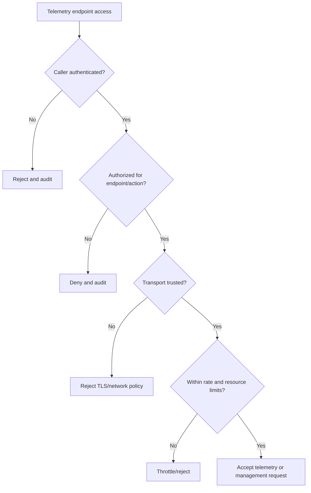

# Bảo vệ telemetry endpoint trong Spring Boot

Telemetry endpoints cung cấp dữ liệu và thao tác quan trọng cho vận hành: Actuator health/metrics/loggers, endpoint quản lý ứng dụng và OTLP receivers nhận logs, metrics, traces. Nếu để truy cập không kiểm soát, attacker hoặc người dùng nội bộ không đúng quyền có thể đọc topology, thay đổi log level, thu thập dữ liệu nhạy cảm hoặc làm cạn tài nguyên bằng telemetry traffic.

**Bảo vệ telemetry endpoint** cần kết hợp authentication, authorization, network segmentation, TLS, giới hạn tài nguyên và chính sách dữ liệu. Không có một cấu hình duy nhất phù hợp mọi endpoint: health công khai có thể chỉ trả trạng thái tối thiểu, trong khi loggers, env, heapdump hoặc OTLP ingestion cần phạm vi truy cập chặt hơn.

Bài **“Bảo vệ telemetry endpoint”** thuộc chương **Security và privacy** của module **SPRING_BOOT_OBSERVABILITY**. Module hướng dẫn thiết lập observability cho Spring Boot bằng Micrometer Observation, metrics, logs và distributed tracing; học propagation ngữ cảnh, tag/cardinality, exporter, sampling và liên kết tín hiệu để điều tra lỗi, độ trễ và hành vi ứng dụng trên môi trường thực.

## 1. Phân loại telemetry endpoints

Có hai nhóm endpoint thường gặp:

| Nhóm | Ví dụ | Rủi ro chính |
| --- | --- | --- |
| Application management | Actuator health, metrics, loggers, env, configprops, heapdump | Lộ thông tin nội bộ hoặc thay đổi runtime |
| Telemetry transport | OTLP HTTP/gRPC receivers, Prometheus scrape endpoint, remote-write/export endpoints | Giả mạo dữ liệu, spam ingestion, đọc/ghi trái phép, cạn tài nguyên |

Actuator endpoints expose trạng thái và thao tác quản trị của ứng dụng. OTLP receiver là nơi agent/SDK gửi telemetry vào Collector hoặc service. Prometheus scrape endpoint thường được scraper nội bộ gọi để đọc metrics. Mỗi endpoint cần policy riêng theo caller, direction và data sensitivity.

Không xem tất cả endpoints là chỉ đọc. Loggers endpoint có thể thay đổi runtime log levels; shutdown hoặc heapdump/configuration endpoints có thể tạo tác động mạnh tùy ứng dụng và version.

## 2. Nguyên tắc least privilege

Mỗi caller chỉ nên truy cập đúng endpoints và operations cần thiết.

- Public load balancer chỉ cần health status tối thiểu nếu kiến trúc yêu cầu.
- Prometheus scraper chỉ cần quyền đọc metrics endpoint.
- Operator có thể cần health details và loggers endpoint.
- Telemetry agents chỉ gửi dữ liệu tới OTLP receiver được chỉ định.
- Developer không mặc định có quyền đọc env, heapdump hoặc loggers trên production.
- Service account của từng workload không dùng chung credential với người vận hành.

Tách quyền đọc và quyền thay đổi. Một principal có thể được phép GET health nhưng không được POST thay đổi logger level. Dùng role/group theo nhiệm vụ và audit các thao tác quản trị.

## 3. Exposure không phải authentication

Spring Boot Actuator cho phép chọn endpoint nào được expose qua HTTP hoặc JMX. Ví dụ:

```yaml
management:
  endpoints:
    web:
      exposure:
        include: health,info,metrics,prometheus
```

Cấu hình trên chỉ điều khiển endpoint exposure. Nó không tự bảo vệ endpoint bằng authentication, authorization hay network policy.

Không dùng include=* trên public interface. Chỉ expose những endpoint thực sự cần, và áp dụng security controls độc lập. Kiểm tra cả JMX exposure nếu ứng dụng có bật JMX management.

Một endpoint không expose qua HTTP vẫn có thể được expose qua JMX hoặc management port khác. Kiểm kê mọi transport thay vì chỉ kiểm tra URL /actuator.

## 4. Tách management port và network

Spring Boot có thể chạy management endpoints trên port riêng:

```yaml
management:
  server:
    port: 9091
```

Tách port giúp áp dụng firewall, service routing và network policy riêng. Nhưng port riêng không tự tạo bảo mật; nếu bind ra mọi network interface và mở firewall rộng, endpoint vẫn có thể truy cập từ vùng không mong muốn.

Thiết kế network nên:

- Chỉ cho phép monitoring network hoặc management subnet truy cập.
- Không publish management port qua public ingress nếu không cần.
- Dùng Kubernetes NetworkPolicy/security groups/firewall rules.
- Giới hạn egress của telemetry agents tới đúng collector/backend.
- Tách management traffic khỏi user-facing traffic khi có thể.
- Kiểm tra service mesh/proxy có vô tình expose management route không.

Nếu ứng dụng chạy container, kiểm tra port mapping/service definitions thực tế, không chỉ application.yml.

## 5. Authentication và authorization với Spring Security

Authentication xác minh caller là ai; authorization quyết định caller được phép làm gì. Spring Security có thể bảo vệ Actuator endpoints bằng filter chain riêng hoặc chung tùy ứng dụng.

Ví dụ policy khái niệm:

```java
@Bean
@Order(1)
SecurityFilterChain actuatorSecurity(HttpSecurity http) throws Exception {
    return http
            .securityMatcher(EndpointRequest.toAnyEndpoint())
            .authorizeHttpRequests(auth -> auth
                    .requestMatchers(EndpointRequest.to("health", "info"))
                        .permitAll()
                    .requestMatchers(EndpointRequest.to("prometheus"))
                        .hasRole("METRICS")
                    .requestMatchers(EndpointRequest.to("loggers"))
                        .hasRole("OPS")
                    .anyRequest().hasRole("ACTUATOR_ADMIN"))
            .httpBasic(Customizer.withDefaults())
            .build();
}
```

Đây là ví dụ minh họa; cần bổ sung authentication provider, credential management, CSRF policy phù hợp và filter chain cho application routes. Kiểm tra endpoint IDs và Spring Boot/Security version. Nếu ứng dụng có SecurityFilterChain riêng, auto-configuration security mặc định có thể không còn áp dụng như mong đợi.

Không cấp quyền ADMIN cho scraper chỉ để đọc metrics. Dùng service account riêng và role hẹp.

## 6. Bảo vệ các thao tác thay đổi trạng thái

| Endpoint | Quyền/rủi ro |
| --- | --- |
| health | Có thể công khai status tối thiểu; details cần bảo vệ |
| metrics/prometheus | Có thể lộ service names, route patterns, topology và business volumes |
| loggers | Có thể thay đổi runtime log levels |
| env/configprops | Có thể lộ cấu hình và thông tin nhạy cảm nếu sanitize sai |
| heapdump | Có thể chứa secrets, tokens và dữ liệu người dùng |
| threaddump | Có thể lộ thread names, class names và runtime state |
| shutdown | Có thể dừng ứng dụng nếu được bật |
| mappings | Có thể lộ route/API structure |

Chỉ expose endpoint cần thiết. Endpoint nhạy cảm nên yêu cầu role quản trị chuyên biệt, audit và management network. Không expose heapdump/env/loggers chỉ vì tiện debug.

## 7. CSRF và HTTP methods

Spring Security CSRF protection có thể ảnh hưởng các POST/DELETE operations của management endpoints. Không tắt CSRF toàn cục chỉ để Actuator POST hoạt động.

Nếu dùng Basic Auth cho machine-to-machine management API, đánh giá CSRF threat model dựa trên browser credentials, cookie/session usage và endpoint exposure. Có thể dùng filter chain riêng cho Actuator với matcher chính xác và CSRF policy giới hạn trong phạm vi phù hợp.

Không loại CSRF cho toàn bộ application routes nếu chỉ một management endpoint cần machine-to-machine access. Test cả GET lẫn POST và xác minh caller không có quyền không thể thay đổi state.

## 8. TLS và mTLS

Management và telemetry traffic thường đi qua network nội bộ, nhưng nội bộ không có nghĩa an toàn tuyệt đối. Dùng TLS để bảo vệ confidentiality/integrity trên transport.

- TLS server-side cho HTTPS management endpoints và OTLP receivers.
- mTLS khi cần xác minh cả client và server.
- Certificate rotation có quy trình và thời hạn rõ ràng.
- Không tắt certificate validation trong production.
- Giới hạn trust store theo CA cần thiết.
- Bảo vệ private keys và tránh đặt chúng trong source control.
- Dùng TLS termination tại gateway chỉ khi hop phía sau cũng được bảo vệ theo trust boundary.

Với OTLP gRPC/HTTP, cấu hình TLS và client authentication tùy receiver/exporter implementation. Kiểm tra protocol endpoint, certificate SAN, trust chain và hostname verification.

## 9. Bảo vệ OTLP receiver

OTLP receiver nhận telemetry từ SDKs, agents hoặc services. Nếu receiver mở cho mọi nguồn không tin cậy, attacker có thể gửi dữ liệu giả, tăng ingest cost hoặc flood memory/CPU.

1. Bind receiver vào interface/network cần thiết.
2. Dùng TLS/mTLS hoặc authentication extension phù hợp.
3. Allowlist workload identity/network source khi có thể.
4. Giới hạn request size, concurrency và rate.
5. Cấu hình memory limiter, batch processor và queue bounds.
6. Giám sát rejected requests, refused spans và exporter failures.
7. Tách tenant/resource identity theo trust boundary.
8. Không tin resource attributes do client tự khai báo nếu chúng quyết định authorization/routing.

Ví dụ OTLP receiver chỉ bind địa chỉ nội bộ và dùng memory limiter:

```yaml
receivers:
  otlp:
    protocols:
      grpc:
        endpoint: 10.20.0.15:4317
      http:
        endpoint: 10.20.0.15:4318

processors:
  memory_limiter:
    check_interval: 1s
    limit_mib: 512
  batch:
    timeout: 5s

service:
  pipelines:
    traces:
      receivers: [otlp]
      processors: [memory_limiter, batch]
      exporters: [otlp/backend]
```

Đây là cấu hình minh họa; exporter otlp/backend phải được định nghĩa và receiver cần TLS/auth theo deployment. Không copy địa chỉ IP mẫu vào production.

## 10. Bảo vệ Prometheus scrape endpoint

Prometheus thường scrape metrics từ endpoint nội bộ. Metrics có thể tiết lộ service names, instance labels, deployment topology, route patterns, request volume, error rates, queue names, dependency names hoặc custom business metrics nhạy cảm.

Chỉ cho phép scraper được tin cậy truy cập endpoint. Dùng network policy, mTLS hoặc authentication qua reverse proxy/service mesh nếu phù hợp. Không đưa secrets, user IDs hoặc raw request values vào labels.

Prometheus endpoint thường được scrape bằng GET, nhưng GET không có nghĩa dữ liệu công khai. Một endpoint read-only vẫn có thể tiết lộ thông tin vận hành nhạy cảm.

## 11. Secrets và credential management

Credential cho Actuator, OTLP exporter, Prometheus gateway hoặc backend không nên hard-code trong YAML committed.

- Dùng secret manager, Kubernetes Secrets với encryption at rest hoặc platform vault.
- Inject credential qua environment/secret volume theo policy.
- Rotate credential và revoke khi workload bị compromise.
- Dùng service account riêng theo environment/workload.
- Không ghi token/password vào logs hoặc telemetry attributes.
- Tránh truyền credential trong query string.
- Giới hạn scope và thời hạn của token.

Không đặt secret trong resource attributes, baggage, span names, metric labels hoặc health details. Những trường này thường được export tới nhiều hệ thống và có retention khác nhau.

## 12. Privacy: telemetry có thể chứa dữ liệu gì?

Logs, traces và metrics có thể mang dữ liệu cá nhân hoặc business-sensitive nếu instrumentation ghi quá rộng.

| Signal | Dữ liệu có thể rò rỉ | Kiểm soát |
| --- | --- | --- |
| Logs | Request body, headers, email, tokens, SQL params | Allowlist, redaction tại producer |
| Traces | URL/query, span attributes, exception details, baggage | Attribute policy, processor redaction |
| Metrics | Labels như userId/orderId hoặc tenant ID | Cardinality review, label allowlist |
| Health | Hostnames, dependency names, exception text | Details policy và access control |
| Dumps | Heap objects, credentials, payloads | Không expose công khai; access rất hạn chế |

Ưu tiên không thu thập dữ liệu nhạy cảm ngay từ producer. Redaction ở Collector là lớp phòng thủ bổ sung; không thể thu hồi dữ liệu đã gửi tới một backend hoặc exporter khác trước đó.

## 13. Multi-tenant isolation và resource attributes

Nếu một Collector/backend phục vụ nhiều tenants, không tin tenant ID do client tự gửi trong resource attributes làm căn cứ authorization. Client không đáng tin có thể giả mạo tenant và ghi dữ liệu vào namespace của tenant khác nếu gateway chỉ route dựa trên field đó.

Tenant identity nên được xác thực từ mTLS identity, token claim hoặc gateway context. Sau đó gateway/collector gắn trusted tenant metadata và loại bỏ/ghi đè giá trị do client cung cấp.

Tách credentials, queues, retention và query permissions theo tenant. Kiểm tra cả read path và write path; tenant isolation không chỉ là routing ingest.

## 14. Rate limiting và resource protection

Telemetry endpoint có thể bị overload do traffic bất thường hoặc instrumentation bug.

- Giới hạn request rate và payload size ở gateway/receiver.
- Giới hạn concurrent requests.
- Dùng bounded queues và memory limiter.
- Có timeout cho exporter/backend calls.
- Cấu hình retry/backoff có giới hạn.
- Theo dõi queue utilization, dropped data và refused requests.
- Tách telemetry workload khỏi application request pools nếu cần.
- Có quota theo tenant/workload.

Không retry vô hạn khi backend unavailable. Retry không giới hạn có thể làm queue tăng và gây OOM. Giới hạn retry/queue và phát cảnh báo khi dữ liệu bị drop.

## 15. Audit và incident response

Các thao tác thay đổi management state nên được ghi audit:

- Ai gọi endpoint?
- Từ workload/network nào?
- Endpoint/action nào?
- Logger/setting nào thay đổi?
- Giá trị trước/sau là gì?
- Thời điểm và correlation/request ID nào?
- Thao tác được chấp nhận hay bị từ chối?

Không ghi credential hoặc payload nhạy cảm vào audit log. Audit trail cần quyền truy cập riêng và retention phù hợp.

Khi nghi ngờ telemetry endpoint bị lạm dụng:

1. Xác định endpoint, caller identity và thời gian.
2. Thu thập access/security logs.
3. Kiểm tra thay đổi logger levels, configuration và resource usage.
4. Revoke/rotate credentials bị ảnh hưởng.
5. Thu hẹp network exposure và rate limits.
6. Kiểm tra telemetry backend xem có dữ liệu giả hoặc tenant crossover.
7. Khôi phục cấu hình và xác minh monitoring vẫn hoạt động.

## 16. Kiểm thử security cho telemetry endpoints

Kiểm thử cả truy cập hợp lệ và bị từ chối:

1. Caller không xác thực gọi Actuator metrics/loggers bị chặn theo policy.
2. Metrics scraper chỉ đọc được endpoint metrics được cấp.
3. Scraper không POST được vào loggers.
4. Operator được phép thay đổi logger level trong phạm vi quyền.
5. User không có quyền bị từ chối khi đọc env/heapdump.
6. Health public chỉ trả status tối thiểu nếu policy yêu cầu.
7. OTLP receiver từ client không có credential bị từ chối.
8. Client certificate không hợp lệ bị từ chối khi dùng mTLS.
9. Payload quá lớn/rate cao bị giới hạn.
10. Tenant identity giả mạo không thể route vào tenant khác.
11. TLS hostname/certificate validation hoạt động.
12. Security/audit logs ghi caller/action nhưng không ghi secret.
13. Endpoint không được expose qua port/ingress ngoài dự kiến.
14. Secret rotation không làm telemetry pipeline mất bảo vệ.

Dùng MockMvc/WebTestClient cho Actuator security integration tests và test deployment/network policy trong staging. Unit tests không chứng minh firewall hoặc Kubernetes NetworkPolicy đang đúng.

## 17. Chẩn đoán sự cố truy cập telemetry endpoint

| Triệu chứng | Nguyên nhân có thể | Cách kiểm tra |
| --- | --- | --- |
| 401 Unauthorized | Thiếu/sai credentials hoặc token hết hạn | Kiểm tra identity provider và auth logs |
| 403 Forbidden | Principal không có role/authority | Kiểm tra authorization matcher |
| 404 Not Found | Endpoint chưa expose hoặc sai management port/path | Kiểm tra exposure và routing |
| Scraper không scrape được | Network policy, TLS hoặc auth mismatch | Kiểm tra target status, certificate và firewall |
| OTLP receiver nhận data từ nguồn lạ | Receiver bind rộng hoặc thiếu authentication | Kiểm tra listener, gateway và network source |
| Telemetry bị drop | Rate limit, queue đầy hoặc memory limiter | Kiểm tra receiver/processor/exporter metrics |
| Metrics lộ topology | Endpoint truy cập quá rộng | Thu hẹp exposure và scrape network |
| Tenant data bị trộn | Tin tenant resource attribute từ client | Xác thực identity tại gateway |
| DEBUG logs chứa secrets | Logging policy/redaction thiếu | Tắt level, rotate secrets và xử lý dữ liệu |
| Management POST bị CSRF reject | CSRF policy không phù hợp machine caller | Kiểm tra filter chain riêng, không tắt toàn cục |

Quy trình điều tra:

1. Xác định endpoint và transport (HTTP, JMX, OTLP gRPC/HTTP, scrape).
2. Kiểm tra exposure, bind address và routing.
3. Xác minh caller identity và credential.
4. Kiểm tra authorization rule cụ thể.
5. Kiểm tra TLS chain/hostname và mTLS identity.
6. Kiểm tra rate limit, payload size, queue và memory.
7. Kiểm tra privacy/redaction và tenant mapping.
8. Đối chiếu audit/security logs và xác nhận policy đã được khôi phục.



## 18. Bài thực hành: bảo vệ Actuator và OTLP

Thực hiện trong local/staging:

1. Expose health, metrics và loggers; giữ endpoint nhạy cảm không expose.
2. Tách management port khỏi application port.
3. Cấu hình Spring Security filter chain riêng cho Actuator.
4. Cho phép health status tối thiểu và metrics scraper role; giới hạn loggers cho operator.
5. Kiểm thử GET/POST và xác minh quyền từng role.
6. Bật HTTPS cho management endpoint; kiểm tra certificate/hostname.
7. Cấu hình OTLP receiver chỉ bind vào interface nội bộ.
8. Bật TLS/authentication hoặc mTLS theo deployment.
9. Thêm memory limiter, batch và bounded queues.
10. Thử payload lớn/traffic burst để xác minh rate/resource limits.
11. Kiểm tra redaction cho logs/traces và loại bỏ secrets.
12. Thử tenant ID giả mạo và xác minh gateway dùng trusted identity.
13. Kiểm tra audit records cho thao tác loggers và access denied.
14. Xác minh Prometheus scraper vẫn scrape được sau khi siết policy.

Kết quả mong đợi: mỗi caller chỉ truy cập đúng endpoint/action; telemetry transport có bảo vệ; sensitive data không bị export ngoài ý muốn; pipeline vẫn hoạt động trong giới hạn tài nguyên.

## 19. Câu hỏi tự kiểm tra

1. Actuator management endpoints và OTLP receivers khác nhau thế nào?
2. Vì sao endpoint exposure không thay thế authentication?
3. Least privilege áp dụng cho operator và metrics scraper ra sao?
4. Khi nào nên tách management port?
5. Vì sao Loggers endpoint cần quyền ghi riêng?
6. Heapdump/env có thể chứa dữ liệu nhạy cảm gì?
7. CSRF policy nên được giới hạn thế nào cho management endpoints?
8. TLS và mTLS bảo vệ những phía nào?
9. Làm sao bảo vệ OTLP receiver khỏi nguồn gửi dữ liệu lạ?
10. Vì sao không tin tenant ID do client tự khai báo?
11. Metrics endpoint có thể tiết lộ topology nào?
12. Redaction tại Collector có giới hạn gì?
13. Rate limiting và bounded queues bảo vệ receiver ra sao?
14. Audit trail cần ghi thông tin nào?
15. Làm sao test authorization riêng cho GET và POST?
16. Vì sao unit test không chứng minh NetworkPolicy đúng?

## Tài liệu tham khảo

- [Spring Boot — Actuator Endpoints](https://docs.spring.io/spring-boot/reference/actuator/endpoints.html): exposure, endpoint access và security.
- [Spring Boot — Actuator Security](https://docs.spring.io/spring-boot/reference/actuator/endpoints.html#actuator.endpoints.security): bảo vệ management endpoints.
- [Spring Security — Servlet Authorization](https://docs.spring.io/spring-security/reference/servlet/authorization/index.html): request authorization và filter chains.
- [Spring Boot — SSL](https://docs.spring.io/spring-boot/reference/features/ssl.html): TLS/SSL configuration.
- [OpenTelemetry Collector — Security](https://opentelemetry.io/docs/security/config-best-practices/): collector deployment và security best practices.
- [OpenTelemetry Protocol](https://opentelemetry.io/docs/specs/otlp/): OTLP transport và protocol.
- [Micrometer Observation](https://docs.micrometer.io/micrometer/reference/observation.html): Observation, handlers và telemetry lifecycle.

## Kết luận

**Bảo vệ telemetry endpoint đòi hỏi kiểm soát cả người đọc/quản trị ứng dụng lẫn workload gửi telemetry.** Actuator exposure cần authentication, authorization và management network; OTLP receivers cần xác thực nguồn gửi, TLS, giới hạn payload/rate và resource bounds; Prometheus scrape endpoints cũng cần được bảo vệ vì metrics có thể tiết lộ topology và hoạt động nội bộ.

Áp dụng least privilege, tách quyền đọc/ghi, không expose endpoint nhạy cảm, quản lý secrets tập trung, redaction tại nguồn và audit thao tác quản trị. Kiểm thử cả HTTP/JMX/OTLP/network paths để xác nhận policy thực sự có hiệu lực. Khi management plane và telemetry transport được bảo vệ đúng, đội vận hành vẫn có thể quan sát hệ thống mà giảm nguy cơ lộ dữ liệu hoặc bị lạm dụng endpoint.

