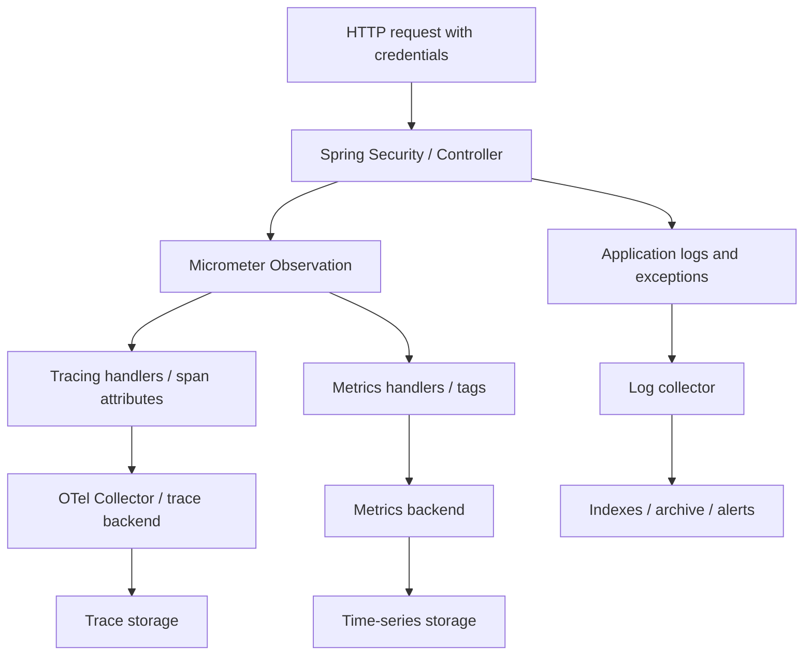

# Không trace password trong Spring Boot

Observability giúp điều tra lỗi bằng cách ghi nhận request, dependency calls, logs và traces. Tuy nhiên, telemetry thường được gửi tới nhiều hệ thống, lưu lâu hơn request gốc và được nhiều nhóm truy cập hơn dữ liệu nghiệp vụ. Nếu password, access token hoặc secret xuất hiện trong log hay span attribute, một lỗi logging có thể biến thành sự cố lộ thông tin xác thực trên toàn bộ observability platform.

**Không trace password** là nguyên tắc thiết kế telemetry: không đưa password, credential, token hoặc secret vào logs, traces, metrics, baggage, exception messages hay metadata được export. Ngăn dữ liệu nhạy cảm ngay tại nơi tạo telemetry, dùng allowlist cho attributes/headers được phép, kiểm thử redaction và hạn chế quyền truy cập vào dữ liệu đã thu thập. Xóa secret khỏi dashboard sau khi export không thể thu hồi bản sao đã gửi tới collector, index hoặc archive.

Trong Spring Boot, dữ liệu có thể đi vào telemetry qua HTTP request/response headers, query parameters, form bodies, exception messages, JDBC URLs, SQL parameters, MDC, custom Observation conventions, tracing baggage và instrumentation agent. Bảo vệ một logger hoặc filter riêng lẻ là chưa đủ.

Bài học thuộc chương **Security và privacy** của module **SPRING_BOOT_OBSERVABILITY**. Module hướng dẫn thiết lập observability cho Spring Boot bằng Micrometer Observation, metrics, logs và distributed tracing; học propagation ngữ cảnh, tag/cardinality, exporter, sampling và liên kết tín hiệu để điều tra lỗi, độ trễ và hành vi ứng dụng trên môi trường thực. Bài này tập trung vào cách giữ password và credentials khỏi telemetry trong toàn bộ pipeline.

## Mục tiêu học tập

1. Giải thích vì sao telemetry có thể trở thành nơi rò rỉ credentials.
2. Nhận diện password, tokens, API keys, cookies và secrets trong request/response data.
3. Phân tích các đường dữ liệu nhạy cảm đi vào logs, traces, metrics, baggage và exception.
4. Thiết kế allowlist thay vì capture toàn bộ headers/attributes.
5. Redact dữ liệu tại nguồn trước khi export.
6. Bảo vệ MDC, structured logging và custom Observation conventions.
7. Tránh ghi SQL parameters, JDBC URLs và HTTP bodies chứa secret.
8. Kiểm thử bằng synthetic credentials và tìm dấu vết trong mọi signal.
9. Xử lý incident khi secret đã bị export.
10. Thiết lập policy vận hành để ngăn tái diễn.

## 1. Vì sao password trong telemetry là rủi ro?

Telemetry được tạo ở runtime nhưng thường rời khỏi application boundary. Logs có thể được forward tới central log platform; traces gửi tới collector/backend; metrics được scrape và lưu trong time series database. Mỗi pipeline có retention, backup, replication, indexing và access control riêng.

Nếu password xuất hiện trong một log, log shipper có thể chuyển nó ra khỏi cluster, search index lưu bản sao trong nhiều shards, snapshot/backup giữ dữ liệu sau khi log gốc hết hạn, alert/ticket có thể copy nội dung và người đọc telemetry có thể không có quyền truy cập password store.

Vì vậy, telemetry phải được xem là một data sink có nguy cơ rò rỉ, không phải nơi an toàn mặc định.

### 1.1. Dữ liệu cần bảo vệ

| Loại dữ liệu | Ví dụ | Xử lý telemetry |
|---|---|---|
| Password | Login password, database password | Không ghi/propagate |
| Access token | Bearer token, OAuth token | Không ghi/propagate |
| API key | Partner key, service key | Không ghi/propagate |
| Cookie/session | Session cookie, refresh cookie | Không ghi/propagate |
| Private key | PEM, signing key | Không ghi/propagate |
| Connection secret | JDBC URL có password | Redact hoặc loại toàn bộ |
| Recovery code | MFA/recovery secret | Không ghi/propagate |
| Sensitive personal data | Email, phone, address | Minimize, mask hoặc loại theo policy |

Không chỉ password cần bảo vệ. Token có thể dùng để impersonate user/service cũng phải được coi là secret.

## 2. Threat model cho observability pipeline

Một request đăng nhập có thể đi qua các lớp:



Secret có thể rò tại application logs, custom tags, instrumentation capture, exporter processors, collector processors hoặc backend transformations. Lớp lọc cuối pipeline hữu ích như defense-in-depth, nhưng source đã gửi secret qua network rồi.

### 2.1. Data in motion và data at rest

Cần bảo vệ cả hai:
- **In motion:** TLS/mTLS, authenticated exporter, network policy và hạn chế destination.
- **At rest:** encryption, role-based access, retention, deletion policy và audit access.

Encryption không thay thế redaction. Người có quyền đọc backend vẫn có thể xem secret nếu nó được lưu nguyên dạng.

### 2.2. Sampling không phải redaction

Trace sampling chỉ quyết định trace nào được giữ/export. Nếu trace được sample, secret trong span vẫn có thể được lưu. Không dựa vào sampling để giảm rủi ro credential exposure.

## 3. Các đường password có thể đi vào telemetry

### 3.1. HTTP headers

Headers nhạy cảm thường gồm Authorization, Proxy-Authorization, Cookie và Set-Cookie. Không log toàn bộ request headers hoặc đưa chúng thành span attributes.

```text
Authorization: Bearer TOKEN_VALUE
Cookie: session=SESSION_SECRET
Set-Cookie: refresh_token=REFRESH_SECRET
```

Các giá trị chỉ minh họa. Cấu hình instrumentation theo allowlist headers cần thiết; loại credential headers trước khi tạo telemetry.

### 3.2. Query parameters và URL

Một số hệ thống cũ truyền API key, reset token hoặc password trong query string. URL có thể xuất hiện trong access logs, client spans, exception messages, proxy logs và browser history.

Không đặt secret trong URL. Nếu endpoint legacy bắt buộc nhận token qua query, không capture raw URL; redaction phải xử lý trước log/trace exporter và cần kế hoạch thay đổi giao thức.

### 3.3. Request/response bodies

Login form, password reset, payment payload hoặc API request có thể chứa credentials. Không serialize toàn bộ body vào logs hoặc spans chỉ để debug. Nếu cần chẩn đoán, ghi event name, status, payload size và field names đã allowlist; bỏ values nhạy cảm.

### 3.4. Exception messages

HTTP client, authentication library hoặc database driver có thể đưa URL, request data hoặc connection string vào exception message. Log toàn bộ exception message/stack trace có thể làm lộ secret nếu thư viện nhúng dữ liệu nhạy cảm.

Giữ exception class, error code và stack trace theo policy; sanitize message/context trước khi log hoặc gắn vào span event. Không tự nối password vào message để giúp debug.

### 3.5. JDBC URL và SQL

JDBC URL có thể chứa username/password hoặc secret parameters. SQL statement có thể chứa literal values; prepared statements giảm rủi ro nhưng instrumentation vẫn có thể capture bind values nếu cấu hình cho phép.

Không log connection string đầy đủ. Dùng database name/role đã chuẩn hóa; tránh SQL parameter capture hoặc sanitize theo schema được duyệt.

## 4. Logs: allowlist và structured fields

Structured logging giúp chọn rõ field được ghi. Ví dụ authentication failure an toàn:

```json
{
  "event.name": "auth.login.failed",
  "auth.provider": "local",
  "failure.code": "INVALID_CREDENTIALS",
  "http.response.status_code": 401,
  "trace_id": "0af7651916cd43dd8448eb211c80319c"
}
```

Không ghi password, Authorization header, cookie, request body hoặc raw exception message.

### 4.1. Không log object request nguyên khối

Debug logging request object, DTO hoặc Map.toString() có thể serialize toàn bộ field, kể cả password. Tạo log event với các field đã chọn thay vì dump object.

### 4.2. MDC

MDC hữu ích để gắn correlation fields như trace ID và span ID. Không đưa password/token vào MDC: MDC thường được render tự động trong mọi log line của thread, kể cả log từ thư viện khác.

Nếu dùng tenant/user context, chỉ ghi identifier đã được policy duyệt hoặc nhóm/role đã chuẩn hóa. Luôn cleanup context khi thread được tái sử dụng.

### 4.3. Redaction ở logging layer

Có thể dùng structured encoder/filter để loại field nhạy cảm như password, token, authorization và cookie. Tuy nhiên, tên field thay đổi theo payload; regex đơn giản có thể bỏ sót nested JSON, escaped values hoặc binary/body encoding. Thiết kế log schema an toàn ngay từ đầu, rồi dùng filter như lớp bảo vệ bổ sung.

## 5. Traces và span attributes

Span attributes giúp truy vấn operation nhưng mọi attribute có thể được export và lưu. Không thêm password/token vào span attributes, span events, span status description, exception event attributes, baggage, resource attributes hoặc link attributes.

Một span HTTP nên giữ method, route template, status và service metadata đã chuẩn hóa. Tránh raw request/response headers và body.

### 5.1. HTTP header capture

Một số instrumentation cho phép cấu hình capture headers. Dùng allowlist cụ thể, ví dụ header correlation không nhạy cảm. Không capture Authorization, Cookie, Set-Cookie hoặc custom header mang API keys. Kiểm tra cấu hình của đúng Java Agent/instrumentation version.

### 5.2. Baggage

Baggage được propagate qua service boundaries và có thể được đưa vào spans/logs tùy cấu hình. Không đưa credentials, session identifiers hoặc personal secrets vào baggage. Baggage nên chứa metadata nhỏ, đã duyệt và có mục đích propagation rõ.

### 5.3. Span events và exception recording

Khi ghi exception, chỉ ghi thông tin cần cho chẩn đoán. Một số tracing SDK tự tạo exception event với message/stack. Kiểm tra behavior thực tế và sanitize trước khi record nếu thư viện có thể chứa secret. Không giả định exception được ghi trong span thì dữ liệu đã được che.

## 6. Metrics và cardinality

Metrics tags được index theo time series; tuyệt đối không dùng password/token làm tag. Tránh cả giá trị có thể mã hóa hoặc hash secret nếu chúng vẫn cho phép liên kết với credential.

Không dùng password/token/API key, username/email nếu không có policy, raw URL/query string, session ID, request/trace ID, exception message hoặc SQL literal làm dimensions.

Thay vào đó, dùng dimensions có tập giá trị giới hạn như auth provider, outcome, status class, operation name và error category.

### 6.1. Hash không tự động an toàn

Hash password/token vẫn tạo fingerprint ổn định, có thể bị dùng để đối chiếu hoặc brute-force nếu secret có entropy thấp. Không hash credential để đưa vào metrics hoặc logs. Nếu cần correlate identity, dùng opaque identifier do hệ thống chuyên dụng phát hành và được policy cho phép.

## 7. Redaction tại nguồn và defense-in-depth

Thứ tự ưu tiên:

1. Không tạo telemetry field chứa secret.
2. Allowlist attributes/headers được ghi.
3. Sanitize exception messages và custom events trước khi record.
4. Dùng processor/filter ở exporter/collector như lớp bổ sung.
5. Kiểm tra backend, alert, archive và support exports.
6. Hạn chế quyền truy cập và retention.

### 7.1. Redaction trước khi span kết thúc

Nếu custom code thêm attribute vào span rồi chỉ redact ở log appender, trace exporter vẫn có thể gửi giá trị gốc. Redaction phải diễn ra trước khi signal được gửi qua exporter tương ứng.

### 7.2. Collector processor

OpenTelemetry Collector có thể dùng processors để delete/transform attributes hoặc lọc dữ liệu. Đây là defense-in-depth hữu ích cho telemetry từ nhiều service, nhưng không thay việc ngăn source capture. Collector có thể không kiểm soát log pipeline riêng hoặc bản copy đã gửi tới nơi khác.

### 7.3. Naming policy

Dùng tên field chuẩn và thống nhất như auth.provider, failure.code, http.route. Có policy rõ cho field bị cấm: password, secret, token, authorization, cookie, credential, private_key. Tuy nhiên, không chỉ dựa vào tên; secret có thể bị đặt trong field message, url hoặc detail.

## 8. Ví dụ cấu hình an toàn trong Spring Boot

Logging an toàn tập trung vào event/metadata đã chọn, không dump request body:

```java
log.warn(
    "Authentication failed: provider={}, reason={}",
    authProvider,
    failureCode
);
```

Không truyền password, raw request object hoặc Authorization header vào logger.

Custom Observation chỉ thêm metadata đã chuẩn hóa:

```java
Observation.createNotStarted("auth.login", observationRegistry)
        .lowCardinalityKeyValue("auth.provider", "local")
        .lowCardinalityKeyValue("auth.outcome", "failure")
        .observe(() -> authenticationService.authenticate(command));
```

Không thêm command/password vào observation context hoặc key-values. Observation context có thể được handler đọc và export; coi mọi custom field là dữ liệu có khả năng rời process.

### 8.1. Không capture header nhạy cảm

Nếu cấu hình HTTP instrumentation capture headers, cấu hình allowlist thay vì wildcard. Chỉ capture correlation header do hệ thống phát hành và đã xác nhận không mang secret. Tên property cụ thể khác nhau giữa Spring Boot, Micrometer Tracing và OTel Java Agent; kiểm tra docs theo version.

### 8.2. Không ghi JDBC URL

Datasource config có thể chứa password từ secret store. Đảm bảo logs startup, exception và custom datasource tags không in full JDBC URL. Dùng logical database/pool name trong metrics.

## 9. Kiểm thử không rò password

Tạo synthetic credentials chỉ dùng trong test, ví dụ TEST_SECRET_DO_NOT_EXPORT_7f3a. Không dùng password thật để kiểm thử redaction.

Một bộ kiểm thử cần:
1. Gửi login request với synthetic password/token.
2. Kích hoạt success và failure paths.
3. Capture application logs.
4. Capture exported spans và span events bằng in-memory exporter.
5. Đọc meter tags/measurements.
6. Kiểm tra MDC và structured log fields.
7. Kiểm tra outbound headers và downstream baggage.
8. Search toàn bộ captured telemetry để xác nhận synthetic secret không xuất hiện.
9. Kiểm tra encoded/escaped forms và nested fields.
10. Chạy test với Java Agent nếu production dùng agent.

### 9.1. Negative assertions

Test cần assert secret **không xuất hiện**, không chỉ assert field password đã bị redact trong một JSON log. Tìm chuỗi secret trong toàn bộ output logs, spans, metrics labels, exception messages và collector payloads.

### 9.2. Regression tests

Đưa kiểm thử secret leakage vào CI để thay đổi logging, HTTP instrumentation hoặc tracing agent không vô tình capture credential. Nếu schema telemetry thay đổi, cập nhật allowlist và negative tests cùng lúc.

## 10. Nếu secret đã bị export

1. Xác định loại credential, hệ thống phát sinh và thời gian exposure.
2. Xác định destinations: log backend, trace backend, collector queues, metrics, alerts, tickets, archive và backups.
3. Thu hẹp quyền truy cập ngay và bảo toàn evidence theo incident policy.
4. Rotate/revoke credential theo quy trình của hệ thống cấp phát.
5. Xóa hoặc quarantine bản ghi theo khả năng backend và retention policy; lưu ý replicas, snapshots và backups.
6. Kiểm tra access audit để xác định ai đã truy cập dữ liệu.
7. Sửa source instrumentation/logging và collector filters.
8. Thêm synthetic-secret regression tests.
9. Theo dõi telemetry mới để xác nhận không còn rò rỉ.
10. Ghi lại incident, scope và hành động khắc phục.

Xóa một log entry không làm credential cũ an toàn trở lại. Nếu secret còn hiệu lực, rotate/revoke là bước cần thiết theo incident process.

## 11. Chẩn đoán secret leakage trong observability

| Triệu chứng | Nguồn có thể | Cách điều tra |
|---|---|---|
| Password xuất hiện trong log login | DTO/object dump hoặc debug logging | Tìm logger và request serialization |
| Bearer token trong server span | Header capture | Kiểm tra instrumentation header allowlist |
| Cookie trong access log | Web server/proxy logging | Kiểm tra access log format và proxy |
| Secret trong exception event | Exception message/driver | Capture test exception và inspect span event |
| JDBC password khi startup | DataSource URL/config logging | Redact connection string và config logs |
| Token trong baggage | Custom propagation fields | Inventory baggage producers/propagators |
| Password thành metric label | Custom tag từ request data | Inspect meter tags và conventions |
| Redaction ở app log nhưng trace vẫn lộ | Filter chỉ áp dụng logging | Kiểm tra tracing source/exporter |
| Secret còn sau deletion | Index replica/snapshot/archive | Backend retention/deletion workflow |
| Leak chỉ xảy ra khi bật agent | Auto-instrumentation capture config | Agent version, header/body capture |

### Quy trình điều tra

1. Tìm nguồn field nhạy cảm ban đầu.
2. Xác định signal đầu tiên nhận giá trị: log, observation, span, metric hay baggage.
3. Theo dõi exporter/collector và destinations.
4. Xác định secret còn hiệu lực hay không; rotate/revoke theo policy.
5. Xác minh phạm vi người có thể đọc telemetry và access audit.
6. Sửa tại source và thêm defense-in-depth ở pipeline.
7. Chạy synthetic-secret tests qua mọi signal.
8. Xác minh backend mới không còn nhận giá trị nhạy cảm.

## 12. Các anti-pattern cần tránh

| Anti-pattern | Hậu quả | Cách phù hợp |
|---|---|---|
| Log toàn bộ request/DTO | Password và PII bị dump | Structured allowlist |
| Capture mọi HTTP headers | Authorization/Cookie bị export | Header allowlist |
| Ghi request/response body vào span | Lộ credential/payload | Không capture body mặc định |
| Đưa token vào baggage | Propagate secret qua services | Baggage chỉ metadata được duyệt |
| Hash password để làm correlation ID | Tạo fingerprint credential | Không derive telemetry identity từ secret |
| Dùng exception message làm metric tag | Lộ dữ liệu và cardinality cao | Error category ổn định |
| Chỉ redact ở dashboard | Backend đã lưu bản gốc | Redact trước export |
| Dựa vào trace sampling | Trace được giữ vẫn có secret | Ngăn capture tại nguồn |
| Log full JDBC URL | Lộ database credential | Logical database/pool name |
| Dùng regex duy nhất cho mọi payload | Bỏ sót nested/escaped/binary data | Schema allowlist và tests |
| Cho rằng TLS giải quyết leakage | Secret vẫn đọc được ở backend | Redaction + access control |
| Không rotate credential sau incident | Secret cũ vẫn dùng được | Revoke/rotate và audit |

## 13. Checklist production

1. **Data inventory:** đã xác định password/token/secret trong request, config và exception?
2. **Logs:** không dump DTO, body, headers hoặc full exception context?
3. **MDC:** chỉ chứa correlation fields đã duyệt?
4. **Traces:** span attributes/events không chứa credential?
5. **HTTP:** header capture dùng allowlist; Authorization/Cookie bị loại?
6. **URLs:** không có secrets trong query/path?
7. **Bodies:** request/response body không được capture mặc định?
8. **JDBC:** connection strings và SQL bind values được bảo vệ?
9. **Baggage:** không propagate credential hoặc session secrets?
10. **Metrics:** tags không chứa secret, identifier động hoặc message?
11. **Redaction:** diễn ra trước exporter và có defense-in-depth?
12. **Collector:** processors/routes được kiểm tra cho mọi signal?
13. **Access:** role, audit và retention của observability backend phù hợp?
14. **Testing:** synthetic secret negative assertions chạy trong CI?
15. **Agent:** test với đúng Java Agent/instrumentation version production?
16. **Incident:** có quy trình revoke/rotate, deletion và access review?

## 14. Câu hỏi tự đánh giá

**Câu 1.** Vì sao telemetry là data sink nhạy cảm?

**Gợi ý:** Nó được export, replicate, index, backup và truy cập bởi nhiều nhóm/hệ thống trong thời gian dài.

**Câu 2.** Vì sao không nên log toàn bộ request DTO?

**Gợi ý:** DTO có thể chứa password, token hoặc dữ liệu cá nhân; object dump không kiểm soát field được xuất.

**Câu 3.** Header nào cần đặc biệt loại khỏi HTTP tracing?

**Gợi ý:** Authorization, Proxy-Authorization, Cookie và Set-Cookie.

**Câu 4.** Vì sao không đưa token vào baggage?

**Gợi ý:** Baggage được propagate qua service boundaries và có thể xuất hiện trong spans/logs ở nhiều hệ thống.

**Câu 5.** Hash password có an toàn để làm tag không?

**Gợi ý:** Không. Hash vẫn tạo fingerprint ổn định và có thể bị brute-force/đối chiếu.

**Câu 6.** Redaction nên diễn ra ở đâu?

**Gợi ý:** Trước khi signal được export, tốt nhất là ngăn tạo field nhạy cảm tại source; collector filter là lớp bổ sung.

**Câu 7.** Trace sampling có thay redaction không?

**Gợi ý:** Không. Trace được sample vẫn có thể chứa secret.

**Câu 8.** Vì sao exception message cần được kiểm tra?

**Gợi ý:** Library có thể nhúng URL, request data, connection string hoặc input vào message/attributes.

**Câu 9.** Cần kiểm thử secret leakage thế nào?

**Gợi ý:** Dùng synthetic credential và tìm nó trong logs, spans, events, metric labels, baggage và collector payloads.

**Câu 10.** Nếu password đã được export, cần làm gì?

**Gợi ý:** Xác định scope/destinations, hạn chế truy cập, rotate/revoke credential, xử lý bản sao theo backend policy và thêm regression tests.

## Kết luận

**Password và credentials không được xuất hiện trong bất kỳ signal observability nào.** Logs, traces, metrics, baggage, exception events và HTTP/JDBC instrumentation đều có thể trở thành đường rò rỉ. Hãy thiết kế telemetry theo allowlist, không dump request objects hoặc headers, redact trước exporter, bảo vệ MDC và custom observation attributes, đồng thời kiểm thử bằng synthetic secrets trên đúng cấu hình production. Nếu secret đã được export, cần xác định phạm vi, hạn chế truy cập, rotate/revoke credential và xử lý các bản sao theo incident policy. Observability chỉ hữu ích lâu dài khi dữ liệu chẩn đoán không làm lộ thông tin xác thực.
