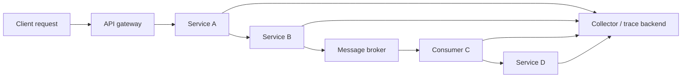

# PII trong baggage của distributed tracing

**PII trong baggage** là rủi ro bảo mật phát sinh khi ứng dụng đưa thông tin nhận dạng cá nhân (Personally Identifiable Information, PII) vào baggage của distributed tracing rồi truyền thông tin đó qua nhiều service. Baggage được thiết kế để mang metadata xuyên suốt một trace; vì vậy một field được thêm ở request đầu vào có thể xuất hiện trong message headers, outbound HTTP calls, logs, spans hoặc telemetry backend ở nhiều hệ thống.

Trong module **SPRING_BOOT_OBSERVABILITY**, baggage hỗ trợ truyền context giữa các service nhưng không phải nơi lưu hồ sơ người dùng hay dữ liệu nghiệp vụ nhạy cảm. Bài thuộc chương **Security và privacy**, tập trung vào nhận diện PII, phạm vi lan truyền và lưu giữ baggage, nguyên tắc data minimization, allowlist, pseudonymization, redaction, kiểm thử và quy trình xử lý khi dữ liệu nhạy cảm đã được export.

## 1. Baggage là gì và vì sao PII trong baggage nguy hiểm?

Baggage là tập hợp các key-value được truyền cùng tracing context qua các process boundaries. Trong OpenTelemetry, W3C Baggage propagator có thể serialize baggage thành HTTP header; messaging instrumentation cũng có thể đưa context vào message headers.

Ví dụ một request mang baggage:

```text
baggage: tenant-tier=standard,region=ap-southeast
```

Metadata như tier hoặc region có thể hữu ích nếu được kiểm soát. Nhưng nếu baggage chứa email, số điện thoại, tên, địa chỉ, account ID hoặc token, dữ liệu có thể được sao chép qua hàng loạt downstream requests và lưu trong nhiều telemetry systems.

Rủi ro không chỉ nằm ở header ban đầu:
- Nhiều service có thể nhận cùng baggage.
- HTTP client và messaging instrumentation có thể tiếp tục inject baggage.
- Debug logs có thể in toàn bộ headers hoặc context.
- Collector có thể nhận và forward dữ liệu sang nhiều exporters.
- Trace backend có thể index, replicate và giữ dữ liệu theo retention policy.
- Người có quyền truy cập traces có thể không có quyền xem hồ sơ người dùng trong hệ thống nghiệp vụ.

Vì vậy, baggage cần được xem là dữ liệu có thể lan truyền và được lưu trữ, không phải vùng nhớ tạm thời chỉ tồn tại trong một request.

## 2. Phân biệt Trace Context, Baggage và span attributes

Ba khái niệm này có vai trò khác nhau:

| Thành phần | Vai trò | Có nên chứa PII? |
| --- | --- | --- |
| Trace Context | Liên kết spans bằng Trace ID, Span ID, flags | Không chứa thông tin người dùng |
| Baggage | Truyền key-value metadata qua process boundaries | Tránh PII; chỉ dùng field allowlist |
| Span attributes | Mô tả operation cụ thể trong trace | Chỉ ghi dữ liệu cần thiết và được phê duyệt |
| Metric tags | Nhóm metrics theo dimensions | Không chứa PII hoặc identifiers có cardinality cao |
| Logs | Ghi sự kiện phục vụ điều tra | Redact/mask dữ liệu nhạy cảm |

Trace ID là định danh trace ngẫu nhiên, không phải user ID. Tuy vậy, khi có bảng mapping hoặc log liên kết, Trace ID vẫn có thể trở thành dữ liệu có khả năng liên kết với một cá nhân trong một hệ thống cụ thể. Áp dụng access control và retention cho trace data phù hợp với nội dung thực tế.

Baggage khác span attributes ở chỗ baggage được thiết kế để truyền tiếp. Một span attribute thường mô tả span hiện tại; baggage có thể đi qua nhiều service và tạo phạm vi lan truyền rộng hơn.

## 3. PII và dữ liệu nhạy cảm thường gặp

PII có thể trực tiếp nhận diện một người hoặc kết hợp với dữ liệu khác để nhận diện. Ví dụ thường gặp trong ứng dụng:

| Dữ liệu | Ví dụ | Xử lý khuyến nghị |
| --- | --- | --- |
| Email | user@example.com | Không đưa vào baggage |
| Điện thoại | Số liên hệ cá nhân | Không đưa vào baggage |
| Họ tên | Tên đầy đủ | Không đưa vào baggage |
| Địa chỉ | Nhà ở/địa chỉ giao hàng | Không đưa vào baggage |
| Account/customer ID | Mã hồ sơ người dùng | Tránh; dùng reference được kiểm soát nếu thực sự cần |
| Access token | Bearer token | Tuyệt đối không truyền trong baggage |
| Session/cookie | Session identifier | Không truyền trong baggage |
| Payment data | Thông tin thẻ/tài khoản | Không truyền trong baggage |
| Tenant tier | free/standard/enterprise | Có thể allowlist nếu cần và tập giá trị nhỏ |
| Region code | ap-southeast | Có thể allowlist nếu không định danh cá nhân |

Không phải mọi identifier đều tự động là PII trong mọi bối cảnh. Tuy nhiên, identifier ổn định có thể được liên kết với hồ sơ cá nhân, tạo khả năng theo dõi xuyên service. Khi chưa đánh giá được khả năng liên kết, hãy coi đó là dữ liệu nhạy cảm và không đưa vào baggage.

## 4. Vì sao baggage làm tăng phạm vi rủi ro?

Giả sử gateway nhận một header có email và đưa nó vào baggage. Service A gọi service B; B publish message; consumer C gọi service D. Nếu propagation được bật ở mỗi bước, cùng giá trị có thể được sao chép qua nhiều network hops.



Một baggage field có thể được lưu trong nhiều spans/logs hoặc headers tại nhiều service. Xóa field ở service cuối không xóa bản đã được export từ các service trước.

### 4.1. Fan-out và batch processing

Một service có thể gửi một request tới nhiều downstream services hoặc publish nhiều messages. Baggage được propagate có thể nhân rộng theo fan-out. Trong batch consumer, nhiều message contexts có thể được kết hợp; không copy tùy tiện baggage từ message đầu tiên sang toàn batch.

### 4.2. Retry và dead-letter queue

Retry, redelivery và dead-letter queues có thể giữ message headers lâu hơn thời gian request ban đầu. Nếu PII nằm trong baggage, dữ liệu có thể tiếp tục tồn tại trong queue, archive hoặc DLQ. Chính sách retention của broker cần được tính vào đánh giá privacy.

## 5. Nguyên tắc data minimization

Nguyên tắc quan trọng nhất là chỉ truyền dữ liệu cần thiết cho mục tiêu observability cụ thể.

Trước khi thêm một baggage field, hãy trả lời:
1. Operation downstream nào thực sự cần field này?
2. Có thể dùng một category ít chi tiết hơn không?
3. Field có định danh trực tiếp hoặc gián tiếp một cá nhân không?
4. Field có thể được lấy từ hệ thống nghiệp vụ bằng một reference có kiểm soát không?
5. Field có cần đi qua mọi service hay chỉ một boundary?
6. Có thể dùng span attribute tại một service thay vì baggage propagation không?
7. Ai có thể đọc dữ liệu sau khi nó tới Collector/backend?
8. Khi nào dữ liệu hết hạn và được xóa?

Nếu không có use case cụ thể, không thêm field. Baggage không nên trở thành một bản sao của request headers, security principal hoặc user profile.

## 6. Dùng allowlist thay vì propagate toàn bộ

Thiết kế propagation theo allowlist: chỉ những key đã được review mới được inject/extract. Không copy toàn bộ incoming baggage vào outgoing context.

Ví dụ các field có thể cân nhắc nếu được phê duyệt:
- tenant-tier với tập giá trị hữu hạn.
- deployment-region.
- workflow-class.
- experiment-cohort nếu không chứa user-specific identity và đã có policy.

Các field cần từ chối:
- email, phone, full-name, address.
- access-token, authorization, cookie.
- raw-user-id, customer-id, account-number.
- request-body hoặc serialized principal.
- mọi key không nhận diện được hoặc chưa được review.

### 6.1. Chuẩn hóa giá trị

Ngay cả field không phải PII cũng có thể tạo cardinality cao nếu value tùy ý. Chuẩn hóa:
- Dùng enum/category hữu hạn thay string tự do.
- Giới hạn độ dài.
- Từ chối giá trị có control characters.
- Giới hạn số lượng baggage entries.
- Không chấp nhận duplicate keys không rõ semantics.
- Không cho client tự chọn baggage keys tùy ý.

Allowlist phải áp dụng ở nơi context đi vào trust boundary và được duy trì tại các boundary tiếp theo. Chỉ lọc tại backend là quá muộn nếu dữ liệu đã được log hoặc export trước đó.

## 7. Không dùng baggage làm authorization context

Baggage là metadata phục vụ observability, không phải bằng chứng xác thực hay phân quyền. Client hoặc producer không đáng tin cậy có thể gửi baggage giả mạo.

Không dùng các field như tenant-id, role, permission, user-id trong baggage để quyết định:
- Truy cập tài nguyên.
- Tenant isolation.
- Quyền quản trị.
- Hạn mức tài chính.
- Chính sách thanh toán.
- Bỏ qua authentication.

Authorization phải dựa trên security context được xác thực và kiểm tra tại service chịu trách nhiệm. Nếu một service cần tenant identity, lấy từ security token/context đã verify hoặc nguồn tin cậy nội bộ; không tin baggage.

## 8. Pseudonymization và tokenization

Trong một số use case điều tra, nhóm vận hành cần liên kết nhiều sự kiện của cùng một subject mà không biết danh tính thật. Có thể cân nhắc pseudonymous reference được tạo bởi hệ thống có thẩm quyền.

Phân biệt:
- **Masking:** che một phần giá trị khi hiển thị.
- **Pseudonymization:** thay định danh trực tiếp bằng mã thay thế; vẫn có thể re-identify nếu có mapping.
- **Tokenization:** thay dữ liệu bằng token, mapping được giữ trong hệ thống bảo vệ riêng.
- **Hashing:** biến đổi một chiều theo thuật toán; hash thường không tự động an toàn nếu input dễ đoán hoặc không có secret key.

Ví dụ một pseudonymous reference:

```text
subject-ref=psn_7f31a9
```

Đây chỉ là ví dụ format. Không tự hash email bằng SHA-256 rồi coi kết quả là anonymous: email có không gian giá trị dễ đoán và có thể bị dictionary attack. Nếu cần deterministic pseudonym, dùng keyed HMAC hoặc token service được quản lý, khóa được bảo vệ và có rotation policy.

Ngay cả pseudonymous reference vẫn có thể là dữ liệu cá nhân theo bối cảnh nếu có khả năng liên kết lại. Giữ quyền truy cập mapping tách biệt và giới hạn retention.

## 9. Redaction tại các trust boundaries

Redaction nên xảy ra càng sớm càng tốt, trước khi dữ liệu nhạy cảm đi vào propagation pipeline.

Các boundary quan trọng:
- **Ingress:** kiểm tra incoming headers/baggage từ client.
- **Application context:** chỉ tạo baggage từ field đã allowlist.
- **Outbound HTTP:** lọc context trước khi inject.
- **Messaging producer:** lọc headers trước khi publish.
- **Consumer:** validate/extract lại metadata nhận được.
- **Logging:** không dump toàn bộ context hoặc headers.
- **Collector:** lọc attributes/headers theo policy như defense-in-depth.
- **Backend:** access control, retention và deletion policy.

Collector filtering là lớp bảo vệ bổ sung. Nếu ứng dụng đã ghi PII vào log hoặc gửi tới một exporter khác, Collector không thể thu hồi bản sao đó.

## 10. Ví dụ lọc baggage trong ứng dụng

Cách triển khai chính xác phụ thuộc Micrometer Context Propagation, OpenTelemetry propagator và Spring Boot version. Một hướng an toàn là không lấy incoming baggage nguyên trạng; ứng dụng chỉ tạo context mới từ các giá trị đã được kiểm tra.

Ví dụ minh họa allowlist ở application boundary:

```java
Set<String> ALLOWED_BAGGAGE_KEYS =
        Set.of("tenant-tier", "deployment-region");

Map<String, String> sanitizeBaggage(
        Map<String, String> incoming) {

    Map<String, String> safe = new HashMap<>();

    for (String key : ALLOWED_BAGGAGE_KEYS) {
        String value = incoming.get(key);
        if (value != null && isAllowedValue(key, value)) {
            safe.put(key, value);
        }
    }

    return Map.copyOf(safe);
}

boolean isAllowedValue(String key, String value) {
    if (value.length() > 32) {
        return false;
    }

    return switch (key) {
        case "tenant-tier" ->
                Set.of("free", "standard", "enterprise")
                        .contains(value);
        case "deployment-region" ->
                Set.of("ap-southeast", "eu-west", "us-east")
                        .contains(value);
        default -> false;
    };
}
```

Đây là logic minh họa, không phải một Baggage API hoàn chỉnh. Trong ứng dụng thật, chuyển các giá trị đã sanitize vào baggage bằng API phù hợp và bảo đảm outgoing propagator chỉ inject baggage đã được phép. Không dùng map từ client làm nguồn dữ liệu trực tiếp.

### 10.1. Bảo vệ cả inbound lẫn outbound

Chỉ sanitize ở ingress chưa đủ nếu một internal service có thể nhận message từ producer khác. Mỗi trust boundary cần kiểm tra context được nhận. Outbound instrumentation phải dùng context đã được lọc, không khôi phục baggage nguyên bản từ một source khác.

## 11. Span attributes, logs và metrics thay thế baggage thế nào?

Nếu chỉ cần thông tin trong một operation, span attribute có thể phù hợp hơn baggage vì không cần truyền tiếp. Nếu cần phân loại tổng hợp, metric tag có thể phù hợp nhưng phải có cardinality thấp. Nếu cần điều tra sự kiện cụ thể, structured log với access control/retention phù hợp có thể hữu ích.

| Nhu cầu | Nơi phù hợp hơn | Lưu ý |
| --- | --- | --- |
| Phân loại deployment | Resource attribute | Giá trị ổn định theo instance/service |
| Operation name | Span name | Không chứa ID động |
| Database system | Span attribute/metric dimension | Theo semantic convention |
| User email | Không export | Dùng nghiệp vụ nội bộ nếu thật sự cần |
| Pseudonymous support reference | Span/log có kiểm soát | Review re-identification risk |
| Request category | Low-cardinality metric tag | Dùng enum hữu hạn |
| Cross-service diagnostic metadata | Baggage allowlist | Chỉ khi downstream thực sự cần |

Không chuyển PII từ baggage sang span attribute hoặc log mà không đánh giá. Thay đổi vị trí không loại bỏ rủi ro privacy.

## 12. Header size, cardinality và chi phí

Baggage được serialize vào headers nên số lượng và độ dài fields ảnh hưởng kích thước request. Nhiều proxies, gateways và brokers áp dụng giới hạn header size. Header quá lớn có thể gây request rejection, tăng network overhead và làm lộ nhiều dữ liệu hơn.

Giới hạn nên có:
- Số baggage entries tối đa.
- Độ dài key/value tối đa.
- Tổng kích thước baggage tối đa.
- Character set/encoding được chấp nhận.
- Quy tắc duplicate keys.
- Danh sách keys được propagate theo từng boundary.

Không dùng user ID hoặc email làm metric tag. Nếu baggage được chuyển thành span attributes, nó vẫn có thể tăng index size và chi phí backend.

## 13. Logging và correlation an toàn

Trace correlation hữu ích để nối log với span, nhưng không cần log toàn bộ baggage. Logging pattern nên chỉ in Trace ID/Span ID và các fields được phép.

Không:
- Log raw baggage header.
- Log toàn bộ request headers.
- Ghi security principal hoặc object toString() vào log.
- Ghi access token/cookie trong exception context.
- Tạo log key chứa email hoặc customer ID.

Nếu cần correlation với support case, dùng reference ngẫu nhiên hoặc pseudonymous token có kiểm soát. Không đưa mapping để giải mã token vào logs hoặc trace backend.

## 14. Retention, access và xử lý khi PII đã bị export

Khi PII đã vào telemetry backend, xóa field khỏi code chỉ ngăn dữ liệu mới; các bản đã lưu vẫn tồn tại.

Quy trình phản ứng:
1. Ngừng phát sinh PII mới bằng cách chặn field ở ingress/application boundary.
2. Xác định service, exporters, Collector pipelines và backends đã nhận dữ liệu.
3. Xác định time range, trace IDs và datasets liên quan bằng quyền truy cập phù hợp.
4. Hạn chế quyền đọc hoặc tạm khóa truy vấn nếu cần.
5. Áp dụng deletion/retention procedure của từng backend và bản sao/replica.
6. Kiểm tra logs, broker headers, DLQ, object storage và backup theo policy.
7. Ghi lại incident, nguyên nhân gốc và thay đổi ngăn tái diễn.
8. Kiểm thử để bảo đảm field không còn được inject hoặc export.

Không giả định xóa trace khỏi giao diện tìm kiếm sẽ xóa mọi bản sao, index, archive và backup. Cần làm việc theo cơ chế retention/deletion thực tế của từng hệ thống.

## 15. Kiểm thử baggage privacy

Kiểm thử cần xác minh cả trường hợp hợp lệ và không hợp lệ ở các boundary.

### 15.1. Unit test allowlist

Đưa vào baggage một tập keys gồm region/tier được phép và email/token/user ID bị cấm. Xác nhận output chỉ chứa fields được allowlist và values nằm trong enum/length limits.

### 15.2. Propagation integration test

Gửi request qua producer service và kiểm tra outbound HTTP/message headers:
- Key được phép được inject.
- PII key không xuất hiện.
- Header size nằm trong giới hạn.
- Consumer chỉ extract fields được phép.
- Invalid/duplicate baggage bị xử lý theo policy.

### 15.3. Telemetry export test

Dùng in-memory exporter hoặc Collector lab để kiểm tra span attributes/log records đã export. Không chỉ kiểm tra request headers; PII có thể được thêm ở một interceptor khác sau bước sanitize.

### 15.4. Regression test

Tạo test fixture với các key nhạy cảm phổ biến như email, phone, authorization, cookie, customer ID và raw payload. Chạy test qua các integration points sau mỗi lần nâng cấp tracing/messaging dependencies.

## 16. Troubleshooting PII trong baggage

| Triệu chứng | Nguyên nhân có thể | Cách kiểm tra |
| --- | --- | --- |
| Email xuất hiện trong downstream spans | Inbound baggage được propagate nguyên trạng | Kiểm tra ingress allowlist và propagator |
| Token xuất hiện trong trace backend | Authorization/header bị copy vào baggage hoặc span | Tìm source instrumentation và chặn tại ingress |
| PII xuất hiện trong message headers | Messaging producer inject context chưa lọc | Kiểm tra record headers trước publish |
| Log chứa toàn bộ baggage | Logging pattern/custom middleware dump context | Rà soát logging configuration |
| PII vẫn xuất hiện sau khi sửa code | Backend còn dữ liệu cũ hoặc exporter khác | Kiểm tra retention, replicas và pipelines |
| Collector filter không loại được dữ liệu | PII đã được log/export trước Collector | Redact sớm hơn ở application |
| Baggage header quá lớn | Nhiều fields hoặc values dài | Giới hạn entries, value length và total bytes |
| Giá trị pseudonymous vẫn bị coi là nhạy cảm | Có mapping hoặc khả năng re-identification | Review tokenization/key custody |
| Field bị thêm lại downstream | Service khác tạo baggage từ request/user context | Kiểm tra từng trust boundary |
| Trace correlation bị mất sau lọc | Policy xóa cả traceparent hoặc propagator bị thay | Chỉ lọc baggage; giữ W3C Trace Context hợp lệ |
| Tenant ID bị giả mạo | Baggage bị dùng như security context | Lấy tenant identity từ nguồn đã xác thực |

### Quy trình điều tra

1. Xác định baggage key/value xuất hiện ở đâu: inbound header, outbound header, span, log hay backend index.
2. Truy ngược service đầu tiên đưa field vào context.
3. Kiểm tra auto instrumentation và custom propagators/interceptors.
4. Kiểm tra HTTP client và messaging producer có dùng context đã sanitize không.
5. Kiểm tra consumer có validate metadata sau broker không.
6. Kiểm tra Collector processors và tất cả exporters.
7. Xác định các bản sao đã lưu và retention/deletion policy.
8. Thêm regression tests cho field bị cấm.
9. Xác minh Trace Context vẫn hoạt động sau khi lọc baggage.
10. Ghi nhận owner và policy cho từng baggage field được phép.

## 17. Bài thực hành: chặn PII khỏi baggage

Mục tiêu là xây dựng một propagation policy chỉ cho phép metadata chẩn đoán an toàn đi qua các service.

### Chuẩn bị

- Spring Boot application có Micrometer Tracing hoặc OpenTelemetry integration.
- Một HTTP client và messaging producer/consumer trong lab.
- In-memory span exporter hoặc Collector lab.
- Test framework cho context propagation.
- Bộ dữ liệu test chứa keys hợp lệ và PII giả lập.

### Bước 1 — Liệt kê baggage hiện tại

Kiểm tra nơi ứng dụng tạo baggage và các incoming headers. Ghi lại key, mục đích, owner, nơi sử dụng và retention liên quan.

### Bước 2 — Phân loại

Đánh dấu field là allowlist, reject hoặc cần review. Email, phone, token, cookie và raw customer identifiers mặc định không được propagate.

### Bước 3 — Tạo sanitizer

Triển khai allowlist, giới hạn length/value set, số entries và tổng kích thước. Không nhận toàn bộ incoming baggage.

### Bước 4 — Áp dụng tại ingress

Tạo context mới từ các fields đã validate. Bỏ keys không được phép trước khi request đi vào business services.

### Bước 5 — Kiểm tra outbound HTTP

Gọi một downstream service. Kiểm tra headers chỉ có trace context chuẩn và baggage allowlist.

### Bước 6 — Kiểm tra messaging

Publish message và xác minh headers không chứa PII. Consumer validate lại metadata trước khi dùng.

### Bước 7 — Kiểm tra span/log export

Xem spans và logs trong test exporter. Xác nhận PII không được thêm lại bởi custom instrumentation hoặc logging middleware.

### Bước 8 — Thử input độc hại

Gửi baggage có token, email, value quá dài, duplicate keys và ký tự bất thường. Xác nhận bị loại hoặc từ chối theo policy.

### Bước 9 — Kiểm tra trace continuity

Xác nhận Trace ID và parent/link relationships vẫn đúng sau khi lọc baggage. Việc loại baggage không được làm hỏng traceparent.

### Bước 10 — Kiểm tra retention

Xác định backend lưu telemetry bao lâu và quy trình xóa dữ liệu nếu phát hiện PII đã được export.

### Checklist nghiệm thu

| Điều cần chứng minh | Kết quả mong đợi |
| --- | --- |
| Data classification | Nhận diện PII và identifiers có thể liên kết |
| Minimization | Chỉ truyền metadata có use case |
| Allowlist | Chỉ keys/values được phê duyệt được propagate |
| Ingress | Incoming baggage được validate |
| Outbound HTTP | Không inject PII |
| Messaging | Headers không chứa PII |
| Consumer | Validate context nhận từ broker |
| Trace continuity | Trace Context vẫn liên tục |
| Cardinality | Không dùng dynamic identifiers làm metric tags |
| Logging | Không dump raw baggage/headers |
| Export | PII không xuất hiện trong spans/logs |
| Retention | Có quy trình xử lý bản đã lưu |

## 18. Những nguyên tắc cần ghi nhớ

1. **Baggage có thể lan truyền và được lưu trữ qua nhiều service.** Xem nó như metadata có thể rời khỏi process.
2. **Không đưa PII, secrets hoặc security credentials vào baggage.** Không dùng baggage để xác thực hoặc phân quyền.
3. **Dùng allowlist và data minimization.** Chỉ truyền fields có use case rõ ràng, tập giá trị nhỏ và owner xác định.
4. **Baggage khác span attributes, logs và metric tags.** Chọn nơi ghi dữ liệu theo phạm vi sử dụng và cardinality.
5. **Pseudonymization không đồng nghĩa anonymous.** Mapping, key và khả năng liên kết vẫn tạo rủi ro nhận diện.
6. **Redact tại ingress và mỗi trust boundary.** Collector filtering là defense-in-depth, không thay thế lọc tại nguồn.
7. **Giới hạn số lượng, độ dài và tổng kích thước headers.** Tránh tăng network overhead và lưu trữ.
8. **Kiểm soát retry, broker và DLQ retention.** Message headers có thể tồn tại lâu hơn request ban đầu.
9. **Kiểm thử cả propagation lẫn telemetry export.** PII có thể được thêm ở nhiều integration points.
10. **Có quy trình xử lý dữ liệu đã export.** Chặn dữ liệu mới và xử lý các bản sao theo retention/deletion policy.

Baggage hữu ích khi cần truyền metadata chẩn đoán qua ranh giới service, nhưng mỗi field cũng mở rộng phạm vi dữ liệu được chia sẻ. Khi chỉ cho phép metadata tối thiểu, lọc tại ingress và outbound boundaries, giữ PII ngoài baggage, logs và metric tags, Spring Boot có thể duy trì trace correlation mà không biến distributed tracing thành một kênh phát tán dữ liệu cá nhân.
