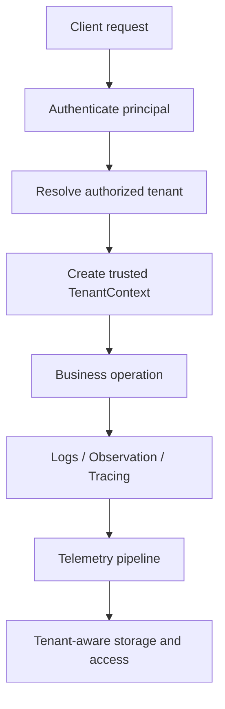

# Tenant isolation trong telemetry của Spring Boot

## 1. Mục tiêu và bối cảnh

Trong ứng dụng multi-tenant, nhiều khách hàng cùng sử dụng một hệ thống nhưng dữ liệu và quyền truy cập của họ phải được tách biệt. Telemetry cũng có thể chứa dữ liệu tenant: log event, trace attributes, baggage, exception context, query metadata và dashboard. Nếu một người dùng tenant A có thể tìm thấy log hoặc trace của tenant B, hệ thống đã vi phạm ranh giới bảo mật dù database nghiệp vụ vẫn cô lập đúng.

**Tenant isolation trong telemetry** là tập hợp biện pháp bảo đảm dữ liệu quan sát được gắn đúng tenant, được lưu/truy vấn trong phạm vi được phép và không bị lộ qua metrics, logs, traces, exporters hay công cụ vận hành.

Bài thuộc chương **Security và privacy** của module **SPRING_BOOT_OBSERVABILITY**. Module hướng dẫn thiết lập observability cho Spring Boot bằng Micrometer Observation, metrics, logs và distributed tracing; học context propagation, tag/cardinality, exporter, sampling và liên kết tín hiệu để điều tra lỗi, độ trễ và hành vi ứng dụng trên môi trường thực.

Sau bài học, bạn có thể:
1. Xác định ranh giới tenant trong telemetry pipeline.
2. Lấy tenant context từ nguồn đã xác thực thay vì tin header tùy ý.
3. Propagate context an toàn qua logs, traces và async execution.
4. Tránh dùng tenant ID làm metric label khi cardinality lớn.
5. Phân vùng telemetry storage và kiểm soát truy vấn theo tenant.
6. Bảo vệ baggage, exemplars, dashboards và support tooling.
7. Kiểm thử ngăn truy cập chéo tenant.

**Baseline:** Spring Boot 3.5.x, Java 17+, Micrometer Observation/Tracing, SLF4J MDC. Thiết kế storage/query cụ thể phụ thuộc log backend, trace backend và mô hình tenancy.

## 2. Threat model: telemetry cũng là dữ liệu tenant

Telemetry thường được xem là dữ liệu kỹ thuật, nhưng nó có thể chứa:
- Tenant ID, organization name hoặc domain.
- User ID, email, request metadata và correlation identifiers.
- SQL/query attributes hoặc resource names.
- Exception messages, validation errors và request/response fragments.
- Trace baggage được propagate qua nhiều service.
- Metrics labels, dashboard variables và exemplar links.

Các rủi ro thường gặp:

| Rủi ro | Ví dụ | Hậu quả |
| --- | --- | --- |
| Context giả mạo | Client gửi `X-Tenant-Id: tenant-b` | Event bị gán nhầm tenant |
| Query thiếu filter | Dashboard tìm logs theo service nhưng không lọc tenant | Tenant A thấy dữ liệu tenant B |
| Shared trace access | Trace backend chỉ phân quyền theo project chung | Người dùng đọc trace không thuộc tenant |
| Baggage leak | Tenant identifier được propagate sang external service | Dữ liệu tenancy đi ra ngoài trust boundary |
| Metric cardinality | Mỗi tenant tạo một label series | Chi phí và nguy cơ DoS qua số series |
| Async context leak | MDC/ThreadLocal không được clear giữa tasks | Log mang tenant context của request trước |
| Support export | Bundle chứa logs/traces của nhiều tenant | Rò rỉ khi chia sẻ hoặc tải xuống |

Isolation cần được áp dụng ở toàn bộ lifecycle: tạo context, propagate, emit, ingest, store, query, export và delete/retention.

## 3. Xây dựng tenant context đáng tin cậy

Tenant identity phải được xác định từ authentication/authorization layer hoặc trusted gateway đã xác minh. Không mặc định tin tenant ID do client tự gửi trong header, query parameter, request body hoặc baggage.

Luồng đề xuất:



Ví dụ: user đăng nhập có quyền trên tenant A. Nếu request gửi header tenant B, application phải kiểm tra membership/authorization trước khi dùng tenant B. Việc header có chữ ký hoặc đến từ gateway chỉ đáng tin khi gateway nằm trong trust boundary, xác thực caller và xóa/ghi đè header từ phía ngoài.

Không dùng raw tenant name/domain làm identity nếu nó có thể thay đổi hoặc chứa dữ liệu nhạy cảm. Ưu tiên opaque internal tenant key đã được chuẩn hóa.

## 4. Tenant context trong Spring application

Có thể biểu diễn tenant đã xác thực bằng một context bất biến:

```java
public record TenantContext(String tenantKey) {
    public TenantContext {
        if (tenantKey == null || tenantKey.isBlank()) {
            throw new IllegalArgumentException("tenantKey is required");
        }
    }
}
```

Đặt context sau bước xác thực/ủy quyền, ví dụ trong filter hoặc interceptor chuyên trách. API truy cập context cần có semantics rõ khi không có tenant: reject request tenant-scoped hoặc đánh dấu operation là system-level theo policy.

Không tạo tenant context từ header một cách mù quáng:

```java
// Không an toàn nếu header do client tự kiểm soát.
String tenant = request.getHeader("X-Tenant-Id");
```

Thay vào đó, lấy tenant đã được xác minh từ principal/security context hoặc trusted tenant resolver:

```java
TenantContext tenantContext = tenantResolver.resolveAuthorizedTenant(authentication, request);
```

`tenantResolver` ở đây là abstraction của ứng dụng; implementation phải kiểm tra membership và quyền truy cập. Không để controller/service tự quyết định tenant từ input tùy ý.

## 5. Liên kết tenant context với logs

SLF4J MDC có thể thêm tenant key vào log events để phục vụ tìm kiếm trong backend. Chỉ thêm opaque key đã được xác thực và cần thiết cho mục đích vận hành.

Ví dụ filter theo Servlet stack:

```java
import jakarta.servlet.FilterChain;
import jakarta.servlet.ServletException;
import jakarta.servlet.http.HttpServletRequest;
import jakarta.servlet.http.HttpServletResponse;
import org.slf4j.MDC;
import org.springframework.web.filter.OncePerRequestFilter;
import java.io.IOException;

public class TenantLoggingFilter extends OncePerRequestFilter {
    private final TenantResolver tenantResolver;

    public TenantLoggingFilter(TenantResolver tenantResolver) {
        this.tenantResolver = tenantResolver;
    }

    @Override
    protected void doFilterInternal(
            HttpServletRequest request,
            HttpServletResponse response,
            FilterChain chain) throws ServletException, IOException {
        String tenantKey = tenantResolver.resolveAuthorizedTenantKey(request);
        try (MDC.MDCCloseable ignored = MDC.putCloseable("tenant.key", tenantKey)) {
            chain.doFilter(request, response);
        }
    }
}
```

Ví dụ giả định resolver đã xác thực request và trả tenant key an toàn. Trong hệ thống thực, tích hợp với Spring Security principal và bảo đảm filter chạy sau authentication. MDC entry phải được khôi phục/xóa ở mọi đường thoát; không dùng `MDC.put` mà quên clear.

Chỉ log tenant key khi log backend và người truy cập có quyền xem. Với log công khai hoặc hệ thống tập trung nhiều tenant, có thể cần pseudonymous key hoặc không emit tenant dimension.

## 6. Tracing attributes và baggage

Tenant context có thể được thêm vào Observation/Span dưới dạng attribute nếu có use case hợp lệ. Tuy nhiên, phân biệt:

| Cơ chế | Mục đích | Lưu ý |
| --- | --- | --- |
| Span attribute | Metadata của span hiện tại | Có thể được lưu và tìm kiếm ở trace backend |
| Baggage | Context được propagate qua process boundary | Có thể đi ra downstream và qua nhiều hệ thống |
| MDC | Field của log event trong execution context | Cần propagation/cleanup đúng thread |
| Metric tag | Dimension của time series | Phải có cardinality thấp và tập giá trị giới hạn |

Không tự động đưa mọi tenant field vào baggage. Baggage có thể được serialize vào outbound headers, vì vậy chỉ propagate qua service nằm trong trust boundary, giới hạn key/value và cấu hình propagation rõ ràng.

Tenant key trong span attribute cũng là dữ liệu có kiểm soát truy cập. Nếu trace backend dùng chung cho nhiều khách hàng, attribute không tự tạo row-level security. Backend phải enforce quyền đọc theo tenant hoặc traces phải được phân vùng.

Không bao giờ đưa secrets, access tokens, personal data hoặc tenant payload vào baggage chỉ để correlation.

## 7. Async, executor và reactive context propagation

Servlet request thường chạy trên thread có MDC. Khi công việc chuyển sang executor, ThreadLocal/MDC không tự động đi theo. Nếu không propagate đúng, log có thể thiếu tenant key hoặc tệ hơn là giữ giá trị của task trước trong pooled thread.

Nguyên tắc:
- Dùng context propagation mechanism phù hợp với Spring/Micrometer và executor.
- Capture context tại điểm submit task và restore/clear trong finally khi task kết thúc.
- Không dùng static mutable TenantContext dùng chung cho mọi request.
- Với CompletableFuture, truyền context rõ ràng hoặc dùng executor đã được decorate.
- Với Reactor, lưu context trong Reactor Context và dùng integration/context propagation phù hợp; không dựa riêng vào ThreadLocal.
- Test concurrent requests thuộc hai tenant để phát hiện context bleed.

Tenant context phải được xác thực trước khi propagate. Propagation không biến một giá trị không đáng tin thành đáng tin.

## 8. Metrics: cardinality và isolation

Metrics là nơi tenant isolation có trade-off đặc biệt. Thêm `tenant.id` vào mọi meter có thể tạo một time series cho mỗi tenant × method × route × status. Với hàng chục nghìn tenants, số series tăng nhanh và có thể làm monitoring backend quá tải.

Ưu tiên metrics tổng hợp không có tenant dimension:

```java
Counter.builder("orders.created")
        .tag("outcome", "success")
        .register(registry)
        .increment();
```

Nếu cần phân tích theo tenant, cân nhắc:
- Chỉ dùng tenant tier/segment có tập giá trị nhỏ, không dùng tenant ID duy nhất.
- Tạo metrics per-tenant ở hệ thống chuyên biệt có quota và giới hạn số tenants.
- Dùng logs/traces có access control cho điều tra tenant cụ thể.
- Dùng exemplars để nhảy tới trace nếu stack hỗ trợ, không đưa traceId/tenantId thành label.
- Áp dụng meter filters/deny rules cho tag keys nhạy cảm.

Không coi tenant ID là low-cardinality chỉ vì chuỗi có độ dài ngắn. Cardinality được quyết định bởi số giá trị khác nhau.

## 9. Tenant-aware storage và query

Thêm tenant key vào log hoặc span không tự tạo isolation. Hệ thống ingest/storage/query phải thực thi authorization.

Các mô hình phổ biến:

| Mô hình | Cách cô lập | Trade-off |
| --- | --- | --- |
| Shared index/table | Mỗi record có tenant key; query bắt buộc filter và backend enforce policy | Dễ vận hành hơn nhưng cần row-level controls chắc chắn |
| Index/namespace theo tenant | Tách dữ liệu theo tenant hoặc nhóm tenant | Cô lập rõ hơn, tăng số resource và vận hành |
| Backend/project riêng | Mỗi tenant hoặc trust domain có telemetry backend riêng | Isolation mạnh, chi phí cao hơn |

Với shared storage, filter tenant phải được áp dụng ở server-side authorization/query layer, không chỉ ở UI dashboard. Người dùng không được tự sửa query để bỏ tenant filter.

Kiểm soát cả:
- Search APIs và dashboards.
- Trace lookup theo traceId.
- Alert payloads và notification integrations.
- Export/download endpoints.
- Saved queries, notebooks và support bundles.
- Backup, replica và data retention workflows.

Trace ID không phải credential. Biết traceId không được tự động cấp quyền đọc trace.

## 10. Sampling, exemplars và export

Sampling giảm lượng trace được giữ nhưng không thay thế tenant authorization. Tail sampling hoặc collector policies có thể route/drop traces dựa trên attributes; nếu tenant attribute không đáng tin hoặc chưa được xác thực, policy có thể phân loại sai.

Trước khi export:
- Xác định tenant context đã được xác thực.
- Chỉ thêm attributes cần thiết và đã được duyệt.
- Không gửi baggage nhạy cảm tới external vendor.
- Phân vùng exporter/tenant endpoint nếu hợp đồng hoặc compliance yêu cầu.
- Kiểm tra collector logs, retry queues và dead-letter storage cũng không làm lộ dữ liệu.

Exemplars có thể mang trace reference từ metrics. Quyền mở trace vẫn phải được kiểm tra ở trace backend; exemplar không phải cơ chế cấp quyền.

## 11. Retention và quyền truy cập

Telemetry có thể được giữ ở nhiều tầng: application stdout, node agent, collector queue, object storage, search index, trace backend, backup và export archive.

Định nghĩa rõ:
- Ai được đọc logs/traces theo tenant và theo role vận hành.
- Ai được xem aggregate metrics hoặc tenant-specific diagnostic data.
- Thời gian retention theo loại dữ liệu và mục đích.
- Quy trình xóa/expire dữ liệu ở primary store, replicas và backup theo policy.
- Audit trail cho truy vấn/export dữ liệu tenant.
- Break-glass access có approval, scope và thời hạn.

Quyền operator không đồng nghĩa mọi nhân viên đều được xem mọi payload. Áp dụng least privilege và ghi audit cho các thao tác truy cập nhạy cảm.

## 12. Kiểm thử tenant isolation

Dùng hai tenants A và B với sentinel identifiers khác nhau. Test không chỉ kiểm tra business database mà cả telemetry sinks.

Test matrix:
1. Request tenant A tạo log event; user tenant B không thể query hoặc export event đó.
2. Request gửi header tenant B nhưng principal chỉ có quyền tenant A; request bị reject hoặc resolver chọn tenant đã được authorize theo policy.
3. Trace của tenant A không thể mở bằng credentials của tenant B dù biết traceId.
4. Dashboard/query API tự áp dụng tenant filter phía server.
5. Metrics không phát tenant ID làm label ngoài policy/quota được duyệt.
6. Async task của tenant A và B chạy đồng thời không trộn MDC/context.
7. Reactor subscriptions trên nhiều tenants không chia sẻ context.
8. Baggage không propagate tenant data qua external trust boundary.
9. Exception, validation errors và support bundles không chứa payload tenant khác.
10. Exporter retry/dead-letter/backup vẫn giữ isolation policy.

Ví dụ kiểm tra log output:

```java
assertThat(tenantALogs).contains("tenant.key=tenant-a");
assertThat(tenantALogs).doesNotContain("TENANT_B_SECRET_SENTINEL");
assertThat(tenantBQueryResult).doesNotContain("TENANT_A_SECRET_SENTINEL");
```

Đây là pseudocode assertion; test thực tế nên dùng identity và backend query API giống production.

## 13. Troubleshooting

| Triệu chứng | Nguyên nhân có thể | Cách xử lý |
| --- | --- | --- |
| Log tenant A có tenant key B | Tin header không xác thực hoặc MDC không được restore | Resolve từ principal và dùng scoped MDC cleanup |
| Log async thiếu tenant key | Context không được propagate sang executor | Dùng context-aware executor và test completion |
| Log async mang tenant của task trước | ThreadLocal/MDC không clear trong pooled thread | Restore/clear trong finally |
| Tenant B tìm thấy trace A | Trace backend thiếu authorization/tenant partition | Enforce access ở query/backend layer |
| Dashboard filter có thể bị bỏ | Tenant filter chỉ nằm ở UI | Enforce server-side query authorization |
| Metrics series tăng mạnh | Tenant ID làm metric label | Bỏ tenant ID hoặc dùng segment hữu hạn |
| External service nhận tenant baggage | Propagation allowlist quá rộng | Giới hạn keys và trust boundary |
| Exemplar mở trace không đúng quyền | Coi trace reference như access token | Enforce authorization ở trace backend |
| Collector lưu raw tenant payload | Sanitization chỉ thực hiện ở app logger | Kiểm tra agent/collector/exporter và redact trước export |
| Support bundle chứa nhiều tenants | Export không có tenant scope | Tạo bundle theo authorization và audit export |
| Tenant ID thay đổi theo alias | Dùng domain/display name làm identity | Dùng opaque canonical tenant key |

## 14. Checklist production

- [ ] Tenant identity được resolve sau authentication/authorization.
- [ ] Client-supplied tenant header/query/body không được tin mặc định.
- [ ] Tenant context là immutable và có lifecycle rõ ràng.
- [ ] MDC/context được restore/clear sau mỗi request/task.
- [ ] Async/reactive propagation được kiểm thử concurrent cross-tenant.
- [ ] Logs/traces/baggage chỉ chứa tenant metadata được duyệt.
- [ ] Metrics không dùng tenant ID cardinality cao làm labels.
- [ ] Storage/query API enforce tenant authorization phía server.
- [ ] TraceId/exemplar không được xem là credential.
- [ ] Exporters, collectors, queues, backups và support bundles được bảo vệ.
- [ ] Retention, deletion và audit policy bao phủ mọi telemetry sinks.
- [ ] Có cross-tenant negative tests cho search, trace lookup và export.

## 15. Câu hỏi tự luyện

1. Vì sao telemetry cũng cần tenant isolation như database nghiệp vụ?
2. Vì sao không nên tin X-Tenant-Id do client gửi?
3. Tenant context nên được tạo ở layer nào?
4. MDC có thể gây context bleed trong pooled executor ra sao?
5. Baggage khác span attribute thế nào về propagation risk?
6. Vì sao tenant ID thường không phù hợp làm metric label?
7. Shared telemetry index cần enforce authorization ở đâu?
8. TraceId có phải credential để đọc trace không?
9. Sampling có thay thế access control không?
10. Cần kiểm thử những đường export/backup nào?
11. Vì sao dashboard-only tenant filter không đủ an toàn?
12. Làm thế nào phát hiện async/reactive context bị trộn giữa tenants?

## Tài liệu tham khảo

- [Spring Boot 3.5 — Observability](https://docs.spring.io/spring-boot/3.5/reference/actuator/observability.html)
- [Micrometer Context Propagation](https://docs.micrometer.io/context-propagation/reference/)
- [Micrometer Tracing — Baggage](https://docs.micrometer.io/tracing/reference/api.html)
- [OpenTelemetry — Context Propagation](https://opentelemetry.io/docs/concepts/context-propagation/)
- [OpenTelemetry — Baggage](https://opentelemetry.io/docs/concepts/signals/baggage/)
- [OWASP — Logging Cheat Sheet](https://cheatsheetseries.owasp.org/cheatsheets/Logging_Cheat_Sheet.html)
- [OWASP — Multi Tenant Security Cheat Sheet](https://cheatsheetseries.owasp.org/cheatsheets/Multi_Tenant_Security_Cheat_Sheet.html)

