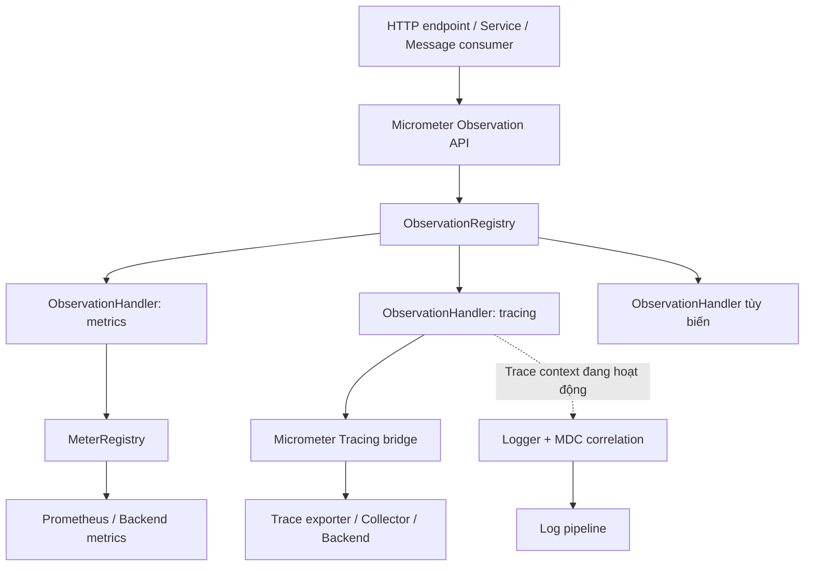
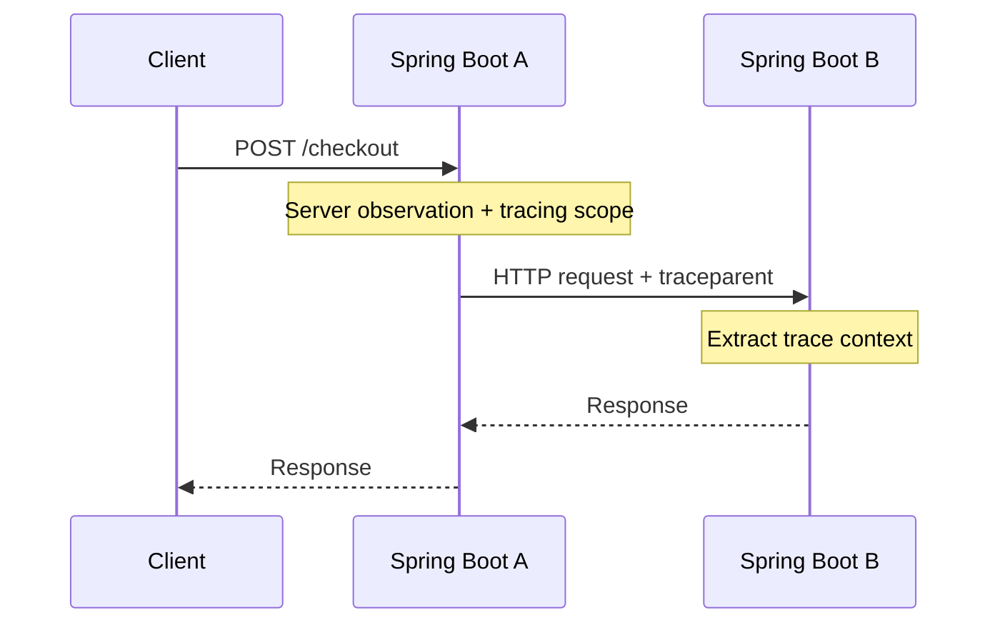

# Observation là gì?

Khi một request `POST /checkout` mất 2 giây, bạn muốn biết nó chậm ở bước nào, có bao nhiêu lần xảy ra, những request lỗi có điểm chung gì và có thể đối chiếu log của chúng với trace hay không. Nếu mỗi lần cần đo lại phải tự viết riêng một timer, một span và một hệ thống gắn tag, mã nghiệp vụ sẽ nhanh chóng phụ thuộc vào nhiều công nghệ thu thập telemetry.

**Micrometer Observation** giải quyết vấn đề đó bằng một API chung để **quan sát một thao tác có tên, có vòng đời và có ngữ cảnh**. Ứng dụng mô tả *đang thực hiện việc gì*; các thành phần xử lý observation quyết định *ghi nhận việc đó ra những tín hiệu nào*, chẳng hạn metrics hoặc distributed traces.

Trong module **SPRING_BOOT_OBSERVABILITY**, Observation là điểm kết nối quan trọng giữa instrumentation trong Spring Boot và các tín hiệu metrics, logs, traces. Hiểu đúng Observation sẽ giúp bạn gắn instrumentation đúng vị trí, duy trì trace context, chọn tag hợp lý, kiểm soát sampling và exporter, rồi liên kết những bằng chứng đó khi điều tra lỗi hoặc độ trễ trên môi trường thực.

Sau bài học, bạn có thể:

1. Giải thích Observation khác metric, timer, log và span ở chỗ nào.
2. Mô tả các thành phần `Observation`, `ObservationRegistry`, `ObservationHandler`, `Observation.Context` và vòng đời start → scope → stop.
3. Tạo custom Observation trong một Spring Boot service, ghi nhận lỗi, phân biệt low-cardinality và high-cardinality key-value.
4. Hiểu điều kiện để một Observation xuất hiện dưới dạng metric hoặc trace và để logs mang trace context.
5. Tránh trùng instrumentation, mất context, nổ cardinality và các kết luận sai khi telemetry thiếu dữ liệu.

## 1. Một Observation đại diện cho điều gì?

Một **Observation** đại diện cho *một lần thực hiện một hoạt động có ý nghĩa đối với hệ thống*. Ví dụ:

- Xử lý một HTTP request.
- Gọi dịch vụ thanh toán.
- Giữ chỗ một mặt hàng trong kho.
- Chạy một tác vụ theo lịch.
- Xử lý một thông điệp từ message broker.

Mỗi lần gọi `payment.authorize` là một occurrence (một lần quan sát), với thời điểm bắt đầu, kết thúc, ngữ cảnh và kết quả riêng. Nhiều occurrence có thể được tổng hợp thành một metric theo thời gian. Nếu hệ thống cấu hình tracing, mỗi occurrence cũng có thể trở thành một span hoặc bổ sung ngữ cảnh cho trace hiện có, tùy `ObservationHandler`.

Hãy phân biệt các khái niệm trước khi viết code:

| Khái niệm | Mô tả | Ví dụ |
| --- | --- | --- |
| **Observation** | Đối tượng ghi nhận vòng đời và ngữ cảnh một thao tác | Một lần `checkout.authorize` |
| **Meter/Timer** | Công cụ đo/tổng hợp số liệu theo tên và tag | Số lần gọi, tổng thời gian, histogram độ trễ |
| **Span** | Đơn vị công việc trong distributed trace; có quan hệ với spans khác | Span HTTP server và span gọi `payment` |
| **Log event** | Bản ghi về một sự kiện cụ thể | `payment rejected: insufficient balance` |
| **Observation context** | Dữ liệu đi kèm để các handler và convention sử dụng | Tên thao tác, key-values, exception |
| **Trace context** | Ngữ cảnh định danh và liên kết trace/span giữa các bước | `traceId`, `spanId`, `traceparent` |

**Observation không phải là một metric hoặc một span theo bản chất.** Nó là lớp biểu diễn ở mức instrumentation. Cùng một Observation có thể được nhiều handler xử lý; một handler tạo metric, handler khác tạo span. Ngược lại, không phải mọi metric hay log của ứng dụng đều xuất phát từ Observation: JVM metrics, gauge của connection pool và log nghiệp vụ có thể đến từ những cơ chế riêng.

### Ví dụ: cùng một thao tác, ba câu hỏi khác nhau

Giả sử `inventory.reserve` vừa mất 870 ms:

- **Metric:** Trong 5 phút, tỷ lệ chậm trên 500 ms là bao nhiêu? p95 hoặc p99 của thao tác này thay đổi thế nào?
- **Trace:** Trong request cụ thể, `inventory.reserve` nằm ở đâu trên đường đi từ HTTP controller đến database/API tồn kho?
- **Log:** Tại thời điểm ấy, hệ thống ghi nhận kết quả đặt chỗ, ngoại lệ hay chính sách retry nào?

Để trả lời cả ba câu hỏi, Observation cung cấp điểm instrumentation thống nhất; metrics/tracing/logging cần cấu hình và pipeline phù hợp để sử dụng ngữ cảnh đó.

## 2. Observation nằm ở đâu trong kiến trúc Micrometer?

Luồng khái niệm:



Sơ đồ là góc nhìn logic: chi tiết handler, bridge và exporter thay đổi theo phiên bản/thư viện. **ObservationRegistry không tự lưu metrics hoặc traces**; nó tổ chức các cấu phần xử lý Observation. Cần có handler và backend thích hợp để dữ liệu thực sự được đo, xuất và truy vấn.

### 2.1. Các thành phần chính

**`Observation`** — API mà mã ứng dụng sử dụng để khai báo tên, mở/đóng một thao tác, gắn key-value, ghi nhận exception hay event.

**`ObservationRegistry`** — điểm tập trung cấu hình và quản lý các handler, predicate, filter và convention liên quan. Trong ứng dụng Spring Boot có Actuator và autoconfiguration phù hợp, registry thường được cung cấp dưới dạng bean để inject; không nên tự tạo registry mới cho mỗi service nếu muốn dùng chung instrumentation mà Boot đã cấu hình.

**`ObservationHandler`** — nhận callback trong vòng đời observation, chẳng hạn khi bắt đầu, kết thúc, mở scope hoặc ghi nhận lỗi. Handler có thể đọc `Observation.Context` để cập nhật Timer, tạo/đóng span hoặc thực hiện tác vụ thu thập khác. Handler không nhất thiết xử lý mọi loại context; `supportsContext(...)` quyết định phạm vi được hỗ trợ.

**`Observation.Context`** — nơi mang metadata của một observation: tên, contextual name, key-values, error, event và dữ liệu tùy biến mà handler có thể sử dụng. Context này **khác** trace propagation context được truyền qua HTTP/message headers, mặc dù tracing handler có thể liên kết chúng.

**`ObservationConvention`** — quy ước đặt tên và tạo key-values nhất quán cho một nhóm observation. Convention đặc biệt hữu ích khi nhiều chỗ cùng instrument một loại thao tác và cần bảo đảm metric name/route/status được chuẩn hóa.

Có thể xem Observation như *hợp đồng giữa mã nghiệp vụ và hệ thống ghi nhận telemetry*: nghiệp vụ nói “đây là một bước thanh toán”; handler nói “khi nào tôi đo thời lượng, tạo span, xuất dữ liệu”.

## 3. Vòng đời của một Observation

Một Observation có hai khái niệm thời gian phải phân biệt:

- **Lifetime:** Từ khi gọi `start()` đến `stop()`. Handler có thể đo thời gian tồn tại của thao tác bằng ranh giới này.
- **Scope:** Khoảng thời gian observation được xem là *current observation* trong ngữ cảnh thực thi. Scope thường hỗ trợ việc gắn quan hệ cha–con cho span, điền thông tin correlation vào log và tìm observation hiện tại.

```text
Thời gian ---------------------------------------------------->
           start()                           stop()
              |================================|
                 openScope()    closeScope()
                      |-------------|
                 current observation

Dấu '=': thời gian observation sống
Dấu '-': khoảng scope hiện hành trên luồng thực thi
```

Các hành động quan trọng:

| Hành động | Ý nghĩa | Lỗi phổ biến |
| --- | --- | --- |
| `createNotStarted(name, registry)` | Tạo observation chưa chạy | Tưởng rằng tạo xong là đã phát metric |
| `start()` | Bắt đầu lifetime, gọi handler tương ứng | Quên `stop()` khiến duration/span thiếu kết thúc |
| `openScope()` | Đưa observation vào ngữ cảnh hiện hành; trả về `Scope` | Không đóng scope, làm context rò sang công việc tiếp theo |
| `lowCardinalityKeyValue(k, v)` | Gắn chiều giá trị hữu hạn, phù hợp cho metric | Đưa `userId` hoặc URL động vào tag |
| `highCardinalityKeyValue(k, v)` | Gắn ngữ cảnh chi tiết cho tracing handler khi hỗ trợ | Cho rằng có thể dùng dữ liệu nhạy cảm tùy ý |
| `event(...)` | Báo một mốc/sự kiện trong lifetime | Cho rằng mọi backend đều lưu đầy đủ event |
| `error(exception)` | Ghi nhận exception vào observation | Không ghi lỗi khi tự bắt rồi nuốt exception |
| `stop()` | Kết thúc lifetime, kích hoạt xử lý cuối | Dừng lặp hoặc dừng hai lần do quản lý vòng đời sai |
| `observe(...)` | Bao một lambda bằng start/scope/stop và xử lý exception | Trộn thêm `start()`/`stop()` thủ công trên cùng observation |

### 3.1. Dùng `observe(...)` khi thao tác đồng bộ, có ranh giới rõ

Ví dụ dưới đây sử dụng **Spring Boot 3.x** (Java 17 trở lên). Giả sử `PaymentGateway` là một dependency đã được triển khai thành bean:

```java
import io.micrometer.observation.Observation;
import io.micrometer.observation.ObservationRegistry;
import org.springframework.stereotype.Service;

@Service
public class CheckoutService {

    private final PaymentGateway gateway;
    private final ObservationRegistry registry;

    public CheckoutService(PaymentGateway gateway, ObservationRegistry registry) {
        this.gateway = gateway;
        this.registry = registry;
    }

    public String authorize(String paymentMethod, String paymentToken) {
        String methodTag = switch (paymentMethod == null ? "" : paymentMethod) {
            case "card" -> "card";
            case "bank_transfer" -> "bank_transfer";
            default -> "other";
        };

        return Observation.createNotStarted("checkout.authorize", registry)
                .contextualName("authorize payment")
                .lowCardinalityKeyValue("payment.method", methodTag)
                .observe(() -> gateway.authorize(paymentToken));
    }
}

// Interface minh họa. Ứng dụng cung cấp implementation dưới dạng Spring bean.
interface PaymentGateway {
    String authorize(String paymentToken);
}
```

**Điều gì xảy ra khi gọi `authorize(...)`?**

1. Tạo Observation có tên ổn định `checkout.authorize`; giá trị `payment.method` chỉ thuộc tập `card`, `bank_transfer`, `other`.
2. `observe(...)` mở vòng đời và scope, gọi `gateway.authorize(...)`, rồi đóng scope và stop observation.
3. Nếu lambda ném exception, API ghi nhận lỗi và truyền exception ra ngoài; không biến exception thành một kết quả thành công.
4. Các handler đã cài trong registry quyết định có cập nhật timer, tạo span, ghi nhận error hay không.

`paymentToken` là dữ liệu nhạy cảm của lời gọi nghiệp vụ: **không đưa vào metric tag, trace attribute hoặc log**. Trong ứng dụng thật, cần bảo đảm token được xử lý theo tiêu chuẩn bảo mật phù hợp.

Trong ví dụ này, tên `checkout.authorize` không phải tên exporter buộc phải giữ nguyên. Hệ thống metrics có thể chuyển tên theo quy ước của Prometheus hoặc backend khác; tìm meter gốc bằng Actuator và tìm tên exported bằng endpoint/exporter.

### 3.2. Quản lý lifetime thủ công khi có nhiều bước

Nếu cần bắt đầu đo trước một loạt lệnh và tự kiểm soát các ranh giới:

```java
import io.micrometer.observation.Observation;
import io.micrometer.observation.ObservationRegistry;

public void processBatch(ObservationRegistry registry, Runnable work) {
    Observation observation = Observation
            .createNotStarted("batch.process", registry)
            .lowCardinalityKeyValue("job", "nightly-settlement")
            .start();

    try (Observation.Scope scope = observation.openScope()) {
        work.run();
    } catch (RuntimeException exception) {
        observation.error(exception);
        throw exception;
    } finally {
        observation.stop();
    }
}
```

`try-with-resources` bảo đảm scope được đóng ngay cả khi công việc ném lỗi. `finally` bảo đảm `stop()` được gọi. `observation.error(exception)` báo cho handler biết có exception; nhưng quy tắc xác định **business failure** vẫn do ứng dụng quyết định. Chẳng hạn, `reserve()` trả `false` có thể là một trường hợp hết hàng hợp lệ chứ không phải exception. Bạn cần một tín hiệu nghiệp vụ riêng nếu muốn cảnh báo tỷ lệ bị từ chối.

> **Điểm dễ nhầm:** `openScope()` không thay thế `start()`, và `stop()` không tự sửa mọi lỗi propagation đã xảy ra. Quản lý vòng đời và truyền context qua ranh giới thực thi là hai trách nhiệm liên quan nhưng khác nhau.

## 4. Observation tạo metrics và traces như thế nào?

Một Observation với tên `checkout.authorize` có thể đi qua các handler theo hai hướng:

**Hướng metrics.** Một metrics handler đo lifetime và gắn **low-cardinality key-values** vào meter. Nhiều lần gọi cùng tên/tập tag được tổng hợp: số lần, tổng thời gian, max và có thể có histogram/percentiles khi được cấu hình. Dữ liệu cuối cùng được xuất qua một `MeterRegistry` như Prometheus registry.

**Hướng tracing.** Một tracing handler có thể tạo span, dùng `contextualName` để đặt tên dễ đọc trên trace, gắn thuộc tính, đánh dấu lỗi và liên kết với span hiện tại. Bridge như Micrometer Tracing → OpenTelemetry chịu trách nhiệm kết nối với hệ sinh thái tracing; exporter chuyển dữ liệu đến collector/backend.

**Hướng logs.** Bản thân Observation **không tự tạo log nghiệp vụ**. Nếu có tracing và MDC/log correlation được cấu hình, log được phát *bên trong scope* có thể mang `traceId`/`spanId`. Kết quả là bạn có thể tra log theo trace của request, kể cả khi log đó được viết bằng SLF4J bình thường.

```text
Một lần checkout.authorize
        |
        +--> Metrics handler --> Timer + low-cardinality tags
        |
        +--> Tracing handler --> Span + trace/span context
        |
        +--> Scope đang hoạt động --> Log có correlation (khi cấu hình)
```

Ba nhánh **có điều kiện**: nếu không có handler, bridge, exporter hoặc hệ thống lưu trữ phù hợp, một hoặc nhiều nhánh sẽ không có dữ liệu đầu ra. Tracing có thể bị sampling loại; điều đó không đồng nghĩa metric của request cũng bị bỏ.

### Observation name và contextual name

Phân biệt hai tên:

- **Observation name** như `checkout.authorize`: tên kỹ thuật **ổn định**, thích hợp để gom dữ liệu và tạo meter.
- **Contextual name** như `authorize payment`: cách mô tả thân thiện hơn cho một occurrence/span trong trace, khi handler hỗ trợ.

Không nên đặt tên là `checkout.customer-12345` hoặc `authorize order 98765` vì tên động gây phân mảnh dữ liệu. Dùng tên ổn định, key-value có kiểm soát và trường correlation riêng.

### Key-values là dữ liệu của observation, chưa chắc là label được export

`lowCardinalityKeyValue(...)` và `highCardinalityKeyValue(...)` được khai báo trên Observation; handler/convention quyết định cách ánh xạ chúng ra metric labels và trace attributes. Cùng một key-value không bảo đảm hiển thị giống nhau ở mọi backend. Khi debug, kiểm tra cả mã instrumentation, handler, cấu hình exporter lẫn phép truy vấn ở backend.

## 5. Gắn key-value đúng cách: cardinality và quyền riêng tư

**Cardinality** là số lượng giá trị khác nhau của một chiều dữ liệu, hoặc số tổ hợp label của một metric. Ví dụ một metric với:

- `operation`: 4 giá trị;
- `outcome`: 3 giá trị;
- `provider`: 5 giá trị;

có thể tạo tới `4 × 3 × 5 = 60` tập nhãn cho cùng một loại meter, chưa tính instance, route hay histogram buckets. Chèn thêm `customerId` với 100.000 giá trị sẽ khiến số series tiềm năng bùng nổ.

| Dữ liệu | Đặt ở đâu | Vì sao |
| --- | --- | --- |
| `operation=authorize`, `outcome=success|failure` | Low-cardinality key-value | Ít giá trị, nhóm được trong metrics |
| `payment.provider=provider-a|provider-b` | Low-cardinality nếu tập provider được kiểm soát | So sánh độ trễ/lỗi theo nhà cung cấp |
| `http.route=/orders/{id}` | Low-cardinality | Gom endpoint theo mẫu route, không theo ID thật |
| `order.id`, `user.id`, email, token | Không đưa vào metrics; cân nhắc tối thiểu hóa dữ liệu trong traces/logs | Cardinality cao, có thể là dữ liệu nhạy cảm |
| Mã phân loại lỗi hữu hạn `failure.reason=timeout|declined|other` | Low-cardinality nếu định nghĩa rõ | Cho phép phân tích lỗi theo nhóm |

Micrometer Observation cung cấp API `highCardinalityKeyValue(...)` cho ngữ cảnh chi tiết mà tracing handler có thể sử dụng. **“High-cardinality” không có nghĩa “được phép lưu mọi dữ liệu”.** Chỉ gắn dữ liệu cần cho chẩn đoán, hạn chế dữ liệu định danh cá nhân, secret, token, payload; thực hiện masking và phân quyền lưu trữ.

Một số thực hành hữu ích:

1. Đặt tên observation, label và value theo một từ điển nhất quán giữa các service.
2. Chuẩn hóa URL có tham số động thành route mẫu; chặn các input tùy ý trở thành metric label.
3. Đừng thêm cùng một thông tin hai lần ở instrumentation framework và custom observation.
4. Nếu một tag có thể tăng vô hạn theo người dùng, request hoặc giao dịch, tìm cơ chế correlation/tracing thay thế.
5. Dùng `ObservationConvention` khi một nhóm operation cần quy tắc đặt tên và key-values thống nhất.

## 6. Dùng Observation trong Spring Boot

### 6.1. Dependency tối thiểu và các đường xuất tín hiệu

Trong ví dụ **Spring Boot 3.x**, ứng dụng đã dùng BOM/dependency management của Spring Boot. Với Maven:

```xml
<!-- Actuator đưa các tích hợp Observation và endpoint vận hành vào ứng dụng -->
<dependency>
    <groupId>org.springframework.boot</groupId>
    <artifactId>spring-boot-starter-actuator</artifactId>
</dependency>

<!-- Chỉ thêm khi muốn xuất metrics cho Prometheus -->
<dependency>
    <groupId>io.micrometer</groupId>
    <artifactId>micrometer-registry-prometheus</artifactId>
</dependency>

<!-- Chỉ thêm khi dùng Micrometer Tracing qua OpenTelemetry -->
<dependency>
    <groupId>io.micrometer</groupId>
    <artifactId>micrometer-tracing-bridge-otel</artifactId>
</dependency>

<!-- Export traces qua OTLP tới collector/backend -->
<dependency>
    <groupId>io.opentelemetry</groupId>
    <artifactId>opentelemetry-exporter-otlp</artifactId>
</dependency>
```

`spring-boot-starter-actuator` cung cấp cơ sở auto-configuration cho quan sát và metrics; nếu cần HTTP endpoint phải có web starter tương ứng. Prometheus registry, tracing bridge và exporter phục vụ những mục đích khác nhau. **Thêm bridge không tự tạo collector**, và exporter không tự tạo dashboard.

Một cấu hình minh họa cho Spring Boot 3.x:

```yaml
management:
  endpoints:
    web:
      exposure:
        include: health,info,metrics,prometheus
  tracing:
    sampling:
      probability: 0.1
  otlp:
    tracing:
      endpoint: http://localhost:4318/v1/traces
```

Cấu hình này giả định OTLP HTTP collector đang lắng nghe tại `localhost:4318`; thay endpoint theo môi trường. Sampling `0.1` nghĩa là tỉ lệ lấy mẫu traces theo chính sách tracing, **không phải** chỉ đo 10% timers. Ở môi trường lab có thể chọn sampling `1.0` để dễ quan sát, nhưng cần cân nhắc chi phí và tải khi triển khai thực.

Có thể dùng các endpoint sau để xác minh:

```bash
curl -fsS http://localhost:8080/actuator/health
curl -fsS http://localhost:8080/actuator/metrics
curl -fsS http://localhost:8080/actuator/metrics/checkout.authorize
curl -fsS http://localhost:8080/actuator/prometheus
```

Ví dụ giả định Actuator ở cổng `8080`; `checkout.authorize` chỉ xuất hiện **sau khi** code instrumentation đã chạy và có metrics handler phù hợp. Không tự động coi việc curl không thấy meter là lỗi của mã Java: có thể ứng dụng chưa chạy lời gọi, meter bị lọc, metrics registry chưa tích hợp hoặc endpoint không được expose.

**Lưu ý phiên bản:** Cấu trúc dependency và thuộc tính OTLP/tracing của Spring Boot **4.x** có thay đổi so với 3.x; 4.x có starter tích hợp OpenTelemetry riêng và nhóm cấu hình export tương ứng. Khi nâng cấp, tham khảo reference documentation đúng phiên bản đang chạy, thay vì sao chép nguyên property ví dụ 3.x.

**Bảo vệ Actuator:** Dùng network segmentation, authentication/authorization và cấu hình exposure phù hợp. Các endpoint `/actuator/metrics` hoặc `/actuator/prometheus` chứa thông tin vận hành, không nên mặc định công khai ra Internet.

### 6.2. Khi nào cần custom observation?

Nhiều đường đi đã được Spring Boot và thư viện instrument sẵn, chẳng hạn HTTP server request, một số HTTP client hoặc thành phần tích hợp. Chỉ nên tạo Observation mới cho một **ranh giới có ý nghĩa**, ví dụ:

- Bước `checkout.authorize` bao gồm logic xử lý nghiệp vụ mà HTTP server timer không thể phân biệt.
- Tác vụ `report.generate` được chạy theo lịch.
- Lời gọi `inventory.reserve` có mục tiêu độ trễ riêng.
- Thao tác xử lý batch/message cần ghi nhận outcome và thời gian tách biệt.

Nếu framework đã tạo span cho outbound HTTP call, tạo thêm một Observation bọc đúng lời gọi đó có thể hữu ích khi đo *toàn bộ bước nghiệp vụ*, nhưng cũng có thể tạo **hai spans chồng nhau** nếu bọc trùng đúng ranh giới của client. Xem trace thực tế, quyết định mỗi span đại diện cho công việc nào và chỉ giữ những ranh giới có ích khi điều tra.

### 6.3. `@Observed` có thể thay mã bọc nhưng cần cấu hình

Micrometer cung cấp `@Observed` để instrument phương thức theo kiểu AOP. Ví dụ:

```java
import io.micrometer.observation.annotation.Observed;
import org.springframework.stereotype.Service;

@Service
public class PricingService {

    @Observed(name = "pricing.calculate", contextualName = "calculate price")
    public long calculate(long basePrice) {
        return basePrice;
    }
}
```

**Chỉ có annotation chưa bảo đảm observation hoạt động.** Cần aspect/AOP instrumentation tương ứng (ví dụ `ObservedAspect` và Spring AOP được cấu hình đúng), đồng thời method call phải đi qua Spring proxy. Việc gọi nội bộ `this.calculate(...)` trong cùng class có thể bỏ qua proxy AOP. Vì vậy, hãy kiểm tra bằng meter/trace thực tế và chọn giữa instrumentation thủ công với annotation tùy ranh giới nghiệp vụ, đặc biệt với async/reactive methods.

## 7. Scope, tracing và propagation ngữ cảnh

Với tracing, một Observation được mở scope có thể trở thành span hiện hành trong phần việc bên trong; một Observation con được tạo trong scope có thể liên kết với ngữ cảnh cha. Tuy vậy, **scope gắn với ngữ cảnh thực thi hiện tại**, không thể giả định rằng nó tự động truyền qua mọi thread, executor, message broker hoặc service.



HTTP propagation thường dựa trên chuẩn **W3C Trace Context**, đặc biệt header `traceparent`. Micrometer Tracing và instrumentation của client/server có nhiệm vụ inject/extract context, khi đã được cấu hình đúng.

Trong Spring Boot, ưu tiên sử dụng `RestClient.Builder` hoặc `WebClient.Builder` do Spring Boot cung cấp để tận dụng các customizer/observation instrumentation. Tự khởi tạo client ngoài cơ chế của Boot có thể bỏ qua instrumentation và làm đứt trace. Với async executor hoặc message listener, kiểm tra context propagation bằng các integration và cơ chế như Micrometer Context Propagation, thay vì suy đoán rằng thread mới sẽ thừa hưởng scope của thread cũ.

**Ví dụ mất context:** request HTTP mở observation cha ở thread A, nhưng tác vụ sau đó chạy ở thread B mà không có context được truyền. Log trên B có thể thiếu `traceId`; span tạo ở B có thể thành trace mới hoặc span không có cha. Lúc đó số lượng request vẫn được metrics ghi nhận nhưng đường trace không còn liên tục.

Một observation còn đang được xử lý không bảo đảm log nào cũng có correlation. Log phải phát ở scope có tracing context hiệu lực, hệ thống logging phải được cấu hình MDC/correlation và log pipeline phải giữ lại các trường đó. Khi trace bị sampling loại bỏ, tùy cấu hình bạn vẫn có thể thấy trace ID trong log dù backend không lưu trace tương ứng.

## 8. Errors, events, sampling và những điểm mù

### 8.1. Error của Observation khác business outcome

Khi đoạn code được bao bởi `observe(...)` ném exception, Observation có thể ghi nhận exception và handler dùng thông tin đó. Tuy nhiên:

- Một request trả `200` nhưng `approved=false` có thể là lỗi nghiệp vụ theo SLI của doanh nghiệp.
- Một request trả `409 Conflict` có thể là kết quả kỳ vọng, không phải sự cố vận hành.
- Exception bị catch rồi chuyển thành kết quả fallback có thể không còn đi ra khỏi lambda; bạn cần chủ động định nghĩa và ghi nhận tình trạng nếu muốn đo fallback rate.

Hãy tách **technical failure** (timeout, exception, lỗi dependency) và **business outcome** (approve, reject, pending) thành những chiều hoặc metric phù hợp, có tập giá trị giới hạn. Không đánh dấu mọi kết quả từ chối là exception để tạo dashboard “đỏ” giả tạo.

### 8.2. Event không thay thế log có cấu trúc

Một Observation có thể nhận event:

```java
Observation observation =
        Observation.createNotStarted("order.process", registry).start();

try (Observation.Scope scope = observation.openScope()) {
    observation.event(Observation.Event.of("inventory_checked"));
    // Thực hiện các bước xử lý đơn hàng ...
} finally {
    observation.stop();
}
```

Event có thể hữu ích với tracing handler/backend hỗ trợ sự kiện trên span. Nhưng **không có gì bảo đảm mỗi event tự biến thành một dòng log hoặc được mọi exporter lưu lại**. Với những thông tin nghiệp vụ cần lưu lâu dài/audit, dùng cơ chế logging hoặc audit riêng được thiết kế cho mục tiêu đó.

### 8.3. Sampling, metrics và exporter

Tracing có thể áp dụng head sampling hoặc chính sách khác; trace hiếm có thể không được thu thập. Vì vậy:

- **Metrics** là nguồn chính để xem tỷ lệ, xu hướng và SLI trên nhiều request, nếu pipeline metrics hoạt động bình thường.
- **Traces** cho thấy chuỗi xử lý và thời gian của những request được thu thập; trace được lấy mẫu không nhất thiết đại diện thống kê cho toàn bộ request.
- **Logs** giúp xem sự kiện và exception cụ thể, nhưng chỉ liên kết được với trace khi có correlation context.
- **Exporter/collector** có thể hỏng hoặc quá tải. Không có trace trong backend không chứng minh request không xảy ra.

Tách lỗi instrumentation và lỗi pipeline telemetry khỏi lỗi thật của nghiệp vụ. Khi một bước `checkout.authorize` bị chậm nhưng timer có dữ liệu còn trace không thấy, hãy kiểm tra sampling, tracing handler, propagation, exporter, collector và khả năng truy vấn backend trước khi kết luận rằng observation chưa chạy.

## 9. Ví dụ điều tra sự cố với Observation

**Tình huống:** Sau khi tăng lưu lượng, p95 `POST /checkout` tăng từ 250 ms lên 1,8 giây. Dashboard cho thấy CPU chỉ 40%, trong khi khách hàng bắt đầu nhận `504` tại gateway.

Nhờ custom `checkout.authorize` observation và HTTP instrumentation sẵn có, bạn lần lượt đối chiếu:

| Bằng chứng | Câu hỏi cần trả lời | Hành động |
| --- | --- | --- |
| Gateway `504` và upstream latency | Request nào người dùng thực sự thấy thất bại? | Đo tỷ lệ lỗi tại ranh giới gateway |
| HTTP server timer và `checkout.authorize` timer | Phần lớn độ trễ thuộc toàn request hay bước thanh toán? | So sánh latency distributions, count và tag |
| Trace chứa server/client spans | Thời gian dồn vào bước nào, có retry hay chờ downstream? | Mở trace mẫu của request chậm |
| Logs có `traceId` | Có exception, fallback hoặc retry cùng lúc? | Truy vấn log theo trace/context |
| Pool queue, connection timeout, backend latency | Có bão hòa tài nguyên hoặc dependency chậm? | Kiểm chứng bằng metrics/traces của dependency |
| Synthetic check sau khắc phục | Người dùng đã nhận phản hồi ổn định chưa? | Xác nhận lại SLI bên ngoài |

Ví dụ một trace cho thấy `checkout.authorize` mất 1,5 giây, trong đó HTTP client gọi payment service mất 1,4 giây. Điều này giúp **khoanh vùng nơi chậm**, nhưng chưa chỉ ra nguyên nhân gốc. Bạn vẫn cần xem timeout, retry, số kết nối chờ, mạng, lỗi dependency và thay đổi triển khai.

Nếu `checkout.authorize` metrics không đổi nhưng gateway timeout tăng, hãy kiểm tra xem request có vào ứng dụng không, thời gian chờ ở ingress, nguồn đo, sampling, hoặc liệu observation có bọc đúng ranh giới cần đo hay không. Metrics và traces ở nhiều tầng có thể khác nhau vì **mẫu số khác nhau**.

### Các lỗi thiết kế cần tự phát hiện

| Biểu hiện | Nguyên nhân có thể | Cách xử lý |
| --- | --- | --- |
| Không thấy metric của Observation tùy biến | Chưa chạy code, registry/metrics handler thiếu, meter bị lọc | Kích hoạt thao tác, kiểm tra `/actuator/metrics` và cấu hình |
| Có metric, không thấy trace | Thiếu tracing bridge/handler, sampling hoặc exporter lỗi | Kiểm tra pipeline tracing và log collector |
| Có traces nhưng child spans không nối nhau | Scope/context mất qua async hoặc client không instrument | Kiểm tra context propagation, client builder, message headers |
| Metric có quá nhiều series | Dùng `orderId`, URL động hoặc `userId` làm tag | Chuẩn hóa route và low-cardinality labels |
| Thời gian đo sai, span treo | Thiếu `stop()`, scope quản lý sai hoặc bọc nhầm ranh giới | Dùng `observe(...)` hoặc `try/finally` rõ ràng |
| Cùng một lời gọi có nhiều spans giống nhau | Custom Observation trùng instrumentation sẵn có | Giữ ranh giới nghiệp vụ có ý nghĩa, loại phần trùng |
| Log không có `traceId` | Thiếu MDC/correlation, phát ngoài scope hoặc mất context | Xác minh cấu hình logging/tracing và thread context |

## 10. Bài thực hành: theo dõi một bước nghiệp vụ

Dùng một Spring Boot API có Actuator và một service thử nghiệm. Làm các bước theo thứ tự:

1. **Tạo thao tác:** thêm `Observation.createNotStarted("demo.reserve", registry).observe(...)` xung quanh logic giả lập đặt hàng.
2. **Thêm low-cardinality tag:** `outcome=accepted|rejected`, bảo đảm số giá trị hữu hạn. Chạy nhiều lần với cả hai kết quả và xem metric count/duration.
3. **Tạo độ trễ có kiểm soát ở môi trường lab:** so sánh metric thời gian với trace mẫu. Nhìn nơi span bắt đầu/kết thúc và xác nhận không đo nhầm phần sleep hoặc setup.
4. **Tạo exception:** quan sát khi lambda ném lỗi, so sánh log, metric outcome và thông tin lỗi trên trace. Phân biệt kết quả `rejected` hợp lệ với exception.
5. **Thử propagation:** gọi service thứ hai bằng HTTP client do Boot cấu hình; so sánh trace tree và log correlation ở cả hai nơi.
6. **Giảm sampling:** xem metrics vẫn cho biết tổng số thao tác trong khi không phải request nào cũng có trace được lưu.
7. **Kiểm tra cardinality:** giả sử có 100.000 mã đơn, giải thích vì sao không dùng `orderId` làm metric label và đề xuất cách điều tra request cá biệt bằng trace/log correlation.

Ba câu hỏi tự kiểm tra:

**1. Nếu một Observation được tạo nhưng không có handler nào ghi metric, điều gì xảy ra?**  
Observation vẫn là lời gọi API hợp lệ; không thể kỳ vọng metric tự xuất hiện. Cần registry và handler/registry xuất tín hiệu phù hợp.

**2. Tại sao `start()` và `openScope()` khác nhau?**  
`start()` đánh dấu lifetime để đo một thao tác; `openScope()` đặt nó vào ngữ cảnh thực thi hiện hành để liên kết hoạt động con và correlation, thường chỉ trong phạm vi scope.

**3. Có thể kết luận hệ thống không có lỗi vì không tìm thấy trace lỗi không?**  
Không. Trace có thể bị sampling loại bỏ, mất context, không được instrument, lỗi exporter/collector hoặc chưa được backend lưu. Hãy đối chiếu metrics, logs và tín hiệu tại ranh giới người dùng.

## 11. Ghi nhớ

- **Observation là API mô tả một thao tác**, không đồng nhất với metric, span hay log.
- **`ObservationRegistry` cùng các handler** quyết định tín hiệu gì được tạo. Có code instrumentation chưa đồng nghĩa dữ liệu đã được export hoặc lưu.
- **`start()`/`stop()` quản lý lifetime; scope quản lý current observation.** Ưu tiên `observe(...)` cho thao tác đồng bộ, bao `stop()` bằng `finally` khi cần làm thủ công.
- **Tên và low-cardinality keys phải ổn định.** Tránh token, ID cá nhân, URL động trong label; dùng correlation với quyền truy cập thích hợp để điều tra request riêng lẻ.
- **Propagation, sampling và exporter là các mắt xích độc lập.** Đọc metrics, logs và traces cùng nhau khi xác định lỗi/độ trễ, và xác nhận kết quả bằng tín hiệu thực sự nhìn thấy từ phía người dùng.

### Tài liệu tham khảo

- [Micrometer — Observation documentation](https://docs.micrometer.io/micrometer/reference/observation.html)
- [Micrometer — Observation components](https://docs.micrometer.io/micrometer/reference/observation/components.html)
- [Spring Boot 3.5 — Observability](https://docs.spring.io/spring-boot/3.5/reference/actuator/observability.html)
- [Spring Boot 3.5 — Tracing](https://docs.spring.io/spring-boot/3.5/reference/actuator/tracing.html)
- [Spring Boot 4.0 — Observability](https://docs.spring.io/spring-boot/4.0/reference/actuator/observability.html)

