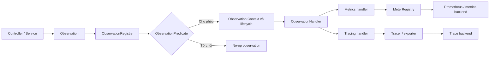
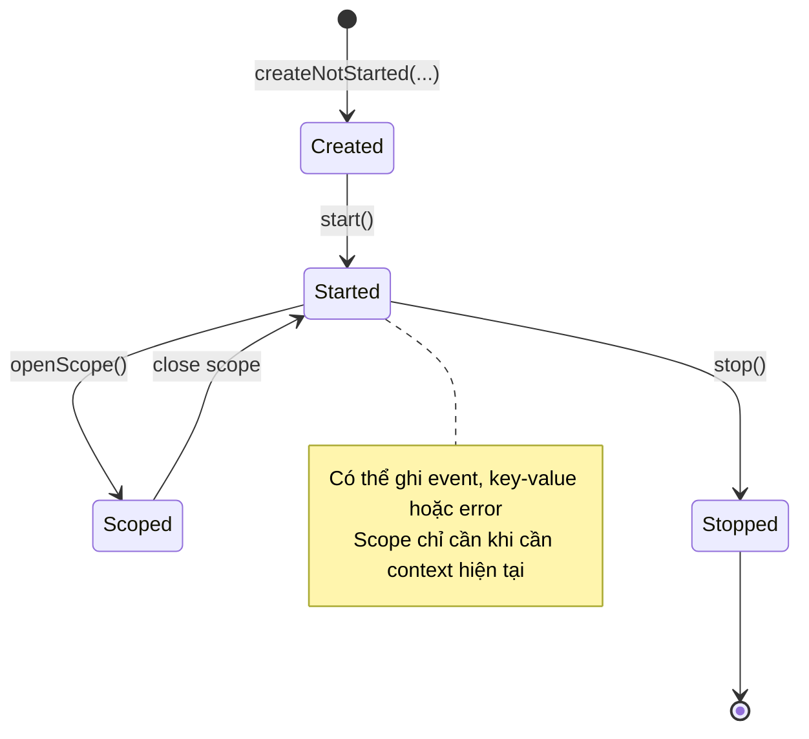

# ObservationRegistry: trung tâm điều phối Micrometer Observation

Khi điều tra API tạo đơn hàng chậm, ta thường muốn trả lời ba câu hỏi liên tiếp: *thao tác nào mất nhiều thời gian*, *request này đã đi qua những dịch vụ nào*, và *log lỗi thuộc về request nào*. Trong Spring Boot, **Micrometer Observation** giúp mô hình hóa một thao tác để các hệ thống metrics và tracing có thể khai thác cùng một nguồn ngữ cảnh. **ObservationRegistry** là thành phần điều phối các Observation đó.

Bài học thuộc chương **Micrometer Observation** của module `SPRING_BOOT_OBSERVABILITY`. Phạm vi của module là thiết lập observability cho Spring Boot qua Micrometer Observation, metrics, logs và distributed tracing, bao gồm propagation ngữ cảnh, tag/cardinality, exporter, sampling và liên kết tín hiệu để điều tra sự cố trong môi trường thực. Riêng bài này tập trung vào cách sử dụng và cấu hình **ObservationRegistry**; các hệ thống lưu trữ, hiển thị và thu thập tín hiệu được đề cập khi cần giải thích luồng dữ liệu.

## 1. ObservationRegistry giải quyết vấn đề gì?

Giả sử một service xử lý thanh toán cần đo độ trễ. Một cách làm là tự khởi tạo `Timer` rồi đo từng lần gọi. Khi cần tracing, ta lại tạo span thủ công; khi muốn kết nối log, ta phải bảo đảm ngữ cảnh trace đi đúng qua các hàm. Nếu từng đoạn code nghiệp vụ biết trực tiếp mọi thư viện giám sát, thay đổi hệ thống observability sẽ làm code khó bảo trì.

Micrometer tách *việc mô tả công việc cần quan sát* khỏi *cơ chế ghi nhận dữ liệu*:

1. Code nghiệp vụ tạo một `Observation` với tên ổn định và các key-value có ý nghĩa.
2. `ObservationRegistry` cung cấp cấu hình, quyết định observation có được chấp nhận hay không và định tuyến sự kiện vòng đời đến các `ObservationHandler`.
3. Handler phù hợp chuyển các sự kiện thành metric, span hoặc hành vi tích hợp khác.
4. Registry và handler không tự động thay thế Prometheus, OTLP Collector, hệ thống lưu log hay trace backend. Các thành phần này phải được cấu hình theo nhu cầu triển khai.

**Định nghĩa:** `ObservationRegistry` là điểm cấu hình và điều phối trung tâm cho các Micrometer Observation trong một phạm vi ứng dụng. Một Observation được tạo với registry sẽ dùng những predicate, convention, filter và handler đã đăng ký với registry đó.

### So sánh các đối tượng thường bị nhầm lẫn

| Đối tượng | Trách nhiệm | Ví dụ |
| --- | --- | --- |
| `Observation` | Đại diện cho một thao tác được quan sát và vòng đời của nó | `checkout.confirm` bắt đầu, phát sinh lỗi, kết thúc |
| `ObservationRegistry` | Giữ cấu hình quan sát, cung cấp ngữ cảnh observation hiện tại và điều phối handler | Bean được inject vào service |
| `Observation.Context` | Giữ dữ liệu và key-value liên quan đến một Observation | Tên thao tác, loại kênh, lỗi |
| `ObservationHandler` | Nhận callback vòng đời, tạo ra tín hiệu nếu hỗ trợ context | Handler ghi Timer hoặc tạo span |
| `MeterRegistry` | Đăng ký, tổng hợp và xuất dữ liệu metric | Counter, Timer, Gauge |
| `Tracer` | Tạo/quản lý span, trace context và hoạt động tracing | Micrometer Tracing bridge |
| Exporter/backend | Chuyển tiếp, lưu, truy vấn hoặc hiển thị tín hiệu | Prometheus, OTLP, Jaeger, Tempo |

Registry **không phải** kho lưu mọi Observation đã chạy. Nó cũng không phải nơi lưu trữ chuỗi thời gian metric hoặc trace history. Các handler và backend thực hiện những công việc đó theo cấu hình.

## 2. Cơ chế điều phối trong một ứng dụng



Đây là sơ đồ **khái niệm**, giản lược vị trí chính xác của một số callback và bộ lọc trong vòng đời. Điểm cần nhớ: application tạo Observation, registry quyết định cơ chế xử lý, còn handler chuyên trách chuyển đổi thành tín hiệu. Nếu có handler metrics nhưng không có handler tracing, nghiệp vụ vẫn chạy và có thể có metrics nhưng không có span tương ứng.

Một registry có thể phục vụ nhiều nhóm Observation:

- HTTP server/client được framework instrument sẵn;
- truy vấn cơ sở dữ liệu hoặc lời gọi đến thư viện có tích hợp;
- thao tác nghiệp vụ do lập trình viên instrument thủ công;
- xử lý message, tác vụ nền hoặc công việc bất đồng bộ có instrumentation thích hợp.

Không phải mọi thao tác tự động xuất hiện chỉ vì có một bean `ObservationRegistry`. Việc sinh observation phụ thuộc vào instrumentation của framework, thư viện hoặc code ứng dụng.

## 3. Tạo và nhận ObservationRegistry

### 3.1. Trong ứng dụng Spring Boot

Với Spring Boot 3.x, khi dùng `spring-boot-starter-actuator`, Boot cung cấp tích hợp Micrometer Observation và thường tự cấu hình bean `ObservationRegistry`. Cách sử dụng trong service là **inject bean đã được Boot quản lý**:

```xml
<dependencies>
    <dependency>
        <groupId>org.springframework.boot</groupId>
        <artifactId>spring-boot-starter-actuator</artifactId>
    </dependency>

    <!-- Thêm khi cần Prometheus scrape -->
    <dependency>
        <groupId>io.micrometer</groupId>
        <artifactId>micrometer-registry-prometheus</artifactId>
    </dependency>
</dependencies>
```

Trong các ví dụ Java tiếp theo, project dùng Spring Boot 3.x, Java 17+ và dependency được quản lý bằng Spring Boot BOM/parent. Chi tiết tự cấu hình hoặc thuộc tính có thể khác khi dùng phiên bản Spring Boot/Micrometer khác.

```java
import io.micrometer.observation.ObservationRegistry;
import org.springframework.stereotype.Service;

@Service
public class CheckoutService {
    private final ObservationRegistry observationRegistry;

    public CheckoutService(ObservationRegistry observationRegistry) {
        this.observationRegistry = observationRegistry;
    }

    // Những phương thức nghiệp vụ sẽ sử dụng cùng registry được inject.
}
```

Điều quan trọng là sử dụng registry từ container Spring cho các nghiệp vụ cùng ứng dụng. Nếu một service tự gọi `ObservationRegistry.create()` rồi dùng registry riêng, các handler/filter và chính sách đã được Boot cấu hình ở bean chính có thể không được áp dụng.

### 3.2. Trong ứng dụng Java thuần

Có thể tạo registry bằng:

```java
import io.micrometer.observation.ObservationRegistry;

ObservationRegistry registry = ObservationRegistry.create();
```

Registry mới cần được gắn handler và chính sách cần thiết nếu muốn ghi nhận metrics/traces. Registry đơn lẻ không tự sinh Prometheus metrics hay xuất span ra backend. Một Observation no-op hoặc một registry không được cấu hình ghi nhận vẫn cho phép code nghiệp vụ trong `observe(...)` chạy như bình thường.

**Quy tắc thực hành:** trong Spring Boot, inject bean; trong Java thuần hoặc bài thử nghiệm cô lập, có thể tạo registry và đăng ký handler bằng tay.

## 4. Vòng đời Observation và vai trò của registry

Vòng đời phổ biến:



- `createNotStarted(name, registry)` tạo Observation gắn với registry nhưng chưa bắt đầu đo thời gian.
- `start()` bắt đầu vòng đời; các handler phù hợp có thể nhận callback `onStart`.
- `openScope()` đặt Observation vào ngữ cảnh hiện tại trong phạm vi scope, giúp những thành phần tương thích truy cập observation đang hoạt động.
- `error(exception)` thông báo một lỗi cho Observation; gọi phương thức này **không thay thế việc ném hoặc xử lý exception** của nghiệp vụ.
- `stop()` kết thúc Observation và kích hoạt xử lý cuối vòng đời; phải được thực thi ngay cả khi nghiệp vụ thất bại.

### 4.1. Cách ngắn gọn: `observe(...)`

Ví dụ service xác nhận một giao dịch, dùng một số giá trị kênh thanh toán được chuẩn hóa:

```java
import io.micrometer.observation.Observation;
import io.micrometer.observation.ObservationRegistry;
import org.springframework.stereotype.Service;

@Service
public class PaymentService {
    private final ObservationRegistry registry;

    public PaymentService(ObservationRegistry registry) {
        this.registry = registry;
    }

    public String confirm(String orderRef, String paymentChannel) {
        String channel = normalizeChannel(paymentChannel);

        return Observation.createNotStarted("payment.confirm", registry)
            .contextualName("confirm-payment")
            .lowCardinalityKeyValue("payment.channel", channel)
            .highCardinalityKeyValue("order.ref", orderRef)
            .observe(() -> callPaymentProvider(orderRef));
    }

    private String normalizeChannel(String channel) {
        if ("card".equals(channel) || "bank".equals(channel)) {
            return channel;
        }
        return "other";
    }

    private String callPaymentProvider(String orderRef) {
        // Ví dụ minh họa: tại đây đặt adapter gọi đối tác thật,
        // kèm timeout, retry có kiểm soát và xử lý lỗi.
        return "confirmed";
    }
}
```

`observe(Supplier`)` tự quản lý các bước start, scope và stop của thao tác được bọc; khi exception phát sinh, cơ chế observation hỗ trợ ghi nhận lỗi rồi truyền lỗi để code gọi xử lý. Đây là cách phù hợp cho đoạn code đồng bộ ngắn.

Hai loại key-value mang mục đích khác nhau:

- `payment.channel` có ít giá trị (`card`, `bank`, `other`): **low cardinality** phù hợp làm nhãn metric để phân tích theo nhóm.
- `order.ref` có thể khác nhau ở mỗi yêu cầu: **high cardinality**, không nên làm metric tag. Dữ liệu như vậy có thể được handler tracing gắn vào span khi cấu hình phù hợp. Chỉ đưa mã tham chiếu vào telemetry nếu chính sách bảo mật cho phép; trong thực tế nên chọn mã opaque không chứa dữ liệu cá nhân.

Giá trị `contextualName` thường phục vụ tên dễ đọc của span hoặc bối cảnh; tên Observation `payment.confirm` nên ổn định để tạo metric hoặc áp convention.

### 4.2. Quản lý vòng đời thủ công khi cần

Khi cần chia thao tác thành nhiều bước, thêm event hoặc chủ động điều khiển scope, dùng vòng đời thủ công:

```java
import io.micrometer.observation.Observation;
import io.micrometer.observation.ObservationRegistry;

public void process(ObservationRegistry registry) {
    Observation observation =
        Observation.createNotStarted("inventory.reserve", registry)
            .lowCardinalityKeyValue("inventory.mode", "online");

    observation.start();
    try (Observation.Scope scope = observation.openScope()) {
        reserveStock();
    } catch (RuntimeException ex) {
        observation.error(ex);
        throw ex;
    } finally {
        observation.stop();
    }
}

private void reserveStock() {
    // Thao tác nghiệp vụ đồng bộ thực tế.
}
```

Ví dụ giả định hai phương thức được đặt trong cùng một class. `try-with-resources` đóng scope trước khi khối `finally` gọi `stop()`. Nếu quên `stop()`, thời gian quan sát có thể bị thiếu hoặc sai; nếu quên đóng scope, Observation hiện tại có thể tồn tại ngoài phạm vi dự định trên thread.

**Scope và lifecycle là hai khái niệm riêng:** Observation có thể bắt đầu rồi kết thúc mà không mở scope, nhưng các instrumentation cần tìm “Observation hiện tại” có thể không thấy ngữ cảnh của nó. Scope không mặc nhiên truyền context sang thread khác, message broker hoặc một HTTP request outbound.

## 5. Observation.Context: dữ liệu được luân chuyển

Mỗi Observation có context cho phép:

- ghi tên thao tác và tên hiển thị theo ngữ cảnh;
- gắn low-cardinality key-value để các handler metrics tổng hợp;
- gắn high-cardinality key-value cho các handler có thể sử dụng dữ liệu chi tiết;
- ghi event hoặc exception khi cần;
- mang dữ liệu bổ sung tùy loại context, chẳng hạn HTTP request/response, carrier để truyền trace context.

Ví dụ cùng một thao tác có dữ liệu:

| Thuộc tính | Giá trị ví dụ | Cách dùng hợp lý |
| --- | --- | --- |
| Observation name | `payment.confirm` | Nhóm cùng loại thao tác |
| Contextual name | `confirm-payment` | Tên span dễ đọc |
| Low-cardinality `payment.channel` | `card` | Tag metric, lọc phân tích |
| Low-cardinality `outcome` | `success` hoặc `error` | Tổng hợp tỷ lệ theo kết quả khi được ghi nhận |
| High-cardinality `order.ref` | Mã tham chiếu opaque | Tra cứu chi tiết trong trace/log khi được phép |
| Error | Một ngoại lệ `TimeoutException` | Đánh dấu thất bại trong telemetry thích hợp |

### Vì sao cần quản trị cardinality?

Giả sử một metric timer có 3 giá trị `channel`, 4 giá trị `outcome`, 6 giá trị `region`, cộng thêm các chiều instance và môi trường. Chỉ riêng ba tag đầu đã cho tối đa **3 × 4 × 6 = 72 tổ hợp**. Nếu thêm `order.ref` với 200.000 mã, số tổ hợp lý thuyết có thể tăng thêm rất lớn, kéo theo nhiều time series, bộ nhớ và chi phí.

Hãy dùng key-value ít giá trị cho dữ liệu muốn vẽ dashboard, alert và so sánh xu hướng. Giữ các mã định danh có độ phân biệt cao cho trace, log hoặc hệ thống tra cứu chuyên biệt; đồng thời giới hạn dữ liệu nhạy cảm, vì high-cardinality key-value không đồng nghĩa “an toàn để ghi log”.

## 6. ObservationHandler: Registry biến một vòng đời thành các tín hiệu

Registry giữ danh sách handler có thể xử lý một loại context. Handler triển khai hợp đồng `ObservationHandler` và cung cấp các callback theo vòng đời, chẳng hạn `onStart`, `onError`, `onEvent` và `onStop`. Phương thức `supportsContext` cho biết một handler có phù hợp với context hiện tại không.

Một handler metrics có thể dùng `MeterRegistry` để ghi thời gian và số lần gọi; handler tracing có thể mở hoặc kết thúc span qua `Tracer`. Các handler này có thể cùng xử lý một Observation khi cấu hình hỗ trợ, giúp tránh phải viết hai lần logic instrument cho cùng một thao tác.

Trong môi trường Java thuần, một cách đơn giản để liên kết registry với metric là:

```java
import io.micrometer.core.instrument.MeterRegistry;
import io.micrometer.core.instrument.simple.SimpleMeterRegistry;
import io.micrometer.core.instrument.observation.DefaultMeterObservationHandler;
import io.micrometer.observation.Observation;
import io.micrometer.observation.ObservationRegistry;

MeterRegistry meters = new SimpleMeterRegistry();
ObservationRegistry observations = ObservationRegistry.create();
observations.observationConfig()
    .observationHandler(new DefaultMeterObservationHandler(meters));

Observation.createNotStarted("batch.import", observations)
    .lowCardinalityKeyValue("source", "file")
    .observe(() -> runBatch());

// Timer có dữ liệu sau khi đoạn code đã được quan sát và kết thúc.
long count = meters.get("batch.import").timer().count();
```

Đoạn code giả định có hàm `runBatch()` trong class bao quanh. Nó mô tả việc **đăng ký handler bằng tay**; với Spring Boot, nên tận dụng bean registry cùng các handler do cơ chế tự cấu hình thiết lập. Một `SimpleMeterRegistry` giữ metrics trong bộ nhớ, không tự công bố endpoint Prometheus hoặc gửi dữ liệu đến collector.

**Chú ý về thứ tự:** khi phối hợp nhiều handler (nhất là composite handler dùng cho context tracing), quy tắc lựa chọn và thứ tự handler có ảnh hưởng kết quả. Không mặc định rằng mọi handler trong mọi cấu hình đều nhận cùng một callback. Cần kiểm tra cấu hình thực tế nếu metrics được ghi nhưng span không xuất hiện, hoặc ngược lại.

### Handler có phải exporter?

Không. Handler chuyển sự kiện Observation thành dữ liệu/trạng thái của thư viện tương ứng. Chẳng hạn handler metrics ghi vào `MeterRegistry`, registry/exporter metrics sẽ cung cấp dữ liệu cho Prometheus; handler tracing thao tác với tracer, rồi tracing exporter chuyển dữ liệu đến collector. Registry không trực tiếp đảm nhận mọi khâu xuất hoặc lưu trữ.

## 7. Predicate, Filter và Convention ở cấp registry

Trong Spring Boot, các chính sách này thường được áp dụng qua cấu hình registry hoặc bean tương ứng để thống nhất cách instrument.

| Cơ chế | Trả lời câu hỏi | Lưu ý |
| --- | --- | --- |
| `ObservationPredicate` | Có nên tạo observation có hiệu lực với tên/context này không? | Loại bỏ quá rộng có thể làm mất cả metric lẫn trace của hoạt động quan trọng |
| `ObservationFilter` | Có cần chỉnh/supplement context trước khi hoàn tất xử lý không? | Thường được áp dụng ở giai đoạn cuối vòng đời; không thay thế dữ liệu handler cần lúc start |
| `ObservationConvention` | Nên đặt tên và các key-value theo chuẩn nào? | Giúp giữ cách đặt tên và tag ổn định |
| `ObservationHandler` | Sau khi có Observation, tín hiệu nào được tạo? | Phụ thuộc loại context và handler đã đăng ký |

### 7.1. Ví dụ ObservationFilter thêm nhãn dùng chung

```java
import io.micrometer.common.KeyValue;
import io.micrometer.observation.ObservationFilter;
import org.springframework.context.annotation.Bean;
import org.springframework.context.annotation.Configuration;

@Configuration
class ObservationPolicyConfiguration {
    @Bean
    ObservationFilter teamTag() {
        return context -> context.addLowCardinalityKeyValue(
            KeyValue.of("team", "checkout")
        );
    }
}
```

Với cấu hình auto-configuration của Spring Boot 3.x thích hợp, bean `ObservationFilter` có thể được đăng ký vào observation registry đang được quản lý. Nhãn `team` là thông tin hữu hạn, phù hợp để tổng hợp. Nếu muốn thêm thông tin mà tracing handler cần ngay khi span bắt đầu, phải hiểu thời điểm áp dụng filter và cân nhắc cách bổ sung dữ liệu trước khi start thay vì dựa vào filter cuối vòng đời.

### 7.2. Ví dụ ObservationPredicate loại thao tác nội bộ không cần theo dõi

```java
import io.micrometer.observation.ObservationPredicate;
import org.springframework.context.annotation.Bean;

@Bean
ObservationPredicate excludeSyntheticCheck() {
    return (name, context) -> !name.equals("internal.synthetic.check");
}
```

Ví dụ này đặt trong một class `@Configuration`; nó lọc đúng tên Observation đã biết. Khi sử dụng predicate thực tế cần xác minh đó là loại traffic muốn bỏ, bởi loại bỏ observation sẽ ảnh hưởng cả khả năng thấy lỗi và số liệu vận hành. Không nên dùng predicate để che lỗi production mà người vận hành cần điều tra.

### 7.3. Convention thống nhất tên và tag

`ObservationConvention` định nghĩa cách đặt tên hoặc key-value cho một nhóm observation; `GlobalObservationConvention` có thể cung cấp hành vi dùng chung khi phù hợp. Một HTTP server observation có thể dùng URI template `/orders/{id}` thay vì URL chứa ID động. Một custom payment observation có thể thống nhất tên `payment.confirm` và tag `payment.channel` giữa các dịch vụ.

Không nhất thiết phải viết convention ngay ở bài đầu tiên: chỉ nên tạo khi cùng một kiểu Observation xuất hiện ở nhiều nơi hoặc khi cần chuẩn hóa schema telemetry có kiểm soát.

## 8. Scope, ngữ cảnh hiện tại và propagation

Khi một Observation mở scope, code trên cùng execution context có thể lấy observation hiện tại thông qua registry:

```java
Observation current = observationRegistry.getCurrentObservation();
if (current != null) {
    current.lowCardinalityKeyValue("flow", "checkout");
}
```

Mẫu này chỉ có ý nghĩa khi code được chạy bên trong scope phù hợp; bên ngoài có thể nhận `null`. Trong một service không nên lạm dụng `getCurrentObservation()` ở mọi tầng để thêm tag, vì có thể vô tình sửa Observation HTTP/framework thay vì custom Observation mà bạn dự định.

### 8.1. Đi qua lời gọi đồng bộ

Nếu `checkout.confirm` mở scope, code được gọi đồng bộ trong phạm vi đó có thể nhìn thấy observation hiện tại. Khi instrument tạo span con, tracer có thể dùng context của scope để thiết lập quan hệ cha–con, với điều kiện handler tracing được cấu hình.

### 8.2. Qua thread, executor, reactive chain hoặc message

ThreadLocal scope **không tự động bảo đảm** propagation khi công việc đổi thread. Với `CompletableFuture`, `@Async`, scheduler, Reactor hoặc message broker, phải dùng cơ chế truyền/capture/restore context tương thích (ví dụ Micrometer Context Propagation và hỗ trợ framework tương ứng). Tránh tự sao chép tràn lan context vào các ThreadLocal tùy ý.

Qua HTTP hay messaging, trace context cần được inject vào header/metadata ở phía gửi và extract ở phía nhận bằng instrumentation và propagation format tương thích, thường là W3C Trace Context. `ObservationRegistry` là một mắt xích ở phía ứng dụng; **chỉ inject registry không tự động chuyển traceId qua network**.

### 8.3. Liên kết với logs

Khi tracing integration thiết lập đúng MDC và logging pattern, log có thể chứa `traceId`/`spanId`. Điều này giúp tìm log theo trace hoặc mở trace từ log. Tên field và việc có ghi ra log hay không phụ thuộc phiên bản và cấu hình logging. ObservationRegistry **không phải** log collector; log export vẫn cần cấu hình sink/agent/pipeline riêng.

## 9. Tích hợp registry với Actuator và observability backend

Một cấu hình Spring Boot 3.x minh họa:

```yaml
spring:
  application:
    name: payment-service

management:
  endpoints:
    web:
      exposure:
        include: health,metrics,prometheus
  observations:
    key-values:
      application: payment-service
  tracing:
    sampling:
      probability: 0.1
```

Với registry Prometheus có mặt, Actuator có thể cung cấp `/actuator/prometheus`; `/actuator/metrics` giúp kiểm tra tên meter và các tag hiện tại. Chỉ khai báo `management.tracing.sampling.probability` **không tự tạo distributed tracing**: còn cần Micrometer Tracing bridge, exporter, propagation và backend phù hợp.

Ví dụ các dependency tracing thường dùng với Spring Boot 3.x khi lựa chọn OpenTelemetry:

```xml
<dependency>
    <groupId>io.micrometer</groupId>
    <artifactId>micrometer-tracing-bridge-otel</artifactId>
</dependency>
<dependency>
    <groupId>io.opentelemetry</groupId>
    <artifactId>opentelemetry-exporter-otlp</artifactId>
</dependency>
```

Ứng dụng còn phải chỉ rõ endpoint exporter đúng với giao thức collector hỗ trợ (ví dụ OTLP HTTP) và cấu hình mạng/bảo mật tương ứng. Sampling trace ảnh hưởng khả năng giữ span, còn metric có thể được ghi với tần suất khác. Nếu một observation bị predicate loại bỏ trước khi handler nhận nó thì cả metric lẫn trace tạo từ observation đó có thể không xuất hiện.

Lưu ý: mở HTTP exposure chỉ quyết định endpoint nào có thể truy cập qua web, không thay thế xác thực và phân quyền. Hạn chế truy cập `/actuator/metrics`, `/actuator/prometheus` và endpoint quản trị bằng chính sách mạng/Spring Security thích hợp.

## 10. Điều tra trường hợp “Observation có chạy nhưng không thấy tín hiệu”

Giả sử hệ thống vẫn hoàn tất thanh toán nhưng dashboard không có biểu đồ `payment.confirm`. Hãy xác minh theo thứ tự:

| Kiểm tra | Điều cần xác định | Hành động phù hợp |
| --- | --- | --- |
| Registry đang được dùng | Service có inject registry do Spring quản lý hay tạo registry độc lập? | Dùng bean `ObservationRegistry` chung |
| Đường chạy mã | `observe(... )` hoặc `start()/stop()` có thực thi không? | Thêm thử request thực tế, xem exception path |
| Predicate | Observation có bị chặn trước khi ghi nhận không? | Kiểm tra chính sách lọc |
| Handler | Có handler metrics hoặc tracing hỗ trợ context không? | Xác minh dependencies và auto-configuration |
| Meter | Meter có tên/tag đúng như truy vấn không? | Kiểm tra `/actuator/metrics` và key-value |
| Exporter | Backend có scrape/nhận dữ liệu thành công không? | Kiểm tra registry/exporter/collector, endpoint, mạng |
| Sampling | Trace có thể bị loại theo chính sách lấy mẫu không? | Kiểm tra xác suất, kiểu sampling và backend |
| Propagation | Span của request qua nhiều service có cùng traceId không? | Kiểm tra header, context khi đổi thread, client/server instrumentation |
| Log correlation | Log có traceId/spanId trong scope thích hợp không? | Kiểm tra tracing, MDC và log pattern |

Một trường hợp đáng chú ý: **metrics có nhưng traces không có**. Nguyên nhân có thể là ứng dụng chỉ cấu hình metrics handler, exporter trace bị lỗi, sampling không giữ request, hoặc context bị đứt. Không nên vội sửa code Observation trước khi biết tín hiệu đã mất ở tầng nào.

Trường hợp ngược lại, **trace có nhưng metric không có**, có thể do meter handler/registry thiếu, tên metric khác mong đợi, quan sát dùng context/handler riêng, hoặc chính sách export metric chưa đúng.

## 11. Những lỗi thiết kế thường gặp

| Lỗi | Tại sao nguy hiểm | Cách phòng tránh |
| --- | --- | --- |
| Tạo một registry mới ở mỗi service | Phân mảnh handler/filter, mất cấu hình Boot và không thống nhất dữ liệu | Inject registry chính |
| Dùng `orderId`, `email` làm low-cardinality tag | Tăng số series mạnh và có thể lộ dữ liệu | Tag hữu hạn; ID vào trace/log khi được phép |
| Quên `stop()` hoặc đóng scope | Thiếu phép đo hoặc sai current observation | Ưu tiên `observe(...)`; dùng `finally` khi thủ công |
| Giả định scope tự đi qua `@Async` | Span rời rạc và mất correlation | Dùng context propagation tương thích |
| Cấu hình filter quá muộn để cung cấp dữ liệu cần ở `onStart` | Handler có thể không nhìn thấy key-value lúc tạo span | Cung cấp dữ liệu trước `start()` hoặc dùng convention phù hợp |
| Gắn quá nhiều handler có tính năng chồng nhau | Có thể tạo dữ liệu trùng lặp hoặc xử lý khác dự kiến | Kiểm tra cơ chế chọn handler và auto-configuration |
| Bỏ qua exporter/backend | Dữ liệu chỉ nằm trong tiến trình | Kiểm tra đầu nhận, scrape và policy retention |
| Xem trace sampling là metrics sampling | Diễn giải sai số liệu và độ phủ điều tra | Phân biệt từng tín hiệu và đường đi dữ liệu |

## 12. Thực hành: tự kiểm chứng ObservationRegistry

Thực hiện trên một ứng dụng Spring Boot có Actuator:

1. Inject `ObservationRegistry` vào service, tạo `Observation` tên `payment.confirm` và bọc một thao tác bằng `observe(...)`.
2. Gọi service ít nhất hai lần với `payment.channel` là `card` và `bank`. Dùng `curl http://localhost:8080/actuator/metrics` để tìm tên meter; nếu thấy `payment.confirm`, truy vấn `curl http://localhost:8080/actuator/metrics/payment.confirm` để xem số đo và tag.
3. Thử thêm một giá trị channel ngẫu nhiên; xác minh helper normalization đưa giá trị này về `other`, tránh tăng cardinality.
4. Thêm đường xử lý ném exception và xác minh lỗi được propagate cho code gọi. Kiểm tra metrics/tracing tùy cấu hình; không giả định tất cả exception đều tạo nhãn lỗi giống nhau ở mọi phiên bản.
5. Tạo một Observation thủ công, mở/đóng scope và kiểm tra `getCurrentObservation()` bên trong/bên ngoài scope. Sau đó thử một tác vụ chạy trên executor để quan sát vì sao cần context propagation.
6. Nếu đã cấu hình tracing backend, gửi request qua hai service và xác minh quan hệ span/traceId; thay đổi tỷ lệ sampling trong môi trường thử nghiệm, quan sát số trace nhận được.
7. Kiểm tra lại access policy của Actuator và không công bố dữ liệu hoặc endpoint nhạy cảm ra internet.

**Tiêu chí tự đánh giá:** bạn có thể giải thích vì sao `ObservationRegistry` khác `MeterRegistry`, cách một Observation được tạo–start–scope–stop, trường hợp nên dùng low/high cardinality, thời điểm handler ghi tín hiệu và nguyên nhân metrics/traces có thể mất sau khi code nghiệp vụ vẫn chạy.

## Kết luận

`ObservationRegistry` là điểm nối giữa **việc instrument công việc trong code** và **các cơ chế thu thập tín hiệu** của hệ thống quan sát. Nó quản lý các chính sách áp dụng lên Observation và điều phối handler theo vòng đời; nhờ đó một thao tác nghiệp vụ có thể đóng góp metrics và distributed traces mà không phải ràng buộc trực tiếp code nghiệp vụ vào từng backend. Trong Spring Boot, dùng registry do framework quản lý, đặt tên/tag ổn định, quản lý scope và propagation rõ ràng, rồi xác minh handler/exporter/sampling là nền tảng để liên kết metrics, logs và traces khi điều tra lỗi và độ trễ trên môi trường thực.
