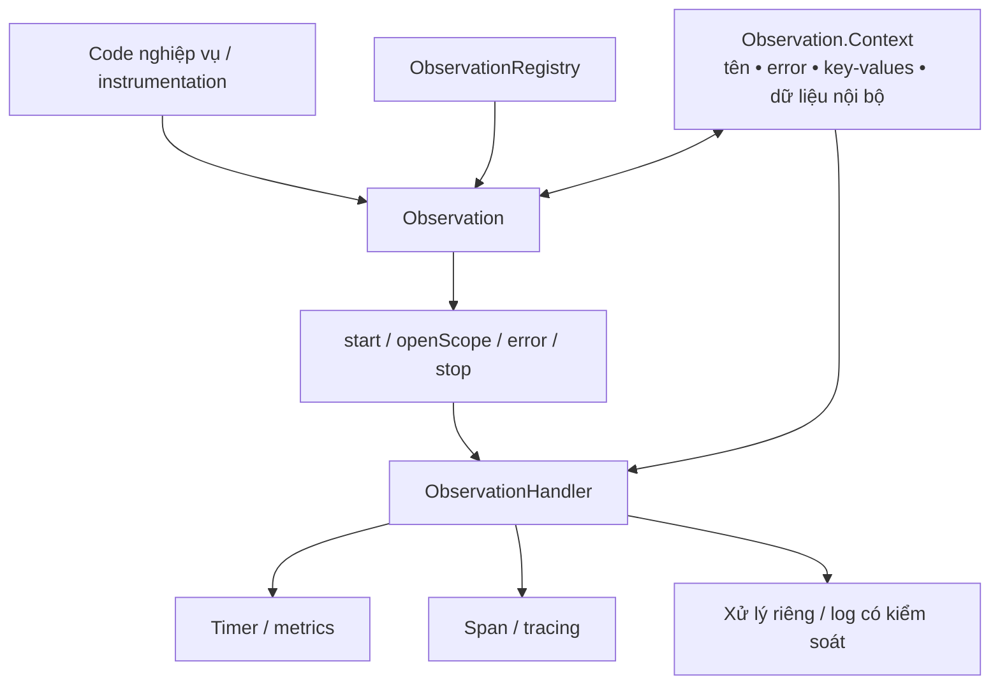

# Observation.Context trong Micrometer Observation

## 1. Mục tiêu và bối cảnh

Trong một ứng dụng Spring Boot, `Observation` biểu diễn **một thao tác đang được quan sát**: xử lý request HTTP, gọi dịch vụ thanh toán, truy vấn dữ liệu hoặc thực hiện bước nghiệp vụ. `Observation.Context` là **đối tượng chứa dữ liệu của chính thao tác đó** để code được instrument, các `ObservationHandler` và các thành phần tùy biến có thể trao đổi thông tin.

Sau bài này, bạn sẽ:

- Giải thích `Observation.Context` lưu gì và vì sao nó cần thiết bên cạnh `Observation`, `ObservationRegistry`, `Observation.Scope`.
- Sử dụng API `put/get/getOrDefault/getRequired/computeIfAbsent`, các trường tên, error và key-values.
- Phân biệt **dữ liệu nội bộ trong Context**, **low-cardinality key-values** và **high-cardinality key-values**.
- Đọc và thay đổi Context qua vòng đời observation, `ObservationHandler`, `ObservationConvention` và `ObservationFilter`.
- Thiết kế Context cho Spring Boot khi cần xuất metrics/traces, truyền ngữ cảnh qua luồng hoặc hệ thống phân tán, và liên kết log để tìm lỗi, độ trễ.

Bài nằm trong chương **Micrometer Observation** của module **SPRING_BOOT_OBSERVABILITY**. Các API minh họa dựa trên Micrometer Observation và Spring Boot hiện đại, chủ yếu phù hợp với nhánh Spring Boot 3.x; khi dùng Spring Boot 4.x cần kiểm tra dependency và tên thuộc tính cấu hình của đúng phiên bản.

## 2. Context giữ vai trò gì trong luồng quan sát?

Giả sử API `POST /orders` gọi `inventory.reserve`. Micrometer cần biết tên thao tác, nhóm kênh bán hàng, lỗi (nếu có) và một số dữ liệu để handler tạo Timer hoặc span. Những dữ liệu ấy có thể xuất hiện tại các thời điểm khác nhau:

1. Khi bắt đầu: biết thao tác là `inventory.reserve`, `channel=web`.
2. Khi chạy: biết đã đến bước `database`.
3. Khi có lỗi: biết exception xảy ra và ở bước nào.
4. Khi dừng: handler lấy tổng thời gian, nhãn và trạng thái để xử lý.

`Observation.Context` đi cùng **một instance observation** trong suốt quá trình trên. Nó là kho dữ liệu có thể thay đổi, được chuyển cho handler khi Micrometer phát các callback vòng đời.



**Context không tự tạo metric, trace hoặc log.** Các handler được đăng ký trong registry mới quyết định hành động trên các sự kiện vòng đời. Ứng dụng có thể dùng cùng một `Observation.Context` để nhiều handler đọc những góc nhìn khác nhau.

### Phân biệt bốn khái niệm gần tên

| Thành phần | Trả lời câu hỏi | Ví dụ |
| --- | --- | --- |
| `ObservationRegistry` | Observation sử dụng tập handler, filter, convention nào? | Registry do Spring Boot Actuator tự cấu hình |
| `Observation` | Thao tác nào đang chạy, khi nào bắt đầu/dừng? | `inventory.reserve` |
| `Observation.Context` | Thao tác này có dữ liệu và metadata gì? | `channel=web`, `error`, bước `database` |
| `Observation.Scope` | Observation nào đang là *current* trên ngữ cảnh thực thi hiện hành? | Scope của request đang xử lý |

Một observation có thể tồn tại mà chưa có scope; scope có thể đóng trong khi observation tiếp tục hoạt động. **Scope không phải Context** và không thay thế cho `stop()`. Context cũng không phải tên gọi khác của Reactor `Context`, OpenTelemetry `Context` hay MDC của hệ thống logging.

## 3. Cấu trúc của `Observation.Context`

`io.micrometer.observation.Observation.Context` là kiểu mutable, có cách truy cập giống map nhưng có thêm thông tin chuyên biệt về observation. Nó triển khai phần giao diện đọc `Observation.ContextView`.

| Nhóm | API tiêu biểu | Ý nghĩa |
| --- | --- | --- |
| Định danh | `getName()`, `getContextualName()` | Tên ổn định cho observation và tên dễ đọc khi hiển thị span |
| Nhãn | `getLowCardinalityKeyValues()`, `getHighCardinalityKeyValues()` | Metadata được thiết kế để handler chuyển sang tín hiệu |
| Trạng thái | `getError()` | Exception đã được ghi nhận cho thao tác |
| Quan hệ | `getParentObservation()` | Parent observation nếu có |
| Dữ liệu tùy ý | `put(key, value)`, `get(key)`, `remove(key)` | Truyền trạng thái từ instrumentation tới handler |
| Đọc an toàn | `containsKey(key)`, `getOrDefault(key, fallback)`, `getRequired(key)` | Kiểm tra sự hiện diện và chính sách khi thiếu dữ liệu |
| Tính toán lười | `computeIfAbsent(key, function)` | Chỉ tạo/ghi giá trị khi chưa tồn tại |
| Đọc dạng giao diện | `Observation.ContextView` | Dùng khi bên nhận chỉ cần truy vấn, không sửa đổi |

Không nên nhầm:
- `context.put("checkout.phase", "database")` cất dữ liệu **nội bộ**. Điều này **không tự tạo nhãn** metric hoặc attribute trace.
- `observation.lowCardinalityKeyValue("channel", "web")` bổ sung một nhãn **độ đa dạng thấp** để các handler thích hợp xử lý.
- `observation.highCardinalityKeyValue("request.id", "...")` bổ sung một nhãn **độ đa dạng cao**, thường phù hợp với span khi hợp lệ về quyền riêng tư; không dùng để tạo metric tag có thể tăng vô hạn.

### 3.1. Dùng Context như kho dữ liệu kiểu key-value

```java
import io.micrometer.observation.Observation;

// Một Context được tạo riêng cho một lần thực thi.
Observation.Context context = new Observation.Context();
Object stepKey = "inventory.step";

context.put(stepKey, "received");
String current = context.get(stepKey);                  // "received"
String missing = context.getOrDefault("unknown", "n/a"); // "n/a"
boolean exists = context.containsKey(stepKey);          // true

// Khi chắc chắn key đã tồn tại; thiếu sẽ ném IllegalArgumentException.
String required = context.getRequired(stepKey);

// Chỉ gọi hàm tạo giá trị nếu không có key.
String owner = context.computeIfAbsent("inventory.owner",
        key -> "stock-service");

context.remove(stepKey);
```

Chú ý: các phương thức `get(...)` trả kiểu generic theo cách gọi; người viết code cần thống nhất **kiểu dữ liệu** của mỗi key. Trộn `Integer` và `String` dưới cùng key có thể gây lỗi ép kiểu. Có thể dùng hằng key riêng (`static final Object` hoặc hằng chuỗi có namespace) để tránh trùng tên giữa các handler. Không lưu `null` như một trạng thái nghiệp vụ; dùng giá trị hoặc kiểu thể hiện thiếu dữ liệu một cách tường minh.

Đây là kho ngữ cảnh cho thao tác đang chạy, **không phải kho lưu trữ lâu dài**, không phải cache ứng dụng và không thích hợp để giữ payload lớn hoặc bí mật.

### 3.2. Tên, contextual name, lỗi và quan hệ cha-con

Ví dụ:
- **Name**: `inventory.reserve` — cố định qua nhiều request, thuận tiện cho metric name và rule.
- **Contextual name**: `reserve inventory` — thân thiện hơn khi đọc một span.
- **Error**: `IllegalStateException` khi hết tồn kho; có thể đọc qua `context.getError()` sau khi observation ghi nhận lỗi.
- **Parent**: nếu bước `inventory.reserve` chạy trong scope `http.server.requests`, nó có thể có parent observation.

Tên không nên chứa `orderId` hoặc URL có ID. Parent có thể không tồn tại, và quan hệ cha-con còn phụ thuộc vào việc context được truyền đúng qua ranh giới thread/network.

## 4. Vòng đời Observation và lúc Context được sử dụng

```text
Tạo Observation/Context
  │  └─ ObservationPredicate xem có cho tạo observation hay không
  ▼
start()              → ObservationHandler.onStart(context)
  ▼
openScope()          → handler nhận sự kiện scope; current observation được gắn vào scope
  ▼
Xử lý nghiệp vụ       → code/handler có thể cập nhật Context
  ├─ error(exception)→ ObservationHandler.onError(context)
  └─ event(event)     → handler nhận sự kiện event
  ▼
close Scope          → handler nhận sự kiện scope đóng
  ▼
stop()
  ├─ ObservationFilter có thể biến đổi Context
  └─ ObservationHandler.onStop(context)
```

Những điểm cần nhớ:

- **`ObservationPredicate` chạy khi tạo** để quyết định có tạo observation hoạt động hay trả về no-op. Predicate không phải nơi gắn dữ liệu biết được sau khi nghiệp vụ kết thúc.
- **`ObservationHandler` nhận chính Context** ở các callback phù hợp: `onStart`, `onError`, `onStop`, ...; handler có thể lưu dữ liệu phụ vào map nội bộ để dùng ở callback kế tiếp.
- **`ObservationFilter` chạy trước các callback `onStop`** và có thể bổ sung/điều chỉnh Context. Dữ liệu chỉ có ở thời điểm dừng sẽ không thể quay ngược thời gian để ảnh hưởng đến quyết định đã thực hiện ở `onStart`.
- Scope mở/đóng tạo điều kiện xác lập current observation để liên kết công việc lồng nhau. `Observation.Context` không tự đưa nội dung map của nó vào một HTTP header hay thread khác.
- Thay Context **sau `stop()`** không đảm bảo metric/span đã xuất sẽ thay đổi. Đặt thông tin sớm đủ để handler cần nó có thể sử dụng.

Các callback chỉ chạy với handler hỗ trợ Context cụ thể. Nếu registry không có handler metrics/tracing, việc tạo một Context không đủ để xuất các tín hiệu ấy.

## 5. Ví dụ Spring Boot: đặt dữ liệu vào Context

Để dùng Observation trong ứng dụng Spring Boot, thông thường bạn có `spring-boot-starter-actuator`. Spring Boot cung cấp `ObservationRegistry` để inject. Ví dụ dùng Java 17+, các API này không phụ thuộc một backend metrics/traces cụ thể.

```java
import io.micrometer.observation.Observation;
import io.micrometer.observation.ObservationRegistry;
import org.springframework.stereotype.Service;

@Service
public class InventoryReservationService {
    public static final String STEP_KEY = "inventory.step";

    private final ObservationRegistry observationRegistry;

    public InventoryReservationService(ObservationRegistry observationRegistry) {
        this.observationRegistry = observationRegistry;
    }

    public void reserve(String source, Runnable databaseAction) {
        // Giới hạn tập nhãn: chỉ có "web" hoặc "other".
        String channel = "web".equals(source) ? "web" : "other";

        Observation.Context context = new Observation.Context();
        context.put(STEP_KEY, "created");

        Observation observation = Observation.createNotStarted(
                        "inventory.reserve",
                        () -> context,
                        observationRegistry)
                .contextualName("reserve inventory")
                .lowCardinalityKeyValue("channel", channel);

        observation.observe(() -> {
            context.put(STEP_KEY, "checking-stock");
            databaseAction.run(); // Có thể ném RuntimeException
            context.put(STEP_KEY, "completed");
        });
    }
}
```

`Runnable databaseAction` giúp ví dụ độc lập với database/framework cụ thể. Trong dự án thực, thay nó bằng lời gọi repository/service. `observe(Runnable)` quản lý start, scope, ghi nhận exception và stop cho xử lý đồng bộ. Nếu bước `databaseAction` ném exception, lệnh đặt `completed` không chạy; handler ở giai đoạn dừng có thể đọc `inventory.step=checking-stock` và `context.getError()`.

Nếu cần tự điều khiển vòng đời thay vì `observe`, mẫu an toàn cho công việc đồng bộ là:

```java
Observation observation = Observation.start("inventory.reserve", observationRegistry);
try (Observation.Scope scope = observation.openScope()) {
    doWork();
} catch (RuntimeException ex) {
    observation.error(ex);
    throw ex;
} finally {
    observation.stop();
}
```

`doWork()` ở ví dụ này là phương thức nghiệp vụ do bạn cài đặt. Với `CompletableFuture` hoặc publisher bất đồng bộ, đoạn `finally` của phương thức gọi có thể chạy **trước khi công việc thật hoàn tất**; khi đó phải quản lý điểm kết thúc observation theo đúng lifecycle bất đồng bộ.

## 6. `ObservationHandler` đọc Context để thực hiện công việc

Một handler được gọi nếu `supportsContext(context)` trả về `true`. Ví dụ ghi log vận hành *mức debug* dựa trên bước xử lý cuối và loại lỗi:

```java
import io.micrometer.observation.Observation;
import io.micrometer.observation.ObservationHandler;
import org.slf4j.Logger;
import org.slf4j.LoggerFactory;
import org.springframework.stereotype.Component;

@Component
public class InventoryContextHandler
        implements ObservationHandler<Observation.Context> {

    private static final Logger log =
            LoggerFactory.getLogger(InventoryContextHandler.class);

    @Override
    public boolean supportsContext(Observation.Context context) {
        return "inventory.reserve".equals(context.getName());
    }

    @Override
    public void onStop(Observation.Context context) {
        String step = context.getOrDefault(
                InventoryReservationService.STEP_KEY, "unknown");
        Throwable error = context.getError();

        log.debug("inventory observation: step={}, outcome={}",
                step, error == null ? "success" : "failure");
    }
}
```

Spring Boot đăng ký các bean `ObservationHandler` với `ObservationRegistry` được auto-configure, nên handler trên sẽ được sử dụng khi Actuator/Observation đã được cấu hình. Nếu dùng Micrometer thuần, bạn phải đăng ký thủ công:

```java
ObservationRegistry registry = ObservationRegistry.create();
registry.observationConfig()
        .observationHandler(new InventoryContextHandler());
```

Handler trên **chỉ làm ví dụ đọc dữ liệu từ Context**. Trong ứng dụng thực, log từng observation có thể tạo lưu lượng rất lớn; nên cân nhắc mức log, chọn lọc thông tin và tránh ghi giá trị nhạy cảm. Việc thêm handler riêng cũng không tự cài tracing exporter hoặc metrics registry.

## 7. Context tùy biến và ObservationConvention

Với thư viện lớn hoặc nhiều call site, một Context chuyên biệt rõ kiểu thường tốt hơn việc nhiều nơi dùng key chuỗi tùy ý:

```java
import io.micrometer.observation.Observation;

public final class InventoryObservationContext extends Observation.Context {
    private final String channel;
    private final String operation;

    public InventoryObservationContext(String channel, String operation) {
        this.channel = channel;
        this.operation = operation;
    }

    public String channel() {
        return channel;
    }

    public String operation() {
        return operation;
    }
}
```

Một handler có thể kiểm tra bằng `context instanceof InventoryObservationContext` rồi đọc `channel()`, `operation()`. `ObservationConvention<InventoryObservationContext>` cho phép chuẩn hóa **tên observation, contextual name và key-values** dựa trên kiểu Context. Những quy tắc này hữu ích khi một instrumentation được dùng bởi nhiều ứng dụng Spring Boot: cùng một nhóm thao tác sẽ có nhãn và tên nhất quán.

Ví dụ Convention ở mức tối thiểu:

```java
import io.micrometer.common.KeyValues;
import io.micrometer.observation.Observation;
import io.micrometer.observation.ObservationConvention;

public class InventoryObservationConvention
        implements ObservationConvention<InventoryObservationContext> {

    @Override
    public boolean supportsContext(Observation.Context context) {
        return context instanceof InventoryObservationContext;
    }

    @Override
    public String getName() {
        return "inventory.reserve";
    }

    @Override
    public String getContextualName(InventoryObservationContext context) {
        return "reserve inventory";
    }

    @Override
    public KeyValues getLowCardinalityKeyValues(
            InventoryObservationContext context) {
        return KeyValues.of("channel", context.channel());
    }
}
```

Một cách tạo Context chuyên biệt khi dùng tên trực tiếp:

```java
InventoryObservationContext context =
        new InventoryObservationContext("web", "reserve");

Observation.createNotStarted("inventory.reserve",
        () -> context, observationRegistry)
        .observe(this::doWork);
```

Dùng overload nhận `ObservationConvention` khi cần convention có quyền quyết định tên/nhãn. Trong ví dụ tạo observation bằng **tên trực tiếp** trên, convention không được tự áp dụng chỉ vì class convention tồn tại. Với HTTP request của Spring MVC/WebFlux, framework đã có những lớp context và convention riêng; đừng tạo lại instrumentation cho cùng một request nếu không có yêu cầu bổ sung rõ ràng.

## 8. Phân biệt dữ liệu map, tags và carrier

Ba loại thông tin dễ bị nhầm:

| Nguồn dữ liệu | Ví dụ | Có tự đi đến metrics/traces? | Quy tắc |
| --- | --- | --- | --- |
| Map nội bộ của `Observation.Context` | `inventory.step=checking-stock` | **Không**. Handler phải chủ động dùng | Không lưu đối tượng lớn, token, thông tin thanh toán |
| Low-cardinality key-values | `channel=web`, `result=ok` | Có thể trở thành metric tags và span attributes qua handler | Tập giá trị nhỏ, hữu hạn, ổn định |
| High-cardinality key-values | ID chạy workflow dạng opaque | Thường vào span attributes, **không dùng làm metric tags** | Phải xét độ nhạy cảm, retention và sampling |
| Carrier khi propagation | HTTP headers, message headers | Chỉ qua sender/receiver instrumentation | Propagator quyết định header nào được inject/extract |

Ví dụ có 5 kênh, 4 outcome và 3 vùng triển khai thì tối đa có thể có `5 × 4 × 3 = 60` tổ hợp label trước khi tính instance và các chiều khác. Thêm `orderId` vào low-cardinality tags có thể làm số series tăng theo từng đơn hàng, gây tốn tài nguyên ở Prometheus hoặc metrics backend.

Khi cần gắn giá trị dùng chung vào mỗi Context, `ObservationFilter` có thể bổ sung key-values trước sự kiện dừng. Với Spring Boot, bean `ObservationFilter` được tự đăng ký:

```java
import io.micrometer.common.KeyValue;
import io.micrometer.observation.ObservationFilter;
import org.springframework.context.annotation.Bean;
import org.springframework.context.annotation.Configuration;

@Configuration
class ObservationTagConfiguration {

    @Bean
    ObservationFilter inventoryComponentTag() {
        return context -> {
            if ("inventory.reserve".equals(context.getName())) {
                context.addLowCardinalityKeyValue(
                        KeyValue.of("component", "inventory"));
            }
            return context;
        };
    }
}
```

Vì filter chạy gần thời điểm dừng, đừng dùng nó để truyền dữ liệu mà một handler **phải biết ngay lúc `onStart`**. Muốn quyết định observation có hoạt động hay không, dùng `ObservationPredicate` thay cho filter. Nếu chỉ cần hạn chế metric label/series tại registry metrics, xem thêm cơ chế `MeterFilter` của Micrometer Metrics.

## 9. Context và truyền ngữ cảnh giữa thread, service

Đây là hai vấn đề khác nhau:

1. **Context dữ liệu của observation** chứa tên, lỗi, key-values và map của một thao tác.
2. **Context propagation** chuyển *ngữ cảnh thực thi hiện hành* (chẳng hạn current observation/span) qua ranh giới thread, reactive chain hoặc mạng để duy trì quan hệ trace.

Micrometer Context Propagation có thể hỗ trợ chuyển current observation qua executor/reactive operator khi tích hợp đúng. Điều đó **không có nghĩa** mọi phần tử `context.put(...)` tự biến thành HTTP header hoặc được sao chép sang service khác.

```mermaid
sequenceDiagram
    participant A as HTTP API
    participant B as Async worker
    participant C as Payment service
    A->>A: Observation A + Context A
    A->>B: Propagate current observation (khi cấu hình)
    B->>B: Observation B + Context B
    B->>C: Request + traceparent (khi instrument)
    C->>C: Observation C + Context C
    Note over A,C: Cùng traceId có thể nối các span; các Context vẫn là những đối tượng khác nhau
```

Trong Spring Boot 3.x với Spring WebFlux, có thể bật `spring.reactor.context-propagation=auto` khi phù hợp với phiên bản và cách chạy Reactor. Với executor của `@Async`, cấu hình `ContextPropagatingTaskDecorator` cho executor cần truyền ngữ cảnh, ví dụ:

```java
import org.springframework.context.annotation.Bean;
import org.springframework.context.annotation.Configuration;
import org.springframework.core.task.support.ContextPropagatingTaskDecorator;

@Configuration
class AsyncObservationConfiguration {
    @Bean
    ContextPropagatingTaskDecorator contextPropagatingTaskDecorator() {
        return new ContextPropagatingTaskDecorator();
    }
}
```

Cần kiểm tra executor thực tế có áp dụng decorator đó; cơ chế cấu hình tự động có thể thay đổi giữa các phiên bản Spring Boot. Khi xử lý đồng thời, đừng dựa vào việc nhiều thread sửa cùng một Context theo thứ tự cố định; phải thiết kế quản lý trạng thái và lifecycle rõ ràng.

### 9.1. SenderContext và ReceiverContext

Khi tự instrument HTTP client hoặc messaging, Micrometer cung cấp các Context chuyên biệt:

- `SenderContext<C>`: mang **carrier** (request/message) và thao tác **ghi** header. Một tracing handler có thể inject `traceparent` hoặc metadata propagation vào carrier.
- `ReceiverContext<C>`: mang carrier và thao tác **đọc** header. Một tracing handler có thể trích parent context từ request/message đến.

Ví dụ hướng đi:

```text
API (SenderContext + HTTP headers)
   └─ traceparent → Payment service (ReceiverContext + HTTP headers)
                      └─ observation/span con được nối vào trace khi có handler phù hợp
```

Đây là Context chuyên biệt để làm việc với transport. Với `RestClient` và `WebClient` được xây từ builder do Spring Boot cấu hình, thường đã có instrumentation thích hợp; chỉ tự viết Sender/Receiver Context khi bạn xây integration cho transport chưa được hỗ trợ. Tránh đưa dữ liệu nghiệp vụ tùy ý vào propagation headers hoặc baggage.

## 10. Dùng Context để điều tra lỗi và độ trễ

Tình huống: latency của `POST /orders` tăng và một số lần đặt hàng thất bại.

1. **Metric**: nhận thấy thời gian xử lý HTTP hoặc `inventory.reserve` tăng; lọc theo nhãn có cardinality hữu hạn như `channel=web`.
2. **Trace**: chọn trace chứa span `inventory.reserve`, kiểm tra nó và span cơ sở dữ liệu/HTTP lân cận để định vị giai đoạn chậm.
3. **Log**: tìm log theo `traceId`/`spanId` đã được gắn đúng ngữ cảnh; đọc lỗi theo bước nghiệp vụ.
4. **Context**: handler có thể đọc `inventory.step=checking-stock` và `getError()` để cung cấp thêm dữ liệu vận hành **nếu bạn đã chủ động định nghĩa việc xuất nó**.
5. **Đối chiếu**: một trace đơn lẻ là ví dụ, không đại diện chắc chắn cho mọi request; dùng metrics tổng hợp để định lượng mức độ ảnh hưởng.

Nếu cần đưa `inventory.step` lên trace, hãy quyết định cách mã hóa bằng `KeyValue` hoặc handler thích hợp, đồng thời chuẩn hóa số giá trị và tránh tiết lộ dữ liệu. Bản thân `Context.put` chưa bảo đảm thông tin này xuất hiện trong backend.

### Tình huống lỗi hay gặp

| Triệu chứng | Nguyên nhân thường gặp | Kiểm tra |
| --- | --- | --- |
| Handler không chạy | Chưa đăng ký hoặc `supportsContext` trả false | Kiểm tra registry, bean, name và kiểu Context |
| `get(key)` trả null | Chưa đặt key, sai key/kiểu, hoặc dữ liệu tạo ở Context khác | Dùng hằng key chung; xem bước tạo và callback |
| Metric không có nhãn `inventory.step` | Dữ liệu chỉ được lưu bằng `put` | Cần `lowCardinalityKeyValue` hoặc Convention/Filter |
| Tag có hàng triệu giá trị | Đưa ID/URL động vào low-cardinality tags | Đổi sang nhãn hữu hạn; rà soát cardinality |
| Log có traceId nhưng không thấy span | Sampling/exporter/backend chưa lưu trace | Kiểm tra sampling và đường gửi span |
| Trace bị đứt sau executor | Không propagate current observation | Kiểm tra TaskDecorator/reactive propagation |
| Handler thấy Context sau `stop` nhưng không có dữ liệu cần thiết | Dữ liệu đến muộn, bị ghi đè, callback không đúng lúc | Gắn dữ liệu sớm theo điểm sử dụng |
| `Context` chứa dữ liệu nhạy cảm | Lưu request/response hoặc credentials không kiểm soát | Giảm payload, phân loại trường, chỉ giữ thông tin cần thiết |

## 11. Checklist thiết kế một Context tốt

- **Một thao tác, một Context** có vòng đời hữu hạn; không tái sử dụng một Context mutable cho nhiều request độc lập.
- Tên observation ngắn, ổn định; contextual name phục vụ người đọc trace.
- Chọn **kiểu Context chuyên biệt** khi có hợp đồng dữ liệu rõ và nhiều handler/convention dùng chung.
- Phân biệt dữ liệu vận hành nội bộ với dữ liệu được phép xuất ra bên ngoài.
- Giới hạn cardinality trước khi đưa thông tin thành metric tag.
- Ghi nhận lỗi với `observation.error(ex)` khi điều khiển thủ công; luôn `stop()` và đóng scope.
- Kiểm tra propagation trên đúng ranh giới executor, reactive pipeline, HTTP hoặc broker.
- Với tracing backend, kiểm tra sampler, exporter và retention khi cần liên kết metrics, traces, logs.
- Không giả định mọi handler nhận cùng giá trị tại mọi thời điểm; thử nghiệm cả thành công, lỗi và xử lý bất đồng bộ.

## 12. Câu hỏi tự luyện

1. Vì sao `context.put("order.id", "123")` không tự tạo tag `order.id` trong Prometheus?
2. `Observation.Context` và `Observation.Scope` khác nhau ở điểm nào?
3. Handler đọc `getError()` khi `onStop`, nhưng không thấy exception; bạn sẽ kiểm tra đường xử lý lỗi thế nào?
4. Khi nào nên tạo `InventoryObservationContext extends Observation.Context` thay vì dùng key chuỗi?
5. `ObservationFilter` có thể bổ sung nhãn ở giai đoạn nào, và vì sao không thích hợp để cung cấp dữ liệu bắt buộc cho `onStart`?
6. Bạn có thể truyền toàn bộ nội dung map của `Observation.Context` sang service khác chỉ bằng W3C `traceparent` không? Vì sao?
7. Nếu sau khi thêm `orderId` làm low-cardinality tag, số time series tăng đột biến, bạn sẽ thay đổi instrumentation thế nào?
8. Tự thêm handler đọc `inventory.step`; hãy xác minh với một request thành công và một request lỗi rằng giá trị bước cuối và `getError()` phù hợp.

## Tài liệu tham khảo

- [Micrometer Reference — Observation Components](https://docs.micrometer.io/micrometer/reference/observation/components.html)
- [Micrometer Reference — Instrumentation, Context Propagation, Sender/Receiver Context](https://docs.micrometer.io/micrometer/reference/observation/instrumenting.html)
- [Micrometer Javadoc — Observation.Context](https://javadoc.io/doc/io.micrometer/micrometer-observation/latest/io/micrometer/observation/Observation.Context.html)
- [Spring Boot 3.5 — Observability](https://docs.spring.io/spring-boot/3.5/reference/actuator/observability.html)
- [Spring Framework — Observability Support](https://docs.spring.io/spring-framework/reference/integration/observability.html)
