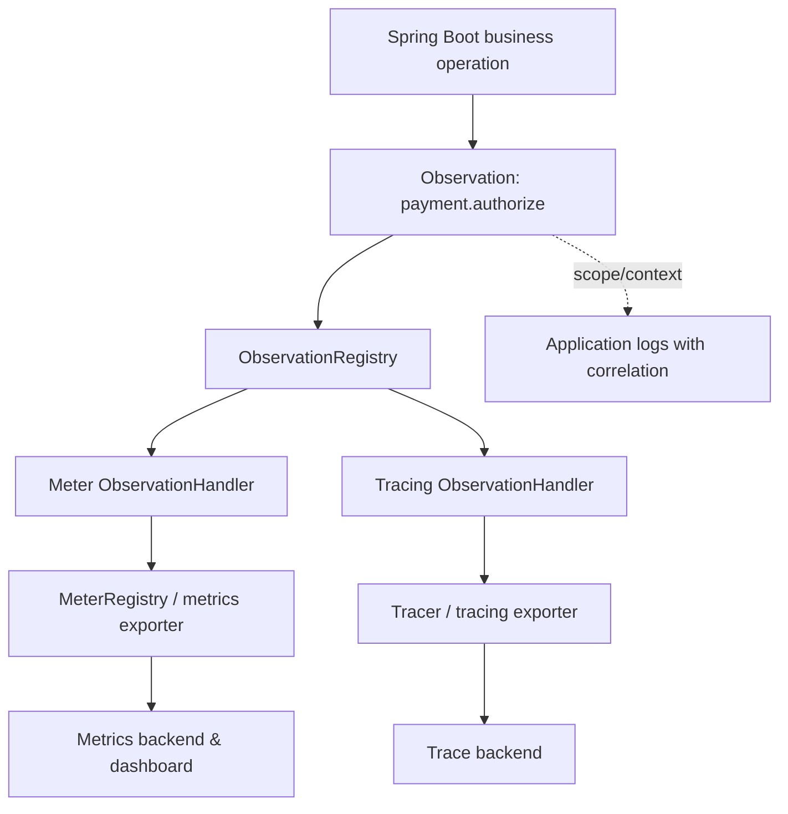

# Observation name trong Micrometer Observation

Trong module **SPRING_BOOT_OBSERVABILITY**, ta thiết lập observability cho Spring Boot bằng Micrometer Observation, metrics, logs và distributed tracing. Một quyết định tưởng như nhỏ nhưng ảnh hưởng trực tiếp đến cả dashboard, cảnh báo và quá trình điều tra sự cố là **đặt tên cho observation**.

**Observation name** trả lời câu hỏi: *“Hệ thống đang quan sát loại thao tác nào?”* Ví dụ, `payment.authorize` đại diện cho nghiệp vụ xác thực thanh toán, bất kể đơn hàng nào được xử lý, nhà cung cấp nào được gọi hoặc thao tác mất bao nhiêu mili giây. Một tên tốt giữ nguyên qua hàng nghìn lần chạy; sự khác nhau giữa các lần chạy được diễn đạt bằng **key-values**, trạng thái lỗi, log và trace.

Chủ đề này tập trung vào cách chọn, sử dụng và duy trì observation name. Để hiểu đúng, cần phân biệt tên của observation với tên hiển thị của span, với nhãn của metric và với thông tin định danh một request cụ thể.

## 1. Observation name là gì?

Micrometer Observation mô hình hóa một hoạt động có điểm bắt đầu và điểm kết thúc, ví dụ:

- Tính giá giỏ hàng: `checkout.price.calculate`.
- Giữ số lượng hàng tồn: `inventory.reserve`.
- Xác thực thanh toán: `payment.authorize`.
- Xử lý một thông điệp nghiệp vụ: `order.message.process`.

Một observation đi qua `ObservationRegistry` và các `ObservationHandler` được cấu hình. Handler có thể tạo **metric**, **trace/span**, cả hai, hoặc không xuất tín hiệu ra bên ngoài. Tên observation cung cấp một định danh logic để handler và các quy ước đặt tên sử dụng.

Trong những cấu hình Micrometer Metrics thông dụng, observation name thường trở thành tên meter (chẳng hạn một timer ghi thời lượng và số lần thao tác); trong cấu hình Micrometer Tracing, tên đó là một nguồn để đặt tên span nếu chưa có contextual name khác. Hành vi cụ thể còn phụ thuộc observation convention, handler, phiên bản thư viện và exporter.

**Không có quy tắc “mỗi lần chạy là một observation name mới”.** Mỗi lần thực thi có một observation riêng, nhưng nhiều instance của cùng thao tác **chia sẻ một tên ổn định**.

```text
Thao tác ở thời điểm T1: payment.authorize
  provider=bank_a, outcome=approved, duration=120 ms

Thao tác ở thời điểm T2: payment.authorize
  provider=bank_b, outcome=declined, duration=260 ms

Thao tác ở thời điểm T3: payment.authorize
  provider=bank_a, outcome=error, duration=1 800 ms

                      cùng observation name
                              │
                              ▼
             metric theo tên + nhãn hữu hạn
             các span riêng trong từng trace
```

Nếu muốn tính tỉ lệ lỗi và p95 độ trễ của *xác thực thanh toán*, tên ổn định giúp truy vấn gộp các lần chạy đúng phạm vi.

## 2. Phân biệt năm khái niệm dễ nhầm

| Khái niệm | Câu hỏi trả lời | Ví dụ | Vai trò |
| --- | --- | --- | --- |
| **Observation name** | Đây là loại thao tác nào? | `payment.authorize` | Định danh logic ổn định, thường liên quan đến meter name |
| **Contextual name** | Tên nào dễ đọc trong cây trace? | `authorize payment` | Tên mang ngữ cảnh cho span khi tracing handler sử dụng |
| **Low-cardinality key-value** | Cần phân nhóm theo thuộc tính hữu hạn nào? | `provider=bank_a`, `outcome=error` | Thường được dùng làm metric tags và trace attributes |
| **High-cardinality key-value** | Cần thông tin chi tiết nào cho lần chạy? | Mã tác vụ nội bộ đã được phép ghi | Thường hữu ích cho tracing; cần kiểm soát riêng tư |
| **Trace ID / span ID** | Đây là lần thực thi nào trong chuỗi lời gọi? | ID do tracing tạo | Tương quan giữa các span, logs và service |

Ví dụ, khi gọi `POST /checkout`, framework có thể tạo server observation với tên `http.server.requests` và các nhãn như phương thức HTTP, route template, status. Ở tầng nghiệp vụ, service có thể tạo observation `payment.authorize`; trong trace, span có thể được hiển thị là `authorize payment`. Cả hai observation có phạm vi và mục đích khác nhau.

Tên observation **không chứa** `orderId`, `userId`, `traceId`, giá trị thời gian hay kết quả trả về. Các giá trị đó thay đổi trên từng lần thực thi. Nếu cần chẩn đoán một lần chạy riêng, dùng trace và log phù hợp, đồng thời tuân thủ chính sách dữ liệu.

## 3. Tên đi qua pipeline observability như thế nào?



Luồng này mô tả **khả năng** liên kết tín hiệu, không phải bảo đảm có sẵn tất cả thành phần. Chẳng hạn:

1. `ObservationRegistry` quyết định observation được xử lý bởi những handler nào.
2. Meter handler có thể dùng **observation name** làm tên meter và low-cardinality key-values làm tags.
3. Tracing handler có thể dùng **contextual name** để đặt span name; nếu không có, tên observation hoặc convention có thể được dùng thay thế.
4. Log correlation cần cấu hình tracing/MDC phù hợp và ngữ cảnh thực thi chính xác; observation name không tự tạo trace ID cho log.
5. Exporter quyết định cách chuyển tên/nhãn sang định dạng của backend. Sampling quyết định trace nào được thu thập hoặc xuất; nó không có nghĩa tên observation thay đổi.

Điều này khiến tên observation trở thành một phần của **hợp đồng telemetry**: dashboard, alert, truy vấn và tài liệu vận hành có thể phụ thuộc vào nó.

## 4. Nguyên tắc đặt tên: ngắn, ổn định, theo hành vi

Một quy ước đơn giản và dễ áp dụng là sử dụng các thành phần chữ thường, phân tách bằng dấu chấm, biểu diễn **miền nghiệp vụ + hành động**:

```text
payment.authorize
inventory.reserve
checkout.price.calculate
invoice.reconcile
order.message.process
```

Đây là **quy ước khuyến nghị**, không phải cú pháp bắt buộc của toàn bộ Micrometer. Khi đo thành phần mà framework đã hỗ trợ, nên giữ tên theo semantic convention của framework thay vì tự phát minh tên tương đương.

| Nên dùng | Tránh dùng | Lý do |
| --- | --- | --- |
| `payment.authorize` | `payment.authorize.ORD-10482` | ID giao dịch làm tên tăng không giới hạn |
| `inventory.reserve` | `com.example.InventoryService.reserve()` | Tên lớp/phương thức là chi tiết triển khai có thể thay đổi |
| `invoice.reconcile` | `invoice-reconcile-2026-11-22` | Ngày chạy không định nghĩa loại thao tác |
| `order.message.process` | `order.process.failed` cho mỗi lần thất bại | Kết quả thuộc tag/status; cùng thao tác cần cùng tên |
| `checkout.price.calculate` | `process`, `operation` | Tên quá chung gây khó hiểu và trộn nhiều hoạt động |
| Tên tích hợp có sẵn như `http.server.requests` | Một tên custom khác đo đúng cùng server request | Tránh telemetry chồng lặp |

### Chọn ranh giới trước khi chọn tên

Giả sử nghiệp vụ checkout gồm:

```text
POST /checkout
  ├─ validateCart()          -> checkout.cart.validate
  ├─ calculatePrice()        -> checkout.price.calculate
  ├─ reserveInventory()      -> inventory.reserve
  └─ authorizePayment()      -> payment.authorize
       └─ HTTP POST provider -> HTTP client observation do framework cung cấp
```

Chỉ nên tạo các observation custom khi từng ranh giới đó thực sự giúp trả lời câu hỏi vận hành, ví dụ: *“Bước nào khiến p95 checkout tăng?”* Không phải mọi phương thức đều cần một observation. Tên theo nghiệp vụ giúp giữ ý nghĩa khi refactor tên class, đổi gateway hoặc di chuyển mã.

### Không thêm service/environment/instance vào tên nếu đã có thuộc tính riêng

Ví dụ, tránh `payment-service-prod-payment.authorize-pod-17`. Tên thao tác là `payment.authorize`; service name, môi trường và instance thường được mô tả bằng resource attributes hoặc tags theo cấu hình backend. Cách phân tách này giúp truy vấn trên nhiều instance mà không tạo ra các tên mới vô ích.

## 5. Đặt tên khi dùng API Observation

Đoạn mã sau minh họa một ứng dụng Spring Boot có `ObservationRegistry` được cấu hình phù hợp. `PaymentRequest`, `PaymentResult` và `PaymentGateway` là **kiểu nghiệp vụ giả định** của ứng dụng; mẫu tập trung vào vòng đời observation và cách đặt tên.

```java
import io.micrometer.observation.Observation;
import io.micrometer.observation.ObservationRegistry;
import org.springframework.stereotype.Service;

import java.util.Locale;

@Service
public class PaymentAuthorizationService {
    private final PaymentGateway gateway;
    private final ObservationRegistry observations;

    public PaymentAuthorizationService(
            PaymentGateway gateway,
            ObservationRegistry observations) {
        this.gateway = gateway;
        this.observations = observations;
    }

    public PaymentResult authorize(PaymentRequest request) {
        // Enum cố định, ví dụ BANK_A, BANK_B, SANDBOX.
        String provider = gateway.provider().name().toLowerCase(Locale.ROOT);

        Observation observation = Observation
                .createNotStarted("payment.authorize", observations)
                .contextualName("authorize payment")
                .lowCardinalityKeyValue("payment.provider", provider);

        observation.start();
        try (Observation.Scope scope = observation.openScope()) {
            PaymentResult result = gateway.authorize(request);
            observation.lowCardinalityKeyValue(
                    "outcome", result.approved() ? "approved" : "declined");
            return result;
        } catch (RuntimeException ex) {
            observation.lowCardinalityKeyValue("outcome", "error");
            observation.error(ex);
            throw ex;
        } finally {
            observation.stop();
        }
    }
}
```

**Giải thích từng lựa chọn:**

1. `createNotStarted("payment.authorize", observations)` gắn **cùng một tên** cho mọi lần xác thực thanh toán. Mỗi lần gọi tạo một observation instance khác nhau.
2. `contextualName("authorize payment")` đặt tên dễ đọc cho ngữ cảnh tracing, trong khi metric có thể tiếp tục gắn với `payment.authorize`.
3. `payment.provider` có tập giá trị hữu hạn, đủ để so sánh nhà cung cấp. Không truyền URL gọi gateway hoặc mã đơn hàng vào tên.
4. `outcome` phân biệt `approved`, `declined` và `error`. Một lần bị từ chối hợp lệ **không nhất thiết** là lỗi kỹ thuật.
5. `openScope()` hỗ trợ làm observation hiện tại trong phạm vi thread; scope được đóng và observation được `stop()` kể cả khi có exception.
6. `error(ex)` chuyển thông tin lỗi cho những handler có hỗ trợ; điều này không thay thế việc ném lại exception để giữ logic ứng dụng.

**Vì sao outcome được gắn sau khi gọi gateway?** Kết quả chỉ được biết khi xử lý hoàn thành. Meter handler thông dụng đọc key-values lúc observation dừng, nên cách ghi này phù hợp; với handler tùy biến cần kiểm tra thời điểm thu thập để tránh mất thông tin.

### Tên và vòng đời là hai mối quan tâm độc lập

Tên `payment.authorize` không quyết định tự động phép đo bắt đầu hoặc kết thúc khi nào. Nếu đặt `start()` trước khi chờ lock và `stop()` sau khi gọi gateway, thời lượng bao gồm thời gian chờ lock. Nếu chỉ đo riêng HTTP client thì ranh giới khác. Hai observation cùng tên nhưng khác ranh giới sẽ khiến số liệu không thể so sánh; phải thống nhất **định nghĩa thao tác** cùng với tên của nó.

## 6. Đặt tên bằng `@Observed`

Khi ranh giới cần đo chính là một phương thức được Spring quản lý, annotation có thể giúp thể hiện tên ngay tại nơi khai báo:

```java
import io.micrometer.observation.annotation.Observed;
import org.springframework.stereotype.Service;

@Service
public class InvoiceReconciliationService {
    private final ReconciliationEngine engine;

    public InvoiceReconciliationService(ReconciliationEngine engine) {
        this.engine = engine;
    }

    @Observed(
            name = "invoice.reconcile",
            contextualName = "reconcile invoice",
            lowCardinalityKeyValues = {"module", "billing"})
    public ReconciliationResult reconcile(InvoiceBatch batch) {
        return engine.reconcile(batch);
    }
}
```

*Đây là minh họa cách dùng annotation; `InvoiceBatch`, `ReconciliationResult` và `ReconciliationEngine` là kiểu nghiệp vụ giả định, cần thay bằng kiểu thực tế của dự án.*

Để `@Observed` có tác dụng trong ứng dụng dùng Spring proxy AOP, cần có Spring AOP và cấu hình `ObservedAspect` phù hợp với phiên bản/thư viện đang dùng. Ví dụ:

```java
import io.micrometer.observation.ObservationRegistry;
import io.micrometer.observation.aop.ObservedAspect;
import org.springframework.context.annotation.Bean;
import org.springframework.context.annotation.Configuration;

@Configuration
class ObservationAspectConfiguration {
    @Bean
    ObservedAspect observedAspect(ObservationRegistry registry) {
        return new ObservedAspect(registry);
    }
}
```

Lưu ý: lời gọi **self-invocation** giữa hai phương thức trong cùng một bean thường không đi qua Spring AOP proxy, nên annotation có thể không được áp dụng. Không gắn `@Observed` tràn lan lên controller/filter đã được framework instrument. Khi cần gắn outcome động sau khi biết kết quả, API `Observation` thủ công thường trực tiếp và rõ ràng hơn.

## 7. Observation convention: quản lý tên tập trung

Khi nhiều nơi cùng instrument một loại thao tác hoặc đang phát triển thư viện dùng chung, việc gõ chuỗi tên ở mỗi call site dễ dẫn tới bất nhất:

```text
payment.authorize
payment.authorization
authorize.payment
```

Người vận hành có thể tưởng đây là ba nghiệp vụ khác nhau, dù thực tế là một. Nên thống nhất **một tên canonical**. Có thể bắt đầu bằng constant:

```java
public final class ObservationNames {
    private ObservationNames() {}

    public static final String PAYMENT_AUTHORIZE = "payment.authorize";
    public static final String INVENTORY_RESERVE = "inventory.reserve";
}
```

Với các tích hợp phức tạp hơn, Micrometer cung cấp khái niệm **`ObservationConvention`** để định nghĩa tên, contextual name và key-values từ một loại `Observation.Context`. Điều này hữu ích khi muốn giữ một hợp đồng instrumentation nhất quán:

| Đầu vào | Quy ước thống nhất |
| --- | --- |
| Context của thao tác thanh toán | Observation name: `payment.authorize` |
| Provider enum | Low-cardinality key: `payment.provider` |
| Trạng thái cuối cùng | Low-cardinality key: `outcome` |
| Tên biểu diễn trong trace | Contextual name: `authorize payment` |

Khi dùng convention mặc định hoặc custom convention của **framework** (ví dụ HTTP, messaging), hãy ưu tiên API tùy biến được framework hỗ trợ. Chỉ đổi tên bằng convention khi hiểu ảnh hưởng tới dashboard và cách framework tạo observation. Việc gọi setter tên hay tự tạo một observation song song có thể làm mất khả năng tương thích của metric hoặc span mặc định.

Trong một hệ thống lớn, có thể tạo tài liệu ngắn mô tả hợp đồng telemetry cho mỗi operation: **tên, ranh giới start/stop, key-values, tập giá trị, chính sách lỗi, service sở hữu**. Đây là thông tin quan trọng hơn việc tên được đặt trong constant hay convention.

## 8. Tên động gây vấn đề gì cho cardinality?

Cardinality không chỉ đến từ metric tags; **tên metric khác nhau cũng tạo các series khác nhau**. Xét đoạn mã cần tránh:

```java
// KHÔNG NÊN: mỗi đơn hàng sinh một observation name mới.
Observation.createNotStarted(
        "payment.authorize." + orderId, observationRegistry);
```

Giả sử có 100.000 đơn hàng, cách làm này có thể tạo gần 100.000 tên meter riêng trước khi tính tags và các chiều bổ sung. Dashboard phải truy vấn hàng loạt tên khác nhau, chi phí lưu trữ tăng và các phép tính tổng hợp trở nên khó bảo trì.

Thay thế:

```java
// NÊN: tên ổn định, nhãn dùng để phân nhóm hữu hạn.
Observation.createNotStarted("payment.authorize", observationRegistry)
        .lowCardinalityKeyValue("payment.method", "card");
```

Với 3 phương thức thanh toán, 2 nhà cung cấp và 3 trạng thái outcome, giới hạn tổ hợp từ ba nhãn này là **3 × 2 × 3 = 18** (chưa tính tags khác). Đây là cơ sở để dự trù chi phí và kiểm soát số series.

Một thuộc tính có số giá trị rất lớn như `order.id` hoặc `customer.id` **không được đặt trong observation name hay low-cardinality metric tag**. Nếu cần gắn vào tracing, đánh giá việc sử dụng high-cardinality key-value theo khả năng xử lý của handler và chính sách bảo mật; tránh ghi PII, access token, số thẻ hoặc payload nhạy cảm. Đôi khi một log có cấu trúc, có correlation với trace, là lựa chọn phù hợp hơn.

### Đừng dùng tên để chứa kết quả hoặc mức độ lỗi

Tránh tách thành `payment.authorize.success` và `payment.authorize.failure` nếu chúng vẫn là **một loại thao tác**. Dùng một tên và nhãn outcome, ví dụ:

```text
name: payment.authorize
outcome: approved | declined | error
```

Điều này giúp tính tổng số lần gọi, tỉ lệ lỗi kỹ thuật hoặc latency từng kết quả từ cùng một định nghĩa metric. Trường hợp *các loại thao tác có ranh giới thực sự khác nhau* mới nên xem xét tên riêng.

## 9. Observation name, span name và context propagation

Khi request đi qua nhiều thành phần:

```text
Trace của POST /checkout
  └─ span: authorize payment
       observation name: payment.authorize
       └─ span: HTTP POST /payments/authorize
            └─ span phía payment provider (nếu propagator và tracing hỗ trợ)
```

Sự liên kết cha/con ở trên được quyết định bởi **tracing context và propagation**, không phải do hai span có tên giống nhau. Hai service cùng dùng `payment.authorize` cũng không tự động thuộc cùng một trace. Cần cấu hình tracer, propagator tương thích (thường dùng W3C Trace Context), instrument các client/consumer thích hợp, và truyền ngữ cảnh qua thread hoặc message boundary.

Với tác vụ bất đồng bộ (`@Async`, `CompletableFuture`, executor, message consumer), observation scope ở thread xử lý request không tự chảy sang thread khác. Cần dùng cơ chế **Micrometer Context Propagation** hoặc tích hợp framework tương ứng. Nếu propagation thất bại, span có thể trở thành trace gốc mới, dù observation name vẫn chính xác.

**Sampling** có thể khiến một span không xuất hiện trong backend dù thao tác thực sự chạy. Nếu metric handler vẫn hoạt động, số lần và thời lượng có thể tiếp tục được ghi cho observation đó. Khi kiểm tra tên, cần phân biệt “meter không có”, “trace không được lấy mẫu”, “span không nối với trace cha” và “exporter chưa xuất dữ liệu”.

## 10. Observation name và tên được exporter hiển thị

Tên trong mã và tên ở công cụ giám sát có thể khác cách viết:

| Lớp | Ví dụ | Ghi chú |
| --- | --- | --- |
| API Micrometer Observation | `payment.authorize` | Tên logical trong code |
| MeterRegistry | `payment.authorize` | Handler metric có thể tạo timer dùng tên này |
| Prometheus exporter | Dạng gần với `payment_authorize_seconds_count` | Tên có thể được chuẩn hóa và thêm hậu tố theo loại meter/phiên bản |
| Trace backend | `authorize payment` | Có thể là contextual name của span |
| Logs | `traceId`, `spanId` và fields có cấu trúc | Correlation phụ thuộc logger/MDC/tracing config |

Đừng coi dạng Prometheus trong bảng là tên chắc chắn có ở mọi dự án. Tên thực tế phụ thuộc Micrometer version, cách tạo meter, naming convention và exporter. Histogram bucket cũng chỉ xuất khi distribution/histogram được cấu hình phù hợp.

Nếu dùng Spring Boot Actuator và metrics endpoint đã được cấu hình/expose, có thể kiểm tra bằng lệnh minh họa:

```bash
curl http://localhost:8080/actuator/metrics/payment.authorize
```

Endpoint này chỉ trả dữ liệu nếu một meter tương ứng đã được ghi và endpoint được expose. Dữ liệu không xuất hiện có thể do handler thiếu, thao tác chưa chạy, registry chưa được gắn, cấu hình endpoint hoặc exporter; chưa thể kết luận observation name sai.

### Đổi tên là thay đổi hợp đồng dữ liệu

Đổi `payment.authorize` thành `payment.authorization` có thể khiến dashboards và alerts đang truy vấn tên cũ không còn thấy dữ liệu mới. Metric series lịch sử vẫn nằm dưới tên trước đó, ảnh hưởng so sánh xu hướng. Với hệ thống thật, nên cập nhật dashboard/query, tài liệu, cảnh báo và kiểm chứng khả năng quan sát trước khi ngừng sử dụng tên cũ. Tránh tạo song song hai timer cho cùng một lần chạy chỉ để giữ tên trong giai đoạn chuyển đổi nếu không có kế hoạch rõ ràng về double counting.

## 11. Kiểm tra một observation name trên môi trường chạy

Hãy kiểm tra bằng các **kịch bản**, thay vì chỉ đọc source code:

| Kiểm tra | Kết quả mong đợi |
| --- | --- |
| Gọi xác thực thanh toán với 2 order ID khác nhau | Cả hai dùng **cùng** observation name `payment.authorize` |
| Gọi với hai provider có mã cố định | Các metric có thể phân tách bằng `payment.provider`, tên không đổi |
| Provider từ chối hợp lệ | `outcome=declined`; không tự ghi nhận exception nếu không có |
| Provider ném exception | `outcome=error`, error được ghi, observation vẫn được stop |
| Bật tracing và có sampling phù hợp | Span nghiệp vụ có contextual name và liên hệ với trace cha khi propagation đúng |
| Quan sát metrics backend | Một họ meter có tên nhất quán; không có tên/tags chứa order ID, email, token |
| Đổi instance hoặc môi trường | Tên nghiệp vụ giữ nguyên, thuộc tính của service/instance phân biệt qua tags/resources |

Một quy trình thực hành:

1. **Chọn câu hỏi:** “Độ trễ xác thực thanh toán tăng do provider nào?”.
2. **Xác định operation:** bắt đầu khi service xác thực thanh toán chạy, kết thúc khi có `approved`, `declined` hoặc lỗi kỹ thuật.
3. **Chốt tên:** `payment.authorize`; contextual name: `authorize payment`.
4. **Chốt tags:** `payment.provider`, `outcome`; liệt kê các giá trị hợp lệ trước khi deploy.
5. **Sinh ba trường hợp:** được duyệt, từ chối hợp lệ, lỗi kỹ thuật; đọc metrics, trace và logs thực tế.
6. **Kiểm tra exporter, sampling và propagation:** metric có ghi không, span có được export không, span con có đúng parent không, log có correlation hay không.
7. **Đo overhead và cardinality** trên tải đại diện, kiểm tra alert và dashboard dùng tên nào.

Trong môi trường production, các điểm đo theo observation name nên gắn với một dashboard hoặc câu hỏi vận hành rõ ràng. Nếu không có ai dùng dữ liệu, cần đánh giá lại sự cần thiết của instrumentation và chi phí duy trì.

## 12. Bài tập áp dụng

Một service xử lý hoàn tiền có các bước: kiểm tra điều kiện hoàn, gọi cổng thanh toán, cập nhật trạng thái và phát sự kiện. Hãy thiết kế tên cho hai ranh giới quan trọng:

1. Đo toàn bộ nghiệp vụ tạo yêu cầu hoàn tiền.
2. Đo riêng bước gọi cổng hoàn tiền và phân nhóm theo provider.

Một phương án:

```text
refund.request.create
  └─ refund.gateway.submit
       payment.provider=bank_a | bank_b
       outcome=accepted | rejected | error
```

Các tên luôn giống nhau giữa nhiều đơn và nhiều request. `refundId` chỉ được sử dụng trong trace/log khi đáp ứng chính sách dữ liệu, không thêm vào observation name. Nếu HTTP client đã có instrumentation cho lời gọi tới gateway, span custom `refund.gateway.submit` chỉ nên tồn tại khi nó biểu đạt thêm ranh giới nghiệp vụ có giá trị khác với span mạng; nếu không, dùng tín hiệu sẵn có.

**Tự kiểm tra:** nếu thay `refundId=RF-001` bằng `RF-999`, observation name có đổi không? Nếu đổi, thiết kế đang gắn danh tính một lần chạy vào tên loại thao tác và cần sửa lại.

## 13. Checklist trước khi đưa tên vào production

- Tên biểu diễn **hành vi ổn định** và nhất quán với ranh giới `start/stop`.
- Không chứa ID, timestamp, URL động, payload, kết quả hoặc exception message.
- Không trùng phạm vi với observation có sẵn của framework.
- Cách đặt tên thống nhất giữa nhóm phát triển, dashboard, SLO/SLI và alert.
- Contextual name phục vụ trace, low-cardinality tags phục vụ phân nhóm, trace ID phục vụ liên kết từng lần chạy.
- Đã xem xét tên sau chuyển đổi bởi MeterRegistry/exporter và khả năng truy vấn thực tế.
- Đã kiểm chứng lỗi, sampling, context propagation, log correlation và số series trên tải đại diện.

**Điểm cần nhớ:** Observation name là *tên của loại công việc được quan sát*. Một tên bền vững như `payment.authorize`, kết hợp nhãn có cardinality thấp, contextual name phù hợp và trace context được truyền đúng, cho phép liên kết metrics, logs và distributed tracing để điều tra lỗi, độ trễ và hành vi Spring Boot trong môi trường thực.
