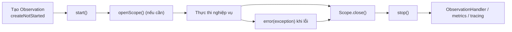

# Observation start và stop trong Micrometer Observation

> **Chương:** Micrometer Observation  
> **Module:** `SPRING_BOOT_OBSERVABILITY` — Thiết lập observability cho Spring Boot bằng Micrometer Observation, metrics, logs và distributed tracing. Bài này tập trung vào **vòng đời một Observation**: tạo, `start()`, đặt vào scope, ghi lỗi và `stop()`. Đây là nền tảng để quan sát đúng thời gian xử lý, giữ trace context và kết nối metrics–traces–logs.

## Mục tiêu học tập

Sau bài học, bạn có thể:

1. Giải thích vai trò của `ObservationRegistry`, `Observation`, `Observation.Context`, `ObservationHandler` và `Observation.Scope`.
2. Phân biệt `start()`, `openScope()`, `Scope.close()` và `stop()`; hiểu vì sao bốn thao tác này không thể thay thế nhau.
3. Viết một đoạn nghiệp vụ Spring Boot dùng `Observation.createNotStarted(...)`, xử lý thành công và ngoại lệ, bảo đảm `stop()` luôn được gọi đúng.
4. Dùng `observe(...)` khi chỉ cần đo một khối xử lý đồng bộ; biết giới hạn khi xử lý bất đồng bộ.
5. Lồng các observation, gắn key-value có cardinality phù hợp, quan sát output metrics/traces/logs và chẩn đoán các lỗi lifecycle phổ biến.

## 1. Vì sao cần start và stop?

Giả sử API đặt hàng gọi hệ thống kiểm tra tồn kho. Ta muốn biết bước kiểm tra tồn kho mất bao lâu, có lỗi hay không và có thể lần theo bước đó trong distributed trace.

Micrometer Observation tạo một vùng quan sát (**observation boundary**) quanh công việc. Vùng này có thời điểm bắt đầu và thời điểm kết thúc; metadata và error được ghi vào `Observation.Context`, sau đó các handler xử lý để sinh ra telemetry tùy cấu hình.



Một Observation **không phải** đồng nghĩa với một metric hoặc một span. Đây là API chung để thông báo vòng đời cho các handler. Khi tích hợp meter registry và tracing bridge phù hợp, cùng một observation có thể đóng góp vào timer metric và trace span; khi ghi log trong scope, log có thể nhận trace ID/span ID từ ngữ cảnh tracing.

Cần nhớ:

- `start()` báo bắt đầu vùng đo; `stop()` báo kết thúc và hoàn tất vòng đời.
- `openScope()` làm observation trở thành ngữ cảnh hiện hành trên luồng thực thi; đóng scope khôi phục ngữ cảnh trước đó.
- `error(Throwable)` ghi nhận lỗi của observation; bản thân nó không đóng scope hay dừng observation.
- `observe(...)` là cách tiện lợi để Micrometer thực hiện start, mở/đóng scope, ghi ngoại lệ phát sinh và stop quanh một công việc **đồng bộ**.

## 2. Những thành phần tham gia vòng đời

| Thành phần | Trách nhiệm | Điểm cần hiểu |
|---|---|---|
| `ObservationRegistry` | Nơi đăng ký configuration, handlers, filters và conventions; cung cấp ngữ cảnh observation đang hiện hành | Inject registry vào service thay vì tự tạo registry rời rạc |
| `Observation` | Đại diện cho một hoạt động đang được quan sát | Có tên, trạng thái vòng đời, context, error và key-values |
| `Observation.Context` | Chứa metadata phục vụ handler: tên, key-values, error, thông tin context khác | Không nên dùng như nơi chứa dữ liệu nhạy cảm tùy tiện |
| `ObservationHandler` | Nhận các callback vòng đời và tạo/điều khiển telemetry | Một handler có thể làm metrics; handler khác làm tracing |
| `Observation.Scope` | Thiết lập ngữ cảnh observation hiện hành trong thời gian scope mở | Scope có thể kết thúc trước observation; chỉ có hiệu lực theo ngữ cảnh thực thi được gắn |
| `ObservationConvention` | Quy ước tên và key-values cho một nhóm observation | Giúp thống nhất metric/span giữa các nơi gọi |

**Tách biệt vòng đời và scope** là chìa khóa. Một observation có thể bắt đầu trước khi công việc được đặt vào thread hiện tại, và có thể kết thúc khi không còn scope nào mở. Ngược lại, một observation có thể có nhiều lần mở scope nếu ứng dụng thực sự cần chuyển ngữ cảnh; việc quản lý các scope đó cần cẩn thận.

Trong Spring Boot, `spring-boot-starter-actuator` đưa vào những thành phần nền tảng liên quan tới observability. Registry được Spring Boot cấu hình và inject qua Spring container. Nếu muốn xuất metrics sang Prometheus hoặc traces sang OTLP, bạn cần thêm registry/exporter/bridge tương ứng. **Có ObservationRegistry không đảm bảo đã có backend ghi nhận telemetry.**

## 3. State và callback: một Observation đi qua những gì?

| Bước | API | Kết quả về mặt lifecycle |
|---|---|---|
| Tạo | `Observation.createNotStarted(name, registry)` | Tạo observation chưa bắt đầu; có thể gắn tên, key-values, contextual name |
| Bắt đầu | `observation.start()` | Đánh dấu bắt đầu; handler phù hợp nhận callback bắt đầu (`onStart`) |
| Đặt vào context | `observation.openScope()` | Observation trở thành current observation; handler nhận callback mở scope (`onScopeOpened`) |
| Thực thi | Code nghiệp vụ | Các log, child observation, instrumented downstream call có thể dùng context hiện hành |
| Ghi nhận lỗi | `observation.error(exception)` | Thông báo lỗi cho các handler (`onError`); không thay thế `stop()` |
| Rời context | `scope.close()` | Đóng scope và khôi phục observation trước đó; callback đóng scope (`onScopeClosed`) |
| Kết thúc | `observation.stop()` | Kết thúc vùng đo, handler nhận callback kết thúc (`onStop`) |

**Mẫu thông thường:**

```text
createNotStarted
    -> start
    -> openScope
    -> [business work; error nếu cần]
    -> close scope
    -> stop
```

Không mở scope vẫn có thể dùng Observation để đo thời gian, nhưng instrumentation con, MDC và hoạt động liên quan đến trace có thể không nhận được ngữ cảnh mong muốn. Trong bài toán chỉ cần tính một timer độc lập, điều đó có thể chấp nhận; với distributed tracing, scope thường rất quan trọng.

Không nên gọi `start()` hai lần hay `stop()` hai lần để cố “chia giai đoạn” trên cùng một observation. Nếu cần đo nhiều công đoạn độc lập, hãy tạo nhiều observation với quan hệ cha–con hoặc các operation riêng. Tránh giả định rằng việc gọi lặp vòng đời là cách được API hỗ trợ để có nhiều mẫu đo.

## 4. Tạo một Observation trong Spring Boot

### 4.1. Dependencies tối thiểu

Ứng dụng Spring Boot 3.x với parent/BOM phù hợp thường cần dependency sau để dùng cơ chế Actuator + Observation:

```xml
<dependency>
    <groupId>org.springframework.boot</groupId>
    <artifactId>spring-boot-starter-actuator</artifactId>
</dependency>
```

Khi thêm Prometheus registry, timer có thể được xuất cho Prometheus scrape:

```xml
<dependency>
    <groupId>io.micrometer</groupId>
    <artifactId>micrometer-registry-prometheus</artifactId>
</dependency>
```

Để có tracing, cần thêm bridge/SDK/exporter tương thích với phiên bản Spring Boot và backend được chọn. Ví dụ cho stack dùng OpenTelemetry:

```xml
<dependency>
    <groupId>io.micrometer</groupId>
    <artifactId>micrometer-tracing-bridge-otel</artifactId>
</dependency>
<dependency>
    <groupId>io.opentelemetry</groupId>
    <artifactId>opentelemetry-exporter-otlp</artifactId>
</dependency>
```

Những dependencies này chỉ minh họa kiến trúc phổ biến cho Spring Boot 3.x; các starter, tên property và cơ chế exporter cần đối chiếu với phiên bản Boot đang dùng. Đừng tạo nhiều `ObservationRegistry` thủ công hoặc nhiều tracing SDK độc lập nếu ứng dụng đã có auto-configuration phù hợp.

### 4.2. Ví dụ đầy đủ: tự start và stop

Service sau tự tạo observation cho bước kiểm tra tồn kho. Ví dụ không phụ thuộc cơ sở dữ liệu để làm rõ vòng đời:

```java
import io.micrometer.observation.Observation;
import io.micrometer.observation.ObservationRegistry;
import org.springframework.stereotype.Service;

@Service
public class StockService {
    private final ObservationRegistry observationRegistry;

    public StockService(ObservationRegistry observationRegistry) {
        this.observationRegistry = observationRegistry;
    }

    public String reserve(String sku, String channel) {
        Observation observation = Observation
                .createNotStarted("inventory.reserve", observationRegistry)
                .contextualName("reserve inventory")
                .lowCardinalityKeyValue("channel", channel);

        observation.start();

        try (Observation.Scope ignored = observation.openScope()) {
            if (sku == null || sku.isBlank()) {
                throw new IllegalArgumentException("SKU is required");
            }

            // Thay bằng logic nghiệp vụ thực tế (DB, HTTP client, ...).
            observation.lowCardinalityKeyValue("outcome", "success");
            return "RESERVED";
        } catch (RuntimeException exception) {
            observation.lowCardinalityKeyValue("outcome", "error");
            observation.error(exception);
            throw exception;
        } finally {
            observation.stop();
        }
    }
}
```

Đọc từ trên xuống:

1. `createNotStarted` xây dựng observation với tên kỹ thuật ổn định `inventory.reserve`.
2. `contextualName` đặt mô tả dễ đọc cho tracing/span khi handler hỗ trợ; tên metric chủ yếu dựa trên observation name/convention.
3. `lowCardinalityKeyValue` cung cấp chiều phân tích có tập giá trị giới hạn, phù hợp làm nhãn metrics.
4. `start()` thông báo sự kiện bắt đầu tới các handler.
5. `openScope()` đặt observation làm current context; `try-with-resources` tự đóng scope khi ra khỏi block, kể cả khi lỗi.
6. Khi có ngoại lệ, `error(exception)` ghi nhận sự kiện lỗi và ngoại lệ vẫn được ném ra cho tầng gọi xử lý.
7. `finally` bảo đảm `stop()` được gọi cả ở nhánh thành công và nhánh lỗi.

Ví dụ này giả định `channel` lấy từ một tập enum/giá trị được chuẩn hóa, chẳng hạn `WEB`, `MOBILE`, `PARTNER`. **Không dùng trực tiếp string do người dùng nhập** làm low-cardinality tag vì số giá trị có thể tăng vô hạn. Nếu channel không nằm trong tập đã biết, nên ánh xạ thành `UNKNOWN` hoặc một nhóm có kiểm soát.

### 4.3. Biến thể đảm bảo stop cả khi mở scope thất bại

Ở code thông thường, `try-with-resources` đủ để đảm bảo đóng scope. Nếu muốn diễn đạt rõ hơn rằng vùng trách nhiệm `stop()` bao bọc cả thao tác mở scope, có thể viết:

```java
Observation observation = Observation
        .createNotStarted("inventory.reserve", observationRegistry)
        .start();

try {
    try (Observation.Scope scope = observation.openScope()) {
        performReservation();
    }
} catch (RuntimeException exception) {
    observation.error(exception);
    throw exception;
} finally {
    observation.stop();
}
```

`performReservation()` là hàm nghiệp vụ minh họa. Ở đây, `finally` nằm bên ngoài khối mở scope; ngoại lệ khi mở scope hoặc chạy nghiệp vụ vẫn dẫn tới `stop()`. Cấu trúc này hữu ích khi một observation thủ công được dùng ở đoạn mã có nhiều nhánh trả về.

**Điểm quan trọng:** scope kết thúc trước khi observation bị stop, để ngữ cảnh cũ được khôi phục trước khi gọi `onStop`. Việc ghi lỗi không đóng scope; `try-with-resources` và `finally` giải quyết hai trách nhiệm khác nhau.

## 5. Dùng observe(...) khi không cần quản lý lifecycle thủ công

Micrometer hỗ trợ phương thức tiện ích `observe(...)` cho tác vụ đồng bộ. Bạn không cần tự gọi `start`, `openScope`, `close` hay `stop`:

```java
public String reserveWithObserve(String sku) {
    return Observation.createNotStarted(
                    "inventory.reserve", observationRegistry)
            .lowCardinalityKeyValue("operation", "reserve")
            .observe(() -> {
                if (sku == null || sku.isBlank()) {
                    throw new IllegalArgumentException("SKU is required");
                }
                return "RESERVED";
            });
}
```

Với hàm trên, `observe` quản lý vòng đời cho callback. Nếu callback ném exception, observation ghi nhận lỗi và exception vẫn được truyền ra ngoài. Kiểu trả về được suy ra từ lambda; API cũng hỗ trợ dạng callback không trả kết quả.

So sánh nhanh:

| Tiêu chí | Quản lý `start/stop` thủ công | `observe(...)` |
|---|---|---|
| Độ dài code | Dài hơn; phải viết try/catch/finally rõ ràng | Ngắn, dễ đọc |
| Scope | Chủ động mở/đóng | Được quản lý quanh callback |
| Xử lý lỗi | Tự gọi `error(exception)` khi cần | Exception phát sinh trong callback được xử lý trong vòng đời observe |
| Thời điểm stop | Tùy logic do bạn kiểm soát | Khi callback kết thúc |
| Phù hợp | Công việc nhiều giai đoạn, callback, tác vụ async có điều phối riêng | Một khối nghiệp vụ đồng bộ |

**Không dùng `observe(() -> startAsyncWork())` để đo thời gian hoàn tất async** nếu callback chỉ trả về `CompletableFuture` hoặc gửi message rồi kết thúc ngay: observation sẽ stop khi callback trả về, trước khi công việc thực sự hoàn tất.

## 6. Phân biệt Scope.close() và Observation.stop()

Đây là hai thao tác rất dễ nhầm.

Giả sử có API chính `checkout.place` đang là current observation, và trong đó gọi `inventory.reserve`:

```text
Thread request
│
├── checkout.place start
│   └── openScope(checkout.place)  ← current = checkout.place
│       ├── inventory.reserve start
│       │   └── openScope(inventory.reserve) ← current = inventory.reserve
│       │       └── gọi inventory
│       │   └── closeScope(inventory.reserve) ← current = checkout.place
│       └── inventory.reserve stop
│       └── tiếp tục checkout
│   └── closeScope(checkout.place) ← khôi phục context trước đó
└── checkout.place stop
```

`Scope.close()` trả current observation về cha; nó không nói với handler rằng operation đã hoàn tất. Nếu quên `stop()`, timer/span có thể không được kết thúc đúng, khiến telemetry thiếu hoặc sai.

Ngược lại, nếu gọi `stop()` trong lúc scope đang mở rồi tiếp tục chạy code trong scope đó, ngữ cảnh hiện hành có thể vẫn trỏ tới một observation đã kết thúc. Điều này dễ gây lỗi khó theo dõi khi logs, tracing handler hoặc child observations tham chiếu current context. Hãy giữ quy ước **đóng scope trước, stop sau**.

### 6.1. Code minh họa observation lồng nhau

```java
Observation parent = Observation
        .createNotStarted("checkout.place", observationRegistry)
        .start();

try (Observation.Scope parentScope = parent.openScope()) {
    // Trong scope của parent, child có thể được tracing handler
    // gắn quan hệ với parent đang hiện hành.
    Observation child = Observation
            .createNotStarted("inventory.reserve", observationRegistry)
            .start();

    try (Observation.Scope childScope = child.openScope()) {
        callInventory();
    } catch (RuntimeException exception) {
        child.error(exception);
        throw exception;
    } finally {
        child.stop();
    }
} catch (RuntimeException exception) {
    parent.error(exception);
    throw exception;
} finally {
    parent.stop();
}
```

`callInventory()` là hàm nghiệp vụ minh họa. Ví dụ đóng child scope trước khi child `stop()` và đóng parent scope trước khi parent `stop()`. Khi child ném lỗi ra ngoài, cả child và parent đều có thể ghi nhận lỗi ở phạm vi mà mỗi observation chịu trách nhiệm; điều này là chủ đích, không phải tự động tạo hai sự kiện lỗi độc lập trong backend.

**Lưu ý:** quan hệ cha–con trong trace còn phụ thuộc tracing handler và context propagation. Chỉ vì hai observation có code lồng nhau không đảm bảo backend chắc chắn có hai span nếu tracing chưa được cấu hình hoặc trace đã bị sampling loại bỏ.

## 7. Khi nào nên gọi error()?

`Observation.error(exception)` thể hiện “đã có lỗi được phát hiện trong vùng quan sát này”. Nó không phải `throw`, không quyết định HTTP response và không tự làm cho application giao dịch rollback.

Một số trường hợp:

| Tình huống | Ghi `error(...)`? | Vì sao |
|---|---|---|
| Callback trong `observe(...)` ném exception | Thông thường không cần gọi lại thủ công | `observe` đã xử lý exception phát sinh trong callback |
| Code thủ công catch exception rồi rethrow | Nên gọi `observation.error(exception)` | Giúp handler nhận biết lỗi trước `stop` |
| Code xử lý được lỗi và trả kết quả fallback thành công | Tùy semantic: lỗi nội bộ có cần thể hiện hay không? | Không phải mọi retry/fallback đều là thất bại của operation |
| HTTP 404 được coi là business outcome bình thường | Không nhất thiết là exception | Không đồng nhất “status không phải 2xx” với exception |
| Timeout của một HTTP downstream call | Nên để instrumentation/catch trong đúng observation phát hiện | Tránh ghi nhận lỗi không liên quan vào mọi observation |

Nếu bắt exception để **nuốt lỗi** mà không gọi `error(...)`, handler có thể coi observation thành công, dù nghiệp vụ thực sự thất bại. Ngược lại, gọi `error` quá rộng trên mọi lỗi đã phục hồi có thể làm tỷ lệ lỗi tracing mang ý nghĩa sai lệch.

Ví dụ với fallback nhưng muốn ghi nhận vấn đề ở child operation:

```java
Observation fallback = Observation
        .createNotStarted("inventory.lookup", observationRegistry)
        .start();

try (Observation.Scope scope = fallback.openScope()) {
    return lookupInventory();
} catch (InventoryUnavailableException exception) {
    fallback.error(exception);
    return "UNKNOWN";
} finally {
    fallback.stop();
}
```

`lookupInventory()` và `InventoryUnavailableException` là thành phần nghiệp vụ giả định. Tầng gọi vẫn nhận `UNKNOWN`, nhưng observation của **bước tra cứu** thể hiện lỗi. Tầng API bao ngoài có thể thành công nếu fallback là hành vi cho phép. Quan trọng là chọn ranh giới observation theo đúng ý nghĩa nghiệp vụ.

## 8. Một timeline thực tế: đo thời gian gì?

Xét một bước kiểm tra tồn kho, gồm validate đầu vào (2 ms), gọi HTTP (120 ms), xử lý response (3 ms):

```text
T0 createNotStarted
T1 start
   ├── T2 openScope
   ├── validation             ~ 2 ms
   ├── outbound HTTP          ~ 120 ms
   ├── response mapping       ~ 3 ms
   └── T3 closeScope
T4 stop                       tổng ~ 125 ms + overhead
```

Khoảng thời gian được ghi nhận thường gắn với `start → stop` theo handler đo thời gian; **không chỉ** `openScope → closeScope`. Vì vậy:

- Gọi `start` quá sớm có thể tính cả thời gian chờ chưa thuộc nghiệp vụ cần đo.
- Gọi `stop` quá sớm loại mất một phần công việc khỏi duration.
- Nếu một callback chạy sau `stop`, nó không thuộc duration của observation đó, dù vẫn dùng cùng object trong code.
- Thời gian của child observation có thể nằm trong parent duration. **Không được cộng tổng duration các span lồng nhau** rồi coi là tổng latency request; việc này dễ đếm trùng.

Đối với HTTP server observations do Spring Boot instrument, hãy ưu tiên instrumentation mặc định. Tạo custom observation cho bước nghiệp vụ cụ thể; đừng cố “đo lại” nguyên request nếu metric `http.server.requests` đã tồn tại.

## 9. Gắn key-value trước và trong vòng đời

Observation hỗ trợ hai nhóm metadata thường gặp:

```java
Observation observation = Observation
        .createNotStarted("checkout.payment", observationRegistry)
        .contextualName("charge payment")
        .lowCardinalityKeyValue("payment.provider", "primary")
        .highCardinalityKeyValue("payment.attempt", attemptId);
```

| Nhóm | Ý nghĩa | Ví dụ |
|---|---|---|
| Low cardinality | Tập giá trị có giới hạn, thích hợp chia nhóm metrics | `payment.provider=primary/backup`, `outcome=success/error` |
| High cardinality | Phù hợp hơn để làm thuộc tính trace khi cần điều tra cụ thể | ID một attempt nội bộ **không nhạy cảm** và đã được cho phép |
| Không nên đưa vào telemetry | Bí mật, dữ liệu nhận dạng hoặc dữ liệu thanh toán | Token, password, số thẻ, email, request body nhạy cảm |

Một trace ID, user ID hay order ID có giá trị khác nhau theo gần mỗi request: **không** dùng chúng làm low-cardinality metric tags. Kể cả high-cardinality tags, chỉ thêm khi có mục tiêu điều tra rõ ràng và chính sách bảo vệ dữ liệu phù hợp.

Với metadata xác định được ngay, thêm trước `start()` giúp handler có thông tin từ đầu. Kết quả xử lý như `outcome` có thể bổ sung sau khi công việc xong nhưng **trước `stop()`**. Nội dung nào xuất hiện trong metric/span cụ thể vẫn phụ thuộc thời điểm và cách hoạt động của handler; không nên giả định mọi exporter đều xử lý mọi field theo cùng cách.

### 9.1. Tên observation và contextual name

- `inventory.reserve`: tên operation ổn định, dùng cho grouping/metric name theo convention.
- `reserve inventory`: contextual name dễ đọc cho trace span khi được hỗ trợ.
- `inventory.reserve.sku-123456`: tên không nên dùng vì chèn ID động làm giảm khả năng tổng hợp và có thể tạo cardinality cao.

Giữ tên nhất quán giữa local và production để dashboard/alert không cần viết lại khi đổi môi trường.

## 10. ObservationRegistry và các callback handler

Khi ứng dụng tạo Observation bằng registry do Spring cấu hình, registry có thể chứa các handler. Một handler nhận chuỗi callback, ví dụ:

```java
public class ExampleObservationHandler
        implements ObservationHandler<Observation.Context> {

    @Override
    public boolean supportsContext(Observation.Context context) {
        return true;
    }

    @Override
    public void onStart(Observation.Context context) {
        // Được gọi khi observation bắt đầu.
    }

    @Override
    public void onError(Observation.Context context) {
        // Được gọi khi observation ghi nhận lỗi.
    }

    @Override
    public void onStop(Observation.Context context) {
        // Được gọi khi observation kết thúc.
    }
}
```

Cần import:

```java
import io.micrometer.observation.Observation;
import io.micrometer.observation.ObservationHandler;
```

Đây là skeleton để hiểu lifecycle; ví dụ chưa tự đăng ký bean hay cung cấp cơ chế lưu số liệu. Trong ứng dụng thực tế, Spring Boot và các integration thường đã đăng ký handler tạo metrics và tracing. Chỉ viết handler mới khi có nhu cầu rõ ràng, và luôn kiểm tra xem nội dung đã được instrumentation mặc định bao phủ chưa.

Thông thường, việc gửi metric/tracing có liên hệ với các callback:

| Callback | Ý nghĩa thường thấy |
|---|---|
| `onStart` | Khởi tạo dữ liệu quan sát, bắt đầu đo thời gian hoặc tạo đối tượng span |
| `onScopeOpened` | Làm cho context/span hiện hành để log hoặc call con nhận được |
| `onError` | Đính thông tin lỗi vào telemetry |
| `onScopeClosed` | Khôi phục context hoặc span trước đó |
| `onStop` | Kết thúc đo thời gian/span và cho phép pipeline export dữ liệu |

Việc **khi nào** trace được flush/nhìn thấy trong backend còn tùy batching, sampling và exporter; `stop()` không đồng nghĩa telemetry đã được gửi qua mạng thành công.

## 11. Liên hệ giữa start/stop với metrics, logs và tracing

Ví dụ đã bật Actuator, meter registry và tracing bridge:

1. `start()` bắt đầu một observation, cho handler có thời điểm mở đo và/hoặc span theo cấu hình.
2. `openScope()` đưa observation vào current context. Khi app ghi log trong scope, MDC có thể mang `traceId`/`spanId` nếu tracing được cấu hình và logging layout giữ các trường đó.
3. Client HTTP được instrument có thể lấy trace context hiện hành để truyền sang downstream.
4. `error(exception)` cho tracing handler biết sự cố trong scope đó.
5. `stop()` kết thúc vùng đo và cho handler cơ hội hoàn thiện timer/span; exporter/collector tiếp tục xử lý bất đồng bộ.

| Tín hiệu | Dấu hiệu để kiểm tra |
|---|---|
| Metrics | Một timer tương ứng với tên observation; `count` tăng, `totalTime`/histogram phản ánh duration |
| Traces | Một span có tên phù hợp, có duration và liên kết parent nếu có trace context |
| Logs | Các log phát sinh trong scope có thể chứa trace ID/span ID để tra cứu cùng request |

Nếu backend không có trace trong khi timer vẫn có, cần kiểm tra bridge, sampling, exporter, receiver và propagation. **Có metrics không đảm bảo đã bật tracing.** Nếu log không có trace ID, hãy kiểm tra scope/current context, cấu hình MDC và pattern/structured logging. Observation tự thân không buộc mọi logger ghi trace context.

### 11.1. Cấu hình local để thực hành

Ví dụ Spring Boot 3.x, có `micrometer-registry-prometheus` và exporter OTLP:

```yaml
spring:
  application:
    name: inventory-service

management:
  endpoints:
    web:
      exposure:
        include: health,metrics,prometheus
  tracing:
    sampling:
      probability: 1.0
  otlp:
    tracing:
      endpoint: ${OTLP_TRACES_ENDPOINT:http://localhost:4318/v1/traces}
```

Khi chỉ học start/stop ở local, bạn có thể kiểm tra timer qua `/actuator/metrics` mà chưa cần dựng hệ thống tracing. Để xem trace, cần backend/Collector OTLP có thể nhận dữ liệu. Cấu hình OTLP trên minh họa **HTTP** endpoint có `/v1/traces`; với gRPC, cổng và giao thức khác.

Gọi endpoint nghiệp vụ thật để tạo observation rồi kiểm tra:

```bash
curl -s http://localhost:8080/actuator/metrics
curl -s http://localhost:8080/actuator/metrics/inventory.reserve
curl -s http://localhost:8080/actuator/prometheus
```

Tên meter xuất ra Prometheus có thể được chuyển thành dạng `inventory_reserve_seconds_count` và `inventory_reserve_seconds_sum`. Kiểm tra tên thực tế từ output đang có, vì registry và phiên bản ảnh hưởng cách đổi tên/đơn vị. Một meter sẽ chỉ xuất hiện sau khi có observation được handler xử lý thực sự.

## 12. Đồng bộ và bất đồng bộ: chốt ranh giới stop cho đúng

### 12.1. Công việc đồng bộ

Với logic chạy liên tục trong một thread/callback và kết thúc trước khi method trả về, `observe(...)` thường là lựa chọn tốt:

```java
String result = Observation
        .createNotStarted("catalog.lookup", observationRegistry)
        .observe(() -> catalogRepository.findName(sku));
```

Method `catalogRepository.findName(sku)` là ví dụ. Observation dừng khi callback hoàn tất, nên duration phản ánh khoảng thời gian thực thi callback này.

### 12.2. Công việc bất đồng bộ

Giả sử nghiệp vụ trả về `CompletableFuture` ngay, trong khi xử lý thật chạy ở executor. Đo “hoàn thành toàn tác vụ” cần đặt `stop()` tại thời điểm future kết thúc, không phải lúc future được tạo.

Ví dụ minh họa cho một future được điều phối bằng executor:

```java
import java.util.concurrent.CompletableFuture;
import java.util.concurrent.Executor;

public CompletableFuture<String> reserveAsync(
        String sku, Executor executor) {

    Observation observation = Observation
            .createNotStarted("inventory.reserve.async", observationRegistry)
            .start();

    try {
        return CompletableFuture
                .supplyAsync(() -> {
                    try (Observation.Scope scope = observation.openScope()) {
                        return reserveInDatabase(sku);
                    }
                }, executor)
                .whenComplete((value, failure) -> {
                    if (failure != null) {
                        observation.error(failure);
                    }
                    observation.stop();
                });
    } catch (RuntimeException schedulingFailure) {
        // Ví dụ: executor từ chối nhận task.
        observation.error(schedulingFailure);
        observation.stop();
        throw schedulingFailure;
    }
}
```

`reserveInDatabase` là method nghiệp vụ giả định. Trong ví dụ:

- Start được gọi trước khi submit task; duration bao gồm **thời gian chờ executor** và thời gian thực thi. Nếu chỉ muốn đo thời gian chạy, start nên nằm tại điểm task thực sự bắt đầu.
- Scope được mở ở worker thread và đóng khi worker hoàn thành.
- `whenComplete` thông báo lỗi nếu future kết thúc bất thường, rồi stop observation.
- Nhánh `catch` bảo đảm stop khi submit task thất bại đồng bộ.

Đây là **mẫu minh họa lifecycle**, không phải giải pháp tổng quát cho mọi callback, cancellation hoặc cấu trúc async phức tạp. Một số pipeline có thể gọi callback/complete ở thread khác; cần quản lý ai sở hữu observation và chắc chắn stop đúng một lần. `Throwable` trong `whenComplete` có thể là exception wrapper (chẳng hạn `CompletionException`); với telemetry production, nên unwrap có kiểm soát để ghi lỗi gốc theo chính sách.

**Context propagation:** chỉ di chuyển đối tượng `Observation` sang thread khác không tự động chuyển mọi ThreadLocal/MDC của các thư viện. Khi có call con trong async task, cần cấu hình Micrometer Context Propagation/`ContextPropagatingTaskDecorator`, executor instrumented hoặc giải pháp dành riêng cho Reactor theo phiên bản framework. Khi có nhiều tác vụ song song, tốt hơn mỗi nhánh có observation rõ ràng và dùng context propagation đúng cách, tránh dùng chung scope mutable qua các thread.

### 12.3. Reactive pipeline

Trong Reactor, thời điểm xây dựng `Mono`/`Flux` khác thời điểm subscribe và hoàn tất. Nếu gọi `start()` lúc *assembly* rồi `stop()` ngay khi method trả về `Mono`, bạn chỉ đo thời gian xây dựng pipeline.

Với reactive code, ưu tiên instrumentation của Spring WebFlux/Reactor và các operator/context integration phù hợp; khi phải viết observation thủ công, phải gắn lifecycle với signal thực tế (completion, error, cancellation) và thực hiện cleanup đúng một lần. Không coi `try-with-resources` ở ngoài reactive chain là giải pháp đóng scope cho mọi signal.

## 13. Những lỗi thường gặp và cách sửa

### Lỗi A: Quên stop khi có exception

**Sai:**

```java
Observation observation = Observation
        .createNotStarted("order.validate", observationRegistry)
        .start();

validateOrder(order);       // Ném exception thì stop bị bỏ qua.
observation.stop();
```

**Đúng:**

```java
Observation observation = Observation
        .createNotStarted("order.validate", observationRegistry)
        .start();

try (Observation.Scope scope = observation.openScope()) {
    validateOrder(order);
} catch (RuntimeException exception) {
    observation.error(exception);
    throw exception;
} finally {
    observation.stop();
}
```

### Lỗi B: Nhầm close scope với stop

**Sai:** chỉ dùng `try (Scope scope = observation.openScope())`, rồi nghĩ timer/span đã kết thúc.

**Đúng:** scope đóng nhờ `try-with-resources`, observation dừng trong `finally` hoặc dùng `observe` để quản lý cả vòng đời.

### Lỗi C: Stop trước khi async hoàn thành

**Sai:**

```java
Observation observation = Observation
        .createNotStarted("email.send", observationRegistry)
        .start();

CompletableFuture<Void> future =
        CompletableFuture.runAsync(this::sendEmail, executor);
observation.stop();  // Chỉ đo thời gian submit, không đo việc gửi email.
return future;
```

**Hướng sửa:** gắn stop với completion của future, đồng thời ghi error/cancellation phù hợp và đảm bảo không có nhánh nào gọi stop hai lần.

### Lỗi D: Đưa ID riêng của từng request vào metric tag

**Sai:**

```java
observation.lowCardinalityKeyValue("order.id", orderId);
```

**Đúng:** dùng chiều phân loại ổn định, ví dụ:

```java
observation.lowCardinalityKeyValue("order.channel", channelEnum.name());
```

Nếu có nhu cầu lưu order ID trong trace, phải đánh giá quy định dữ liệu và nhu cầu truy vấn, rồi cân nhắc high-cardinality attribute với giới hạn phù hợp; không dùng để tạo nhãn metric.

### Lỗi E: Hiểu rằng start tự tạo current context

Nếu code gọi `start()` rồi ghi log/call downstream mà không có scope, logs hoặc các child operation có thể thiếu correlation với observation mong muốn. Hãy mở scope quanh đoạn code cần nhận context và đóng scope đúng hạn.

### Lỗi F: Mọi observation đều có span trong backend

Không nhất thiết: tracing bridge chưa cấu hình, sampling không chọn trace, exporter lỗi hoặc backend không nhận dữ liệu đều khiến span không hiển thị. `stop()` báo hoàn tất lifecycle trong tiến trình, không đồng nghĩa backend đã lưu trace.

## 14. Kiểm tra vòng đời bằng tình huống cụ thể

Giả sử có endpoint `POST /orders` gọi `StockService.reserve(...)`. Thực hành theo ba tình huống:

| Tình huống | Điều mong đợi |
|---|---|
| SKU hợp lệ | Observation được start/stop; timer count tăng; tag `outcome=success` nếu handler xuất metric |
| SKU rỗng | Exception được ghi qua `error`, scope đóng, observation stop; method vẫn ném exception ra ngoài |
| Nhiều request liên tiếp | Timer count tăng theo số lần observation hoàn thành; không có operation bị treo do thiếu stop |

Với tracing hoạt động, mở trace của một request và kiểm tra:

1. Span chứa nghiệp vụ `reserve inventory` có duration hợp lý.
2. Nếu có HTTP server span cha và context phù hợp, span con liên kết đúng trace.
3. Trong thời gian scope mở, logs có thể được tìm theo trace ID của request (nếu log format và MDC hỗ trợ).
4. Sau khi đóng scope, các log/call tiếp theo không “bị dính” vào observation đã kết thúc.

Đối chiếu timer histogram và traces: timer tổng hợp tất cả lần xử lý được meter handler ghi nhận, còn trace backend có thể chỉ chứa một phần request do sampling. Vì vậy, **không lấy số trace làm số lượng request**. Trong production, cần kiểm tra cardinality, sampling, quy tắc exporter và bảo vệ dữ liệu trước khi tăng mức instrumentation.

## 15. Bài tập tư duy và tiêu chí hoàn thành

**Bài 1 — Đặt ranh giới:** API import file gồm parse (20 ms), validate (30 ms), ghi DB (100 ms). Đề xuất một parent observation `file.import` và ba child observation cho từng bước. Xác định vị trí start, openScope, close scope, stop. Giải thích vì sao tổng duration ba child không nhất thiết bằng duration parent (còn overhead, thời gian điều phối và các công đoạn khác).

**Bài 2 — Lỗi được xử lý:** `inventory.lookup` timeout, nhưng service dùng cache và trả kết quả hợp lệ. Xác định observation nào cần ghi lỗi, observation nào có thể thành công và những nhãn outcome nào có ý nghĩa. Phân biệt lỗi kỹ thuật ở downstream với kết quả cuối cùng của API.

**Bài 3 — Async:** một job trả về `CompletableFuture` ngay sau khi submit, thực thi sau 400 ms. Nếu observation stop ngay lúc submit, số đo sẽ sai thế nào? Nếu muốn đo thời gian chờ queue và thời gian chạy tách riêng, cần các ranh giới observation nào?

**Bài 4 — Gỡ lỗi:** metric `inventory.reserve` có count tăng nhưng trace backend không thấy span. Hãy lần lượt kiểm tra tracing bridge, sampling, OTLP endpoint, Collector, service identity và thời gian tìm kiếm; giải thích vì sao không nên tự kết luận start/stop bị sai.

Bạn hoàn thành bài học khi có thể viết đúng vòng đời một operation ở cả nhánh thành công/lỗi, giải thích riêng vai trò của scope, biết khi nào `observe` phù hợp và đọc được dấu hiệu đo lường ở metrics, traces, logs.

---

## Ghi nhớ

**Observation xác định ranh giới đo; scope xác định ngữ cảnh đang hiện hành.** `start()` và `stop()` bao lấy thời gian hoạt động; `openScope()` và `Scope.close()` giúp propagation/correlation trong phần code liên quan; `error(...)` ghi nhận lỗi; `observe(...)` là lựa chọn ngắn gọn cho khối đồng bộ. Với async, hãy dừng observation đúng lúc công việc hoàn thành. Việc tạo metric, trace và logs liên kết còn phụ thuộc registry, handlers, exporters, sampling và cấu hình logging của Spring Boot.
