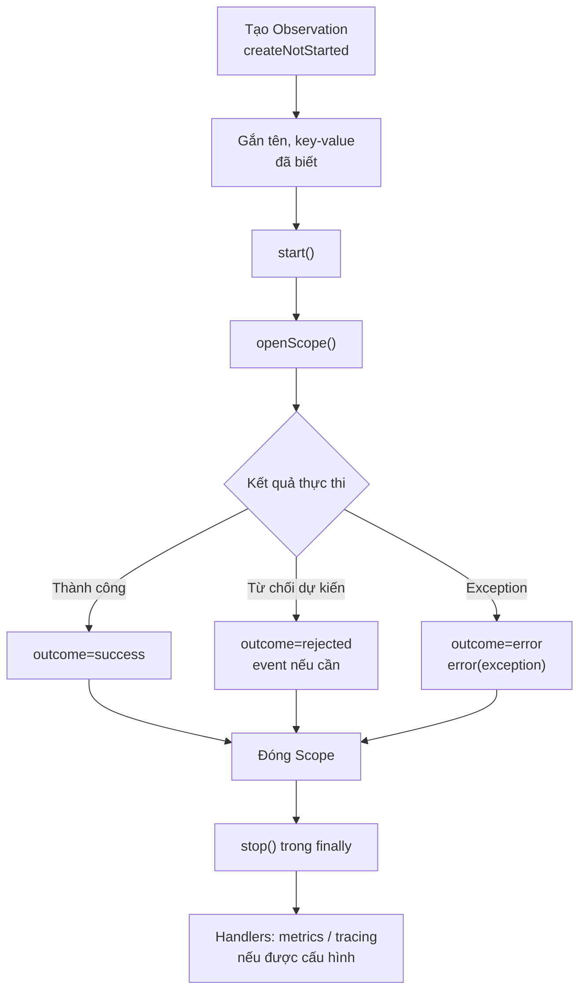
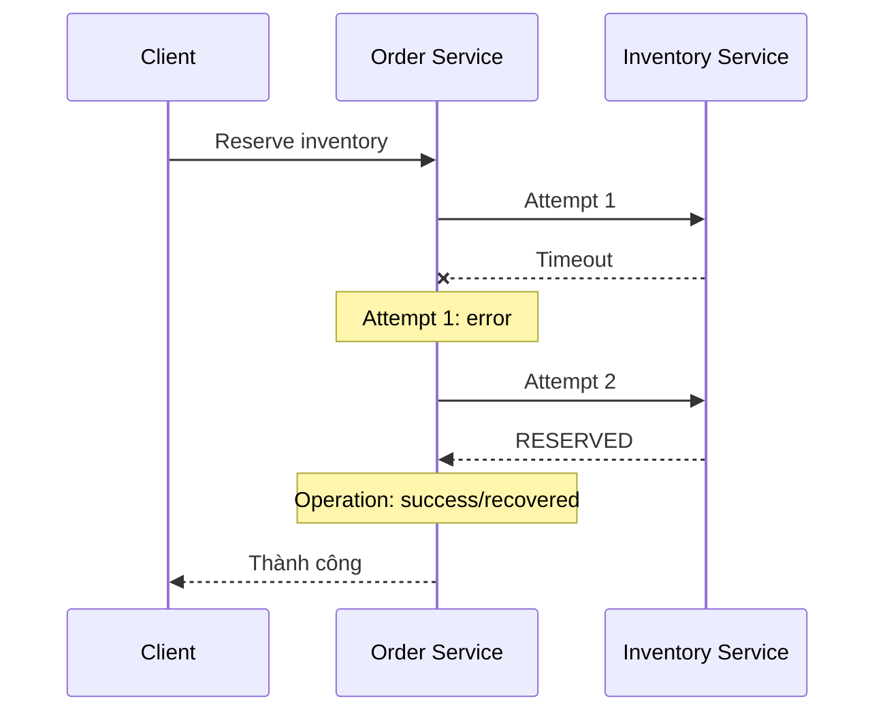

# Observation thành công và thất bại trong Spring Boot

Một API trả HTTP 200 chưa chắc đã hoàn tất nghiệp vụ như mong muốn; ngược lại, một thao tác bị từ chối vì quy tắc nghiệp vụ không nhất thiết là lỗi kỹ thuật. Khi thiết kế observability, chúng ta cần phân biệt rõ **observation đã hoàn thành**, **kết quả nghiệp vụ**, và **lỗi trong quá trình thực thi**. Nếu nhập nhằng ba khái niệm này, biểu đồ lỗi, trace và log có thể đưa ra những kết luận sai.

Trong chương **Micrometer Observation** thuộc module **SPRING_BOOT_OBSERVABILITY**, chúng ta học cách thiết lập observability cho Spring Boot bằng Micrometer Observation, metrics, logs và distributed tracing; hiểu propagation ngữ cảnh, tag/cardinality, exporter, sampling và cách liên kết các tín hiệu để điều tra lỗi, độ trễ, hành vi ứng dụng thực tế. Bài này đi sâu vào vòng đời của một `Observation` khi thao tác **thành công**, **thất bại vì exception**, hoặc **kết thúc bình thường nhưng kết quả nghiệp vụ không đạt**.

## 1. Mục tiêu học tập

Sau bài học, bạn có thể:

- Mô tả vòng đời `start → scope → error/event (nếu có) → stop` và vai trò của `ObservationRegistry`.
- Phân biệt lỗi kỹ thuật, trường hợp bị từ chối theo nghiệp vụ và lỗi đã được phục hồi bằng fallback/retry.
- Ghi nhận exception bằng `observation.error(exception)`, gắn nhãn kết quả bằng low-cardinality key-value và bảo đảm `stop()` luôn được gọi.
- Hiểu `ObservationHandler` có thể chuyển dữ liệu observation thành metric hoặc span, và giới hạn của các kết quả được xuất.
- Liên kết observation với logging/tracing, tránh trùng lặp observation và tag cardinality cao.
- Kiểm tra các trường hợp thành công, lỗi, trả về sớm và retry.

## 2. Observation là gì và “thành công” có nghĩa thế nào?

**Micrometer Observation** là API mô tả một công việc được quan sát: tên thao tác, thời điểm bắt đầu/kết thúc, các key-value, sự kiện và thông tin lỗi. `ObservationRegistry` chứa cấu hình cùng các `ObservationHandler` sẽ nhận thông báo trong vòng đời observation. Tùy handler được đăng ký, một observation có thể sinh **timer metric**, **tracing span**, hoặc hành vi quan sát khác. Bản thân việc tạo một observation **không bảo đảm** metrics/traces đã được xuất đến backend.

Giả sử thao tác `inventory.reserve` thực hiện giữ hàng:

| Tình huống | Kết quả nghiệp vụ | Có exception? | Cách biểu diễn gợi ý |
| --- | --- | --- | --- |
| Giữ hàng thành công | `RESERVED` | Không | `outcome=success` |
| Không đủ hàng, hệ thống trả kết quả dự kiến | `REJECTED` | Không | `outcome=rejected`; không tự coi là lỗi kỹ thuật |
| Inventory gateway timeout | Không có kết quả hợp lệ | Có | `outcome=error` + `observation.error(ex)` |
| Lần gọi đầu timeout, retry thành công | Giữ hàng cuối cùng thành công | Có lỗi ở attempt đầu | Observation của **attempt** ghi lỗi; observation của **thao tác tổng thể** ghi thành công hoặc `recovered` theo quy ước |

Điều quan trọng là xác định **ranh giới của công việc**: một lần gọi HTTP, một lần thử kết nối tới inventory, hay toàn bộ nghiệp vụ đặt hàng. Cùng một chuỗi sự kiện có thể cho kết quả khác nhau ở các cấp này. Tên và nhãn observation cần phản ánh đúng ranh giới đã chọn.

### Ba câu hỏi cần tách riêng

1. **Vòng đời có kết thúc không?** `observation.stop()` cho biết thao tác quan sát đã chấm dứt; việc gọi `stop` không tự chứng minh thành công.
2. **Thao tác trả kết quả gì?** Một tập outcome hữu hạn do ứng dụng quy định, ví dụ `success`, `rejected`, `error`.
3. **Có lỗi được ghi nhận không?** `observation.error(ex)` thông báo Throwable cho các handler quan tâm; observation có thể vừa được đánh dấu lỗi vừa có nhãn kết quả do ứng dụng thêm.

Đừng suy luận rằng “không ném exception” luôn đồng nghĩa thành công, hay “có HTTP 4xx” luôn đồng nghĩa hệ thống bị lỗi. Phân loại phải căn cứ vào ngữ nghĩa nghiệp vụ và mục đích của chỉ số.

## 3. Vòng đời của một observation



Các bước cơ bản:

- `Observation.createNotStarted(name, registry)`: tạo observation chưa bắt đầu; có thể gắn key-value hoặc contextual name.
- `start()`: bắt đầu đo, thông báo cho handler.
- `openScope()`: làm observation trở thành scope hiện hành đối với phần code đang chạy; đây là điều quan trọng để liên kết observation lồng nhau, trace context và MDC khi integration hỗ trợ.
- `event(...)`: đánh dấu một mốc đáng chú ý, như chuyển sang fallback. Event không thay thế exception.
- `error(exception)`: thông báo rằng đã xảy ra lỗi; các handler có thể sử dụng exception để gắn trạng thái lỗi/thuộc tính cho tín hiệu.
- `stop()`: hoàn tất vòng đời, cho phép handler kết thúc đo thời gian hoặc span; cần thực thi cả khi nhánh xử lý ném lỗi.

Một số tích hợp/công cụ có cách tự động quản lý vòng đời, ví dụ `Observation.observe(...)` hoặc instrumentation của framework. Khi **tự** mở observation, hãy tự bảo đảm kết thúc nó đúng một lần, và cân nhắc xem framework đã tạo observation ở ranh giới đó hay chưa.

### Phân biệt scope và observation

`Observation` mô tả công việc; `Observation.Scope` quản lý observation **hiện hành** trong phạm vi xử lý. Đóng scope không đồng nghĩa dừng observation. Trong code đồng bộ, quy tắc dễ kiểm tra là: `start` trước khi vào công việc, `openScope` quanh phần cần gắn ngữ cảnh, đóng scope khi ra khỏi khối `try-with-resources`, và `stop` ở `finally`.

Trong xử lý bất đồng bộ, scope thường gắn với context/thread đang thực thi. Không nên truyền bừa một `Scope` đã mở ở luồng này sang luồng khác; thay vào đó phải dùng cơ chế **context propagation** phù hợp với executor, Reactor hoặc message listener.

## 4. Ví dụ Spring Boot: thành công, bị từ chối và thất bại

Đoạn Java dưới đây dùng `ObservationRegistry` do Spring cung cấp. `InventoryGateway` là dependency giả định của ứng dụng; enum `ReserveResult` minh họa kết quả nghiệp vụ. Mỗi lần gọi `reserve` tạo **một** observation cho toàn bộ thao tác.

```java
import io.micrometer.observation.Observation;
import io.micrometer.observation.ObservationRegistry;
import org.springframework.stereotype.Service;

@Service
public class InventoryReservationService {

    private final ObservationRegistry observationRegistry;
    private final InventoryGateway inventoryGateway;

    public InventoryReservationService(
            ObservationRegistry observationRegistry,
            InventoryGateway inventoryGateway) {
        this.observationRegistry = observationRegistry;
        this.inventoryGateway = inventoryGateway;
    }

    public ReserveResult reserve(String sku, int quantity) {
        Observation observation = Observation
            .createNotStarted("inventory.reserve", observationRegistry)
            .contextualName("reserve inventory")
            .lowCardinalityKeyValue("operation", "reserve")
            .start();

        try (Observation.Scope scope = observation.openScope()) {
            try {
                ReserveResult result = inventoryGateway.reserve(sku, quantity);

                if (result == ReserveResult.REJECTED) {
                    observation.lowCardinalityKeyValue("outcome", "rejected");
                    observation.event(
                        Observation.Event.of("inventory.rejected"));
                    return result;
                }

                observation.lowCardinalityKeyValue("outcome", "success");
                return result;
            } catch (RuntimeException ex) {
                observation.lowCardinalityKeyValue("outcome", "error");
                observation.error(ex);
                throw ex;
            }
        } finally {
            observation.stop();
        }
    }
}

enum ReserveResult {
    RESERVED,
    REJECTED
}

interface InventoryGateway {
    ReserveResult reserve(String sku, int quantity);
}
```

**Phân tích mã:**

1. Tên `inventory.reserve` mô tả một công việc có nghĩa. `operation=reserve` có tập giá trị hữu hạn nên phù hợp cho low-cardinality key-value.
2. Với kết quả `RESERVED`, code gán `outcome=success`, trả kết quả và vẫn chạy `finally` để kết thúc observation.
3. Với `REJECTED`, hệ thống xử lý điều kiện nghiệp vụ dự kiến; code thêm `outcome=rejected` và có thể phát event. Không tạo exception giả chỉ để làm trace có màu đỏ.
4. Với `RuntimeException`, code gán `outcome=error`, gọi `observation.error(ex)` **trước khi ném lại lỗi**, rồi kết thúc observation qua `finally`.
5. `try-with-resources` đóng scope khi rời khối. `finally` đảm bảo `stop()` chạy khi return hoặc khi ném exception.

Trong ứng dụng thật, hãy quy định rõ gateway có thể trả `null` hay một kết quả khác không. Ví dụ giả định gateway luôn trả một trong hai enum; nếu có kết quả bất định, cần định nghĩa cách phân loại riêng để tránh ghi “success” cho trạng thái chưa được xác định.

**Không đưa `sku`, mã giao dịch, `userId`, URL đầy đủ hoặc exception message vào low-cardinality key-value.** Những dữ liệu có nhiều giá trị khác nhau có thể tạo quá nhiều time series trong metrics. Có thể lưu định danh yêu cầu ở log hoặc high-cardinality context khi cần và đã đánh giá quyền riêng tư, nhưng high-cardinality key-value có thể được tracing handler sử dụng, làm tăng lượng thuộc tính traces. Cần kiểm soát cả độ dài và độ nhạy cảm.

### Phiên bản tối giản khi thao tác chỉ có hai nhánh

Với đoạn code đơn giản, có thể dùng phương thức `observe` để Micrometer quản lý `start`, scope, lỗi ném ra và `stop`:

```java
Observation.createNotStarted("inventory.check", observationRegistry)
    .lowCardinalityKeyValue("operation", "check")
    .observe(() -> inventoryGateway.reserve(sku, quantity));
```

Đoạn trên minh họa một thao tác trả giá trị theo chữ ký `Supplier` của `observe`; dùng khi muốn quan sát toàn bộ lambda mà không phải tự đặt outcome ở nhiều nhánh. Với kết quả **từ chối nghiệp vụ nhưng không ném lỗi**, phải chủ động bổ sung phân loại nếu dashboard cần phân biệt với thành công. Có thể quay về mẫu quản lý observation tường minh phía trên.

Lưu ý: API `observe(...)` có cơ chế ghi nhận lỗi ném ra trong quá trình thực thi và hoàn tất observation; không cần bọc thêm `observation.error(...)` cho chính lambda đó nếu không muốn ghi nhận cùng lỗi hai lần. Khi triển khai trên dự án cụ thể, hãy xem behavior của phiên bản Micrometer và handler đang dùng.

## 5. Thành công hay thất bại được phản ánh ở metrics như thế nào?

Khi cấu hình meter observation handler, observation có thể tạo **timer** cho `inventory.reserve` và gắn các low-cardinality key-value như `operation`, `outcome`. Timer giúp trả lời: thao tác diễn ra bao nhiêu lần, thời gian bao lâu, xu hướng latency có thay đổi không. Số liệu percentile/histogram còn phụ thuộc cấu hình phân phối trong Micrometer và backend.

Ví dụ, nếu trong một khoảng thời gian có 100 lượt giữ hàng:

| Outcome | Số lượt | Ý nghĩa |
| --- | ---: | --- |
| `success` | 90 | Giữ hàng thành công |
| `rejected` | 7 | Bị từ chối bởi điều kiện nghiệp vụ dự kiến |
| `error` | 3 | Thất bại kỹ thuật, có exception |

Ta có thể tính tỷ lệ lỗi kỹ thuật của thao tác:

\[
\text{technical error rate} =
\frac{\text{count(outcome = error)}}{\text{count(all outcomes)}} =
\frac{3}{100} = 3\%
\]

Nếu mục tiêu là tỷ lệ **giữ hàng không thành công** theo góc nhìn người dùng, cần tính cả `rejected`:

\[
\text{non-success rate} =
\frac{7+3}{100}=10\%
\]

Hai chỉ số có ý nghĩa **khác nhau**; dashboard và cảnh báo phải đặt tên đúng. Một nghiệp vụ có thể muốn theo dõi tỷ lệ bị từ chối vì hết hàng nhưng không coi đó là sự cố vận hành.

### Điểm cần chú ý khi tạo nhãn

Các giá trị như `outcome=success|rejected|error`, `operation=reserve` là tập hữu hạn. Ngược lại, `exception.message`, `sku`, `requestId` hay `traceId` biến đổi theo từng request và không thích hợp làm metric label. Ngay cả `exception.class` cũng có thể cần chuẩn hóa về một tập nhóm ổn định (`timeout`, `dependency_error`, `validation`) thay vì để tên lỗi tùy ý.

Không phải mọi lỗi đều được thấy rõ trong metric tự động: một lỗi bị `catch` và trả fallback thành công có thể biến mất khỏi metric cấp ngoài, trong khi metric của dependency/attempt ghi nhận lỗi. Hãy xác định metric đang đo **cấp thao tác nào**.

## 6. Khi observation thất bại, tracing và logs hiển thị điều gì?

Với Micrometer Tracing được tích hợp, một observation có thể tương ứng với tracing span. `observation.error(ex)` thông báo lỗi tới các handler; tracing handler có thể đưa thông tin lỗi vào span và đánh dấu trạng thái tương ứng tùy implementation, cấu hình và exporter. Điều đó **không** đồng nghĩa mọi backend sẽ hiển thị y hệt nhau hoặc mọi trace đều được xuất: trace sampling có thể loại bỏ một phần traces.

| Tín hiệu | Thành công | Lỗi kỹ thuật |
| --- | --- | --- |
| **Metric** | Timer/count với `outcome=success` | Timer/count với `outcome=error` nếu handler ghi nhận |
| **Trace** | Span có tên/context, thời lượng | Span có thông tin lỗi nếu tracing handler xử lý `error(ex)` |
| **Log** | Sự kiện thành công ở mức thích hợp | Sự kiện thất bại, mã lỗi ổn định và stack trace ở ranh giới xử lý phù hợp |

Observation **không tự động phát một dòng log ứng dụng** khi bạn gọi `observation.error(ex)`. Nếu cần log chẩn đoán, hãy dùng logger của ứng dụng:

```java
catch (RuntimeException ex) {
    observation.lowCardinalityKeyValue("outcome", "error");
    observation.error(ex);
    log.error("event=inventory_reservation_failed reason=DEPENDENCY_ERROR", ex);
    throw ex;
}
```

Đoạn này là cách bổ sung logging vào nhánh `catch` của ví dụ trước, giả sử service đã khai báo logger SLF4J. Tránh log cùng exception với stack trace tại mọi tầng rồi tiếp tục ném, vì làm tăng nhiễu và khiến sự cố trông như nhiều lỗi độc lập.

Khi log format của Spring Boot đưa được **`traceId` và `spanId`** từ MDC vào bản ghi, người vận hành có thể tìm log theo cùng trace để phân tích. Observation phải có scope/context phù hợp, và phía logging/tracing phải được cấu hình; việc gọi `openScope` đơn lẻ không thể tự biến log thành dữ liệu phân tán.

### Mối quan hệ giữa HTTP error và business error

Tại ranh giới HTTP server, Spring Boot và instrumentation có thể đã ghi observation cho request và phản ánh HTTP status. Một phản hồi `409 Conflict` vì không đủ hàng có thể bị nhìn như một mã trạng thái HTTP không thành công, trong khi observation nghiệp vụ `inventory.reserve` có `outcome=rejected`. Ngược lại, hệ thống có thể trả HTTP 200 chứa kết quả `REJECTED`. Cách phân loại của **HTTP observation** và **business observation** có thể khác nhau và cả hai đều đúng theo ngữ cảnh riêng.

Không nên sửa hoặc ghi đè HTTP observation đã được framework tạo chỉ để khớp nhãn business. Nếu cần một góc nhìn nghiệp vụ, hãy tạo observation ở ranh giới nghiệp vụ, đặt tên rõ ràng và có tài liệu giải thích các outcome.

## 7. Retry, fallback và lỗi được phục hồi

Với retry, rất dễ đếm sai số lỗi:



Hãy quyết định rõ muốn quan sát:

- **Observation cấp thao tác tổng thể:** đo từ lúc nhận yêu cầu đến khi trả kết quả cuối cùng; có thể gắn `outcome=success` và thêm `recovered=true` nếu tập nhãn hữu hạn. Đây là số liệu gần với trải nghiệm người dùng.
- **Observation cấp attempt:** đo từng lần gọi downstream; attempt 1 nhận `outcome=error`, attempt 2 `outcome=success`. Đây là số liệu gần với độ ổn định của dependency.

Một lỗi ở attempt đầu tiên **không bắt buộc** biến observation cấp ngoài thành lỗi nếu quy tắc vận hành coi thao tác đã phục hồi và đáp ứng yêu cầu. Tuy nhiên, cần giữ evidence rằng retry đã xảy ra, chẳng hạn event có tên cố định, counter retry hoặc observation cấp attempt. Khi lỗi ở attempt cuối làm thất bại toàn bộ thao tác, cấp ngoài nên ghi `outcome=error` và thông báo exception tương ứng.

Các điểm kiểm tra:

1. Tránh tạo observation mới mỗi lần retry rồi dùng chúng để tính số yêu cầu người dùng; số lượng attempts có thể lớn hơn số requests.
2. Đừng gọi `observation.error(ex)` một cách vô điều kiện lên observation cấp ngoài khi retry đã xử lý thành công và khái niệm “thành công” là kết quả cuối. Quy ước của tổ chức có thể khác, nhưng phải nhất quán.
3. Nếu fallback trả dữ liệu suy giảm, nên định nghĩa rõ `outcome=degraded` hoặc `recovered`, thay vì mặc nhiên ghi một kết quả thành công không phân biệt.
4. Tránh span/tag/event theo số lần retry không giới hạn; cần kiểm soát chi phí và dữ liệu nhạy cảm.

## 8. Lỗi phổ biến trong vòng đời Observation

| Lỗi thiết kế | Hậu quả | Cách xử lý |
| --- | --- | --- |
| Quên `stop()` khi ném exception hoặc return sớm | Handler không được thông báo kết thúc; timer/span có thể thiếu | Luôn dừng trong `finally` hoặc dùng API `observe(...)` |
| Gọi `stop()` trước khi công việc thực sự kết thúc | Thời lượng sai, scope ngữ cảnh không khớp | Đặt ranh giới đúng và đóng scope trước `stop` |
| Chỉ có `try/finally` nhưng không ghi `error(ex)` | Có thể đo được thời gian nhưng handler không biết lỗi | Bắt exception, gọi `error(ex)` rồi ném tiếp |
| Chỉ dùng exception để định nghĩa thất bại | Không thấy các trường hợp bị từ chối hợp lệ | Phân loại outcome theo hợp đồng nghiệp vụ |
| Xem mọi `REJECTED` là lỗi hệ thống | Alert nhiễu và tỷ lệ lỗi vận hành sai | Phân biệt business rejection với technical error |
| Gắn `requestId`, `sku` làm low-cardinality key | Cardinality metrics bùng nổ | Chỉ dùng nhãn hữu hạn; định danh vào log/trace nếu được phép |
| Tạo observation trùng ở boundary đã instrument | Đếm/đo trùng và thêm span thừa | Kiểm tra HTTP, database và client instrumentation trước khi bọc tay |
| Mất context khi chạy `@Async`/executor | Parent-child span sai, log mất `traceId` | Cấu hình Micrometer Context Propagation theo môi trường |
| Giả định `error(ex)` tự viết log hoặc luôn xuất trace | Không thấy thông tin như mong đợi | Cấu hình logging, handlers, exporter, sampling và xác minh pipeline |

### Lưu ý về exception và luồng dữ liệu

Mẫu `catch (RuntimeException ex)` ở trên phù hợp với gateway có hợp đồng ném runtime exception. Nếu API có **checked exception**, xử lý loại exception đó theo chữ ký phương thức và gọi `observation.error(ex)` trước khi ném tiếp hoặc chuyển đổi có kiểm soát. Không nên bắt mọi `Throwable` chỉ để log rồi tiếp tục chạy: một số lỗi nghiêm trọng cần được lan truyền để hệ thống xử lý đúng.

Nếu code dùng reactive stream (`Mono`/`Flux`), vòng đời logic của thao tác có thể kéo dài **sau khi phương thức trả về publisher**. Tạo observation, `start` và `stop` ngay khi xây dựng publisher sẽ đo *thời gian tạo publisher*, không đo thời gian xử lý khi subscribe. Hãy dùng instrumentation/operator và context propagation tương thích Reactor, bảo đảm việc kết thúc observation gắn với tín hiệu hoàn thành, lỗi hoặc cancellation.

## 9. Quy trình thực hành và xác minh

Một kịch bản nhỏ nhưng sát production:

**Chuẩn bị:** Spring Boot có Micrometer Observation; thêm Spring Boot Actuator, một meter registry nếu muốn xuất metrics và tracing bridge/exporter nếu muốn xuất traces. Giữ cấu hình phiên bản dependency thống nhất với Spring Boot BOM. Tạo một gateway có ba chế độ: trả `RESERVED`, trả `REJECTED`, và ném exception timeout mô phỏng.

**Thực hiện:** Gọi service ba lần. Ghi lại kết quả bên ngoài, metric/timer với nhãn `outcome`, trace (nếu được sampling và xuất), và log.

| Ca kiểm tra | Hành vi của gateway | Kết quả mong đợi |
| --- | --- | --- |
| A — Thành công | Trả `RESERVED` | Một observation dừng hoàn chỉnh; `outcome=success`; không gọi `error` |
| B — Từ chối nghiệp vụ | Trả `REJECTED` | Một observation dừng hoàn chỉnh; `outcome=rejected`; có event nếu cấu hình handler quan tâm |
| C — Lỗi kỹ thuật | Ném `RuntimeException` | Observation nhận `error(ex)`, `outcome=error`; lỗi tiếp tục lan lên; `stop()` vẫn chạy |
| D — Retry phục hồi | Attempt đầu lỗi, attempt sau thành công | Attempt đầu lỗi; cấp tổng thể thành công hoặc recovered theo quy ước |
| E — Thực thi qua executor | Chuyển xử lý sang worker thread | Trace context và liên kết log vẫn đúng nếu propagation đã cấu hình |

**Các bước kiểm chứng:**

1. Xem các metric của tên `inventory.reserve` và các nhãn outcome. Khi bật histogram/percentile, so sánh latency giữa thành công và lỗi; không giả định cấu hình mặc định luôn có p95.
2. Xem trace có span phù hợp và tên contextual name; nếu không có trace, kiểm tra tracing bridge, exporter, Collector, sampling và tính liên tục của context.
3. Tìm log theo trace ID để xem event lỗi. Đừng nhầm log application với việc `ObservationHandler` đã nhận callback `onError`.
4. Chạy trường hợp trả về sớm và exception; xác nhận không còn observation chưa stop, không có scope/MDC bị giữ sang request sau.
5. Kiểm tra tag không chứa ID động hoặc dữ liệu nhạy cảm. So sánh số operation với số attempt khi bật retry.

### Bộ câu hỏi tự kiểm tra

1. Một phương thức không ném exception nhưng trả `REJECTED`, bạn sẽ đánh dấu outcome và error như thế nào? Vì sao?
2. Vì sao `finally { observation.stop(); }` vẫn cần thiết khi trong `try` có nhiều nhánh `return`?
3. Khi retry thành công ở lần 2, tỷ lệ lỗi của dependency và tỷ lệ lỗi trải nghiệm người dùng khác nhau ra sao?
4. Nếu metric có `outcome=error` nhưng trace backend không thấy span lỗi tương ứng, những nguyên nhân nào cần kiểm tra?
5. Vì sao `traceId` hữu ích trong log nhưng nguy hiểm nếu dùng làm metric label?

## 10. Ghi nhớ

**Kết thúc observation** và **thành công của thao tác** là hai khái niệm riêng. Với Micrometer Observation, hãy đặt ranh giới công việc rõ ràng, đảm bảo `start/stop` đầy đủ, ghi `error(ex)` khi có exception cần phản ánh, và gắn `outcome` có tập giá trị nhỏ để phân biệt thành công, từ chối nghiệp vụ và lỗi kỹ thuật. Với retry/fallback, xác định outcome của từng attempt và của toàn bộ thao tác.

Khi các `ObservationHandler`, metrics registry, tracing bridge, exporter và logging được cấu hình đúng, những thông tin này có thể được nối thành các tín hiệu vận hành hữu ích: metrics đo tần suất và latency, traces cho biết đường đi và nơi phát sinh lỗi, logs mô tả sự kiện cụ thể. Kiểm soát context propagation, cardinality và sampling giúp kết quả điều tra đáng tin cậy trên môi trường thực.
