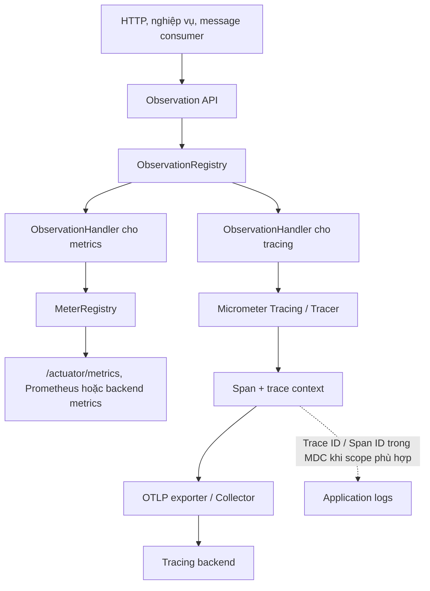
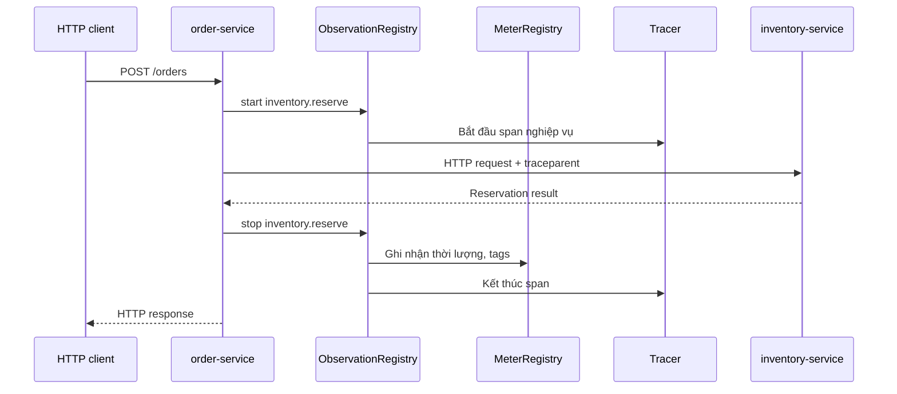

# Observation cho metrics và traces trong Spring Boot

Trong Spring Boot Observability, **Micrometer Observation** là một cách mô tả một hoạt động của ứng dụng để các hệ thống giám sát có thể thu thập tín hiệu liên quan. Cùng một hoạt động, chẳng hạn `inventory.reserve`, có thể đóng góp **metric về số lần chạy và thời lượng**, đồng thời tạo **span** để lần theo đường đi của một yêu cầu qua nhiều dịch vụ. Sự kết hợp này giúp phát hiện mức độ ảnh hưởng của lỗi hoặc độ trễ bằng metrics, rồi dùng traces và logs để xác định phần nào của luồng xử lý cần điều tra.

Bài học thuộc chương **Micrometer Observation** của module **SPRING_BOOT_OBSERVABILITY**. Trọng tâm là API Observation, cách các handler kết nối tới metrics và distributed tracing, các nguyên tắc về context propagation, tag/cardinality, exporter và sampling, cùng một quy trình kiểm chứng trong môi trường Spring Boot thực tế.

## 1. Vì sao dùng chung một Observation?

Giả sử API `POST /orders` phải kiểm tra tồn kho. Nhóm vận hành muốn trả lời hai câu hỏi:

- **Ở mức hệ thống:** việc giữ hàng mất bao lâu theo p95/p99? Tỷ lệ lỗi trong 15 phút gần nhất là bao nhiêu?
- **Ở mức một yêu cầu cụ thể:** request chậm đã chờ `inventory-service`, database hay một lời gọi HTTP khác?

**Metrics** tổng hợp số liệu theo tên metric, đơn vị và tập tag. Ví dụ, Timer `inventory.reserve` cho biết số lần thực thi và tổng thời gian; backend có thể tính tốc độ hoặc phân vị khi có dữ liệu histogram phù hợp. **Traces** hiển thị một cây các span có thời điểm bắt đầu/kết thúc và quan hệ cha–con; một trace cho thấy đường đi của một request cụ thể.

Nếu tạo metric bằng `Timer` và trace bằng `Tracer` trong hai đoạn mã rời nhau, nhà phát triển phải giữ đồng bộ tên, tag, trạng thái lỗi và vòng đời thủ công. Observation cung cấp một **ranh giới hoạt động chung**, để những handler được cấu hình có thể chuyển nó thành tín hiệu tương ứng.

| Khía cạnh | Metric từ Observation | Span từ Observation |
| --- | --- | --- |
| Câu hỏi | Hoạt động xảy ra bao nhiêu lần, thường mất bao lâu? | Lần thực thi này đi qua đâu, chậm ở bước nào? |
| Định danh | Tên meter + các tag có cardinality thấp | Trace ID, Span ID, quan hệ với span khác |
| Dữ liệu | Số lần, tổng thời gian, dữ liệu histogram nếu bật | Thời điểm bắt đầu/kết thúc, attributes, lỗi, context |
| Mức độ bao phủ | Có thể ghi nhận mọi hoạt động nếu metrics handler hoạt động | Phụ thuộc tracing handler, instrumentation, sampling và exporter |
| Tác động của ID giao dịch | Không nên đưa ID riêng lẻ vào tag | Có thể có attribute riêng theo chính sách dữ liệu, nhưng cần cân nhắc dung lượng/bảo mật |

**Một Observation không tự bảo đảm có đủ cả hai tín hiệu.** Ứng dụng cần cấu hình thích hợp: metrics handler và `MeterRegistry` để ghi metric; tracing handler và tracer/bridge để tạo span; exporter và backend để xem trace từ xa.

## 2. Các thành phần và luồng dữ liệu



Các thành phần có vai trò khác nhau:

1. **`Observation`** đại diện cho một hoạt động và vòng đời của nó. Observation giữ tên, context, key-values và thông tin lỗi được ghi nhận.
2. **`ObservationRegistry`** là nơi tập trung cấu hình Observation: các handler, predicate, filter và convention. Registry không phải nơi lưu trace hay hệ thống lưu metrics.
3. **`ObservationHandler`** nhận sự kiện vòng đời như bắt đầu, mở/đóng scope, lỗi, dừng. Handler metrics thường chuyển hoạt động thành dữ liệu meter; handler tracing tương ứng quản lý span.
4. **`MeterRegistry`** tập hợp meter như Timer, Counter, Gauge. Registry dành cho Prometheus hay một hệ thống khác quyết định cách xuất metric.
5. **Micrometer Tracing bridge** kết nối Observation với tracer/SDK thực tế, ví dụ OpenTelemetry. Exporter gửi span tới Collector hoặc backend tracing.
6. **Context propagation** giữ ngữ cảnh khi code chuyển qua method, thread, request HTTP hay hệ thống messaging. Nó quyết định liệu span mới có liên quan đúng với span hiện hành hay trở thành một trace rời rạc.

Trong Spring Boot đã được cấu hình observability, nhiều thành phần được tạo và kết nối tự động. Ứng dụng có thể inject `ObservationRegistry` mà không phải tự đăng ký từng handler. Khi dùng Micrometer thuần ngoài Spring Boot, nhà phát triển thường phải cấu hình handler cho registry rõ ràng.

### Observation có giống metric hoặc span không?

Không. **Observation là mô tả hoạt động có vòng đời**, còn metric/span là các kết quả quan sát mà handler có thể tạo ra. Một Observation thường tạo một Timer ở phía metrics và một span ở phía tracing, nhưng không có quy tắc tuyệt đối rằng mỗi Observation sẽ luôn tạo đúng một meter và đúng một span: việc đó tùy loại handler, convention, predicate, loại instrumentation và quyết định sampling.

Nếu chỉ có `spring-boot-starter-actuator`, một Observation của ứng dụng có thể tạo metric dù chưa có tracer. Nếu cấu hình bridge/exporter và tracing handler phù hợp, chính Observation đó còn có thể sinh span. Ngược lại, chỉ thêm exporter không biến mọi method Java thành span: hoạt động cần được instrument và được truyền context đúng.

## 3. Vòng đời của Observation

Vòng đời điển hình:

```text
Tạo Observation
      |
Gắn tên và thông tin ngữ cảnh
      |
start()
      |
openScope() -> trở thành Observation hiện hành trong scope
      |
Thực hiện công việc nghiệp vụ
      |
Ghi lỗi bằng error(exception) nếu có
      |
close() scope
      |
stop() -> kết thúc, handler ghi nhận kết quả
```

Một cách ngắn gọn là dùng `observe(...)`. Phương thức này thực hiện quản lý vòng đời cho phần code được bao quanh, bao gồm mở scope, ghi nhận lỗi được ném ra và dừng Observation.

```java
import io.micrometer.observation.Observation;
import io.micrometer.observation.ObservationRegistry;
import org.springframework.stereotype.Service;

@Service
public class PriceCalculationService {

    private final ObservationRegistry observationRegistry;

    public PriceCalculationService(ObservationRegistry observationRegistry) {
        this.observationRegistry = observationRegistry;
    }

    public long calculateTotal(long subtotalCents, String salesChannel) {
        String channel = "mobile".equals(salesChannel)
                ? "mobile"
                : "web";

        Observation observation = Observation
                .createNotStarted("checkout.calculate_total", observationRegistry)
                .contextualName("calculate checkout total")
                .lowCardinalityKeyValue("channel", channel);

        return observation.observe(() -> {
            try {
                if (subtotalCents < 0) {
                    throw new IllegalArgumentException("Subtotal must be non-negative");
                }

                long total = Math.addExact(subtotalCents, 250L);
                observation.lowCardinalityKeyValue("outcome", "success");
                return total;
            } catch (RuntimeException exception) {
                observation.lowCardinalityKeyValue("outcome", "error");
                throw exception;
            }
        });
    }
}
```

Trong ví dụ:

- `checkout.calculate_total` là **tên kỹ thuật ổn định**; metrics handler có thể dùng làm tên Timer.
- `contextualName("calculate checkout total")` cung cấp tên diễn giải cho bối cảnh hiện hành, có thể được tracing handler dùng làm tên span.
- `channel` và `outcome` được rút về các tập giá trị nhỏ, phù hợp để dùng làm low-cardinality key-values.
- `observe(...)` quản lý start/scope/stop. Khi lambda ném exception, lỗi được Observation ghi nhận; code không cần gọi `error(...)` lần nữa để ghi cùng ngoại lệ.
- Phép tính chỉ minh họa API. Trong hệ thống thực, Observation riêng thường có giá trị hơn tại ranh giới nghiệp vụ đáng quan sát, chẳng hạn `inventory.reserve`, `payment.authorize` hay một quy trình xét duyệt.

Tại đây không có lời gọi trực tiếp tới `Timer` hoặc `Tracer`. Nếu đã cấu hình cả hai loại handler, cùng một Observation có thể cung cấp dữ liệu cho cả metrics và tracing.

### 3.1. Điều khiển vòng đời thủ công

Đôi khi thao tác gồm nhiều bước, cần mở scope rõ ràng hoặc chỉ muốn kết thúc ở một khối `finally`:

```java
import io.micrometer.observation.Observation;
import io.micrometer.observation.ObservationRegistry;

public class ReservationWorkflow {

    private final ObservationRegistry registry;

    public ReservationWorkflow(ObservationRegistry registry) {
        this.registry = registry;
    }

    public void execute(Runnable reservationAction) {
        Observation observation = Observation.start("inventory.reserve", registry);

        try (Observation.Scope scope = observation.openScope()) {
            reservationAction.run();
        } catch (RuntimeException exception) {
            observation.error(exception);
            throw exception;
        } finally {
            observation.stop();
        }
    }
}
```

**Điểm cần giữ đúng:** `start()` khởi động hoạt động, `openScope()` kích hoạt ngữ cảnh hiện hành cho đoạn code trong scope, `Scope.close()` khôi phục ngữ cảnh trước đó và `stop()` kết thúc Observation. Không để scope bị rò rỉ sau request, và không gọi `stop()` nhiều lần như một cách xử lý lỗi. Với các method đơn giản, `observe(...)` thường ngắn gọn và ít sai sót hơn.

Một Observation có thể bắt đầu và kết thúc nhưng không được mở scope; khi đó handler vẫn có thể đo thời lượng, song code chạy bên trong không nhất thiết nhìn thấy Observation như ngữ cảnh hiện hành. Điều này đặc biệt quan trọng khi muốn tạo **span con**.

## 4. Tên, key-values, convention và cardinality

Các thông tin thường đi cùng Observation:

| Thuộc tính | Cách dùng | Ví dụ |
| --- | --- | --- |
| **Name** | Tên ổn định mô tả loại hoạt động; thường làm tên meter | `payment.authorize` |
| **Contextual name** | Tên thuận tiện khi đọc trace, phản ánh loại công việc | `authorize payment` |
| **Low-cardinality key-values** | Tags có tập giá trị hữu hạn, thường dùng được cho metrics và tracing | `payment.method=card/wallet` |
| **High-cardinality key-values** | Thuộc tính chi tiết hơn, phù hợp cho trace nếu an toàn và thật sự cần | Mã tương quan nội bộ đã được phê duyệt sử dụng |
| **Error** | Ngoại lệ gây ra trong quá trình thực hiện | Lỗi timeout hoặc lỗi nghiệp vụ được ghi nhận |
| **Observation.Context** | Dữ liệu ngữ cảnh và trạng thái mà handler/convention khai thác | Context của HTTP server/client hoặc một nghiệp vụ riêng |

**Cardinality** là số giá trị khác nhau của một tag. Nếu thêm `order.id` vào Timer, mỗi đơn hàng có thể trở thành một chuỗi thời gian riêng biệt; bộ nhớ và chi phí truy vấn của metrics backend có thể tăng mạnh. Vì vậy, hãy dùng giá trị cố định như `channel=web/mobile`, `result=success/failure` hay `region=apac/eu` khi thực sự cần phân đoạn.

Micrometer Observation tách hai API:

```java
observation.lowCardinalityKeyValue("payment.method", "card");
observation.highCardinalityKeyValue("operation.ref", approvedReference);
```

Ở đây, `approvedReference` chỉ là biến minh họa cho một giá trị được phép đưa vào dữ liệu quan sát; nó không đại diện cho dữ liệu cá nhân hay bí mật. Theo cách tích hợp metrics/tracing thường gặp, low-cardinality key-values được dùng làm tags metric và attributes trace; high-cardinality key-values được dành cho trace, không đưa vào tags của Timer. Cách handler tùy biến sử dụng key-values có thể khác.

**High cardinality không phải ngoại lệ của chính sách bảo mật.** Không đưa password, access token, API key, số thẻ, địa chỉ email, raw request body, payload đầy đủ hoặc dữ liệu khách hàng nhạy cảm vào span attributes hay baggage. Cần giới hạn độ dài và áp dụng retention, sampling, lọc dữ liệu tại nguồn phù hợp.

### 4.1. Khi nào dùng ObservationConvention?

Khi nhiều điểm trong hệ thống đều tạo Observation cùng loại, tự viết tên và tags tại từng nơi dễ gây lệch chuẩn. **`ObservationConvention`** tập trung cách đặt name, contextual name và key-values dựa trên một loại `Observation.Context`. Chẳng hạn mọi thao tác `inventory.reserve` có thể thống nhất `channel`, `result` và `warehouse.region`; handler cho metrics/tracing nhận cùng quy ước.

`ObservationFilter` có thể bổ sung hoặc thay đổi dữ liệu Observation theo chính sách chung; `ObservationPredicate` cho phép quyết định Observation nào được xử lý. Cần dùng cẩn thận để không tạo tags cardinality cao hoặc vô hiệu hóa các tín hiệu cần thiết cho điều tra.

**Không lạm dụng convention để tự động sao chép mọi field từ HTTP request thành tags.** Dùng một danh sách thuộc tính được phép, có giá trị ổn định và ý nghĩa vận hành rõ ràng.

## 5. Cấu hình Spring Boot để nhận cả metrics và traces

Các đoạn dưới đây minh họa cho **Spring Boot 3.x** với dependency management của Spring Boot. Tên starter hoặc property có thể khác ở những dòng Spring Boot khác, vì vậy cần khớp phiên bản dự án đang dùng.

### 5.1. Dependencies

Ví dụ Maven, giả sử ứng dụng đã có web starter thích hợp:

```xml
<dependencies>
    <!-- ObservationRegistry, Actuator, metrics auto-configuration -->
    <dependency>
        <groupId>org.springframework.boot</groupId>
        <artifactId>spring-boot-starter-actuator</artifactId>
    </dependency>

    <!-- Bridge cho Micrometer Tracing qua OpenTelemetry -->
    <dependency>
        <groupId>io.micrometer</groupId>
        <artifactId>micrometer-tracing-bridge-otel</artifactId>
    </dependency>

    <!-- Xuất spans theo giao thức OTLP -->
    <dependency>
        <groupId>io.opentelemetry</groupId>
        <artifactId>opentelemetry-exporter-otlp</artifactId>
    </dependency>

    <!-- Tùy chọn: xuất metrics theo định dạng Prometheus -->
    <dependency>
        <groupId>io.micrometer</groupId>
        <artifactId>micrometer-registry-prometheus</artifactId>
    </dependency>
</dependencies>
```

Actuator cung cấp tích hợp Observation và metrics; bridge OTel tạo đường đi cho tracing; exporter OTLP gửi spans sang receiver tương thích; registry Prometheus chỉ cần khi muốn scrape endpoint Prometheus. Nếu hệ thống sử dụng backend metrics khác, dùng MeterRegistry phù hợp.

### 5.2. Cấu hình ứng dụng phát triển

```yaml
spring:
  application:
    name: order-service

management:
  endpoints:
    web:
      exposure:
        include: health,info,metrics,prometheus
  tracing:
    sampling:
      probability: 1.0   # Dùng cho lab/dev; cân chỉnh ở production
  otlp:
    tracing:
      endpoint: http://localhost:4318/v1/traces
```

Các endpoint thường dùng:

- `GET /actuator/metrics`: liệt kê tên meters hiện có.
- `GET /actuator/metrics/checkout.calculate_total`: xem chi tiết Timer sau khi ứng dụng đã thực thi ví dụ và metrics handler ghi nhận.
- `GET /actuator/prometheus`: xuất metrics theo định dạng Prometheus nếu đã thêm registry tương ứng và endpoint được bật.
- Tracing backend: tìm span theo `service.name=order-service`, tên operation hoặc Trace ID.

Endpoint `http://localhost:4318/v1/traces` ở trên giả định có **OTLP/HTTP receiver** đang chạy tại địa chỉ đó. Cổng 4318 thường dùng OTLP/HTTP; cổng 4317 thường dùng OTLP/gRPC. Chọn protocol khớp endpoint và exporter, không dùng hai giao thức thay thế lẫn nhau. Nếu ứng dụng chạy trong container, `localhost` là container ứng dụng; cần sử dụng DNS/hostname có thể truy cập Collector hoặc backend.

Ở production, bảo vệ Actuator endpoints bằng chính sách truy cập phù hợp, cấu hình sampling và retention theo lưu lượng, và bảo đảm exporter/Collector có TLS, quyền truy cập và giới hạn tài nguyên cần thiết. Ví dụ sử dụng 100% sampling chỉ để kiểm chứng dễ quan sát trên môi trường phát triển.

### 5.3. Có cần tự khai báo ObservationRegistry?

Với Spring Boot và các dependencies phù hợp, **nên inject `ObservationRegistry` do framework quản lý**. Đăng ký một `ObservationRegistry.create()` khác riêng trong service có thể khiến Observation của service đó không đi qua các handler, meter registry và tracer đã được Spring Boot cấu hình.

Tạo registry/handler thủ công chỉ hợp lý khi dùng Micrometer ngoài Spring Boot hoặc muốn có phạm vi instrumentation riêng được thiết kế rõ ràng. Thêm bean registry mới thiếu handler không tự tạo ra metrics hay spans.

## 6. Một Observation tạo metric và span như thế nào?

Xét lời gọi `order-service` nhận đơn hàng, thực thi `inventory.reserve` và gọi `inventory-service` qua HTTP client đã được instrumented.



Dấu vết có thể đọc theo hai góc nhìn:

**Góc nhìn metrics.** Sau nhiều lần chạy, một Timer tên `inventory.reserve` (hoặc tên được convention xác định) phản ánh số lần hoàn tất và thời lượng. Tags như `channel=mobile` hay `result=reserved` giúp so sánh các nhóm yêu cầu. Trên Prometheus, tên meter và đơn vị thường được chuyển thành dạng tên theo quy ước backend; không nhất thiết có cùng cách viết với tên Observation gốc.

**Góc nhìn tracing.** Trong một trace đã được lấy mẫu, span `inventory.reserve` cho thấy thời gian cụ thể mà request đó dành cho bước giữ hàng. Nếu có HTTP client span và server span ở dịch vụ tồn kho, backend còn hiển thị cuộc gọi xuyên dịch vụ khi context propagation hoạt động.

Cần nhớ:

- Meter thường tồn tại khi hoạt động đã kết thúc và được metrics handler xử lý. Span hoàn tất cần được tracing handler/SDK xử lý trước khi exporter đưa lên backend.
- Một trace có thể không xuất hiện vì sampling hoặc lỗi export, trong khi metric vẫn tăng bình thường.
- Metric Timer không tự chứa Trace ID cho từng lần đo. Muốn đi từ metric cụ thể sang trace có thể dùng **exemplars** khi registry, backend, instrumentation và sampling hỗ trợ; nếu không, dùng service, operation và khoảng thời gian để tra trace.
- Lỗi được Observation ghi nhận có thể xuất hiện khác nhau trên metrics và traces, tùy convention/handler và semantic conventions được dùng. Một HTTP response 4xx không mặc nhiên giống exception hoặc một span có trạng thái `ERROR`.

### 6.1. Phân biệt name và contextualName

Cần đặt tên nhất quán để dễ truy vấn:

```java
Observation observation = Observation
        .createNotStarted("payment.authorize", observationRegistry)
        .contextualName("authorize payment")
        .lowCardinalityKeyValue("method", "card");
```

`payment.authorize` là tên hoạt động ổn định, thích hợp để nhóm số liệu. `authorize payment` giúp đọc trace. Tên contextual cụ thể do tracing handler quyết định khi chuyển sang tên span. Không đặt tên dạng `payment.authorize.order-12345` hoặc thêm URL chứa ID riêng lẻ vào tên, vì làm tăng số tên operation và gây khó khăn khi tổng hợp.

## 7. Scope, context propagation và distributed tracing

Một Observation được mở scope có thể trở thành hoạt động hiện hành để những thao tác bên trong tham chiếu. Tracing handler dùng context này để tạo span có quan hệ đúng với span đang hoạt động. Khi gọi từ `order-service` sang `inventory-service`, **trace context** cần được chèn vào HTTP headers và trích xuất ở phía nhận.

Ví dụ W3C Trace Context:

```http
traceparent: 00-4bf92f3577b34da6a3ce929d0e0e4736-00f067aa0ba902b7-01
```

Trong các dịch vụ tham gia cùng trace, **Trace ID giống nhau**, còn mỗi span có **Span ID riêng**. Header cũng chứa cờ liên quan đến quyết định sampling. Trace propagation và trace export là hai phần độc lập: gửi header đúng chưa chứng minh rằng Collector đã nhận được spans.

### 7.1. Dùng HTTP client do Spring quản lý

Trong Spring Boot 3.2+ có thể tạo `RestClient` từ builder do Spring cung cấp:

```java
import org.springframework.context.annotation.Bean;
import org.springframework.context.annotation.Configuration;
import org.springframework.web.client.RestClient;

@Configuration
class DownstreamClientConfiguration {

    @Bean
    RestClient inventoryClient(RestClient.Builder builder) {
        return builder
                .baseUrl("http://inventory-service")
                .build();
    }
}
```

Khi builder đã được cấu hình observability, lời gọi qua client có thể được instrument và chuyển tiếp context thích hợp. Tương tự, có thể dùng `WebClient.Builder` hoặc `RestTemplateBuilder` do Spring quản lý với stack và phiên bản hỗ trợ tương ứng. Tự tạo client hoặc ghi đè instrumentation có thể làm mất HTTP client span và `traceparent`.

### 7.2. Khi đổi thread hoặc xử lý message

Context có thể bị mất nếu một phần công việc chạy trong `@Async`, thread pool tự tạo, Reactor pipeline, scheduled job hay message listener. Trong môi trường phù hợp, sử dụng Micrometer Context Propagation và các cơ chế tích hợp của Spring, chẳng hạn `ContextPropagatingTaskDecorator` cho executor hỗ trợ:

```java
import org.springframework.context.annotation.Bean;
import org.springframework.context.annotation.Configuration;
import org.springframework.core.task.support.ContextPropagatingTaskDecorator;
import org.springframework.scheduling.concurrent.ThreadPoolTaskExecutor;

@Configuration
class AsyncTaskConfiguration {

    @Bean("observedExecutor")
    ThreadPoolTaskExecutor observedExecutor() {
        ThreadPoolTaskExecutor executor = new ThreadPoolTaskExecutor();
        executor.setCorePoolSize(4);
        executor.setMaxPoolSize(8);
        executor.setTaskDecorator(new ContextPropagatingTaskDecorator());
        return executor;
    }
}
```

Ví dụ này phù hợp với các phiên bản Spring Framework có hỗ trợ decorator, như 6.1+. Nếu dùng `@Async("observedExecutor")`, ứng dụng còn phải bật `@EnableAsync` tại cấu hình liên quan. Context propagation cần các accessor/instrumentation được cấu hình đúng; decorator không tự khắc phục mọi thư viện hoặc mọi kiểu công việc async.

Với Kafka/RabbitMQ, instrumentation của producer và consumer cần chèn/đọc headers tương ứng. Batch và fan-out có thể cần span links thay vì giả định chỉ có một parent span. Kiểm chứng thực tế bằng Trace ID và quan hệ span trước/sau ranh giới thread, message hoặc dịch vụ.

**Chỉ sao chép chuỗi Trace ID vào MDC không tạo được quan hệ parent–child.** MDC phục vụ log correlation; distributed tracing cần span context và propagation thực sự. Baggage có thể qua nhiều dịch vụ nên phải hạn chế dữ liệu nhạy cảm và tránh gửi sang đối tác ngoài phạm vi tin cậy.

## 8. Sampling ảnh hưởng tới traces nhưng không thay thế metrics

Nếu `management.tracing.sampling.probability` được đặt là `0.10`, một quyết định sampling xác suất ở nơi cấu hình được áp dụng có thể chọn khoảng 10% trace trong dài hạn; số trace thực tế trên cửa sổ nhỏ không nhất thiết đúng 10%. Quyết định từ upstream và chính sách sampler cũng có thể ảnh hưởng đến kết quả.

```yaml
management:
  tracing:
    sampling:
      probability: 0.10
```

**Observation vẫn có thể ghi metric cho các hoạt động không được chọn làm trace.** Đó là ưu điểm quan trọng khi ghép metrics với tracing: metrics cho biết bức tranh tổng thể, traces cho biết mẫu hành trình chi tiết.

| Trường hợp | Metrics | Traces |
| --- | --- | --- |
| Một Observation hợp lệ, metrics/tracing đều cấu hình, được chọn sampling | Timer ghi nhận nếu handler chạy | Span có thể được xuất tới backend |
| Observation được metrics handler xử lý nhưng tracer không lấy mẫu | Timer vẫn ghi nhận | Có thể không có span xuất ra |
| Tracer đã tạo span nhưng exporter/Collector lỗi | Metrics không nhất thiết bị ảnh hưởng | Span có thể không xuất hiện trên backend |
| Metrics handler/registry chưa kết nối | Có thể không có Timer mong đợi | Trace vẫn có thể có nếu tracing được cấu hình |

Trong hệ thống lưu lượng lớn, cân nhắc **head sampling** ở đầu trace để giảm chi phí hoặc **tail sampling** ở Collector/backend để ưu tiên trace lỗi/chậm theo dữ liệu thu thập. Tail sampling cần tài nguyên buffer và không thể phục hồi spans đã bị upstream loại bỏ bởi head sampling. Không dùng tập trace lấy mẫu thiên lệch để suy ra tỷ lệ lỗi tổng thể; hãy dùng metrics toàn hệ thống cho loại phân tích đó.

## 9. Liên kết metrics, traces và logs trong điều tra sự cố

Giả sử từ dashboard phát hiện thời gian xử lý `POST /orders` tăng mạnh, còn Timer `inventory.reserve` cho thấy p95 của riêng thao tác giữ hàng tăng theo.

1. **Metrics xác định phạm vi:** tìm service, operation, tag và khoảng thời gian xảy ra tăng độ trễ. Kiểm tra histogram, tỷ lệ lỗi và traffic để tránh kết luận từ số đo quá ít.
2. **Trace giúp khoanh vùng:** tra các trace gần khoảng thời gian đó, chọn request chậm hoặc lỗi. Xem span `inventory.reserve` và các span HTTP/DB bên trong để thấy thời gian chờ nằm ở đâu.
3. **Logs bổ sung chi tiết:** dùng `traceId` và `spanId` trong MDC/log pattern khi tracing scope còn hiệu lực để đọc lỗi timeout, retry hay thông điệp nghiệp vụ.
4. **Đối chiếu nhiều tín hiệu:** kiểm tra saturation của connection pool, retry count, error rate downstream và các trace khác trước khi kết luận nguyên nhân gốc.

Ví dụ log tương quan có thể có dạng:

```text
INFO  [order-service,4bf92f3577b34da6a3ce929d0e0e4736,00f067aa0ba902b7] Start checkout
WARN  [order-service,4bf92f3577b34da6a3ce929d0e0e4736,df37a09623a1be77] Inventory call retrying
```

Đây là định dạng **minh họa**. Trường `traceId`/`spanId` và vị trí của chúng trong log phụ thuộc phiên bản, logging pattern và tracing context đang có hiệu lực. Quan sát một trace chậm chỉ giúp đặt giả thuyết, không tự chứng minh lỗi ở dependency: có thể còn vấn đề mạng, DB lock, pool, thread starvation hoặc clock skew.

## 10. Thực hành: xác minh một Observation có cả metric và trace

Chuẩn bị một ứng dụng Spring Boot 3.x có Actuator, metrics registry, bridge tracing và OTLP exporter như ở phần cấu hình. Chạy OTLP receiver cùng một tracing backend phù hợp; trong môi trường phát triển đặt sampling `1.0` để kiểm chứng. Sau đó thực hiện các bước:

1. Tạo service mẫu `PriceCalculationService` ở phần 3 và một HTTP endpoint gọi `calculateTotal(...)`. Gửi vài request với `salesChannel=mobile` và `salesChannel=web` để quan sát hai nhóm tags.
2. Gọi `GET /actuator/metrics`, tìm meter `checkout.calculate_total`. Mở `GET /actuator/metrics/checkout.calculate_total` để xem measurement và các giá trị tag có thể lọc. Timer có thể chỉ xuất hiện sau khi đã có request hoàn tất.
3. Nếu có Prometheus registry, kiểm tra `GET /actuator/prometheus`; nhận diện các series timer đã được đổi tên theo convention của Prometheus. Kiểm tra chỉ có một tập nhỏ giá trị `channel` và `outcome`.
4. Trong tracing backend, tìm `order-service` rồi mở trace tương ứng với lần gọi endpoint. Tìm span liên quan đến `checkout.calculate_total` và kiểm tra nó nằm trong span HTTP server khi tracing context hoạt động.
5. Gửi request với `subtotalCents` âm để ném exception. Kiểm tra `outcome=error` ở dữ liệu do metrics handler xử lý và ngoại lệ trong trace/log; cách ghi lỗi trên span phụ thuộc tracing handler và backend.
6. Thử gắn một bước `@Async` hoặc lời gọi HTTP tới dịch vụ thứ hai. Đảm bảo Trace ID/quan hệ parent span nhất quán, sau đó kiểm tra khi thiếu propagation trace sẽ đứt ở điểm nào.
7. Đặt sampling về `0.10` và tạo nhiều request. So sánh metrics với số trace hiển thị; giải thích được vì sao không phải request nào cũng có trace dù Timer vẫn tăng.
8. Kiểm tra lại tags và span attributes để chắc chắn không có mã người dùng, token hoặc dữ liệu nhạy cảm. Loại mọi ID động ra khỏi **low-cardinality** metric tags.

### Checklist đánh giá kết quả

| Điều cần chứng minh | Dấu hiệu đạt |
| --- | --- |
| Observation được thực thi | Có dữ liệu đo trong metrics backend sau khi gọi endpoint |
| Metrics handler hoạt động | Timer của operation và các tag mong đợi xuất hiện |
| Tracing handler hoạt động | Có span tương ứng trong trace được lấy mẫu |
| Context propagation hợp lệ | Span HTTP/operation/downstream cùng Trace ID và quan hệ hợp lý |
| Xử lý lỗi được ghi nhận | Operation lỗi có thông tin lỗi phù hợp trong metrics/tracing/logs |
| Cardinality được kiểm soát | Tags có tập giá trị ổn định, không chứa ID mỗi request |
| Sampling được hiểu đúng | Giảm sampling khiến trace ít đi nhưng metrics tổng hợp vẫn phục vụ quan sát |
| Exporter/Collector hoạt động | Span được backend nhận và tìm kiếm được trong cửa sổ thời gian hợp lệ |

Nếu metric xuất hiện nhưng trace không có, hãy kiểm tra bridge, sampling, exporter endpoint, Collector và backend. Nếu trace có nhưng không có metric, kiểm tra `MeterRegistry`, metrics handler, điều kiện lọc Observation và việc operation đã kết thúc hay chưa. Nếu có cả hai nhưng trace đứt giữa dịch vụ, kiểm tra HTTP client instrumentation và propagation headers.

## 11. Những sai lầm thường gặp

| Sai lầm | Hệ quả | Cách xử lý |
| --- | --- | --- |
| Tạo `ObservationRegistry.create()` riêng trong service khi đã dùng Spring Boot | Thiếu các handlers do Boot cấu hình, metric/span không xuất hiện | Inject `ObservationRegistry` của Spring |
| Tưởng có `Observation` là chắc chắn có trace trên UI | Không tính tới bridge, sampling, exporter hoặc Collector | Kiểm tra lần lượt instrumentation, sampling và pipeline xuất |
| Tạo Observation cho từng getter/vòng lặp | Số spans quá nhiều, tăng overhead và khó đọc trace | Chọn operation có ý nghĩa nghiệp vụ, ranh giới và thời lượng đáng quan sát |
| Đưa ID đơn hàng/người dùng vào low-cardinality key-values | Nổ số lượng series trong metrics backend | Dùng các nhóm giá trị nhỏ và ổn định |
| Quên `stop()` hoặc `Scope.close()` trong đường đi lỗi | Thời lượng sai, context rò rỉ hoặc span chưa hoàn tất | Dùng `observe(...)` hoặc `try/finally` và `try-with-resources` |
| Dùng `@Observed` mà không cấu hình cơ chế xử lý annotation phù hợp | Annotation không sinh Observation như mong đợi | Kiểm tra AOP/ObservedAspect hoặc dùng Observation API trực tiếp |
| Tạo một Observation tự viết trùng với instrumentation đã có | Metrics/spans lặp, khó phân tích | Xác định ranh giới business riêng, không instrument trùng cùng operation |
| Giả định thread mới tự giữ context | Span mới thành root hoặc mất liên kết, log thiếu Trace ID | Dùng context propagation được framework hỗ trợ |
| Nhầm sampling với xuất dữ liệu | Có trace context nhưng không thấy span trong backend | Kiểm tra riêng sampler, exporter, Collector và backend |

## 12. Ghi nhớ

**Observation là điểm chung của instrumentation**, có khả năng phục vụ metrics và traces thông qua các handler được cấu hình. Khi thiết kế một hoạt động như `payment.authorize` hoặc `inventory.reserve`, hãy:

- Giữ tên operation ổn định và dùng contextual name để dễ đọc trace.
- Gắn tags có cardinality thấp cho metrics; chỉ đưa chi tiết có kiểm soát vào span attributes.
- Quản lý đầy đủ start, scope, error và stop; ưu tiên `observe(...)` cho thao tác gọn.
- Dùng `ObservationRegistry` tích hợp sẵn của Spring Boot và đúng bộ metrics registry, tracing bridge, exporter.
- Duy trì trace context xuyên HTTP/async/messaging; kiểm chứng bằng Trace ID thay vì chỉ nhìn log text.
- Hiểu rằng sampling làm thay đổi số trace có thể xem, trong khi metrics vẫn có thể phản ánh đầy đủ hoạt động.
- Kết hợp **metrics để phát hiện xu hướng**, **traces để tìm đường đi gây chậm hoặc lỗi**, và **logs để xác minh chi tiết** trước khi đưa ra quyết định vận hành.

Khi các phần này vận hành đồng bộ, một Observation tại ranh giới nghiệp vụ có thể trở thành dữ liệu đo lường tổng hợp cho toàn hệ thống và đồng thời là một mắt xích hữu ích trong distributed trace của một request thực tế.
