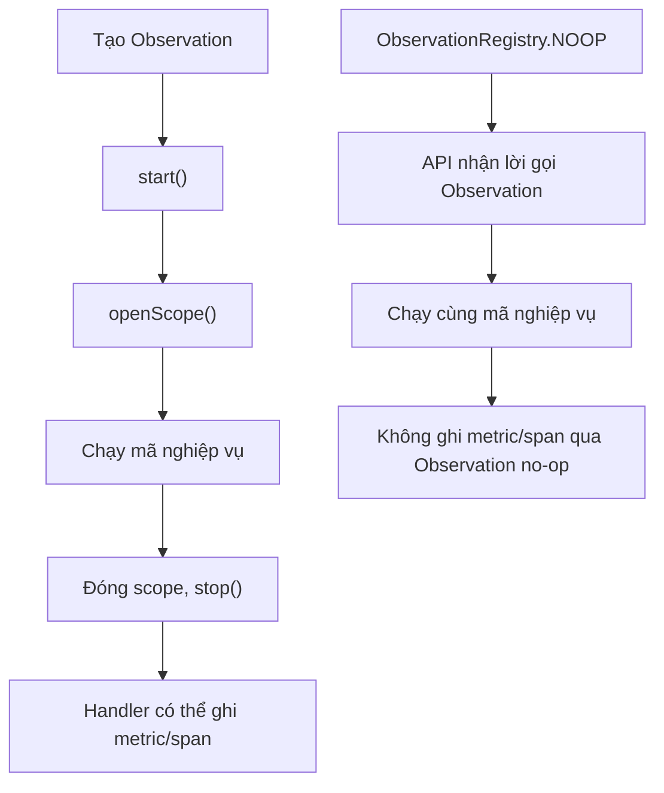
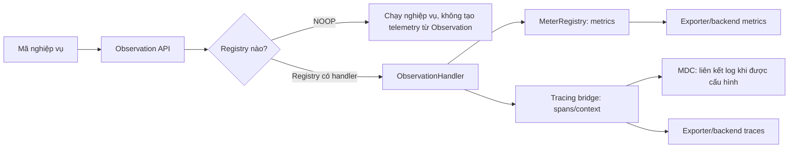
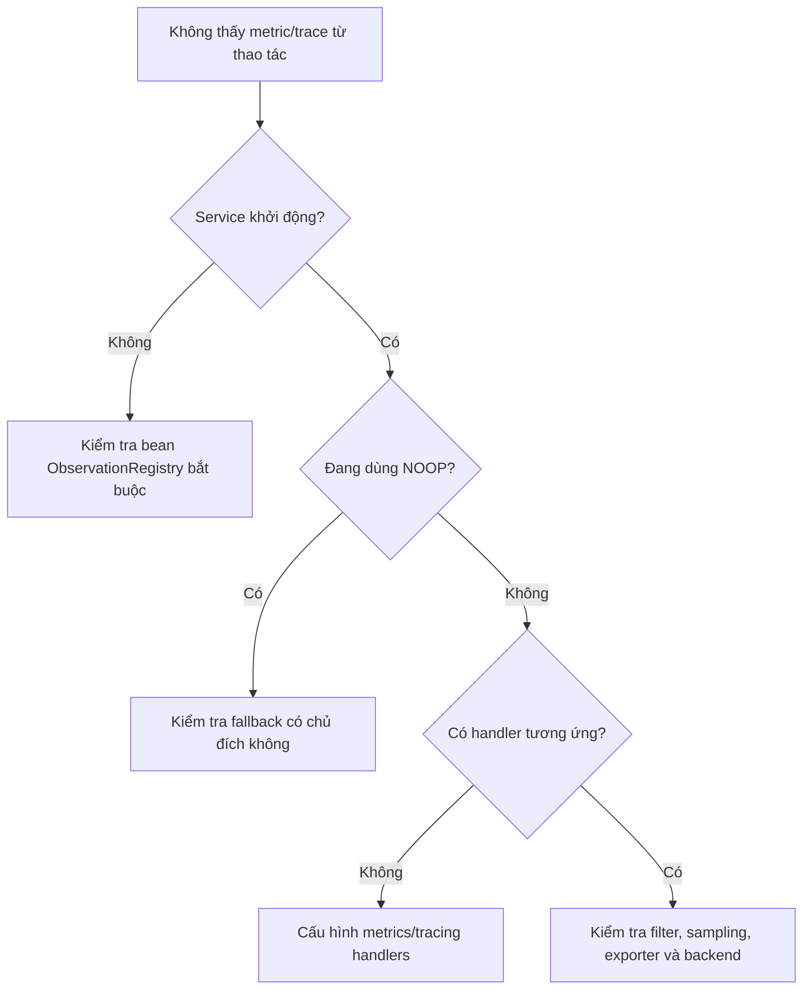

# No-op khi thiếu registry trong Micrometer Observation

Trong Spring Boot, một thao tác nghiệp vụ có thể được bao quanh bằng **Micrometer Observation** để đo thời gian, gắn thuộc tính, ghi nhận lỗi và tạo span khi tracing được cấu hình. Nhưng không phải môi trường nào cũng có một `ObservationRegistry` hoạt động: chương trình chạy độc lập, unit test, thư viện tái sử dụng hoặc ứng dụng chưa bật observability có thể không đăng ký registry.

Bài học **“No-op khi thiếu registry”** thuộc chương **Micrometer Observation** của module **SPRING_BOOT_OBSERVABILITY**. Mục tiêu là hiểu chính xác cơ chế *no-op* (không tạo tác dụng phụ quan sát), duy trì hành vi nghiệp vụ khi thiếu registry, phân biệt việc thiếu bean với thiếu handler/exporter, và biết cách kiểm tra hệ quả đối với metrics, logs, distributed tracing, propagation, tag/cardinality và sampling trong môi trường thực.

## 1. No-op là gì, và tại sao cần?

**No-op** (*no operation*) là một đối tượng vẫn cung cấp các phương thức theo hợp đồng API nhưng không thực hiện các tác động đo đạc hoặc ghi nhận telemetry tương ứng.

Với Micrometer Observation, ta thường muốn đoạn mã nghiệp vụ luôn có cùng hình thức:

```java
return Observation.createNotStarted("order.validate", registry)
        .observe(() -> validateOrder());
```

Trong môi trường có registry và handler phù hợp, thao tác có thể tạo meter, span và liên kết trace context. Trong môi trường không cần observability, ta vẫn muốn gọi `validateOrder()` đúng một lần và nhận đúng giá trị hoặc exception của nó, **không bắt buộc phải thêm nhánh `if` cho từng đoạn nghiệp vụ**.

Micrometer cung cấp đối tượng:

```java
ObservationRegistry.NOOP
```

Đây là một `ObservationRegistry` dùng cho trường hợp cố ý không thu thập qua Observation. Nó tạo một đường gọi API hợp lệ để mã sử dụng Observation tiếp tục vận hành với chi phí xử lý telemetry tối thiểu. Tuy nhiên, *no-op* không có nghĩa là phương thức bên trong `observe(...)` bị bỏ qua.

> **Phân biệt quan trọng:** Thiếu bean `ObservationRegistry` trong Spring không tự động biến mọi lời gọi thành no-op. Chỉ khi mã cung cấp một registry fallback hợp lệ (chẳng hạn `ObservationRegistry.NOOP`), việc sử dụng Observation mới có đường chạy thay thế rõ ràng.

## 2. “Thiếu registry” có thể mô tả bốn tình huống khác nhau

| Tình huống | Điều thực sự xảy ra | Có tiếp tục thực thi nghiệp vụ không? | Metric/trace từ Observation đó |
| --- | --- | --- | --- |
| Không có bean `ObservationRegistry`, nhưng constructor bắt buộc inject | Spring có thể không khởi tạo được bean phụ thuộc và ứng dụng không khởi động | Không chạy đến đoạn nghiệp vụ | Không có |
| Mã chủ động dùng `ObservationRegistry.NOOP` | API Observation có registry fallback; các thao tác quan sát trở thành no-op | Có, nếu code nghiệp vụ tự nó chạy bình thường | Không tạo từ đường Observation no-op này |
| Có `ObservationRegistry.create()` nhưng chưa đăng ký `ObservationHandler` thích hợp | Có registry thật nhưng chưa có handler chuyển sự kiện thành metric/span | Có | Thường không có tín hiệu từ Observation đó |
| Có registry, handler và exporter, nhưng exporter/backend lỗi | Observation có thể vẫn thực thi và tạo dữ liệu nội bộ; sự cố nằm ở khâu vận chuyển/lưu trữ | Thường có, tùy cấu hình lỗi và xử lý của pipeline | Có thể không thấy dữ liệu ở backend |

Hai tình huống ở giữa có thể giống nhau ở màn hình dashboard (đều không thấy dữ liệu), nhưng **không đồng nhất về vòng đời, khả năng cấu hình và chi phí**. `ObservationRegistry.NOOP` là lựa chọn tường minh để bỏ qua instrumentation; `ObservationRegistry.create()` là một registry có thể được gắn handler, filter, convention và predicate phù hợp.

Cũng cần phân biệt thiếu bean với thiếu **dependency**. Nếu project hoàn toàn không có thư viện `micrometer-observation` trên classpath, Java không biên dịch được các import `Observation` và `ObservationRegistry`. `NOOP` chỉ xử lý tình huống mã đã có Micrometer API mà registry thực tế chưa sẵn sàng hoặc không được cung cấp.

### Tại sao không truyền `null`?

Đừng mặc định rằng:

```java
Observation.createNotStarted("order.validate", null); // Không nên làm
```

sẽ được Micrometer tự động chuyển thành no-op. `null` không phải một registry hợp lệ được bảo đảm bởi hợp đồng sử dụng thông thường; kết quả có thể là lỗi runtime tùy điểm gọi và phiên bản. Tạo fallback một lần tại ranh giới nhận dependency sẽ rõ ràng và dễ kiểm soát hơn.

## 3. Cơ chế thực thi: phần nào no-op, phần nào vẫn chạy?

Một Observation bình thường có vòng đời:



Các điểm cần nắm:

1. **`observe(...)` vẫn thực thi callback.** Nếu callback trả về giá trị, giá trị được trả cho caller. Nếu callback ném lỗi, không được xem no-op như cơ chế nuốt lỗi.
2. **Không tạo side effect quan sát qua registry no-op.** Các thao tác như bắt đầu/kết thúc observation, gắn key-value, ghi error và mở scope không tạo ra meter/span thông qua registry no-op.
3. **Tác dụng phụ của mã nghiệp vụ vẫn có.** Gọi database, gửi HTTP request, ghi log do lập trình viên chủ động viết, thay đổi trạng thái và phát exception vẫn xảy ra như bình thường.
4. **Không có phép màu propagation.** Registry no-op tự nó không tạo span mới hay cung cấp tracing handler để gắn context cho lời gọi liên dịch vụ. Một tracer khác đang hoạt động bên ngoài đoạn code có thể có context riêng; không được suy rằng toàn bộ trace trong ứng dụng biến mất chỉ vì một Observation dùng no-op.
5. **No-op không đồng nghĩa chi phí Java bằng 0.** Biểu thức làm đối số, tạo lambda và mã nghiệp vụ vẫn được thực thi theo ngữ nghĩa Java. Điều không xảy ra là công việc telemetry của Observation no-op.

Ví dụ kiểm tra ý nghĩa ở mức Java:

```java
import io.micrometer.observation.Observation;
import io.micrometer.observation.ObservationRegistry;
import java.util.concurrent.atomic.AtomicInteger;

ObservationRegistry registry = ObservationRegistry.NOOP;
AtomicInteger executions = new AtomicInteger();

String result = Observation.createNotStarted("example.noop", registry)
        .observe(() -> {
            executions.incrementAndGet();
            return "done";
        });

// result.equals("done") == true
// executions.get() == 1
// Không có metric/span được tạo bởi Observation no-op.
```

Đoạn mã ở trên minh họa logic, có thể đặt trong phương thức thử nghiệm phù hợp. Cần hiểu “không ghi metric/span” là đặc tính của **đường Observation này**; log lập trình viên tự phát và instrumentation độc lập của thư viện khác vẫn có thể tồn tại.

## 4. Fallback đơn giản trong Java thuần

Giả sử một thư viện cung cấp thao tác `calculateTotal` nhưng không muốn ép mọi ứng dụng gọi nó phải cấu hình observability. Có thể chuẩn hóa registry ngay tại constructor:

```java
import io.micrometer.observation.Observation;
import io.micrometer.observation.ObservationRegistry;

public final class PriceCalculator {
    private final ObservationRegistry registry;

    // null ở boundary được chuyển thành fallback rõ ràng.
    public PriceCalculator(ObservationRegistry providedRegistry) {
        this.registry = providedRegistry != null
                ? providedRegistry
                : ObservationRegistry.NOOP;
    }

    public int calculateTotal(int unitPrice, int quantity) {
        return Observation.createNotStarted("pricing.calculate", registry)
                .lowCardinalityKeyValue("operation", "multiply")
                .observe(() -> Math.multiplyExact(unitPrice, quantity));
    }
}
```

Hai cách dùng:

```java
PriceCalculator withoutTelemetry = new PriceCalculator(null);
int total = withoutTelemetry.calculateTotal(250, 3); // 750

ObservationRegistry configured = ObservationRegistry.create();
PriceCalculator withRegistry = new PriceCalculator(configured);
int anotherTotal = withRegistry.calculateTotal(250, 3); // 750
```

Trong ví dụ thứ hai, `ObservationRegistry.create()` **chưa đủ** để xuất metric hoặc trace: cần đăng ký `ObservationHandler` tương ứng (chẳng hạn handler metrics hoặc tracing), đồng thời có meter registry/tracer/exporter phù hợp.

`Math.multiplyExact` có thể ném `ArithmeticException` nếu tràn số. Trường hợp đó vẫn ném exception dù dùng `NOOP`; fallback không làm thay đổi hợp đồng trả về/lỗi của `calculateTotal`.

### Khi nào nên dùng fallback kiểu này?

- **Thư viện dùng chung:** muốn Observation là khả năng tùy chọn mà không thêm điều kiện khắp code.
- **Unit test hoặc chương trình demo:** muốn kiểm tra logic nghiệp vụ riêng với pipeline quan sát.
- **Tác vụ CLI/batch nhỏ:** có Micrometer API nhưng chưa tích hợp backend quan sát.
- **Chế độ tắt telemetry có chủ đích:** cần hợp đồng hoạt động rõ ràng ngay cả khi không thu thập tín hiệu.

Đối với ứng dụng production yêu cầu metrics/tracing để vận hành, không nên im lặng fallback sang no-op khi cấu hình thiết yếu bị lỗi. Khi đó, kiểm tra và báo lỗi khởi động thường giúp phát hiện mất observability sớm hơn.

## 5. Fallback an toàn khi dùng Spring Boot Dependency Injection

Nếu một `@Service` constructor yêu cầu trực tiếp `ObservationRegistry`:

```java
@Service
public class PaymentService {
    public PaymentService(ObservationRegistry registry) {
        // ...
    }
}
```

và Spring context **không có bean tương ứng**, ứng dụng có thể thất bại lúc khởi tạo service. Đặt `ObservationRegistry.NOOP` ở nơi khác không tự cứu dependency injection này.

Với trường hợp registry thực sự là tùy chọn, hãy dùng `ObjectProvider<ObservationRegistry>` của Spring để lấy bean nếu có, nếu không thì dùng `NOOP`:

```java
import io.micrometer.observation.Observation;
import io.micrometer.observation.ObservationRegistry;
import org.springframework.beans.factory.ObjectProvider;
import org.springframework.stereotype.Service;

@Service
public class CheckoutService {
    private final ObservationRegistry registry;

    public CheckoutService(ObjectProvider<ObservationRegistry> registries) {
        this.registry = registries.getIfAvailable(
                () -> ObservationRegistry.NOOP
        );
    }

    public int totalAmount(int price, int quantity) {
        return Observation.createNotStarted("checkout.calculate", registry)
                .lowCardinalityKeyValue("checkout.step", "total")
                .observe(() -> Math.multiplyExact(price, quantity));
    }
}
```

Ở đây `ObjectProvider` là dependency mà Spring có thể cung cấp; phương thức `getIfAvailable(...)` dùng factory fallback nếu không tìm được bean `ObservationRegistry`.

Bảng hành vi mong đợi:

| Cấu hình Spring context | `CheckoutService` dùng | Hành vi `totalAmount(...)` |
| --- | --- | --- |
| Không có bean ObservationRegistry | `ObservationRegistry.NOOP` | Tính tiền vẫn chạy; đoạn observation không phát metric/span |
| Có bean ObservationRegistry và handler | Bean thật | Tính tiền vẫn chạy; có thể tạo tín hiệu theo handler |
| Có bean ObservationRegistry nhưng không có handler | Bean thật | Tính tiền vẫn chạy; chưa chắc có metric/span |
| Có nhiều bean cùng kiểu không chọn được | `ObjectProvider` có thể báo lỗi không duy nhất | Cần dùng `@Primary`/`@Qualifier` hoặc thiết kế lại wiring |

**Không nên đăng ký đại trà bean `ObservationRegistry.NOOP` bằng một `@Bean` fallback** nếu chưa đánh giá thứ tự auto-configuration. Một bean no-op được đăng ký quá sớm có thể khiến auto-configuration của Spring Boot không tạo ObservationRegistry được kỳ vọng, dẫn đến mất observability ngay cả ở production. Fallback cục bộ trong service/library thường dễ kiểm soát phạm vi hơn.

### Spring Boot có tự tạo registry không?

Khi tích hợp Spring Boot Actuator/Micrometer và các auto-configuration liên quan, ứng dụng thường có một `ObservationRegistry` được Spring quản lý. Nhưng việc có bean này **không bảo đảm** tracing đang xuất span hay metrics đã tới Prometheus. Tùy phiên bản, dependency và cấu hình, cần thêm registry metrics, tracing bridge, exporter, endpoint và backend.

Khi quan sát hoạt động là yêu cầu bắt buộc, ưu tiên constructor injection trực tiếp rồi để lỗi cấu hình lộ ra lúc khởi động. Chỉ dùng cách inject tùy chọn khi hệ thống thực sự cho phép chạy mà không có telemetry.

## 6. Kết nối với metrics, logs và distributed tracing

Trong module **SPRING_BOOT_OBSERVABILITY**, Micrometer Observation đóng vai trò mô hình hóa thao tác; từng tín hiệu đến từ phần triển khai cụ thể:



### Metrics

Một handler metrics có thể cập nhật timer/counter với nhãn từ Observation. Với `NOOP`, không có metric được tạo **bởi Observation đó**. Điều này không cản trở metric JVM, HTTP server hoặc custom `MeterRegistry` khác, nếu những thành phần ấy được cấu hình độc lập.

Ngay cả khi đang dùng no-op, hãy định nghĩa nhãn đúng ngay trong mã để khi bật registry thật, hệ thống không gặp vấn đề **cardinality**:

- Nên dùng giá trị hữu hạn: `operation=calculate`, `payment.method=card`, route template `/orders/{id}`.
- Tránh gắn giá trị biến thiên lớn vào metric label: `orderId`, `userId`, `traceId`, URL đầy đủ hoặc nội dung exception.
- Phân biệt `lowCardinalityKeyValue` và `highCardinalityKeyValue` theo ngữ nghĩa, không dựa vào việc hiện tại registry đang no-op.

### Logs

Log lập trình viên chủ động ghi qua SLF4J/Logback vẫn có thể xuất hiện:

```java
log.info("Đã tính tổng tiền cho đơn hàng");
```

Nhưng registry no-op **không tự tạo span hoặc correlation ID** cho phần việc đó. Vì vậy log có thể thiếu `traceId`/`spanId` trong MDC. Nếu ứng dụng có một trace context tồn tại từ instrumentation khác, log vẫn có thể mang ID ấy; cần kiểm tra context thực tế và cấu hình logger.

### Traces và context propagation

Với tracing bridge và instrumentation đúng, Observation có thể tham gia trace và tạo span, đồng thời context được propagate qua HTTP client, message consumer hoặc tác vụ bất đồng bộ. Với Observation sử dụng registry no-op, ta không thể kỳ vọng có span cho thao tác đó hoặc tự động inject/extract context thông qua nó.

Đừng nhầm trường hợp **no-op registry** với **sampling probability = 0**:

| No-op registry | Registry có tracer nhưng sampler chọn không ghi trace |
| --- | --- |
| Không chạy tracing handler của Observation đó | Tracing handler/instrumentation có thể vẫn chạy |
| Không tạo span qua đường Observation no-op | Có thể có ngữ cảnh trace và quyết định sampling dù không xuất span |
| Không tự đảm nhiệm propagation | Propagation có thể vẫn vận hành tùy tracing SDK/instrumentation |
| Không liên quan trực tiếp đến một xác suất lấy mẫu | Có quy tắc sampling và chính sách xuất/lưu |

Nếu hệ thống có một request HTTP xuyên ba dịch vụ và một dịch vụ vô tình dùng `NOOP`, waterfall trace có thể bị thiếu công đoạn hoặc đứt liên kết nếu chính công đoạn đó chịu trách nhiệm propagation. Đó là vấn đề observability, **không nhất thiết** là lỗi nghiệp vụ.

### Exporter và backend

Có `ObservationRegistry` cùng handler vẫn chưa đủ: dữ liệu cần đến được collector/backend. Tình huống exporter OTLP không gửi được span, hoặc Prometheus chưa scrape endpoint, là **lỗi vận chuyển/thu thập**, không phải trường hợp registry no-op. Không giải quyết lỗi exporter bằng cách thay registry thành `NOOP`; việc này chỉ khiến hệ thống mất thêm dữ liệu cần cho điều tra.

## 7. Chẩn đoán khi Observation chạy mà không thấy dữ liệu

Giả sử `CheckoutService.totalAmount(...)` trả đúng kết quả nhưng dashboard không hiển thị timer hoặc trace. Kiểm tra theo thứ tự, từ ứng dụng ra backend:

1. **Xác định registry thực tế.** Constructor nhận bean thật hay fallback `ObservationRegistry.NOOP`? Trong môi trường cho phép chạy no-op, nên ghi nhận một cảnh báo khởi động khi xảy ra fallback để đội vận hành biết.
2. **Xác minh handler.** Một registry được tạo bằng `ObservationRegistry.create()` có thể chưa gắn handler metrics/tracing. Có registry không đồng nghĩa có tín hiệu.
3. **Kiểm tra tên Observation và tag.** `checkout.calculate` có được tạo khi method thực thi không? Có filter/predicate vô hiệu hóa observation này không? Tên meter cuối cùng có thể được exporter chuẩn hóa.
4. **Kiểm tra pipeline metrics.** `MeterRegistry` có handler phù hợp? Endpoint hoặc exporter đã bật? Backend nhận metric đúng tên, nhãn và khoảng thời gian chưa?
5. **Kiểm tra pipeline tracing.** Có tracer bridge, tracer/exporter, instrumentation và collector không? Sampling có loại trace cần tìm không? `traceId` có được truyền qua ranh giới dịch vụ?
6. **Kiểm tra log correlation.** MDC có `traceId`/`spanId` khi log được ghi không? Encoder và pipeline có lưu đúng field không? Executor/reactive/messaging có làm rơi context không?
7. **Kiểm tra khác biệt giữa môi trường.** Test dùng `NOOP` còn production có handler? Hoặc production vô tình nhận bean no-op từ cấu hình? So sánh cấu hình wiring và dấu hiệu runtime.

Có thể phác họa cây quyết định:



Trên production, nên đặt một phép kiểm tra vận hành đáng tin cậy cho tín hiệu bắt buộc; log một dòng startup chỉ giúp chẩn đoán, chưa đủ thay thế giám sát pipeline telemetry.

## 8. Kiểm chứng hành vi no-op bằng các ca thực hành

Các tình huống dưới đây tập trung vào *hợp đồng hành vi* thay vì kiểm tra implementation nội bộ của Micrometer:

| Ca | Chuẩn bị | Kết quả nên quan sát |
| --- | --- | --- |
| Trả giá trị | Dùng `ObservationRegistry.NOOP`, callback trả `"ok"` | Kết quả trả về `"ok"`; callback chạy đúng một lần |
| Có tác dụng phụ nghiệp vụ | Callback tăng một counter trong bộ nhớ | Counter vẫn tăng |
| Có lỗi nghiệp vụ | Callback ném `IllegalStateException` | Caller vẫn nhận exception; không bị no-op nuốt |
| Có registry rỗng | `ObservationRegistry.create()` chưa có handler | Nghiệp vụ vẫn chạy nhưng dashboard không tự có metric/span |
| Có handler metrics | Cấu hình handler metrics và registry phù hợp | Timer/count có thể cập nhật với tên/tag đúng |
| Có handler tracing | Cấu hình tracer và tracing handler | Có thể xem span/context khi instrumentation, sampler và exporter hoạt động |
| Mất backend | Tắt đích xuất dữ liệu ở môi trường thử nghiệm | Phân biệt lỗi exporter với việc dùng registry no-op |

Ví dụ tối giản cho trường hợp exception:

```java
ObservationRegistry registry = ObservationRegistry.NOOP;

try {
    Observation.createNotStarted("example.failure", registry)
            .observe(() -> {
                throw new IllegalStateException("Business rule failed");
            });
} catch (IllegalStateException expected) {
    // Lỗi nghiệp vụ vẫn được truyền ra ngoài.
}
```

Nếu dùng `Observation.observe(...)` để bao quanh mã, tránh bắt và nuốt lỗi chỉ để “giữ observability chạy”; việc ghi nhận lỗi của Observation có ý nghĩa khi registry/handler hoạt động, nhưng không thay thế cơ chế xử lý lỗi của ứng dụng.

### Thực hành trong một Spring Boot service

1. Chạy service khi `ObservationRegistry` được Spring cung cấp và các handler đã được cấu hình; gọi endpoint có observation tùy chỉnh.
2. Quan sát metric/span từ thao tác. Nếu không thấy, phân biệt registry, handler, exporter và sampling theo mục 7.
3. Trong một môi trường thử nghiệm **cho phép thiếu bean**, dùng constructor `ObjectProvider` như mục 5 để fallback `NOOP`; xác nhận kết quả nghiệp vụ và exception vẫn giống trước.
4. Bật lại registry/handler. Kiểm tra các nhãn không phát sinh cardinality không kiểm soát, context được truyền đúng giữa các dịch vụ và log correlation khi có tracing.
5. Ghi nhận rõ chính sách: môi trường nào được no-op, môi trường nào phải báo lỗi vì thiếu telemetry.

## 9. Sai lầm thường gặp và cách sửa

| Nhận định hoặc cách làm | Vấn đề | Cách hiểu/sửa |
| --- | --- | --- |
| “Không inject được registry thì Micrometer tự no-op” | Spring có thể lỗi khởi tạo bean trước khi chạy nghiệp vụ | Dùng optional dependency có chủ đích hoặc bảo đảm bean thật tồn tại |
| “Truyền `null` giống `NOOP`” | `null` không phải fallback API an toàn | Chuẩn hóa sang `ObservationRegistry.NOOP` tại boundary |
| “Có `ObservationRegistry.create()` là có metric” | Registry chưa có handler/exporter | Thiết lập handler, meter registry và backend |
| “No-op bỏ qua callback nên tác vụ không chạy” | Nhầm telemetry với nghiệp vụ | Callback `observe(...)` vẫn chạy, trả kết quả/ném lỗi như bình thường |
| “Tắt sampling giống dùng no-op registry” | Context propagation, span lifecycle và chính sách sampler khác nhau | Chẩn đoán registry và sampling riêng |
| “Thấy log là Observation đang hoạt động” | Log do code hoặc hệ thống logging độc lập phát ra | Kiểm tra ID tương quan, handler và dữ liệu backend |
| “Production cứ fallback im lặng cho an toàn” | Che mất sai cấu hình và khoảng trống giám sát | Chỉ fallback nếu telemetry thực sự là optional; nếu bắt buộc thì fail fast hoặc báo trạng thái rõ ràng |
| “Tag nào cũng ổn vì đang dùng no-op” | Khi bật handler thật sẽ tạo nhiều metric series | Chuẩn hóa low-cardinality tag từ lúc viết instrumentation |

## 10. Câu hỏi tự kiểm tra

1. Vì sao ứng dụng dùng constructor `PaymentService(ObservationRegistry registry)` có thể không khởi động nếu Spring thiếu bean, dù Micrometer có `ObservationRegistry.NOOP`?
2. Khi một callback bên trong `observe(...)` ném exception, registry no-op có nên “thành công hóa” callback không? Vì sao?
3. Sự khác nhau giữa `ObservationRegistry.create()` chưa có handler và `ObservationRegistry.NOOP` là gì?
4. Vì sao một request vẫn xuất hiện trong log ứng dụng dù Observation của thao tác đang dùng `NOOP`?
5. Sau khi chuyển từ NOOP sang registry thật, các tag `userId` hoặc `orderId` ảnh hưởng thế nào đến số metric series?
6. Vì sao trace biến mất sau khi cấu hình sampling cần được điều tra khác với trace biến mất do fallback NOOP?
7. Trong Spring Boot production, khi nào fallback là thiết kế hợp lý, và khi nào nên để dependency injection thất bại để lộ lỗi cấu hình?

## Kết luận

**`ObservationRegistry.NOOP` giữ cho lời gọi Observation có thể được thực thi mà không tạo telemetry qua registry đó; mã nghiệp vụ bên trong `observe(...)` vẫn chạy và vẫn tuân theo hợp đồng trả về/lỗi.** “Thiếu registry”, “registry không có handler”, “trace bị sampling” và “exporter lỗi” là những trạng thái khác nhau, đòi hỏi cách chẩn đoán khác nhau. Trong Spring Boot, hãy lựa chọn fallback một cách tường minh tại ranh giới phụ thuộc, giữ nhãn metric có cardinality thấp ngay từ đầu, và xác định rõ môi trường nào cho phép no-op để hệ thống vừa hoạt động ổn định vừa không âm thầm mất khả năng quan sát.

