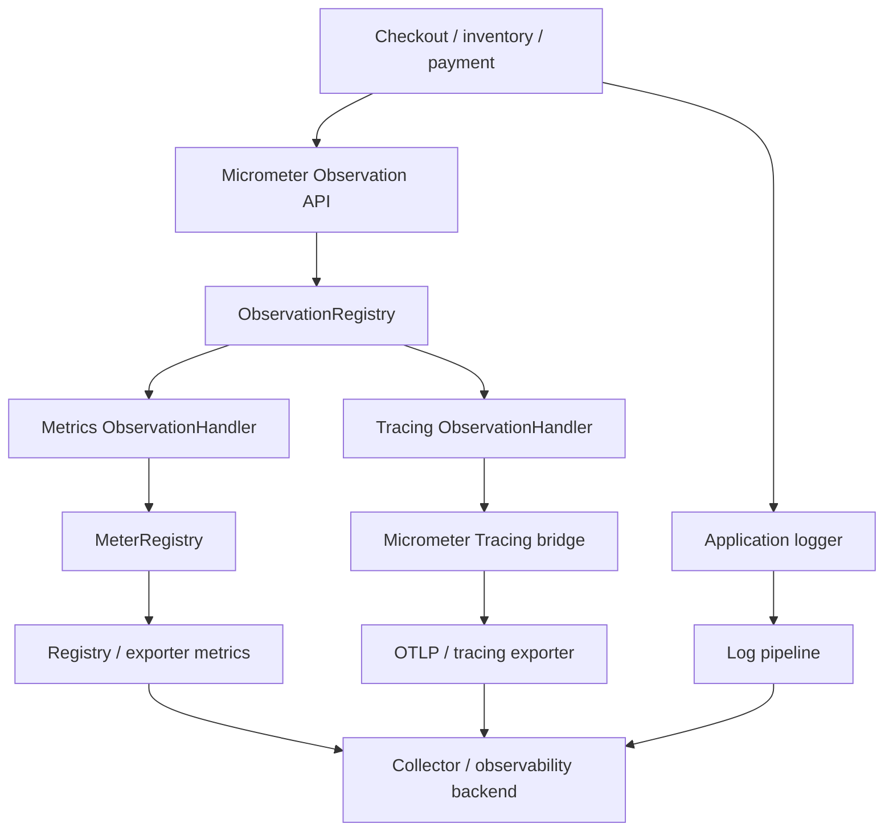
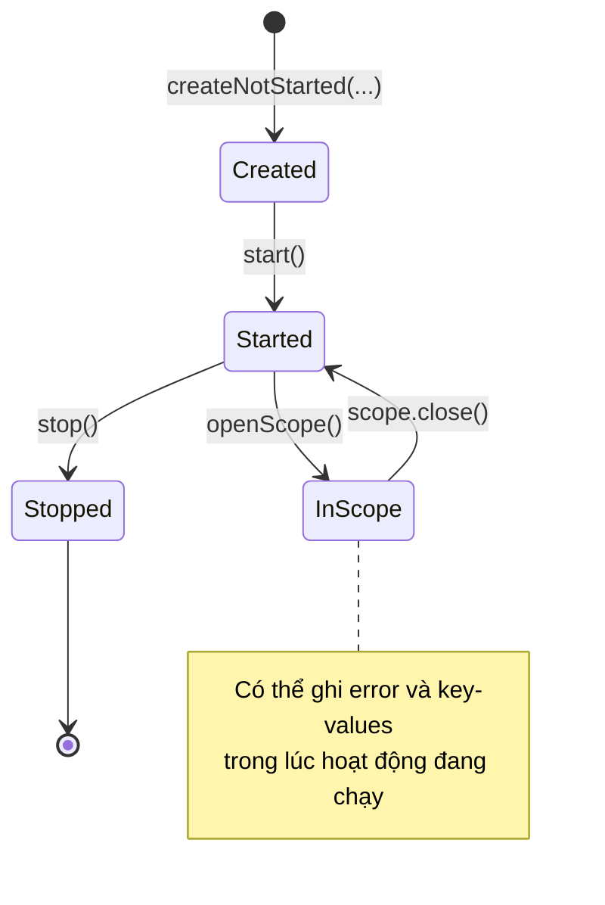
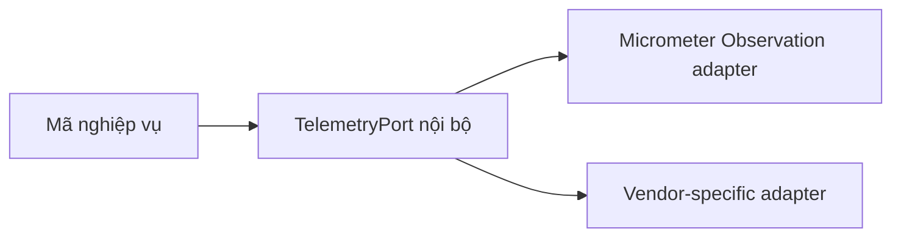

# Observation API và vendor API trong Spring Boot

Trong một ứng dụng Spring Boot, việc đo độ trễ, đếm lỗi và theo dõi đường đi của request thường bắt đầu từ những đoạn mã rất gần nghiệp vụ. Chẳng hạn, khi tạo đơn hàng, ta muốn biết lời gọi giữ hàng đã mất bao lâu, bao nhiêu lần thất bại và request đi qua những dịch vụ nào. Vấn đề xuất hiện khi mỗi đoạn mã nghiệp vụ phải gọi thẳng SDK của một hệ thống giám sát cụ thể: đổi backend có thể kéo theo sửa rất nhiều nơi trong ứng dụng.

**Micrometer Observation API** giải quyết một phần bài toán này bằng cách cho ứng dụng mô tả **hoạt động cần quan sát** thông qua một API thống nhất. Các thành phần được cấu hình bên ngoài mã nghiệp vụ quyết định cách biến hoạt động đó thành **metrics** và **traces**. Trong khi đó, **vendor API** là API gắn với một sản phẩm, agent hoặc SDK cụ thể; dùng trực tiếp thường cho phép truy cập tính năng chuyên biệt nhưng làm tăng sự phụ thuộc vào nhà cung cấp.

Bài học thuộc chương **Micrometer Observation** của module **SPRING_BOOT_OBSERVABILITY**, trong phạm vi thiết lập observability cho Spring Boot bằng Micrometer Observation, metrics, logs và distributed tracing; đồng thời kết nối các vấn đề như context propagation, tag/cardinality, exporter, sampling và tương quan tín hiệu khi điều tra ứng dụng thực tế.

## 1. Các thuật ngữ phải phân biệt

| Khái niệm | Vai trò | Ví dụ |
| --- | --- | --- |
| **Observation API** | API để mô tả một hoạt động, vòng đời và ngữ cảnh quan sát mà không chọn sẵn backend | `io.micrometer.observation.Observation` |
| **ObservationRegistry** | Nơi quản lý cấu hình và các `ObservationHandler` xử lý sự kiện vòng đời observation | `ObservationRegistry` được ứng dụng inject |
| **ObservationHandler** | Phản ứng khi observation start, stop, error, mở/đóng scope; có thể tạo phép đo hoặc span | Handler metrics hoặc tracing |
| **Micrometer Metrics API** | API làm việc trực tiếp với counter, gauge, timer và các meter khác | `MeterRegistry`, `Counter`, `Timer` |
| **Micrometer Tracing API** | Abstraction chuyên về span, tracer và baggage; thường được bridge sang implementation tracing | `io.micrometer.tracing.Tracer` |
| **OpenTelemetry API** | API tracing/telemetry tiêu chuẩn, **không phải API độc quyền của một vendor** | `io.opentelemetry.api.trace.Tracer` |
| **Vendor API/SDK** | API hoặc extension của một hãng, dùng để gọi tính năng riêng, thu thập hoặc gửi dữ liệu | SDK proprietary để ghi business transaction/event |
| **Exporter/registry/backend** | Thành phần vận chuyển, xuất, lưu trữ hoặc hiển thị telemetry | Prometheus, OTLP Collector, Tempo, Jaeger, backend thương mại |

Từ **vendor** trong bài chỉ **nhà cung cấp công cụ giám sát**. OpenTelemetry là một tiêu chuẩn và hệ sinh thái mã nguồn mở, hỗ trợ nhiều backend; sử dụng API OpenTelemetry trực tiếp vẫn có thể làm mã nghiệp vụ phụ thuộc vào **kiểu mô hình span và SDK**, nhưng không đồng nghĩa bị khóa vào một hãng.

Điểm mấu chốt là phân biệt **hành động nghiệp vụ muốn quan sát** với **cách ghi và xuất tín hiệu**. Observation API thiên về vế thứ nhất; API trực tiếp của tracing, metrics hoặc vendor cho phép thao tác cụ thể hơn ở vế thứ hai.

## 2. Vì sao không gọi thẳng vendor API khắp ứng dụng?

Giả sử dịch vụ `checkout-service` đang dùng hệ thống theo dõi A, và sau một năm doanh nghiệp muốn chuyển tracing sang hệ thống B. Nếu mỗi tầng controller/service tự tạo transaction bằng API của A, mã nghiệp vụ chứa nhiều import, phương thức và định dạng tag riêng của A. Việc chuyển đổi cần rà soát từng nơi; các dashboard và query có thể phụ thuộc vào cùng những tên đó.

Khi ứng dụng mô tả thao tác bằng Observation API:

1. Code nghiệp vụ đặt tên operation, ngữ cảnh và thuộc tính có ý nghĩa.
2. Các `ObservationHandler` được đăng ký thực hiện việc ghi metrics và/hoặc tracing.
3. Registry, tracing bridge, exporter và collector gửi tín hiệu đến hệ thống phù hợp.
4. Khi thay backend tương thích, thường chỉnh dependencies, cấu hình và pipeline xuất dữ liệu; logic mô tả observation có cơ hội giữ nguyên.



Sơ đồ thể hiện luồng có thể cấu hình, **không cam kết mọi observation đều tạo cả metric lẫn trace**. Nếu không đăng ký handler thích hợp, không có registry/exporter tương ứng hoặc bị sampling, tín hiệu cụ thể có thể không xuất hiện ở backend. **Log nghiệp vụ do logger tạo ra**, không tự phát sinh chỉ vì code tạo một `Observation`.

## 3. Vòng đời của một Observation

Một observation thường có những thành phần:

- **Name:** tên kỹ thuật ổn định của hoạt động, ví dụ `checkout.inventory.reserve`, dùng để phân nhóm và làm cơ sở đặt tên metric.
- **Context:** trạng thái cùng thông tin được mang trong quá trình quan sát. Có thể dùng `Observation.Context` hoặc kiểu context tùy biến.
- **Low-cardinality key-values:** các thuộc tính ít giá trị khác nhau, phù hợp làm nhãn metrics.
- **High-cardinality key-values:** các thuộc tính có nhiều giá trị, hữu ích khi điều tra từng trace; cần kiểm soát bảo mật và chi phí.
- **Start/stop:** xác định ranh giới thời gian thực hiện.
- **Scope:** đặt observation vào ngữ cảnh hiện tại để các thao tác lồng bên trong có thể liên hệ với nó.
- **Error:** ghi nhận exception hay trạng thái lỗi khi ứng dụng chủ động báo cho observation.



Khi dùng hàm tiện ích `observe(...)`, API bao quanh công việc bằng vòng đời observation. Khi cần kiểm soát try/catch, scope hoặc thời điểm thêm key-value, dùng `start()`, `openScope()` và `stop()` tường minh.

**Một observation không phải một trace.** Observation là mô hình hoạt động ở mức ứng dụng; trace là cấu trúc các span. Nếu có tracing handler, vòng đời observation có thể được ánh xạ thành span tương ứng. Không có tracing handler, ứng dụng vẫn chạy mà không nhất thiết phát span nào.

## 4. Ví dụ Spring Boot: tạo observation không phụ thuộc vendor

Ví dụ dưới đây đo hoạt động giữ hàng bằng Micrometer Observation API. `InventoryGateway` tượng trưng cho adapter gọi tới kho hàng; kiểu này được đưa vào để ví dụ có thể đọc độc lập.

```java
import io.micrometer.observation.Observation;
import io.micrometer.observation.ObservationRegistry;
import org.springframework.stereotype.Service;

interface InventoryGateway {
    boolean reserve(String sku, int units);
}

@Service
public class CheckoutService {
    private final InventoryGateway inventoryGateway;
    private final ObservationRegistry observationRegistry;

    public CheckoutService(
            InventoryGateway inventoryGateway,
            ObservationRegistry observationRegistry) {
        this.inventoryGateway = inventoryGateway;
        this.observationRegistry = observationRegistry;
    }

    public boolean reserveForCheckout(String sku, int units) {
        return Observation.createNotStarted(
                "checkout.inventory.reserve", observationRegistry)
            .lowCardinalityKeyValue("operation", "reserve")
            .lowCardinalityKeyValue("source", "checkout")
            .observe(() -> inventoryGateway.reserve(sku, units));
    }
}
```

Trong ví dụ:

1. `checkout.inventory.reserve` mô tả **việc gì đang được đo**, không phải tên một hãng giám sát.
2. `ObservationRegistry` được truyền qua dependency injection; ứng dụng không tạo SDK vendor bên trong service.
3. `operation` và `source` có tập giá trị hữu hạn, nên phù hợp làm low-cardinality tags.
4. Hàm `observe(...)` giúp observation được kết thúc khi xử lý xong, kể cả khi phần code được bao quanh ném exception.
5. Có metric, span hay không còn tùy cấu hình registry, handler và tracing sampling; đoạn code chỉ thể hiện phần instrumentation của nghiệp vụ.

Không nên thêm `sku`, mã đơn, email hoặc request ID làm **low-cardinality key**. Một SKU có thể có hàng trăm nghìn giá trị; đưa trực tiếp vào nhãn metric làm số time series tăng mạnh. Nếu cần tìm giao dịch cụ thể, dùng correlation ID hoặc thuộc tính trace có kiểm soát, kết hợp hệ thống nghiệp vụ khi cần truy vấn định danh.

### Khi cần xử lý lỗi và scope rõ ràng

Một số hoạt động phải phân biệt ba kết quả: xử lý thành công, bị từ chối theo quy tắc nghiệp vụ, hoặc ném exception. Khi ấy có thể tự điều khiển vòng đời:

```java
import io.micrometer.observation.Observation;
import io.micrometer.observation.ObservationRegistry;

public final class ReservationOperation {
    private final ObservationRegistry registry;
    private final InventoryGateway gateway;

    public ReservationOperation(ObservationRegistry registry,
                                InventoryGateway gateway) {
        this.registry = registry;
        this.gateway = gateway;
    }

    public boolean execute(String sku, int units) {
        Observation observation = Observation.createNotStarted(
                "checkout.inventory.reserve", registry)
            .lowCardinalityKeyValue("operation", "reserve")
            .start();

        try (Observation.Scope ignored = observation.openScope()) {
            boolean accepted = gateway.reserve(sku, units);
            observation.lowCardinalityKeyValue(
                "outcome", accepted ? "accepted" : "rejected");
            return accepted;
        } catch (RuntimeException ex) {
            observation.error(ex);
            observation.lowCardinalityKeyValue("outcome", "error");
            throw ex;
        } finally {
            observation.stop();
        }
    }
}
```

**`rejected` khác `error`**: một yêu cầu hết hàng có thể bị từ chối đúng nghiệp vụ mà không phải lỗi kỹ thuật. Cách gắn `outcome` nhất quán giúp truy vấn tỷ lệ từng kết quả. Việc handler biểu diễn exception dưới dạng nhãn metric hoặc trạng thái span có thể khác theo cấu hình; phải xác minh ở đầu ra thực tế.

Việc mở scope có ý nghĩa khi code bên trong dùng tracing/logging correlation. Scope hiện tại **không mặc nhiên được truyền sang một thread, executor hoặc message consumer khác**; cần instrumentation và cơ chế context propagation tương ứng.

## 5. So sánh với việc thao tác trực tiếp trên API tracing

Một đội kỹ thuật có thể muốn tạo span bằng OpenTelemetry API thay vì Observation API. Ví dụ dưới đây dùng **OpenTelemetry API tiêu chuẩn**, chỉ minh họa quan sát tracing; nó không phải ví dụ SDK độc quyền của vendor.

```java
import io.opentelemetry.api.trace.Span;
import io.opentelemetry.api.trace.StatusCode;
import io.opentelemetry.api.trace.Tracer;
import io.opentelemetry.context.Scope;

public final class DirectTracingExample {
    public static boolean reserve(
            Tracer tracer,
            InventoryGateway gateway,
            String sku,
            int units) {

        Span span = tracer.spanBuilder("checkout.inventory.reserve")
            .startSpan();

        try (Scope ignored = span.makeCurrent()) {
            span.setAttribute("operation", "reserve");
            return gateway.reserve(sku, units);
        } catch (RuntimeException ex) {
            span.recordException(ex);
            span.setStatus(StatusCode.ERROR);
            throw ex;
        } finally {
            span.end();
        }
    }
}
```

Để sử dụng đoạn code cần dependency OpenTelemetry API và một `Tracer` được cấu hình phù hợp. Đoạn code tạo **span** với ngữ cảnh OpenTelemetry; nó **không tự tạo Micrometer Timer** để tổng hợp độ trễ. Muốn có cùng metric cần thêm instrumentation hoặc một đường thu thập metrics tương ứng.

Hai ví dụ thể hiện hai mức trừu tượng:

| Tiêu chí | Micrometer Observation API | OpenTelemetry API trực tiếp | Vendor API độc quyền |
| --- | --- | --- | --- |
| Ý định trong code | Quan sát một hoạt động nghiệp vụ | Điều khiển span/tracing cụ thể | Điều khiển transaction, event hoặc chức năng của sản phẩm |
| Phụ thuộc ở lớp nghiệp vụ | Micrometer Observation | OpenTelemetry API | SDK của vendor |
| Phát metrics từ cùng một hoạt động | Có thể có qua metrics handler | Không tự tạo Micrometer metrics chỉ vì bắt đầu span | Tùy SDK và tính năng |
| Phát traces | Có thể có qua tracing handler/bridge | Có khi Tracer/SDK/exporter được cấu hình | Tùy SDK và agent |
| Đổi backend giám sát | Thường tập trung ở handler, registry, bridge, exporter | Có thể đổi exporter/backend qua SDK | Có thể phải sửa call site và quy ước dữ liệu |
| Khả năng dùng tính năng đặc thù | Qua extension hoặc API riêng khi cần | Các tính năng trong chuẩn OTel | Thường rộng nhất cho tính năng của chính vendor đó |

Không có quy tắc “luôn dùng Observation API” cho mọi tình huống. Nếu thực sự cần span links, event chi tiết, baggage đặc thù hoặc một khả năng mà lớp Observation không mô hình hóa đủ rõ, sử dụng API tracing trực tiếp trong **adapter/tầng hạ tầng** có thể hợp lý. Nếu cần loại dữ liệu chỉ SDK của vendor hỗ trợ, nên gom điểm phụ thuộc đó tại một adapter có ranh giới rõ.

## 6. Liên hệ giữa Observation API, MeterRegistry và Tracer

Ba API liên quan nhưng giải quyết những nhu cầu khác nhau:

- **Observation API:** rất phù hợp cho hoạt động có bắt đầu/kết thúc như xử lý checkout, gọi inventory, xác nhận payment. Handler có thể cùng lúc sinh timer và span.
- **MeterRegistry:** phù hợp khi cần metric không mang vòng đời một thao tác, ví dụ gauge số phần tử trong queue, counter số bản ghi bỏ qua hoặc distribution summary kích thước payload.
- **Tracing API:** phù hợp khi cần thao tác rõ trên span, liên kết trace, trao đổi ngữ cảnh hoặc gắn sự kiện có độ chi tiết cao.

Ví dụ, `queue.depth` là trạng thái hiện tại, tự nhiên hơn khi đo bằng gauge. Ngược lại, `checkout.inventory.reserve` là thao tác có thời lượng, nên biểu diễn bằng Observation API thường trực quan hơn.

Việc đổi từ `MeterRegistry` sang Observation API **không phải phép chuyển đổi một đổi một**: một counter nghiệp vụ có định nghĩa rõ ràng đôi khi vẫn nên là counter. Observation giúp thống nhất instrumentation hoạt động, không thay thế toàn bộ mô hình metrics.

## 7. ObservationConvention: giữ tên và tag có hệ thống

Khi nhiều controller/service cùng mô tả một loại thao tác, nguy cơ phổ biến là mỗi nơi chọn tên và nhãn hơi khác:

```text
checkout.inventory.reserve
checkout.inventory.reservation
inventory.reserve.checkout
```

Những tên này có thể tạo các series metrics và nhóm span khác nhau dù ý nghĩa gần giống nhau. Giải pháp là xây dựng **quy ước observation** thống nhất: tên operation ổn định, tên tag nhất quán, tập giá trị hạn chế và quy tắc xác định kết quả.

Micrometer hỗ trợ `ObservationConvention` cùng các kiểu context để mô tả:

- Tên observation và contextual name phù hợp với mục đích đo.
- Các low-cardinality key-values để tổng hợp.
- Các high-cardinality key-values để hỗ trợ truy vết, tùy handler hỗ trợ.
- Giá trị mặc định và logic rút nhãn từ ngữ cảnh, tránh copy vào từng method.

Đối với một instrumentation tái sử dụng ở nhiều nơi, viết convention là hợp lý. Với một ví dụ nhỏ, thêm `lowCardinalityKeyValue(...)` trực tiếp vẫn dễ hiểu. Cần lưu ý tên metric thực tế còn chịu quy tắc của metrics handler và registry; tên span cũng có thể dựa trên contextual name hoặc convention. Hãy xác minh định dạng đầu ra của cả hai.

### Tag cardinality quyết định khả năng vận hành

Giả sử metric có các nhãn `operation` (3 giá trị), `outcome` (3 giá trị), `region` (4 giá trị). Mỗi instance có thể sinh tối đa **3 × 3 × 4 = 36 tổ hợp** cho tập nhãn đó, trước khi tính nhãn bổ sung. Thêm `orderId` với 1 triệu giá trị tiềm năng sẽ làm số tổ hợp tăng theo cấp số nhân.

| Nhãn/thuộc tính | Loại thường phù hợp | Lý do |
| --- | --- | --- |
| `operation=reserve` | Low-cardinality | Ít giá trị ổn định |
| `outcome=accepted/rejected/error` | Low-cardinality | Dễ tổng hợp và cảnh báo |
| `region=ap-southeast-1` | Low-cardinality nếu tập region hữu hạn | Dùng để phân tích khu vực |
| `http.route=/orders/{id}` | Low-cardinality | Route template có số giá trị giới hạn |
| `orderId`, `requestId` | Không dùng làm nhãn metrics | Giá trị gần như duy nhất theo request |
| Mã tương quan không nhạy cảm của một lần chạy | Có thể là thuộc tính trace được kiểm soát | Hữu ích tìm một trường hợp, nhưng không nên ghi vô hạn |

High-cardinality không đồng nghĩa được lưu dữ liệu cá nhân. Các trường định danh có thể phải được mã hóa, ẩn, loại bỏ hoàn toàn hoặc chỉ giữ ở cơ sở dữ liệu nghiệp vụ tùy yêu cầu bảo mật. Tracing backend cũng có giới hạn số thuộc tính, kích thước và retention.

## 8. Từ observation đến exporter và backend

Code ứng dụng chỉ định nghĩa observation chưa bảo đảm tín hiệu sẽ đến dashboard. Một kiến trúc Spring Boot dùng Micrometer có thể gồm:

```text
Mã nghiệp vụ
   └─ Observation API
       └─ ObservationRegistry + handlers
           ├─ Micrometer Metrics → MeterRegistry
           │    └─ Prometheus scrape hoặc registry/exporter khác
           └─ Micrometer Tracing → bridge (ví dụ OpenTelemetry)
                └─ SDK/exporter → OTLP Collector → trace backend

Mã nghiệp vụ → Logger → log collector → log backend
```

Để thử nghiệm, với Spring Boot 3.x người học thường gặp các dependency sau, tùy cách ứng dụng được build và phiên bản:

```gradle
dependencies {
    implementation("org.springframework.boot:spring-boot-starter-actuator")
    runtimeOnly("io.micrometer:micrometer-registry-prometheus")
    implementation("io.micrometer:micrometer-tracing-bridge-otel")
    runtimeOnly("io.opentelemetry:opentelemetry-exporter-otlp")
}
```

Đây là **bộ dependency minh họa**, cần dùng BOM/quản lý phiên bản thích hợp và kiểm tra khả năng autoconfiguration của bản Spring Boot đang chạy. Có thể thay Prometheus bằng một registry khác, hoặc cấu hình OTLP tới backend/collector phù hợp. Không nên mặc định mọi bản Spring Boot đều có cùng tên dependency/property.

Một cấu hình ví dụ cho Spring Boot 3.x khi sử dụng tracing exporter hỗ trợ OTLP HTTP:

```yaml
management:
  endpoints:
    web:
      exposure:
        include: health,info,prometheus
  tracing:
    sampling:
      probability: 0.1
  otlp:
    tracing:
      endpoint: http://otel-collector:4318/v1/traces
```

**Cần kiểm tra phiên bản:** thuộc tính cấu hình, cách gọi exporter, endpoint và behavior của autoconfiguration có thể thay đổi giữa các dòng Spring Boot. Ví dụ chỉ minh họa ý tưởng, không có nghĩa là cấu hình đầy đủ cho mọi môi trường.

Trong hệ thống thực:

1. Kiểm tra Actuator/registry có metric mong đợi và tên/đơn vị chính xác.
2. Kiểm tra trace backend nhận span với service name, parent–child relationship và thời lượng hợp lý.
3. Kiểm tra application logs có `traceId`/`spanId` khi đã cấu hình tracing correlation.
4. Kiểm tra exporter, collector và backend có hiển thị lỗi thu thập hoặc dropped data.
5. Giới hạn quyền truy cập Actuator, kiểm soát dữ liệu nhạy cảm và thời gian lưu trữ.

**Sampling:** nếu cấu hình lấy 10% traces, một observation vẫn có thể đóng góp vào metrics nhưng không có trace được lưu tương ứng. Kết quả cụ thể phụ thuộc pipeline instrument/export và chính sách sampling; log có trace ID cũng không bảo đảm trace đó hiện diện ở backend.

## 9. Correlation và context propagation không chỉ là đổi API

Trong hệ thống phân tán, request `POST /checkout` có thể đi qua `checkout → inventory → payment`. Nếu tracing handler hoạt động và HTTP client/server được instrumentation phù hợp, trace context thường được truyền qua header như `traceparent` của chuẩn W3C. Nhờ đó span downstream có thể liên hệ với span upstream.

**Tạo Observation là cần thiết nhưng chưa đủ để bảo đảm propagation.** Những tình huống có thể làm mất mối liên hệ:

- Tự tạo thread, dùng executor không được instrument, hoặc xử lý bất đồng bộ mà không truyền context.
- Dùng HTTP client hoặc giao thức message tự viết nhưng không inject/extract trace context.
- Ghi log ngoài scope hoặc trước khi correlation ID được gắn vào ngữ cảnh logging.
- Dùng nhiều tracer/SDK không được tích hợp nhất quán, khiến trace bị tách.

Ở ranh giới bất đồng bộ, cần cơ chế context propagation phù hợp với framework và công cụ đang dùng. Ở ranh giới HTTP/message, cần instrument cả phía gửi và phía nhận. Không nên tự truyền nguyên toàn bộ đối tượng `Observation` qua mạng.

Khi có correlation, ba góc nhìn phối hợp:

| Tín hiệu | Mẫu dữ liệu | Tác dụng |
| --- | --- | --- |
| Metric | `checkout.inventory.reserve` tăng p95, nhãn `outcome=error` tăng | Phát hiện mức độ và thời điểm |
| Trace | `traceId` liên kết span checkout và inventory, cho biết inventory mất 1,4 giây | Khoanh vùng nơi chậm |
| Log | Cùng `traceId`, sự kiện `inventory.timeout` và loại exception | Đọc chi tiết lỗi tại thời điểm đó |

Metric thường tổng hợp theo nhóm chứ không chứa `traceId` của từng request. Một số pipeline hỗ trợ **exemplars** để liên kết điểm đo/histogram bucket với trace ID, nhưng phải có hỗ trợ từ registry, exporter và backend; liên kết metric-to-trace không tự động xuất hiện trong mọi hệ thống.

## 10. Khi nào chấp nhận gọi trực tiếp vendor API?

Observation API phù hợp cho instrumentation chung, nhưng API cấp thấp hoặc vendor-specific vẫn có chỗ đứng. Ví dụ một hãng hỗ trợ cấu trúc event độc quyền để xác định trạng thái phiên giao dịch; nếu nghiệp vụ thật sự cần khả năng đó và không thể biểu diễn qua Observation/Micrometer hoặc OpenTelemetry tiêu chuẩn, một adapter riêng có thể gọi SDK tương ứng.



Đây là một **lựa chọn kiến trúc**, không có yêu cầu phải tạo `TelemetryPort` cho mọi ứng dụng. Một app nhỏ có thể dùng `ObservationRegistry` trực tiếp. Khi có nhu cầu tính năng vendor ở nhiều nơi, adapter giúp gom import và hành vi phụ thuộc vendor ở một chỗ.

| Nhu cầu | Lựa chọn khởi đầu hợp lý |
| --- | --- |
| Đo thời gian một hoạt động và muốn có metrics/traces | Micrometer Observation |
| Đếm sự kiện nghiệp vụ, đo gauge queue | Micrometer Metrics API |
| Điều khiển span hoặc span events chi tiết | Micrometer Tracing hay OpenTelemetry API, tùy ngăn xếp đang chạy |
| Dùng tính năng độc quyền của một hãng | Vendor SDK qua ranh giới adapter rõ ràng |
| Chỉ đổi nơi lưu trữ traces/metrics | Kiểm tra exporter/registry/collector trước khi sửa instrumentation |

Chi phí của abstraction cũng cần nhìn nhận: API chung không đại diện cho **mọi tính năng** của backend; một số thuộc tính, status hoặc convention có thể khác nhau khi đổi registry/bridge. Kiến trúc ít khóa vào vendor giúp giảm số điểm cần sửa, nhưng không bảo đảm một lần đổi backend hoàn toàn không cần điều chỉnh dashboard, alert, query và pipeline.

## 11. Tình huống thực tế: đổi tracing backend và điều tra checkout chậm

**Bối cảnh giả định:** ứng dụng Spring Boot đang gửi traces đến backend A, metrics được Prometheus thu thập. Đội vận hành quyết định chuyển tracing sang backend B hỗ trợ OTLP và muốn giữ việc đo hoạt động `checkout.inventory.reserve`.

Nếu nghiệp vụ đang dùng Observation API:

1. **Giữ hợp đồng quan sát:** tên `checkout.inventory.reserve`, ý nghĩa `outcome` và giới hạn cardinality.
2. **Kiểm tra tracing bridge/exporter:** xem đường xuất OTLP/Collector có nhận span mới, endpoint và xác thực có đúng không.
3. **Xác nhận propagation:** thực hiện một request qua checkout và inventory, kiểm tra span nằm trong cùng một trace.
4. **Xác nhận metrics độc lập:** rate và latency của observation vẫn có ở registry metrics tương ứng.
5. **Kiểm tra log correlation:** nếu log chứa `traceId` thì có thể tìm trace tương ứng khi trace được sample và export thành công.
6. **Cập nhật các lớp phụ thuộc backend:** dashboard, query, alert, retention, quyền truy cập hoặc biểu diễn attribute có thể cần điều chỉnh.

Sau đổi backend, metrics cho thấy p95 của checkout tăng. Trace được lưu cho thấy span inventory kéo dài 1,4 giây; log có cùng trace ID ghi timeout. Đây là một **giả thuyết điều tra**: hệ thống inventory hoặc đường kết nối tới nó có thể đang gặp vấn đề. Cần kiểm tra trên nhiều request, metric downstream và thay đổi triển khai trước khi kết luận nguyên nhân.

Mô hình giải thích: **Observation API làm code nghiệp vụ nhất quán; exporter/backend nhận và hiển thị tín hiệu; correlation giúp người vận hành kết nối các mảnh chứng cứ**.

## 12. Lỗi thường gặp khi chọn và tích hợp API

| Hiện tượng | Nguyên nhân có thể | Cách kiểm chứng/khắc phục |
| --- | --- | --- |
| Code tạo Observation nhưng không thấy metric | Chưa có metrics handler/registry, tên metric khác kỳ vọng | Kiểm tra dependencies, registry, Actuator và dữ liệu xuất |
| Có metric nhưng không có trace | Chưa có tracing handler/bridge/exporter; trace không được sample | Kiểm tra cấu hình tracing, sampling và collector |
| Trace bị chia thành nhiều đoạn | Context mất qua HTTP/async/message boundary | Kiểm tra instrumentation ở client/server và propagate context |
| Log không có trace ID | Logging correlation chưa cấu hình hoặc log ngoài scope | Kiểm tra MDC, logging pattern và thời điểm ghi log |
| Số lượng time series tăng đột biến | Đưa ID duy nhất vào low-cardinality tags | Xóa nhãn có cardinality cao và xem lại thiết kế tag |
| Span có nhưng tên rất khó đọc | Không có naming convention hoặc contextual name phù hợp | Thống nhất tên observation/span và xác minh trên backend |
| Thêm OTel API mà metric không xuất hiện | Code chỉ tạo span; không tạo Meter/Observation metrics | Dùng Observation handler hoặc thêm metric phù hợp |
| Đổi vendor nhưng dashboard/alert hỏng | Query language, tên metric và mapping attribute khác | Kiểm thử mapping, dashboard, cảnh báo và quy ước telemetry |

Khi exporter ngắt kết nối, dữ liệu có thể bị drop hoặc chậm gửi tùy SDK/buffer/retry. Observability cần được theo dõi như một pipeline riêng; không nên dùng việc “không thấy trace” làm bằng chứng rằng request không chạy.

## 13. Bài tập tự kiểm tra

**Câu 1.** Một lập trình viên muốn đo thời gian xử lý `checkout.inventory.reserve` và trong tương lai có thể đổi từ backend A sang B. Nên bắt đầu với API nào?

*Gợi ý:* Observation API phù hợp vì code mô tả hoạt động, còn handler/bridge/exporter quyết định tín hiệu và backend. Vẫn cần đặt tên và tag nhất quán.

**Câu 2.** Đã thêm dependency tracing và dùng Observation API, nhưng không có span nào trong trace backend. Có thể kết luận code `Observation` bị sai không?

*Gợi ý:* Chưa. Kiểm tra registry/handler, sampling, bridge, exporter, endpoint, collector, service name và thời gian lưu trữ.

**Câu 3.** Một hàm dùng OpenTelemetry `spanBuilder(...)` và `span.end()`. Điều này có bảo đảm có metric Prometheus về thời lượng hàm không?

*Gợi ý:* Không. OpenTelemetry tracing API tạo span; Prometheus metrics cần một đường instrumentation/registry hoặc pipeline metrics riêng.

**Câu 4.** Vendor SDK có tính năng ghi business event nâng cao mà Observation không diễn tả được. Có bắt buộc tránh SDK đó không?

*Gợi ý:* Không. Có thể dùng qua adapter với ranh giới rõ; ghi lại mức phụ thuộc để đánh giá chi phí khi thay vendor.

**Câu 5.** Tại sao `orderId` không nên là low-cardinality key, dù nó giúp tra cứu đơn hàng nhanh?

*Gợi ý:* Mỗi ID tạo tổ hợp nhãn mới làm bùng nổ số time series. Dùng hệ thống nghiệp vụ hoặc trace/log có kiểm soát để tìm giao dịch cụ thể.

## 14. Điều cần ghi nhớ

- **Micrometer Observation API** giúp mô tả vòng đời và ngữ cảnh của một hoạt động nghiệp vụ; `ObservationRegistry` và handler có thể chuyển observation thành metrics và traces.
- **Vendor API** đem lại tính năng riêng nhưng cũng đưa phụ thuộc vendor vào code. OpenTelemetry API là **tiêu chuẩn vendor-neutral**, dù dùng trực tiếp vẫn gắn code với mô hình tracing.
- **Observation, metrics, tracing và logs** là các khái niệm có liên hệ, không thay thế nhau hoàn toàn: observation không tự động tạo log; span không tự động tạo metric.
- **Low-cardinality tags, naming convention, context propagation và sampling** ảnh hưởng trực tiếp tới giá trị, độ chính xác và chi phí của dữ liệu observability.
- **Backend có thể đổi mà không sửa logic nghiệp vụ** khi ranh giới instrumentation rõ, nhưng exporter, mapping, dashboard và cảnh báo vẫn cần được kiểm chứng sau thay đổi.
