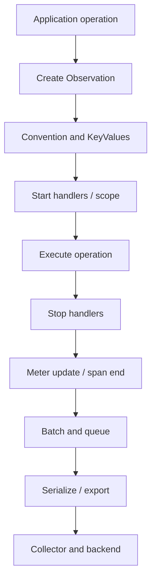
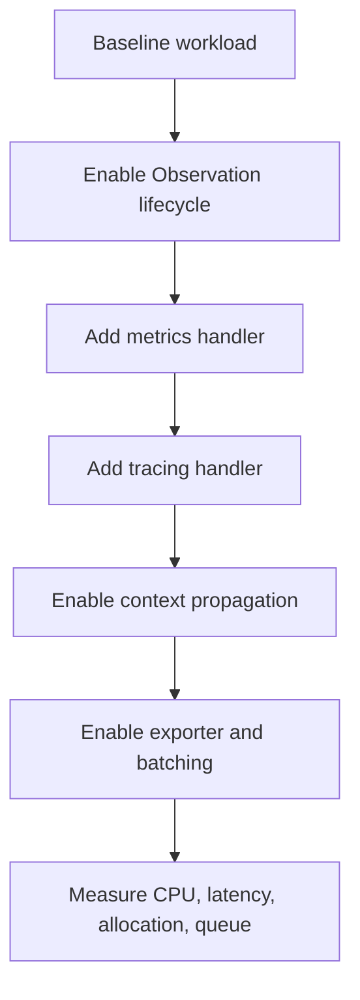

# Chi phí tạo Observation trong Spring Boot

Micrometer Observation cung cấp một điểm instrumentation thống nhất để ứng dụng ghi nhận metrics, traces và context liên quan. Mỗi Observation giúp chuẩn hóa cách mô tả một operation, nhưng việc tạo và ghi nhận telemetry cũng tiêu tốn CPU, memory, allocations, network và storage. Khi số request lớn hoặc instrumentation được đặt quá sâu trong call graph, chi phí này có thể ảnh hưởng latency và throughput.

**Chi phí tạo Observation** không chỉ là thời gian gọi API tạo object. Nó gồm lifecycle start/stop, xử lý convention và KeyValues, chạy ObservationHandlers, tạo meter/span, propagate context, export batches và lưu dữ liệu ở backend. Cần đánh giá toàn pipeline và so sánh với lợi ích vận hành mà telemetry mang lại.

Bài **“Chi phí tạo observation”** thuộc chương **Hiệu năng observability** của module **SPRING_BOOT_OBSERVABILITY**. Module hướng dẫn thiết lập observability cho Spring Boot bằng Micrometer Observation, metrics, logs và distributed tracing; học propagation ngữ cảnh, tag/cardinality, exporter, sampling và liên kết tín hiệu để điều tra lỗi, độ trễ và hành vi ứng dụng trên môi trường thực.

## 1. Một Observation tiêu tốn những gì?

Một Observation có thể đi qua các bước:

1. Kiểm tra predicate và tạo/khởi tạo Observation.
2. Gán name, context và metadata từ convention.
3. Chạy handlers khi start.
4. Đặt scope/current observation và propagate context.
5. Thực thi operation.
6. Chạy handlers khi error/event/stop.
7. Cập nhật meters hoặc kết thúc span.
8. Đưa telemetry vào exporter queue/batch.
9. Serialize, nén và gửi dữ liệu tới Collector/backend.



Không phải mọi Observation đều tạo cả metric và span. Kết quả phụ thuộc registry, handlers, predicates, tracing configuration và sampling. Tuy nhiên, ngay cả khi span không được export, instrumentation và context handling vẫn có thể có chi phí.

## 2. Chi phí CPU và allocation

Chi phí trong process có thể gồm:

- Tạo Observation/context và các objects liên quan.
- Tạo hoặc nối KeyValues.
- Tìm handlers và gọi callbacks.
- Đọc/ghi current context hoặc ThreadLocal/Reactor Context.
- Tạo span, attributes, events và links.
- Cập nhật Counter/Timer/Histogram.
- Đồng bộ nội bộ trong registry hoặc exporter queue.
- Serialize telemetry khi export.

Một Observation đơn lẻ thường rẻ so với database/network call, nhưng ở hàng chục nghìn hoặc hàng triệu operations mỗi giây, allocation nhỏ lặp lại cũng đáng kể. Instrumentation ở mỗi vòng lặp hoặc mỗi item trong batch có thể tạo telemetry volume lớn hơn nhiều so với instrumentation ở boundary của batch.

Không giả định mọi implementation/version có cùng allocation profile. Hãy đo trên JDK, Micrometer, tracing bridge và registry thực tế của ứng dụng.

## 3. No-op Observation và recording Observation

Micrometer có thể xử lý Observation theo cấu hình registry và handlers. Nếu không có handler phù hợp hoặc predicate loại bỏ operation, chi phí có thể thấp hơn recording path. Nhưng không nên coi no-op là hoàn toàn miễn phí: code tạo context, gọi API hoặc đánh giá predicate vẫn có thể chạy tùy cách sử dụng.

Recording Observation có thêm chi phí do handlers cập nhật metrics, tạo spans, scope context và export.

| Trường hợp | Công việc có thể xảy ra |
| --- | --- |
| Không có recording handler | Lifecycle có thể no-op hoặc nhẹ hơn, nhưng call/convention vẫn có thể tốn chi phí |
| Metrics handler | Cập nhật Counter/Timer/Histogram và tags |
| Tracing handler | Tạo span, attributes, scope và kết thúc span |
| Metrics + tracing | Cả hai loại handler cùng xử lý lifecycle |
| Predicate loại Observation | Bỏ qua recording theo policy, predicate vẫn phải được đánh giá |

Nếu cần bỏ một loại operation, dùng ObservationPredicate hoặc cơ chế filter phù hợp thay vì tạo hàng triệu spans rồi trông chờ backend tự drop sau ingest.

## 4. Số lượng Observation và vị trí instrumentation

Số lượng Observation thường quan trọng hơn chi phí của một Observation.

Ví dụ một HTTP request gọi 3 services, chạy 5 database operations và xử lý 100 records. Nếu chỉ instrument HTTP boundary và outbound calls, số Observation có thể tương đối nhỏ. Nếu tạo Observation cho mỗi vòng lặp/field conversion, telemetry count có thể tăng hàng trăm lần.

| Boundary | Số lượng tương đối | Khuyến nghị |
| --- | --- | --- |
| HTTP server request | Mỗi inbound request | Thường là boundary cần thiết |
| Outbound HTTP call | Mỗi dependency exchange | Có giá trị cho latency/correlation |
| Database operation | Mỗi query/operation | Chọn các operation có ý nghĩa |
| Batch processing | Mỗi batch | Thêm batch size thay vì span cho từng item nếu không cần |
| Inner loop/item mapping | Có thể hàng nghìn mỗi request | Tránh tạo Observation cho từng item nếu không có nhu cầu cụ thể |

Đặt Observation ở operation boundary có ý nghĩa với chẩn đoán. Với chi tiết nội bộ, dùng event/log hoặc metric phù hợp nếu tạo span riêng không đem lại thêm giá trị.

## 5. Metrics cardinality và chi phí bộ nhớ

Metrics có chi phí tăng theo số meter và số time series. Một meter có nhiều tag combinations có thể tạo hàng nghìn hoặc hàng triệu series.

Ví dụ không an toàn:

```java
registry.counter(
        "orders.processed",
        "order.id", orderId,
        "customer.id", customerId
).increment();
```

Mỗi order/customer có thể tạo series mới. Thay bằng tags hữu hạn:

```java
registry.counter(
        "orders.processed",
        "channel", channel,
        "outcome", outcome
).increment();
```

Cardinality ảnh hưởng:

- Heap/memory của process registry.
- CPU cập nhật và export meters.
- Network payload và ingest throughput.
- Backend index/storage/query cost.
- Dashboard query latency và alert evaluation.

Observation low-cardinality KeyValues thường được dùng cho metrics. High-cardinality values có thể được dùng cho traces tùy policy, nhưng không nên đưa vào meter tags.

## 6. Tracing sampling giảm chi phí ở đâu?

Sampling quyết định spans nào được ghi/giữ theo tracing pipeline. Sampling có thể giảm:

- Số spans được export.
- Network traffic tới Collector/backend.
- Storage/indexing/query cost.
- CPU/memory ở downstream telemetry infrastructure.

Sampling không nhất thiết loại bỏ mọi chi phí trước khi sampling decision được áp dụng. Client instrumentation có thể vẫn tạo context, thực hiện propagation, đánh giá sampler và chạy một phần handlers. Các span attributes hoặc scope cần thiết cho trace context cũng có thể có chi phí.

| Loại sampling | Thời điểm/quyết định | Tác động |
| --- | --- | --- |
| Head sampling | Quyết định khi span/trace bắt đầu | Giảm spans được recording/export sớm |
| Tail sampling | Quyết định sau khi Collector quan sát trace | Giữ trace theo latency/error policy nhưng Collector cần buffer và xử lý |
| Parent-based sampling | Theo quyết định của parent context | Giữ tính nhất quán trong trace tree |
| Always-on | Ghi mọi trace | Telemetry volume và chi phí cao nhất |
| Always-off | Không export spans | Vẫn có thể còn chi phí instrumentation/context tùy implementation |

Không dùng sampling để giải quyết metric cardinality. Metrics thường không đi theo trace sampling decision; cần quản lý meter tags và filters riêng.

## 7. Context propagation cũng có chi phí

Observation scope có thể được lưu trong ThreadLocal hoặc context mechanism của framework. Với reactive/async execution, context có thể được capture/restore qua Reactor Context, executor hoặc thread boundary.

Chi phí có thể đến từ:

- Capture và restore context.
- ThreadLocal access.
- Context snapshots và wrappers.
- Propagation qua scheduler/executor.
- Inject/extract headers trong HTTP/messaging calls.

Không tắt context propagation chỉ để giảm vài microseconds nếu nó làm mất trace parent hoặc log correlation. Thay vào đó, đo overhead và chỉ propagate context cần thiết, tránh lưu payload/objects lớn trong context.

## 8. Exporter, batching và backpressure

Sau khi span/meter được cập nhật, exporter cần serialize và gửi dữ liệu. Batching giúp giảm số network calls, nhưng queue và batch có giới hạn.

Các chi phí/risks:

- Serialization và compression CPU.
- Network I/O và TLS.
- Queue memory.
- Retry khi Collector/backend unavailable.
- Dropped telemetry khi queue đầy hoặc shutdown.
- Backpressure và thread contention nếu exporter cấu hình không phù hợp.

Cần cấu hình batch size, schedule delay, queue capacity, timeout và retry theo throughput/backend capacity. Không tăng queue vô hạn để tránh drop; queue lớn có thể làm heap tăng mạnh khi backend ngừng hoạt động.

## 9. Logs và metrics có chi phí khác nhau

Logs thường tạo event records riêng, format/encode message và gửi tới appender/collector. Traces tạo spans có attributes/events/links. Metrics cập nhật aggregate structures và thường export snapshot/delta theo chu kỳ.

| Signal | Chi phí nổi bật | Tối ưu thường dùng |
| --- | --- | --- |
| Metrics | Meter count, cardinality, histogram buckets | Giảm tag combinations, chọn histogram có chủ đích |
| Traces | Span creation, attributes, sampling, export | Sampling, chọn boundary và attributes |
| Logs | Message formatting, allocation, I/O, ingestion | Log level, structured logging, redaction và async appenders |

Không dùng logs thay metrics cho mọi count/latency; log volume thường lớn và query aggregation tốn kém. Cũng không tạo span cho từng log event nếu correlation fields đã đủ.

## 10. Histogram và percentile cost

Histogram có thể tạo nhiều buckets/time series cho mỗi tag combination. Percentile histograms hữu ích cho latency SLO nhưng tăng memory, payload và backend storage.

Chọn histogram dựa trên nhu cầu:

- Chỉ cần throughput/error rate: Counter có thể đủ.
- Cần latency distribution: Timer với histogram phù hợp.
- Cần percentile chính xác ở backend: bật histogram theo giới hạn series và retention.
- Cần percentile client-side: hiểu memory/CPU và semantics của implementation.

Không bật percentile histogram cho mọi meter một cách toàn cục nếu số tag combinations lớn. Chọn một số critical operations và đặt bucket boundaries theo latency objectives.

## 11. ObservationPredicate và filtering

ObservationPredicate có thể quyết định Observation có được tạo/ghi nhận hay không theo context. Đây là nơi loại bỏ các operation không có giá trị telemetry, ví dụ health probe noise hoặc một loại internal polling có volume rất lớn.

Ví dụ khái niệm:

```java
@Bean
ObservationPredicate skipInternalPolling() {
    return (name, context) ->
            !name.equals("internal.polling.noise");
}
```

API/bean wiring cần theo Micrometer version và cách registry được cấu hình. Predicate nên đơn giản, deterministic và rẻ; không gọi database/network trong predicate.

Không loại tất cả health checks hoặc errors chỉ để giảm volume. Giữ telemetry cần thiết cho liveness/readiness, SLO và incident investigation. Có thể lọc theo operation name hoặc metadata ổn định.

## 12. Giảm chi phí bằng cách thiết kế metadata

Một convention tốt giảm chi phí downstream bằng cách kiểm soát cardinality và kích thước attributes:

- Dùng service/operation names ổn định.
- Giới hạn số low-cardinality tag values.
- Không gắn raw URL/query, user ID, order ID hoặc message payload.
- Giới hạn số span events/links/attributes.
- Tránh ghi stacktrace lặp lại cho lỗi expected ở mọi layer.
- Redact dữ liệu nhạy cảm trước export.
- Không đưa object lớn vào context.
- Tránh duplicate instrumentation ở cả framework và custom wrapper nếu cùng đo một boundary.

Metadata ít nhưng có ý nghĩa giúp query nhanh và giảm chi phí ingest/storage.

## 13. Benchmark chi phí Observation đúng cách

Để đo overhead, cần so sánh các trường hợp có cùng workload:

1. Baseline không có instrumentation.
2. Observation với no-op/minimal handlers.
3. Metrics handler only.
4. Tracing handler với sampling off/low.
5. Metrics + tracing.
6. Full export pipeline với Collector/backend.
7. Cùng workload nhưng tăng cardinality hoặc attributes để đo độ nhạy.

Đo:

- Throughput (requests/operations per second).
- p50/p95/p99 latency.
- CPU utilization.
- Allocation rate và GC pauses.
- Heap usage.
- Export queue size/dropped telemetry.
- Network bytes và backend ingest rate.

Dùng JMH cho microbenchmarks khi cần đo operation nhỏ, và load test/integration benchmark cho end-to-end pipeline. Warm up JVM, giữ dataset/workload cố định, chạy nhiều lần và so sánh phân phối thay vì một lần đo.

Không benchmark chỉ bằng một request local; JIT, connection warm-up, GC và network variance có thể làm kết quả sai lệch.

## 14. Phân tích overhead theo từng lớp

Một cách thực tế là tắt/bật từng thành phần để xác định phần gây chi phí:



Nếu chi phí tăng mạnh khi thêm tracing handler, kiểm tra span count, attributes, events và sampling. Nếu tăng khi bật metrics, kiểm tra cardinality/histograms. Nếu tăng khi bật exporter, xem serialization, queue, compression và network. Nếu tăng ở async workloads, xem context propagation và wrappers.

Chỉ thay một biến trong mỗi lần đo để biết nguyên nhân. Sau khi tối ưu, chạy lại toàn pipeline vì các thành phần có thể tương tác.

## 15. Tối ưu mà vẫn giữ khả năng điều tra

Một số nguyên tắc:

- Instrument inbound/outbound boundaries có giá trị cao trước.
- Dùng Observation chung cho operation cần cả metrics và tracing.
- Dùng Counter/Timer API trực tiếp cho business metrics có semantics riêng.
- Giữ tags low-cardinality và naming ổn định.
- Chọn sampling policy theo traffic, error/latency investigation needs.
- Dùng batch exporter và queue bounds hợp lý.
- Tránh span cho mỗi item trong batch nếu links/batch metadata đủ.
- Giới hạn attributes và events.
- Giữ error traces theo policy khi cần, không drop toàn bộ lỗi.
- Theo dõi dropped telemetry và exporter health như một phần observability pipeline.

Tối ưu không nên chỉ dựa trên số lượng spans giảm. Nếu sampling/filtering làm mất khả năng tìm root cause của lỗi hiếm, chi phí vận hành incident có thể tăng.

## 16. Chẩn đoán khi observability overhead cao

| Triệu chứng | Nguyên nhân có thể | Cách kiểm tra |
| --- | --- | --- |
| CPU tăng sau khi bật tracing | Nhiều spans/attributes/events | Đo spans per request và sampling |
| Heap tăng liên tục | Cardinality cao hoặc exporter queue lớn | Meter count, queue capacity và heap profile |
| GC tăng | Allocation từ contexts, spans, log formatting | Allocation profiling |
| Metrics backend ingest tăng mạnh | Tag combinations/histogram buckets | Series count và tag review |
| Latency p99 tăng khi backend down | Exporter blocking/retry/queue pressure | Async export, timeout và bounded queue |
| Trace thiếu nhưng CPU vẫn tăng | Sampling decision sau một phần instrumentation | Kiểm tra sampler và span creation path |
| Batch workload có telemetry volume lớn | Observation cho từng record | Instrument batch boundary, dùng batch size |
| Context propagation tốn CPU | Capture/restore quá rộng | Profile scheduler/executor boundaries |
| Log volume tăng | DEBUG/TRACE hoặc duplicate appenders | Kiểm tra logger levels và appender config |
| Dữ liệu export quá lớn | Attributes, events hoặc payload không giới hạn | Attribute allowlist và redaction |

Quy trình:

1. Xác lập baseline workload và SLO.
2. Xác định signal/handler nào tạo phần overhead.
3. Đo số Observations/spans/meters trên mỗi request.
4. Kiểm tra cardinality và histogram configuration.
5. Profile allocation, CPU và GC.
6. Kiểm tra exporter queue/retry/network.
7. Điều chỉnh sampling, filtering hoặc instrumentation boundary.
8. Chạy lại benchmark và kiểm tra trace usefulness.

## 17. Bài thực hành: đo và tối ưu Observation cost

Thực hiện trong local/staging:

1. Tạo Spring Boot endpoint xử lý một operation ổn định.
2. Chạy load test baseline chưa bật custom Observation.
3. Bật Observation với minimal/no-op handler nếu phù hợp.
4. Thêm MeterObservationHandler và đo lại.
5. Thêm tracing bridge với sampling policy đã chọn.
6. Thêm một số low-cardinality tags, sau đó thử cardinality cao trong test cô lập để quan sát khác biệt.
7. Bật histogram cho một Timer và đo series count/storage impact.
8. Bật exporter batching, tạo backend slowdown và quan sát queue/drop behavior.
9. Thử ObservationPredicate loại một operation noise.
10. So sánh CPU, throughput, p95/p99, allocation rate, GC và telemetry volume.
11. Xác minh trace của lỗi test vẫn có thể tìm được sau sampling/filtering.
12. Chọn cấu hình đáp ứng SLO và budget telemetry.

Không gửi dữ liệu nhạy cảm hoặc tạo cardinality test lớn lên production backend.

## 18. Câu hỏi tự kiểm tra

1. Chi phí tạo Observation gồm những lớp nào?
2. Vì sao Observation count quan trọng hơn chỉ nhìn cost của một object?
3. No-op Observation có hoàn toàn miễn phí không?
4. Metrics handler và tracing handler thêm loại chi phí nào?
5. Vì sao high-cardinality tags làm tăng heap và backend storage?
6. Head sampling khác tail sampling về thời điểm quyết định thế nào?
7. Sampling có loại bỏ toàn bộ instrumentation overhead không?
8. Context propagation qua Reactor/executor có chi phí gì?
9. Exporter batching giúp gì và tạo rủi ro gì?
10. Histogram buckets ảnh hưởng series count ra sao?
11. ObservationPredicate nên được thiết kế thế nào?
12. Vì sao không nên tạo Observation cho từng item trong batch?
13. Benchmark cần đo p95/p99, CPU, allocation và queue thế nào?
14. Làm sao xác định tracing, metrics hay exporter là phần overhead chính?
15. Tối ưu sampling có thể ảnh hưởng khả năng điều tra lỗi hiếm ra sao?

## Tài liệu tham khảo

- [Micrometer Observation](https://docs.micrometer.io/micrometer/reference/observation.html): Observation lifecycle, handlers, predicates và conventions.
- [Micrometer Counters](https://docs.micrometer.io/micrometer/reference/concepts/counters.html): Counter semantics.
- [Micrometer Timers](https://docs.micrometer.io/micrometer/reference/concepts/timers.html): Timer, histogram và percentile configuration.
- [Spring Boot — Metrics](https://docs.spring.io/spring-boot/reference/actuator/metrics.html): MeterRegistry, filters và metrics export.
- [OpenTelemetry — Sampling](https://opentelemetry.io/docs/concepts/sampling/): head/tail sampling concepts và trade-offs.
- [OpenTelemetry Collector — Performance](https://opentelemetry.io/docs/collector/scaling/): Collector pipeline, batching và scaling.
- [JMH](https://openjdk.org/projects/code-tools/jmh/): JVM microbenchmark harness.

## Kết luận

**Chi phí tạo Observation đến từ toàn bộ lifecycle và pipeline xử lý telemetry, không chỉ thao tác khởi tạo object.** Metrics handlers cập nhật meters; tracing handlers tạo spans và context; propagation capture/restore state; exporters serialize, batch và gửi dữ liệu; cardinality quyết định memory và storage footprint.

Đặt Observation ở boundary có giá trị, giữ metric tags low-cardinality, giới hạn attributes/events, cấu hình sampling và exporter queues theo budget, rồi benchmark từng lớp trên workload thực tế. Không hy sinh context hoặc tín hiệu lỗi quan trọng chỉ để giảm volume. Mục tiêu là telemetry đủ hữu ích cho điều tra nhưng có CPU, memory, latency và storage cost nằm trong giới hạn vận hành.

