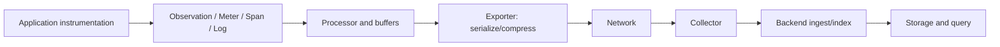

# Chi phí export telemetry trong Spring Boot

**Chi phí export telemetry** là tài nguyên và chi phí vận hành phát sinh khi ứng dụng thu thập, xử lý, truyền và lưu metrics, logs cùng distributed traces. Export telemetry tiêu thụ CPU để tạo/serialize dữ liệu, memory cho buffers và queues, network bandwidth để truyền payload, cùng storage/indexing capacity ở Collector và backend. Trong Spring Boot, Micrometer Observation giúp kết nối instrumentation với metrics và tracing handlers, nhưng mỗi signal pipeline đều có chi phí riêng cần đo và kiểm soát.

Trong module **SPRING_BOOT_OBSERVABILITY**, mục tiêu không chỉ là thu thập nhiều dữ liệu mà là thu thập đúng dữ liệu để điều tra lỗi, độ trễ và hành vi ứng dụng với ngân sách hợp lý. Bài thuộc chương **Hiệu năng observability**, tập trung vào các thành phần tạo chi phí export, cardinality, sampling, batching, queue/backpressure, exporter retry/timeout, Collector topology, benchmark và tối ưu theo mục tiêu vận hành.

## 1. Telemetry export tiêu tốn những gì?

Một telemetry event đi qua nhiều bước: instrumentation tạo dữ liệu, handler chuyển observation thành meter/span/log record, processor hoặc registry giữ dữ liệu, exporter serialize và gửi, Collector có thể xử lý tiếp, backend ingest/index/store rồi phục vụ truy vấn.



Chi phí có thể xuất hiện ở từng bước:

| Tài nguyên | Nơi phát sinh | Biểu hiện |
| --- | --- | --- |
| CPU | Instrumentation, tag lookup, serialization, compression | CPU usage, request latency |
| Heap memory | Span objects, metric state, queues, batch buffers | Heap pressure, GC |
| Network | OTLP/Prometheus/log shipping | Bandwidth, retransmission |
| Storage | Metrics time series, trace spans, log records | Retention cost, disk growth |
| Indexing/query | Backend processing | Ingest lag, query latency |
| Operations | Collector/backend capacity and maintenance | Infrastructure and service cost |

Không phải mọi chi phí đều nằm trong ứng dụng. Backend có thể tốn nhiều hơn ứng dụng vì indexing, replication, retention và truy vấn.

## 2. Phân biệt chi phí theo signal

Metrics, traces và logs có đặc tính lưu trữ khác nhau.

| Signal | Đặc điểm | Nguồn chi phí chính |
| --- | --- | --- |
| Metrics | Measurements tổng hợp theo series và tags | Số time series, scrape/write rate, retention |
| Traces | Spans theo từng operation/request | Span volume, attribute size, sampling, indexing |
| Logs | Sự kiện có nội dung chi tiết | Log rate, message size, parsing/indexing, retention |
| Baggage/context | Metadata lan truyền theo request/message | Header size, propagation overhead, span/log duplication |

Metrics thường được giữ liên tục với dimensions có kiểm soát; traces thường được sampling; logs có thể có nhiều dòng và payload lớn. Dùng cùng một policy cho cả ba signal thường dẫn tới chi phí không cần thiết hoặc mất dữ liệu cần thiết.

### 2.1. Observation không miễn phí

Micrometer Observation là abstraction để tạo signals nhất quán. Observation itself vẫn cần allocation, scope management, key-value processing và handler execution. Nếu một method cực nhỏ được gọi hàng triệu lần mỗi phút, thêm observation cho mọi invocation có thể tạo overhead đáng kể dù exporter batching tốt.

Chỉ instrument các operation có giá trị vận hành. Dùng load test để đo overhead trước và sau khi bật instrumentation ở workload đại diện.

## 3. Cardinality là động lực chi phí lớn của metrics

Mỗi tổ hợp metric name và tag values có thể tạo một time series riêng. Một tag có hàng nghìn giá trị có thể làm số series tăng nhanh; nhiều tags kết hợp với nhau có thể tạo tích số combinations.

Ví dụ không nên dùng raw URL:

```text
http.server.requests{uri="/orders/1001"}
http.server.requests{uri="/orders/1002"}
http.server.requests{uri="/orders/1003"}
```

Nên dùng route template:

```text
http.server.requests{uri="/orders/{id}"}
```

| Tag | Cardinality | Khuyến nghị |
| --- | --- | --- |
| HTTP method | Thấp | Dùng |
| Route template | Thấp nếu chuẩn hóa | Dùng |
| Status/outcome | Thấp | Dùng tập hữu hạn |
| Region/environment | Thấp nếu allowlist | Dùng có kiểm soát |
| User ID/order ID | Rất cao | Không dùng metric tag |
| Trace ID/span ID | Rất cao | Giữ trong tracing/log correlation |
| Raw query string | Cao và có thể nhạy cảm | Không dùng |
| Exception message | Không giới hạn | Chuẩn hóa thành error category |

### 3.1. Tính số series trước khi triển khai

Có thể ước lượng cardinality bằng tích số giá trị có thể có của từng tag. Ví dụ method 5 giá trị, route 40, status 6 và region 4 tạo tối đa 4.800 tổ hợp cho một metric name nếu mọi tổ hợp đều xuất hiện. Đây là ước lượng upper bound; số series thực tế phụ thuộc combinations được quan sát.

Đặt giới hạn và review tag keys trước khi thêm custom metrics. Một tag mới có thể làm chi phí backend tăng mạnh dù code thay đổi rất nhỏ.

### 3.2. Cardinality không giống số samples

Một series có thể ghi nhiều samples theo thời gian. Cardinality đo số series đồng thời; sample/write rate đo lượng measurements gửi theo thời gian. Cần theo dõi cả hai vì chúng tác động tới backend theo cách khác nhau.

## 4. Trace volume và sampling

Mỗi request có thể tạo nhiều spans: server, client, database, messaging và custom spans. Nếu traffic tăng, số spans có thể tăng theo cả request rate lẫn số operation trên mỗi request.

Head sampling chọn trace sớm, thường tại trace root. Ví dụ ratio sampler giữ một phần traces:

```yaml
management:
  tracing:
    sampling:
      probability: 0.10
```

Property cụ thể phụ thuộc Spring Boot version và tracing implementation. Ví dụ 10% chỉ minh họa; không dùng làm mặc định production mà chưa đánh giá traffic và yêu cầu điều tra.

Sampling giảm số spans được export nhưng không thay thế metrics. Nếu cần biết request count và error rate toàn traffic, metrics vẫn phải ghi nhận đầy đủ theo dimensions phù hợp.

### 4.1. Parent-based sampling

Parent-based sampling giúp child spans theo sampled decision của parent, tránh trace bị đứt đoạn do mỗi service tự chọn ngẫu nhiên độc lập. Trong distributed systems, propagating sampled decision và thống nhất policy giữa services rất quan trọng.

### 4.2. Tail sampling

Tail sampling tại Collector có thể quyết định giữ trace sau khi quan sát nhiều spans, ví dụ giữ trace có lỗi hoặc latency cao. Tuy nhiên, để áp dụng tail sampling, ứng dụng thường phải gửi spans đầu vào Collector; vì vậy chi phí network/Collector trước quyết định sampling vẫn tồn tại. Không coi tail sampling là cách miễn phí để gửi toàn bộ traces.

## 5. Log volume và mức độ chi tiết

Logs có thể chiếm nhiều storage vì mỗi record thường có timestamp, metadata và message. DEBUG/TRACE trên traffic lớn có thể làm volume tăng đột biến.

Quản lý log cost bằng:
- Chọn log level theo môi trường và component.
- Tránh log cùng một exception ở nhiều tầng.
- Không log payload/request body mặc định.
- Dùng structured fields có allowlist.
- Sample hoặc rate-limit repetitive logs khi phù hợp.
- Giữ ERROR/WARN có ý nghĩa và không bỏ mất incident signals.
- Dùng retention theo nhu cầu điều tra và quy định dữ liệu.

Không dùng log sampling để loại bỏ mọi lỗi hiếm. Có thể giữ error logs, tổng hợp repetitive events hoặc áp dụng rate limit có đếm số event bị drop.

## 6. Batching và batch size

Exporter thường gom nhiều records trước khi gửi để giảm số network requests và overhead per-request. Batch nhỏ giúp giảm thời gian chờ và memory mỗi batch; batch lớn cải thiện throughput nhưng tăng memory, payload size và latency trước export.

Các yếu tố cần cân nhắc:
- Batch size tối đa.
- Schedule delay/flush interval.
- Queue capacity.
- Export timeout.
- Payload byte size.
- Collector receiver throughput.
- Shutdown flush budget.

Không chọn batch chỉ theo số record; một span có nhiều attributes hoặc log record có body lớn sẽ nặng hơn nhiều record nhỏ.

### 6.1. Ví dụ cấu hình batch processor

OpenTelemetry SDK có BatchSpanProcessor; ví dụ minh họa:

```java
BatchSpanProcessor processor =
        BatchSpanProcessor.builder(spanExporter)
                .setScheduleDelay(Duration.ofSeconds(5))
                .setMaxQueueSize(2048)
                .setMaxExportBatchSize(512)
                .setExporterTimeout(Duration.ofSeconds(10))
                .build();
```

API/methods và defaults phụ thuộc OpenTelemetry SDK version. Các giá trị trên chỉ là điểm khởi đầu trong lab, không phải sizing production.

### 6.2. Flush interval

Flush quá thường xuyên tạo nhiều request nhỏ. Flush quá thưa làm tăng queue occupancy, thời gian chờ telemetry và lượng dữ liệu có thể mất khi process crash. Chọn interval dựa trên freshness requirement, batch throughput và shutdown behavior.

## 7. Queue, backpressure và dropped telemetry

Nếu exporter hoặc Collector chậm hơn tốc độ tạo telemetry, queue tăng. Khi queue đầy, processor có thể drop records hoặc block tùy implementation. Blocking trên request thread có thể biến telemetry outage thành business outage.

Theo dõi:
- Queue occupancy/utilization.
- Export success/failure.
- Spans/log records dropped.
- Export latency và timeout.
- Collector receiver refused/failed records.
- Backend ingest lag.

### 7.1. Không để telemetry làm chậm business path

Ưu tiên asynchronous/batched export khi integration hỗ trợ. Đặt queue hữu hạn, timeout và shutdown budget. Không gọi network exporter đồng bộ từ custom ObservationHandler trên request thread.

Nếu telemetry backend outage, ứng dụng cần tiếp tục xử lý business requests theo policy. Có thể mất một phần telemetry trong giới hạn được chấp nhận, nhưng không nên làm toàn bộ service ngừng hoạt động chỉ vì exporter không phản hồi.

### 7.2. Queue lớn không giải quyết được throughput thiếu

Tăng queue chỉ trì hoãn thời điểm đầy nếu tốc độ tạo records vẫn cao hơn tốc độ export. Cần giảm volume, tăng exporter/Collector capacity, cải thiện network hoặc điều chỉnh sampling/batch. Queue lớn còn tiêu thụ heap và tăng thời gian drain.

## 8. Retry, timeout và network overhead

Retry giúp xử lý lỗi tạm thời nhưng cũng tạo thêm network traffic và kéo dài thời gian drain. Retry không giới hạn có thể tạo retry storm khi backend hồi phục.

Thiết kế cần:
- Timeout cho từng export request.
- Retry có giới hạn và exponential backoff với jitter nếu exporter hỗ trợ.
- Phân loại lỗi retryable/non-retryable.
- Giới hạn concurrent exports.
- Theo dõi retry count và dropped records.
- Cân nhắc load shedding khi receiver quá tải.

Không giả định mọi exporter có retry semantics giống nhau. Kiểm tra SDK/exporter version và Collector pipeline thực tế.

### 8.1. Compression

Compression giảm network bytes nhưng tiêu tốn CPU và có thể tăng latency cho payload nhỏ. Đo compression ratio, CPU cost và end-to-end export latency trước khi bật hoặc đổi thuật toán.

### 8.2. Protocol và connection reuse

OTLP/gRPC dùng HTTP/2; OTLP/HTTP dùng HTTP. Cấu hình protocol cần tương thích với receiver/proxy. Reuse connections và tránh tạo exporter/channel mới liên tục giúp giảm handshake và allocation overhead.

## 9. Collector topology và chi phí

OpenTelemetry Collector có thể chạy dạng agent cạnh ứng dụng hoặc gateway tập trung.

| Mô hình | Ưu điểm | Trade-off |
| --- | --- | --- |
| Agent/sidecar | Local hop, cô lập theo workload | Tốn tài nguyên theo từng pod/node |
| Node agent/DaemonSet | Chia sẻ agent trên node | Cần quản lý isolation và routing |
| Gateway | Centralized processing, tail sampling, routing | Tập trung tải và network hop |
| Direct to backend | Ít tầng trung gian | Ứng dụng phụ thuộc backend và credentials |

Collector có thể batch, filter, transform, redact, sample và route. Mỗi processor thêm CPU/memory. Gateway giúp quản lý policy tập trung nhưng cần capacity, redundancy và autoscaling.

### 9.1. Agent và gateway kết hợp

Một topology phổ biến là application gửi tới node/sidecar agent, agent forward tới gateway, gateway thực hiện tail sampling và export tới backend. Điều này có thể giảm kết nối từ hàng trăm pods tới backend, nhưng tăng một network hop và cần quản lý queue ở từng tầng.

### 9.2. Collector không phải kho lưu trữ

Collector nhận và chuyển tiếp telemetry; backend thường chịu trách nhiệm retention/index/query. Tăng Collector replicas không giải quyết storage/index bottleneck nếu backend ingest đang nghẽn.

## 10. Attribute size và payload design

Span có hàng trăm attributes, event descriptions dài hoặc exception stack traces lớn sẽ tạo payload nặng. Logs với serialized object/request body có thể còn lớn hơn.

Nguyên tắc:
- Chọn attributes có giá trị điều tra.
- Dùng enum/category thay free-form text.
- Không serialize object graph.
- Không gắn full request/response body.
- Giới hạn exception details theo policy.
- Tránh duplicate metadata ở Resource, span và log nếu không cần.
- Kiểm soát số events trên mỗi span.

Một attribute nhỏ nhưng xuất hiện ở hàng triệu spans cũng có chi phí tích lũy. Đánh giá cả byte size lẫn số lần lặp.

## 11. Metrics export: scrape và push

Micrometer có thể export metrics theo mô hình pull/scrape như Prometheus hoặc push qua registry/exporter khác. Mỗi mô hình có chi phí khác nhau.

**Pull:** backend scrape theo interval; scrape interval quyết định sample frequency và network load. Nếu scrape quá thường xuyên, backend ingest tăng; nếu quá thưa, phát hiện thay đổi chậm.

**Push:** application/agent gửi metrics theo step/interval; cần xử lý batch, network failures và buffering.

Không expose cùng một metrics pipeline tới nhiều backends mà không có mục đích. Duplicate scrape/export có thể nhân đôi ingestion và chi phí.

### 11.1. Scrape interval

Chọn interval dựa trên tốc độ cần phát hiện incident. Metrics business trend thường không cần độ phân giải từng giây; metrics saturation/latency có thể cần interval ngắn hơn. Cân bằng freshness, retention và sample volume.

### 11.2. Histogram buckets

Histogram tạo nhiều series theo bucket, cộng thêm count/sum và tag combinations. Bucket quá nhiều kết hợp với cardinality cao làm series count tăng mạnh. Chọn buckets theo SLO/latency distribution cần phân tích, không bật mọi bucket cho mọi metric.

## 12. Retention và backend cost

Storage cost phụ thuộc:
- Ingestion rate (samples, spans, log bytes).
- Cardinality và index strategy.
- Replication factor.
- Retention period.
- Compression/storage tier.
- Query concurrency và index maintenance.

Có thể dùng retention khác nhau:
- Metrics tổng hợp giữ lâu hơn để phân tích trend.
- Traces giữ ngắn hơn hoặc sampling theo policy.
- Logs audit/security có retention riêng theo yêu cầu tổ chức.
- High-detail diagnostic data giữ ngắn và access-controlled.

Không giảm retention tùy tiện nếu có yêu cầu audit/incident investigation. Policy phải được owner dữ liệu và vận hành thống nhất.

## 13. Cost-aware sampling và filtering

Sampling/filtering nên dựa trên mục tiêu điều tra:
- Metrics cho coverage toàn traffic với tags ít cardinality.
- Traces sample phần lớn traffic bình thường nhưng tăng khả năng giữ error/slow traces nếu kiến trúc hỗ trợ.
- Logs giữ sự kiện quan trọng; giảm repetitive debug noise.
- Filter health checks/noisy internal endpoints nếu không có nhu cầu phân tích.

Không loại tất cả health checks nếu chúng là tín hiệu quan trọng cho availability. Không drop error traces chỉ để giảm chi phí nếu chúng là nguồn điều tra chính; cân nhắc tail sampling hoặc policy ưu tiên lỗi.

### 13.1. Sampling không phải security filter

Sampling quyết định records nào được giữ; nó không loại bỏ PII khỏi records được giữ. Redaction và data minimization cần diễn ra trước khi export.

## 14. Đo overhead trong ứng dụng Spring Boot

Đánh giá chi phí bằng workload đại diện. So sánh baseline không có instrumentation bổ sung với cấu hình metrics/tracing/logging mục tiêu.

Đo các chỉ số:
- Request throughput và p50/p95/p99 latency.
- CPU utilization.
- Heap usage, allocation rate và GC pause.
- Network bytes/requests tới Collector.
- Export queue occupancy và dropped records.
- Collector CPU/memory/ingest rate.
- Backend ingest lag và storage growth.

Thử nghiệm cần giữ workload, dataset, JVM options và environment ổn định. Chạy đủ lâu để quan sát steady state và GC behavior, đồng thời thử cả backend bình thường lẫn backend chậm/mất kết nối.

### 14.1. So sánh từng lớp

Thay đổi từng yếu tố:
1. Instrumentation only.
2. Metrics handlers/export.
3. Tracing với sampling ratio.
4. Logging volume.
5. Batch/queue configuration.
6. Compression và Collector topology.

Cách này giúp xác định chi phí đến từ instrumentation, serialization, network hay backend. Tránh thay nhiều tham số cùng lúc rồi không biết thay đổi nào tạo tác động.

## 15. Cost budget và alerting

Thiết lập budget cho cả ứng dụng và pipeline:
- Số metric series theo service.
- Samples/sec hoặc write rate.
- Spans/sec và bytes/sec.
- Log bytes/sec.
- Export failure/drop rate.
- Collector queue utilization.
- Backend ingest lag.
- Storage growth và retention.

Alert nên cảnh báo cả hai chiều: pipeline quá tải và telemetry bị mất. Một backend ingest thấp bất thường có thể là exporter failure chứ không phải traffic giảm.

### 15.1. Không chỉ alert theo chi phí

Kết hợp cost metrics với coverage:
- Error rate có trace sample đủ để điều tra không?
- Có metrics toàn traffic cho SLO không?
- Log sampling có bỏ mất sự kiện quan trọng không?
- Có service nào không export telemetry không?
- Trace continuity giữa services có bị đứt không?

Tối ưu chi phí nhưng làm mất khả năng phát hiện incident là một trade-off không tốt.

## 16. Troubleshooting chi phí export telemetry

| Triệu chứng | Nguyên nhân có thể | Cách kiểm tra |
| --- | --- | --- |
| CPU tăng sau bật tracing | Span creation, attribute processing, serialization | So sánh profile baseline và instrumented |
| Heap/GC tăng | Queue lớn, batch buffer, payload/attributes lớn | Kiểm tra allocation và queue occupancy |
| Network bytes tăng | Sampling thấp, span/log volume hoặc payload lớn | Đo bytes/sec theo signal |
| Metrics backend tăng series nhanh | Dynamic tags/raw URI/IDs | Kiểm tra top cardinality dimensions |
| Export queue liên tục đầy | Producer rate vượt exporter/Collector throughput | Giảm volume hoặc tăng capacity |
| Dropped spans tăng | Queue full, timeout hoặc exporter failure | Kiểm tra processor/exporter diagnostics |
| Request latency tăng khi Collector chậm | Export đồng bộ hoặc queue pressure | Kiểm tra handler và async export |
| Backend ingest lag | Collector/backend quá tải | So sánh receiver accepted và backend ingest |
| Retry storm | Retry không giới hạn hoặc backoff kém | Kiểm tra retry count và timeout |
| Compression làm CPU cao | Payload nhỏ hoặc CPU-bound compression | Benchmark compressed/uncompressed |
| Trace coverage thấp | Sampling/filter policy quá chặt | Đối chiếu trace volume với request/error metrics |
| Logs storage tăng đột biến | DEBUG/TRACE hoặc duplicate exception logs | Kiểm tra log level và duplicate events |
| Shutdown mất telemetry | Flush budget không đủ hoặc process kill | Kiểm tra close lifecycle và termination grace |
| Tail sampling không giảm app network | Sampling sau khi Collector nhận spans | Xem vị trí sampling trong topology |

### Quy trình điều tra

1. Xác định signal nào tăng cost: metrics, traces hay logs.
2. Đo instrumentation overhead trên application CPU/latency.
3. Kiểm tra cardinality, attribute count và payload size.
4. Kiểm tra sampling/filter policy và signal coverage.
5. Kiểm tra batch processor, queue, timeout, retry và dropped records.
6. Đo network throughput và compression CPU.
7. So sánh Collector receiver rate với exporter/backend rate.
8. Kiểm tra backend indexing, retention và storage growth.
9. Thay từng tham số trong benchmark có kiểm soát.
10. Ghi nhận cost/coverage trade-off sau tối ưu.

## 17. Bài thực hành: lập ngân sách telemetry export

Mục tiêu là đo overhead và tìm cấu hình cân bằng giữa chi phí với khả năng điều tra.

### Chuẩn bị

- Spring Boot service có Micrometer Observation.
- MeterRegistry và tracing bridge/exporter.
- OpenTelemetry Collector lab.
- Metrics/traces backend hoặc test receiver.
- Load generator với workload có thể lặp lại.
- Baseline JVM/CPU/memory measurements.

### Bước 1 — Đo baseline

Chạy workload với instrumentation hiện có và ghi throughput, p95/p99 latency, CPU, heap, GC và network.

### Bước 2 — Bật metrics

Bật metrics export và đo series count, samples/sec, network bytes/sec. Kiểm tra route templates và tag cardinality.

### Bước 3 — Bật tracing

Bật tracing với sampling ratio thấp trong lab. Đo spans/sec, bytes/sec, CPU và latency. Xác minh Trace ID continuity.

### Bước 4 — Tăng sampling có kiểm soát

Thử một số sampling ratios khác nhau. So sánh trace coverage, exporter load và backend ingest. Không thay đổi workload giữa các lần đo.

### Bước 5 — Thử logs

Tăng/giảm log level trong workload có kiểm soát. Đo log bytes/sec và backend ingest. Kiểm tra duplicate exception logs và payload size.

### Bước 6 — Điều chỉnh batch/queue

Thử batch size, schedule delay và queue capacity khác nhau. Theo dõi queue occupancy, export latency, drops và heap.

### Bước 7 — Mô phỏng Collector chậm

Giới hạn receiver hoặc ngắt kết nối có kiểm soát. Xác nhận business requests không bị block vô hạn và dropped telemetry được quan sát.

### Bước 8 — Thử compression

So sánh CPU, network bytes và export latency khi bật/tắt compression.

### Bước 9 — Kiểm tra backend retention

Ước lượng storage growth theo ingest rate và retention. Xác định policy riêng cho metrics, traces và logs.

### Bước 10 — Chốt budget

Ghi lại cấu hình, throughput, p95/p99, CPU, memory, series count, spans/sec, logs bytes/sec, drop rate và coverage. Chọn policy đáp ứng SLO và nhu cầu incident investigation.

### Checklist nghiệm thu

| Điều cần chứng minh | Kết quả mong đợi |
| --- | --- |
| Cost model | Nhận diện CPU, memory, network, storage, indexing |
| Metrics | Cardinality và sample rate được đo |
| Traces | Sampling và spans/sec được đo |
| Logs | Log volume/retention được kiểm soát |
| Batching | Batch/queue phù hợp workload |
| Backpressure | Queue full không làm business path block vô hạn |
| Retry | Timeout/backoff/drop behavior rõ ràng |
| Collector | Agent/gateway topology có capacity |
| Backend | Ingest, index và retention được theo dõi |
| Benchmark | So sánh baseline với instrumented workload |
| Coverage | Tối ưu không làm mất tín hiệu cần thiết |
| Privacy | Không export secrets/PII để tiết kiệm bằng cách che giấu vấn đề |

## 18. Những nguyên tắc cần ghi nhớ

1. **Export telemetry có chi phí ở toàn pipeline.** Đo từ instrumentation tới backend, không chỉ CPU của ứng dụng.
2. **Metrics cardinality là yếu tố quan trọng.** Dùng route templates và tags hữu hạn; tránh IDs/raw values.
3. **Metrics, traces và logs cần policy khác nhau.** Metrics cho coverage, traces cho điều tra sampled requests, logs cho sự kiện chi tiết.
4. **Sampling giảm trace volume nhưng không thay thế metrics.** Tail sampling vẫn cần vận chuyển spans tới Collector trước quyết định.
5. **Batching cải thiện throughput nhưng tiêu thụ memory và tăng thời gian chờ.** Sizing theo record count lẫn byte size.
6. **Queue phải hữu hạn và có backpressure/drop policy rõ ràng.** Telemetry outage không nên làm business path ngừng hoạt động.
7. **Retry, compression và Collector processors cũng có cost.** Benchmark thay vì bật theo cảm tính.
8. **Backend indexing và retention có thể chiếm phần lớn ngân sách.** Theo dõi ingest, storage và query cost.
9. **Đo overhead bằng workload đại diện.** So sánh throughput, latency, CPU, heap, GC, network và dropped records.
10. **Tối ưu cost phải giữ đủ coverage.** Theo dõi trace continuity, error visibility và SLO metrics.
11. **Redaction là yêu cầu độc lập với sampling.** Không dùng sampling để xử lý PII.

Chi phí export telemetry có thể được kiểm soát khi nhóm phát triển hiểu volume, cardinality, payload size và throughput ở từng tầng. Với Spring Boot, hãy instrument có chọn lọc, giữ metric dimensions hữu hạn, sampling traces theo mục tiêu, batch/export bất đồng bộ với queue hữu hạn và đo cả Collector/backend. Một ngân sách telemetry tốt cân bằng chi phí với khả năng phát hiện, điều tra và phục hồi sự cố của hệ thống.
