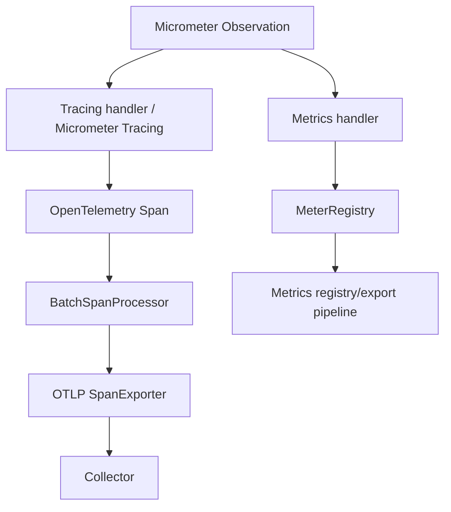
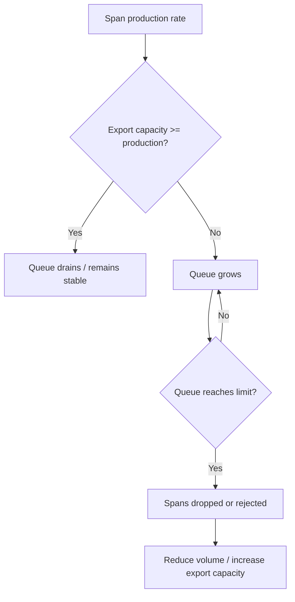

# Batch exporter trong observability

Một ứng dụng Spring Boot có thể tạo hàng nghìn observations và spans mỗi giây. Nếu mỗi span được gửi ngay thành một network request riêng, ứng dụng phải trả thêm chi phí kết nối, serialization, TLS và syscall; collector cũng nhận nhiều request nhỏ. Batch exporter gom nhiều telemetry records thành một batch rồi gửi cùng nhau, giúp giảm overhead và tăng throughput. Tuy nhiên, batch cần bộ nhớ đệm, có độ trễ trước khi export và phải có chính sách rõ khi queue đầy, exporter lỗi hoặc process shutdown.

**Batch exporter** là thành phần thu thập telemetry records vào buffer/queue, sau đó gửi chúng theo batch dựa trên batch size, thời gian chờ hoặc điều kiện flush. Trong kiến trúc Spring Boot dùng Micrometer Observation với Micrometer Tracing và OpenTelemetry bridge, Observation tạo dữ liệu ở application layer; tracing SDK/processor và OTLP exporter chịu trách nhiệm xử lý, batch và vận chuyển spans. Metrics có pipeline riêng qua MeterRegistry và registry/exporter tương ứng; không nên coi batch span exporter và metrics publishing là cùng một cơ chế.

Thiết kế batch exporter là bài toán cân bằng throughput, latency, memory và độ tin cậy. Batch quá nhỏ làm tăng số lần export; batch quá lớn làm tăng bộ nhớ, thời gian chờ và kích thước payload. Queue quá nhỏ dễ drop dữ liệu khi backend chậm; queue quá lớn có thể che giấu sự cố và làm tăng memory pressure.

Bài học thuộc chương **Hiệu năng observability** của module **SPRING_BOOT_OBSERVABILITY**. Module hướng dẫn thiết lập observability cho Spring Boot bằng Micrometer Observation, metrics, logs và distributed tracing; học propagation ngữ cảnh, tag/cardinality, exporter, sampling và liên kết tín hiệu để điều tra lỗi, độ trễ và hành vi ứng dụng trên môi trường thực. Bài này tập trung vào batch exporter, cách cấu hình, tuning, theo dõi queue và bảo đảm telemetry được flush trong giới hạn shutdown.

## Mục tiêu học tập

Sau bài này, bạn có thể:

1. Giải thích vì sao exporter cần batching khi telemetry volume cao.
2. Phân biệt Observation creation, span processing, batching và export.
3. Hiểu vai trò của OpenTelemetry BatchSpanProcessor và OTLP exporter.
4. Phân biệt batch size, schedule delay, export timeout và queue capacity.
5. Đánh giá trade-off giữa throughput, export latency và memory.
6. Hiểu queue saturation, backpressure, retry và dropped telemetry.
7. Cấu hình batch span processing trong Spring Boot theo version.
8. Phân biệt tracing batch export với metrics push/pull pipeline.
9. Kiểm thử flush, shutdown, collector outage và exporter timeout.
10. Dùng exporter metrics để tuning dựa trên dữ liệu thực tế.

## 1. Vì sao cần batch exporter?

Telemetry thường được tạo ở tốc độ cao hơn tốc độ một request đơn lẻ. Một inbound HTTP request có thể tạo server span, service spans, client spans và database spans. Nếu mỗi span được export ngay, mỗi record tạo thêm chi phí transport và serialization.

Batching gom nhiều records:


Batching có thể:
- Giảm số lần network export.
- Tăng payload efficiency.
- Giảm overhead per-span.
- Tách tốc độ tạo spans khỏi tốc độ gửi tới collector trong một khoảng ngắn.
- Hấp thụ burst telemetry tạm thời.

Batching không làm giảm số spans được tạo. Sampling, filtering và span design mới ảnh hưởng volume trước khi batch.

### 1.1. Batch không phải sampling

| Cơ chế | Tác động |
|---|---|
| Batching | Gom nhiều records thành ít export requests |
| Sampling | Chọn records/traces được giữ |
| Filtering | Loại records theo policy |
| Compression | Giảm byte truyền tải |
| Aggregation | Tổng hợp measurements, thường dùng cho metrics |

Nếu ứng dụng tạo 10.000 spans và sampling giữ 10%, processor còn khoảng 1.000 spans để xử lý; batching chia 1.000 spans đó thành một số export batches. Batch size không thay đổi sampling decision.

### 1.2. Batching không bảo đảm delivery

Batch exporter có thể retry trong giới hạn, nhưng queue trong memory không phải durable storage. Process crash, OOM hoặc shutdown cưỡng bức có thể làm mất records chưa export. Nếu cần durability cao hơn, cần kiến trúc collector/agent/queue phù hợp và chấp nhận chi phí tương ứng.

## 2. Vị trí batching trong Spring Boot telemetry pipeline

Với Micrometer Observation, application code tạo Observation. Các handlers có thể ghi metrics hoặc tạo spans. Khi dùng Micrometer Tracing với OpenTelemetry bridge, spans được chuyển tới OpenTelemetry SDK; span processor quyết định xử lý đồng bộ hay batch; exporter gửi dữ liệu tới OTLP endpoint.



Điểm cần nhớ:
- Observation API không tự định nghĩa batch queue cho mọi signal.
- BatchSpanProcessor là thành phần OpenTelemetry SDK xử lý spans.
- OTLP exporter thực hiện export protocol/transport.
- Metrics thường được ghi vào MeterRegistry; registry có thể pull qua scrape endpoint hoặc push theo step interval.
- Logs có pipeline riêng tùy logging backend/OTel integration.

### 2.1. BatchSpanProcessor và SimpleSpanProcessor

OpenTelemetry SDK thường cung cấp hai kiểu processor:
- **SimpleSpanProcessor:** chuyển span đã kết thúc trực tiếp tới exporter; hữu ích cho test/debug nhưng có thể làm tăng overhead trên application thread.
- **BatchSpanProcessor:** enqueue span đã kết thúc và export theo batch; phù hợp production workloads cần giảm overhead.

Tên class/package và cách cấu hình phụ thuộc OTel SDK version. Không tự tạo processor thứ hai nếu Spring Boot/OTel auto-configuration đã cấu hình processor tương ứng.

### 2.2. Exporter và processor là hai trách nhiệm khác nhau

Processor quản lý lifecycle, batching và scheduling. Exporter serialize/transport dữ liệu tới backend. Thay endpoint/credentials thường là exporter configuration; thay queue/batch size là processor configuration. Phân biệt hai lớp giúp tìm đúng nguyên nhân khi export chậm hoặc mất dữ liệu.

## 3. Các tham số batch quan trọng

Batch span processor có các tham số thường gặp:

| Tham số | Ý nghĩa | Tác động chính |
|---|---|---|
| maxQueueSize | Số spans tối đa chờ export | Memory và khả năng hấp thụ burst |
| maxExportBatchSize | Số spans tối đa trong một batch | Payload size và export efficiency |
| scheduleDelay | Khoảng chờ tối đa giữa các lần export theo lịch | Export latency và batch fill |
| exporterTimeout | Thời gian tối đa cho một export operation | Thời gian chờ và shutdown behavior |

Các giá trị mặc định thay đổi theo OTel SDK version/distribution. Kiểm tra SDK docs và effective runtime configuration thay vì dựa vào con số mặc định từ một phiên bản khác.

### 3.1. Queue size

Queue lớn hấp thụ burst lâu hơn khi collector chậm, nhưng tiêu thụ memory nhiều hơn. Nếu queue đầy, processor có thể drop spans mới hoặc áp dụng behavior theo implementation. Queue lớn không giải quyết được backend thiếu capacity kéo dài.

### 3.2. Batch size

Batch size lớn giảm số export calls nhưng làm payload lớn hơn, cần nhiều memory để serialize và có thể vượt giới hạn request của proxy/collector. Batch size phải phù hợp với collector limits, network MTU/HTTP behavior và exporter implementation.

### 3.3. Schedule delay

Schedule delay quyết định processor thường xuyên kiểm tra queue để export. Delay ngắn giúp spans tới backend sớm hơn nhưng có thể gửi nhiều batch nhỏ. Delay dài tăng cơ hội batch đầy nhưng làm tăng thời gian telemetry nằm trong memory.

### 3.4. Export timeout

Timeout giới hạn thời gian chờ export. Timeout quá ngắn gây thất bại khi mạng/backend chậm nhất thời; timeout quá dài làm worker/export shutdown kéo dài và queue khó drain. Cần phối hợp với timeout ở proxy, collector và process termination budget.

## 4. Tuning batch size và queue

Không có một cấu hình batch tối ưu cho mọi service. Cần bắt đầu từ tốc độ tạo spans, kích thước span trung bình, collector capacity, network throughput và memory budget.

Một cách ước lượng:

```text
queued_span_count ≈ spans_per_second × tolerated_export_delay_seconds

queue_memory ≈ queued_span_count × average_in_memory_span_size

batches_per_second ≈ spans_per_second / effective_batch_size
```

Đây là ước lượng ban đầu; span object size và serialized payload size khác nhau, và queue có overhead. Đo heap thực tế trong load test.

### 4.1. Ví dụ sizing

Giả sử service tạo trung bình 2.000 spans/giây và muốn hấp thụ khoảng 3 giây collector slowdown:

- Queue cần chứa ít nhất khoảng 6.000 spans, cộng headroom cho burst.
- Nếu batch size 512, queue đầy tương đương khoảng 12 batches.
- Memory cần đo bằng heap profiling vì mỗi span có attributes/events khác nhau.

Các con số minh họa không phải cấu hình khuyến nghị. Nếu collector chậm 30 giây, queue 6.000 không đủ; cần giảm volume, tăng capacity hoặc thiết kế buffering downstream.

### 4.2. Tuning theo burst

Average throughput không mô tả burst. Load test nên tạo traffic spike, fan-out tới nhiều dependencies và error storm vì exception events có thể làm span lớn hơn bình thường. Queue cần đủ headroom cho peak rate trong khoảng backend có thể phục hồi.

### 4.3. Tránh tăng queue vô hạn

Queue vô hạn hoặc rất lớn có thể biến exporter outage thành heap exhaustion. Chọn giới hạn rõ, quan sát dropped spans và thiết lập alert để phát hiện queue saturation sớm.

## 5. Cấu hình OpenTelemetry batch processor

Cách cấu hình phụ thuộc Spring Boot version, OTel starter/SDK và bridge được dùng. Trong nhiều cấu hình Spring Boot với OpenTelemetry SDK, batch processor được auto-configure; các environment variables hoặc properties của OTel SDK có thể điều chỉnh queue, batch và delay.

Ví dụ minh họa qua environment variables của OpenTelemetry SDK:

```yaml
environment:
  OTEL_BSP_MAX_QUEUE_SIZE: "8192"
  OTEL_BSP_MAX_EXPORT_BATCH_SIZE: "512"
  OTEL_BSP_SCHEDULE_DELAY: "5000"
  OTEL_BSP_EXPORT_TIMEOUT: "30000"
```

Các biến OTEL_BSP_* là cấu hình BatchSpanProcessor phổ biến trong OpenTelemetry SDK. Đơn vị và support cần đối chiếu với SDK version/distribution đang dùng. Không đặt các giá trị này vào application YAML như Spring properties nếu runtime không bind environment variables theo cách đó; ví dụ trên mô tả container environment.

### 5.1. Spring Boot configuration

Spring Boot có thể quản lý OpenTelemetry SDK thông qua starter/auto-configuration hoặc Micrometer Tracing bridge tùy version. Trước khi thêm custom SDK bean:
1. Xác định ai tạo OpenTelemetry instance.
2. Xác định processor đã được đăng ký chưa.
3. Xác định exporter hiện tại.
4. Kiểm tra property/environment binding.
5. Chỉ tùy biến một nơi để tránh hai processors cùng export.

### 5.2. Không đăng ký processor/exporter trùng

Nếu auto-configuration đã thêm BatchSpanProcessor và custom code thêm processor thứ hai, mỗi ended span có thể được export hai lần. Test số spans và instrumentation scopes sau cấu hình. Khi thay processor, bảo đảm exporter cũ không còn được đăng ký.

### 5.3. Endpoint và protocol

OTLP exporter có thể dùng gRPC hoặc HTTP/protobuf tùy dependency/config. Endpoint, TLS, authentication headers và timeout phải khớp Collector receiver. Batch processor không sửa được lỗi endpoint, certificate hoặc protocol mismatch.

## 6. Backpressure và queue saturation

Batch queue tách producer khỏi exporter trong thời gian ngắn, nhưng producer vẫn có tốc độ tạo spans. Nếu tốc độ tạo lâu dài lớn hơn tốc độ export, queue sẽ tăng đến giới hạn.



Các nguyên nhân phổ biến:
- Collector/backend quá tải.
- Network latency hoặc packet loss.
- Export timeout quá thường xuyên.
- Span volume tăng đột ngột do traffic/error storm.
- Attributes/events làm payload lớn.
- Collector receiver hoặc downstream exporter bị nghẽn.

### 6.1. Backpressure không luôn truyền ngược tới request

BatchSpanProcessor thường enqueue non-blocking để tránh làm chậm application request. Khi queue đầy, telemetry có thể bị drop thay vì chặn business thread. Đây là lựa chọn bảo vệ application latency nhưng giảm observability completeness.

Không giả định tăng queue sẽ tạo backpressure hữu ích cho ứng dụng. Đo dropped spans và queue occupancy.

### 6.2. Giảm volume trước khi tăng buffer

Nếu telemetry volume quá cao, cân nhắc sampling, loại span không hữu ích, giảm attributes/events, sửa duplicate instrumentation hoặc tránh span cho từng record trong batch job. Tăng queue chỉ hấp thụ burst; không sửa throughput mismatch lâu dài.

## 7. Retry, failure và delivery semantics

OTLP exporter có thể retry một số lỗi tạm thời tùy implementation, retry policy và timeout. Batch processor cũng có giới hạn export lifecycle. Không giả định mọi failure đều retry vô hạn hoặc exactly-once delivery.

Một export có thể:
- Thành công và collector nhận batch.
- Timeout dù collector có thể đã nhận một phần/toàn bộ payload.
- Bị từ chối do authentication, payload size hoặc protocol.
- Thất bại do network/collector unavailable.
- Bị drop khi queue đầy hoặc process dừng trước flush.

### 7.1. Retry và duplicate delivery

Khi client retry sau timeout, không phải mọi protocol/path đều bảo đảm deduplication. Backend thường nhận diện spans theo trace/span IDs, nhưng không nên dựa vào điều đó để giả định exactly-once. Quan sát exporter errors và collector ingestion.

### 7.2. Persistent queue ở Collector

Nếu cần buffer bền vững qua restart, có thể cấu hình persistent queue ở Collector/exporter downstream khi thành phần đó hỗ trợ. Điều này khác in-memory BatchSpanProcessor trong application. Persistent queue cần disk capacity, retention, permissions và recovery policy.

## 8. Shutdown và force flush

Khi Spring Boot dừng, SDK cần flush spans còn trong queue và shutdown exporter. Nếu process bị kill trước khi flush hoàn tất, spans đang chờ có thể mất.

Các yếu tố cần phối hợp:
- Application shutdown hook gọi SDK shutdown.
- Force flush trước khi đóng exporter nếu lifecycle yêu cầu.
- Export timeout.
- Spring lifecycle timeout.
- Container termination grace period.
- Kubernetes SIGTERM và SIGKILL timing.

### 8.1. Không tự flush sau mỗi request

Force flush sau mỗi request phá batching, tăng latency và network overhead. Chỉ dùng flush ở các boundary có ý nghĩa như controlled shutdown hoặc test; không gọi trong hot path.

### 8.2. Shutdown budget

Termination grace period phải đủ để application dừng nhận work, hoàn tất in-flight operations và flush telemetry trong giới hạn timeout. Nếu shutdown budget quá ngắn, exporter có thể bị kill giữa chừng. Nếu quá dài, rollout/scale-in bị kéo dài.

### 8.3. Test flush

Tạo spans trong test, gọi flush/shutdown theo SDK lifecycle và xác nhận exporter nhận records. Test cả export timeout/failure để đảm bảo application shutdown không treo vô hạn.

## 9. Metrics pipeline không giống span batching

Micrometer metrics thường được ghi vào MeterRegistry. Với pull registry như Prometheus, scraper đọc snapshot theo interval; không có nghĩa mỗi measurement được gửi theo batch span processor. Với push registry, registry có step interval và thực hiện publish/aggregation theo implementation.

| Signal | Pipeline thường gặp | Batching/aggregation |
|---|---|---|
| Traces | Span processor → span exporter → Collector | Batch spans |
| Metrics pull | MeterRegistry → scrape endpoint | Scrape snapshot; registry aggregates measurements |
| Metrics push | MeterRegistry → push registry | Step-based publish/aggregation |
| Logs | Logging appender/OTel log exporter → Collector | Theo appender/exporter implementation |

Không áp dụng OTEL_BSP_* để tuning metrics hoặc logs. Tìm cấu hình đúng của từng pipeline.

## 10. Quan sát hiệu năng exporter

Để tuning, cần đo:
- Spans ended/produced per second.
- Exported spans per second.
- Queue occupancy/capacity.
- Dropped spans.
- Export duration/latency.
- Export failure/timeout count.
- Collector receiver accepted/refused records.
- Payload size và network throughput.
- Application heap/GC pause.

Tên metric cụ thể tùy SDK/agent/collector version. Một số SDK expose internal telemetry metrics; kiểm tra các instrumentations được bật và endpoint metrics thực tế.

### 10.1. Queue occupancy

Queue occupancy tăng liên tục cho thấy exporter không theo kịp producer. Queue tăng rồi giảm sau burst là hành vi có thể chấp nhận nếu drop bằng 0 và latency phù hợp.

### 10.2. Export latency

Export latency cao có thể do network, TLS, serialization, collector processing hoặc backend. Phân tách application processor/exporter metrics với collector receiver/exporter metrics để tìm bottleneck.

### 10.3. Dropped spans

Dropped spans là tín hiệu quan trọng vì dashboard trace có thể vẫn hoạt động trong khi thiếu dữ liệu. Alert khi drop rate khác 0 kéo dài hoặc tăng đột biến, đồng thời đối chiếu queue occupancy và exporter errors.

## 11. Kiểm thử batch exporter

Một bộ test nên bao gồm:

1. **Normal throughput:** producer rate thấp hơn exporter capacity; queue ổn định.
2. **Batch fill:** tạo đủ spans để đạt max batch size và xác minh export.
3. **Schedule delay:** tạo ít spans và xác minh export theo delay.
4. **Burst:** tạo spike, quan sát queue và drain sau burst.
5. **Collector slow:** giả lập latency để kiểm tra queue growth.
6. **Collector unavailable:** kiểm tra timeout, retry và dropped spans.
7. **Queue saturation:** tạo volume vượt capacity và xác minh drop metrics/behavior.
8. **Large spans:** nhiều attributes/events để đánh giá payload size.
9. **Shutdown flush:** dừng SDK/app sau khi tạo spans và xác minh records được flush.
10. **Duplicate processor:** kiểm tra một span không bị export hai lần.

### 11.1. Test exporter in-memory

Dùng in-memory exporter/test exporter để kiểm tra span processor behavior mà không cần backend thật. Test riêng OTLP connectivity trong integration/staging với Collector tương thích.

### 11.2. Load test

Load test cần ghi nhận cả business request latency và telemetry exporter metrics. Nếu bật batch processor làm p99 request latency tăng, kiểm tra exporter có block application thread, queue lock contention hoặc serialization overhead. Tracing không được làm hệ thống nghiệp vụ mất ổn định khi collector chậm.

## 12. Chẩn đoán batch exporter

| Triệu chứng | Nguyên nhân có thể | Cách điều tra |
|---|---|---|
| Trace tới backend trễ | Schedule delay dài hoặc queue lớn | Processor config và export latency |
| Queue luôn tăng | Export capacity thấp hơn production | Queue occupancy, collector throughput |
| Dropped spans tăng | Queue đầy hoặc export failure | SDK internal metrics và logs |
| Nhiều request export nhỏ | Batch size thấp hoặc schedule delay ngắn | Effective processor settings |
| Export timeout | Collector/network/backend chậm | Export duration, receiver metrics |
| Batch bị từ chối | Payload quá lớn hoặc protocol mismatch | Collector logs, payload size |
| Trace không có khi shutdown | Flush/shutdown budget thiếu | Lifecycle hooks và termination grace |
| Span bị export hai lần | Hai processors/exporters cùng đăng ký | SDK wiring và span IDs |
| App latency tăng khi collector down | Processor/exporter block hoặc custom sync path | Thread dump, request latency |
| Heap tăng khi burst | Queue quá lớn hoặc span objects nặng | Heap profile, queue capacity |
| Metrics có nhưng traces mất | Metrics pipeline độc lập với tracing exporter | Tracing bridge/processor/exporter |
| Chỉ một replica mất traces | Cấu hình hoặc resource pressure khác nhau | Effective config và per-instance metrics |

### Quy trình điều tra

1. Xác định pipeline đang dùng: Micrometer Tracing bridge, OTel SDK, agent hay cấu hình kết hợp.
2. Kiểm tra processor thực tế và số exporter được đăng ký.
3. Đọc batch size, queue size, schedule delay và timeout effective.
4. So sánh span production rate với export rate.
5. Xem queue occupancy, dropped spans, export failures và latency.
6. Kiểm tra Collector receiver/exporter logs và capacity.
7. Kiểm tra payload size, attributes/events và duplicate instrumentation.
8. Xem heap, GC và thread dumps khi queue tăng.
9. Kiểm tra force flush/shutdown và container termination grace.
10. Điều chỉnh một nhóm tham số, load test lại và theo dõi business latency.

## 13. Các anti-pattern cần tránh

| Anti-pattern | Hậu quả | Cách phù hợp |
|---|---|---|
| Dùng SimpleSpanProcessor trong high-volume production | Export overhead trên span end | BatchSpanProcessor |
| Queue quá nhỏ | Drop spans khi burst | Sizing theo peak rate và delay |
| Queue cực lớn | Heap pressure/OOM | Queue bounded và alert |
| Batch size vượt collector limit | Payload bị reject | Phối hợp collector limits |
| Schedule delay quá dài | Trace xuất hiện muộn | Chọn latency budget |
| Timeout vô hạn/quá dài | Shutdown/export worker bị giữ | Timeout hữu hạn |
| Force flush mỗi request | Mất lợi ích batching | Flush ở shutdown/test boundary |
| Thêm processor thứ hai khi auto-config đã có | Duplicate spans | Inventory SDK wiring |
| Tăng queue thay sampling | Không xử lý volume quá cao kéo dài | Giảm volume hợp lý |
| Coi queue memory là durable | Mất spans khi crash | Persistent queue ở downstream nếu cần |
| Dùng BSP config cho metrics | Tuning sai pipeline | Cấu hình theo từng signal |
| Chỉ kiểm tra backend UI | Không phát hiện dropped spans | Theo dõi exporter/collector metrics |

## 14. Checklist production

1. **Pipeline:** xác định rõ Observation, tracing bridge, SDK processor và exporter?
2. **Ownership:** chỉ có processor/exporter cần thiết, không đăng ký trùng?
3. **Batch:** max batch size phù hợp collector payload limit?
4. **Queue:** bounded queue đủ hấp thụ burst trong memory budget?
5. **Delay:** schedule delay đáp ứng trace visibility requirement?
6. **Timeout:** export timeout hữu hạn và phối hợp network/collector?
7. **Volume:** sampling/filtering/attributes được kiểm soát trước batch?
8. **Backpressure:** queue saturation và drop behavior đã biết?
9. **Retry:** failure/retry semantics không bị hiểu nhầm exactly-once?
10. **Collector:** receiver capacity, downstream exporter và persistent queue phù hợp?
11. **Metrics:** exporter/queue/drop metrics được expose và alert?
12. **Shutdown:** SDK flush/shutdown nằm trong termination grace period?
13. **Signals:** metrics/logs có pipeline riêng được cấu hình đúng?
14. **Testing:** burst, outage, saturation, timeout và shutdown flush được test?
15. **Performance:** business p95/p99, heap và GC không bị ảnh hưởng quá mức?
16. **Runbook:** có hướng dẫn phân biệt app processor, network và Collector bottleneck?

## 15. Câu hỏi tự đánh giá

**Câu 1.** Batch exporter giải quyết vấn đề gì?

**Gợi ý:** Gom nhiều telemetry records để giảm số lần export và overhead transport/serialization.

**Câu 2.** Batching khác sampling thế nào?

**Gợi ý:** Batching gom records đã được giữ; sampling quyết định records/traces nào được giữ.

**Câu 3.** BatchSpanProcessor có nhiệm vụ gì?

**Gợi ý:** Queue spans và export theo batch/delay/timeout; exporter thực hiện transport.

**Câu 4.** Queue size quá nhỏ gây gì?

**Gợi ý:** Queue dễ đầy khi burst hoặc collector chậm, dẫn đến dropped spans.

**Câu 5.** Queue size quá lớn có rủi ro gì?

**Gợi ý:** Tăng heap usage và có thể gây memory pressure/OOM khi exporter outage kéo dài.

**Câu 6.** Schedule delay ảnh hưởng điều gì?

**Gợi ý:** Độ trễ trước khi spans được export và khả năng batch có đủ records.

**Câu 7.** Vì sao không force flush sau mỗi request?

**Gợi ý:** Phá batching, tăng network calls và làm tăng request latency.

**Câu 8.** OTEL_BSP_* có cấu hình metrics export không?

**Gợi ý:** Không. Đây là nhóm cấu hình BatchSpanProcessor cho spans; metrics có pipeline riêng.

**Câu 9.** Queue trong application có bảo đảm không mất dữ liệu khi crash không?

**Gợi ý:** Không. In-memory queue mất dữ liệu khi process crash/kill; cần downstream persistent buffering nếu yêu cầu durability.

**Câu 10.** Khi queue tăng liên tục cần kiểm tra gì?

**Gợi ý:** So sánh span production/export rates, exporter latency/errors, collector capacity, payload size và dropped spans.

## Kết luận

**Batch exporter gom spans thành các lô để giảm overhead và tăng hiệu quả vận chuyển telemetry.** Trong pipeline Spring Boot, Micrometer Observation tạo dữ liệu, tracing bridge chuyển thành spans, BatchSpanProcessor quản lý queue/batch và OTLP exporter gửi tới Collector. Hãy tuning queue size, batch size, schedule delay và timeout theo production rate, collector capacity, memory budget và yêu cầu độ trễ. Theo dõi queue occupancy, export latency, failures và dropped spans; kiểm thử burst, collector outage và shutdown flush. Metrics và logs có pipeline riêng, vì vậy cấu hình batch span processor không thay thế việc tuning các signal đó.
