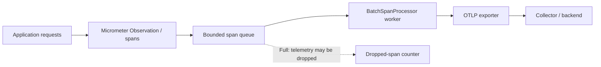

# Queue của exporter trong observability

Một ứng dụng Spring Boot tạo nhiều spans khi traffic tăng đột biến. Exporter gửi telemetry tới Collector qua mạng, nhưng Collector chậm hoặc tạm unavailable. Nếu ứng dụng gửi từng span đồng bộ ngay trong request path, latency của business request có thể tăng và lỗi telemetry có thể ảnh hưởng ứng dụng. Vì vậy, tracing SDK thường dùng **queue có giới hạn** để tách việc tạo spans khỏi việc export. Queue hấp thụ burst ngắn, còn worker nền gom batch và gửi dữ liệu tới exporter.

Queue không phải nơi lưu trữ bền vững. Khi queue đầy, SDK thường phải drop telemetry mới hoặc áp dụng hành vi được cấu hình; không thể giả định mọi span sẽ được giữ cho tới khi backend phục hồi. Thiết kế queue cần cân bằng throughput, memory, export latency và mức telemetry có thể chấp nhận mất trong sự cố.

Bài **Queue của exporter** thuộc chương **Hiệu năng observability** của module **SPRING_BOOT_OBSERVABILITY**. Module tập trung thiết lập observability cho Spring Boot bằng Micrometer Observation, metrics, logs và distributed tracing; học context propagation, tag/cardinality, exporter, sampling và liên kết tín hiệu để điều tra lỗi, độ trễ và hành vi ứng dụng trên môi trường thực.

## 1. Mục tiêu học tập

Sau bài học, bạn có thể:

- Giải thích vì sao exporter dùng queue và batch processing.
- Phân biệt queue của tracing span processor với metrics push/export pipeline.
- Hiểu OpenTelemetry BatchSpanProcessor và các tham số queue/batch/timeout.
- Ước lượng queue capacity theo span production rate và thời gian exporter bị chậm.
- Nhận biết queue saturation, dropped spans và export failures.
- Theo dõi queue utilization, export latency và exporter errors.
- Chọn sampling và batch settings phù hợp với traffic/SLO.
- Thiết kế ứng phó khi Collector hoặc backend unavailable.

## 2. Vì sao cần queue trước exporter?

Observation/tracing instrumentation tạo telemetry ngay trong application execution. Exporter serialize và gửi telemetry tới Collector hoặc backend. Hai tốc độ này không luôn bằng nhau: application có thể tạo hàng nghìn spans mỗi giây, trong khi exporter/network có throughput thấp hơn; Collector có thể restart, throttle hoặc trả lỗi; DNS, TLS, connection establishment hoặc remote storage có thể làm export chậm.

Queue tách producer (thread tạo spans) khỏi consumer (export worker):



Khi exporter tạm chậm, queue tích lũy spans đã kết thúc. Khi exporter phục hồi, worker gửi batch để giảm overhead per request. Nếu tốc độ tạo spans cao hơn tốc độ export trong thời gian đủ dài, queue sẽ đầy.

## 3. Queue có giới hạn, không phải durable buffer

Queue trong process thường giữ object telemetry trong memory. Nó bounded để tránh memory tăng không kiểm soát, volatile nên process restart/crash có thể làm mất items chưa export, asynchronous để application thread thường không chờ remote export, và lossy under pressure vì SDK có thể drop spans khi queue đầy.

Không dùng queue này làm message broker hoặc durable event store. Nếu yêu cầu nghiệp vụ cần bảo đảm sự kiện không mất, hãy dùng transactional messaging/outbox hoặc durable pipeline riêng; tracing telemetry thường chấp nhận sampling/drop có kiểm soát.

| Trạng thái | Ý nghĩa |
| --- | --- |
| Span được tạo | Instrumentation bắt đầu theo dõi operation |
| Span được kết thúc | Span sẵn sàng được processor xử lý |
| Span được enqueue | Span chờ export trong queue |
| Batch được export | Exporter gửi một batch tới Collector |
| Collector nhận | Collector nhận request; chưa nhất thiết backend đã lưu bền vững |
| Backend lưu/query được | Telemetry có thể được tìm kiếm theo backend semantics |

Không xem span đã enqueue là span đã được export, và không xem HTTP 200 từ Collector là bằng chứng mọi downstream storage đã lưu thành công.

## 4. OpenTelemetry BatchSpanProcessor

Trong OpenTelemetry Java SDK, BatchSpanProcessor là processor phổ biến để export spans theo batch. Nó nhận spans đã kết thúc, đưa vào queue bounded và có worker export theo chu kỳ hoặc khi batch đủ lớn.

| Tham số | Ý nghĩa |
| --- | --- |
| maxQueueSize | Số spans tối đa chờ trong queue |
| maxExportBatchSize | Số spans tối đa trong một lần export |
| scheduleDelay | Khoảng thời gian worker chờ trước khi export batch chưa đầy |
| exportTimeout | Thời gian tối đa dành cho một lần export |

Tên builder methods/API có thể thay đổi theo OpenTelemetry SDK version. maxExportBatchSize không nên lớn hơn maxQueueSize. Batch size lớn có thể tăng throughput nhờ giảm request overhead, nhưng cũng tăng memory per export, payload size và latency chờ gom batch. Batch nhỏ giảm thời gian chờ nhưng có thể làm tăng số lần gửi.

Queue size là khả năng hấp thụ burst, không phải tốc độ export. Tăng queue chỉ trì hoãn thời điểm đầy nếu throughput dài hạn vẫn thấp hơn tốc độ tạo spans.

## 5. Cấu hình minh họa cho OpenTelemetry SDK

Nếu ứng dụng tự cấu hình OpenTelemetry SDK, có thể xây dựng BatchSpanProcessor với queue/batch settings:

```java
SpanExporter exporter = OtlpGrpcSpanExporter.builder()
    .setEndpoint("http://otel-collector:4317")
    .setTimeout(Duration.ofSeconds(5))
    .build();

SpanProcessor processor = BatchSpanProcessor.builder(exporter)
    .setMaxQueueSize(4096)
    .setMaxExportBatchSize(512)
    .setScheduleDelay(Duration.ofSeconds(2))
    .setExporterTimeout(Duration.ofSeconds(10))
    .build();

SdkTracerProvider tracerProvider = SdkTracerProvider.builder()
    .addSpanProcessor(processor)
    .build();
```

Đây là ví dụ SDK-level để minh họa processor settings. Kiểm tra imports và builder API đúng OpenTelemetry version; tên exporter builder và timeout method có thể khác theo release. Nếu Spring Boot auto-configure tracing SDK, không tạo thêm một SDK độc lập nếu không có chủ đích, vì có thể tạo hai pipelines hoặc spans không đi qua cùng registry.

### Spring Boot và Micrometer Tracing

Trong ứng dụng Spring Boot, Micrometer Tracing bridge có thể kết nối Micrometer Observation với Brave hoặc OpenTelemetry. OTLP exporter và SDK properties được cấu hình theo Spring Boot/Micrometer version và dependency set. Queue settings của OpenTelemetry SDK có thể cần customizer/SDK customization thay vì một property chung áp dụng cho mọi version.

Đừng giả định properties của OTel Java agent, OpenTelemetry SDK tự cấu hình và Spring Boot Actuator có cùng namespace. Xác định thành phần nào đang sở hữu SDK trước khi thay đổi queue.

## 6. Queue sizing: ước lượng theo tốc độ và thời gian gián đoạn

Một ước lượng đầu tiên cho queue capacity:

\[
Q \approx R \times T
\]

Trong đó Q là số spans cần buffer, R là tốc độ spans sau sampling (spans/giây), T là khoảng thời gian exporter không theo kịp (giây).

Ví dụ ứng dụng tạo 800 spans/giây sau sampling và muốn hấp thụ 5 giây exporter slowdown:

\[
Q \approx 800 \times 5 = 4000 \text{ spans}
\]

Đây là sizing ban đầu, chưa tính burst, safety margin, span size và concurrent export. Nếu mỗi span giữ nhiều attributes/events lớn, queue 4.000 spans có thể chiếm memory đáng kể.

### Tính throughput dài hạn

Queue chỉ ổn định nếu export throughput trung bình đủ lớn so với span arrival rate:

\[
\text{Export throughput} > \text{Span arrival rate}
\]

Nếu ứng dụng tạo 1.000 spans/giây nhưng exporter chỉ gửi được 700 spans/giây, queue sẽ tăng khoảng 300 spans/giây cho tới khi đầy. Tăng queue size không sửa được chênh lệch throughput dài hạn.

### Span size cũng quan trọng

Số lượng spans không mô tả đủ memory usage. Span có nhiều attributes, events, links hoặc stacktrace có thể lớn hơn nhiều span đơn giản. Hạn chế payload/attributes không cần thiết và không đưa request body vào spans.

## 7. Batch delay, export timeout và retry

- **Schedule delay:** ảnh hưởng thời gian chờ để gom batch khi queue chưa đầy.
- **Export timeout:** giới hạn thời gian một export attempt được phép chạy.
- **Retry:** cách exporter/Collector xử lý lỗi và gửi lại, tùy exporter implementation/protocol.

Không phải mọi SDK exporter đều tự retry giống nhau hoặc retry vô hạn. Một số exporter có retry/backoff theo protocol/configuration; processor queue vẫn bị giới hạn. Đọc tài liệu exporter cụ thể và theo dõi dropped telemetry thay vì giả định retry sẽ giữ mọi spans.

Nếu timeout quá dài, worker có thể bị giữ lâu trong export call và queue dễ đầy. Timeout quá ngắn có thể tạo failures giả khi network có latency bình thường. Chọn timeout theo network SLO và Collector capacity.

## 8. Khi queue đầy thì điều gì xảy ra?

Với bounded batch span processor, khi queue không còn chỗ, span mới có thể bị drop. Application request thường vẫn tiếp tục vì telemetry export được tách khỏi business execution, nhưng trace completeness giảm.

Hậu quả:

- Trace có thể thiếu spans ở thời điểm tải cao.
- Root/parent spans có thể còn trong khi child spans bị drop.
- Debugging incident khó hơn vì telemetry bị mất đúng lúc cần nhất.
- Tăng queue có thể tăng memory pressure và GC.

Đây là trade-off cần theo dõi. Không cố lưu mọi span bằng queue cực lớn nếu process memory không đủ; sampling và export capacity cần được thiết kế cùng nhau.

## 9. Metrics và logs để theo dõi exporter queue

Các metrics hữu ích tùy SDK/exporter version có thể gồm:

| Metric concept | Ý nghĩa |
| --- | --- |
| Queue size / utilization | Số spans đang chờ và tỷ lệ sử dụng capacity |
| Queue capacity | Giới hạn queue |
| Dropped spans | Số spans bị bỏ vì queue đầy hoặc processor shutdown |
| Export batch size | Số spans mỗi batch |
| Export duration | Thời gian một batch export |
| Export failures | Số lần exporter trả lỗi |
| Export timeout | Số lần vượt export timeout |

Tên metric thực tế phụ thuộc OTel SDK version và instrumentation/exporter. Xác minh qua MeterRegistry/Actuator hoặc telemetry của SDK thay vì tự đặt tên giả định.

### Alert theo xu hướng, không chỉ một ngưỡng

Một queue tăng ngắn hạn có thể bình thường trong burst. Alert hữu ích nên kết hợp queue utilization duy trì cao, dropped spans tăng, export failures/timeouts tăng, export throughput thấp hơn span arrival rate và Collector receiver/exporter queue có dấu hiệu bão hòa.

Nếu chỉ alert khi queue đạt 100%, đội vận hành có thể nhận cảnh báo sau khi spans đã bị drop. Dùng warning threshold thấp hơn và quan sát trend.

## 10. Queue của tracing khác metrics export pipeline

Không phải mọi telemetry signal đều đi qua cùng một queue:

| Signal | Cách xử lý thường gặp | Điều cần phân biệt |
| --- | --- | --- |
| Traces | Span processor queue, batch span exporter | Queue giữ ended spans chờ export |
| Metrics pull | Registry lưu aggregations; Prometheus scrape đọc snapshot | Không nhất thiết có per-measurement queue |
| Metrics push/OTLP | Meter registry export theo step/interval | Có chu kỳ push và aggregation state |
| Logs | Logging appender/OTel log processor có thể có queue riêng | Queue, batch và drop policy riêng |

Tăng BatchSpanProcessor.maxQueueSize không sửa queue của OTLP metrics exporter hoặc async logging appender. Khi mất metrics, điều tra metrics registry/exporter pipeline; khi mất logs, điều tra logging appender/processor.

## 11. Sampling và queue capacity

Sampling quyết định số spans được ghi nhận và đưa vào export pipeline. Nếu sampling giảm số spans, queue arrival rate cũng giảm. Tuy nhiên, sampling quá thấp có thể làm mất trace cần thiết để điều tra lỗi hiếm.

Kết hợp head sampling để kiểm soát lượng spans ngay từ đầu trace, parent-based sampling để giữ quyết định nhất quán qua service boundaries, tail sampling ở Collector nếu cần chọn trace dựa trên outcome/latency, và span attribute allow-list/giới hạn events để giảm payload size.

Tail sampling cần Collector giữ spans trong thời gian chờ quyết định; queue/memory pressure có thể chuyển sang Collector. Không coi tail sampling là miễn phí hoặc chỉ là thay đổi ở application exporter.

## 12. Shutdown và flush

Khi process shutdown, spans còn trong queue có thể chưa được export. SDK thường cung cấp shutdown/forceFlush semantics để cố gắng gửi telemetry còn lại trong giới hạn timeout.

Với Spring Boot, cần bảo đảm lifecycle của tracing SDK/exporter được đóng đúng cách. Nếu tự tạo SDK/processor, ứng dụng phải quản lý shutdown hooks và tránh đóng exporter quá sớm. Trong container orchestration, termination grace period phải đủ cho ứng dụng drain và flush telemetry cần thiết.

Không đặt flush timeout dài hơn toàn bộ termination grace period; platform có thể kill process trước khi export hoàn tất. Flush cũng không bảo đảm backend lưu bền vững nếu Collector/network đang lỗi.

## 13. Troubleshooting

| Triệu chứng | Nguyên nhân có thể | Hướng kiểm tra |
| --- | --- | --- |
| Queue utilization liên tục tăng | Span arrival rate cao hơn export throughput | So sánh rate tạo spans và rate export |
| Dropped spans tăng | Queue đầy hoặc processor không theo kịp | Kiểm tra queue size, batch size và Collector |
| Export timeout | Collector chậm, network/TLS/DNS hoặc timeout quá thấp | Đo export duration và kiểm tra connectivity |
| Export failures tăng | Endpoint sai, auth/TLS lỗi, Collector unavailable | Kiểm tra exporter logs và Collector receiver |
| Trace thiếu spans lúc peak traffic | Queue saturation hoặc sampling | Đối chiếu dropped counters và sampling rate |
| Memory/GC tăng sau khi tăng queue | Queue giữ nhiều/lớn span objects | Đánh giá span size, queue capacity và heap |
| Batch export quá nhỏ | Schedule delay ngắn hoặc traffic thấp | Xem batch size distribution và network overhead |
| Export latency tăng dù queue thấp | Collector/network xử lý chậm nhưng arrival rate chưa cao | Kiểm tra export duration và backend |
| Metrics vẫn có nhưng traces mất | Tracing exporter/processor pipeline lỗi | Điều tra BatchSpanProcessor riêng |
| Shutdown làm mất spans cuối | SDK không flush hoặc termination quá nhanh | Kiểm tra lifecycle, forceFlush và grace period |
| Tạo hai lần export | SDK/processor được cấu hình trùng | Kiểm tra auto-configuration và custom SDK |
| Tăng queue vẫn drop | Throughput dài hạn vẫn thấp hơn arrival rate | Tăng export capacity/giảm span rate, không chỉ queue |

### Checklist điều tra

1. Xác định pipeline đang dùng: OTel SDK, Java agent hay Spring Boot auto-configuration.
2. Đo spans/giây sau sampling.
3. Kiểm tra queue capacity, queue utilization và dropped spans.
4. Đo batch size, export duration, failures và timeouts.
5. Kiểm tra Collector receiver/exporter queues và backend health.
6. Xác nhận retry/backoff và endpoint/TLS/auth configuration.
7. Đánh giá span size, attributes/events và sampling policy.
8. Kiểm tra flush/shutdown behavior khi deploy hoặc restart.

## 14. Thực hành: xử lý exporter queue saturation

**Bối cảnh:** order-service tạo khoảng 800 spans/giây sau sampling. Khi Collector restart, exporter chậm khoảng 5 giây và dropped spans tăng. Nhóm cần chọn queue/batch settings và xác minh telemetry phục hồi.

### Phần A — Chuẩn bị

1. Xác định ai sở hữu OpenTelemetry SDK và BatchSpanProcessor.
2. Ghi lại queue size, batch size, schedule delay và export timeout hiện tại.
3. Bật metrics/logs cần thiết để theo dõi queue, dropped spans và export errors.
4. Ước lượng capacity sơ bộ: 800 × 5 = 4.000 spans, sau đó thêm safety margin phù hợp memory.
5. Xác nhận Collector endpoint, TLS/auth và resource limits.

### Phần B — Kiểm chứng

| Ca | Thao tác | Kết quả cần quan sát |
| --- | --- | --- |
| A — Normal | Gửi traffic ổn định | Queue thấp, export throughput theo kịp arrival rate |
| B — Collector delay | Tạm dừng Collector 5 giây | Queue tăng nhưng chưa đầy theo sizing |
| C — Recovery | Khôi phục Collector | Worker drain queue, export failures giảm |
| D — Saturation | Tạo tải vượt capacity có kiểm soát | Dropped spans tăng và được ghi nhận |
| E — Batch | Thay batch size | So sánh export duration, payload và throughput |
| F — Sampling | Giảm sampling trong test | Arrival rate/queue pressure giảm |
| G — Shutdown | Restart graceful | Processor flush phần queue còn lại trong timeout |
| H — Signal isolation | Kiểm tra metrics và logs riêng | Thay đổi span queue không làm nhầm pipeline khác |

### Phần C — Câu hỏi tự đánh giá

1. Vì sao exporter queue nên bounded?
2. Queue có thể hấp thụ burst nhưng vì sao không sửa throughput dài hạn?
3. maxQueueSize khác maxExportBatchSize như thế nào?
4. Schedule delay và export timeout tác động tới giai đoạn nào?
5. Khi queue đầy, vì sao business request vẫn có thể thành công nhưng trace bị thiếu?
6. Làm sao ước lượng queue capacity từ spans/giây và exporter downtime?
7. Vì sao span size ảnh hưởng memory dù queue count không đổi?
8. Sampling tác động queue arrival rate ra sao?
9. Vì sao tăng BatchSpanProcessor queue không sửa metrics/logs exporter queue?
10. Shutdown cần flush telemetry trong giới hạn nào?

## 15. Ghi nhớ

**Queue của exporter** tách việc tạo telemetry khỏi việc gửi dữ liệu tới Collector/backend. Với tracing, OpenTelemetry BatchSpanProcessor dùng bounded queue và batch worker để hấp thụ burst ngắn, giảm chi phí export theo từng span. Queue capacity, batch size, schedule delay và export timeout kiểm soát các phần khác nhau của pipeline.

Ước lượng queue từ span arrival rate và khoảng gián đoạn exporter, nhưng luôn tính memory theo span size và safety margin. Nếu export throughput dài hạn thấp hơn tốc độ tạo spans, queue sẽ đầy dù được tăng kích thước. Theo dõi queue utilization, dropped spans, export duration/failures và Collector health; kết hợp sampling để điều chỉnh span rate. Tracing, metrics và logs có pipeline/queue riêng, vì vậy phải điều tra đúng signal. Cuối cùng, quản lý flush/shutdown để giảm mất telemetry khi deploy, đồng thời nhớ queue trong process không phải durable storage.
