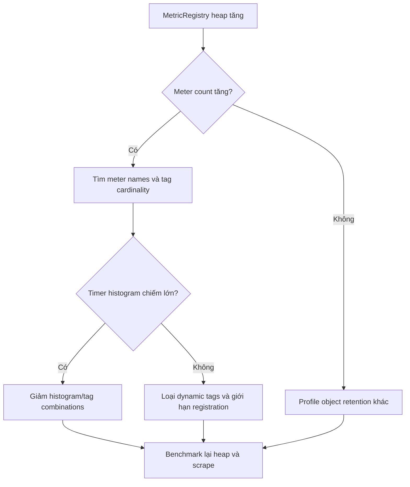

# Bộ nhớ của MetricRegistry trong Spring Boot

Micrometer lưu trữ các meter trong registry trước khi chúng được scrape hoặc export. Mỗi Counter, Timer, Gauge hay DistributionSummary cần metadata và state riêng; các tag combinations tạo ra những meter instances/time series độc lập. Vì vậy, **memory footprint của MetricRegistry phụ thuộc mạnh vào số lượng meter và cardinality**, không chỉ số lượng dòng code instrumentation.

Một ứng dụng có thể hoạt động ổn định với vài trăm meter, nhưng tăng heap đáng kể nếu mỗi request tạo một tag value mới như user ID, order ID hoặc URL đầy đủ. Registry thường giữ meter đã đăng ký trong suốt vòng đời ứng dụng; request kết thúc không có nghĩa meter tương ứng được giải phóng.

Bài **“Metric registry memory”** thuộc chương **Hiệu năng observability** của module **SPRING_BOOT_OBSERVABILITY**. Module hướng dẫn thiết lập observability cho Spring Boot bằng Micrometer Observation, metrics, logs và distributed tracing; học propagation ngữ cảnh, tag/cardinality, exporter, sampling và liên kết tín hiệu để điều tra lỗi, độ trễ và hành vi ứng dụng trên môi trường thực.

## 1. MeterRegistry lưu những gì?

MeterRegistry quản lý meter theo identity được tạo từ tên, tags và loại meter. Mỗi meter có thể chứa tên và metadata như description/base unit, tag keys/values, state như counter value hoặc timer accumulators, histogram buckets/percentile state nếu được bật, cùng references và cấu trúc hỗ trợ lookup/export.

Một registry có nhiều meter khác nhau dù chúng cùng tên nếu tag values khác nhau. Ví dụ:

```text
http.server.requests{method="GET",status="200",uri="/orders"}
http.server.requests{method="GET",status="500",uri="/orders"}
http.server.requests{method="POST",status="200",uri="/orders"}
```

Đây là ba meter identities riêng. Khi thêm tag user ID, mỗi user có thể tạo thêm một identity.

Không có một con số bytes cố định cho mỗi meter áp dụng mọi ứng dụng. Memory phụ thuộc Micrometer version, registry implementation, tag count/length, meter type, histogram configuration và JVM.

## 2. Cardinality là yếu tố tăng memory nhanh nhất

Cardinality là số tổ hợp giá trị tag khác nhau của một meter. Nếu metric có ba tags:

- method: 4 values.
- status: 6 values.
- region: 5 values.

Số tổ hợp tối đa theo lý thuyết là:

\[
4 \times 6 \times 5 = 120
\]

Nếu thêm user ID với 100.000 values, giới hạn lý thuyết trở thành 12 triệu tổ hợp. Không phải mọi tổ hợp đều xuất hiện, nhưng chỉ cần một tag gần như unique là series count có thể tăng rất nhanh.

Ví dụ nguy hiểm:

```java
registry.counter(
        "orders.processed",
        "order.id", orderId
).increment();
```

Mỗi order ID có thể tạo meter riêng. Thay bằng dimension hữu hạn:

```java
registry.counter(
        "orders.processed",
        "channel", channel,
        "outcome", outcome
).increment();
```

Dùng enum/allowlist cho tag values như web, mobile, success, failure. Không dùng user ID, order ID, email, trace ID, request ID, raw URL hoặc exception message làm metric tags.

## 3. Vì sao meter không tự biến mất sau request?

MeterRegistry thường giữ meter đã đăng ký để các lần record tiếp theo dùng lại cùng identity. Ví dụ request đầu tiên tạo Counter cho customer ID 123; khi request kết thúc, registry vẫn giữ Counter đó. Request tiếp theo với customer khác có thể đăng ký meter khác.

Đây là hành vi cần thiết cho aggregation, nhưng cũng có nghĩa dynamic tags tạo memory growth tích lũy.

Không dùng meter registration như object per-request. Tránh pattern:

```java
public void process(String tenantId) {
    registry.counter("job.processed", "tenant", tenantId).increment();
}
```

Nếu tenantId có hàng chục nghìn giá trị, registry có thể giữ số meter tương ứng. Thay bằng metric không có tenant tag, hoặc nhóm tenant vào một số category được quản lý.

## 4. Ước lượng số meter từ tag dimensions

Một cách dự báo sơ bộ là nhân số giá trị có thể có của từng tag.

| Tag | Số giá trị |
| --- | ---: |
| method | 5 |
| status | 6 |
| outcome | 4 |
| region | 3 |
| Tổng tổ hợp tối đa | 360 |

Nếu meter là Timer có histogram buckets, mỗi identity còn tạo thêm distribution state/bucket data tùy implementation. Do đó, 360 Timer identities có thể đắt hơn 360 Counter identities.

Ước lượng này không thay thế measurement. Filters có thể loại một số combinations; một số registry export nhiều series cho một meter (ví dụ histogram buckets/sum/count). Cần phân biệt số meter trong process với số time series backend nhìn thấy.

## 5. Timer và histogram làm footprint lớn hơn

Counter thường giữ một giá trị tích lũy. Timer còn ghi nhận count và total time; tùy implementation/configuration, có thể có max, histogram buckets, percentile accumulators và rolling window state.

Histogram buckets làm tăng số series export và memory cho distribution state. Nếu bật histogram trên meter có cardinality cao, chi phí nhân lên theo cả số identities và số buckets.

Ví dụ một Timer có 100 tag combinations và 20 histogram buckets có thể tạo dữ liệu bucket tương ứng với mỗi combination, ngoài count/sum và các series liên quan. Số series chính xác tùy registry/backend convention.

Nguyên tắc:

- Chỉ bật histogram cho latency metrics có mục tiêu SLO rõ.
- Chọn bucket boundaries phù hợp latency range.
- Không bật percentile histogram toàn cục khi chưa đánh giá cardinality.
- Giảm tag dimensions trước khi tăng bucket resolution.
- So sánh memory/series count trước và sau thay đổi.

## 6. Gauge và object references

Gauge thường quan sát một object hoặc giá trị được cung cấp bởi object. Cách đăng ký gauge có thể giữ reference tới object được quan sát tùy overload/API và implementation.

Nếu đăng ký gauge cho mỗi request hoặc object có vòng đời ngắn, registry có thể giữ nhiều meter/reference hơn dự kiến. Tránh tạo gauge động theo từng entity.

Ví dụ phù hợp là một gauge cho queue depth hoặc cache size:

```java
Gauge.builder("worker.queue.size", queue, Queue::size)
        .register(registry);
```

Đăng ký một lần cho resource ổn định. Không tạo gauge mới cho từng queue item hoặc request. Kiểm tra lifecycle của object được gauge tham chiếu để tránh memory retention không mong muốn.

## 7. Naming và tag design

Metric identity cần ổn định theo thời gian. Không encode giá trị động vào tên meter:

```text
orders.customer.123.processed
orders.customer.456.processed
```

Dùng một meter name và tags có kiểm soát:

```text
orders.processed{channel="web"}
orders.processed{channel="mobile"}
```

Tag keys nên mô tả dimension có ý nghĩa, tag values nên hữu hạn. Dùng logical service/dependency name thay hostname động hoặc IP ephemeral. Với HTTP metrics, ưu tiên route template như /orders/{id} thay path chứa từng ID.

Trước khi thêm tag, hãy hỏi:

1. Giá trị có tập hữu hạn không?
2. Có thể thay đổi theo từng request/user/entity không?
3. Có thực sự cần filter/group dashboard theo dimension này không?
4. Có thể suy ra từ logs/traces thay vì metrics không?
5. Số tổ hợp tối đa dự kiến là bao nhiêu?

## 8. MeterFilter để giới hạn registry

Micrometer hỗ trợ MeterFilter để điều chỉnh hoặc loại meter khi đăng ký. Có thể dùng filter để deny meter names, giới hạn số meters hoặc chuẩn hóa metadata theo policy.

Ví dụ deny một metric không còn được dùng:

```java
@Bean
MeterRegistryCustomizer<MeterRegistry> meterPolicy() {
    return registry -> registry.config()
            .meterFilter(MeterFilter.denyNameStartsWith("legacy.debug"));
}
```

Filter cần được cấu hình sớm trước khi meters được đăng ký để policy có tác dụng nhất quán. Một filter deny không thay thế việc sửa instrumentation tạo high-cardinality tags; nó chỉ là lớp kiểm soát bổ sung.

Một số filter có thể giới hạn maximum allowable tags/values tùy API/version. Kiểm tra semantics: filter có thể reject meter mới sau ngưỡng, khiến metric bị thiếu. Cần alert/test để nhận biết việc meter registration bị từ chối.

## 9. Registry memory và backend time series không giống nhau

Có hai nơi lưu trữ khác nhau:

- **In-process registry:** meter objects và recording state nằm trong heap ứng dụng.
- **Backend time-series database:** series đã scrape/export, index, labels, samples và retention data.

Giảm registry memory thường giúp giảm số meters/recording state; giảm backend storage còn phụ thuộc scrape interval, retention, compression và backend indexing.

Một meter có thể export thành nhiều time series. Ví dụ Timer histogram có bucket series, sum/count và có thể có percentile series. Vì vậy, không dùng meter count trong JVM để dự đoán trực tiếp backend series count.

## 10. Export và scrape cũng tạo chi phí

Khi Prometheus scrape hoặc registry push export, hệ thống cần duyệt meters, snapshot/format measurements và serialize output. Nhiều meters làm tăng CPU khi scrape/export, response payload size, network bytes, Collector/backend ingest rate và query/indexing cost.

Nếu scrape interval quá ngắn và registry có hàng trăm nghìn series, export có thể tạo tải đáng kể. Cân bằng scrape frequency với freshness/SLO và capacity.

Không giải quyết scrape latency bằng cách tăng timeout vô hạn. Trước tiên giảm meter count/cardinality, kiểm tra histogram và chia nhỏ scrape targets nếu kiến trúc yêu cầu.

## 11. Phân biệt memory leak và cardinality growth

Heap tăng không tự động có nghĩa memory leak. Registry có thể tăng dần vì meter identities mới được tạo liên tục; đây là cardinality growth có thể quan sát được.

| Dấu hiệu | Cardinality growth | Memory leak khác |
| --- | --- | --- |
| Meter count | Tăng theo thời gian | Có thể ổn định |
| Tag values | Xuất hiện giá trị mới liên tục | Không nhất thiết thay đổi |
| Heap dominator | Nhiều meter/tag/registry objects | Object graph khác giữ references |
| Reproduce | Gửi nhiều IDs/tenant values làm count tăng | Có thể phụ thuộc lifecycle khác |
| Khắc phục | Giảm dynamic tags, giới hạn meters | Sửa object retention/resource lifecycle |

Dùng heap dump/profiler để xem dominator tree và object histogram. Nếu nhiều object thuộc MeterRegistry/Meter/Tag/Timer distribution, kiểm tra cardinality trước khi tìm leak ở business objects.

## 12. Theo dõi meter count và registry behavior

Có thể kiểm tra số meters từ registry trong test/diagnostics:

```java
int meterCount = registry.getMeters().size();
```

Đây là số meter objects trong registry tại thời điểm đọc, không phải số backend series. Không gọi getMeters() liên tục trong hot path chỉ để monitoring; enumeration có thể tốn CPU và tạo overhead.

Có thể quan sát meter count trong test hoặc periodic diagnostic job có tần suất thấp. Với production, ưu tiên diagnostics sẵn có của registry/exporter và kiểm tra version-specific support.

## 13. Sizing và budget cho metric registry

Không có một giới hạn meter count chung cho mọi ứng dụng. Budget cần dựa trên heap, meter types, tags, histogram configuration, throughput và scrape/export frequency.

Quy trình sizing:

1. Đo baseline heap và registry meter count khi startup.
2. Tạo workload đại diện có tag distributions thực tế.
3. Đo meter count sau mỗi giai đoạn tải.
4. Kiểm tra histogram-enabled meters riêng.
5. Profile heap để xác định retained size của registry.
6. Đo CPU/latency khi scrape/export.
7. Đặt budget meter/series theo capacity và backend quota.
8. Cảnh báo khi meter count tăng bất thường hoặc series count vượt budget.

Budget nội bộ cần lấy từ load test và heap measurements của chính ứng dụng, không sao chép một ngưỡng phổ quát.

## 14. Kiểm thử cardinality và memory

Một test có thể mô phỏng dynamic tag values trong registry cô lập:

```java
SimpleMeterRegistry registry = new SimpleMeterRegistry();

for (int i = 0; i < 10_000; i++) {
    registry.counter(
            "orders.processed",
            "order.id",
            "order-" + i
    ).increment();
}

assertThat(registry.getMeters()).hasSize(10_000);
```

Test này minh họa rằng mỗi tag value mới có thể tạo một meter identity. Không dùng nó trên production registry. Thêm test đối chứng với finite tag values:

```java
SimpleMeterRegistry registry = new SimpleMeterRegistry();

for (int i = 0; i < 10_000; i++) {
    registry.counter(
            "orders.processed",
            "outcome",
            i % 2 == 0 ? "success" : "failure"
    ).increment();
}

assertThat(registry.getMeters()).hasSize(2);
```

Số lượng thực tế phụ thuộc cách test khởi tạo và meter identity; mục tiêu là xác minh finite tags tái sử dụng meter thay vì tạo một meter cho mỗi entity.

Để benchmark memory, dùng forked JVM/load test và heap profiling; không suy retained bytes bằng cách nhân meter count với một hằng số tùy ý.

## 15. Chẩn đoán registry memory cao

| Triệu chứng | Nguyên nhân có thể | Cách kiểm tra |
| --- | --- | --- |
| Heap tăng cùng traffic | Dynamic tag values tạo meters mới | Theo dõi meter count và tag values |
| Timer chiếm nhiều heap | Histogram/percentiles trên nhiều identities | Kiểm tra distribution config |
| Registry count tăng liên tục | Meter registration per request/entity | Tìm code gọi registry với IDs động |
| Scrape response lớn | Nhiều meters/buckets/tags | Đo payload size và series count |
| CPU scrape cao | Registry enumeration và serialization | Profile scrape path |
| Backend series tăng nhưng meter count ổn | Một meter export thành nhiều series | Kiểm tra histogram/registry mapping |
| Gauge giữ object lớn | Reference lifecycle không phù hợp | Heap dominator/reference analysis |
| Meter bị thiếu sau filter | MeterFilter reject registration | Kiểm tra filter và registration logs |
| Memory không giảm sau traffic giảm | Registry giữ meters đã đăng ký | Cardinality identities không tự expire |

Quy trình điều tra:

1. Lấy heap baseline và meter count.
2. Xác định meter names có nhiều identities nhất.
3. Phân tích tag values để tìm dimension gần unique.
4. Kiểm tra Timer/histogram và Gauge references.
5. So sánh meter count với backend series count.
6. Profile retained heap của registry.
7. Sửa instrumentation/tag design và thêm MeterFilter guardrail.
8. Load test lại và theo dõi heap/series growth.



## 16. Bài thực hành: đo memory footprint của registry

Thực hiện trong local/test:

1. Tạo ứng dụng nhỏ có SimpleMeterRegistry hoặc registry test.
2. Đăng ký một Counter với hai finite tag values và ghi nhận meter count.
3. Đăng ký Counter theo 10.000 entity IDs trong registry cô lập; so sánh meter count.
4. Tạo Timer với histogram tắt rồi bật; so sánh heap/series output.
5. Đăng ký một Gauge cho resource ổn định và kiểm tra object lifecycle.
6. Thử MeterFilter deny/maximum tags theo API/version.
7. Chạy load test và lấy heap histogram/dominator tree.
8. Đo scrape response size và scrape duration.
9. Thay dynamic tags bằng allowlist; chạy lại cùng workload.
10. Đặt budget cảnh báo cho meter count và backend series.

Kết quả mong đợi: thấy quan hệ giữa tag cardinality, meter count, histogram state, heap footprint và export volume; biết phát hiện cardinality growth trước khi registry gây áp lực memory.

## 17. Câu hỏi tự kiểm tra

1. MeterRegistry lưu metadata và state nào?
2. Vì sao meter identity phụ thuộc tên và tags?
3. Cardinality của nhiều tag được ước lượng ra sao?
4. Vì sao meter không tự biến mất khi request kết thúc?
5. Timer histogram tốn thêm gì so với Counter?
6. Gauge có thể giữ reference tới object nào?
7. Registry meter count khác backend time-series count thế nào?
8. MeterFilter có thể bảo vệ registry ra sao và có giới hạn gì?
9. Vì sao scrape/export tốn CPU khi meter count lớn?
10. Làm sao phân biệt cardinality growth với memory leak?
11. Những tags nào không nên dùng trong metrics?
12. Làm sao benchmark retained heap của registry?
13. Vì sao không nên enumerate toàn bộ meters trong hot path?
14. Khi nào cần giảm histogram buckets thay vì tăng heap?
15. Làm sao đặt budget meter/series theo service capacity?

## Tài liệu tham khảo

- [Micrometer — Meter](https://docs.micrometer.io/micrometer/reference/concepts/meters.html): meter identity, registry và meter types.
- [Micrometer — Meter Filters](https://docs.micrometer.io/micrometer/reference/concepts/meter-filters.html): deny/accept filters và distribution configuration.
- [Micrometer — Counters](https://docs.micrometer.io/micrometer/reference/concepts/counters.html): Counter semantics.
- [Micrometer — Timers](https://docs.micrometer.io/micrometer/reference/concepts/timers.html): Timer, histogram và percentile behavior.
- [Spring Boot — Metrics](https://docs.spring.io/spring-boot/reference/actuator/metrics.html): MeterRegistry auto-configuration và registry customization.
- [Prometheus — Metric and label naming](https://prometheus.io/docs/practices/naming/): metric/label design và cardinality guidance.
- [Java Flight Recorder](https://docs.oracle.com/en/java/javase/21/jfapi/): profiling allocation, CPU và runtime behavior.

## Kết luận

**Memory của MetricRegistry tăng theo số meter identities và state mà mỗi meter cần giữ.** Dynamic tag values tạo meter mới và registry thường giữ chúng sau khi request kết thúc. Timer histograms, percentiles, nhiều tags và Gauge references có thể làm footprint tăng thêm; export/scrape cũng tốn CPU, memory và network.

Giữ metric tags trong allowlist hữu hạn, đặt histogram có chọn lọc, đăng ký meter ổn định thay vì theo từng request, dùng MeterFilter làm guardrail và đo heap bằng profiler. Phân biệt registry memory với backend series storage để chọn đúng biện pháp. Khi kiểm soát cardinality từ instrumentation, Spring Boot có thể duy trì metrics hữu ích mà không để registry tăng trưởng ngoài budget.

