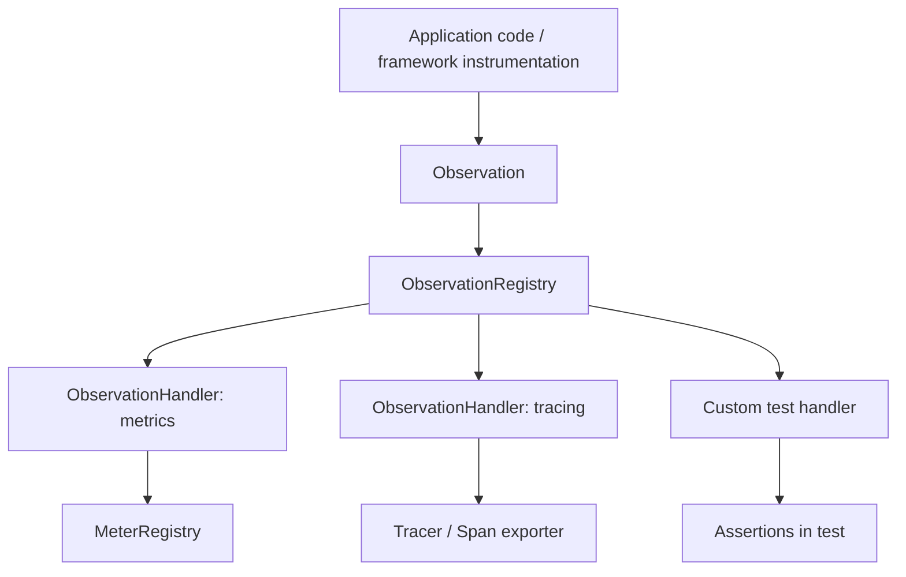

# Test ObservationRegistry trong Spring Boot

Một service Spring Boot có thể tạo observations cho HTTP requests, business methods, database calls và scheduled tasks. Khi thêm instrumentation, cần xác minh observation bắt đầu và kết thúc đúng lúc, mang đúng tên/context/key-values, ghi nhận exception, đồng thời được chuyển thành metrics hoặc spans theo cấu hình. Nếu chỉ kiểm tra endpoint trả HTTP 200, có thể bỏ sót trường hợp observation không được tạo, handler không chạy hoặc context bị mất qua async boundary.

**Test ObservationRegistry** là kiểm thử hành vi của registry và các handlers xử lý observation. Có thể dùng registry thật với test handlers, in-memory MeterRegistry hoặc test tracing exporter để quan sát lifecycle và dữ liệu phát sinh. Mục tiêu là xác minh application instrumentation tạo đúng telemetry ở đúng boundary, không phụ thuộc backend observability production.

Trong Micrometer, ObservationRegistry là điểm điều phối observation lifecycle. Observation được tạo từ API hoặc instrumentation tích hợp, sau đó handlers phù hợp nhận callbacks như start, scope opened/closed, error và stop. Test cần phân biệt registry có nhận observation với việc metrics/tracing exporter thực sự nhận được dữ liệu.

Bài học thuộc chương **Testing observability** của module **SPRING_BOOT_OBSERVABILITY**. Module hướng dẫn thiết lập observability cho Spring Boot bằng Micrometer Observation, metrics, logs và distributed tracing; học propagation ngữ cảnh, tag/cardinality, exporter, sampling và liên kết tín hiệu để điều tra lỗi, độ trễ và hành vi ứng dụng trên môi trường thực. Bài này tập trung vào cách kiểm thử ObservationRegistry, handlers, context, metrics và tracing trong ứng dụng Spring Boot.

## Mục tiêu học tập

1. Giải thích vai trò của ObservationRegistry trong Micrometer Observation.
2. Phân biệt registry, Observation, ObservationHandler và MeterRegistry.
3. Tạo test handler để ghi nhận observation lifecycle.
4. Kiểm tra tên observation, contextual name và key-values.
5. Xác minh exception/error và stop callbacks.
6. Kiểm thử metrics được tạo từ observation.
7. Kiểm thử tracing span, kind, parent và context propagation.
8. Dùng Spring Boot test để xác minh wiring trong application context.
9. Kiểm soát registry state và tránh test pollution.
10. Kiểm thử async/reactive boundaries và các trường hợp instrumentation bị thiếu.

## 1. ObservationRegistry trong kiến trúc observability

ObservationRegistry là nơi Observation được đăng ký và dispatch tới các handlers phù hợp. Một observation có thể tạo nhiều signal thông qua handlers: metrics handler ghi meter, tracing handler tạo span, hoặc custom handler ghi nhận event.



| Thành phần | Trách nhiệm | Điều cần test |
|---|---|---|
| Observation | Đại diện một operation lifecycle | Start/stop/error/context |
| ObservationRegistry | Điều phối observation tới handlers | Registry wiring và dispatch |
| ObservationHandler | Xử lý callbacks | Handler được gọi đúng lúc |
| MeterRegistry | Lưu metrics/meters | Meter name, tags, count, duration |
| Tracer/Span exporter | Tạo và xuất spans | Span name, kind, parent, status |
| ObservationConvention | Chuẩn hóa tên và key-values | Convention output/cardinality |

Một registry không tự tạo metrics hoặc spans nếu không có handlers tương ứng. Một test handler nhận callbacks cũng không chứng minh OTLP exporter hay production backend hoạt động.

## 2. Tạo registry cho unit test

Có thể tạo registry độc lập:

```java
ObservationRegistry registry = ObservationRegistry.create();
```

Sau đó tạo observation:

```java
Observation.createNotStarted("inventory.lookup", registry)
        .lowCardinalityKeyValue("operation", "lookup")
        .observe(() -> inventoryService.find("SKU-42"));
```

Registry độc lập giúp kiểm thử logic instrumentation mà không cần khởi động toàn bộ Spring context. Tuy nhiên, registry trống không tự có metrics/tracing handlers. Muốn assert callback, đăng ký test handler; muốn assert metrics, thêm metrics handler và MeterRegistry; muốn assert spans, cấu hình tracing handler/test exporter.

### 2.1. Registry mặc định và Noop behavior

Nếu code không nhận registry phù hợp hoặc dùng no-op observation path, business operation vẫn có thể chạy mà telemetry không được tạo. Test nên inject registry tường minh để xác minh instrumentation. Business method thành công không chứng minh registry đã hoạt động.

### 2.2. Dùng registry riêng cho từng test

Tạo registry mới trong mỗi test hoặc reset handlers/meters sau test. Registry dùng chung có thể giữ state, observations hoặc meters từ test trước và làm assertion phụ thuộc thứ tự chạy.

## 3. Viết test ObservationHandler

Test handler là cách trực tiếp để quan sát lifecycle. Có thể implement ObservationHandler cho context cụ thể hoặc dùng handler tổng quát phù hợp API Micrometer version.

Ví dụ handler đơn giản:

```java
class RecordingObservationHandler
        implements ObservationHandler<Observation.Context> {

    private final List<String> events = new ArrayList<>();

    @Override
    public boolean supportsContext(Observation.Context context) {
        return true;
    }

    @Override
    public void onStart(Observation.Context context) {
        events.add("start:" + context.getName());
    }

    @Override
    public void onStop(Observation.Context context) {
        events.add("stop:" + context.getName());
    }

    List<String> events() {
        return events;
    }
}
```

Đây là ví dụ minh họa; imports và API signatures cần đối chiếu Micrometer version. Test handler nên thread-safe nếu observation có thể chạy đồng thời.

Đăng ký handler:

```java
ObservationRegistry registry = ObservationRegistry.create();
RecordingObservationHandler handler =
        new RecordingObservationHandler();

registry.observationConfig().observationHandler(handler);
```

Thực thi operation:

```java
Observation.createNotStarted("inventory.lookup", registry)
        .observe(() -> "found");
```

Assertion có thể xác minh start và stop đều xảy ra theo thứ tự. Với nhiều handlers, không phụ thuộc thứ tự callback giữa handlers trừ khi API bảo đảm điều đó.

### 3.1. Test lifecycle

Các callback thường cần xác minh:
- onStart: observation bắt đầu.
- onScopeOpened / onScopeClosed: context được đưa vào và rời current scope.
- onError: operation gặp exception.
- onStop: lifecycle kết thúc.

Không phải handler nào cũng cần override mọi callback. Test theo contract của handler và API version đang dùng.

### 3.2. Test contextual name và key-values

Đọc context trong handler để xác minh observation name, contextual name, low-cardinality key-values và high-cardinality values. Low-cardinality values sẽ được đưa vào metrics; không đặt request ID, user ID hoặc raw URL vào nhóm này.

### 3.3. Test scope cleanup

Sau khi observation hoàn tất, current observation phải được khôi phục/clear theo scope lifecycle. Kiểm tra scope đóng kể cả khi callback ném exception để tránh context rò sang operation tiếp theo trên cùng thread.

## 4. Kiểm thử error handling

Observation cần phản ánh operation thất bại:

```java
RuntimeException expected =
        new IllegalStateException("inventory unavailable");

assertThrows(IllegalStateException.class, () ->
        Observation.createNotStarted("inventory.lookup", registry)
                .observe(() -> {
                    throw expected;
                }));
```

Test handler có thể lưu exception từ onError và xác nhận onStop vẫn được gọi theo lifecycle. Kiểm tra exception class/status; tránh export message có dữ liệu nhạy cảm.

### 4.1. Exception được catch bên trong operation

Nếu code bắt exception rồi trả kết quả fallback, observation có thể kết thúc bình thường. Đây có thể là semantics đúng nếu operation thành công theo contract fallback. Nếu muốn phân biệt degraded/fallback outcome, thêm key-value có tập giá trị giới hạn hoặc custom event.

### 4.2. Error không bị ghi hai lần

Nhiều layer có thể log cùng exception. Xác định boundary nào chịu trách nhiệm ghi error và tránh một lỗi được ghi ở controller, service, repository và global handler với payload lặp lại không cần thiết.

## 5. Kiểm thử metrics từ Observation

Để test metrics, kết hợp ObservationRegistry với MeterRegistry và metrics observation handler phù hợp. Micrometer cung cấp handler chuyển observation thành timer/counter tùy convention và configuration.

Ví dụ cấu hình test:

```java
SimpleMeterRegistry meterRegistry = new SimpleMeterRegistry();
ObservationRegistry registry = ObservationRegistry.create();

registry.observationConfig().observationHandler(
        new DefaultMeterObservationHandler(meterRegistry));
```

Tên class/package và constructor phụ thuộc Micrometer version. Trong Spring Boot application, handler thường được auto-configure; integration test nên lấy registry đã inject thay vì tự đăng ký handler lần nữa.

Thực hiện observation:

```java
Observation.createNotStarted("inventory.lookup", registry)
        .lowCardinalityKeyValue("operation", "lookup")
        .observe(() -> inventoryService.find("SKU-42"));
```

Sau đó kiểm tra timer/meter theo convention thực tế. Meter name, suffix và tags có thể khác theo handler/registry; dùng meterRegistry.getMeters() hoặc tìm meter theo tên đã xác minh.

### 5.1. Assert count và duration

Với timer, xác minh count tăng một lần và total time lớn hơn hoặc bằng 0. Không assert duration bằng giá trị tuyệt đối chính xác vì scheduler/JVM timing thay đổi. Dùng range hợp lý hoặc chỉ assert timer được ghi.

### 5.2. Assert cardinality

Chạy operation với hai request IDs khác nhau nhưng cùng operation. Xác minh số time series không tăng theo request ID. Chỉ low-cardinality tags được đưa vào meter; high-cardinality values nên ở tracing context khi có nhu cầu.

### 5.3. Không nhầm meter name

Framework integration có thể dùng meter name riêng. Trước khi hard-code assertion, inspect meter registry trong test và xác nhận tên/tag keys theo dependency version. Tránh test mong đợi meter do custom handler tạo trong khi context đã có handler khác.

## 6. Kiểm thử tracing từ Observation

Tracing handler chuyển observation thành spans. Test có thể dùng in-memory span exporter hoặc test tracer để kiểm tra spans mà không cần collector/backend production.

Những thuộc tính nên xác minh:
- Span name và kind.
- Trace ID và span ID.
- Parent span relationship.
- Start/end timestamps.
- Status/error events.
- Attributes và instrumentation scope.
- Không có secret hoặc high-cardinality metric tags ngoài policy.

### 6.1. Root và child observations

Tạo parent observation rồi tạo child observation trong scope của parent. Xác minh child span thuộc cùng trace và parent span ID trỏ tới parent span. Nếu child chạy ngoài scope hoặc async context không được propagate, nó có thể trở thành root span mới.

### 6.2. Test propagation qua executor

Nếu operation chạy qua executor, test context propagation bằng cơ chế ứng dụng cấu hình, ví dụ Micrometer Context Propagation hoặc executor decorator phù hợp. Không chỉ assert ThreadLocal ở thread gốc; xác minh observation/trace context trong worker thread và cleanup sau completion.

### 6.3. Sampling và test expectations

Sampler có thể drop spans trước exporter. Nếu test muốn kiểm tra instrumentation tạo span, cấu hình sampler giữ toàn bộ traces trong test. Nếu test sampler behavior, viết test riêng cho sampling decision; không để sampling ngẫu nhiên làm test tracing chập chờn.

## 7. Kiểm thử ObservationConvention

ObservationConvention chuẩn hóa observation name và key-values. Test convention độc lập để xác minh name ổn định, contextual name dễ đọc và không chứa ID động, low-cardinality keys có tập giá trị giới hạn, high-cardinality fields không thành metric tags, missing/null values được xử lý theo contract.

Ví dụ convention ánh xạ operation type:

```java
class InventoryObservationConvention
        implements ObservationConvention<InventoryObservationContext> {

    @Override
    public boolean supportsContext(Observation.Context context) {
        return context instanceof InventoryObservationContext;
    }

    @Override
    public String getName() {
        return "inventory.operation";
    }

    @Override
    public KeyValues getLowCardinalityKeyValues(
            InventoryObservationContext context) {
        return KeyValues.of(
                KeyValue.of("operation", context.operation()));
    }
}
```

Đây là minh họa khái niệm; constructor/context types tùy codebase. Test với nhiều input để chắc convention không đưa SKU/customer ID vào low-cardinality tags.

## 8. Spring Boot integration test

Unit test registry không xác minh auto-configuration. Dùng Spring Boot test để kiểm tra application context đã cấu hình ObservationRegistry, handlers, MeterRegistry và tracer đúng.

Ví dụ:

```java
@SpringBootTest
class InventoryObservationIntegrationTest {

    @Autowired
    ObservationRegistry observationRegistry;

    @Autowired
    MeterRegistry meterRegistry;

    @Test
    void registryIsAvailable() {
        assertNotNull(observationRegistry);
        assertNotNull(meterRegistry);
    }
}
```

Dependencies/test configuration phải tương ứng Spring Boot version. Có registry bean không chứng minh mọi handler đã được gắn; thực hiện operation thật rồi assert meter/span output.

### 8.1. Tránh đăng ký handler trùng trong test

Nếu Boot đã auto-configure metrics observation handler, đăng ký thêm DefaultMeterObservationHandler có thể ghi duplicate meters. Kiểm tra handler wiring hoặc dùng test-specific registry/context thay vì thêm handler vào registry production trong test.

### 8.2. Test slice và full context

Test slice có thể không load tracing/Actuator auto-configuration đầy đủ. Dùng slice cho behavior nhỏ; dùng @SpringBootTest hoặc explicit imports khi cần xác minh end-to-end wiring. Ghi rõ test đang xác minh layer nào.

## 9. Test HTTP server và client observations

Với HTTP server, gửi request tới application test và xác minh server observation/span được tạo với method, route template và status phù hợp. Với HTTP client, gọi mock server và kiểm tra client observation, status/outcome và outbound trace headers.

Một test nên xác minh inbound request tạo đúng server boundary, outbound exchange tạo client span nếu client được instrument, client span có parent/current context đúng, downstream nhận trace context header, error/timeout được ghi theo convention và URI tags không chứa raw ID/query.

Không assert một số span cố định nếu test vô tình bật instrumentation khác như security/filter/agent. Xác định expected boundary và assert theo span name/kind/scope.

## 10. Test async và reactive observations

Observation scope thường gắn với execution context. Khi công việc chuyển sang thread khác hoặc reactive pipeline, cần bảo đảm context propagation theo integration đã chọn.

### 10.1. Executor

Test task chạy trên worker thread, kiểm tra current observation/trace context được chuyển qua và được dọn sau khi hoàn tất. Nếu không cần propagate, xác minh worker bắt đầu root operation độc lập theo thiết kế.

### 10.2. Reactor

Với WebFlux/Reactor, context có thể được lưu trong Reactor Context thay vì chỉ ThreadLocal. Test publisher được subscribe và terminal signal success/error/cancel. Tạo Mono/Flux mà không subscribe không đảm bảo observation được thực thi.

### 10.3. Cancellation

Kiểm tra cancellation đóng scope và kết thúc observation/span theo behavior của integration. Tránh chỉ cover success path vì cancellation có thể để lại task/resource đang chạy.

## 11. Test không rò dữ liệu nhạy cảm

Test telemetry cần negative assertions cho password/token/cookie. Tạo synthetic secret trong request và xác minh nó không xuất hiện trong logs, span attributes/events, baggage, metrics tags và exception messages được export.

Không dùng secret production trong test. Kiểm tra cả nested values và encoded forms nếu instrumentation có thể serialize payload.

## 12. Cô lập test và tránh flaky behavior

- Tạo ObservationRegistry/MeterRegistry riêng cho test cần isolation.
- Clear/reset state sau test nếu registry dùng chung.
- Không assert duration chính xác.
- Không phụ thuộc thứ tự callback giữa handlers nếu contract không bảo đảm.
- Dùng latches/futures với timeout hữu hạn cho async tests.
- Giữ sampling deterministic.
- Tắt agent hoặc bật agent nhất quán theo mục tiêu test.
- Không dùng Thread.sleep dài để đợi exporter; dùng flush/latch/test exporter.
- Tránh chạy tests song song nếu chúng sửa cùng shared registry/global tracer.

## 13. Chẩn đoán test ObservationRegistry thất bại

| Triệu chứng | Nguyên nhân có thể | Cách kiểm tra |
|---|---|---|
| Handler không nhận callback | Observation dùng registry khác | Kiểm tra registry injection |
| Có start nhưng thiếu stop | Operation lifecycle/scope bị bỏ dở | Exception/cancel path |
| Meter không xuất hiện | Thiếu metrics handler hoặc registry | Handler wiring và meter registry |
| Meter count gấp đôi | Handler đăng ký trùng hoặc duplicate instrumentation | Inspect registry handlers |
| Span không xuất hiện | Tracing handler/bridge/sampler | Tracer, sampler và exporter |
| Child span thành root | Context mất qua async boundary | Executor/Reactor propagation |
| Test không ổn định | Sampling hoặc timing nondeterministic | Sampler deterministic và latches |
| Annotation không hoạt động | AOP proxy/self-invocation | Bean proxy và invocation path |
| Meter tag chứa ID động | Convention dùng low-cardinality sai | Inspect KeyValues |
| Secret xuất hiện trong span | Attribute/header capture không an toàn | Span events/attributes và redaction |
| Integration test thiếu bean | Test slice không load auto-config | Test configuration/context |
| Span có nhưng backend không thấy | Exporter/collector pipeline | In-memory exporter vs OTLP test |

### Quy trình điều tra

1. Xác định test đang dùng registry nào.
2. Kiểm tra observation được tạo trên đúng registry.
3. Gắn recording handler để quan sát lifecycle.
4. Kiểm tra metrics handler và MeterRegistry.
5. Kiểm tra tracing bridge, sampler và test exporter.
6. Assert span kind/name/parent thay vì chỉ đếm tổng spans.
7. Kiểm tra async/reactive context và subscription.
8. Kiểm tra test slice có thiếu auto-configuration.
9. Kiểm tra handler/agent có đăng ký trùng.
10. Tìm synthetic secrets trong tất cả captured signals.

## 14. Các anti-pattern cần tránh

| Anti-pattern | Hậu quả | Cách phù hợp |
|---|---|---|
| Chỉ assert ObservationRegistry bean tồn tại | Không chứng minh handlers hoạt động | Chạy operation và assert signals |
| Dùng registry global cho mọi test | Test pollution/flaky | Registry riêng hoặc reset |
| Đăng ký metrics handler thêm vào Boot registry | Duplicate meters | Kiểm tra auto-configuration trước |
| Assert duration bằng số tuyệt đối | Test phụ thuộc scheduler/JVM | Assert count và duration range |
| Dùng sampler ngẫu nhiên trong test | Span assertions chập chờn | Sampler deterministic |
| Chỉ test success | Bỏ sót error/cancel lifecycle | Test failure và cancellation |
| Không test context propagation | Child spans có thể thành root | Executor/Reactor integration tests |
| Không subscribe WebClient/Mono | Operation không chạy | Kích hoạt publisher trong test |
| Test chỉ không có Java Agent | Bỏ sót production duplicate | Profile test với agent khi cần |
| Assert tổng span count đơn thuần | Dễ fail vì instrumentation hợp lệ khác | Assert kind/name/scope/parent |
| Dùng secret thật trong test | Rủi ro lộ dữ liệu | Synthetic credentials |
| Gọi OTLP backend trong mọi unit test | Test chậm và phụ thuộc hạ tầng | In-memory exporter; integration riêng |

## 15. Checklist kiểm thử observability

1. **Registry:** test xác định rõ registry được inject?
2. **Lifecycle:** start, scope, error và stop được xác minh?
3. **Context:** observation name/context/key-values đúng?
4. **Handlers:** metrics/tracing handlers được gắn đúng một lần?
5. **Metrics:** meter name, tags, count và duration được assert?
6. **Cardinality:** IDs động không thành low-cardinality tags?
7. **Tracing:** span name/kind/parent/status được assert?
8. **Propagation:** trace context qua HTTP/executor/reactive boundary?
9. **Errors:** exception và fallback outcomes đúng?
10. **Cancellation:** scope/resource được cleanup?
11. **AOP:** annotation/proxy path được kiểm tra?
12. **Security:** synthetic secrets không xuất hiện trong telemetry?
13. **Isolation:** registry/tracer state không rò giữa tests?
14. **Sampling:** test sampler deterministic?
15. **Auto-configuration:** integration tests xác minh wiring Spring Boot?
16. **Agent:** test phản ánh Java Agent nếu production dùng?
17. **Export:** in-memory tests và OTLP integration tests tách biệt?
18. **Flakiness:** async waits có timeout và không phụ thuộc sleep dài?

## 16. Câu hỏi tự đánh giá

**Câu 1.** ObservationRegistry có vai trò gì?

**Gợi ý:** Điều phối observation lifecycle tới các ObservationHandlers đã đăng ký.

**Câu 2.** Registry có tự tạo metrics và spans không?

**Gợi ý:** Không. Cần handlers tương ứng và các registry/tracer/exporter được cấu hình.

**Câu 3.** Test handler giúp xác minh điều gì?

**Gợi ý:** Callback start, scope, error, stop và context/key-values của observation.

**Câu 4.** Vì sao không nên chỉ assert registry bean tồn tại?

**Gợi ý:** Bean tồn tại không chứng minh observation được tạo hoặc handlers/export pipeline hoạt động.

**Câu 5.** Làm sao kiểm thử metrics từ observation?

**Gợi ý:** Dùng MeterRegistry in-memory và metrics observation handler; assert meter/tags/count/duration.

**Câu 6.** Làm sao kiểm thử tracing không cần backend?

**Gợi ý:** Dùng test tracer hoặc in-memory span exporter và assert span attributes/parent relationship.

**Câu 7.** Vì sao child span có thể thành root khi chạy async?

**Gợi ý:** Current context không được propagate qua executor/reactive boundary.

**Câu 8.** Vì sao cần sampler deterministic trong test?

**Gợi ý:** Tránh trace bị drop ngẫu nhiên làm assertions không ổn định.

**Câu 9.** Vì sao không đăng ký thêm metrics handler trong Spring Boot integration test tùy tiện?

**Gợi ý:** Boot có thể đã auto-configure handler, thêm lần nữa có thể ghi duplicate meters.

**Câu 10.** Cần xác minh gì khi test instrumentation production có Java Agent?

**Gợi ý:** Chạy smoke/integration test với agent tương đương production, kiểm tra spans/metrics theo boundary và duplicate instrumentation.

## Kết luận

**Kiểm thử ObservationRegistry phải xác minh hành vi của observation và handlers, không chỉ sự tồn tại của registry bean.** Dùng recording handler để kiểm tra lifecycle/context, in-memory MeterRegistry để assert metrics và test span exporter để xác minh tracing, parent relationship cùng propagation. Spring Boot integration tests cần xác nhận auto-configuration thật sự gắn đúng handlers; unit tests nên cô lập registry và dùng sampler/timing deterministic. Bao phủ error, cancellation, async/reactive boundaries và negative assertions cho secrets để bảo đảm telemetry được tạo đúng, có cardinality an toàn và không phụ thuộc backend production trong mỗi test.
