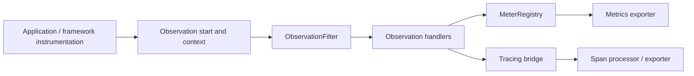

# Test ObservationFilter trong Spring Boot

**Test ObservationFilter** là việc kiểm chứng các bộ lọc metadata của Micrometer Observation hoạt động đúng trước khi observation được chuyển thành metrics, spans hoặc tín hiệu khác. ObservationFilter thường được dùng để chuẩn hóa hoặc bổ sung key-values, loại bỏ metadata không phù hợp và bảo vệ telemetry khỏi cardinality không kiểm soát hoặc dữ liệu nhạy cảm.

Trong module **SPRING_BOOT_OBSERVABILITY**, kiểm thử filter giúp bảo đảm policy metadata được áp dụng nhất quán cho observations do framework tạo và do ứng dụng tạo. Bài thuộc chương **Testing observability**, tập trung vào filter lifecycle, thứ tự xử lý, wiring vào ObservationRegistry, kiểm tra low/high-cardinality values, xác minh kết quả ở metrics/tracing handlers, regression tests và troubleshooting.

## 1. ObservationFilter làm gì?

Micrometer Observation có lifecycle và context mang các key-values mô tả operation. ObservationFilter cho phép điều chỉnh Observation.Context trước khi handlers xử lý context theo cơ chế của Micrometer.

Các use case thường gặp:
- Chuẩn hóa metadata để tránh nhiều cách viết cho cùng một dimension.
- Loại bỏ key-value không được phép.
- Bổ sung thông tin kỹ thuật có nguồn tin cậy.
- Giới hạn metadata được chuyển thành metrics hoặc tracing.
- Áp dụng policy chung cho observations từ nhiều instrumentation points.

Filter là một phần của instrumentation pipeline. Nó không thay thế authentication, authorization hoặc redaction tại ingress. Nếu PII đã được ghi vào logs hoặc gửi qua exporter khác trước filter, ObservationFilter không thể thu hồi bản sao đó.

### 1.1. Vị trí trong pipeline



Filter tác động lên context theo API và thời điểm mà Micrometer áp dụng. Không giả định nó thay đổi mọi metadata trong logs, baggage headers hoặc custom telemetry ngoài Observation pipeline.

## 2. Phân biệt ObservationFilter với convention và handler

| Thành phần | Trách nhiệm | Khi nên dùng |
| --- | --- | --- |
| ObservationConvention | Đặt tên và key-values ban đầu cho một loại observation | Chuẩn hóa metadata theo operation |
| ObservationFilter | Điều chỉnh Observation.Context theo policy chung | Filtering/normalization xuyên nhiều observations |
| ObservationHandler | Phản ứng với lifecycle start/stop/error | Ghi metrics, spans hoặc custom signal |
| MeterFilter | Điều chỉnh meters khi đăng ký vào MeterRegistry | Giới hạn meter names/tags ở metrics layer |
| Tracing processor | Xử lý spans trước export | Redaction/filter ở tracing pipeline |

Không dùng ObservationFilter để thay thế MeterFilter nếu policy chỉ dành cho metrics. Tương tự, filter context không bảo đảm mọi tracing SDK span attribute được tạo ngoài Micrometer đều bị lọc.

## 3. Cấu hình ObservationFilter vào registry

ObservationFilter cần được đăng ký với ObservationRegistry mà instrumentation thực sự sử dụng. Trong Spring Boot, registry thường do application context quản lý; cấu hình cụ thể phụ thuộc Spring Boot/Micrometer version.

Ví dụ filter đơn giản:

```java
@Bean
ObservationFilter normalizeObservationValues() {
    return context -> {
        String region = context.get("region");
        if (region != null) {
            context.addLowCardinalityKeyValue(
                    KeyValue.of("region", normalizeRegion(region)));
        }
        return context;
    };
}
```

Đoạn code minh họa ý tưởng; API truy xuất/thay đổi context và cách đăng ký bean cần khớp Micrometer version đang dùng. Xác nhận Spring Boot tự phát hiện ObservationFilter bean hay cần đăng ký tường minh vào registry.

### 3.1. Đăng ký trực tiếp với ObservationRegistry

Ở mức Micrometer, registry cung cấp cơ chế đăng ký filter. Ví dụ khái niệm:

```java
observationRegistry.observationConfig()
        .observationFilter(observationFilter);
```

Dùng đúng registry mà framework instrumentation và custom observations cùng sử dụng. Nếu filter được thêm vào registry khác, test trực tiếp filter có thể pass nhưng HTTP/database observations trong application không bị ảnh hưởng.

### 3.2. Tránh đăng ký hai lần

Nếu filter vừa được auto-configure vừa được thêm thủ công, policy có thể chạy nhiều lần. Với filter không idempotent, giá trị có thể bị biến đổi lặp hoặc tạo metadata không mong muốn. Kiểm tra wiring và thứ tự đăng ký.

## 4. Thiết kế policy có thể kiểm thử

Trước khi viết test, xác định rõ:
- Keys nào được phép.
- Keys nào phải xóa.
- Values nào phải chuẩn hóa.
- Key-values nào là low-cardinality.
- Có bổ sung metadata hay không và nguồn nào được tin cậy.
- Behavior khi value null, rỗng, quá dài hoặc không hợp lệ.
- Filter có được phép sửa context đã có hay chỉ bổ sung field mới.

Ví dụ policy:

| Key | Input | Expected |
| --- | --- | --- |
| region | ap-southeast | Giữ nguyên |
| region | AP-SOUTHEAST | Chuẩn hóa thành ap-southeast |
| region | unknown text | Loại bỏ hoặc map vào other |
| user.email | person@example.test | Xóa |
| authorization | Bearer token | Xóa |
| request.id | UUID | Không đưa vào metric tags |
| tenant-tier | enterprise | Giữ nếu nằm trong allowlist |
| arbitrary | value | Xóa nếu không nằm trong allowlist |

Policy phải nhất quán với ObservationConvention và handlers. Nếu filter chỉ xóa low-cardinality values nhưng giữ cùng PII ở high-cardinality values, telemetry vẫn có thể bị lộ.

## 5. Unit test cho filter

Unit test nên kiểm tra filter độc lập với Spring context để xác nhận policy cho từng input. Có thể tạo Observation.Context cụ thể, thêm key-values và áp dụng filter.

Ví dụ kiểm thử dạng pseudocode, cần điều chỉnh API context theo Micrometer version:

```java
@Test
void removesSensitiveValues() {
    Observation.Context context = new Observation.Context();
    context.addHighCardinalityKeyValue(
            KeyValue.of("user.email", "person@example.test"));
    context.addLowCardinalityKeyValue(
            KeyValue.of("region", "AP-SOUTHEAST"));

    Observation.Context filtered = filter.map(context);

    assertThat(filtered.getHighCardinalityKeyValues())
            .noneMatch(kv -> kv.getKey().equals("user.email"));
    assertThat(filtered.getLowCardinalityKeyValues())
            .anyMatch(kv -> kv.getKey().equals("region")
                    && kv.getValue().equals("ap-southeast"));
}
```

Đây là cấu trúc minh họa; ObservationFilter API có thể nhận/trả Observation.Context trực tiếp dưới dạng function. Viết assertion theo API getters có trong version thực tế.

### 5.1. Test cả low và high cardinality

Kiểm tra hai nhóm riêng:
- Low-cardinality key-values có thể đi vào metric tags.
- High-cardinality key-values có thể được đưa vào span attributes.

Không chỉ assert filter trả về object khác. Cần assert key/value bị cấm thực sự không còn trong context.

### 5.2. Test null, empty và malformed values

Bổ sung trường hợp:
- Value null hoặc blank.
- Value vượt giới hạn độ dài.
- Unicode/control characters không được phép.
- Key không nằm trong allowlist.
- Duplicate key.
- Value ngoài enum.

Filter nên có behavior xác định và không ném exception vì metadata không hợp lệ từ request.

## 6. Test registry wiring

Một unit test gọi filter trực tiếp không chứng minh filter đã được đăng ký vào ObservationRegistry mà Spring Boot sử dụng.

Tạo Spring context test và inject registry:

```java
@SpringBootTest
class ObservationFilterWiringTest {

    @Autowired
    ObservationRegistry observationRegistry;

    @Test
    void registryIsAvailable() {
        assertThat(observationRegistry).isNotNull();
    }
}
```

Test này chỉ xác nhận registry tồn tại. Để xác minh filter wiring, tạo observation qua registry, gắn metadata nhạy cảm/không hợp lệ và quan sát context mà test handler nhận được sau filter.

### 6.1. Test handler quan sát context cuối

Có thể đăng ký test ObservationHandler hoặc handler ghi nhận context tại lifecycle callback. Xác nhận handler nhận context đã được filter xử lý.

Thứ tự callback và thời điểm filter áp dụng phụ thuộc Micrometer lifecycle/version. Thiết kế test dựa trên contract thực tế của API đang dùng, không giả định mọi handler callback nhìn thấy cùng một snapshot.

## 7. Test metrics không nhận tag bị cấm

Nếu policy nhằm bảo vệ metrics cardinality, kiểm tra meter sau khi observation hoàn tất. Dùng SimpleMeterRegistry hoặc registry test tương ứng để xem tags thực tế.

Ví dụ ý tưởng:

```java
SimpleMeterRegistry registry = new SimpleMeterRegistry();

// Register the observation handlers used by the application.
// Create and stop an observation through the configured registry.

// Assert that the resulting meter has normalized tags
// and contains no user-specific or unbounded values.
```

Test cần xác minh:
- Tag region được chuẩn hóa.
- Không có email, user ID hoặc request ID.
- Số tag keys nằm trong policy.
- Không tạo meter riêng cho mỗi giá trị input.
- Timer/counter được tạo đúng tên và outcome.

Không chỉ kiểm tra Observation.Context; handler hoặc convention khác có thể bổ sung tags sau filter tùy pipeline/version.

## 8. Test tracing không nhận attribute bị cấm

Nếu filter nhằm bảo vệ span attributes, dùng in-memory/test span exporter hoặc test tracing handler để kiểm tra span đã kết thúc.

Xác minh:
- Span name ổn định.
- Low-cardinality metadata đã chuẩn hóa.
- High-cardinality metadata nhạy cảm đã bị loại.
- Trace ID/parent relationship vẫn nguyên vẹn.
- Error status và timing vẫn được ghi nhận.
- Không có PII trong span events hoặc exception attributes ngoài policy.

ObservationFilter chỉ lọc Observation.Context. Nếu code tạo span trực tiếp qua OpenTelemetry API, các attributes được thêm trực tiếp có thể không đi qua ObservationFilter. Cần test cả đường instrumentation đó và áp dụng tracing processor/redaction phù hợp.

## 9. Test filter với HTTP instrumentation

HTTP server observation thường được tạo bởi framework. Integration test nên gửi request qua embedded server hoặc WebTestClient/MockMvc phù hợp với application stack, sau đó xác minh telemetry.

Kiểm tra:
- Route template thay raw path ID.
- Method/status/outcome có giá trị ổn định.
- Header nhạy cảm không thành tags/attributes.
- Request URI/query string không bị đưa nguyên trạng vào metrics.
- Filter được áp dụng cho framework-created observations.

Nếu test chỉ gọi service method trực tiếp, nó không chứng minh HTTP instrumentation dùng cùng registry hoặc filter.

## 10. Test async và reactive observations

Với Reactor, context có thể đi qua thread/scheduler boundaries. Observation lifecycle có thể kết thúc khi publisher complete, error hoặc cancel. Test cần xác minh filter áp dụng cho context của observation và metadata không bị thêm lại trong callback.

Các trường hợp cần test:
- Mono success/error/cancel.
- Flux complete/cancel.
- Scheduler switch.
- Async callback/future completion.
- Context propagation qua WebClient hoặc messaging.
- Baggage riêng với Observation key-values.

Không nhầm ObservationFilter với propagator. Filter chỉnh observation context; W3C propagator quyết định trace context/baggage được inject vào carrier.

## 11. Test idempotency và filter order

Nếu nhiều filters cùng chạy, thứ tự có thể ảnh hưởng kết quả. Ví dụ filter A chuẩn hóa region, filter B chỉ allowlist values đã chuẩn hóa. Nếu B chạy trước A, giá trị uppercase có thể bị xóa thay vì chuẩn hóa.

Thiết kế filters để:
- Có thứ tự đăng ký rõ ràng.
- Ưu tiên idempotent transformations.
- Không ghi đè value từ nguồn tin cậy bằng input không tin cậy.
- Không tạo duplicate keys.
- Có test cho combination filters.
- Không phụ thuộc iteration order không được API cam kết.

### 11.1. Idempotency test

Áp dụng cùng policy hai lần lên context đã lọc và xác nhận kết quả không đổi. Điều này giúp giảm rủi ro khi configuration vô tình đăng ký filter trùng.

## 12. Test security và privacy regression

Tạo bộ dữ liệu test chứa các giá trị giả lập:
- Email, phone và address.
- Authorization bearer token.
- Cookie/session ID.
- Customer/account ID.
- Raw request body marker.
- SQL bind value marker.
- Trace baggage không được allowlist.

Sau khi tạo observation, export test telemetry và tìm các marker bị cấm trong meter tags, span attributes, events và structured logs có liên quan.

Dùng marker duy nhất trong test để dễ tìm, nhưng không sử dụng dữ liệu production thật. Kiểm tra cả application exporter và Collector output nếu cần xác minh end-to-end.

## 13. Troubleshooting ObservationFilter tests

| Triệu chứng | Nguyên nhân có thể | Cách kiểm tra |
| --- | --- | --- |
| Unit test pass nhưng application vẫn lộ tag | Filter chưa được đăng ký vào registry thực | Kiểm tra Spring bean và ObservationRegistry wiring |
| Filter chạy hai lần | Auto-configuration và manual registration cùng hoạt động | Kiểm tra bean/configuration |
| Metrics vẫn có key bị cấm | Meter được tạo từ đường khác hoặc filter timing khác | Kiểm tra handler, convention và MeterFilter |
| Span vẫn có PII | Attribute được thêm trực tiếp qua tracing API | Kiểm tra span processor và instrumentation |
| HTTP observations không bị lọc | HTTP instrumentation dùng registry khác hoặc filter chưa áp dụng | Test qua real web context |
| Async metadata bị mất | Context propagation/lifecycle sai | Kiểm tra Reactor Context và callback |
| Region không chuẩn hóa | Filter order hoặc key-values không đúng | Test filter composition |
| Duplicate keys | Filter thêm value mà không thay thế/remove cũ | Xác định semantics update của API |
| Test không thấy meter | Observation chưa stop hoặc handler thiếu | Kiểm tra lifecycle và registry |
| PII vẫn xuất hiện trong logs | Logs không đi qua ObservationFilter | Redact ở logging boundary |
| Test phụ thuộc version | API/context getters khác nhau | Kiểm tra Micrometer dependency version |
| Trace correlation bị mất | Filter xóa nhầm tracing metadata | Chỉ lọc keys theo policy, giữ trace context |

### Quy trình điều tra

1. Xác nhận Micrometer version và ObservationFilter API.
2. Kiểm tra filter được tạo và đăng ký đúng một lần.
3. Xác nhận framework instrumentation dùng đúng ObservationRegistry.
4. Tạo observation test qua chính registry đó.
5. Kiểm tra context sau filter bằng test handler.
6. Kiểm tra meter tags thực tế trong test registry.
7. Kiểm tra span attributes qua test exporter.
8. Kiểm tra HTTP/reactive/messaging paths riêng.
9. Tìm instrumentation trực tiếp bypass Observation pipeline.
10. Kiểm tra logs và Collector/backend theo policy riêng.

## 14. Bài thực hành: kiểm thử filter loại bỏ PII

Mục tiêu là xác minh một ObservationFilter chuẩn hóa region và loại metadata nhạy cảm trước khi metrics/tracing handlers xử lý context.

### Chuẩn bị

- Spring Boot application có Micrometer Observation.
- ObservationRegistry được Spring quản lý.
- SimpleMeterRegistry hoặc test MeterRegistry.
- Test ObservationHandler hoặc in-memory span exporter.
- Một HTTP/service observation test path.

### Bước 1 — Viết policy

Allowlist region và tenant-tier có giá trị hữu hạn. Reject email, token, cookie, user ID và arbitrary values.

### Bước 2 — Implement filter

Viết filter dùng API Micrometer version của dự án. Đảm bảo filter không ném exception với input null/invalid và có behavior rõ ràng khi key trùng.

### Bước 3 — Unit test

Test normalization, allowlist, rejection, length limit, null/blank và idempotency.

### Bước 4 — Đăng ký filter

Đăng ký filter vào ObservationRegistry được Spring Boot sử dụng. Kiểm tra không có manual registration trùng với auto-configuration.

### Bước 5 — Test context cuối

Tạo observation qua registry và dùng test handler xác nhận context đã được lọc trước khi handler xử lý theo lifecycle contract của version.

### Bước 6 — Test metrics

Dùng test registry để xác minh meter tags chỉ chứa low-cardinality values được phép.

### Bước 7 — Test tracing

Dùng test span exporter để xác minh span attributes không chứa marker PII và trace correlation vẫn đúng.

### Bước 8 — Test HTTP/reactive

Gửi request qua HTTP instrumentation và một reactive operation. Xác nhận filter áp dụng cho framework-created observations.

### Bước 9 — Test bypass paths

Tạo span trực tiếp qua tracing API hoặc log record riêng để chứng minh ObservationFilter không thay thế redaction ở các pipeline đó. Áp dụng filter tương ứng tại đúng boundary.

### Bước 10 — Regression test

Chạy toàn bộ test sau khi nâng cấp Spring Boot/Micrometer hoặc thêm instrumentation dependency. So sánh meter tags và exported span attributes với policy.

### Checklist nghiệm thu

| Điều cần chứng minh | Kết quả mong đợi |
| --- | --- |
| Filter policy | Allowlist/reject/normalize rõ ràng |
| Registry wiring | Filter gắn đúng registry một lần |
| Unit tests | Null, malformed, duplicate và idempotency |
| Context | Handler nhận metadata đã lọc |
| Metrics | Không có tag nhạy cảm/cardinality cao |
| Tracing | Span attributes không có PII |
| HTTP | Framework observations được lọc |
| Reactive | Lifecycle/context được giữ đúng |
| Bypass paths | Logs/direct spans có redaction riêng |
| Correlation | Trace ID và parent relationship không đổi |
| Version | Test khớp Micrometer API thực tế |
| Regression | Test chạy lại sau dependency upgrades |

## 15. Những nguyên tắc cần ghi nhớ

1. **ObservationFilter điều chỉnh Observation.Context.** Nó không tự lọc mọi logs, baggage headers hoặc spans được tạo ngoài Observation pipeline.
2. **Đăng ký filter vào đúng ObservationRegistry.** Unit test filter độc lập chưa chứng minh application đang dùng filter.
3. **Phân biệt convention, filter, handler và MeterFilter.** Mỗi thành phần tác động ở một lớp khác nhau.
4. **Test low và high-cardinality key-values riêng.** Metrics và tracing có nguy cơ khác nhau.
5. **Kiểm tra output thực tế của handlers.** Context đã lọc không đảm bảo một instrumentation path khác không thêm metadata trở lại.
6. **Giữ filter idempotent và thứ tự rõ ràng.** Tránh registration trùng và duplicate key-values.
7. **Test HTTP, reactive và messaging paths.** Framework-created observations cần được xác minh qua integration test.
8. **Giữ Trace Context hợp lệ.** Không xóa Trace ID/parent metadata khi chỉ muốn loại PII.
9. **Redact tại từng pipeline boundary.** Logs, direct OpenTelemetry spans và baggage cần policy riêng.
10. **Dùng regression tests sau nâng cấp.** Micrometer/Spring integration có thể thay đổi API hoặc wiring.

Kiểm thử ObservationFilter cần chứng minh policy được áp dụng ở đúng registry và trước các handlers thực sự ghi metrics/traces. Kết hợp unit tests cho transformation với integration tests qua HTTP/reactive paths và kiểm tra meter/span output giúp phát hiện cả lỗi filter lẫn những đường instrumentation bypass filter. Điều này giữ metadata có cardinality kiểm soát, giảm nguy cơ PII bị export và vẫn duy trì trace correlation cần thiết cho điều tra sự cố.
