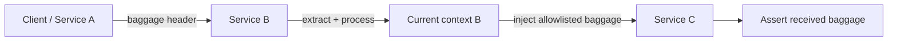

# Test baggage propagation trong Spring Boot

## 1. Mục tiêu và bối cảnh

Distributed tracing thường cần truyền một lượng context nhỏ qua nhiều service. Trace context xác định trace/span relationship; baggage mang các key-value bổ sung để downstream có thể dùng trong cùng request flow. Ví dụ hợp lệ có thể là một classification không nhạy cảm như `tenant-tier=gold` hoặc `workflow=checkout`. Nếu baggage bị mất, downstream không nhận được context mong đợi; nếu baggage bị truyền quá rộng, dữ liệu nhạy cảm có thể rời khỏi trust boundary.

**Test baggage propagation** là kiểm tra toàn bộ vòng đời của baggage: giá trị được tạo hoặc trích xuất từ inbound request, gắn vào context hiện hành, tồn tại qua các operation, được inject vào outbound request khi được phép và không rò rỉ sang request/tenant khác.

Bài thuộc chương **Testing observability** của module **SPRING_BOOT_OBSERVABILITY**. Module hướng dẫn thiết lập observability cho Spring Boot bằng Micrometer Observation, metrics, logs và distributed tracing; học context propagation, tag/cardinality, exporter, sampling và liên kết tín hiệu để điều tra lỗi, độ trễ và hành vi ứng dụng trên môi trường thực.

Sau bài học, bạn có thể:
1. Phân biệt trace context với baggage.
2. Kiểm tra baggage extraction từ inbound headers.
3. Kiểm tra baggage được inject vào outbound HTTP request.
4. Xác minh allowlist remote fields và correlation fields.
5. Kiểm thử propagation qua nhiều service hops.
6. Phát hiện context loss/leak trong executor và Reactor.
7. Kiểm tra giới hạn bảo mật, kích thước và dữ liệu được propagate.
8. Viết integration tests có thể lặp lại mà không phụ thuộc tracing backend thật.

**Baseline:** Spring Boot 3.5.x, Java 17+, Micrometer Tracing và một tracing bridge phù hợp (Brave hoặc OpenTelemetry). Property/API cụ thể cần khớp bridge và version được Spring Boot dependency management quản lý.

## 2. Trace context và baggage khác nhau thế nào?

| Thành phần | Mục đích | Ví dụ |
| --- | --- | --- |
| Trace context | Liên kết spans trong cùng distributed trace | trace ID, parent/span ID, sampling flags |
| Baggage | Mang key-value context bổ sung qua process boundary | `tenant-tier=gold` |
| MDC/correlation fields | Đưa một số context vào log event hiện tại | `tenant-tier=gold` trong log |

Trace context phục vụ quan hệ trace/span. Baggage là metadata ứng dụng và có thể được serialize thành HTTP headers để downstream nhận được. Baggage không tự động trở thành span attribute, metric tag hoặc MDC field; mỗi integration cần được cấu hình riêng.

Không dùng baggage thay cho authentication/authorization. Downstream không được tin một tenant/user value chỉ vì nó đến trong baggage header.

## 3. Cấu hình baggage propagation

Spring Boot cung cấp các cấu hình tracing baggage. Ví dụ khai báo field được phép propagate từ xa và field được đưa vào logging correlation:

```yaml
management:
  tracing:
    baggage:
      remote-fields:
        - tenant-tier
        - workflow
      correlation:
        fields:
          - tenant-tier
```

`remote-fields` xác định các baggage fields được truyền qua process boundary theo tracing integration. `correlation.fields` yêu cầu đưa field vào logging correlation context khi integration hỗ trợ. Hai mục đích khác nhau: một field có thể được propagate mà không cần xuất hiện trong mọi log line.

Kiểm tra property theo Spring Boot version và tracing bridge đang dùng. Không giả định mọi arbitrary baggage key tự động được inject; cấu hình allowlist và propagation format quyết định điều đó.

## 4. W3C Baggage header

Với W3C Baggage, header có dạng key-value phân tách bằng dấu phẩy:

```http
baggage: tenant-tier=gold,workflow=checkout
```

Giá trị có thể cần percent-encoding theo chuẩn. Không tự nối chuỗi header bằng cách đưa input chưa validate vào request. Baggage có giới hạn kích thước và số member; intermediary có thể bỏ header quá lớn.

Không đưa password, access token, email, số tài khoản, raw tenant payload hoặc dữ liệu cá nhân vào baggage. Vì header có thể đi qua nhiều proxy/service/vendor, chỉ propagate metadata tối thiểu và được phép.

## 5. Kiểm thử inbound extraction

Integration test cần gửi inbound request có baggage header đến ứng dụng và xác nhận baggage hiện diện trong context của request handler. Cách truy xuất cụ thể phụ thuộc tracing bridge và Micrometer version; nên kiểm tra qua abstraction/handler được ứng dụng sử dụng thay vì đọc private ThreadLocal.

Ví dụ controller test probe dùng `BaggageManager` của Micrometer Tracing để đọc field hiện hành:

```java
import io.micrometer.tracing.Baggage;
import io.micrometer.tracing.BaggageManager;
import org.springframework.web.bind.annotation.GetMapping;
import org.springframework.web.bind.annotation.RestController;

@RestController
class BaggageProbeController {
    private final BaggageManager baggageManager;

    BaggageProbeController(BaggageManager baggageManager) {
        this.baggageManager = baggageManager;
    }

    @GetMapping("/test/baggage")
    String baggage() {
        Baggage baggage = baggageManager.getBaggage("tenant-tier");
        return baggage == null ? "missing" : baggage.get();
    }
}
```

Probe này chỉ dành cho test/example endpoint, không phải endpoint production để echo baggage. Nếu baggage field không được cấu hình/extract, kết quả có thể là null.

Ví dụ MockMvc:

```java
mockMvc.perform(get("/test/baggage")
        .header("baggage", "tenant-tier=gold"))
    .andExpect(status().isOk())
    .andExpect(content().string("gold"));
```

Test phải chạy với tracing auto-configuration và baggage remote field thực tế. Nếu dùng test slice không load tracing configuration, test có thể không phản ánh production.

## 6. Kiểm thử outbound injection

Extraction thành công chưa chứng minh outbound propagation hoạt động. Cần tạo một outbound HTTP call trong cùng request context và kiểm tra mock server nhận baggage header.

Ví dụ cấu hình WebClient dùng builder do Spring Boot quản lý:

```java
@Component
class InventoryClient {
    private final WebClient webClient;

    InventoryClient(WebClient.Builder builder) {
        this.webClient = builder
                .baseUrl("http://localhost:9091")
                .build();
    }

    Mono<String> lookup() {
        return webClient.get()
                .uri("/inventory")
                .retrieve()
                .bodyToMono(String.class);
    }
}
```

Trong integration test, chạy mock HTTP server ở port động, cấu hình base URL của client theo port đó, gọi endpoint ứng dụng và assert request nhận được có header `baggage` chứa `tenant-tier=gold`. Dùng auto-configured WebClient.Builder để giữ observation/tracing customizers.

Không chỉ assert header có mặt; parse members và xác nhận chỉ những keys được allowlist mới được gửi. Thứ tự member trong header không nên là điều kiện của test.

## 7. Kiểm thử multi-hop propagation

Trong hệ thống A → B → C, baggage phải được kiểm tra ở từng boundary:



Test nên xác nhận:
- A gửi baggage member hợp lệ.
- B extract được giá trị vào context.
- B không tự ý thêm field ngoài policy.
- B inject field được phép khi gọi C.
- C nhận đúng value và trace context liên quan.
- Field bị loại ở B không xuất hiện ở C.

Đặc biệt kiểm tra khi B gọi external service ngoài trust boundary: baggage tenant/workflow nội bộ có thể phải bị loại bỏ ở outbound boundary đó.

## 8. Test allowlist và dữ liệu không được propagate

Test negative quan trọng không kém test success. Ví dụ inbound header chứa:

```http
baggage: tenant-tier=gold,workflow=checkout,secret-token=DO_NOT_PROPAGATE
```

Outbound request chỉ nên chứa fields được cấu hình cho remote propagation. Assert rằng `secret-token` không xuất hiện trong outbound header, logs, span attributes hoặc test exporter payload.

Kiểm tra các trường hợp:
- Field không nằm trong allowlist.
- Key/value malformed hoặc percent-encoding không hợp lệ.
- Header lặp hoặc nhiều members.
- Baggage vượt giới hạn kích thước.
- Value rỗng hoặc quá dài.
- Request không có baggage.
- Caller cố gửi field định danh tenant không được authorize.

Ứng dụng phải fail closed theo policy: bỏ field không hợp lệ hoặc từ chối request khi field đó là yêu cầu nghiệp vụ; không tự động tin giá trị.

## 9. Baggage và async execution

Context có thể bị mất khi request chuyển sang executor hoặc CompletableFuture. Một test đơn giản gọi method đồng bộ không phát hiện được lỗi này.

Kiểm thử:
1. Nhận request có baggage.
2. Submit công việc sang executor được ứng dụng dùng trong production.
3. Đọc baggage trong worker task hoặc thực hiện outbound call từ task đó.
4. Xác nhận context được propagate đúng.
5. Chạy hai request với hai giá trị khác nhau đồng thời.
6. Xác nhận không có context bleed giữa tasks.

Dùng context propagation integration phù hợp với Spring Boot/Micrometer và executor decoration. Không copy ThreadLocal thủ công mà không restore/clear trong mọi đường thoát.

## 10. Baggage trong Reactor/WebFlux

Reactor không đảm bảo một request luôn chạy trên cùng thread. Baggage cần theo reactive context/observation context qua operator chain và scheduler changes.

Test với WebTestClient/WebFlux nên:
- Gửi baggage header vào reactive endpoint.
- Tạo outbound WebClient call sau một hoặc nhiều `publishOn`/`subscribeOn` nếu ứng dụng dùng chúng.
- Assert outbound mock server nhận baggage.
- Chạy nhiều subscriptions đồng thời với values khác nhau.
- Kiểm tra cancel/error không để context rò rỉ sang subscription khác.

Không dùng `ThreadLocal`/MDC trực tiếp trong reactive code rồi giả định nó luôn đúng. Dùng Micrometer context propagation/Reactor integration theo version.

## 11. Baggage, logs và metrics

Correlation field trong MDC có thể giúp tìm log theo baggage key, nhưng chỉ cấu hình những field an toàn và cần thiết. Kiểm tra log output để xác nhận:
- Field được đưa vào log đúng request.
- Field được xóa/restore sau request.
- Hai request song song không trộn values.
- Sensitive fields không xuất hiện.

Không đưa baggage value có cardinality cao vào metric tags. Ví dụ `tenant-tier` với vài giá trị được kiểm soát có thể là dimension hữu hạn; `tenant-id` với hàng nghìn giá trị thường không phù hợp cho metrics. Nếu cần tenant-level diagnostics, dùng backend có access control và query scoping.

Baggage không tự động trở thành metric label. Việc gắn tag phải có chủ đích qua observation convention/customization.

## 12. Unit test và integration test

| Loại test | Mục tiêu | Thành phần |
| --- | --- | --- |
| Unit | Kiểm tra allowlist/normalization policy | Baggage policy service |
| MVC integration | Kiểm tra inbound extraction | MockMvc + tracing context |
| HTTP client integration | Kiểm tra outbound injection | MockWebServer/WireMock |
| Multi-hop | Kiểm tra B → C propagation | Hai ứng dụng hoặc test services |
| Async | Kiểm tra executor context | Real configured executor |
| Reactive | Kiểm tra Reactor context | WebTestClient + WebClient |
| Security | Kiểm tra secret/unknown fields bị loại | Captured headers/logs/spans |

Ưu tiên integration test với cùng auto-configuration và bridge như production. Unit test cho policy vẫn hữu ích nhưng không chứng minh HTTP instrumentation thực sự inject header.

## 13. Troubleshooting

| Triệu chứng | Nguyên nhân có thể | Cách xử lý |
| --- | --- | --- |
| Inbound baggage luôn null | Remote field chưa cấu hình hoặc propagation type không khớp | Kiểm tra management.tracing.baggage.remote-fields và header format |
| B đọc được nhưng C không nhận | Outbound client không được instrument hoặc field không nằm trong allowlist | Dùng Boot builder và kiểm tra outbound header |
| Header baggage quá lớn/mất | Quá nhiều members hoặc value dài | Giới hạn keys/bytes và chỉ propagate metadata tối thiểu |
| Baggage xuất hiện trong external request | Remote fields cấu hình quá rộng | Tách trust boundary và outbound policy |
| Async task mất baggage | Executor không propagate context | Dùng context-aware/decorated executor |
| Reactive call mất baggage sau scheduler hop | Reactor context integration thiếu/sai | Kiểm tra Micrometer context propagation |
| Log có baggage của request trước | MDC/ThreadLocal không restore/clear | Dùng scoped context và concurrent tests |
| Secret xuất hiện trong outbound header | Không có allowlist hoặc tin inbound values | Allowlist, validate và negative tests |
| Test pass nhưng production fail | Test slice thiếu tracing auto-configuration hoặc bridge khác | Dùng full integration context/version tương ứng |
| Baggage không hiện trong span | Chưa cấu hình span processor/attribute mapping | Kiểm tra tracing bridge; baggage không tự thành span attribute |

## 14. Checklist production

- [ ] Baggage keys được allowlist rõ ràng.
- [ ] Inbound values chỉ được tin sau validation/authorization.
- [ ] `remote-fields` chỉ chứa metadata được phép qua boundary.
- [ ] Baggage không chứa secrets, PII hoặc payload.
- [ ] Key/value count và kích thước header được giới hạn.
- [ ] Outbound HTTP clients dùng auto-configured builders.
- [ ] Multi-hop tests xác nhận extraction và injection ở từng service.
- [ ] External trust boundaries có policy loại bỏ baggage nội bộ.
- [ ] Async executor và Reactor context propagation được kiểm thử.
- [ ] MDC correlation được cleanup và không bleed giữa requests.
- [ ] Baggage không bị dùng làm high-cardinality metric labels.
- [ ] Có negative tests cho unknown fields, malformed và oversized headers.

## 15. Câu hỏi tự luyện

1. Trace context khác baggage ở mục đích nào?
2. `management.tracing.baggage.remote-fields` điều khiển điều gì?
3. Vì sao `correlation.fields` không đồng nghĩa với remote propagation?
4. Làm thế nào kiểm tra inbound baggage extraction?
5. Vì sao cần assert outbound header ở mock server?
6. Test multi-hop cần xác nhận những boundary nào?
7. Tại sao baggage không phải authentication context?
8. Vì sao cần negative test cho secret/unknown fields?
9. Async executor có thể làm mất hoặc rò rỉ baggage như thế nào?
10. Reactor context khác ThreadLocal ra sao?
11. Vì sao baggage value thường không phù hợp làm metric label?
12. Cần kiểm tra gì khi test pass nhưng production propagation fail?

## Tài liệu tham khảo

- [Spring Boot 3.5 — Tracing](https://docs.spring.io/spring-boot/3.5/reference/actuator/tracing.html)
- [Spring Boot 3.5 — Common Application Properties](https://docs.spring.io/spring-boot/3.5/appendix/application-properties/index.html)
- [Micrometer Tracing — Baggage](https://docs.micrometer.io/tracing/reference/api.html)
- [Micrometer Context Propagation](https://docs.micrometer.io/context-propagation/reference/)
- [W3C — Baggage](https://www.w3.org/TR/baggage/)
- [OpenTelemetry — Context Propagation](https://opentelemetry.io/docs/concepts/context-propagation/)

