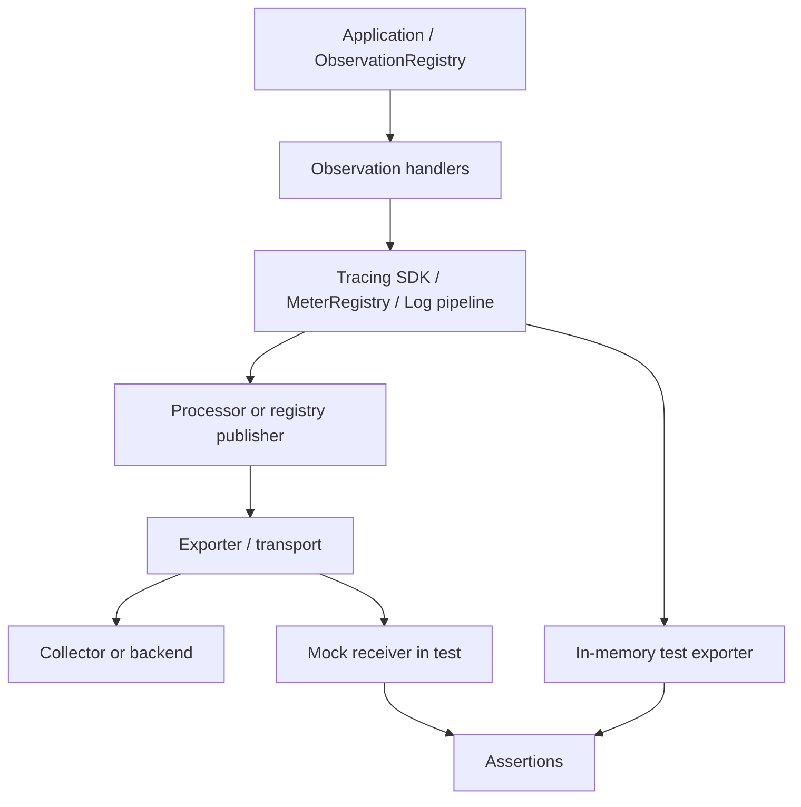

# Test exporter bằng mock trong Spring Boot

Một ứng dụng Spring Boot có thể tạo metrics, spans và logs rồi gửi chúng tới observability backend qua HTTP, gRPC hoặc một giao thức riêng. Khi kiểm thử, gọi backend production thật làm test chậm, phụ thuộc network/credentials và khó tái tạo lỗi. Mock exporter hoặc mock server cho phép kiểm tra dữ liệu được tạo, request được gửi, response được xử lý và lỗi transport được phản ánh đúng mà không cần hạ tầng telemetry production.

**Test exporter bằng mock** là kiểm thử ranh giới export bằng một thành phần giả lập hoặc server cục bộ có hành vi điều khiển được. Cần phân biệt in-memory exporter với mock transport server: in-memory exporter nhận spans trực tiếp trong process để kiểm tra nội dung span; mock OTLP server nhận request HTTP/gRPC thật để kiểm tra serialization, headers, endpoint và response handling. Hai cách trả lời các câu hỏi khác nhau và có thể bổ trợ nhau.

Trong module **SPRING_BOOT_OBSERVABILITY**, Micrometer Observation tạo operation context; metrics/tracing handlers chuyển observation thành signals; registry, SDK processor và exporter chịu trách nhiệm lưu hoặc vận chuyển. Bài học thuộc chương **Testing observability**, tập trung kiểm thử exporter bằng mock trong ứng dụng Spring Boot sử dụng Micrometer Observation, metrics, logs và distributed tracing. Nội dung giúp kiểm tra exporter boundary, payload, lỗi mạng, timeout, retry và tính ổn định của tests.

## Mục tiêu học tập

1. Phân biệt exporter, processor, registry và backend.
2. Chọn in-memory exporter hay mock transport server theo mục tiêu test.
3. Kiểm tra span payload, resource attributes, events và parent context.
4. Dùng mock HTTP server hoặc local receiver để xác minh OTLP requests.
5. Assert endpoint, protocol, headers và authentication metadata mà không dùng secret thật.
6. Kiểm thử response thành công, lỗi HTTP/gRPC, timeout và server unavailable.
7. Xác minh retry/timeout behavior theo exporter implementation.
8. Kiểm tra metrics và logs export bằng công cụ mock phù hợp.
9. Giữ tests deterministic, cô lập và không phụ thuộc backend production.
10. Chẩn đoán lỗi giữa instrumentation, processor, exporter và transport.

## 1. Exporter nằm ở đâu trong pipeline?

ObservationRegistry điều phối observation tới handlers. Tracing handler có thể tạo span; SDK processor nhận span khi kết thúc và chuyển tới exporter. Metrics đi qua MeterRegistry và registry-specific publishing/scraping. Logs đi qua logging appender hoặc log exporter.



Các lớp có trách nhiệm riêng:

| Thành phần | Vai trò | Mock/test phù hợp |
|---|---|---|
| ObservationRegistry | Điều phối observation lifecycle | Recording ObservationHandler |
| MeterRegistry | Lưu và truy vấn meters | SimpleMeterRegistry hoặc test registry |
| Span processor | Xử lý ended spans, batching/sampling | Test SDK/processor |
| Span exporter | Nhận spans và vận chuyển | In-memory exporter hoặc mock OTLP receiver |
| OTLP transport | HTTP/gRPC serialization và network | Mock web server/local receiver |
| Log appender/exporter | Chuyển log events tới sink | List appender hoặc mock log receiver |

Một test chỉ dùng in-memory exporter không kiểm tra HTTP serialization. Một mock HTTP server nhận request không tự chứng minh business instrumentation tạo span đúng; cần assert cả payload và operation boundary.

## 2. Chọn đúng loại mock

### 2.1. In-memory exporter

In-memory exporter giữ spans trong bộ nhớ để test đọc và assert. Nó phù hợp khi mục tiêu là:
- Span name, kind, status và attributes.
- Parent/child relationship.
- Resource attributes và instrumentation scope.
- Exception events.
- Span được tạo đúng một lần.

Nó không kiểm tra OTLP wire format, endpoint URL, HTTP headers, TLS, gRPC status hoặc network retry.

### 2.2. Mock transport server

Mock server hoặc local OTLP receiver nhận request như một backend thật ở ranh giới HTTP/gRPC. Nó phù hợp để kiểm tra:
- Request được gửi tới endpoint dự kiến.
- Content type/protocol đúng.
- Headers và auth metadata được gắn.
- Payload có resource/scope/spans/metrics/log records cần thiết.
- HTTP/gRPC response được xử lý đúng.
- Timeout, unavailable và retry behavior.

Mock server không cần persist telemetry lâu dài; test có thể giữ request đã nhận trong memory để assert.

### 2.3. Mock object hay fake server?

Mock exporter object có thể kiểm tra số lần gọi và arguments. Fake server kiểm tra serialization và transport thật hơn. Chọn theo ranh giới cần xác minh; không cần tạo mock backend phức tạp cho mọi unit test.

## 3. Kiểm thử span bằng in-memory exporter

Với OpenTelemetry SDK, có thể cấu hình SDK test với in-memory span exporter và sampler giữ spans. Tên class/API phụ thuộc OTel SDK version; các phiên bản có thể cung cấp InMemorySpanExporter trong testing artifact hoặc yêu cầu custom exporter lưu spans.

Ví dụ khái niệm:

```java
List<SpanData> exported = new CopyOnWriteArrayList<>();

SpanExporter testExporter = new SpanExporter() {
    @Override
    public CompletableResultCode export(Collection<SpanData> spans) {
        exported.addAll(spans);
        return CompletableResultCode.ofSuccess();
    }

    @Override
    public CompletableResultCode flush() {
        return CompletableResultCode.ofSuccess();
    }

    @Override
    public CompletableResultCode shutdown() {
        return CompletableResultCode.ofSuccess();
    }
};
```

Đây là minh họa API; signatures thay đổi theo OpenTelemetry SDK version. Trong test, gắn exporter vào SDK test riêng và kết thúc span/flush processor trước khi đọc kết quả.

### 3.1. Assert span data

Xác minh span name, kind, status, attributes, events, trace ID, span ID, parent span ID và resource attributes. Không chỉ assert exported list có một phần tử; instrumentation khác có thể tạo spans hợp lệ trong cùng operation.

### 3.2. Sampling

Sampler có thể drop span trước khi exporter nhận. Đặt sampler deterministic giữ spans trong test exporter content assertions. Viết test sampling riêng nếu muốn xác minh policy drop/keep.

### 3.3. Flush trước khi assert

BatchSpanProcessor export bất đồng bộ. Gọi forceFlush hoặc dùng latch/test synchronization phù hợp trước khi đọc exporter. Không dựa vào Thread.sleep cố định vì có thể flaky và làm test chậm.

## 4. Mock OTLP HTTP receiver

Một mock HTTP server có thể ghi lại requests gửi tới OTLP HTTP endpoint. Test cần biết exporter dùng OTLP HTTP/protobuf hay JSON/protobuf theo cấu hình và dependency.

Một test transport nên xác minh:
1. Request tới đúng path/port.
2. Method và content type phù hợp.
3. ResourceSpans/ScopeSpans chứa span dự kiến.
4. Headers cần thiết có mặt.
5. Response success được exporter chấp nhận.
6. HTTP error/timeout được xử lý theo policy.
7. Không có Authorization token/password trong captured payload hoặc log output.

Không hard-code wire payload nếu encoder/version thay đổi; ưu tiên parse bằng OTLP protobuf model hoặc dùng test receiver tương thích.

### 4.1. Endpoint path

OTLP HTTP thường dùng signal-specific paths như v1/traces, v1/metrics và v1/logs, nhưng endpoint base URL và path resolution phụ thuộc SDK/exporter configuration. Kiểm tra URL cuối cùng exporter tạo, nhất là khi cấu hình base endpoint so với signal-specific endpoint.

### 4.2. Content type và encoding

Kiểm tra Content-Type và encoding theo protocol đã chọn. Không giả định mọi exporter dùng cùng payload format. Với protobuf binary, parse payload bằng schema tương ứng thay vì so sánh raw bytes cố định.

### 4.3. Response codes

Mock server nên trả các response có chủ đích: success, transient server error, permanent client error, invalid response và delayed response. Xác minh exporter implementation có retry hay không theo status/transport error; không tự giả định mọi lỗi đều retry.

## 5. Mock gRPC receiver

Nếu exporter dùng OTLP/gRPC, HTTP mock server không đủ. Dùng local gRPC test service triển khai OTLP ExportTraceService hoặc test receiver tương thích.

Kiểm tra:
- RPC method/service đúng.
- ResourceSpans payload hợp lệ.
- Metadata headers được truyền đúng.
- Status code success/unavailable/deadline exceeded.
- Channel shutdown và deadline behavior.

Không assert nội dung protobuf bằng serialized byte sequence nếu field ordering/encoding có thể thay đổi. Parse message và assert fields.

## 6. Cấu hình Spring Boot test để dùng mock endpoint

Trong integration test, cấu hình exporter endpoint trỏ tới server cục bộ của test. Không ghi endpoint production hoặc credentials production vào test config.

Ví dụ cấu hình khái niệm qua test properties:

```yaml
management:
  otlp:
    tracing:
      endpoint: http://localhost:4318/v1/traces
```

Property prefix và endpoint semantics thay đổi theo Spring Boot/Micrometer Tracing version và exporter dependency. Một số setup dùng OTEL_EXPORTER_OTLP_ENDPOINT hoặc OTEL_EXPORTER_OTLP_TRACES_ENDPOINT. Đọc effective configuration và xác minh request thực sự đến mock server.

### 6.1. Dynamic port

Cho mock server bind port động để tránh test collision khi chạy song song. Inject URL thực tế vào application context bằng DynamicPropertySource hoặc cơ chế test property tương đương. Không hard-code port có thể bị process khác chiếm.

### 6.2. Context lifecycle

Đảm bảo mock server khởi động trước exporter/client và dừng sau khi SDK/exporter shutdown. Nếu Spring context cache giữa tests, quản lý endpoint/port lifetime để tránh context giữ URL của server đã dừng.

### 6.3. Không gửi tới production

Test profile phải override endpoint rõ ràng và fail-fast nếu mock server không được khởi tạo. Không cho phép fallback sang endpoint production khi test config thiếu.

## 7. Kiểm thử headers và authentication

Exporter có thể gửi headers như Authorization, API key hoặc tenant metadata. Dùng giá trị giả lập trong test, không dùng credential thật.

Mock server có thể assert:
- Header key đúng.
- Scheme/value format đúng.
- Header không bị ghi vào logs.
- Credential không xuất hiện trong span attributes hoặc metric tags.
- Header không bị propagate sang endpoint khác ngoài dự kiến.

Không log nguyên request headers trong test failure message; test report cũng có thể được lưu lâu và truy cập rộng.

## 8. Kiểm thử exporter failure, timeout và retry

Tạo mock server có thể điều khiển response:
- **Success:** nhận batch và trả success.
- **Unavailable:** từ chối kết nối hoặc trả lỗi server.
- **Timeout:** trì hoãn response lâu hơn exporter timeout.
- **Permanent failure:** trả client error hoặc protocol error.
- **Recovery:** ban đầu fail, sau đó success.

Kiểm tra số lần request, thời gian kết thúc, error metrics/logs và behavior của processor queue. Retry policy phụ thuộc exporter; tránh assert số lần retry cố định nếu SDK version/backoff config không được cố định trong test.

### 8.1. Queue saturation

Để test queue đầy, giảm queue capacity trong SDK test và làm mock server chậm hoặc unavailable. Tạo spans vượt tốc độ drain, sau đó assert dropped/failed behavior nếu SDK expose metric/hook phù hợp. Không dùng production-sized queue cho unit test.

### 8.2. Exporter không được làm hỏng business operation

Một số processor enqueue spans non-blocking; export failure không nhất thiết làm request fail. Test business result độc lập với exporter result theo policy. Nếu ứng dụng dùng custom synchronous exporter, cần test latency/failure isolation vì behavior có thể khác.

### 8.3. Retry không đồng nghĩa exactly-once

Timeout có thể xảy ra sau khi receiver đã nhận payload. Client retry có thể làm receiver thấy cùng batch nhiều lần. Test receiver nên ghi nhận requests và span IDs để phân tích duplicate delivery; không mặc định exporter/backend đảm bảo exactly-once.

## 9. Kiểm thử metrics exporter

Metrics có pipeline khác tracing. Với pull registry, dùng SimpleMeterRegistry hoặc Prometheus test registry để kiểm tra meter name, tags và measurements; scrape endpoint test nếu cần xác minh exposition. Với push/OTLP metrics exporter, mock receiver cần kiểm tra export request theo protocol và step/flush lifecycle.

Các assertions hữu ích:
- Metric name và unit.
- Resource attributes và dimensions.
- Counter/timer/histogram values.
- Không có high-cardinality IDs hoặc secrets trong labels.
- Publish/scrape xảy ra theo schedule/step dự kiến.

Không dùng mock span exporter để kết luận metrics exporter hoạt động.

## 10. Kiểm thử log exporter/appender

Nếu logs được gửi qua appender hoặc OpenTelemetry Logs SDK, dùng test appender hoặc mock log receiver. Assert severity, body, timestamp, resource/scope attributes và trace/span correlation fields.

Không giả định log appender được flush cùng lifecycle với tracing SDK. Kiểm thử shutdown/flush riêng cho logging pipeline. Tránh capture toàn bộ log output nếu chứa test credentials; dùng synthetic values và negative assertions.

## 11. Kiểm thử payload và privacy

Mock receiver lưu payload giúp tìm dữ liệu không mong muốn trước khi gửi tới backend thật.

Dùng synthetic secret trong test, sau đó search:
- Span attributes/events.
- Metric labels.
- Log body/attributes.
- Baggage/resource attributes.
- Export headers và serialized payload.
- Error messages khi exporter thất bại.

Không đưa password/token thật vào test. Kiểm tra redaction ở source và exporter boundary; collector/backend redaction chỉ là lớp bổ sung.

### 11.1. Schema assertions thay raw snapshots

Snapshot nguyên payload dễ vỡ khi SDK thêm field/version đổi encoding. Parse payload thành data model rồi assert field có ý nghĩa. Chỉ dùng snapshot khi schema/version được pin và thay đổi có review.

## 12. Test isolation và deterministic behavior

- Tạo mock server riêng cho mỗi test class hoặc test context.
- Dùng dynamic port.
- Cấu hình sampler deterministic.
- Flush/shutdown exporter trước khi đọc payload hoặc dừng server.
- Không phụ thuộc sleep cố định.
- Reset request journal giữa tests.
- Không chạy song song nếu mock receiver dùng state chung không thread-safe.
- Pin exporter/SDK versions trong test dependencies.
- Dùng synthetic credentials.
- Đặt timeout hữu hạn cho mọi async wait.

Nếu test dùng Spring context cache, đảm bảo mock server vẫn sống trong toàn bộ lifetime của context hoặc đóng context trước khi server dừng.

## 13. Chẩn đoán mock exporter test thất bại

| Triệu chứng | Nguyên nhân có thể | Cách kiểm tra |
|---|---|---|
| In-memory exporter không có span | Sampling drop hoặc span chưa end/flush | Sampler, span lifecycle, forceFlush |
| Mock server không nhận request | Exporter chưa được cấu hình hoặc processor chưa flush | Effective endpoint, SDK wiring |
| Request tới sai port/path | Base endpoint/path resolution sai | Capture URL và protocol |
| HTTP server nhận nhưng parse lỗi | Content type/protobuf mismatch | Exporter protocol và schema |
| gRPC mock không nhận RPC | Exporter dùng HTTP hoặc service binding sai | Protocol và service descriptor |
| Header auth thiếu | Header supplier/config không bind | Effective headers và test properties |
| Test pass nhưng production lỗi TLS | Mock không kiểm tra TLS trust chain | Separate staging TLS integration test |
| Export timeout không xảy ra | Server response không đủ chậm hoặc timeout khác | Effective exporter timeout |
| Retry count thay đổi | Backoff/version/async scheduling | Pin config, assert range/behavior |
| Payload bị gửi hai lần | Retry sau timeout hoặc processor/exporter trùng | Request journal và span IDs |
| Test bị treo khi shutdown | Exporter flush chờ timeout dài | Shutdown budget và deadlines |
| Secret trong failure output | Test log raw request headers/body | Redact test diagnostics |

### Quy trình điều tra

1. Xác định signal đang test: trace, metrics hay logs.
2. Kiểm tra exporter, processor và registry wiring.
3. Xác định protocol và endpoint cuối cùng.
4. Với in-memory exporter, kiểm tra sampling, span end và flush.
5. Với mock server, kiểm tra request count, path, content type và status.
6. Parse payload và xác minh span/resource/scope attributes.
7. Kiểm tra auth headers và secret leakage.
8. Tái tạo timeout/unavailable/recovery bằng response có kiểm soát.
9. Kiểm tra retry, queue/drop metrics và shutdown lifecycle.
10. Chạy integration test TLS/Collector riêng nếu cần xác minh hạ tầng thật.

## 14. Các anti-pattern cần tránh

| Anti-pattern | Hậu quả | Cách phù hợp |
|---|---|---|
| Dùng backend production trong unit tests | Chậm, flaky và phụ thuộc credentials | In-memory exporter/mock receiver |
| Dùng in-memory exporter để test HTTP | Bỏ sót serialization/transport | Mock OTLP server |
| Dùng HTTP mock cho exporter gRPC | Test sai protocol | Local gRPC receiver |
| So sánh raw protobuf bytes | Dễ vỡ theo encoding/version | Parse message và assert fields |
| Hard-code port | Test collision | Dynamic port |
| Không forceFlush trước assertion | Export async chưa hoàn tất | Flush/latch có timeout |
| Dùng secret production trong test | Rủi ro lộ credential | Synthetic credentials |
| Log toàn bộ mock request khi fail | Test report có thể lộ token | Redacted diagnostics |
| Giả định mọi lỗi đều retry | Assertion sai theo exporter policy | Pin version/config và test behavior |
| Cho test fallback production endpoint | Có thể gửi telemetry thật | Fail-fast test endpoint override |
| Chỉ test traces | Bỏ sót metrics/log export | Test từng signal pipeline |
| Không shutdown exporter | Test leak threads/requests | Close SDK/appender/context đúng lifecycle |

## 15. Checklist kiểm thử exporter

1. **Boundary:** test xác định rõ registry, processor, exporter hay transport?
2. **Mock type:** in-memory exporter hay mock receiver phù hợp mục tiêu?
3. **Protocol:** HTTP/gRPC và encoding đúng?
4. **Endpoint:** dynamic test endpoint được bind trước exporter?
5. **Payload:** span/resource/scope/metric/log fields được parse và assert?
6. **Headers:** auth metadata đúng, không bị log hoặc export sai nơi?
7. **Sampling:** deterministic khi test content?
8. **Flush:** export async được flush trước assertion?
9. **Failures:** success, unavailable, timeout và permanent error được test?
10. **Retry:** behavior theo version/config được xác minh?
11. **Queue:** saturation/drop behavior được kiểm tra khi cần?
12. **Privacy:** synthetic secrets không xuất hiện trong mọi signal?
13. **Isolation:** request journal và SDK state được reset?
14. **Shutdown:** exporter/appender đóng và flush trong timeout?
15. **No production:** test không thể gửi tới production endpoint?
16. **TLS:** TLS/auth integration được test riêng trong staging khi cần?

## 16. Câu hỏi tự đánh giá

**Câu 1.** In-memory span exporter khác mock OTLP receiver thế nào?

**Gợi ý:** In-memory exporter kiểm tra SpanData trong process; mock receiver kiểm tra request serialization và transport tới endpoint.

**Câu 2.** Vì sao mock HTTP server không test được exporter gRPC?

**Gợi ý:** gRPC dùng RPC protocol/service contract riêng; cần local gRPC receiver tương thích.

**Câu 3.** Vì sao cần forceFlush trước khi assert?

**Gợi ý:** Batch processor export bất đồng bộ; span có thể vẫn nằm trong queue khi assertion chạy.

**Câu 4.** Có nên so sánh raw protobuf bytes không?

**Gợi ý:** Thường không. Parse protobuf và assert fields để tránh test phụ thuộc encoding/field ordering.

**Câu 5.** Làm sao kiểm tra auth header mà không lộ credential?

**Gợi ý:** Dùng synthetic token, assert header trong memory và không log raw request.

**Câu 6.** Exporter timeout có thể gây duplicate delivery không?

**Gợi ý:** Có thể. Receiver đã nhận payload nhưng response bị timeout; client retry có thể gửi lại batch.

**Câu 7.** In-memory exporter có kiểm tra OTLP endpoint không?

**Gợi ý:** Không. Nó không kiểm tra URL, HTTP/gRPC, TLS hoặc wire serialization.

**Câu 8.** Vì sao metrics và traces cần test exporter riêng?

**Gợi ý:** Chúng có registry, processor, protocol và lifecycle khác nhau.

**Câu 9.** Làm sao tránh test vô tình gửi telemetry tới production?

**Gợi ý:** Override endpoint bằng dynamic mock URL, fail-fast nếu mock chưa sẵn sàng và không có fallback production.

**Câu 10.** Khi mock receiver không nhận dữ liệu, nên kiểm tra theo thứ tự nào?

**Gợi ý:** Registry/handler, processor/flush, exporter wiring, protocol, endpoint và mock server lifecycle.

## Kết luận

**Mock exporter tests xác minh telemetry ở ranh giới export mà không cần backend production.** In-memory exporter phù hợp kiểm tra nội dung spans; mock HTTP/gRPC receiver phù hợp kiểm tra serialization, endpoint, headers và response handling. Hãy xác định đúng signal và protocol, flush processor trước assertion, dùng dynamic endpoint cùng synthetic credentials, kiểm tra failure/timeout/retry và bảo đảm test không thể fallback sang production. Metrics, traces và logs có pipeline riêng nên cần kiểm thử theo đúng registry/exporter của từng signal. Khi tách rõ instrumentation, processor và transport, test sẽ chỉ ra lỗi nằm ở dữ liệu telemetry hay ở quá trình vận chuyển.
