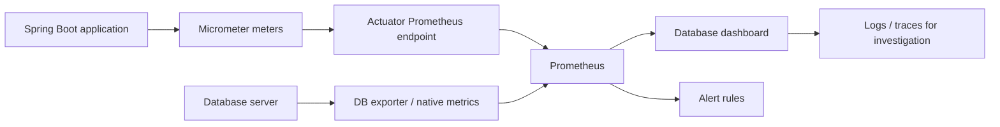

# Dashboard database cho Spring Boot

## 1. Mục tiêu và bối cảnh

Database thường là một dependency quan trọng của ứng dụng Spring Boot. Khi response time tăng, nguyên nhân có thể nằm ở query chậm, connection pool cạn, lock contention, database quá tải hoặc network giữa application và database. Một dashboard database tốt giúp đội vận hành nhìn thấy các tín hiệu này cùng lúc, xác định phạm vi ảnh hưởng và chuyển từ triệu chứng sang nguyên nhân.

Dashboard cần kết hợp metrics ở phía ứng dụng với metrics của database server. Spring Boot/Micrometer có thể cung cấp connection pool, JDBC và datasource observations tùy cấu hình; database exporter hoặc hệ thống monitoring riêng cung cấp CPU, disk, locks, replication và transaction metrics. Không nên suy ra sức khỏe database chỉ từ một meter phía application.

Bài thuộc chương **Dashboard và alert** của module **SPRING_BOOT_OBSERVABILITY**. Module hướng dẫn thiết lập observability cho Spring Boot bằng Micrometer Observation, metrics, logs và distributed tracing; học context propagation, tag/cardinality, exporter, sampling và liên kết tín hiệu để điều tra lỗi, độ trễ và hành vi ứng dụng trên môi trường thực.

Sau bài học, bạn có thể:
1. Xác định các panel thiết yếu cho database dashboard.
2. Theo dõi connection pool usage, pending threads và timeout.
3. Phân tích query throughput, latency và errors.
4. Kết hợp application metrics với database server metrics.
5. Viết PromQL cho rate, saturation và latency histograms.
6. Thiết lập alert dựa trên symptom, duration và SLO.
7. Tránh cardinality cao và diễn giải sai metrics.

**Baseline:** Spring Boot 3.5.x, Java 17+, Actuator, Micrometer và Prometheus. Ví dụ connection pool dùng HikariCP (pool mặc định phổ biến của Spring Boot JDBC/JPA). Tên meter thực tế phụ thuộc pool, driver, registry và version.

## 2. Dashboard database nên trả lời câu hỏi nào?

Dashboard nên được tổ chức quanh bốn câu hỏi:

| Câu hỏi | Nhóm tín hiệu | Điều cần biết |
| --- | --- | --- |
| Ứng dụng có kết nối được không? | Connection pool, connection errors, DB health | Pool có hoạt động, timeout có tăng? |
| Database có xử lý đủ nhanh không? | Query latency, throughput, errors | Query nào chậm, p95/p99 thay đổi? |
| Tài nguyên có bị bão hòa không? | Pool saturation, DB CPU, locks, I/O | Bottleneck ở application hay database? |
| Người dùng có bị ảnh hưởng không? | Request latency, error rate, SLO | DB degradation tác động endpoint nào? |

Dashboard không nên là một tập hợp hàng chục gauge không có ngữ cảnh. Panel cần có đơn vị, window, labels, threshold và liên kết tới logs/traces.

## 3. Kiến trúc dữ liệu



Application metrics mô tả những gì ứng dụng quan sát được: pool usage, JDBC operation và request impact. Database metrics mô tả server-side resource và engine behavior. Dùng cả hai để xác định bottleneck ở đúng tầng.

## 4. Bật datasource và connection pool metrics

Spring Boot Actuator có thể tự instrument datasource/connection pool khi dependency và instrumentation tương ứng có mặt. Với HikariCP, các meter thường có prefix `hikaricp.connections`; JDBC datasource metrics có thể có prefix `jdbc.connections`.

Ví dụ cấu hình Prometheus registry và endpoint:

```yaml
management:
  endpoints:
    web:
      exposure:
        include: health,prometheus
  metrics:
    enable:
      hikaricp: true
```

Không phải mọi project cần khai báo `metrics.enable.hikaricp`; meter availability phụ thuộc binder và auto-configuration. Trước khi viết query, mở `/actuator/prometheus` để xác nhận tên metric và tags thực tế.

Những pool signals quan trọng:

| Signal | Ý nghĩa | Cách đọc |
| --- | --- | --- |
| Active connections | Connections đang được sử dụng | Tăng gần max kéo dài có thể báo pool pressure |
| Idle connections | Connections sẵn sàng | Bằng 0 không tự động là lỗi nếu active thấp |
| Max connections | Giới hạn pool | Dùng làm denominator cho utilization |
| Pending/waiting threads | Threads đang chờ connection | Tăng liên tục cho thấy pool không đáp ứng kịp |
| Connection timeout count | Lần lấy connection thất bại do timeout | Tăng là symptom trực tiếp người dùng có thể gặp |

Với Hikari, metric names thường gồm `hikaricp_connections_active`, `hikaricp_connections_idle`, `hikaricp_connections_max`, `hikaricp_connections_pending` và `hikaricp_connections_timeout_total` sau Prometheus naming conversion. Hãy xác minh exposition thực tế vì version/binder có thể khác.

## 5. Panel connection pool

### 5.1. Active / max connections

Panel nên hiển thị active, idle và max cùng nhau. Active tuyệt đối giúp thấy số connection đang dùng; tỷ lệ active/max cho biết mức utilization.

PromQL minh họa:

```promql
hikaricp_connections_active
```

Utilization:

```promql
100 * hikaricp_connections_active
/ clamp_min(hikaricp_connections_max, 1)
```

Nếu metric có labels như pool/instance, giữ cùng label dimensions ở tử và mẫu. Dùng `clamp_min` để tránh chia cho zero khi metric chưa có hoặc pool chưa khởi tạo.

### 5.2. Pending threads và timeouts

```promql
hikaricp_connections_pending
```

```promql
rate(hikaricp_connections_timeout_total[5m])
```

Pending tăng trong thời gian dài thường quan trọng hơn một spike ngắn. Nếu active gần max, pending tăng và timeout xuất hiện đồng thời, pool có khả năng đang bão hòa.

Không tăng max pool size ngay lập tức. Pool lớn hơn có thể làm database nhận nhiều concurrent work hơn và khiến server-side contention tệ hơn. Kiểm tra query duration, transaction length, DB max connections và số replicas trước khi điều chỉnh.

## 6. Panel query throughput và latency

Datasource pool metrics không tự cho biết query nào chậm. Để có query-level insight, cần JDBC instrumentation/Observation, custom timers hoặc database-native query statistics.

Các panel nên có:
- Query/operation rate theo operation name hữu hạn.
- Query duration p50/p95/p99 nếu histogram được bật.
- Error/timeout rate theo operation và outcome.
- Slow query count theo threshold.
- Top query fingerprints theo tổng thời gian hoặc số lần chạy, nếu backend hỗ trợ.

Ví dụ custom timer tên `app.db.operation` với tag `operation` và `outcome` có tập giá trị hữu hạn. Prometheus histogram query minh họa:

```promql
histogram_quantile(0.95,
  sum by (le, operation) (
    rate(app_db_operation_seconds_bucket[5m])
  )
)
```

Query rate:

```promql
sum by (operation) (rate(app_db_operation_seconds_count[5m]))
```

Error rate:

```promql
sum by (operation) (rate(app_db_operation_errors_total[5m]))
```

Metric names ở ví dụ là custom contract của ứng dụng, không phải meters mặc định được Spring Boot đảm bảo. Hãy chuẩn hóa và ghi rõ schema trước khi tạo dashboard.

## 7. Kết hợp database server metrics

Để xác định bottleneck, kết hợp application và database server metrics:

| Database signal | Ý nghĩa vận hành | Dấu hiệu cần điều tra |
| --- | --- | --- |
| CPU utilization | Mức sử dụng CPU của DB host/instance | CPU cao đồng thời query latency tăng |
| Active sessions/connections | Workload đang chạy trên DB | Sessions cao, wait events tăng |
| Lock waits/deadlocks | Transaction tranh chấp | Latency/error spike theo table/operation |
| Buffer/cache hit ratio | Hiệu quả cache của engine | Disk reads tăng và latency tăng |
| Disk IOPS/latency | Storage pressure | Query chậm dù pool chưa bão hòa |
| Replication lag | Độ trễ replica | Read-after-write hoặc stale reads |
| Transaction/log growth | Áp lực transaction log/WAL | Storage tăng, checkpoint/commit chậm |

Metrics và cách đặt tên phụ thuộc engine (PostgreSQL, MySQL, SQL Server, Oracle) và exporter. Không dùng cùng một threshold cho mọi database engine hoặc workload.

## 8. Dashboard layout đề xuất

### Hàng 1 — User impact
- Request rate, error rate và p95/p99 latency của endpoint dùng database.
- SLO burn rate nếu service có latency/availability SLO.

### Hàng 2 — Application connection pool
- Active/idle/max connections.
- Pool utilization percentage.
- Pending threads.
- Connection timeout rate.

### Hàng 3 — Database operations
- Query rate theo operation.
- p95/p99 query duration.
- Query errors/timeouts.
- Slow query count hoặc top fingerprints.

### Hàng 4 — Database server
- CPU, memory, disk latency/IOPS.
- Active sessions, lock waits/deadlocks.
- Cache hit ratio và replication lag nếu phù hợp.

### Hàng 5 — Diagnostics
- Links tới logs theo service/instance/traceId.
- Traces có database spans chậm.
- Deployment annotations và database failover events.

Đặt dashboard variables cho environment, service, instance, pool và database cluster. Chỉ cung cấp tenant filter khi storage/query backend thực thi authorization tương ứng.

## 9. Alert design

Alert nên dựa trên symptom có ý nghĩa và yêu cầu hành động. Ví dụ:

| Alert | Điều kiện minh họa | Ý nghĩa |
| --- | --- | --- |
| Pool saturation | Utilization > 90% trong 5 phút và pending > 0 | Connection pressure kéo dài |
| Connection timeouts | Timeout rate > 0 trong 2-5 phút | Request có thể không lấy được connection |
| Query latency | p95 vượt SLO trong 5 phút | DB operations chậm ảnh hưởng request |
| Query errors | Error ratio vượt ngưỡng trong 5 phút | Query/connection failures tăng |
| Database unavailable | Health check DOWN liên tục | Dependency không phục vụ được |
| Replication lag | Lag vượt freshness objective | Read replica có thể stale |

Ngưỡng chỉ là điểm bắt đầu. Chọn threshold theo baseline, traffic, SLO, database engine và khả năng chịu tải. Dùng `for` duration để tránh alert vì một spike ngắn.

### 9.1. Ví dụ Prometheus alert rules

```yaml
groups:
  - name: database-observability
    rules:
      - alert: HikariPoolSaturated
        expr: |
          (hikaricp_connections_active
           / clamp_min(hikaricp_connections_max, 1)) > 0.9
          and hikaricp_connections_pending > 0
        for: 5m
        labels:
          severity: warning
        annotations:
          summary: Hikari connection pool is saturated

      - alert: HikariConnectionTimeouts
        expr: rate(hikaricp_connections_timeout_total[5m]) > 0
        for: 2m
        labels:
          severity: critical
        annotations:
          summary: Application cannot acquire database connections
```

Alert expression cần điều chỉnh theo labels và metric names thực tế. Nếu có nhiều replicas, xác định alert theo instance/pool hay aggregate theo service để tránh che khuất một instance lỗi.

## 10. Cardinality và dữ liệu nhạy cảm

Không dùng các giá trị sau làm labels:
- SQL statement raw hoặc SQL parameter values.
- User ID, tenant ID có số lượng lớn, email hoặc account number.
- Raw URL/query string, exception message.
- Transaction ID hoặc trace ID.

Ưu tiên operation name/query fingerprint đã chuẩn hóa và có tập giá trị hữu hạn. Query fingerprint cũng cần policy để tránh lộ table/column names nhạy cảm.

Database dashboard thường được nhiều nhóm dùng. Cần giới hạn quyền truy cập dashboard, logs và traces; không để panel hiển thị raw SQL/bind values nếu chưa có kiểm soát.

## 11. Điều tra một sự cố điển hình

Giả sử p95 API tăng từ 120 ms lên 1.8 s:

1. Hàng user impact cho thấy chỉ endpoint gọi database bị chậm.
2. Pool panel cho thấy active connections đạt max, pending threads tăng.
3. Query latency panel cho thấy `order.search` p95 tăng mạnh.
4. Database panel cho thấy lock waits tăng nhưng CPU không cao.
5. Mở trace mẫu để tìm span query chậm; mở logs theo traceId để xem operation context.
6. Kiểm tra deployment/query plan/transaction changes và lock holder.

Chuỗi bằng chứng này giúp phân biệt pool size issue với query/locking issue. Nếu chỉ tăng pool max, có thể làm database chịu thêm concurrency trong khi lock contention vẫn tồn tại.

## 12. Kiểm thử dashboard và metrics

Trước khi publish dashboard:
1. Gọi `/actuator/prometheus` và xác nhận meter names/tags thực tế.
2. Tạo workload có connection acquisition, query success, query error và timeout.
3. Xác nhận Counter tăng và Timer/histogram có buckets khi cấu hình.
4. Kiểm tra PromQL trả kết quả đúng với một sample window.
5. Test pool utilization khi pool idle, active và saturated.
6. Test alert firing/resolution bằng synthetic metrics hoặc rule test.
7. Xác nhận labels không chứa IDs, raw SQL, PII hoặc secrets.
8. Kiểm tra dashboard variables và access permissions.

Không assert p95 tuyệt đối trong unit test với thời gian chạy phụ thuộc máy. Test semantics của metric và dùng load test/production baseline để đánh giá threshold.

## 13. Troubleshooting

| Triệu chứng | Nguyên nhân có thể | Cách xử lý |
| --- | --- | --- |
| Không có Hikari metrics | Không dùng Hikari, binder chưa đăng ký hoặc datasource chưa khởi tạo | Kiểm tra pool implementation và endpoint exposition |
| Active vượt max hoặc ratio bất thường | Query labels không khớp hoặc aggregation sai | Giữ cùng dimensions và kiểm tra raw series |
| Pending cao nhưng DB CPU thấp | Lock waits, long transactions hoặc pool leak | Kiểm tra DB waits, transaction và connection lifecycle |
| Query latency cao nhưng pool bình thường | DB execution, network hoặc result mapping chậm | Mở trace và DB-native query stats |
| Timeout tăng nhưng query rate không tăng | Connection leak, DB unavailable hoặc max connections | Kiểm tra pool leak detection và DB connection limit |
| Dashboard trống sau đổi version | Meter name/tag schema thay đổi | Kiểm tra endpoint và cập nhật queries |
| p95 không có dữ liệu | Histogram buckets chưa bật hoặc traffic thấp | Bật histogram có chọn lọc, kiểm tra sample count |
| Alert luôn firing | Threshold không phù hợp hoặc metric labels nhiều series | Đối chiếu baseline và aggregate đúng scope |
| Alert không firing dù pool cạn | Pending/timeout metric không được scrape hoặc query sai | Test rule với sample data và Targets health |
| Một replica lỗi bị che bởi average | Dashboard chỉ aggregate toàn service | Thêm per-instance panel/alert |
| Dashboard lộ SQL/PII | Labels hoặc logs chứa raw values | Chuẩn hóa tags và kiểm soát access |

## 14. Checklist production

- [ ] Dashboard có user-impact, pool, query và database-server panels.
- [ ] Pool active/idle/max/pending/timeout được scrape.
- [ ] Query latency/throughput/error metrics có operation names ổn định.
- [ ] Histogram chỉ bật cho latency metrics cần percentile.
- [ ] Database exporter cung cấp CPU, locks, I/O và replication signals phù hợp.
- [ ] PromQL dùng labels đã xác minh từ exposition thực.
- [ ] Alert có duration, severity, owner và runbook.
- [ ] Có per-instance view để phát hiện một replica bị saturation.
- [ ] Không có raw SQL, bind values, PII hoặc high-cardinality IDs trong labels.
- [ ] Dashboard và diagnostic links có access control.
- [ ] Dashboard được test với success, error, timeout và saturation scenarios.

## 15. Câu hỏi tự luyện

1. Vì sao cần kết hợp application metrics với database server metrics?
2. Active connections gần max trong thời gian dài cho biết điều gì?
3. Pending threads khác connection timeout count như thế nào?
4. Vì sao tăng pool max không phải lúc nào cũng giải quyết bottleneck?
5. Spring Boot có thể expose những Hikari/JDBC metrics nào?
6. Vì sao query-level latency cần instrumentation riêng?
7. Histogram buckets hỗ trợ p95/p99 trong Prometheus ra sao?
8. Những database server signals nào giúp nhận diện lock/storage pressure?
9. Alert pool saturation nên kết hợp utilization với tín hiệu nào?
10. Vì sao dashboard cần per-instance view?
11. Những label values nào cần tránh trong database metrics?
12. Làm thế nào kiểm thử PromQL và alert trước production?

## Tài liệu tham khảo

- [Spring Boot 3.5 — DataSource Metrics](https://docs.spring.io/spring-boot/3.5/reference/actuator/metrics.html)
- [Spring Boot 3.5 — Prometheus Endpoint](https://docs.spring.io/spring-boot/3.5/reference/actuator/metrics.html#actuator.metrics.export.prometheus)
- [Micrometer — JVM and Database Metrics](https://docs.micrometer.io/micrometer/reference/reference/jvm.html)
- [Micrometer — Timers](https://docs.micrometer.io/micrometer/reference/concepts/timers.html)
- [Prometheus — Querying Basics](https://prometheus.io/docs/prometheus/latest/querying/basics/)
- [Prometheus — Histograms](https://prometheus.io/docs/practices/histograms/)
- [Grafana — Dashboards](https://grafana.com/docs/grafana/latest/dashboards/)

