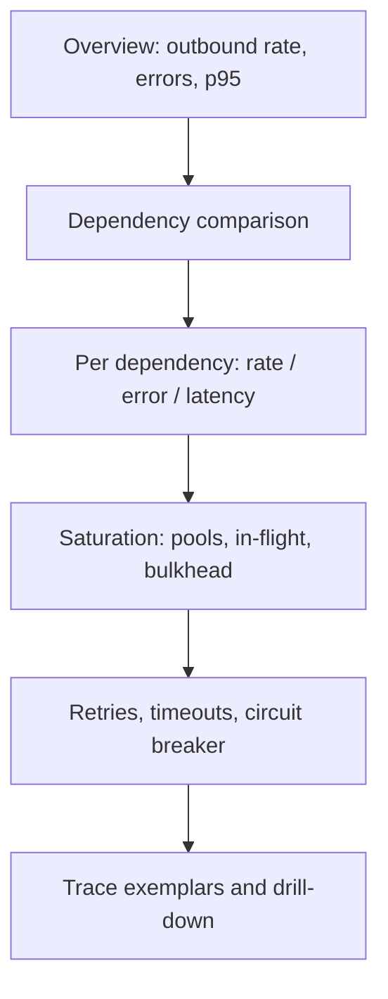

# Dashboard external calls trong Spring Boot

Dashboard external calls theo dõi các lời gọi outbound từ Spring Boot tới HTTP APIs, database clients, message brokers và dịch vụ nội bộ. Dashboard giúp nhận diện dependency chậm/lỗi, request rate, retry, circuit breaker và tác động lên latency đầu cuối.

Trong module SPRING_BOOT_OBSERVABILITY, dashboard này kết nối Micrometer metrics với distributed traces để điều tra từng request. Bài thuộc chương Dashboard và alert, tập trung vào traffic, error rate, duration, saturation, SLO, PromQL, drill-down, cardinality và kiểm thử cảnh báo.

## 1. Mục tiêu dashboard

Dashboard cần trả lời:
- Dependency nào nhận nhiều outbound calls nhất?
- Tỷ lệ lỗi và timeout của từng dependency có tăng không?
- p95/p99 latency có vượt ngân sách không?
- Retry có làm request volume tăng nhiều lần không?
- Connection pool hoặc bulkhead có bão hòa không?
- Circuit breaker đang closed, open hay half-open?
- Dependency chậm có kéo latency API đầu vào lên không?
- Có trace mẫu để xác định nguyên nhân cụ thể không?

Chỉ nhìn tổng latency của service không đủ để xác định dependency gây ra vấn đề. Cần phân biệt lỗi caller, client/network và downstream.

## 2. Inventory dependency và operation

Lập danh sách HTTP clients, JDBC/R2DBC, Kafka/RabbitMQ producers, RPC clients, cache, identity/payment/search services và các SDK bên ngoài.

Mỗi dependency có tên logic ổn định, ví dụ inventory, payment, identity hoặc orders-db. Không dùng hostname động, full URL hay IP làm metric dimension mặc định.

| Dimension | Ví dụ | Quy tắc |
| --- | --- | --- |
| dependency | inventory | Tên logic ổn định |
| operation | inventory.lookup | Tên chuẩn hóa |
| client type | webclient, jdbc, kafka | Tập giá trị hữu hạn |
| destination | inventory-api | Không chứa host động |
| outcome | success, error, timeout | Tập giá trị hữu hạn |
| HTTP method | GET, POST | Low cardinality |
| status class | 2xx, 4xx, 5xx | Dễ tổng hợp |
| raw URL/query | URL chứa order/user ID | Không dùng làm metric tag |
| request/trace ID | UUID | Không dùng làm metric tag |

Một dependency có thể có nhiều operations. Theo dõi cả dependency và operation giúp phát hiện endpoint nào chậm trong cùng một service.

## 3. Bộ metrics nền tảng

| Nhóm | Metrics | Câu hỏi |
| --- | --- | --- |
| Traffic | Calls/sec, requests by dependency/operation | Lưu lượng đang đi đâu? |
| Errors | Error rate, timeout rate, retry/failure count | Dependency có lỗi không? |
| Duration | p50/p95/p99, max/long-running calls | Chậm đến mức nào? |
| Saturation | In-flight, pool pending, connection usage | Client có cạn tài nguyên không? |

Tên metric thực tế phụ thuộc instrumentation và client library. Spring Boot/Micrometer có thể đặt tên và tags khác nhau theo version/implementation. Liệt kê meters hiện có và xác minh tags trước khi viết query.

### 3.1. RED method

RED là:
- **Rate:** số calls trong một đơn vị thời gian.
- **Errors:** tỷ lệ calls thất bại.
- **Duration:** phân phối thời gian hoàn thành.

Áp dụng RED riêng cho từng dependency/operation. Kết hợp saturation để biết vì sao client không thể phục vụ thêm calls.

## 4. Bố cục dashboard



### 4.1. Hàng tổng quan

Đặt các panel đầu dashboard: outbound calls/sec tổng, error/timeout rate tổng, p95 outbound duration, số dependency degraded/open circuit, retry rate hoặc retry amplification và SLO status/burn rate nếu có.

### 4.2. Hàng so sánh dependency

Dùng bảng hoặc time series theo dependency: rate, error percentage, p95/p99 duration, timeout count, retry count và circuit breaker state. Sắp xếp theo error rate hoặc latency để thấy dependency bất thường.

### 4.3. Hàng chi tiết dependency

Khi chọn dependency, hiển thị calls/sec theo operation, error rate theo outcome/status class, latency histogram, in-flight calls, pool/bulkhead usage, retry attempts, timeout, circuit transitions và exemplar sang traces.

## 5. Traffic và error rate

Traffic tăng có thể làm dependency quá tải; traffic giảm đột ngột có thể biểu hiện circuit breaker open hoặc routing failure.

Ví dụ PromQL theo dependency:

```promql
sum by (dependency) (rate(outbound_client_requests_total[5m]))
```

Error ratio:

```promql
sum by (dependency) (rate(outbound_client_requests_total{outcome="error"}[5m]))
/
sum by (dependency) (rate(outbound_client_requests_total[5m]))
```

Metric name và label dependency/outcome là schema minh họa. Thay bằng meter và tag thực tế.

### 5.1. Phân loại lỗi

Tách timeout, connection refused/unavailable, DNS/TLS/network, HTTP 5xx, HTTP 4xx theo business contract, serialization, pool acquisition timeout và circuit breaker rejection.

Không coi mọi 4xx là dependency outage. Ví dụ 400/404 có thể là response hợp lệ theo contract.

## 6. Latency và histogram

Latency cần được xem dưới dạng phân phối. Average có thể che khuất một nhóm requests rất chậm. Dùng histogram buckets để tính quantiles ở backend hỗ trợ Prometheus.

p95:

```promql
histogram_quantile(
  0.95,
  sum by (le, dependency) (
    rate(outbound_client_request_duration_seconds_bucket[5m])
  )
)
```

p99:

```promql
histogram_quantile(
  0.99,
  sum by (le, dependency) (
    rate(outbound_client_request_duration_seconds_bucket[5m])
  )
)
```

Metric name minh họa; xác minh timer/histogram thực tế có export buckets không. Nếu chỉ có summary/client-side percentile, query và khả năng aggregate sẽ khác.

### 6.1. Chọn bucket theo SLO

Nếu timeout budget của dependency là 500 ms, histogram nên có bucket đủ phân giải quanh vùng đó, ví dụ 100, 200, 300, 500 ms và các mức cao hơn phù hợp. Chọn boundaries theo latency distribution/SLO. Nhiều buckets làm tăng số time series.

## 7. So sánh outbound và inbound latency

Đặt cạnh nhau HTTP server request duration, outbound client duration theo dependency, database query duration, queue/pool wait và tổng request rate/error rate.

Nếu inbound p95 tăng cùng lúc payment client p95 tăng, đó là dấu hiệu cần drill-down, chưa phải bằng chứng toàn bộ thời gian được cộng trực tiếp. Có thể có concurrency, retry hoặc async execution.

Trace cho biết quan hệ thời gian và parent-child giữa spans, giúp xác nhận dependency call có nằm trên critical path hay không.

## 8. Retry amplification và timeout

Retry có thể cải thiện độ tin cậy khi lỗi tạm thời, nhưng làm tăng outbound traffic khi dependency yếu. Theo dõi logical operations/sec, actual attempts/sec, retry attempts per operation, timeout rate, retry exhaustion và calls bị cancel.

```text
retry_amplification = actual_attempts / logical_operations
```

Nếu một logical operation trung bình tạo 3 attempts, dependency có thể nhận gấp ba lần tải nghiệp vụ. Phân biệt logical calls với network attempts nếu instrumentation cung cấp.

### 8.1. Timeout budget

Timeout outbound phải nằm trong ngân sách latency inbound. Nếu tổng request budget là 2 giây, không để mỗi dependency tuần tự có timeout 2 giây mà không tính tổng thời gian và retry.

## 9. Circuit breaker và bulkhead

Nếu dùng Resilience4j hoặc cơ chế tương đương, dashboard nên hiển thị circuit breaker state, failure/slow-call rate, calls rejected, buffered/permitted calls ở half-open, bulkhead available/max concurrent calls, bulkhead rejections và state transitions.

Circuit breaker open có thể làm outbound call rate giảm trong khi rejection count tăng. Chỉ nhìn downstream request rate có thể khiến operator hiểu nhầm traffic giảm tự nhiên.

Đặt breaker name ổn định theo dependency/operation, không tạo tên động theo user/request.

## 10. Connection pool và in-flight saturation

Một dependency có thể chậm do client-side pool trước khi request tới downstream:
- HTTP connection pool pending/acquired/idle.
- JDBC/R2DBC pool acquired/idle/pending.
- Max connections và acquire timeout.
- In-flight requests.
- Event-loop/thread saturation.

Nếu pool pending tăng và downstream server latency không tăng tương ứng, bottleneck có thể nằm ở client pool. Nếu acquired gần max, pending tăng và acquire timeout xuất hiện, kiểm tra pool sizing, connection lifecycle và thời gian giữ connection.

Không chỉ tăng max pool size theo dashboard. Dependency có giới hạn connection và tăng concurrency có thể làm downstream quá tải hơn.

## 11. Exemplars và drill-down sang traces

Metrics dashboard cho biết xu hướng tổng hợp; trace cho biết một request cụ thể đi qua dependency nào và mất thời gian ở đâu. Nếu backend hỗ trợ exemplars, có thể gắn sample Trace ID với histogram observations.

Dashboard nên hỗ trợ click từ dependency/latency panel sang trace exemplar, filter traces theo service/operation/outcome, so sánh successful/failed calls, xem timeout/retry/downstream span attributes và xác định dependency call nằm trên critical path hay chạy song song.

Không thêm Trace ID làm metric label. Dùng exemplar hoặc trace link để kết nối metrics với traces mà không tạo cardinality bùng nổ.

### 11.1. Sampling ảnh hưởng drill-down

Nếu trace bị sampling out, dashboard vẫn có metrics nhưng không có trace tương ứng. Đặt sampling policy đủ giữ mẫu phục vụ điều tra; ưu tiên error/slow traces nếu tail sampling architecture hỗ trợ. Metrics vẫn cần bao phủ toàn traffic để tính error rate và SLO.

## 12. PromQL cho các panel thường dùng

Các query sau là mẫu với metric names/tags giả định. Thay bằng meters thực tế sau khi kiểm tra Actuator hoặc Prometheus scrape.

Outbound rate:

```promql
sum by (dependency) (
  rate(outbound_client_requests_total[5m])
)
```

Error percentage:

```promql
100 *
sum by (dependency) (
  rate(outbound_client_requests_total{outcome="error"}[5m])
)
/
sum by (dependency) (
  rate(outbound_client_requests_total[5m])
)
```

p95 duration:

```promql
histogram_quantile(
  0.95,
  sum by (le, dependency) (
    rate(outbound_client_request_duration_seconds_bucket[5m])
  )
)
```

Timeout rate:

```promql
sum by (dependency) (
  rate(outbound_client_requests_total{error_type="timeout"}[5m])
)
```

Retry attempts:

```promql
sum by (dependency) (
  rate(outbound_client_retry_attempts_total[5m])
)
```

In-flight calls:

```promql
sum by (dependency) (outbound_client_requests_in_flight)
```

Không copy query trước khi xác minh metric names, label names, counter/gauge semantics và histogram buckets. Query đúng cú pháp nhưng sai metric semantics vẫn gây dashboard sai.

## 13. Alerting từ dashboard external calls

Dashboard phục vụ exploration; alert cần kích hoạt theo symptom ảnh hưởng người dùng hoặc SLO. Tránh alert chỉ vì một request lỗi đơn lẻ.

Alert có thể cân nhắc error ratio vượt threshold trong cửa sổ đủ dài và có traffic tối thiểu, p95/p99 vượt dependency latency budget, timeout rate tăng liên tục, circuit breaker open quá lâu, pool pending/acquire timeout tăng, retry amplification vượt ngưỡng và outbound errors kéo inbound SLO burn rate tăng.

### 13.1. Alert có traffic guard

Error ratio trên một request có thể là 100% nhưng không đáng paging nếu chỉ là một call thử nghiệm. Kết hợp error ratio với minimum request rate/count hoặc số lượng errors tuyệt đối trong cửa sổ.

### 13.2. SLO và burn rate

Nếu dependency có SLO availability hoặc latency, dùng error budget burn rate để phát hiện vi phạm kéo dài. Payment/auth có criticality khác analytics/recommendation.

Alert annotation nên nêu dependency, operation, observed rate/latency, dashboard link và runbook. Không đưa payload, user IDs hoặc raw query vào alert labels.

## 14. Cardinality và naming

Dimensions nên ổn định: dependency alias, operation name/template, HTTP method, status class và exception category chuẩn hóa.

Không dùng full URL, hostname động, IP, request ID, user ID, message ID, exception message hoặc raw SQL làm label. Nếu có nhiều destinations động, nhóm theo service class hoặc logical dependency.

## 15. Thiết kế dashboard theo vai trò

| Người dùng | Câu hỏi | Panel phù hợp |
| --- | --- | --- |
| On-call | Dependency nào làm service degraded? | Overview, errors, p95, circuit state |
| Service owner | Operation nào thường chậm? | Per-dependency/operation latency |
| Platform team | Client/pool/Collector có saturation? | In-flight, pool, exporter health |
| SRE | SLO/burn rate có bị ảnh hưởng? | Error budget, latency SLO |
| Developer | Request cụ thể chậm ở đâu? | Exemplars và trace drill-down |

Giữ dashboard chính gọn; panel chi tiết nằm trong dashboard dependency riêng. Dùng biến dashboard cho service, environment và dependency đã allowlist.

## 16. Troubleshooting dashboard external calls

| Triệu chứng | Nguyên nhân có thể | Cách kiểm tra |
| --- | --- | --- |
| Không thấy dependency | Client instrumentation chưa bật hoặc meter chưa tạo | Gọi client path và kiểm tra registry |
| Rate bằng 0 nhưng request thành công | Metric name/tag sai hoặc instrumentation bypass | Kiểm tra meter thực tế |
| Error ratio tăng bất thường | 4xx hợp lệ bị tính là error | Xem outcome classification |
| p95 tăng nhưng average ổn | Tail latency của một nhóm requests | Xem histogram và traces |
| Outbound rate tăng nhiều lần | Retry amplification hoặc duplicate calls | So logical operations với attempts |
| Circuit open nhưng rate giảm | Calls bị reject trước network | Xem breaker state/rejection count |
| Pool pending tăng | Client pool saturation | So acquired/idle/max/acquire timeout |
| Inbound p95 tăng cùng downstream p95 | Dependency có thể nằm trên critical path | Drill-down trace spans |
| Không có exemplar | Sampling hoặc exemplar support/config thiếu | Kiểm tra tracing/export/backend |
| Series tăng mạnh | URL/IDs/host động làm label | Kiểm tra top cardinality labels |
| Alert false positive | Traffic thấp hoặc cửa sổ ngắn | Thêm traffic guard |
| PromQL no data | Counter/gauge/histogram semantics hoặc label sai | Inspect metric metadata |
| Retry alert không khớp | Metric đếm logical call thay vì attempt | Xác minh instrumentation boundary |
| Latency vượt budget nhưng breaker đóng | Threshold/state policy khác nhau | Đối chiếu breaker config |

### Quy trình điều tra

1. Chọn service, environment và dependency có symptom.
2. Xác nhận meter name, tags và metric type.
3. So sánh outbound rate, error ratio và p95/p99.
4. Kiểm tra timeout, retry attempts và circuit breaker state.
5. Kiểm tra in-flight calls, pool usage và acquire latency.
6. So sánh với inbound request latency/error rate.
7. Mở exemplar/trace để xác nhận dependency nằm trên critical path.
8. Kiểm tra downstream status, network errors và server-side metrics.
9. Rà soát cardinality và query correctness.
10. Đánh giá alert thresholds với traffic volume và SLO.

## 17. Bài thực hành: xây dựng dashboard cho external calls

Mục tiêu là theo dõi inventory API và payment API, đồng thời liên kết metrics với traces.

### Chuẩn bị

- Spring Boot service có HTTP client instrumentation.
- Micrometer registry và Prometheus/Grafana hoặc backend tương đương.
- Micrometer Tracing exporter và trace backend.
- Hai dependency lab có thể tạo latency/error có kiểm soát.
- Operations ổn định như inventory lookup và payment authorize.

### Bước 1 — Kiểm tra meters

Gọi mỗi dependency ít nhất một lần. Liệt kê Actuator metrics và xác định timer/counter, tags, histogram buckets thực tế.

### Bước 2 — Chuẩn hóa dependency names

Đặt alias ổn định cho inventory và payment. Xác minh raw host, URL, query string và request IDs không trở thành metric labels.

### Bước 3 — Tạo overview panels

Thêm total outbound rate, error ratio, p95 duration và số circuit breakers open. Dùng cùng time range và refresh interval.

### Bước 4 — Tạo comparison table

Nhóm theo dependency để so sánh rate, errors, p95/p99 và retry rate. Sắp xếp theo symptom cần ưu tiên.

### Bước 5 — Thêm latency panels

Cấu hình histogram buckets theo dependency SLO. Tạo p95/p99 queries và kiểm tra kết quả với histogram data.

### Bước 6 — Thêm saturation panels

Hiển thị in-flight calls, HTTP/database pool pending/acquired và bulkhead rejections nếu có.

### Bước 7 — Thêm retry/breaker panels

Theo dõi attempts, timeout và circuit state. Phân biệt logical operation với từng network attempt.

### Bước 8 — Liên kết traces

Bật exemplars hoặc trace links. Gửi request đi qua inventory/payment và xác minh có thể drill-down từ metrics tới trace.

### Bước 9 — Tạo alert rules

Mô phỏng latency/error spike. Thêm traffic guard, duration window và annotation có dependency/runbook context.

### Bước 10 — Kiểm thử cardinality

Gửi requests với nhiều IDs/URLs nhưng cùng operation templates. Xác nhận số series không tăng theo identifiers.

### Checklist nghiệm thu

| Điều cần chứng minh | Kết quả mong đợi |
| --- | --- |
| Inventory | Có danh sách dependency và operation |
| Traffic | Calls/sec theo dependency |
| Errors | Error/timeout ratio đúng semantics |
| Latency | p50/p95/p99 từ histogram phù hợp |
| Saturation | In-flight, pool và bulkhead metrics |
| Retry | Phân biệt logical calls và attempts |
| Circuit breaker | State/rejection transitions hiển thị |
| Correlation | Có exemplar/trace drill-down |
| Cardinality | Không có URL/ID động trong metric tags |
| Alerts | Có traffic guard và SLO-aware thresholds |
| Privacy | Không đưa payload/PII vào labels |
| Validation | Query được đối chiếu với meter thực tế |

## 18. Những nguyên tắc cần ghi nhớ

1. **Theo dõi outbound calls theo dependency và operation ổn định.** Không dùng URL/hostname/IDs động làm metric dimensions.
2. **Dùng RED và saturation.** Rate, errors, duration cùng pool/in-flight signals cho thấy symptom và resource pressure.
3. **Dùng histogram cho tail latency.** Chọn buckets theo SLO và kiểm soát series cost.
4. **Phân biệt logical calls với retry attempts.** Retry amplification có thể làm downstream quá tải.
5. **Quan sát circuit breaker và pool.** Rate giảm có thể do calls bị reject trước network; pending tăng có thể do client-side saturation.
6. **Đặt outbound latency cạnh inbound latency.** Dùng traces để xác nhận dependency nằm trên critical path.
7. **Dùng exemplars/trace links thay Trace ID metric labels.** Giữ cardinality thấp mà vẫn drill-down được.
8. **Alert theo symptom, traffic và SLO.** Tránh paging vì một lỗi đơn lẻ ở traffic thấp.
9. **Xác minh metric semantics trước khi viết PromQL.** Counter, gauge, histogram và tags phải đúng với query.
10. **Kiểm thử dashboard bằng fault injection.** Tạo latency, timeout, retry và circuit-open scenarios để chứng minh panels/alerts phản ánh đúng.

Dashboard external calls giúp operator xác định dependency đang làm chậm hoặc gây lỗi cho Spring Boot service, đồng thời cho thấy retry, pool saturation và circuit breaker có đang khuếch đại sự cố hay không. Khi metrics được nhóm theo dependency/operation ổn định, latency được đo bằng histogram, alerts gắn với SLO và traces hỗ trợ drill-down, dashboard trở thành công cụ điều tra có thể hành động thay vì chỉ là tập biểu đồ.
