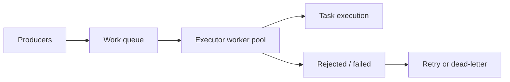
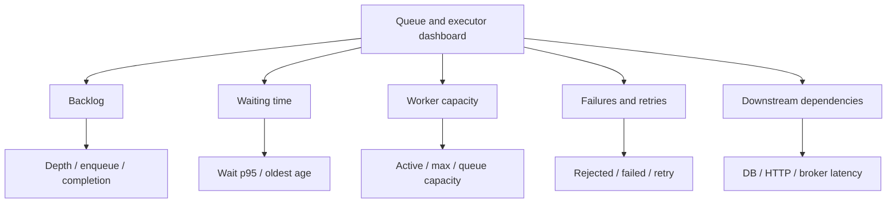

# Dashboard queue và executor trong Spring Boot

Queue và executor quyết định khả năng hấp thụ tải và thực thi công việc bất đồng bộ. Queue giữ task đang chờ; executor lấy task và chạy trên worker threads. Khi tốc độ enqueue lớn hơn tốc độ xử lý, queue depth và queue age tăng. Khi worker pool bão hòa, active threads chạm giới hạn, task chờ lâu hoặc bị reject.

Dashboard cần trả lời: backlog đang tăng hay giảm, task chờ lâu nhất bao nhiêu, worker còn capacity không, throughput có theo kịp ingress không và có task nào bị reject hoặc timeout không. **Queue depth đơn lẻ không đủ để đánh giá sức khỏe**: queue nhỏ đang tăng nhanh và task age vượt SLA có thể nguy hiểm hơn queue lớn đang giảm.

Bài **“Dashboard queue và executor”** thuộc chương **Dashboard và alert** của module **SPRING_BOOT_OBSERVABILITY**. Module hướng dẫn thiết lập observability cho Spring Boot bằng Micrometer Observation, metrics, logs và distributed tracing; học propagation ngữ cảnh, tag/cardinality, exporter, sampling và liên kết tín hiệu để điều tra lỗi, độ trễ và hành vi ứng dụng trên môi trường thực.

## 1. Phân biệt queue và executor

- Queue nhận và giữ công việc đang chờ xử lý.
- Executor quản lý worker threads thực thi task.
- Producer/enqueuer tạo công việc.
- Consumer/worker lấy task, thực thi và hoàn tất.
- Rejection xảy ra khi executor không thể nhận thêm task theo policy.
- Retry hoặc dead-letter handling có thể tạo thêm queue và luồng xử lý khác.



Với message broker, queue depth có thể đến từ broker-native metrics; với in-process executor, queue size đến từ ThreadPoolExecutor hoặc instrumentation tương ứng. Không gộp hai nguồn thành một metric nếu semantics khác nhau.

## 2. Các câu hỏi dashboard phải trả lời

| Nhóm | Câu hỏi |
| --- | --- |
| Backlog | Có bao nhiêu task đang chờ? Backlog tăng hay giảm? |
| Waiting time | Task chờ bao lâu trước khi bắt đầu? Task cũ nhất bao nhiêu? |
| Processing capacity | Executor có bao nhiêu worker active/idle? Throughput hiện tại? |
| Failure and saturation | Có task bị reject, timeout, retry hoặc fail không? |

Đặt panel theo thứ tự symptom tới cause: backlog và age trước, throughput tiếp theo, pool utilization/rejection sau đó. Người trực ca cần thấy service nào có backlog nguy hiểm và nguyên nhân có thể nằm ở consumer capacity hay downstream dependency.

## 3. Queue metrics cần theo dõi

| Metric | Ý nghĩa | Cách dùng |
| --- | --- | --- |
| queue depth/size | Số task đang chờ | Nhìn backlog hiện tại |
| enqueue rate | Số task được thêm mỗi giây | Đo ingress |
| dequeue/start rate | Số task bắt đầu xử lý mỗi giây | Đo tốc độ worker nhận việc |
| completion rate | Số task hoàn tất mỗi giây | Đo throughput |
| oldest task age | Tuổi của task chờ lâu nhất | Phát hiện starvation |
| queue wait duration | Thời gian từ enqueue tới execution start | Đo latency do chờ |
| rejected/dropped count | Task không được nhận hoặc bị bỏ | Phát hiện capacity/policy failure |
| retry count | Số lần task được thử lại | Nhận diện lỗi lặp |

Không phải queue abstraction nào cũng cung cấp sẵn mọi metric. Với broker, dùng native queue depth/consumer lag/oldest message age nếu có. Với in-memory queue, instrument enqueue/dequeue và thời điểm tạo task.

## 4. Executor metrics cần theo dõi

| Metric | Ý nghĩa |
| --- | --- |
| pool size | Số worker threads hiện tại |
| core/max pool size | Giới hạn cấu hình |
| active threads | Worker đang thực thi task |
| queue size | Task đang chờ trong executor queue |
| remaining queue capacity | Số slot còn lại nếu queue bounded |
| completed task count | Tổng task đã hoàn tất |
| task rejection count | Task bị từ chối |
| task execution duration | Thời gian worker thực thi |
| task wait duration | Thời gian task nằm trong queue |
| task failure count | Task kết thúc bằng lỗi |

Active threads gần max trong thời gian dài cùng queue growth là dấu hiệu saturation. Pool size lớn không tự chứng minh có capacity; cần đối chiếu CPU, downstream latency, task blocking và rejection policy.

## 5. Instrument ThreadPoolTaskExecutor

Spring cung cấp ThreadPoolTaskExecutor để cấu hình executor. Có thể expose executor qua bean và đăng ký gauges cho pool/queue state.

```java
@Configuration
public class WorkerConfiguration {

    @Bean
    ThreadPoolTaskExecutor orderExecutor() {
        ThreadPoolTaskExecutor executor = new ThreadPoolTaskExecutor();
        executor.setThreadNamePrefix("order-worker-");
        executor.setCorePoolSize(8);
        executor.setMaxPoolSize(16);
        executor.setQueueCapacity(200);
        executor.setRejectedExecutionHandler(
                new ThreadPoolExecutor.AbortPolicy());
        executor.initialize();
        return executor;
    }
}
```

Có thể bind executor metrics bằng Micrometer ExecutorServiceMetrics hoặc instrumentation phù hợp với Spring Boot/Micrometer version. Ví dụ:

```java
ExecutorServiceMetrics.monitor(
        registry,
        executor.getThreadPoolExecutor(),
        "order.executor",
        Tags.of("executor", "order")
);
```

API overload cụ thể phụ thuộc Micrometer version; kiểm tra Javadoc và auto-configuration hiện tại. Không bind cùng executor nhiều lần vì có thể tạo duplicate meters hoặc registration conflicts.

Tên metric được chuẩn hóa theo registry. Xem meter thực tế trong Actuator hoặc registry test trước khi viết dashboard query.

## 6. Queue metrics cho in-process work queue

Với BlockingQueue hoặc queue abstraction riêng, có thể đăng ký Gauge cho queue size và remaining capacity. Gauge nên tham chiếu một queue ổn định, đăng ký một lần khi application startup.

```java
@Bean
MeterBinder orderQueueMetrics(BlockingQueue<OrderTask> orderQueue) {
    return registry -> {
        Gauge.builder("order.queue.size", orderQueue, BlockingQueue::size)
                .tag("queue", "orders")
                .register(registry);

        Gauge.builder("order.queue.remaining", orderQueue,
                BlockingQueue::remainingCapacity)
                .tag("queue", "orders")
                .register(registry);
    };
}
```

Queue size là snapshot tại thời điểm scrape. Nó không cho biết tốc độ tăng/giảm hoặc tuổi của task. Muốn đo queue wait/oldest age, ghi timestamp enqueue và record duration khi worker bắt đầu.

Không tạo Gauge theo từng task hoặc tenant. Một queue identity ổn định với tag values hữu hạn thường là đủ.

## 7. Đo queue wait duration

Queue wait duration là thời gian từ lúc task được enqueue tới lúc worker bắt đầu xử lý. Nó khác task execution duration.

Gắn thời điểm enqueue vào task envelope:

```java
record QueuedTask<T>(T payload, long enqueuedAtNanos) {
    static <T> QueuedTask<T> of(T payload) {
        return new QueuedTask<>(payload, System.nanoTime());
    }
}
```

Khi worker lấy task:

```java
long waitedNanos = System.nanoTime() - task.enqueuedAtNanos();
queueWaitTimer.record(waitedNanos, TimeUnit.NANOSECONDS);
```

Dùng monotonic clock như System.nanoTime cho elapsed duration trong cùng process; không dùng wall-clock timestamp để trừ duration vì clock có thể bị điều chỉnh. Với queue qua broker hoặc nhiều hosts, timestamp cần clock synchronization và semantics rõ ràng.

## 8. Throughput và backlog trend

Dashboard nên hiển thị ingress, starts và completions cùng nhau:

- Enqueue rate cao hơn completion rate: backlog có xu hướng tăng.
- Completion rate cao hơn enqueue rate: backlog có thể giảm.
- Queue depth ổn định nhưng oldest age tăng: có thể task starvation hoặc stuck.
- Dequeue rate cao nhưng completion rate thấp: worker nhận task nhưng xử lý chậm hoặc fail.
- Retry rate cao: throughput hữu ích có thể thấp hơn số attempt.

Không so sánh raw counter values giữa process restarts. Dùng rate/increase trong cửa sổ thời gian và xử lý counter resets theo query engine.

## 9. PromQL cho dashboard

Tên metric chính xác tùy registry và naming convention. Các truy vấn sau minh họa với metric names giả định đã được xác minh trong Prometheus.

Queue depth:

```promql
order_queue_size{queue="orders"}
```

Queue enqueue rate:

```promql
sum(rate(order_queue_enqueued_total{queue="orders"}[5m]))
```

Completion throughput:

```promql
sum(rate(order_tasks_completed_total{queue="orders"}[5m]))
```

Task rejection rate:

```promql
sum(rate(order_executor_rejected_total{executor="order"}[5m]))
```

Executor active utilization:

```promql
order_executor_active_threads{executor="order"}
/
order_executor_max_threads{executor="order"}
```

Queue capacity utilization:

```promql
order_executor_queue_size{executor="order"}
/
(
  order_executor_queue_size{executor="order"}
  +
  order_executor_queue_remaining{executor="order"}
)
```

Nếu queue không bounded hoặc remaining capacity không được cung cấp, không dùng công thức capacity utilization này. Dùng depth, oldest age và throughput trend thay thế.

## 10. Bố cục dashboard đề xuất

Một dashboard queue/executor có thể chia thành các hàng:

1. **Overview:** queue depth, oldest age, enqueue/completion rate, rejection rate.
2. **Queue health:** depth theo queue, wait duration p50/p95/p99, oldest task age, retry/drop.
3. **Executor capacity:** active/max threads, pool size, queue occupancy, completed/rejected.
4. **Task performance:** execution duration, failure rate, downstream wait/latency.
5. **Dependencies:** DB/HTTP latency, connection pool pressure, circuit breaker state.
6. **Operational context:** deploy version, instance, recent restart và scaling events.



Dùng dashboard variables cho service, environment, queue và executor names. Tránh biến instance thành dimension mặc định ở mọi panel nếu số replicas lớn; giữ aggregate view trước, drill down theo instance khi cần.

## 11. Alert backlog tăng và task age vượt ngưỡng

Alert nên phản ánh tác động, không chỉ một giá trị tức thời.

Backlog growth:

```promql
(
  sum(rate(order_queue_enqueued_total[5m]))
  -
  sum(rate(order_tasks_completed_total[5m]))
) > 0
```

Điều kiện này chỉ cho thấy ingress vượt completion trong cửa sổ; cần kết hợp queue depth hoặc oldest age để tránh alert khi queue vẫn thấp và burst ngắn là bình thường.

Queue age:

```promql
order_queue_oldest_task_age_seconds{queue="orders"} > 300
```

Executor rejection:

```promql
increase(order_executor_rejected_total{executor="order"}[5m]) > 0
```

Ngưỡng 300 giây chỉ là ví dụ; đặt theo business SLA/task deadline. Với rejection counter, dùng increase/rate và cấu hình for duration nếu cần tránh cảnh báo do một sự kiện đã xử lý.

## 12. Alert saturation cần nhiều tín hiệu

Không alert chỉ vì active threads = max trong một scrape. Pool có thể đạt max ngắn hạn mà không ảnh hưởng người dùng.

Saturation alert nên kết hợp active/max utilization cao liên tục, queue depth/occupancy tăng, queue wait p95 vượt SLO, rejection rate tăng, completion throughput không theo kịp enqueue và downstream latency/error.

Ví dụ utilization:

```promql
(
  order_executor_active_threads{executor="order"}
  /
  order_executor_max_threads{executor="order"}
) > 0.9
```

Kết hợp với queue growth và wait latency trong alert rule group. Chọn for duration phù hợp workload để tránh alert theo spike ngắn.

## 13. Capacity planning từ Little's Law

Little's Law liên hệ số lượng công việc trung bình, throughput và thời gian lưu lại:

\[
L = \lambda W
\]

Trong đó L là số task trung bình trong queue/system, λ là throughput trung bình (tasks/second), W là thời gian trung bình trong system (seconds).

Ví dụ worker xử lý trung bình 40 tasks/second và thời gian chờ+phục vụ là 2 seconds, số task trung bình trong system xấp xỉ 80. Đây là quan hệ steady-state; không dùng để suy capacity tối đa khi hệ thống overload hoặc arrival/service rates biến động mạnh.

Sizing executor cần thêm CPU cores, blocking ratio, downstream concurrency limits, task duration distribution và queue wait SLO. Tăng queue capacity chỉ hấp thụ burst lâu hơn; nó không làm tăng processing capacity và có thể làm latency xấu hơn.

## 14. Backpressure và rejection policy

Executor queue bounded giúp giới hạn memory và phát hiện overload. RejectedExecutionHandler quyết định behavior khi queue đầy:

| Policy | Behavior | Hệ quả |
| --- | --- | --- |
| AbortPolicy | Ném RejectedExecutionException | Caller thấy overload rõ |
| CallerRunsPolicy | Caller thread chạy task | Tạo backpressure nhưng có thể tăng request latency |
| DiscardPolicy | Bỏ task mới | Có nguy cơ mất công việc âm thầm |
| DiscardOldestPolicy | Bỏ task cũ nhất trong queue | Có nguy cơ mất task quan trọng |

Chọn policy theo semantics nghiệp vụ. Nếu task không thể mất, cần durable queue/broker hoặc persistence thay vì chỉ dựa vào in-memory executor. Instrument rejected/discarded tasks để không biến overload thành silent data loss.

## 15. Correlate queue metrics với task traces

Metrics cho biết xu hướng tổng thể; traces giúp điều tra task cụ thể. Với async work, propagate trace context qua task envelope/message headers khi phù hợp.

Có thể ghi queue wait duration trên consumer/task span, task execution duration, retry attempt/final outcome, logical queue/executor name và links tới producer spans nếu batch có nhiều parent contexts.

Không đưa task ID, customer ID hoặc payload vào metric tags. Nếu cần tìm task cụ thể, dùng trace/log identifiers với policy bảo mật phù hợp.

Sampling có thể làm một số task traces không có mặt, trong khi metrics vẫn ghi nhận aggregate queue behavior. Không kỳ vọng mọi queue metric point có một trace tương ứng.

## 16. Chẩn đoán queue backlog

| Triệu chứng | Nguyên nhân có thể | Cách kiểm tra |
| --- | --- | --- |
| Depth tăng, completion thấp | Worker thiếu capacity hoặc task chậm | Active threads, execution duration, CPU |
| Depth thấp nhưng oldest age cao | Task starvation hoặc stuck | Queue ordering, worker progress, age metric |
| Active threads max, queue tăng | Executor saturation | Wait duration, downstream calls, rejection |
| Rejection tăng | Queue đầy hoặc pool max | Queue capacity, policy, ingress burst |
| Dequeue cao, completion thấp | Task fail/retry hoặc blocking | Failure/retry metrics và traces |
| CPU thấp nhưng active threads max | Workers block I/O/lock | Thread dump, downstream latency |
| CPU cao và execution duration tăng | CPU-bound task hoặc contention | CPU profile, GC, task mix |
| Retry tăng làm backlog phình | Dependency failure/retry storm | Retry policy, circuit breaker, DLQ |
| Queue depth về 0 nhưng errors tăng | Tasks bị reject/drop hoặc fail nhanh | Rejected, failed và dropped counters |
| Một executor chậm, executor khác khỏe | Pool sizing/task isolation | Executor-specific panels |

Quy trình điều tra:

1. Xác định queue nào backlog tăng.
2. So sánh enqueue, start và completion rates.
3. Kiểm tra oldest age và wait p95.
4. Xem active/max threads, queue capacity và rejection.
5. Kiểm tra task execution duration và failure/retry.
6. Correlate downstream DB/HTTP latency và circuit breaker.
7. Dùng thread dump/profiling nếu workers bị block.
8. Quyết định giảm ingress, scale workers, tối ưu task hoặc khôi phục dependency.
9. Theo dõi backlog drain rate sau thay đổi.

## 17. Bài thực hành: dashboard executor

Thực hiện trong local/staging:

1. Tạo ThreadPoolTaskExecutor có core/max size và bounded queue.
2. Bind executor metrics bằng Micrometer.
3. Đăng ký Gauge cho in-process queue size và remaining capacity nếu cần.
4. Instrument enqueue, completion, failure, rejection và queue wait duration.
5. Chạy workload ổn định để tạo baseline throughput.
6. Tăng producer rate vượt worker capacity để tạo backlog.
7. Quan sát active/max threads, queue depth, oldest age và rejection.
8. Làm task chậm bằng dependency mock để xem downstream latency ảnh hưởng executor.
9. Xây PromQL panels cho enqueue/completion rate, wait p95 và utilization.
10. Tạo alert cho queue age, backlog growth và rejection.
11. Thử từng rejection policy trong môi trường test và xác minh task outcome.
12. Khôi phục tải bình thường và xác minh backlog drain.

Kết quả mong đợi: dashboard phân biệt queue backlog, executor saturation, task execution slowdown và downstream dependency failure.

## 18. Câu hỏi tự kiểm tra

1. Queue depth khác executor active threads thế nào?
2. Vì sao oldest task age bổ sung thông tin cho queue size?
3. Những metrics nào cần có để đo enqueue/dequeue/completion throughput?
4. ThreadPoolTaskExecutor expose những thông tin pool nào?
5. Queue wait duration khác task execution duration ra sao?
6. Vì sao dùng System.nanoTime để đo elapsed time trong process?
7. Khi nào không thể dùng queue capacity utilization?
8. Làm sao nhận biết ingress đang vượt completion rate?
9. Vì sao active threads = max chưa đủ để alert?
10. Little's Law giúp capacity planning thế nào?
11. Queue capacity lớn có làm tăng processing capacity không?
12. RejectedExecutionHandler ảnh hưởng task semantics ra sao?
13. Khi nào CallerRunsPolicy tạo backpressure?
14. Làm sao correlate queue metrics với task traces?
15. Những tags nào không nên dùng cho queue/executor metrics?
16. Khi backlog tăng nhưng CPU thấp, cần kiểm tra điều gì?
17. Làm sao phân biệt task stuck với task processing chậm?
18. Sau khi scale workers, cần theo dõi metric nào để xác minh backlog drain?

## Tài liệu tham khảo

- [Spring Boot — Task Execution and Scheduling](https://docs.spring.io/spring-boot/reference/features/task-execution-and-scheduling.html): executor auto-configuration và task execution.
- [Spring Framework — Task Execution and Scheduling](https://docs.spring.io/spring-framework/reference/integration/scheduling.html): TaskExecutor và scheduling abstractions.
- [Micrometer — MeterRegistry](https://docs.micrometer.io/micrometer/reference/concepts/registry.html): meter registration và registry behavior.
- [Prometheus — Querying](https://prometheus.io/docs/prometheus/latest/querying/basics/): PromQL query basics.
- [Prometheus — Alerting Rules](https://prometheus.io/docs/prometheus/latest/configuration/alerting_rules/): alert rule configuration.
- [Java ThreadPoolExecutor Javadoc](https://docs.oracle.com/en/java/javase/21/docs/api/java.base/java/util/concurrent/ThreadPoolExecutor.html): pool sizing, queueing và rejection semantics.

## Kết luận

**Dashboard queue và executor phải cho thấy backlog, thời gian chờ, năng lực worker và task failures trong cùng một góc nhìn.** Queue depth cho biết số công việc đang chờ; oldest age và wait duration cho biết mức chậm; active/max threads và queue capacity cho biết saturation; completion/rejection/retry rates cho biết kết quả xử lý.

Instrument queue và executor bằng meters có tên ổn định, tags hữu hạn, đo queue wait bằng monotonic clock và kết hợp PromQL panels/alerts theo SLA. Khi backlog tăng, đối chiếu throughput, thread pool, task duration và downstream dependencies trước khi tăng queue capacity. Điều đó giúp chọn đúng hành động: giảm ingress, scale worker, tối ưu task hoặc khôi phục dependency.

