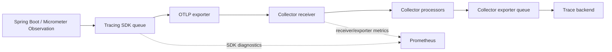

# Alert theo exporter failure trong Spring Boot

Một ứng dụng Spring Boot vẫn xử lý request bình thường nhưng trace hoặc metrics không tới được backend. Collector có thể unavailable, DNS/TLS lỗi, exporter timeout, queue đầy hoặc credentials hết hạn. Nếu chỉ theo dõi business request errors, đội vận hành có thể không nhận ra telemetry pipeline đang mất dữ liệu. **Alert theo exporter failure** giúp phát hiện sớm khi telemetry không được gửi, bị drop hoặc bị backlog, để khôi phục khả năng quan sát trước khi incident khác xảy ra.

Exporter failure là lỗi của observability pipeline; không phải lúc nào cũng là lỗi của business service. Alert cần phân biệt export failures, export timeouts, queue saturation, dropped telemetry và Collector health. Một cảnh báo hữu ích chỉ ra signal nào bị ảnh hưởng, mức độ mất dữ liệu, phạm vi instance và bước điều tra đầu tiên. Không nên tạo một alert chung chung cho mọi lỗi mạng hoặc mọi lần retry.

Bài **Alert theo exporter failure** thuộc chương **Dashboard và alert** của module **SPRING_BOOT_OBSERVABILITY**. Module tập trung thiết lập observability cho Spring Boot bằng Micrometer Observation, metrics, logs và distributed tracing; học context propagation, tag/cardinality, exporter, sampling và liên kết tín hiệu để điều tra lỗi, độ trễ và hành vi ứng dụng trên môi trường thực.

## 1. Mục tiêu học tập

Sau bài học, bạn có thể:

- Phân biệt exporter failure với business request failure.
- Nhận biết export errors, timeouts, retries, dropped spans và queue saturation.
- Theo dõi exporter pipeline ở application và Collector.
- Viết Prometheus alert rules với rate(), increase() và for duration.
- Chọn severity dựa trên mức telemetry bị ảnh hưởng.
- Tránh alert nhiễu khi exporter có retry transient.
- Thiết kế dashboard và runbook cho trace/metrics/logs exporters.
- Kiểm thử alert bằng cách làm Collector unavailable có kiểm soát.

## 2. Exporter failure là gì?

Exporter chuyển telemetry từ process hoặc Collector tới điểm nhận tiếp theo. Tùy kiến trúc, điểm nhận có thể là OpenTelemetry Collector qua OTLP, Prometheus scrape endpoint, hoặc backend telemetry trực tiếp.

Một số failure modes thường gặp:

- **Connection failure:** DNS, routing, connection refused hoặc network policy.
- **TLS/authentication failure:** certificate không tin cậy, token sai/hết hạn hoặc mTLS mismatch.
- **Timeout:** Collector/backend phản hồi chậm hơn export timeout.
- **Throttling/rejection:** receiver trả lỗi do rate limit, payload không hợp lệ hoặc quá tải.
- **Queue saturation:** tốc độ tạo telemetry vượt tốc độ export trong thời gian đủ dài.
- **Dropped telemetry:** SDK/Collector loại bỏ data khi queue đầy hoặc khi shutdown.
- **Configuration failure:** endpoint, protocol, port hoặc exporter pipeline sai.

### Exporter failure khác business failure

Business request có thể thành công trong khi span export thất bại vì tracing thường được gửi bất đồng bộ. Ngược lại, exporter có thể hoạt động bình thường dù business request trả 500. Cần theo dõi hai nhóm độc lập và liên kết chúng khi điều tra.

| Nhóm | Ví dụ | Tác động chính |
| --- | --- | --- |
| Business signals | HTTP 5xx, latency, DB errors | Người dùng và chức năng ứng dụng |
| Telemetry export | Export failures, timeouts, dropped spans | Khả năng quan sát và điều tra |
| Collector/backend | Receiver refused, exporter queue full, backend unavailable | Phạm vi nhiều services cùng gửi telemetry |

## 3. Vẽ pipeline trước khi tạo alert

Một pipeline có thể gồm SDK trong ứng dụng, Collector và backend:



Mỗi boundary có telemetry riêng. SDK queue full không giống Collector exporter queue full. Exporter gửi thành công tới Collector chỉ chứng minh hop đó đã nhận request; Collector vẫn có thể drop hoặc fail khi export tiếp tới backend.

Trước khi viết query, xác định:

1. Application dùng Micrometer Tracing với Brave hay OpenTelemetry bridge?
2. Có dùng OTel Java agent hay Spring Boot-managed SDK?
3. Exporter gửi trực tiếp tới backend hay qua Collector?
4. Prometheus scrape metrics của application và Collector ở đâu?
5. Những metrics exporter/queue nào thực sự được bật ở version hiện tại?

Tên metric phụ thuộc SDK, exporter, Collector distribution và version. Hãy kiểm tra exposition thực tế thay vì giả định một tên series cố định.

## 4. Những tín hiệu cần theo dõi

### Export failures và timeouts

Theo dõi số lần export thất bại và số lần timeout theo exporter, signal và service. Nếu exporter phát metric dạng counter, dùng rate() để phát hiện lỗi đang diễn ra:

```promql
sum by (service_name) (
  rate(otel_exporter_send_failed_spans[5m])
)
```

Tên otel_exporter_send_failed_spans là ví dụ minh họa, không phải cam kết tên metric cho mọi SDK. Thay bằng series tương ứng trong telemetry thực tế. Nếu metrics không có service_name, dùng labels được scrape target cung cấp hoặc bỏ grouping.

### Dropped spans

Dropped spans là tín hiệu mạnh vì dữ liệu đã mất trước khi đến backend:

```promql
sum by (service_name) (
  increase(otel_sdk_span_dropped_total[10m])
)
```

Đây cũng là tên khái niệm minh họa. SDK có thể expose dropped count qua internal metrics, logs hoặc không expose mặc định; cần bật/bridge diagnostic metrics phù hợp. Phân biệt drop do queue full, processor shutdown và sampling: sampling có chủ đích không nhất thiết là exporter failure.

### Queue utilization

Nếu SDK/Collector cung cấp queue size và capacity:

```promql
max by (service_name) (
  otel_exporter_queue_size
  /
  clamp_min(otel_exporter_queue_capacity, 1)
)
```

Query trên biểu diễn tỷ lệ queue utilization. Series names có thể khác; Collector exporter queue metrics cũng khác SDK span processor queue metrics. Tạo dashboard riêng hoặc labels phân biệt rõ hai vị trí.

### Collector health và exporter queue

Collector cần được giám sát như một service độc lập. Theo dõi receiver accepted/refused telemetry, exporter send failures, queue size/capacity, process memory/CPU và scrape target health. Nếu nhiều application exporters cùng lỗi một lúc, nguyên nhân có thể nằm ở Collector hoặc backend chung.

## 5. Viết alert rules cho Prometheus

Alert rule thường có bốn phần:

- **Expression:** điều kiện đo lường failure.
- **For duration:** thời gian điều kiện phải liên tục đúng trước khi firing.
- **Labels:** severity, team, service hoặc environment.
- **Annotations:** summary, impact và runbook link.

Ví dụ alert khi export failures kéo dài:

```yaml
groups:
  - name: telemetry-export
    rules:
      - alert: TelemetryExportFailures
        expr: |
          sum by (service_name) (
            rate(otel_exporter_send_failed_spans[5m])
          ) > 0
        for: 5m
        labels:
          severity: warning
        annotations:
          summary: Trace export is failing for service {{ $labels.service_name }}
          description: Check exporter connectivity, Collector receiver and authentication.
```

Đây là mẫu rule. Thay metric và labels theo instrumentation thực tế; nếu exporter không expose counter này, chọn diagnostic signal có sẵn. for: 5m giúp bỏ qua một lỗi ngắn, nhưng thời gian phải phù hợp với retry/backoff và mức độ mất telemetry có thể chấp nhận.

### Alert khi dropped spans tăng

```yaml
groups:
  - name: telemetry-export
    rules:
      - alert: TelemetrySpansDropped
        expr: |
          sum by (service_name) (
            increase(otel_sdk_span_dropped_total[10m])
          ) > 0
        for: 2m
        labels:
          severity: critical
        annotations:
          summary: Spans are being dropped by the telemetry pipeline
          description: Inspect SDK queue saturation, Collector health and export throughput.
```

Dropped spans đã xác nhận telemetry mất; severity có thể cao hơn transient retry. Tuy nhiên, đánh giá volume và phạm vi: một vài spans bị drop trong shutdown có thể có mức ảnh hưởng khác với hàng nghìn spans/giây bị mất.

### Alert queue saturation

```yaml
groups:
  - name: telemetry-export
    rules:
      - alert: TelemetryExporterQueueNearCapacity
        expr: |
          max by (service_name) (
            otel_exporter_queue_size
            /
            clamp_min(otel_exporter_queue_capacity, 1)
          ) > 0.8
        for: 10m
        labels:
          severity: warning
        annotations:
          summary: Telemetry exporter queue is near capacity
          description: Export throughput may be lower than telemetry production rate.
```

Ngưỡng 80% chỉ là điểm khởi đầu. Dùng threshold theo queue capacity, burst pattern và tốc độ drain sau khi Collector phục hồi. Nếu không có capacity metric, không thể tính utilization đáng tin cậy từ queue size riêng lẻ.

## 6. Severity và alert fatigue

Không phải mọi export failure đều cần page ngay. Severity nên phản ánh data loss, thời gian kéo dài và phạm vi:

| Severity | Điều kiện gợi ý | Hành động |
| --- | --- | --- |
| Info | Một vài retry transient, chưa có drop | Ghi nhận, không page |
| Warning | Export failures kéo dài hoặc queue tăng liên tục | Điều tra trong giờ trực |
| Critical | Dropped telemetry tăng nhanh, queue liên tục đầy hoặc toàn bộ traces mất | Page telemetry/on-call owner |
| Resolved | Export ổn định, queue drain và không còn drops | Xác nhận recovery |

Không gắn critical chỉ vì một request export timeout. Retry có thể tự phục hồi. Ngược lại, queue utilization cao kéo dài có thể báo trước data loss dù chưa có dropped spans.

### Thêm for và rate windows đúng cách

Rate window tính tốc độ lỗi từ counter; for yêu cầu điều kiện tồn tại liên tục trước khi firing. Ví dụ rate(...[5m]) kết hợp for: 5m có thể cần khoảng thời gian đáng kể mới báo động. Chọn chúng theo detection objective, scrape interval và exporter retry/backoff.

## 7. Tách cảnh báo theo signal

Traces, metrics và logs có pipeline riêng. Một exporter failure của traces không nhất thiết làm metrics exporter fail. Tách alert theo signal:

| Signal | Theo dõi |
| --- | --- |
| Traces | Failed span exports, dropped spans, BatchSpanProcessor queue, OTLP exporter latency |
| Metrics | Push failures, scrape target down, registry/export errors, Collector metrics pipeline |
| Logs | Async appender queue, log processor drops, log exporter failures |

Nếu cả ba signal cùng mất, kiểm tra network, Collector, DNS, TLS, credentials và backend chung. Nếu chỉ một signal mất, tập trung vào exporter/processor tương ứng.

## 8. Dashboard cho exporter failure

Dashboard nên giúp xác định failure nằm ở application, Collector hay backend:

1. Export failure rate theo service và signal.
2. Dropped spans/logs/metrics theo thời gian.
3. SDK queue utilization và Collector exporter queue utilization.
4. Export duration/timeout và retry rate.
5. Collector receiver accepted/refused rate.
6. Collector exporter success/failure rate.
7. Collector CPU, memory, restarts và scrape target health.

Thêm annotations cho deploy, Collector config changes và backend maintenance. Khi alert firing, người trực có thể đối chiếu thời điểm queue bắt đầu tăng với thay đổi gần nhất.

### Tránh cardinality cao trong alert labels

Alert labels nên là dimensions ổn định như service, environment, exporter và signal. Không thêm trace ID, span ID, request ID, raw endpoint URL hoặc exception message làm label. Những giá trị này tạo alert instances không giới hạn và làm routing khó kiểm soát.

## 9. Runbook khi exporter failure

Khi alert firing:

1. Xác định signal nào bị ảnh hưởng: traces, metrics hay logs.
2. Xác định phạm vi: một instance, một service hay nhiều services.
3. Kiểm tra exporter endpoint, protocol, DNS, network route, TLS và credentials.
4. Kiểm tra application SDK queue và dropped telemetry.
5. Kiểm tra Collector receiver accepted/refused metrics.
6. Kiểm tra Collector exporter queue, retries và downstream backend health.
7. Đối chiếu deployment/configuration changes.
8. Sau khi phục hồi, xác nhận queue drain, failure rate về baseline và telemetry mới truy vấn được.

Không tăng queue vô hạn như biện pháp chữa cháy. Nếu export throughput dài hạn thấp hơn telemetry arrival rate, queue sẽ đầy trở lại. Có thể giảm sampling có chủ đích, tăng Collector/exporter capacity hoặc sửa bottleneck backend.

## 10. Kiểm thử alert và failure scenarios

Alert rules cần được kiểm thử trước khi đưa vào production:

- Unit-test Prometheus rules bằng promtool test rules.
- Dùng test fixture để xác minh firing/resolved transitions.
- Tạo Collector outage có kiểm soát trong môi trường test.
- Mô phỏng TLS/auth failure và network timeout.
- Tạo traffic đủ lớn để queue saturation có thể tái hiện.
- Kiểm tra alert labels/annotations và routing tới đúng team.

Ví dụ cấu trúc rule test:

```yaml
rule_files:
  - exporter-alerts.yml

evaluation_interval: 1m

tests:
  - interval: 1m
    input_series:
      - series: 'otel_exporter_send_failed_spans{service_name="orders"}'
        values: '0 1 2 3 4 5 6 7'
    alert_rule_test:
      - eval_time: 7m
        alertname: TelemetryExportFailures
        exp_alerts:
          - exp_labels:
              service_name: orders
              severity: warning
```

Đây là minh họa cấu trúc test; cần đồng bộ rule expression, evaluation timing, labels và cú pháp promtool với phiên bản Prometheus. Counter values phải phản ánh đúng chuỗi samples để rate window có đủ dữ liệu.

## 11. Troubleshooting

| Triệu chứng | Nguyên nhân có thể | Hướng kiểm tra |
| --- | --- | --- |
| Export failures tăng ở mọi service | Collector/backend hoặc network chung lỗi | Kiểm tra Collector targets, receiver và backend |
| Chỉ một service export lỗi | Endpoint/auth/config riêng của service | So sánh environment variables và exporter config |
| Timeout nhưng không có drops | Retry còn xử lý được, queue chưa đầy | Theo dõi queue trend và retry recovery |
| Dropped spans tăng | SDK queue đầy hoặc processor shutdown | Kiểm tra arrival/export throughput và lifecycle |
| Collector nhận nhưng backend không có traces | Collector processor/exporter lỗi | Kiểm tra downstream exporter queue và backend |
| Queue cao nhưng failure counter bằng 0 | Exporter đang chậm nhưng chưa trả lỗi | Theo dõi export duration và queue slope |
| Alert firing quá thường xuyên | for ngắn, transient retries hoặc threshold thấp | Điều chỉnh window/for và severity |
| Không có metric exporter diagnostics | SDK/Collector internal telemetry chưa bật | Bật telemetry endpoint/metrics theo version |
| Alert không firing dù export lỗi | Sai metric name, label hoặc scrape target | Kiểm tra Prometheus query và series thực tế |
| Alert không resolve sau recovery | Queue chưa drain hoặc condition còn đúng | Kiểm tra throughput và rule evaluation |
| Queue đầy sau khi tăng capacity | Throughput dài hạn vẫn thấp hơn arrival rate | Tăng export capacity hoặc giảm span rate |
| Chỉ traces mất, metrics vẫn có | Tracing processor/exporter riêng bị lỗi | Kiểm tra BatchSpanProcessor và OTLP traces pipeline |

### Checklist sau recovery

1. Export failure rate trở về baseline.
2. Dropped telemetry không tiếp tục tăng.
3. Queue utilization giảm và ổn định.
4. Collector receiver/exporter không còn refused/failures bất thường.
5. Trace/metric/log mới xuất hiện trong backend.
6. Alert chuyển resolved và runbook ghi nhận nguyên nhân.

## 12. Thực hành: cảnh báo khi OTLP trace exporter lỗi

**Bối cảnh:** order-service gửi spans qua OTLP tới Collector. Khi Collector restart, export timeout tăng, queue dâng lên và sau đó spans bị drop. Nhóm cần alert trước khi data loss trở nên nghiêm trọng.

### Phần A — Chuẩn bị

1. Xác định SDK/exporter implementation và version.
2. Bật diagnostic metrics cho export failures, queue và dropped spans nếu được hỗ trợ.
3. Bật Prometheus scrape cho application và Collector telemetry endpoints.
4. Ghi nhận baseline export latency, queue utilization và span arrival rate.
5. Viết alert rules theo đúng metric names/labels thực tế.

### Phần B — Kiểm chứng

| Ca | Thao tác | Kết quả cần quan sát |
| --- | --- | --- |
| A — Normal | Gửi traffic ổn định | Queue thấp, exporter failure rate bằng 0 |
| B — Transient timeout | Gây network delay ngắn | Retry tăng nhưng alert page không firing sớm |
| C — Collector restart | Restart Collector trong test | Export failures/queue tăng theo dự kiến |
| D — Queue pressure | Tăng spans có kiểm soát | Warning queue alert firing trước data loss |
| E — Drop | Vượt capacity trong test | Dropped-span alert firing |
| F — Recovery | Khôi phục Collector | Queue drain, errors giảm, alert resolved |
| G — Auth failure | Dùng credential test không hợp lệ | Authentication/export failure được nhận diện |
| H — Signal isolation | Giữ metrics exporter hoạt động khi traces lỗi | Chỉ trace pipeline alert firing |

### Phần C — Câu hỏi tự đánh giá

1. Vì sao business requests có thể thành công trong khi span export thất bại?
2. Exporter failure khác Collector downstream failure ở điểm nào?
3. Vì sao cần theo dõi cả queue utilization và dropped spans?
4. rate() và increase() phù hợp với loại counter nào?
5. Khi nào exporter timeout chỉ cần warning?
6. Vì sao alert theo queue saturation có thể báo trước dropped telemetry?
7. Tại sao cần tách alert traces, metrics và logs?
8. Làm sao phân biệt SDK queue full với Collector exporter queue full?
9. Vì sao tăng queue không giải quyết throughput deficit dài hạn?
10. Những điều kiện nào xác nhận pipeline đã recovery?

## 13. Ghi nhớ

**Alert theo exporter failure** bảo vệ khả năng quan sát bằng cách phát hiện export errors, timeouts, queue saturation và dropped telemetry. Hãy xác định pipeline và metric names thực tế trước khi viết PromQL; tên diagnostic metrics thay đổi theo SDK, exporter và Collector version. Theo dõi riêng application SDK và Collector queues, đồng thời phân biệt retry transient với data loss đã xảy ra.

Thiết kế alert theo signal, severity, rate window và for duration phù hợp với retry/backoff. Dùng dashboard để xác định failure boundary, labels có cardinality thấp và runbook nêu rõ bước kiểm tra network, TLS/auth, queue và backend. Kiểm thử rule bằng fixtures và failure injection trước production. Khi exporter phục hồi, xác nhận queue drain, drops dừng và telemetry mới truy vấn được. Cách này giúp phát hiện mất telemetry sớm mà không biến mọi lỗi tạm thời thành cảnh báo khẩn cấp.
