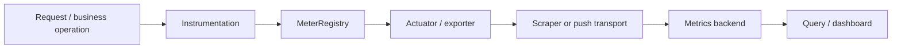

# Không thấy metrics trong Spring Boot

Một ứng dụng Spring Boot có thể vẫn xử lý request bình thường nhưng dashboard không hiển thị metrics mong đợi. Ví dụ, endpoint trả HTTP 200 nhưng không thấy http.server.requests, custom counter không tăng, hoặc Prometheus target đang UP nhưng query không trả series. Những tình huống này thường đến từ một trong các lớp của pipeline: instrumentation không tạo meter, MeterRegistry không nhận meter, Actuator không expose endpoint, scraper không thu thập, hoặc query đang tìm sai tên/tag.

**Không thấy metrics** là tình huống telemetry metric không xuất hiện ở nơi mong đợi, xuất hiện chậm, thiếu một số dimensions hoặc có giá trị không thay đổi. Cách chẩn đoán hiệu quả là đi theo đường dữ liệu từ operation tới backend: code/framework instrumentation → MeterRegistry → Actuator/exporter → scrape/publish → storage → query/dashboard. Kiểm tra từng boundary giúp xác định chính xác nơi dữ liệu biến mất.

Trong Spring Boot, Micrometer cung cấp abstraction cho meters và MeterRegistry; Actuator có thể expose danh sách/measurement qua metrics endpoint; registry như Prometheus hoặc OTLP đẩy metrics tới backend theo cơ chế riêng. Observation và tracing là pipeline liên quan nhưng không tự bảo đảm metric sẽ tồn tại. Bài học thuộc chương **Chẩn đoán sự cố** của module **SPRING_BOOT_OBSERVABILITY**, tập trung vào cách điều tra khi metrics không xuất hiện trong hệ thống observability.

## Mục tiêu học tập

1. Mô tả đường đi của metrics từ instrumentation tới dashboard.
2. Phân biệt meter chưa được tạo với meter chưa được export/scrape.
3. Kiểm tra Actuator metrics endpoint và Prometheus exposition.
4. Xác minh MeterRegistry, auto-configuration và custom binders.
5. Chẩn đoán sai tên meter, tags, filters và cardinality.
6. Phân biệt pull registry với push/export pipeline.
7. Kiểm tra security, endpoint exposure và management port.
8. Hiểu timing, lazy registration, counter behavior và scrape interval.
9. Dùng test registry và integration tests để tái tạo lỗi.
10. Thiết lập quy trình chẩn đoán có thứ tự, từ application tới backend.

## 1. Theo dõi toàn bộ metrics pipeline

Metrics đi qua nhiều lớp. Nếu một lớp không hoạt động, dashboard có thể không có series dù ứng dụng vẫn chạy.



Các điểm kiểm tra:

| Lớp | Câu hỏi | Dấu hiệu lỗi |
|---|---|---|
| Instrumentation | Operation có tạo meter không? | Không có meter trong registry |
| Registry | Meter có được đăng ký đúng registry? | Custom registry trống |
| Actuator/exporter | Meter có được expose? | Endpoint thiếu meter hoặc 404 |
| Scraper/transport | Backend có lấy được dữ liệu? | Target down, scrape error |
| Storage | Series có được ingest? | Scrape thành công nhưng không có samples |
| Query/dashboard | Query có đúng tên/labels/time range? | Series tồn tại nhưng panel rỗng |

Không bắt đầu bằng cách sửa dashboard nếu chưa xác minh meter tồn tại trong application.

## 2. Kiểm tra Actuator metrics endpoint

Với Spring Boot Actuator, endpoint metrics thường được truy cập qua /actuator/metrics. Trước hết, xác nhận dependency Actuator có trong application runtime và endpoint được expose.

Ví dụ:

```yaml
management:
  endpoints:
    web:
      exposure:
        include: health,info,metrics,prometheus
```

Prometheus endpoint cần registry Prometheus phù hợp trên classpath. Exposure list không tự thêm registry dependency. Nếu endpoint bị disable hoặc security policy chặn, request có thể trả 404, 401 hoặc 403.

### 2.1. Xem danh sách meter

Gọi:

```http
GET /actuator/metrics
```

Response liệt kê meter names có trong registry. Tìm meter cần điều tra, ví dụ http.server.requests, jvm.memory.used hoặc một custom meter.

Sau đó truy vấn meter cụ thể:

```http
GET /actuator/metrics/http.server.requests
```

Endpoint có thể trả available tags và measurements. Có thể lọc theo tag:

```http
GET /actuator/metrics/http.server.requests?tag=method:GET
```

Tên meter và tag values phụ thuộc Spring Boot/Micrometer version, web stack và instrumentation. Dùng response thực tế làm nguồn chuẩn thay vì đoán tên.

### 2.2. Phân biệt 404, 401 và 403

- **404:** endpoint không expose, không enabled, sai base path/port hoặc endpoint không có trong runtime.
- **401:** authentication chưa được cung cấp hoặc không hợp lệ.
- **403:** caller đã xác thực nhưng không có quyền.
- **200 nhưng không có meter:** registry chưa có meter đó, meter chưa được tạo hoặc đang tìm sai tên.

Đọc response và security logs trước khi thay đổi cấu hình.

## 3. Xác minh MeterRegistry được cấu hình

Spring Boot auto-configure MeterRegistry dựa trên registry implementation có trong classpath. Nếu không có backend-specific registry, ứng dụng vẫn có thể có registry khác hoặc composite registry tùy dependencies/configuration.

Trong test hoặc debug, kiểm tra bean:

```java
@Autowired
MeterRegistry meterRegistry;
```

Có MeterRegistry bean không có nghĩa mọi meter đã được bind. Kiểm tra tên và loại registry, rồi inspect meters:

```java
meterRegistry.getMeters().forEach(meter ->
        log.debug("Registered meter: {}", meter.getId()));
```

Đoạn debug này chỉ nên dùng trong môi trường kiểm thử hoặc debug có kiểm soát; tránh dump toàn bộ tag values nếu chúng có thể chứa dữ liệu nhạy cảm.

### 3.1. Custom registry bị tách khỏi registry chính

Một lỗi thường gặp là code tự tạo SimpleMeterRegistry hoặc registry mới rồi ghi meter vào đó, trong khi Actuator/Prometheus scrape một registry khác. Meter tồn tại trong object custom nhưng không xuất hiện ở endpoint.

Ưu tiên inject MeterRegistry do Spring Boot quản lý. Chỉ tạo registry riêng cho test hoặc use case có chủ đích.

### 3.2. CompositeMeterRegistry

Nếu dùng CompositeMeterRegistry, kiểm tra child registries đã được add và có registry phù hợp với exporter. Meter có thể xuất hiện trong composite nhưng không được publish nếu child registry chưa cấu hình hoặc chưa được gắn.

### 3.3. Registry filter

MeterFilter có thể deny, rename hoặc transform meter IDs/tags. Nếu meter không xuất hiện, kiểm tra các filters được đăng ký trong application context và thứ tự áp dụng. Một filter deny theo prefix hoặc tag có thể loại meter mong đợi.

## 4. Kiểm tra instrumentation đã tạo meter chưa

Không phải mọi operation đều tự động có metric. Spring Boot thường instrument một số framework boundaries như HTTP server, datasource, JVM và executor khi dependencies/configuration phù hợp. Business logic tùy chỉnh cần meter hoặc Observation instrumentation rõ ràng.

Ví dụ custom counter:

```java
@Component
class PaymentMetrics {
    private final Counter acceptedPayments;

    PaymentMetrics(MeterRegistry registry) {
        this.acceptedPayments = Counter.builder("payments.accepted")
                .description("Accepted payment operations")
                .register(registry);
    }

    void recordAccepted() {
        acceptedPayments.increment();
    }
}
```

Nếu counter không tăng, kiểm tra method recordAccepted có thực sự được gọi, bean có được tạo và có dùng registry đang được export không.

### 4.1. Lazy meter registration

Một số meters được tạo khi code đăng ký meter hoặc khi operation đầu tiên xảy ra. Nếu chưa có request/operation phù hợp, meter có thể chưa xuất hiện trong danh sách. Tạo một operation có kiểm soát rồi kiểm tra lại.

### 4.2. Timer và counter semantics

Timer count thường chỉ tăng khi sample được stop/record. Nếu code bắt đầu Timer.Sample nhưng không stop, measurement chưa được ghi. Counter chỉ tăng khi increment được gọi. Gauge đọc giá trị object tại thời điểm scrape; nếu object không được cập nhật hoặc bị garbage-collected theo cách đăng ký, giá trị có thể không như mong đợi.

### 4.3. Observation không tự tạo mọi business metric

Observation có thể tạo timer/span thông qua handlers và conventions. Nếu không có metrics observation handler hoặc observation không được chạy trên registry đúng, metric tương ứng không xuất hiện. Một observation chỉ có tracing handler có thể tạo span mà không tạo meter.

## 5. Kiểm tra tên meter và naming convention

Tên meter có thể khác giữa Actuator và backend. Ví dụ Micrometer meter http.server.requests có thể được Prometheus registry chuyển thành http_server_requests_seconds với suffix _count, _sum hoặc histogram buckets tùy cấu hình.

| Nơi quan sát | Ví dụ tên |
|---|---|
| Actuator metrics | http.server.requests |
| Prometheus exposition | http_server_requests_seconds_count |
| Prometheus histogram bucket | http_server_requests_seconds_bucket |

Không copy tên từ một backend sang Actuator query hoặc ngược lại. Kiểm tra exposition trực tiếp:

```http
GET /actuator/prometheus
```

Tìm metric name trong raw output trước khi viết PromQL.

### 5.1. Suffix và unit

Timer có thể export count, sum và buckets; distribution statistics có thể chưa được bật. Nếu query tìm _bucket nhưng histogram chưa cấu hình, series đó sẽ không tồn tại dù timer count/sum có mặt.

### 5.2. Tags được chuẩn hóa

Tên tag/label có thể được chuyển đổi theo registry. Tag uri có thể chứa route template; một số stack dùng tên khác hoặc giá trị UNKNOWN. Inspect raw series và label set.

## 6. Kiểm tra tags và filters

Meter có thể tồn tại nhưng query theo tag không khớp. Ví dụ dashboard lọc uri="/orders/{id}" trong khi runtime tag thực tế là "/orders/{orderId}" hoặc UNKNOWN.

Các nguyên nhân thường gặp:
- Tag key sai.
- Tag value sai casing hoặc route template.
- Filter loại meter/tag.
- Meter được đăng ký với một tập tags khác.
- Query yêu cầu mọi labels phải khớp nhưng series thiếu một label.
- Environment/service labels được gắn ở scrape config chứ không phải application meter.

Không dùng raw path/request ID làm metric tags để “làm cho query tìm thấy”. Điều đó tạo cardinality cao và có thể làm backend quá tải.

### 6.1. Cardinality limit

Một số registry/configuration có thể giới hạn meter cardinality hoặc từ chối values vượt policy. Nếu meter xuất hiện ở một route nhưng không ở route khác, kiểm tra tag values và cardinality limits. Chuẩn hóa dimensions theo allowlist.

### 6.2. Common tags

management.metrics.tags hoặc registry common tags có thể thêm service/environment labels. Nếu dashboard filter theo environment=prod nhưng app export env=production, query không trả series. Xác minh labels sau khi scrape, không chỉ application config.

## 7. Prometheus scrape và service discovery

Nếu /actuator/prometheus trả metrics nhưng Prometheus không có series, vấn đề nằm ở scrape/discovery hoặc ingestion.

Kiểm tra:
1. Target có xuất hiện trong Prometheus Targets?
2. Target state là UP hay DOWN?
3. Scrape URL/path đúng chưa?
4. Port và network policy cho phép Prometheus truy cập?
5. Scrape interval và timeout có hợp lý?
6. Prometheus scrape đúng replica/service?
7. Scrape error hoặc sample limit có xảy ra?
8. Metric relabeling có drop series?

Một target UP chỉ chứng minh scrape endpoint trả thành công; không chứng minh query đang tìm đúng metric/label.

### 7.1. Kubernetes discovery

Kiểm tra service annotations, ServiceMonitor/PodMonitor hoặc scrape configuration theo cách cluster triển khai. Pod port name, namespace selector, label selector hoặc endpoint path sai có thể khiến target không được phát hiện.

### 7.2. Relabeling

Prometheus relabel_configs và metric_relabel_configs có thể drop/rename targets hoặc samples. Nếu metric có ở raw endpoint nhưng không có trong TSDB, kiểm tra relabel rules và sample limits.

### 7.3. Push pipeline

Nếu dùng OTLP hoặc push registry, kiểm tra endpoint, protocol, auth, TLS, exporter errors và Collector receiver. Không dùng Prometheus scrape diagnostics để kết luận một pipeline push đang hoạt động.

## 8. Kiểm tra management port, security và network

Actuator có thể chạy trên management port riêng hoặc base path riêng. Ví dụ application server ở 8080 nhưng management server ở 8081; scraper vẫn gọi 8080 sẽ không thấy endpoint.

Kiểm tra các cấu hình:
- management.server.port
- management.endpoints.web.base-path
- management.endpoints.web.exposure.include
- management.endpoint.metrics.access hoặc enablement tương ứng version
- Spring Security rules cho /actuator/**
- NetworkPolicy, firewall, ingress và service ports

Không expose toàn bộ Actuator endpoints chỉ để xử lý metrics. Chỉ mở endpoint cần thiết cho scraper và bảo vệ bằng network/auth controls.

## 9. Metrics chưa xuất hiện ngay: timing và scrape interval

Metrics không nhất thiết xuất hiện tức thì ở mọi backend:
- Timer chỉ record khi operation hoàn tất.
- Counter chưa có series nếu chưa increment.
- Prometheus chỉ thấy dữ liệu ở lần scrape kế tiếp.
- Push registry có step interval; publish xảy ra theo chu kỳ.
- Exporter/Collector có batch/queue và network delay.
- Dashboard time range có thể không bao gồm sample mới.

Khi kiểm tra, tạo operation có kiểm soát, đợi ít nhất một scrape/publish interval phù hợp rồi kiểm tra raw data. Không dùng Thread.sleep cố định trong unit test; dùng registry trực tiếp hoặc đồng bộ test/exporter.

## 10. Metrics từ Observation và tracing

Observation có thể phát metrics và spans qua handlers riêng. Nếu trace có nhưng metric không có:
- Kiểm tra metrics observation handler.
- Kiểm tra ObservationRegistry đang dùng.
- Kiểm tra observation convention và meter filter.
- Xác minh operation kết thúc để timer được record.

Nếu metric có nhưng trace không có:
- Kiểm tra tracing bridge/handler.
- Kiểm tra sampler.
- Kiểm tra span processor/exporter.
- Xác minh span được end và flush.
- Kiểm tra backend trace query riêng.

Đừng giả định một signal xuất hiện đồng nghĩa các signal còn lại cũng phải xuất hiện.

## 11. Kiểm tra bằng test

Dùng SimpleMeterRegistry để xác minh meter được tạo và cập nhật trong unit test:

```java
@Test
void recordsAcceptedPayment() {
    SimpleMeterRegistry registry = new SimpleMeterRegistry();
    PaymentMetrics metrics = new PaymentMetrics(registry);

    metrics.recordAccepted();

    assertThat(registry.get("payments.accepted")
            .counter()
            .count()).isEqualTo(1.0);
}
```

Đây là ví dụ khái niệm; cấu trúc class test phụ thuộc codebase. Với Spring Boot integration test, inject MeterRegistry thật của test context, gọi operation rồi assert meter. Với Prometheus exporter, gọi endpoint exposition và xác minh tên/labels.

### 11.1. Kiểm thử auto-instrumentation

Gửi một HTTP request test rồi kiểm tra meter http.server.requests trong registry. Đảm bảo request đã hoàn tất trước assertion. Với database metrics, mở và đóng connection để pool state có cơ hội cập nhật.

### 11.2. Kiểm thử endpoint security

Test /actuator/metrics và /actuator/prometheus theo security policy: scraper credential có quyền, anonymous caller bị giới hạn đúng như mong muốn.

### 11.3. Không phụ thuộc production backend

Unit/integration tests nên dùng in-memory registry hoặc mock receiver. Kiểm tra OTLP/Prometheus backend thật trong smoke/staging riêng, không khiến mọi test phụ thuộc network hoặc credentials production.

## 12. Chẩn đoán theo triệu chứng

| Triệu chứng | Nguyên nhân có thể | Cách kiểm tra |
|---|---|---|
| /actuator/metrics trả 404 | Endpoint không expose/enable hoặc sai port | Actuator config và management path |
| /actuator/metrics trả 401/403 | Security policy | Credentials/roles |
| Meter không có trong danh sách Actuator | Instrumentation chưa tạo hoặc registry khác | MeterRegistry và operation path |
| Meter có ở Actuator nhưng không ở Prometheus | Registry dependency/exposure/scrape | /actuator/prometheus và Targets |
| Raw Prometheus có series nhưng query rỗng | Sai metric name/labels/time range | Raw exposition và PromQL |
| Trace có nhưng metric thiếu | Metrics handler/filter/registry | ObservationRegistry wiring |
| Metric có nhưng trace thiếu | Sampler/tracing handler/exporter | Tracing pipeline |
| Custom counter luôn 0 | increment path không chạy | Business code và test |
| Timer không có count | Sample chưa stop/record | Timer lifecycle |
| Gauge không đổi | Object state không update hoặc gauge reference | Gauge source lifecycle |
| Metric thiếu một số tag values | Filter/cardinality cap | MeterFilter và tag values |
| Chỉ một replica thiếu metrics | Config/dependency khác nhau | Per-pod endpoint và effective config |
| Prometheus target DOWN | Network/path/auth/TLS | Target error và scrape config |
| Target UP nhưng thiếu series | Relabeling hoặc chưa có operation | Scrape output và raw series |
| Metrics tới backend chậm | Scrape/step/batch interval | Effective publishing interval |

### Quy trình điều tra

1. Gọi /actuator/metrics và tìm meter name.
2. Nếu không có, kiểm tra operation có chạy và instrumentation có đăng ký meter.
3. Xác minh MeterRegistry được inject có phải registry được Actuator/exporter sử dụng.
4. Kiểm tra MeterFilter, common tags và cardinality limits.
5. Gọi meter endpoint cụ thể và xem available tags/measurements.
6. Với Prometheus, kiểm tra /actuator/prometheus raw exposition.
7. Kiểm tra Prometheus target state, scrape errors và relabeling.
8. So sánh metric name, labels và query time range.
9. Kiểm tra security, management port/base path và network access.
10. Nếu dùng push/OTLP, xem exporter/Collector errors và pipeline riêng.
11. Tạo operation test và chờ scrape/publish cycle.
12. So sánh các replicas để tìm config drift.

## 13. Các anti-pattern cần tránh

| Anti-pattern | Hậu quả | Cách phù hợp |
|---|---|---|
| Chỉ kiểm tra dashboard | Không biết dữ liệu mất ở lớp nào | Đi từ MeterRegistry tới backend |
| Tự tạo SimpleMeterRegistry trong production bean | Meter không tới Actuator registry | Inject MeterRegistry do Boot quản lý |
| Expose mọi Actuator endpoint | Tăng bề mặt tấn công | Allowlist metrics/prometheus cần thiết |
| Đoán tên Prometheus từ Actuator | Query sai meter | Inspect raw exposition |
| Dùng raw URL/ID làm tag | Cardinality tăng cao | Route template và bounded labels |
| Đăng ký handler hai lần | Meter count/duration duplicate | Kiểm tra auto-configuration |
| Coi trace có nghĩa metric phải có | Nhầm signal handlers | Kiểm tra metrics pipeline riêng |
| Coi target UP nghĩa mọi query đúng | Bỏ sót name/label mismatch | Kiểm tra raw series |
| Dùng sleep dài trong unit test | Test chậm và flaky | In-memory registry/flush/latch |
| Bỏ qua MeterFilter | Meter bị deny/rename | Inspect filter configuration |
| Chỉ test một replica | Bỏ sót config drift | Kiểm tra từng instance |
| Tăng scrape interval để sửa missing metric | Dữ liệu còn chậm hơn | Sửa endpoint/discovery/export |

## 14. Checklist production

1. **Instrumentation:** operation cần đo đã được instrument?
2. **Registry:** code dùng đúng MeterRegistry của application?
3. **Handlers:** metrics observation handler/binders được cấu hình?
4. **Endpoint:** metrics/prometheus enabled và exposed đúng?
5. **Security:** scraper có quyền truy cập; endpoint không mở quá rộng?
6. **Port/path:** management port và base path đúng?
7. **Naming:** Actuator meter name và Prometheus exposition name được phân biệt?
8. **Tags:** keys/values khớp query và có cardinality thấp?
9. **Filters:** không có MeterFilter deny/rename ngoài ý muốn?
10. **Scrape:** target UP, scrape interval/timeout và discovery đúng?
11. **Relabeling:** không drop samples cần thiết?
12. **Timing:** operation hoàn tất và scrape/publish cycle đã chạy?
13. **Signals:** metrics và traces được chẩn đoán độc lập?
14. **Replicas:** effective config đồng nhất giữa instances?
15. **Testing:** unit/integration/scrape smoke tests bao phủ meter?
16. **Privacy:** tags không chứa credentials, PII hoặc IDs động?
17. **Runbook:** có trình tự kiểm tra từ registry tới backend?

## 15. Câu hỏi tự đánh giá

**Câu 1.** Metrics pipeline có những lớp nào?

**Gợi ý:** Instrumentation, MeterRegistry, Actuator/exporter, scraper/publisher, backend storage và query/dashboard.

**Câu 2.** /actuator/metrics trả 200 nhưng không có meter cần tìm nghĩa là gì?

**Gợi ý:** Endpoint hoạt động nhưng meter chưa được tạo, dùng registry khác hoặc tên meter không đúng.

**Câu 3.** Vì sao tự tạo SimpleMeterRegistry trong application bean có thể làm metric biến mất?

**Gợi ý:** Meter được ghi vào registry riêng không được Actuator/Prometheus export.

**Câu 4.** Khác nhau giữa Actuator meter name và Prometheus metric name?

**Gợi ý:** Registry có thể chuẩn hóa tên và thêm suffix/unit cho exposition, ví dụ timer count.

**Câu 5.** Target Prometheus UP nhưng query rỗng có thể do đâu?

**Gợi ý:** Query sai name/labels/time range, relabeling drop series hoặc operation chưa phát sinh sample.

**Câu 6.** Vì sao timer count chưa tăng ngay khi operation bắt đầu?

**Gợi ý:** Timer thường ghi sample khi operation kết thúc/record được gọi.

**Câu 7.** Observation tạo span nhưng không có metric có thể do gì?

**Gợi ý:** Thiếu metrics handler, registry sai hoặc filter loại meter; tracing và metrics handlers độc lập.

**Câu 8.** MeterFilter có thể gây missing metrics thế nào?

**Gợi ý:** Filter có thể deny, rename hoặc biến đổi meter ID/tags.

**Câu 9.** Vì sao không nên dùng raw path làm tag?

**Gợi ý:** Path chứa ID động làm cardinality cao và có thể khiến backend tốn tài nguyên.

**Câu 10.** Trình tự điều tra khi dashboard trống là gì?

**Gợi ý:** Kiểm tra meter trong Actuator registry, raw exposition, scrape target, storage series, rồi query/labels/dashboard.

## Kết luận

**Khi không thấy metrics, hãy xác định dữ liệu biến mất ở instrumentation, registry, endpoint, scrape/export hay query.** Spring Boot Actuator giúp kiểm tra meters trong MeterRegistry; Prometheus exposition cho biết tên và labels thực tế mà scraper nhận. Xác minh đúng registry, handlers, MeterFilters, management port, security, scrape discovery và publishing interval trước khi sửa dashboard. Dùng in-memory registry cho unit tests, mock/scrape tests cho integration và kiểm tra từng replica để phát hiện config drift. Metrics, traces và logs có pipeline riêng, vì vậy cần chẩn đoán từng signal theo đúng boundary của nó.
