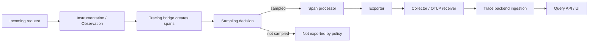

# Không thấy traces trong Spring Boot: quy trình chẩn đoán

## 1. Mục tiêu và bối cảnh

Khi một request đi qua nhiều service nhưng trace không xuất hiện trong giao diện tracing, nguyên nhân có thể nằm ở bất kỳ chặng nào: ứng dụng không tạo span, observation không được bridge sang tracing, sampling loại trace, exporter không gửi dữ liệu, collector không nhận, backend từ chối hoặc giao diện truy vấn sai phạm vi thời gian/service. Chỉ nhìn trang search trống không đủ để kết luận ứng dụng chưa instrument.

Bài này hướng dẫn điều tra theo đường đi của trace từ Spring Boot tới backend, đồng thời phân biệt ba tình huống: không có trace, trace có nhưng thiếu span, và trace đã export nhưng không tìm thấy trong UI.

Bài thuộc chương **Chẩn đoán sự cố** của module **SPRING_BOOT_OBSERVABILITY**. Module hướng dẫn thiết lập observability cho Spring Boot bằng Micrometer Observation, metrics, logs và distributed tracing; học context propagation, tag/cardinality, exporter, sampling và liên kết tín hiệu để điều tra lỗi, độ trễ và hành vi ứng dụng trên môi trường thực.

Sau bài học, bạn có thể:
1. Lần theo pipeline tracing từ instrumentation tới trace backend.
2. Xác nhận Spring Boot đã tạo Observation và span.
3. Kiểm tra tracing bridge, exporter, endpoint và sampling.
4. Phân biệt lỗi propagation với lỗi export/ingestion.
5. Chẩn đoán trace thiếu span hoặc chỉ xuất hiện một phần.
6. Kiểm tra collector, authentication, TLS, resource attributes và UI filters.
7. Dùng metrics/logs và test integration để khoanh vùng lỗi.

**Baseline:** Spring Boot 3.5.x, Java 17+, Micrometer Observation/Tracing và một bridge như OpenTelemetry hoặc Brave. Exporter, protocol và property phải khớp backend cùng dependency versions thực tế.

## 2. Trace đi qua những chặng nào?

Trace chỉ xuất hiện trong UI nếu toàn bộ pipeline hoạt động:



Mỗi chặng có một loại lỗi khác nhau. Ví dụ:
- Không có span: instrumentation chưa hoạt động hoặc request không đi qua instrumented client/server.
- Span bị drop: sampling policy hoặc processor loại span.
- Export thất bại: sai endpoint/protocol, timeout, TLS hoặc authentication.
- Collector nhận nhưng backend không có: pipeline processor/exporter hoặc backend ingestion lỗi.
- Backend có dữ liệu nhưng UI trống: sai time range, service filter, tenant/project hoặc query.

## 3. Bắt đầu bằng một request có thể tái hiện

Chọn một request cụ thể và ghi lại:
- Thời điểm gửi request, timezone và khoảng thời gian tìm kiếm.
- HTTP route/method và service instance xử lý.
- Kết quả HTTP status và thời gian phản hồi.
- Trace ID nếu client đã gửi hoặc response/log có cung cấp.
- Deployment/version và environment.

Ưu tiên một request mới được tạo sau khi cấu hình tracing đã có hiệu lực. Không dùng trace cũ để đánh giá một lần restart/config change vừa thực hiện.

Nếu UI cho phép tìm theo trace ID, dùng trace ID đó. Nếu không có, tìm theo service name, operation/route và time range hẹp. Xác nhận clock synchronization giữa application, collector và backend; clock lệch có thể khiến trace nằm ngoài khoảng tìm kiếm.

## 4. Xác nhận Spring Boot có tracing dependencies

Micrometer Observation và Micrometer Tracing là các lớp liên quan nhưng không đồng nhất. Có ObservationRegistry không có nghĩa ứng dụng đã có tracing bridge và exporter.

Kiểm tra dependency graph của ứng dụng:
- Spring Boot Actuator/observability infrastructure.
- Micrometer Tracing bridge tương ứng: Brave hoặc OpenTelemetry.
- Exporter phù hợp: OTLP hoặc Zipkin, tùy kiến trúc.
- Logging correlation integration nếu cần trace/span IDs trong logs.

Ví dụ dependency Maven theo hướng OpenTelemetry/OTLP, dùng version do Spring Boot BOM quản lý:

```xml
<dependency>
    <groupId>org.springframework.boot</groupId>
    <artifactId>spring-boot-starter-actuator</artifactId>
</dependency>
<dependency>
    <groupId>io.micrometer</groupId>
    <artifactId>micrometer-tracing-bridge-otel</artifactId>
</dependency>
<dependency>
    <groupId>io.opentelemetry</groupId>
    <artifactId>opentelemetry-exporter-otlp</artifactId>
</dependency>
```

Artifact/version cụ thể phụ thuộc Spring Boot release và lựa chọn exporter. Tránh trộn Brave bridge với OpenTelemetry exporter hoặc kéo các phiên bản Micrometer/OpenTelemetry độc lập không tương thích.

## 5. Xác nhận instrumentation tạo span

### 5.1. HTTP server

Spring Boot có thể instrument incoming HTTP requests khi observability auto-configuration và server instrumentation phù hợp hoạt động. Kiểm tra:
- Request có đi qua Spring MVC/WebFlux server instrumentation hay không.
- Endpoint có bị exclude bởi cấu hình hoặc custom ObservationPredicate không.
- ObservationRegistry có tracing handler/bridge hay chỉ metrics handler.
- Custom filter/interceptor có làm thay đổi execution boundary hoặc context không.

### 5.2. HTTP client

Với RestClient, RestTemplate hoặc WebClient, dùng builder do Spring Boot auto-configure để giữ observation/tracing customizers:

```java
@Component
class CatalogClient {
    private final RestClient client;

    CatalogClient(RestClient.Builder builder) {
        this.client = builder
                .baseUrl("https://catalog.internal")
                .build();
    }

    CatalogItem find(String id) {
        return client.get()
                .uri("/items/{id}", id)
                .retrieve()
                .body(CatalogItem.class);
    }
}
```

Tạo client bằng constructor riêng hoặc thay builder bằng một instance không được instrument có thể làm mất client observation. Kiểm tra cách client được tạo và đúng connector.

### 5.3. Custom business spans

Đối với method nội bộ, dùng `@Observed` hoặc Observation API phù hợp. Nếu dùng `@Observed`, xác nhận annotation processing đã bật, Spring AOP có mặt và method được gọi qua proxy. Self-invocation (`this.someMethod()`) không đi qua proxy thông thường nên có thể không tạo observation.

## 6. Kiểm tra sampling

Sampling quyết định trace/span nào được giữ và export. Một request thành công có thể không xuất hiện do sampling policy hợp lệ, đặc biệt khi tỷ lệ sample thấp.

Cần kiểm tra:
- Sampling probability/rate hiện hành.
- Parent-based behavior và sampling flags nhận từ upstream.
- Có sampler custom theo service/route/error hay không.
- Collector tail-sampling có drop trace do policy hoặc decision timeout không.
- Có giới hạn queue/batch processor làm drop spans khi quá tải không.

Để chẩn đoán, dùng môi trường test với sampling 100% trong thời gian ngắn hoặc cấu hình test sampler rõ ràng. Không tăng sampling toàn production mà không đánh giá ingest/storage cost.

Head sampling thường quyết định sớm ở application SDK; tail sampling quyết định sau khi collector quan sát thêm spans của trace. Nếu head sampler đã drop trace trước export, collector không thể khôi phục trace đó.

## 7. Kiểm tra exporter và OTLP endpoint

Với OTLP, xác nhận các yếu tố:
- Exporter dependency đã có trên runtime classpath.
- Endpoint đúng host, port và path theo protocol (OTLP/gRPC hoặc OTLP/HTTP).
- Protocol exporter khớp receiver; không nhầm gRPC với HTTP/protobuf.
- TLS certificate/truststore và hostname verification hợp lệ.
- Authentication headers/token đúng và chưa hết hạn.
- DNS/network policy/firewall cho phép kết nối.
- Batch processor có flush khi shutdown và queue không bị đầy.

Ví dụ cấu hình OTLP endpoint theo property Spring Boot tương ứng version:

```yaml
management:
  otlp:
    tracing:
      endpoint: http://otel-collector:4318/v1/traces
```

Endpoint ví dụ dùng OTLP/HTTP receiver. Nếu dùng gRPC, port/protocol và property cần khớp cấu hình exporter. Kiểm tra tài liệu Spring Boot đúng version thay vì copy nguyên cấu hình giữa các protocol.

Không giả định HTTP 200 từ một health endpoint của collector chứng minh trace ingestion hoạt động. Cần xác nhận receiver nhận spans và exporter pipeline xử lý thành công.

## 8. Kiểm tra collector pipeline

Nếu application exporter gửi thành công nhưng trace không tới backend, kiểm tra collector:
- Receiver đang bật đúng protocol/port.
- Pipeline traces có receiver, processor và exporter cần thiết.
- Processor không drop spans do filter, tail sampling hoặc memory limiter.
- Batch processor không giữ dữ liệu vô hạn hoặc bị queue full.
- Exporter backend có DNS/TLS/auth đúng.
- Collector logs/metrics không báo refused, retry, throttling hoặc rejected spans.

Ví dụ pipeline OpenTelemetry Collector dạng khái niệm:

```yaml
receivers:
  otlp:
    protocols:
      grpc:
        endpoint: 0.0.0.0:4317
      http:
        endpoint: 0.0.0.0:4318

processors:
  batch:

exporters:
  otlp:
    endpoint: tracing-backend:4317
    tls:
      insecure: true

service:
  pipelines:
    traces:
      receivers: [otlp]
      processors: [batch]
      exporters: [otlp]
```

Đây là cấu hình minh họa cho môi trường lab/private network; không bật insecure TLS trên network không tin cậy. Production cần TLS/auth và secret management phù hợp.

## 9. Trace có nhưng thiếu spans

Nếu root span xuất hiện nhưng thiếu child spans, trace export pipeline có thể vẫn hoạt động. Điều tra instrumentation và context propagation:

- Downstream HTTP client có được tạo từ auto-configured builder không?
- Database/client library có instrumentation tương ứng không?
- Trace context có được propagate qua executor/CompletableFuture không?
- Reactive pipeline có giữ Reactor context qua scheduler changes không?
- Custom code có tạo một root trace mới thay vì child span trong current context không?
- Sampling hoặc collector filter có drop một số spans không?

Kiểm tra trace IDs ở các service và log correlation. Nếu inbound request tạo trace A nhưng outbound request không mang trace context, downstream có thể tạo trace mới hoặc không tạo span liên kết.

Không dùng ThreadLocal/MDC thủ công làm cơ chế duy nhất cho async/reactive propagation. Dùng context propagation integration phù hợp.

## 10. Kiểm tra propagation headers

Trace context thường được truyền qua W3C Trace Context headers, ví dụ `traceparent` và tùy cấu hình có thể có `tracestate`. Baggage là header riêng và không thay thế trace context.

Kiểm tra bằng mock server hoặc test service:
1. Gửi request inbound với trace context hợp lệ.
2. Ứng dụng tạo outbound HTTP request.
3. Assert outbound request có `traceparent` theo propagation policy.
4. Xác nhận downstream span thuộc cùng trace và parent relationship hợp lệ.
5. Gửi request không có trace header; xác nhận ứng dụng tạo trace mới khi sampling cho phép.
6. Gửi header malformed; xác nhận xử lý an toàn và không làm request thất bại ngoài policy.

Không hardcode trace ID trong test như thể mọi request phải dùng cùng ID. Kiểm tra format, quan hệ và sự hiện diện của context theo request cụ thể.

## 11. Resource attributes và tìm kiếm trong UI

Trace có thể đã được lưu nhưng không tìm thấy do service/resource attributes không như mong đợi. Kiểm tra:
- `service.name` có đúng và ổn định không.
- Environment/namespace/version attributes có được gắn không.
- UI đang chọn đúng project/tenant/datasource không.
- Time range có bao phủ timestamp của trace không.
- Search filter có dùng đúng service name, operation và status không.
- Trace backend có ingest delay hoặc retention ngắn không.

Service name không nên thay đổi theo pod ID, request ID hoặc deployment timestamp. Dùng service identity ổn định; instance/pod identity là attribute riêng.

## 12. Dùng metrics và logs để khoanh vùng

Nếu chưa tìm thấy trace, các tín hiệu khác vẫn giúp xác định chặng lỗi:

| Tín hiệu | Điều cần kiểm tra | Gợi ý chẩn đoán |
| --- | --- | --- |
| HTTP request metrics | Request count/latency/error | Ứng dụng có nhận request không? |
| Observation metrics | Operation count/duration | Method có được instrument không? |
| Exporter/collector metrics | Sent, failed, dropped spans, queue | Có export/ingest failure không? |
| Application logs | Startup config, exporter errors, trace IDs | Bridge/exporter có khởi tạo? |
| Collector logs | Receiver/exporter retries, rejected spans | Collector có nhận và forward? |

Logs không có traceId cũng có thể là dấu hiệu context correlation chưa hoạt động, nhưng không chứng minh trace không tồn tại. Sampling có thể giữ trace nhưng logging correlation field bị thiếu do cấu hình khác.

## 13. Quy trình kiểm tra nhanh theo thứ tự

1. Gửi một request mới, ghi timestamp, route, instance và status.
2. Kiểm tra Actuator/application metrics xác nhận request đã tới service.
3. Xác nhận tracing bridge và exporter dependencies có trong runtime.
4. Kiểm tra server observation và custom ObservationPredicate/exclusions.
5. Tạm dùng sampling 100% trong môi trường test.
6. Kiểm tra log exporter errors, endpoint, protocol, TLS và auth.
7. Kiểm tra collector receiver, processor, queue và backend exporter.
8. Tìm trace bằng time range rộng hơn, đúng service/resource attributes.
9. Nếu root trace có nhưng thiếu spans, kiểm tra client instrumentation và async/reactive propagation.
10. Khôi phục sampling/security settings theo baseline sau khi chẩn đoán.

## 14. Integration test tối thiểu

Test end-to-end nên có một inbound endpoint gọi outbound mock service:

```java
@SpringBootTest(webEnvironment = SpringBootTest.WebEnvironment.RANDOM_PORT)
class TracePropagationIntegrationTest {
    // Start a mock downstream server on a dynamic port.
    // Inject the application HTTP client and test server port.

    @Test
    void propagatesTraceContextToDownstream() {
        // Send an inbound request with a valid traceparent header.
        // Capture the outbound request at the mock server.
        // Assert traceparent is present and valid.
        // Assert the downstream span shares the trace ID.
    }
}
```

Đây là skeleton mô tả test contract; phần mock server và tracing test exporter cần được wiring theo stack của project. Bổ sung test cases:
- Exporter endpoint unavailable: request nghiệp vụ có tiếp tục theo policy hay không.
- Sampling disabled/low probability: test không giả định trace luôn xuất hiện.
- Collector drop/filter: xác nhận metrics/logs cho biết spans bị drop.
- Async/reactive call: xác nhận parent-child relationship giữ đúng.
- Error request: xác nhận exception/status được ghi vào span khi policy yêu cầu.

Trong unit/integration tests, dùng in-memory span exporter/test ObservationHandler nếu bridge hỗ trợ để assert span name, parent, attributes và error mà không cần backend ngoài.

## 15. Troubleshooting

| Triệu chứng | Nguyên nhân có thể | Cách xử lý |
| --- | --- | --- |
| Không có trace nào từ service | Thiếu tracing bridge/exporter hoặc instrumentation chưa bật | Kiểm tra runtime dependencies và auto-configuration |
| Có metrics nhưng không có spans | Chỉ có meter registry/observation metrics handler | Thêm tracing bridge và exporter phù hợp |
| Trace xuất hiện không đều | Sampling rate thấp hoặc parent sampling flags | Kiểm tra sampler và test với 100% ở môi trường test |
| Exporter báo connection refused | Sai host/port hoặc collector không listen | Kiểm tra endpoint từ network của application |
| OTLP export lỗi protocol | Client dùng gRPC nhưng receiver/path là HTTP hoặc ngược lại | Đồng bộ protocol, port và endpoint |
| TLS/authentication failure | Certificate, hostname hoặc token sai | Kiểm tra trust chain, auth headers và secret expiry |
| Collector nhận nhưng backend không có trace | Processor/filter/exporter drop hoặc backend reject | Kiểm tra collector pipeline logs/metrics |
| Root span có nhưng thiếu client span | Client không dùng auto-configured builder | Kiểm tra cách tạo RestClient/WebClient/RestTemplate |
| Downstream tạo trace mới | Trace context không được inject/propagate | Kiểm tra traceparent và context propagation |
| Async span bị tách trace | Context mất qua executor/future/reactor | Dùng context-aware executor/Reactor integration |
| Trace tồn tại nhưng UI search trống | Sai time range/service/project/tenant filter | Kiểm tra resource attributes và query scope |
| Chỉ một số spans biến mất | Tail sampling, collector filters hoặc queue overflow | Kiểm tra sampling decisions và dropped counters |
| Logs không có traceId | Logging correlation chưa bật hoặc context không tới MDC | Kiểm tra correlation fields và propagation |
| Trace latency/time order bất thường | Clock skew giữa hosts | Đồng bộ clock và xem timestamp nguồn |

## 16. Checklist production

- [ ] Tracing bridge và exporter dependencies đúng version, đúng implementation.
- [ ] HTTP server/client instrumentation tạo spans như mong đợi.
- [ ] Custom `@Observed` methods đi qua Spring AOP proxy.
- [ ] Sampling policy được hiểu và có metrics quan sát drop decisions.
- [ ] OTLP protocol, endpoint, TLS và authentication khớp collector.
- [ ] Collector traces pipeline có receiver/processor/exporter hoạt động.
- [ ] Queue, retry, rejected/dropped spans được theo dõi.
- [ ] `service.name` và resource attributes ổn định, dễ tìm kiếm.
- [ ] Trace context propagate qua HTTP, executor và reactive flows.
- [ ] UI time range, project/tenant và service filters đúng.
- [ ] Có integration test với mock downstream và test span exporter.
- [ ] Sampling/config tạm thời được khôi phục sau troubleshooting.

## 17. Câu hỏi tự luyện

1. Những chặng nào phải hoạt động để trace xuất hiện trong UI?
2. Vì sao có ObservationRegistry nhưng vẫn không có spans?
3. Sampling có thể làm trace biến mất ở giai đoạn nào?
4. Head sampling khác tail sampling ra sao?
5. Vì sao dùng auto-configured WebClient.Builder quan trọng?
6. OTLP/gRPC và OTLP/HTTP khác nhau ở cấu hình nào?
7. Collector nhận spans nhưng backend không có thì kiểm tra gì?
8. Root span có nhưng thiếu child spans thường gợi ý lỗi nào?
9. Trace context khác baggage thế nào?
10. Resource attributes ảnh hưởng tìm kiếm trace trong UI ra sao?
11. Vì sao log không có traceId không chứng minh trace không tồn tại?
12. Test end-to-end cần assert những gì ngoài việc header có mặt?

## Tài liệu tham khảo

- [Spring Boot 3.5 — Tracing](https://docs.spring.io/spring-boot/3.5/reference/actuator/tracing.html)
- [Spring Boot 3.5 — Observability](https://docs.spring.io/spring-boot/3.5/reference/actuator/observability.html)
- [Micrometer Tracing — Reference](https://docs.micrometer.io/tracing/reference/)
- [Micrometer Observation — Concepts](https://docs.micrometer.io/micrometer/reference/observation.html)
- [OpenTelemetry — OTLP Specification](https://opentelemetry.io/docs/specs/otlp/)
- [OpenTelemetry Collector — Configuration](https://opentelemetry.io/docs/collector/configuration/)
- [W3C — Trace Context](https://www.w3.org/TR/trace-context/)

