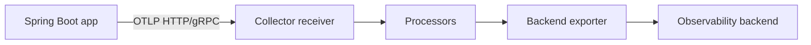
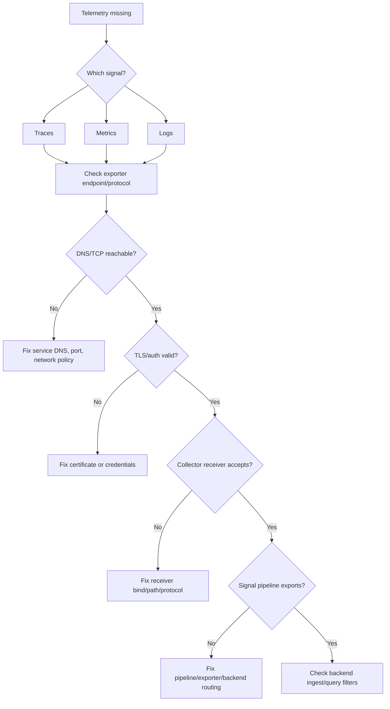

# Sai exporter endpoint trong Spring Boot

Khi cấu hình Micrometer hoặc OpenTelemetry để gửi metrics, traces và logs, exporter cần trỏ tới đúng receiver, protocol và network address. Một endpoint sai có thể khiến telemetry không được gửi, bị từ chối hoặc đi vào pipeline khác. Ứng dụng vẫn có thể xử lý request bình thường, vì export thường diễn ra bất đồng bộ; do đó lỗi endpoint dễ bị bỏ sót nếu chỉ kiểm tra health của business service.

Bài **“Sai exporter endpoint”** thuộc chương **Chẩn đoán sự cố** của module **SPRING_BOOT_OBSERVABILITY**. Module hướng dẫn thiết lập observability cho Spring Boot bằng Micrometer Observation, metrics, logs và distributed tracing; học propagation ngữ cảnh, tag/cardinality, exporter, sampling và liên kết tín hiệu để điều tra lỗi, độ trễ và hành vi ứng dụng trên môi trường thực.

## 1. Xác định đúng signal và exporter

Trước khi sửa URL, xác định loại dữ liệu không tới backend:

| Signal | Đường gửi phổ biến | Cần kiểm tra |
| --- | --- | --- |
| Traces | OTLP exporter qua HTTP hoặc gRPC | Receiver protocol, port, path, TLS |
| Metrics | Micrometer registry exporter hoặc OTLP metrics | Registry type, endpoint, temporality |
| Logs | Logging appender/agent hoặc OTLP logs exporter | Appender/provider, receiver logs pipeline |
| Prometheus scrape | Prometheus chủ động gọi ứng dụng | Scrape target, port, metrics path |

Một endpoint traces hoạt động không chứng minh metrics/logs cũng được cấu hình đúng. Các signals có thể dùng exporter, port, path và pipeline khác nhau.

## 2. Hiểu endpoint OTLP HTTP và gRPC

OTLP hỗ trợ HTTP/protobuf và gRPC. Chúng không thể thay thế URL cho nhau một cách tùy tiện.

| Transport | Ví dụ endpoint base | Ghi chú |
| --- | --- | --- |
| OTLP/gRPC | http://otel-collector:4317 | Dùng gRPC receiver |
| OTLP/HTTP | http://otel-collector:4318 | Dùng HTTP receiver |
| OTLP/HTTP traces | http://otel-collector:4318/v1/traces | Path theo signal |
| OTLP/HTTP metrics | http://otel-collector:4318/v1/metrics | Path theo signal |
| OTLP/HTTP logs | http://otel-collector:4318/v1/logs | Path theo signal |

Port 4317 và 4318 là convention phổ biến, không phải bảo đảm receiver đang lắng nghe ở đó. Kiểm tra Collector config và deployment thực tế.

Với OTLP HTTP, một số SDK nhận endpoint base rồi tự nối path theo signal; một số cấu hình cho phép endpoint riêng từng signal. Tránh tự thêm /v1/traces vào một property vốn mong đợi base URL, vì có thể tạo path lặp. Đọc tài liệu đúng exporter/version.

## 3. Phân biệt endpoint của application exporter và Collector receiver

Trong mô hình phổ biến, Spring Boot application gửi telemetry tới OpenTelemetry Collector. Collector nhận dữ liệu qua receiver, chạy processors rồi chuyển tới exporter backend.



Endpoint được cấu hình trong ứng dụng phải là địa chỉ receiver của Collector, không phải endpoint exporter backend trừ khi backend trực tiếp hỗ trợ OTLP ingest và được thiết kế để nhận từ workload.

Collector có hai phía độc lập:

- Receiver endpoint: nơi application/agent gửi dữ liệu tới.
- Exporter endpoint: nơi Collector gửi dữ liệu tiếp tới backend.

Nhầm hai địa chỉ này là nguyên nhân cấu hình phổ biến. Kiểm tra receiver và exporter trong pipeline tương ứng với traces, metrics hoặc logs.

## 4. Các lỗi endpoint thường gặp

| Lỗi | Triệu chứng |
| --- | --- |
| Sai hostname/service name | DNS resolution failure hoặc connection refused |
| Sai port | Connection refused hoặc timeout |
| Sai protocol | HTTP gửi vào gRPC port hoặc ngược lại |
| Sai path | HTTP 404/405 hoặc receiver không parse được request |
| Dùng localhost trong container | App gọi chính container của nó thay vì Collector |
| Sai TLS scheme | Handshake failure hoặc plaintext/TLS mismatch |
| Certificate không tin cậy | Unknown CA/hostname verification failure |
| Sai auth header | HTTP 401/403 |
| Collector chưa mở receiver | Connection refused |
| Receiver có nhưng pipeline thiếu signal | Request được nhận nhưng không export tiếp |
| Sai endpoint theo signal | Traces tới nơi nhưng metrics/logs mất |

Không kết luận endpoint sai chỉ từ một thông báo exporter failed. Cần phân biệt lỗi DNS, TCP, TLS, HTTP/gRPC status và lỗi pipeline sau khi receiver nhận dữ liệu.

## 5. Kiểm tra network namespace và DNS

Nếu Spring Boot chạy trong Docker/Kubernetes, localhost chỉ trỏ về network namespace của chính container/pod.

Ví dụ cấu hình sai khi app và Collector là hai container riêng:

```yaml
management:
  otlp:
    tracing:
      endpoint: http://localhost:4318/v1/traces
```

Trong Docker Compose, dùng service DNS name, ví dụ otel-collector. Trong Kubernetes, dùng Service DNS name và namespace tương ứng, ví dụ otel-collector.observability.svc.cluster.local.

Từ đúng container/pod của ứng dụng, kiểm tra DNS và TCP connectivity bằng công cụ có sẵn trong image hoặc ephemeral debug container. Kiểm tra cả egress NetworkPolicy, firewall, service port và targetPort. Một phép thử từ laptop developer không chứng minh pod production có thể kết nối.

## 6. Kiểm tra Collector receiver và pipeline

Xác minh Collector thực sự khai báo receiver tương ứng và service pipeline sử dụng receiver đó.

Ví dụ cấu hình minh họa:

```yaml
receivers:
  otlp:
    protocols:
      grpc:
        endpoint: 0.0.0.0:4317
      http:
        endpoint: 0.0.0.0:4318

processors:
  batch: {}

exporters:
  debug:
    verbosity: basic

service:
  pipelines:
    traces:
      receivers: [otlp]
      processors: [batch]
      exporters: [debug]
    metrics:
      receivers: [otlp]
      processors: [batch]
      exporters: [debug]
    logs:
      receivers: [otlp]
      processors: [batch]
      exporters: [debug]
```

Cấu hình này chỉ dành cho minh họa/debug; exporter thực tế cần được thay bằng backend exporter phù hợp. Receiver có thể lắng nghe nhưng nếu signal không được gắn vào service pipeline, dữ liệu không đi tiếp theo cách mong muốn.

Kiểm tra Collector startup logs, config validation, receiver bind address và exporter health. Nếu Collector chạy trong container, bind vào 127.0.0.1 có thể khiến các container khác không kết nối được; bind address cần phù hợp network/security design.

## 7. Cấu hình exporter trong Spring Boot

Property names phụ thuộc Spring Boot, Micrometer registry và tracing bridge đang dùng. Không copy một property từ tài liệu phiên bản khác mà chưa xác minh dependency tree.

Với cấu hình OTLP tracing trong Spring Boot, endpoint có thể được đặt qua property thuộc nhóm management OTLP tracing tùy phiên bản. Với Micrometer OTLP metrics registry, endpoint metrics có thể nằm trong cấu hình registry riêng. OTLP logs có thể được gửi bởi logging provider/appender riêng thay vì Actuator.

Quy trình xác minh:

1. Kiểm tra Spring Boot version và Micrometer versions do BOM quản lý.
2. Xác định exporter implementation thực tế trên classpath.
3. Tìm property prefix trong reference documentation đúng version.
4. Xác minh property được bind bằng configuration diagnostics an toàn.
5. Kiểm tra environment variables có override YAML không.
6. Đảm bảo endpoint không bị ghi đè bởi profile hoặc deployment manifest.
7. Restart/redeploy khi property chỉ được đọc lúc startup.

Không in toàn bộ Environment hoặc configprops công khai để debug; chúng có thể chứa secrets.

## 8. Phân biệt connection, protocol và authentication errors

Dùng status/error class để khoanh vùng:

| Evidence | Khả năng |
| --- | --- |
| UnknownHostException | DNS/service name không phân giải |
| ConnectException: refused | Host tới được nhưng port không có listener hoặc bị reject |
| SocketTimeoutException | Network path/receiver chậm hoặc bị drop |
| SSLHandshakeException | TLS protocol, trust chain hoặc certificate mismatch |
| HTTP 404 | Sai path hoặc route không tồn tại |
| HTTP 401/403 | Credential, token hoặc authorization |
| HTTP 415 | Content type/protocol mismatch |
| gRPC UNAVAILABLE | Receiver/network/service unavailable |
| gRPC UNAUTHENTICATED/PERMISSION_DENIED | AuthN/AuthZ |
| Export success nhưng backend không thấy | Collector pipeline/exporter/tenant routing/query |

Các exception cụ thể tùy client library. Đọc root cause và status code, không chỉ dòng log tổng quát.

## 9. Kiểm tra TLS và authentication

Nếu endpoint dùng HTTPS hoặc gRPC TLS:

- Kiểm tra scheme và port khớp receiver.
- Xác minh certificate SAN chứa hostname client sử dụng.
- Xác minh trust store có CA cần thiết.
- Kiểm tra certificate expiry và rotation.
- Với mTLS, xác minh client certificate/key được load đúng.
- Kiểm tra token/API key và header names theo backend/Collector extension.
- Không tắt hostname verification hoặc certificate validation để “thử cho chạy”.

Nếu gateway terminate TLS, xác minh hop từ gateway tới Collector cũng nằm trong trust boundary được bảo vệ. Tránh gửi credentials qua plaintext HTTP trên network không tin cậy.

## 10. Vì sao ứng dụng vẫn chạy khi exporter endpoint sai?

Exporter thường hoạt động bất đồng bộ hoặc theo batch. Business request có thể hoàn tất trong khi export retry hoặc drop telemetry ở background. Vì vậy:

- HTTP endpoint của ứng dụng vẫn trả 200.
- Observation/metrics trong process vẫn được tạo.
- Exporter log có thể báo lỗi định kỳ.
- Queue exporter có thể tăng hoặc telemetry bị drop.
- Backend không nhận dữ liệu mới.

Đừng dùng business health endpoint làm bằng chứng telemetry pipeline healthy. Theo dõi exporter failure, queue size, dropped data và Collector receiver/exporter metrics.

## 11. Phân biệt receiver đã nhận với backend đã lưu

Telemetry đi qua nhiều bước: client exporter, network, receiver, processor, exporter và backend ingest/indexing.

Nếu client báo export thành công, điều đó thường chỉ xác nhận một bước protocol đã được chấp nhận, không đảm bảo dữ liệu đã xuất hiện trong dashboard. Tiếp tục kiểm tra:

1. Collector receiver accepted/refused counts.
2. Processor drop/filter/transform behavior.
3. Collector exporter send failures/retries.
4. Backend authentication/tenant routing.
5. Backend ingestion delay và retention/query time range.
6. Resource/service name filters trong dashboard.

Dùng debug exporter trong local/staging để xác minh dữ liệu tới Collector trước khi điều tra backend. Không bật verbose payload logging chứa dữ liệu nhạy cảm trên production.

## 12. Các bước chẩn đoán theo thứ tự

1. Xác định signal bị mất: traces, metrics, logs hay cả ba.
2. Xác định app exporter và protocol: OTLP HTTP, OTLP gRPC, Prometheus scrape hoặc registry-specific.
3. Đọc endpoint effective từ deployment config, profile và environment variables.
4. Kiểm tra hostname/service DNS từ chính runtime network namespace.
5. Kiểm tra port/listener và path.
6. Kiểm tra TLS certificate, trust chain và authentication.
7. Kiểm tra Collector receiver và signal pipeline.
8. Kiểm tra exporter của Collector tới backend.
9. Kiểm tra dropped/refused/retry metrics và exporter logs.
10. Gửi một test signal có service name rõ ràng, không chứa dữ liệu nhạy cảm.
11. Xác minh dữ liệu xuất hiện trong backend với time range/resource filters phù hợp.



## 13. Prometheus scrape endpoint là trường hợp khác

Prometheus thường pull metrics từ ứng dụng; ứng dụng không push metrics tới Prometheus trong cấu hình scrape thông thường.

Kiểm tra:

- Prometheus target URL và port.
- Metrics path, thường là /actuator/prometheus nếu được expose.
- Target health và last scrape error.
- Authentication/TLS giữa scraper và application.
- Network policy từ Prometheus tới pod/service.
- Relabeling/drop rules làm metric bị loại.
- Scrape interval và timeout.

Nếu target UP nhưng một metric không có, kiểm tra meter registration, filters, tags và query labels. Không sửa OTLP exporter endpoint để khắc phục Prometheus scrape failure.

## 14. Kiểm thử endpoint và pipeline

Một test matrix hữu ích:

| Test | Kết quả cần xác minh |
| --- | --- |
| Endpoint hostname sai | DNS error rõ ràng, không làm business request treo |
| Port sai/receiver dừng | Connect failure và exporter retry/drop được quan sát |
| HTTP/gRPC mismatch | Protocol error được phân loại |
| Path sai | HTTP route error |
| Certificate sai | TLS handshake fail |
| Token sai | 401/403 hoặc gRPC auth status |
| Receiver đúng, pipeline thiếu | Receiver nhận nhưng không có export tiếp |
| Collector backend sai | Exporter failure ở Collector |
| Prometheus path sai | Target DOWN với scrape error |
| Endpoint đúng | Test signal tới backend |

Dùng local Collector/test container hoặc mock server. Kiểm tra cả success lẫn failure, và xác nhận retry queue có giới hạn.

## 15. Những điều không nên làm khi debug

- Không đổi đồng thời protocol, port, path và TLS; sẽ khó xác định nguyên nhân.
- Không dùng localhost giữa các container khác nhau nếu network namespace tách biệt.
- Không tắt TLS verification hoặc authentication trên production.
- Không log token, API key, certificate private key hoặc telemetry payload nhạy cảm.
- Không tăng retry vô hạn để che endpoint sai.
- Không giả định export success đồng nghĩa backend đã index dữ liệu.
- Không kiểm tra chỉ từ laptop nếu workload chạy trong Kubernetes.
- Không sửa đồng thời cả app endpoint và Collector receiver mà không có một test xác nhận từng hop.

## 16. Bài thực hành: sửa endpoint sai

Thực hiện trong local/staging:

1. Chạy OpenTelemetry Collector có OTLP HTTP receiver và debug exporter.
2. Cấu hình Spring Boot exporter với hostname/port/path đúng.
3. Gửi một test trace và xác minh Collector nhận.
4. Đổi hostname thành một service name không tồn tại; quan sát DNS failure.
5. Khôi phục hostname, đổi port sai; quan sát connection failure.
6. Thử cấu hình HTTP exporter trỏ vào gRPC port và ngược lại.
7. Thử path sai cho OTLP HTTP.
8. Bật TLS với certificate test; thử trust store sai rồi sửa lại.
9. Kiểm tra signal-specific pipeline cho traces, metrics và logs.
10. Với Prometheus, kiểm tra riêng scrape target/path.
11. Xác minh exporter queue/drop/retry behavior khi Collector dừng.
12. Khôi phục endpoint đúng và xác nhận test signals xuất hiện ở backend.

Kết quả mong đợi: phân loại được lỗi DNS, TCP, protocol, path, TLS, auth, Collector pipeline và backend ingest; biết sửa đúng layer thay vì thay URL theo phỏng đoán.

## 17. Câu hỏi tự kiểm tra

1. Vì sao phải xác định signal trước khi sửa exporter endpoint?
2. OTLP HTTP khác OTLP gRPC về endpoint/protocol thế nào?
3. Receiver endpoint khác Collector exporter endpoint ra sao?
4. Vì sao localhost thường sai khi app và Collector ở hai container?
5. Endpoint base và signal-specific path khác nhau thế nào?
6. UnknownHostException và ConnectException chỉ ra lớp lỗi nào?
7. HTTP 404, 401, 415 thường gợi ý vấn đề gì?
8. Vì sao TLS certificate SAN và trust chain cần được kiểm tra?
9. Collector receiver nhận dữ liệu có bảo đảm backend đã lưu không?
10. Vì sao business application vẫn có thể healthy khi telemetry export fail?
11. Prometheus scrape khác OTLP push như thế nào?
12. Làm sao xác minh effective configuration sau khi environment override YAML?
13. Vì sao retry vô hạn không sửa được endpoint sai?
14. Cần kiểm tra gì trong Collector pipeline nếu receiver accepted nhưng backend trống?
15. Làm sao test endpoint failure từ đúng container/pod network?

## Tài liệu tham khảo

- [OpenTelemetry OTLP Specification](https://opentelemetry.io/docs/specs/otlp/): protocol, transport và signal paths.
- [OpenTelemetry Collector Configuration](https://opentelemetry.io/docs/collector/configuration/): receivers, processors, exporters và service pipelines.
- [Spring Boot — Tracing](https://docs.spring.io/spring-boot/reference/actuator/tracing.html): Micrometer Tracing và exporter configuration.
- [Spring Boot — Metrics](https://docs.spring.io/spring-boot/reference/actuator/metrics.html): MeterRegistry và metrics export.
- [Micrometer OTLP Registry](https://docs.micrometer.io/micrometer/reference/implementations/otlp.html): OTLP metrics registry configuration.
- [Prometheus — Configuration](https://prometheus.io/docs/prometheus/latest/configuration/configuration/): scrape targets, paths và authentication.
- [OpenTelemetry Collector — Troubleshooting](https://opentelemetry.io/docs/collector/troubleshooting/): collector diagnostics và telemetry pipeline.

## Kết luận

**Sai exporter endpoint cần được chẩn đoán theo từng hop từ application tới receiver, pipeline và backend.** Xác định signal/protocol trước, rồi kiểm tra hostname, port, path, network namespace, TLS/authentication và Collector pipeline. Với Prometheus, kiểm tra scrape target/path riêng vì đây là pull model, khác OTLP push.

Dùng error class/status và receiver/exporter metrics để xác định chính xác tầng hỏng. Kiểm thử từ đúng container/pod, giữ retry và queues có giới hạn, không tắt bảo mật hoặc log secrets để debug. Khi mỗi hop được xác minh độc lập, việc khôi phục telemetry sẽ nhanh và ít gây tác động ngoài ý muốn tới ứng dụng.

