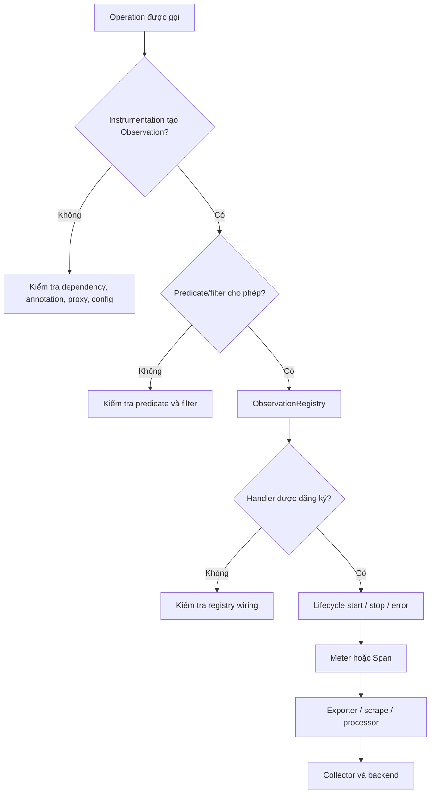

# Observation không được ghi trong Spring Boot

Khi một **Observation không được ghi**, cần xác định observation chưa từng được tạo, bị bỏ qua trước khi start, không được handler xử lý, hay đã được ghi nhận trong process nhưng không xuất hiện ở metrics/tracing backend. Đây là các giai đoạn khác nhau trong pipeline Micrometer Observation; kiểm tra sai tầng thường dẫn tới thay đổi cấu hình không giải quyết được nguyên nhân.

Trong module **SPRING_BOOT_OBSERVABILITY**, Micrometer Observation kết nối instrumentation của Spring Boot với metrics và distributed tracing thông qua ObservationRegistry cùng các handlers. Bài thuộc chương **Chẩn đoán sự cố**, tập trung vào cách lần theo lifecycle từ điểm instrument tới registry, handler, meter/span processor và exporter; kiểm tra filter/predicate, AOP/proxy, sampling, async context và backend.

## 1. Phân biệt observation bị thiếu ở tầng nào

Một observation có thể không xuất hiện vì nhiều nguyên nhân:
1. Instrumentation không tạo observation.
2. Observation được tạo nhưng bị predicate hoặc điều kiện bỏ qua.
3. Observation không đi qua ObservationRegistry mà ứng dụng đang quan sát.
4. Handler tương ứng không được đăng ký hoặc không hỗ trợ context đó.
5. Observation chưa kết thúc nên timer/span chưa được ghi hoàn chỉnh.
6. Meter/span đã được tạo nhưng exporter hoặc scrape pipeline không chuyển dữ liệu.
7. Sampling loại span khỏi trace export.
8. Backend nhận dữ liệu nhưng query/dashboard lọc sai.



Hãy xác định tín hiệu đang thiếu: metrics, traces hay cả hai. Nếu metrics có nhưng spans không có, khả năng cao instrumentation đã chạy và vấn đề nằm ở tracing handler, sampler hoặc exporter. Nếu cả hai đều thiếu, kiểm tra observation creation và registry trước.

## 2. Xác nhận operation thực sự được instrument

Bắt đầu từ operation cụ thể: HTTP server request, outbound HTTP client call, database query, message publish/consume, method có annotation hoặc custom business operation dùng Observation API.

Xác nhận đúng đường code đang được gọi và instrumentation tương ứng có hỗ trợ API/client/version đó. Một số integration chỉ instrument abstraction cụ thể; gọi native client trực tiếp có thể bypass wrapper đã được instrument.

Ví dụ: ứng dụng có dependency cho WebClient instrumentation nhưng code thực tế dùng một HTTP client tự tạo không đi qua bean được cấu hình. Dashboard không có client observation dù request vẫn thành công.

### 2.1. Framework observation và custom observation

Không phải mọi method đều tự động tạo observation. Một method business thông thường chỉ có observation nếu được annotation/interceptor hỗ trợ hoặc code chủ động instrument.

Không suy luận rằng đã thêm Actuator là mọi method đều có metrics/traces. Actuator expose dữ liệu đã tồn tại; nó không tự instrument mọi code path.

## 3. Kiểm tra dependency và version compatibility

Observation support phụ thuộc Spring Boot, Micrometer, Spring integration và client library version.

Kiểm tra:
- Spring Boot version và dependency management/BOM.
- Micrometer Observation version được resolve thực tế.
- Micrometer Tracing bridge nếu cần spans.
- Registry/exporter tương ứng với backend.
- Integration module cho Kafka, RabbitMQ, HTTP client hoặc database.
- Có dependency bị exclude hoặc version override không tương thích không.

Đừng chỉ kiểm tra file build; kiểm tra dependency tree/runtime classpath để biết version thực sự được nạp. Một dependency chỉ có ở test scope sẽ không hoạt động trong ứng dụng chạy thật.

## 4. Kiểm tra ObservationRegistry

ObservationRegistry là điểm trung tâm nơi observations được tạo và handlers được áp dụng. Một lỗi thường gặp là custom code dùng registry khác với registry do Spring Boot quản lý.

Trong Spring Boot, ưu tiên inject registry từ application context:

```java
@Service
class InventoryLookup {

    private final ObservationRegistry observationRegistry;

    InventoryLookup(ObservationRegistry observationRegistry) {
        this.observationRegistry = observationRegistry;
    }

    InventoryItem find(String sku) {
        return Observation.createNotStarted(
                        "inventory.lookup", observationRegistry)
                .observe(() -> load(sku));
    }

    private InventoryItem load(String sku) {
        return new InventoryItem(sku);
    }
}
```

Ví dụ minh họa custom observation đồng bộ. Bảo đảm registry được inject là registry đã cấu hình handlers. Tránh tự tạo ObservationRegistry.create() trong từng service nếu muốn dùng auto-configured handlers của Spring Boot.

### 4.1. Registry không có handlers

Observation API có thể được dùng trong cấu hình không có handler phù hợp. Khi đó operation vẫn chạy nhưng không tạo meter/span mà bạn mong đợi.

Kiểm tra registry có handlers không; Meter handler có được đăng ký khi MeterRegistry hiện diện không; tracing handler có được cấu hình khi tracing bridge hiện diện không; custom registry có được kết nối với handlers đúng không.

## 5. Kiểm tra ObservationPredicate và ObservationFilter

ObservationPredicate có thể quyết định một observation có được tạo/ghi nhận hay không theo tên và context. Predicate quá rộng có thể vô tình loại bỏ operation cần thiết.

ObservationFilter điều chỉnh context metadata. Filter không nên bị nhầm với predicate: filter thường thay đổi context; predicate quyết định có tiếp tục với observation hay không theo contract API.

Rà soát:
- Predicate có return false cho observation name này không.
- Điều kiện dựa trên context có phụ thuộc field chưa được thiết lập ở thời điểm đánh giá không.
- Filter có xóa key-value mà dashboard đang dùng để lọc không.
- Có filter/predicate được đăng ký hai lần hoặc theo thứ tự ngoài dự kiến không.
- Custom convention có tạo tên observation khác với tên dashboard đang query không.

Tạo test cho từng predicate branch. Trong lab, dùng một observation name ổn định đã biết để xác nhận pipeline.

## 6. Kiểm tra Observation lifecycle

Timer và span thường cần observation hoàn tất để ghi duration và kết quả. Nếu code start observation nhưng không stop trong mọi đường thực thi, dữ liệu có thể thiếu hoặc không đầy đủ.

Dùng API quản lý lifecycle an toàn:

```java
Observation observation = Observation.start(
        "inventory.lookup", observationRegistry);
try {
    return loadInventory();
}
catch (RuntimeException ex) {
    observation.error(ex);
    throw ex;
}
finally {
    observation.stop();
}
```

Đây là ví dụ lifecycle đồng bộ. Với code mới, observe(...) thường giảm nguy cơ quên stop khi operation đồng bộ. Với async/reactive, method trả future/publisher không đồng nghĩa công việc đã hoàn tất; cần integration hỗ trợ lifecycle bất đồng bộ hoặc callback quản lý completion/error/cancel đúng cách.

### 6.1. Scope không được đóng

Nếu mở Observation.Scope thủ công, cần đóng scope trong try-with-resources/finally. Scope không đóng có thể làm context rò rỉ sang operation khác hoặc khiến trace correlation sai.

Không giữ scope qua thread boundary tùy tiện. ThreadLocal context không tự truyền qua executor, Reactor scheduler hoặc broker.

## 7. Annotation observation không chạy

Nếu dùng @Observed hoặc annotation tương tự, kiểm tra:
- Annotation API nằm trong runtime classpath.
- Spring Boot/Micrometer version hỗ trợ integration.
- Aspect/interceptor cần thiết đã được cấu hình.
- Bean được Spring quản lý.
- Method invocation đi qua proxy.
- Self-invocation không bypass proxy.
- Method visibility và proxy strategy phù hợp integration.
- Annotation không nằm trên method không được intercept.

Ví dụ self-invocation:

```java
@Service
class ReportService {

    public void generate() {
        this.buildReport();
    }

    @Observed(name = "report.build")
    public void buildReport() {
        // generate report
    }
}
```

Trong proxy-based AOP, lời gọi this.buildReport() thường không đi qua proxy nên interceptor có thể không chạy. Tách method sang bean khác hoặc thiết kế invocation qua proxy được framework hỗ trợ.

Property annotation enablement phụ thuộc Spring Boot version. Xác minh configuration metadata/reference docs của version dự án; không đoán tên property từ ví dụ của release khác.

## 8. Kiểm tra MeterRegistry và metrics handler

Nếu observation tồn tại nhưng không thấy metrics:
- MeterRegistry có trong application context không.
- Có registry đúng loại không, ví dụ Prometheus registry khi cần scrape Prometheus.
- Observation metrics handler có được đăng ký không.
- Meter name thực tế có khác dashboard query không.
- Timer/counter chỉ được ghi sau stop/completion không.
- MeterFilter có deny meter hoặc giới hạn tags không.
- Actuator metrics endpoint có expose và caller có quyền truy cập không.

Kiểm tra meter trong process trước khi kiểm tra backend:

```http
GET /actuator/metrics
GET /actuator/metrics/inventory.lookup
```

Đây là URL minh họa; tên meter thực tế có thể được chuẩn hóa hoặc chuyển đổi theo registry. Actuator metrics endpoint là công cụ kiểm tra tại process, không phải bằng chứng Prometheus đã scrape thành công.

### 8.1. MeterFilter và naming

MeterFilter có thể deny hoặc transform meter ID/tags. Dashboard có thể query tên trước khi registry áp dụng naming convention hoặc export mapping.

Liệt kê meter names/tags thực tế trong registry và so sánh với query. Không tự tạo metric name giả định rồi kết luận instrumentation không hoạt động.

## 9. Kiểm tra tracing handler và sampling

Nếu metrics xuất hiện nhưng traces không:
- Có Micrometer Tracing bridge phù hợp không.
- Tracer và tracing ObservationHandler có được cấu hình không.
- Sampler có loại trace này không.
- Span processor có nhận span đã kết thúc không.
- Exporter endpoint/protocol có đúng không.
- Collector/backend có nhận dữ liệu không.

Sampling có thể giữ một phần traces. Khi sampling probability bằng 0 hoặc parent sampled decision là false theo policy, không thấy span ở backend có thể là hành vi mong đợi.

Sampling ảnh hưởng trace export, không nên được dùng để giải thích việc metrics timer/counter biến mất.

### 9.1. Parent-based sampling

Nếu service nhận parent context không được sampled, parent-based sampler có thể không ghi child spans dù local probability cao. Kiểm tra traceparent flags và sampler policy xuyên services.

### 9.2. Span chưa kết thúc

Một span đang mở chưa được export cho tới khi kết thúc theo processor lifecycle. Kiểm tra exception path, callback và shutdown handling nếu spans bị thiếu ở cuối operation.

## 10. Kiểm tra exporter, Collector và backend

Nếu meter/span có trong process nhưng backend không thấy, kiểm tra từng chặng:
1. Exporter được cấu hình và enabled.
2. Endpoint/host/port đúng.
3. Protocol tương thích receiver.
4. TLS/authentication và credentials hợp lệ.
5. Network/DNS/firewall cho phép kết nối.
6. Export timeout/retry không liên tục thất bại.
7. Collector receiver chấp nhận signal.
8. Processor không filter/drop dữ liệu.
9. Collector exporter chuyển tiếp thành công.
10. Backend ingest/index và query đúng service/environment.

Metrics pull như Prometheus cần scrape target và path đúng. OTLP push cần exporter endpoint/protocol tương thích. Không áp dụng cách kiểm tra push exporter cho scrape pipeline hoặc ngược lại.

## 11. Async, Reactor và context propagation

Với asynchronous code, observation có thể bị mất hoặc kết thúc quá sớm nếu context/lifecycle không được truyền đúng.

Kiểm tra:
- CompletableFuture callback có khôi phục context không.
- Reactor pipeline có giữ Reactor Context qua operator/scheduler switch không.
- Executor có được instrument/context-propagated theo setup không.
- Messaging consumer extract trace context trước khi xử lý không.
- Observation được stop khi complete/error/cancel thay vì khi tạo publisher.
- Có vô tình dùng ThreadLocal trực tiếp qua thread boundary không.

Không nhầm mất trace context với mất observation metrics. Một operation có thể vẫn có timer nhưng span không có parent; hoặc span được tạo nhưng log callback thiếu trace ID.

## 12. Tên observation, tags và dashboard query

Observation có thể được ghi dưới tên khác với tên bạn đang tìm. Convention hoặc naming convention có thể chuẩn hóa tên; registry có thể map meter names khi export.

Kiểm tra observation name được tạo thực tế, meter name sau naming convention, tag keys/values, URI route template hay raw path, query có lọc nhầm service/environment/instance/outcome không và dashboard time range/scrape interval có bao phủ thời điểm operation không.

Không dùng dynamic IDs làm tags chỉ để tìm một observation. Dùng traces/log correlation cho dữ liệu theo từng request.

## 13. Quy trình điều tra theo triệu chứng

| Triệu chứng | Nguyên nhân có thể | Bước kiểm tra đầu tiên |
| --- | --- | --- |
| Không có metrics lẫn traces | Instrumentation chưa chạy hoặc registry sai | Xác minh operation và ObservationRegistry |
| Metrics có, trace không | Tracing bridge, sampler hoặc exporter | Kiểm tra tracing handler/sampling |
| Trace có, timer không | Meter handler/registry/filter | Kiểm tra MeterRegistry và MeterFilter |
| Observation có nhưng duration thiếu | Chưa stop hoặc async lifecycle sai | Kiểm tra completion/finally |
| Annotation không tạo observation | AOP/proxy/dependency/property | Kiểm tra Spring bean và interception |
| HTTP observation thiếu | Server instrumentation hoặc registry wiring | Gửi request qua embedded server |
| Outbound call thiếu | Client bypass integration | Kiểm tra client instance/dependency |
| Chỉ mất ở production | Profile/override/network/credentials | So effective config và exporter |
| Chỉ thiếu một operation | Predicate/filter/name mismatch | Kiểm tra observation name và conditions |
| Span bị sampling | Parent/sample policy | Kiểm tra trace flags và sampler |
| Process có meter, backend không có | Scrape/export/Collector/query | Kiểm tra từng pipeline hop |
| Async span mất parent | Context propagation lỗi | Kiểm tra executor/Reactor/message headers |
| Dữ liệu bị drop | Queue full, timeout hoặc processor filter | Kiểm tra exporter/Collector diagnostics |
| Dashboard no data | Metric name/labels/time range sai | Query meter thực tế |

### Quy trình điều tra tuần tự

1. Chọn một request/operation có thể tái hiện.
2. Xác nhận instrumentation code path thực sự được gọi.
3. Kiểm tra ObservationRegistry mà operation sử dụng.
4. Kiểm tra predicate/filter và observation name.
5. Xác nhận lifecycle start/stop/error.
6. Kiểm tra handlers: metrics và tracing riêng.
7. Xác nhận meter/span xuất hiện trong process/test exporter.
8. Kiểm tra sampling, exporter, Collector và backend.
9. Kiểm tra dashboard query, labels và time range.
10. Thêm regression test tại tầng đã gây lỗi.

## 14. Bài thực hành: khôi phục một observation bị thiếu

Mục tiêu là phân biệt lỗi creation, handler và export bằng một operation có thể tái hiện.

### Chuẩn bị

- Spring Boot application có Actuator.
- ObservationRegistry được Spring quản lý.
- SimpleMeterRegistry hoặc registry test.
- Tracing bridge/test exporter nếu kiểm tra spans.
- Một service method có custom observation hoặc integration đã biết.
- Test client gọi được operation.

### Bước 1 — Tạo baseline operation

Gọi operation một lần và ghi lại tên observation, expected meter/span và thời điểm.

### Bước 2 — Kiểm tra registry

Inject ObservationRegistry từ Spring context. Xác nhận custom instrumentation dùng registry này thay vì registry tự tạo.

### Bước 3 — Kiểm tra predicate/filter

Dùng một test operation name đã biết. Xác nhận predicate không loại bỏ observation và filter không xóa metadata dùng để nhận diện.

### Bước 4 — Kiểm tra lifecycle

Đảm bảo observation dừng khi operation hoàn tất và error được ghi nhận khi có exception. Với async path, xác minh completion callback.

### Bước 5 — Kiểm tra metrics handler

Dùng SimpleMeterRegistry/test handler để xác nhận meter xuất hiện sau khi observation stop. Kiểm tra meter name và tags thực tế.

### Bước 6 — Kiểm tra tracing handler

Dùng test span exporter. Xác nhận span xuất hiện khi sampler cho phép và có trace/parent context đúng.

### Bước 7 — Kiểm tra framework integration

Nếu lỗi nằm ở annotation hoặc HTTP/client instrumentation, gọi method qua Spring proxy hoặc gửi HTTP request qua embedded server thay vì gọi object tự tạo.

### Bước 8 — Mô phỏng export failure

Tạm cấu hình Collector endpoint sai trong lab. Xác nhận observation/meter được tạo tại process nhưng export không tới backend; đọc exporter diagnostics.

### Bước 9 — Khôi phục endpoint và xác minh

Sửa endpoint/protocol/credentials trong lab, gửi operation mới và xác nhận backend nhận dữ liệu.

### Bước 10 — Viết regression test

Giữ test ở đúng tầng đã phát hiện lỗi: unit filter, registry wiring, AOP integration, async lifecycle hoặc exporter integration.

### Checklist nghiệm thu

| Điều cần chứng minh | Kết quả mong đợi |
| --- | --- |
| Instrumentation | Operation thực sự đi qua code được instrument |
| Registry | Dùng đúng ObservationRegistry |
| Predicate/filter | Không loại nhầm observation |
| Lifecycle | Start/stop/error đúng |
| Metrics | Meter được handler ghi nhận |
| Tracing | Span được tạo khi sampling cho phép |
| Async | Context và completion được giữ |
| Export | Phân biệt process data với backend ingest |
| Query | Tên meter/tags/time range đúng |
| Regression | Có test ngăn lỗi tái diễn |

## 15. Những nguyên tắc cần ghi nhớ

1. **Xác định tầng bị thiếu trước khi sửa.** Creation, registry, handler, lifecycle, exporter và backend là các điểm khác nhau.
2. **Dùng đúng ObservationRegistry.** Registry tự tạo có thể không có handlers của Spring Boot.
3. **Kiểm tra predicate và filter.** Predicate có thể bỏ observation; filter chủ yếu điều chỉnh context metadata.
4. **Observation phải hoàn tất đúng lifecycle.** Đặc biệt với future, Reactor và callback.
5. **Metrics và tracing có handlers/pipelines riêng.** Có metrics không chứng minh tracing export hoạt động.
6. **Sampling chỉ giải thích trace visibility.** Nó không phải lý do chung cho metrics biến mất.
7. **Annotation cần interception thực sự.** Bean/proxy/self-invocation có thể quyết định aspect có chạy hay không.
8. **Kiểm tra dữ liệu tại process trước backend.** Phân biệt instrumentation với exporter/Collector/query.
9. **Xác minh meter names và tags thực tế.** Dashboard query giả định có thể là nguyên nhân no data.
10. **Tạo regression test ở đúng tầng lỗi.** Test business result đơn thuần không chứng minh observation được ghi.

Khi một observation không xuất hiện, hãy lần theo operation từ instrumentation tới ObservationRegistry, predicate/filter, lifecycle, handlers và exporter. Việc tách riêng metrics với tracing, kiểm tra dữ liệu ngay trong process rồi mới kiểm tra Collector/backend giúp xác định chính xác điểm mất tín hiệu. Với một test tái hiện ổn định và registry đúng, lỗi observation thường có thể khoanh vùng mà không cần thay đổi ngẫu nhiên nhiều cấu hình.
