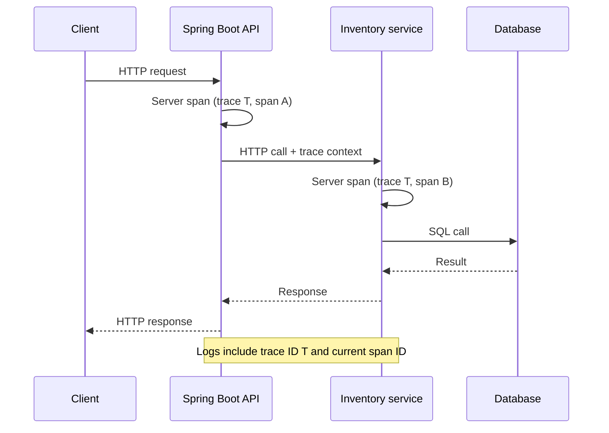
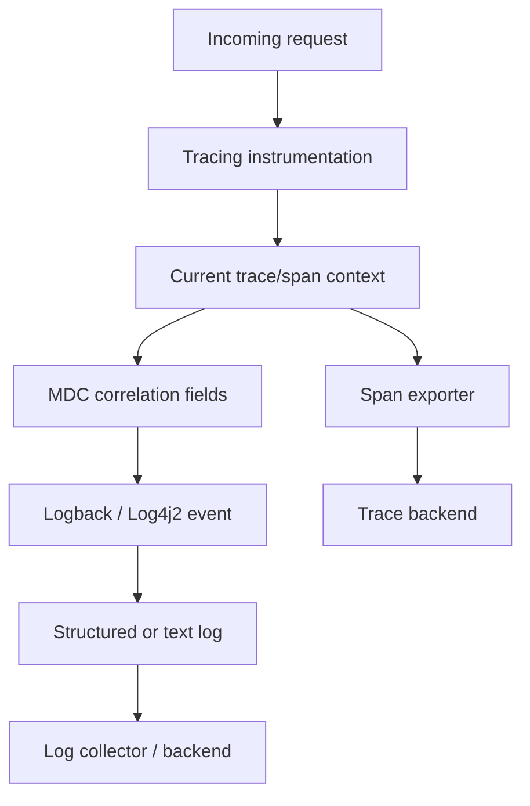
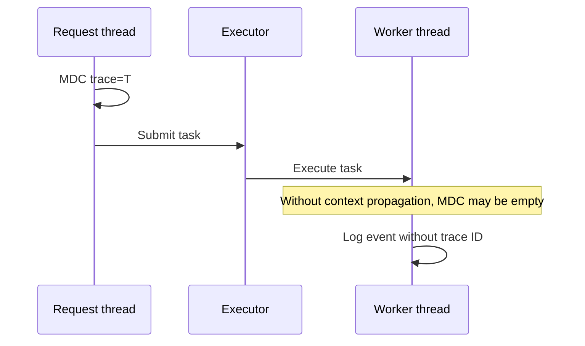

# Log không có correlation ID trong Spring Boot

Khi một request đi qua gateway, Spring Boot service, database và một service phía sau, log của từng thành phần thường nằm ở nhiều nơi. Nếu mỗi log line không có thông tin liên kết, người vận hành phải tìm bằng timestamp, message và hostname; việc này dễ nhầm giữa các request đồng thời và khó dựng lại luồng xử lý. Correlation ID hoặc trace ID giúp liên kết log events thuộc cùng một request/trace để chuyển từ log sang distributed trace.

**Log không có correlation ID** là tình huống log record không chứa identifier cần thiết để liên kết với request hoặc trace, hoặc identifier xuất hiện nhưng không nhất quán giữa các thread/services. Trong Spring Boot, correlation có thể được cung cấp bởi tracing context và đưa vào MDC thông qua Micrometer Tracing bridge, logging integration hoặc custom filter. Cần xác định rõ ID nào được dùng, ai tạo, cách propagate và thời điểm MDC được cleanup.

Correlation ID và trace ID có liên quan nhưng không hoàn toàn giống nhau. Trace ID định danh một distributed trace; span ID định danh một operation trong trace đó. Correlation ID là identifier ứng dụng hoặc tổ chức định nghĩa để nối các events, có thể bằng trace ID hoặc là một giá trị riêng. Tránh tạo nhiều ID song song nếu không có nhu cầu rõ ràng.

Bài học thuộc chương **Chẩn đoán sự cố** của module **SPRING_BOOT_OBSERVABILITY**. Module hướng dẫn thiết lập observability cho Spring Boot bằng Micrometer Observation, metrics, logs và distributed tracing; học propagation ngữ cảnh, tag/cardinality, exporter, sampling và liên kết tín hiệu để điều tra lỗi, độ trễ và hành vi ứng dụng trên môi trường thực. Bài này tập trung vào nguyên nhân log thiếu correlation ID, cách cấu hình liên kết logs/traces và kiểm chứng context propagation.

## Mục tiêu học tập

1. Phân biệt correlation ID, trace ID và span ID.
2. Hiểu cách Micrometer Tracing đưa trace context vào logging MDC.
3. Kiểm tra logging pattern/structured encoder có render đúng MDC fields.
4. Xác định vì sao correlation bị mất qua HTTP, executor, Reactor hoặc message boundaries.
5. Phân biệt thiếu ID do tracing chưa hoạt động với lỗi format log.
6. Propagate trace context qua HTTP clients và messaging integration.
7. Tạo correlation ID cho request không có distributed trace khi thật sự cần.
8. Ngăn spoofing, log injection và rò rỉ dữ liệu qua request headers.
9. Kiểm thử MDC lifecycle, async propagation và log correlation.
10. Chẩn đoán từ request đầu vào tới log backend bằng quy trình có thứ tự.

## 1. Correlation ID, trace ID và span ID

Ba identifier có mục đích khác nhau:

| Identifier | Ý nghĩa | Phạm vi |
|---|---|---|
| Trace ID | Định danh toàn bộ distributed trace | Xuyên qua các services trong cùng trace |
| Span ID | Định danh một operation/span | Một operation trong trace |
| Correlation ID | Định danh luồng nghiệp vụ/request theo policy ứng dụng | Phạm vi do hệ thống quy định |

Một request có thể tạo một trace gồm nhiều spans. Mỗi log line trong một span thường mang cùng trace ID và span ID hiện tại. Khi request gọi service khác, trace ID giữ nguyên còn span ID thay đổi theo operation mới.



### 1.1. Khi nào dùng trace ID làm correlation ID?

Nếu mục tiêu là liên kết logs với distributed trace, trace ID thường đã đủ và tránh thêm một identifier khác. Nếu business workflow tồn tại qua nhiều traces hoặc qua async events, correlation ID riêng có thể hữu ích để liên kết toàn bộ workflow.

Không gắn correlation ID riêng vào trace ID field. Dùng field name rõ ràng như correlation_id và trace_id để tránh nhầm semantics.

### 1.2. Không dùng span ID làm request ID toàn cục

Span ID thay đổi giữa server/client/internal operations. Nếu dùng span ID để tìm toàn bộ request qua nhiều services, kết quả sẽ bị phân mảnh. Dùng trace ID cho distributed trace; span ID để xác định log thuộc operation cụ thể.

## 2. Micrometer Tracing và logging correlation

Spring Boot có thể tích hợp Micrometer Tracing với tracing bridge như OpenTelemetry hoặc Brave. Khi tracing và logging correlation được cấu hình, trace ID/span ID có thể được đặt trong MDC để logging framework thêm vào log records.

Pipeline khái quát:



MDC là map theo execution context/thread trong logging framework. Tracing integration có thể cập nhật và khôi phục MDC khi scope mở/đóng. Tên MDC keys và logging pattern phụ thuộc bridge/version/configuration; xác minh runtime output thay vì giả định key names.

### 2.1. Có tracing chưa chắc log đã render ID

Tracing có thể tạo spans và export trace thành công trong khi log pattern không in MDC. Nếu trace backend có dữ liệu nhưng log thiếu trace ID, kiểm tra logging configuration và MDC fields trước khi thay đổi tracing setup.

### 2.2. Có ID trong log chưa chắc có trace

Một custom correlation filter có thể gắn request ID vào MDC mà tracing chưa bật hoặc sampler drop trace. Khi đó correlation ID vẫn tồn tại nhưng trace ID không có span tương ứng. Cần phân biệt hai trường hợp trong log schema.

## 3. Kiểm tra dependency và tracing bridge

Để Spring Boot tạo trace context, cần các dependency phù hợp với version và stack đang dùng. Một cấu hình Micrometer Tracing thường kết hợp bridge và exporter/registry tương ứng. Chỉ thêm logging pattern không tạo trace ID; chỉ thêm exporter mà không có tracer/bridge cũng không instrument request.

Kiểm tra:
- Spring Boot Actuator/observation integration.
- Micrometer Tracing API.
- Một tracing bridge phù hợp, ví dụ OpenTelemetry hoặc Brave.
- Exporter/transport tương ứng nếu cần gửi trace backend.
- HTTP server/client instrumentation.
- Sampler và tracing configuration.
- Java Agent nếu production có sử dụng.

Không kết hợp hai bridge hoặc hai instrumentation owners cho cùng boundary nếu chưa có chủ đích; điều đó có thể tạo spans trùng hoặc context behavior khó hiểu.

### 3.1. Auto-configuration

Spring Boot auto-configuration có thể tạo tracer, handlers và correlation integration khi dependency/configuration đúng. Nếu ứng dụng tự tạo ObservationRegistry hoặc Tracer bean, kiểm tra custom beans có thay thế cấu hình mặc định ngoài ý muốn không.

### 3.2. Kiểm tra runtime bean

Trong integration test hoặc debug context, xác minh Tracer/ObservationRegistry có mặt và server request tạo observation/span. Không chỉ kiểm tra bean tồn tại; thực hiện một request và quan sát trace context trong handler hoặc exporter.

## 4. Logging pattern và MDC fields

Nếu dùng Logback, pattern cần render MDC values. Cú pháp cụ thể phụ thuộc logging backend. Một pattern minh họa:

```text
%d{yyyy-MM-dd'T'HH:mm:ss.SSS} %-5level
[trace=%X{traceId:-}, span=%X{spanId:-}]
[%thread] %logger{36} - %msg%n
```

Micrometer Tracing bridge có thể dùng MDC key names như traceId/spanId hoặc tên khác theo cấu hình/version. Xác minh key thực tế trong MDC. Nếu key không tồn tại, pattern chỉ in giá trị rỗng; pattern không tự tạo correlation.

### 4.1. Structured logging

Với JSON logs, đưa trace_id và span_id thành top-level fields để log backend có thể filter/index. Ví dụ:

```json
{
  "timestamp": "2026-11-22T08:15:30.123+07:00",
  "level": "INFO",
  "message": "Order accepted",
  "trace_id": "4bf92f3577b34da6a3ce929d0e0e4736",
  "span_id": "00f067aa0ba902b7",
  "correlation_id": "checkout-flow-72"
}
```

Các ID chỉ minh họa. Chọn field names thống nhất với schema log platform; tránh có nơi dùng traceId, nơi dùng trace_id mà không có mapping.

### 4.2. Empty MDC values

Khi không có active span, traceId/spanId có thể rỗng hoặc không xuất hiện. Đây là behavior hợp lệ với startup logs, scheduled tasks chưa tạo root observation hoặc code chạy ngoài request. Nếu mọi request logs đều trống, điều tra tracing instrumentation/propagation.

### 4.3. Log format và collector parsing

Log line có ID nhưng backend không hiển thị field có thể do multiline parsing, JSON parser, field rename hoặc ingest pipeline. So sánh raw stdout/file với parsed document trong backend. Tránh sửa ứng dụng khi dữ liệu đã có trong raw log nhưng parser làm rơi field.

## 5. Request đầu vào và correlation ID

Với distributed tracing, server instrumentation thường đọc trace context từ header chuẩn như W3C traceparent và tạo server span. Client tiếp tục gửi context qua outbound instrumentation.

Nếu hệ thống còn cần correlation ID riêng, có thể nhận header do gateway phát hành hoặc tạo ID ở trusted edge. Không tin tưởng một giá trị tùy ý từ client rồi dùng nó làm security identity.

### 5.1. Header do client gửi

Client có thể gửi header trùng tên correlation ID với giá trị chứa newline hoặc chuỗi rất dài. Nếu log trực tiếp giá trị đó, có thể tạo log injection hoặc cardinality/storage abuse. Validate độ dài, ký tự hợp lệ và canonicalize; không dùng header này cho authorization.

### 5.2. Tạo ID tại edge

Nếu cần ID riêng, gateway hoặc filter đầu tiên có thể tạo ID khi request không có giá trị hợp lệ. Ghi lại giá trị đã chuẩn hóa vào response header nếu API contract cho phép. Không tạo ID mới ở mỗi service vì sẽ làm mất liên kết xuyên service.

### 5.3. Không ghi raw request headers

Chỉ ghi correlation header đã allowlist. Không dump toàn bộ headers vì có thể chứa Authorization, Cookie hoặc credentials. Correlation ID không nên mang user data hoặc secret.

## 6. Propagation qua HTTP services

W3C Trace Context thường sử dụng traceparent và tracestate. HTTP client instrumentation có thể inject current trace context vào outbound request; server instrumentation phía nhận extract context để tiếp tục trace.

```text
traceparent: 00-4bf92f3577b34da6a3ce929d0e0e4736-00f067aa0ba902b7-01
```

Không tự copy traceparent từ inbound request sang mọi outbound request bằng string manipulation nếu tracing library đã quản lý propagation. Dùng instrumented clients và configured propagators để bảo đảm parent/span relationships đúng.

### 6.1. Client chưa được instrument

Nếu dùng HTTP client tự tạo hoặc thư viện không được instrument, trace context có thể không được inject. Kiểm tra client bean/customizer và instrumentation tương ứng; test mock server để xem request có trace headers.

### 6.2. Gateway và proxy

Gateway có thể tạo hoặc tiếp tục trace. Nếu gateway loại trace headers, thay đổi header hoặc tạo trace mới, downstream logs có thể có trace ID khác. So sánh incoming/outgoing traceparent ở gateway và service, tránh log giá trị nhạy cảm.

### 6.3. Correlation ID riêng

Nếu correlation ID riêng cần đi qua HTTP, inject một header được chuẩn hóa theo allowlist. Không đặt nó vào baggage một cách mặc định; baggage có semantics propagation riêng và có thể được export thành span attributes.

## 7. MDC và asynchronous execution

MDC thường gắn với thread execution. Khi request submit công việc sang executor khác, thread worker không tự động có MDC của thread gọi. Kết quả là log trong worker không có trace/correlation ID dù log trước khi submit có đủ.



### 7.1. Micrometer Context Propagation

Micrometer Context Propagation cung cấp cơ chế capture/restore context qua execution boundaries khi được cấu hình. Spring Boot có thể tích hợp context propagation với các executor/framework paths theo version và configuration. Kiểm tra executor bean thực tế và decorator/customization.

Không tự copy toàn bộ MDC map nếu nó có thể chứa dữ liệu nhạy cảm hoặc stale context. Chỉ propagate fields/context cần thiết và bảo đảm restore/cleanup sau khi worker hoàn thành.

### 7.2. TaskDecorator

Với ThreadPoolTaskExecutor, TaskDecorator có thể capture context lúc submit và restore trong worker. Nếu tracing/context propagation integration đã cấu hình, ưu tiên dùng cơ chế thống nhất của framework để tránh double wrapping hoặc leak context.

Ví dụ khái niệm:

```java
@Bean
ThreadPoolTaskExecutor applicationExecutor() {
    ThreadPoolTaskExecutor executor = new ThreadPoolTaskExecutor();
    executor.setCorePoolSize(4);
    executor.setTaskDecorator(new ContextPropagatingTaskDecorator());
    return executor;
}
```

Class/API availability phụ thuộc Spring Framework/Spring Boot version. Kiểm tra dependency trước khi dùng; không tự tạo decorator chỉ copy traceId string nếu cần propagate full tracing context.

### 7.3. Context cleanup

Thread pool tái sử dụng worker threads. Context phải được restore về trạng thái trước task hoặc clear sau task; nếu không, log của request tiếp theo có thể mang ID của request trước. Test hai tasks liên tiếp với hai trace contexts khác nhau và một task không có context.

## 8. Reactor và reactive pipelines

Trong WebFlux/Reactor, execution có thể chuyển thread và context thường được lưu qua Reactor Context. MDC ThreadLocal không tự phản ánh mọi operator boundary nếu context propagation không được tích hợp.

Kiểm tra:
- Micrometer context-propagation dependency/integration.
- Reactor automatic/context propagation mode theo version.
- Observation/tracing instrumentation của WebFlux.
- Logging được thực hiện trong reactive chain hay callback ngoài chain.
- Subscription và terminal signals.

Không tạo Mono/Flux rồi bỏ quên subscribe; code chưa thực thi thì không có operation context để log. Với reactive pipeline, test log fields trong onNext/onError/doOnEach hoặc hook tương ứng theo cách ứng dụng thực sự chạy.

## 9. Scheduled tasks và message consumers

Scheduled task thường không có inbound HTTP parent span. Nếu muốn correlation trong logs, tạo root observation/span cho mỗi execution; log trong task sẽ có trace ID riêng. Không kỳ vọng startup logs hoặc mọi background logs đều có request trace ID.

Message consumers có thể tiếp tục trace context từ message headers nếu producer/consumer instrumentation hỗ trợ propagation. Nếu message không mang context, consumer có thể tạo root trace mới và dùng business correlation ID đã được duyệt để liên kết workflow.

### 9.1. Retry và redelivery

Mỗi attempt có thể có span riêng nhưng cùng business correlation ID. Ghi attempt number như trace/log attribute có kiểm soát; không dùng attempt ID làm metric tag. Xác minh broker headers không bị strip khi retry/dead-letter.

### 9.2. Batch processing

Một batch có thể chứa nhiều message contexts. Không gán tùy tiện một trace ID của message đầu tiên cho toàn bộ batch. Dùng span links hoặc correlation fields theo semantics của framework để biểu diễn quan hệ nhiều nguồn.

## 10. Sampling và correlation

Sampling quyết định trace nào được ghi/export, nhưng không nhất thiết quyết định log có trace ID hay không. Khi request có active trace context, log correlation fields có thể vẫn xuất hiện dù sampler không export span; backend sẽ không tìm thấy trace tương ứng.

Đây là nguyên nhân phổ biến khi người vận hành thấy trace ID trong log nhưng không tra được trace:
- Sampler drop trace.
- Tail sampling ở collector/backend loại trace.
- Exporter/collector mất dữ liệu.
- Trace retention đã hết.
- Query sai tenant/time range.

Không xóa trace ID khỏi log chỉ vì sampling; nó vẫn giúp liên kết các log records của cùng request. Nếu cần điều tra lỗi hiếm, cân nhắc error-aware sampling/tail sampling theo policy và giới hạn telemetry volume.

## 11. Bảo mật correlation fields

Correlation ID không phải secret nhưng vẫn là untrusted input nếu client tự gửi. Cần:
- Validate độ dài/character set.
- Loại CR/LF và control characters.
- Không dùng làm authorization principal.
- Không chứa email, account number hoặc dữ liệu cá nhân.
- Không đưa vào metric tags.
- Không ghi raw Authorization/Cookie headers.
- Giới hạn baggage propagation và attribute capture.

Trace ID theo format chuẩn nên được tracing library parse/validate. Không tự nhận trace ID tùy ý rồi dùng nó để tin cậy caller.

## 12. Kiểm thử log correlation

Một integration test hữu ích gửi request qua application, thực hiện outbound call và capture logs cùng spans.

Kịch bản:
1. Request không có traceparent: server tạo trace mới nếu tracing được bật.
2. Request có traceparent hợp lệ: service tiếp tục trace theo policy.
3. Outbound HTTP call: client inject context.
4. Async executor: worker logs giữ context mong đợi.
5. Executor reuse: request sau không nhận MDC stale.
6. Exception: error logs có trace/span IDs đúng.
7. No tracing: correlation ID riêng vẫn hoạt động nếu policy yêu cầu.
8. Sampling drop: log ID vẫn có thể xuất hiện dù backend không có trace.
9. Malformed correlation header: giá trị bị reject/regenerate.
10. Security: Authorization/Cookie không xuất hiện trong logs.

### 12.1. Capture logs

Dùng test appender hoặc output capture để đọc structured fields/MDC. Assert field values trên log event thay vì chỉ tìm substring trong console output nếu logging framework hỗ trợ structured access.

### 12.2. Assert trace relationship

Dùng in-memory span exporter để lấy trace ID/span ID và đối chiếu với log records. Với batch processor, flush trước khi assert; dùng sampler deterministic trong test.

### 12.3. Không dùng Thread.sleep

Dùng latch/future để đợi worker/log/exporter hoàn tất với timeout hữu hạn. Sleep cố định dễ flaky trên CI và làm test chậm.

## 13. Chẩn đoán log không có correlation ID

| Triệu chứng | Nguyên nhân có thể | Cách kiểm tra |
|---|---|---|
| Tất cả request logs thiếu trace ID | Tracing bridge/auto-config chưa hoạt động | Dependency, tracer và server instrumentation |
| Trace backend có span nhưng log trống | Logging pattern không render MDC | Inspect MDC keys và encoder |
| Controller có ID, async worker không có | Context không propagate qua executor | TaskDecorator/context propagation |
| Worker có ID của request trước | MDC không cleanup/restore | Thread reuse test và scope lifecycle |
| HTTP downstream có trace mới | Client không inject hoặc gateway đổi headers | Outbound traceparent và client instrumentation |
| Trace ID trong log nhưng không có trace backend | Sampling/drop/export/retention | Sampler, collector, exporter và query range |
| Chỉ một replica thiếu ID | Config/dependency drift | Per-pod dependencies và effective config |
| JSON log có field nhưng backend không filter được | Parser/field mapping | Raw log vs indexed document |
| Scheduled task không có ID | Không tạo root observation/span | Task instrumentation |
| Message consumer mất context | Broker header propagation thiếu | Producer/consumer instrumentation |
| Correlation ID thay đổi mỗi service | Mỗi service tự tạo ID mới | Header/trace propagation policy |
| ID chứa newline hoặc quá dài | Untrusted header không validate | Input validation và log injection controls |

### Quy trình điều tra

1. Gửi một request test và ghi nhận traceparent đầu vào nếu có.
2. Xác minh server instrumentation tạo current span.
3. Kiểm tra trace/span values trong MDC tại controller/service boundary.
4. So sánh raw application log với parsed backend document.
5. Kiểm tra outbound HTTP request có trace context headers.
6. Kiểm tra executor/Reactor/message context propagation.
7. Kiểm tra MDC cleanup khi thread được tái sử dụng.
8. Kiểm tra sampler, exporter, collector và trace retention.
9. So sánh effective config/dependencies giữa replicas.
10. Chạy integration test có log capture và in-memory span exporter.

## 14. Các anti-pattern cần tránh

| Anti-pattern | Hậu quả | Cách phù hợp |
|---|---|---|
| Chỉ thêm %X{traceId} vào pattern | Pattern không tự tạo MDC field | Cấu hình tracing correlation |
| Tạo correlation ID mới ở mỗi service | Không thể liên kết xuyên service | Propagate một ID theo policy |
| Dùng span ID làm request ID | Logs bị phân mảnh theo operation | Dùng trace ID |
| Copy MDC thủ công không cleanup | Context stale giữa tasks | Context capture/restore |
| Dump toàn bộ inbound headers | Lộ credentials và dữ liệu nhạy cảm | Header allowlist |
| Dùng correlation ID cho authorization | Caller có thể spoof identifier | Security identity độc lập |
| Đưa correlation ID vào metric tag | Cardinality cao | Chỉ dùng logs/traces |
| Kỳ vọng mọi background log có request ID | Background task không có parent request | Tạo root observation khi phù hợp |
| Tắt sampling để chữa log thiếu ID | Tăng volume không cần thiết | Phân biệt logging correlation với trace retention |
| Log raw traceparent do client gửi | Input không tin cậy/log injection | Parse/validate bằng tracing library |
| Sửa parser trước khi kiểm tra raw logs | Che khuất lỗi ở application | So sánh raw và indexed event |
| Dùng Thread.sleep trong test | Test flaky | Latch/future/flush |

## 15. Checklist production

1. **Identifier policy:** trace ID, span ID và correlation ID có semantics rõ?
2. **Tracing:** server instrumentation và tracing bridge được cấu hình?
3. **MDC:** logging integration đưa đúng keys vào MDC?
4. **Format:** text/JSON encoder render trace_id/span_id nhất quán?
5. **HTTP:** trace context được extract/inject qua client/server?
6. **Gateway:** proxy không vô tình strip hoặc rewrite trace headers?
7. **Async:** executor có capture/restore context?
8. **Reactive:** Reactor context propagation phù hợp version?
9. **Messaging:** producer/consumer propagate context qua headers?
10. **Background:** scheduled tasks tạo root observation khi cần?
11. **Cleanup:** MDC/context được restore sau task?
12. **Sampling:** operator hiểu log ID có thể tồn tại dù trace bị drop?
13. **Security:** correlation headers được validate và không chứa PII/secrets?
14. **Cardinality:** IDs không trở thành metric labels?
15. **Testing:** logs được đối chiếu với exported spans?
16. **Backend:** parser/index mapping giữ nguyên fields?
17. **Replicas:** dependencies/configuration nhất quán?
18. **Runbook:** có quy trình kiểm tra từ inbound context tới log backend?

## 16. Câu hỏi tự đánh giá

**Câu 1.** Trace ID và span ID khác nhau thế nào?

**Gợi ý:** Trace ID định danh distributed trace; span ID định danh một operation trong trace.

**Câu 2.** Correlation ID có nhất thiết phải khác trace ID không?

**Gợi ý:** Không. Trace ID thường đủ cho liên kết request; correlation ID riêng hữu ích khi workflow vượt nhiều traces.

**Câu 3.** Vì sao logging pattern có traceId field nhưng output vẫn rỗng?

**Gợi ý:** MDC key không được populate, tracing bridge chưa hoạt động hoặc key name khác.

**Câu 4.** Vì sao async worker mất correlation ID?

**Gợi ý:** MDC/thread-local context không tự truyền sang executor thread; cần capture/restore context.

**Câu 5.** Vì sao thread pool có thể làm log mang ID request cũ?

**Gợi ý:** MDC không được cleanup/restore sau task và worker thread được tái sử dụng.

**Câu 6.** Trace ID trong log nhưng không tìm thấy trace backend có thể do đâu?

**Gợi ý:** Sampling, tail sampling, exporter/collector failure, retention hoặc query sai.

**Câu 7.** Có nên tự copy traceparent sang mọi HTTP client request không?

**Gợi ý:** Không nếu client instrumentation đã inject context; dùng propagator chuẩn để tạo span relationship đúng.

**Câu 8.** Scheduled task lấy correlation ID từ đâu?

**Gợi ý:** Tạo root observation/span cho mỗi execution hoặc dùng workflow correlation ID đã được xác định.

**Câu 9.** Correlation ID từ client có đáng tin để authorization không?

**Gợi ý:** Không. Đây là identifier để liên kết telemetry, không phải security identity.

**Câu 10.** Cần kiểm thử những gì để xác minh log correlation?

**Gợi ý:** Request context, MDC fields, outbound propagation, async cleanup, structured parser và đối chiếu log IDs với exported spans.

## Kết luận

**Log correlation cần một identifier nhất quán và context được truyền đúng qua mọi execution boundary.** Trong Spring Boot, Micrometer Tracing có thể đưa trace ID/span ID vào MDC; logging pattern hoặc structured encoder phải render các field đó. Kiểm tra riêng tracing instrumentation, MDC integration, HTTP propagation, executor/Reactor context và backend parsing để tìm đúng nơi ID bị mất. Dùng trace ID cho distributed request correlation, chỉ tạo correlation ID riêng khi business workflow cần semantics rộng hơn, validate mọi ID từ client và luôn cleanup context trên thread pool. Kiểm thử logs cùng exported spans để bảo đảm correlation hoạt động cả ở request đồng bộ lẫn async/background processing.
