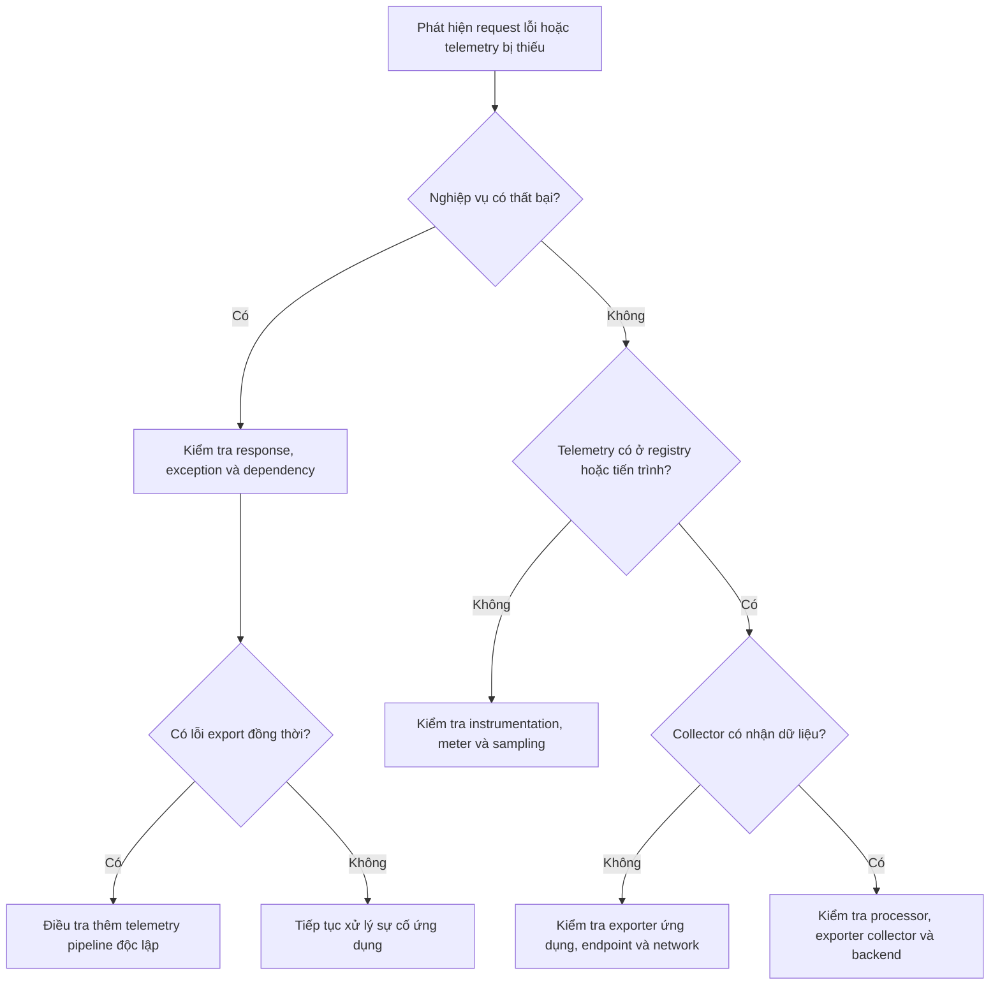

# Phân biệt lỗi ứng dụng và lỗi exporter

Khi dashboard không có dữ liệu, trace bị thiếu hoặc hệ thống phát sinh nhiều log lỗi, rất dễ kết luận rằng ứng dụng đang gặp sự cố. Thực tế, lỗi có thể nằm ở hai nơi khác nhau: **đường xử lý nghiệp vụ của ứng dụng** hoặc **đường thu thập và chuyển dữ liệu observability**. Hai loại lỗi có thể xuất hiện riêng lẻ hoặc cùng lúc, nhưng cách điều tra và khắc phục khác nhau.

Mục tiêu của bài này là xác định điểm hỏng nằm ở đâu trước khi thay đổi code, cấu hình hay hạ tầng. Quy tắc quan trọng là kiểm tra kết quả nghiệp vụ độc lập với việc telemetry có được gửi đến backend hay không.

## 1. Hai đường đi cần phân biệt

### 1.1. Đường xử lý của ứng dụng

Đường xử lý ứng dụng bắt đầu khi request đi vào Spring MVC hoặc WebFlux, sau đó qua controller, service, repository và các dependency như database, cache hay dịch vụ HTTP khác. Lỗi trên đường này có thể làm request thất bại, trả về kết quả nghiệp vụ sai hoặc làm một tác vụ nền không hoàn thành.

Ví dụ:

- Controller hoặc service ném exception do dữ liệu đầu vào không hợp lệ.
- Truy vấn database timeout hoặc vi phạm constraint.
- Một dịch vụ phụ thuộc trả về HTTP 5xx.
- Logic nghiệp vụ tính toán sai và trả về kết quả không đúng dù HTTP status là 200.

Đây là lỗi ứng dụng hoặc lỗi của dependency mà ứng dụng đang sử dụng. Cần truy vết stack trace, log nghiệp vụ, kết quả request và trạng thái dependency để tìm nguyên nhân.

### 1.2. Đường thu thập và xuất telemetry

Spring Boot có thể tạo telemetry thông qua Micrometer Observation và các instrumentation tương ứng. Observation được xử lý bởi các handler để tạo metrics, tracing hoặc liên kết với logging. Các registry và exporter sau đó chuyển dữ liệu đến collector hoặc backend quan sát.

Một đường đi điển hình có dạng:

```text
Request / tác vụ nền
        |
        v
Controller -> Service -> Repository -> Dependency
        |
        v
Micrometer Observation / instrumentation
        |
        +----> MeterRegistry ----> Metrics exporter ----+
        |                                               |
        +----> Tracer ---------> Trace exporter --------+--> Collector --> Backend
        |                                               |
        +----> Logging / correlation ------------------+
```

Lỗi exporter xảy ra khi dữ liệu telemetry không được chuyển tiếp thành công, chẳng hạn do sai endpoint, lỗi DNS, TLS, xác thực, timeout, queue đầy hoặc collector/backend từ chối dữ liệu. Lỗi này có thể làm mất hoặc chậm metrics, traces hay logs trong khi request nghiệp vụ vẫn thành công.

Trong thực tế, exporter có thể nằm trong tiến trình ứng dụng hoặc nằm ở collector. Vì vậy, khi nói “lỗi exporter”, cần xác định rõ thành phần nào đang gửi dữ liệu: exporter trong Spring Boot hay exporter ở OpenTelemetry Collector.

### 1.3. Một lỗi có thể che khuất lỗi còn lại

Ứng dụng có thể vừa trả về HTTP 500 vừa không gửi được trace. Khi đó có hai vấn đề cần điều tra độc lập: nguyên nhân làm request thất bại và nguyên nhân làm trace không đến backend. Không nên mặc định lỗi exporter gây ra lỗi nghiệp vụ, cũng không nên mặc định mọi log lỗi exporter đều là nguyên nhân của HTTP 5xx.

## 2. Dấu hiệu nhận biết ban đầu

Bảng dưới đây giúp phân loại triệu chứng trước khi đi sâu vào cấu hình.

| Triệu chứng | Khả năng cần kiểm tra trước | Bằng chứng nên tìm |
|---|---|---|
| Request trả về 5xx, có exception trong stack trace | Ứng dụng hoặc dependency | Log request, exception, span lỗi nếu có, log database hoặc dịch vụ phụ thuộc |
| Request và tác vụ nghiệp vụ vẫn thành công nhưng trace không xuất hiện | Tracing pipeline | Sampling, instrumentation, trace exporter, collector receiver và backend |
| Metrics có trong registry của ứng dụng nhưng không có trên dashboard | Metrics export pipeline | Cấu hình registry/exporter, kết nối collector, lỗi ingest và bộ lọc ở backend |
| Chỉ metrics mất, traces vẫn có | Metrics pipeline | Metrics exporter, scrape/export interval, registry và cấu hình metrics collector |
| Chỉ traces mất, metrics vẫn có | Tracing pipeline | Sampling, tracer bridge, trace exporter, collector và retention |
| Log exporter báo timeout, 401, 403 hoặc lỗi TLS trong khi request vẫn bình thường | Exporter hoặc collector/backend | Endpoint, credentials, certificate, DNS, network và log phía nhận |
| Request 5xx đồng thời có lỗi gửi telemetry | Có thể là hai lỗi độc lập | Điều tra request và telemetry theo hai luồng riêng |

HTTP status chỉ phản ánh kết quả ở một lớp của request. Proxy, gateway hoặc load balancer cũng có thể tạo ra 4xx/5xx. Hãy xác định thành phần nào trả status đó trước khi kết luận code Spring Boot bị lỗi.

## 3. Quy trình điều tra theo thứ tự

### Bước 1: Xác nhận ứng dụng có thực sự thất bại

Chọn một request hoặc một khoảng thời gian cụ thể, ghi lại timestamp, route, HTTP status, request ID hoặc trace ID nếu có. Đối chiếu kết quả từ client với access log của gateway và log của ứng dụng.

Kiểm tra các câu hỏi sau:

1. Request có đến được instance Spring Boot không?
2. Ứng dụng có trả response lỗi hay gateway tự tạo response?
3. Tác vụ nghiệp vụ có hoàn thành không? Với tác vụ nền, kiểm tra trạng thái job hoặc message acknowledgement thay vì chỉ nhìn HTTP status.
4. Có exception hoặc lỗi dependency tại cùng thời điểm không?

Nếu nghiệp vụ thất bại, điều tra exception và dependency như một sự cố ứng dụng. Vẫn ghi nhận lỗi telemetry nếu có, nhưng không để nó thay thế việc tìm nguyên nhân request thất bại.

### Bước 2: Đọc log ứng dụng và exception

Tìm stack trace đầy đủ, lớp phát sinh exception và chuỗi nguyên nhân (`Caused by`). Phân biệt exception thuộc code nghiệp vụ với exception khi gửi dữ liệu telemetry. Tên package, thread và thời điểm thường giúp nhận diện hai nhóm này.

Ví dụ, lỗi truy vấn database thường xuất hiện trong luồng xử lý request và có nguyên nhân liên quan đến JDBC, transaction hoặc driver. Lỗi gửi OTLP có thể nhắc đến exporter, gRPC/HTTP client, connection, TLS, authentication hoặc collector. Tên logger phụ thuộc thư viện và phiên bản, vì vậy không nên chỉ lọc theo một tên logger cố định.

Một dòng log exporter ở mức WARN hoặc ERROR chưa đủ chứng minh request thất bại. Hãy ghép log với request ID, thread, timestamp và HTTP status để xác định nó xảy ra trong hay ngoài đường xử lý nghiệp vụ.

### Bước 3: Kiểm tra telemetry ngay trong tiến trình ứng dụng

Nếu Actuator được bật và endpoint được expose, có thể kiểm tra các meter mà ứng dụng đang giữ bằng endpoint metrics. Ví dụ:

```yaml
management:
  endpoints:
    web:
      exposure:
        include: health,info,metrics
```

Sau khi cấu hình endpoint phù hợp với môi trường, truy vấn một meter cụ thể, chẳng hạn:

```http
GET /actuator/metrics/http.server.requests
```

Tên meter thực tế phụ thuộc instrumentation và phiên bản thư viện. Có thể dùng `/actuator/metrics` để xem danh sách meter đang có, sau đó truy vấn meter cần điều tra.

Kết quả tại `/actuator/metrics` cho biết meter có tồn tại trong registry của tiến trình. Nó **không chứng minh** exporter đã gửi thành công dữ liệu đến collector hoặc backend. Nếu meter có dữ liệu tại ứng dụng nhưng dashboard không có, hãy chuyển trọng tâm sang đường export và ingest.

Tương tự, `/actuator/health` chủ yếu phản ánh các health indicator được cấu hình. Endpoint này không mặc nhiên xác nhận metrics exporter hoặc trace exporter đang gửi dữ liệu thành công. Không nên dùng trạng thái `UP` của health endpoint làm bằng chứng duy nhất cho toàn bộ telemetry pipeline.

Trong môi trường production, chỉ expose endpoint cần thiết, giới hạn quyền truy cập và tuân theo chính sách bảo mật nội bộ. Không mở rộng endpoint quản trị công khai chỉ để điều tra tạm thời.

### Bước 4: Kiểm tra cấu hình exporter trong Spring Boot

Với exporter chạy trong ứng dụng, kiểm tra lần lượt:

- **Endpoint và protocol:** host, port, path và giao thức HTTP/gRPC có khớp với receiver của collector không? OTLP/gRPC thường dùng port 4317, OTLP/HTTP thường dùng port 4318; cấu hình thực tế có thể khác.
- **Xác thực:** token, API key, header, tenant hoặc thông tin xác thực có đúng và còn hiệu lực không?
- **TLS:** certificate chain, hostname, trust store và thời hạn chứng chỉ có hợp lệ không?
- **Network:** DNS có phân giải được không, route/firewall có cho phép kết nối không, kết nối có bị reset không?
- **Timeout và retry:** timeout có quá ngắn không, retry có hoạt động đúng không, lỗi kéo dài có làm queue tăng không?
- **Batch và chu kỳ export:** batch size, export interval và giới hạn queue có phù hợp với lưu lượng không?
- **Resource và filter:** resource attributes, processor hoặc filter có loại bỏ dữ liệu cần tìm không?

Tên property và cách cấu hình exporter thay đổi theo phiên bản Spring Boot, Micrometer và thư viện registry được dùng. Hãy đối chiếu với phiên bản thực tế của dự án và tài liệu của exporter đang cài đặt; không sao chép một property từ phiên bản khác mà chưa xác minh.

### Bước 5: Kiểm tra collector và backend

Nếu ứng dụng kết nối được đến collector, kiểm tra tiếp đường đi bên nhận:

1. Receiver có nhận đúng protocol và port không?
2. Collector có chấp nhận dữ liệu hay từ chối vì payload, authentication hoặc cấu hình pipeline?
3. Processor có lọc, lấy mẫu, giới hạn hoặc loại bỏ dữ liệu không?
4. Exporter của collector có gửi thành công đến backend không?
5. Backend có từ chối dữ liệu do quota, tenant, schema, timestamp, retention hoặc giới hạn ingest không?

Theo dõi log của collector cùng các metrics nội bộ về số lượng nhận, gửi thành công, gửi thất bại, enqueue thất bại và số lượng bị loại bỏ. Tên metric cụ thể phụ thuộc phiên bản OpenTelemetry Collector và exporter. Nếu collector nhận được dữ liệu nhưng không chuyển tiếp được, điều tra exporter của collector và backend đích. Nếu collector không nhận dữ liệu, quay lại kiểm tra exporter trong ứng dụng, network và receiver.

### Bước 6: So sánh từng loại tín hiệu

Metrics, traces và logs có thể dùng các exporter, queue, processor và chính sách lưu trữ khác nhau. Không nên kết luận toàn bộ observability bị lỗi chỉ vì một loại tín hiệu bị thiếu.

Ví dụ:

- Metrics vẫn tăng nhưng traces biến mất: kiểm tra sampling, tracer bridge, trace exporter và trace pipeline.
- Traces có nhưng metrics không cập nhật: kiểm tra meter registry, metrics exporter, chu kỳ export hoặc scrape target.
- Logs có exception ứng dụng nhưng không có trace liên kết: kiểm tra trace context propagation, correlation và cấu hình logging.
- Cả ba loại tín hiệu cùng mất: kiểm tra kết nối chung, collector, xác thực, backend hoặc sự cố hạ tầng quan sát.

### Bước 7: Đánh giá tác động đến request

Exporter có thể gửi dữ liệu theo batch bất đồng bộ, nhưng cách triển khai cụ thể quyết định mức độ ảnh hưởng khi backend chậm hoặc mất kết nối. Kiểm tra queue, thread, CPU, memory, thời gian shutdown và độ trễ request trong lúc exporter retry.

Một exporter tùy biến gửi đồng bộ trong request path có thể làm tăng latency hoặc khiến request thất bại nếu exception không được xử lý. Vì vậy, không nên khẳng định exporter luôn độc lập với nghiệp vụ. Cần xem cách exporter được tích hợp và xác định liệu lỗi export có lan ngược vào luồng xử lý hay không.

## 4. Sơ đồ quyết định nhanh



Sơ đồ này là thứ tự khoanh vùng. Trong hệ thống phân tán, có thể cần kiểm tra nhiều nhánh song song khi có bằng chứng về nhiều lỗi cùng lúc.

## 5. Các tình huống thường gặp

### Tình huống A: Request trả 500 nhưng trace vẫn xuất hiện

Một endpoint trả HTTP 500. Backend tracing vẫn có trace tương ứng, trong đó span của service có trạng thái lỗi và thời gian gọi database tăng cao.

**Nhận định:** telemetry pipeline đang hoạt động đủ để ghi nhận request. Tập trung vào stack trace, span database, transaction và dependency. Không cần thay endpoint exporter chỉ vì request trả 500.

**Hướng xử lý:** xác định exception đầu tiên, kiểm tra truy vấn hoặc dependency gây lỗi, sau đó xác minh request thành công ở lần thử lại. Giữ lại trace lỗi để phục vụ phân tích nguyên nhân.

### Tình huống B: Request trả 200 nhưng dashboard không có metrics

Ứng dụng vẫn xử lý request bình thường. Khi truy vấn `/actuator/metrics/http.server.requests`, meter có dữ liệu nhưng dashboard không cập nhật.

**Nhận định:** instrumentation trong ứng dụng có khả năng đang tạo meter. Điểm cần kiểm tra tiếp là registry/exporter, kết nối collector, cấu hình ingest và dashboard query.

**Hướng xử lý:** đối chiếu log exporter, endpoint OTLP, trạng thái receiver, metrics nội bộ của collector và bộ lọc tại backend. Nếu collector đã nhận dữ liệu, kiểm tra tiếp exporter collector và truy vấn dashboard.

### Tình huống C: Ứng dụng vừa trả 500 vừa báo lỗi OTLP timeout

Trong cùng khoảng thời gian, log ứng dụng có exception từ service và log exporter có timeout khi gửi trace.

**Nhận định:** đây có thể là hai lỗi đồng thời. Exception service giải thích vì sao request thất bại; timeout OTLP giải thích vì sao trace có thể không đến backend. Chưa có bằng chứng cho thấy một lỗi gây ra lỗi còn lại.

**Hướng xử lý:** dùng log cục bộ và các tín hiệu còn hoạt động để điều tra lỗi service. Đồng thời kiểm tra network, collector và queue của trace exporter. Sau khi khắc phục, xác minh cả tỷ lệ request lỗi lẫn tỷ lệ export thất bại.

### Tình huống D: Metrics có nhưng traces không có

Dashboard vẫn hiển thị JVM metrics và HTTP request metrics, nhưng không tìm thấy trace cho một route.

**Nhận định:** metrics pipeline hoạt động không đồng nghĩa tracing pipeline hoạt động. Trước khi kết luận exporter lỗi, hãy kiểm tra sampling, instrumentation của route, propagation và điều kiện tìm kiếm trace.

**Hướng xử lý:** xác minh route có tạo span không, sampling có giữ trace đó không, trace ID có được truyền qua các service không và trace exporter có gửi dữ liệu đến đúng backend/tenant không.

## 6. Những nguyên nhân dễ bị nhầm với lỗi exporter

| Hiện tượng | Vì sao dễ nhầm | Cách xác minh |
|---|---|---|
| Trace không xuất hiện do sampling | Không có trace được giữ lại nên dashboard trống | Kiểm tra sampler, sampling probability và chính sách tail sampling |
| Filter hoặc processor loại bỏ dữ liệu | Exporter có thể gửi thành công nhưng dữ liệu bị loại trước khi lưu | Kiểm tra cấu hình filter, processor và bộ đếm dropped records |
| Dashboard truy vấn sai | Dữ liệu tồn tại nhưng query, label hoặc time range không khớp | Tìm trực tiếp theo service, resource attributes và khoảng thời gian rộng hơn |
| Resource attribute sai | Dữ liệu nằm dưới service name, environment hoặc tenant khác | Kiểm tra resource attributes thực tế ở collector/backend |
| Retention hoặc ingest quota | Backend nhận rồi loại bỏ hoặc xóa dữ liệu theo chính sách | Kiểm tra ingest response, quota và retention policy |
| Dữ liệu đến trễ | Batch, retry hoặc backlog làm dashboard cập nhật chậm | So sánh event timestamp với ingest timestamp và queue depth |
| Đồng hồ lệch | Trace nằm ngoài time range đang xem | Kiểm tra đồng bộ thời gian của ứng dụng, collector và backend |
| Chỉ thiếu một route hoặc một loại span | Instrumentation hoặc propagation không bao phủ đường xử lý đó | Kiểm tra instrumentation và context propagation tại route/service liên quan |

Các trường hợp này có thể cùng tồn tại với lỗi exporter. Hãy dựa vào bằng chứng ở từng chặng thay vì chỉ dựa vào việc dashboard có hay không có dữ liệu.

## 7. Hướng khắc phục theo vị trí lỗi

### Khi lỗi thuộc ứng dụng hoặc dependency

- Sửa nguyên nhân trong controller, service, repository hoặc dependency.
- Giữ lại exception và ngữ cảnh cần thiết để điều tra; không chuyển mọi lỗi thành response thành công chỉ để dashboard sạch hơn.
- Kiểm tra timeout, retry và circuit breaker của dependency để tránh lỗi lan rộng.
- Dùng trace và metrics còn sẵn để xác định latency, số lần retry và thành phần gây lỗi.

### Khi lỗi thuộc exporter trong ứng dụng

- Sửa endpoint, protocol, port, path, authentication hoặc TLS theo cấu hình receiver thực tế.
- Khôi phục DNS và network; kiểm tra firewall, proxy và giới hạn kết nối.
- Điều chỉnh batch, queue, timeout và retry theo lưu lượng cũng như khả năng tiếp nhận của collector.
- Theo dõi dữ liệu bị drop khi queue đầy hoặc khi retry hết giới hạn.
- Kiểm tra việc exporter có chạy đồng bộ trong request path hay không; xử lý lỗi để tránh làm hỏng request nghiệp vụ ngoài ý muốn.

### Khi lỗi thuộc collector hoặc backend

- Sửa receiver và pipeline để chấp nhận đúng protocol, signal và resource.
- Kiểm tra processor, memory limiter, queue và exporter của collector.
- Xử lý quota, xác thực, schema, retention hoặc giới hạn ingest tại backend.
- Theo dõi cả số liệu nhận, gửi thành công và gửi thất bại để phát hiện tình trạng backlog hoặc mất dữ liệu.

Không nên tắt toàn bộ instrumentation chỉ để loại bỏ log exporter. Cách đó làm mất dữ liệu cần thiết cho lần điều tra tiếp theo. Nếu cần giảm tải khẩn cấp, thay đổi sampling hoặc export theo phạm vi có kiểm soát, ghi nhận rõ dữ liệu nào sẽ bị giảm và theo dõi tác động.

## 8. Checklist khi xử lý sự cố

- [ ] Ghi nhận timestamp, service, instance, route, status và request/trace ID nếu có.
- [ ] Xác nhận response lỗi đến từ gateway hay ứng dụng.
- [ ] Kiểm tra exception đầu tiên và lỗi dependency tại cùng thời điểm.
- [ ] Kiểm tra meter trong tiến trình bằng Actuator nếu endpoint được bật và được phép truy cập.
- [ ] Xác định tín hiệu bị thiếu: metrics, traces, logs hay nhiều loại.
- [ ] Kiểm tra log và cấu hình exporter trong ứng dụng.
- [ ] Xác minh collector receiver có nhận dữ liệu không.
- [ ] Nếu collector đã nhận, kiểm tra processor, exporter collector và backend.
- [ ] Kiểm tra sampling, filter, resource attributes, retention và time range.
- [ ] Đánh giá queue, retry, latency và khả năng exporter ảnh hưởng request path.
- [ ] Sau khắc phục, xác minh riêng kết quả nghiệp vụ và khả năng export telemetry.

## 9. Nguyên tắc ghi nhận và phòng ngừa

Nên xây dựng cảnh báo riêng cho sức khỏe ứng dụng và sức khỏe telemetry pipeline. Cảnh báo ứng dụng có thể dựa trên tỷ lệ request lỗi, latency, lỗi dependency và trạng thái job. Cảnh báo pipeline có thể dựa trên export failures, dropped records, queue depth, collector receiver/exporter và độ trễ ingest. Hai nhóm cảnh báo giúp đội vận hành biết hệ thống đang xử lý nghiệp vụ không tốt hay đang mất khả năng quan sát hệ thống.

Khi thiết kế, cần bảo đảm lỗi gửi telemetry không dễ dàng lan thành lỗi nghiệp vụ. Ưu tiên cơ chế batch và retry có giới hạn phù hợp, theo dõi queue và có hành vi suy giảm được xác định trước. Đồng thời, không giả định mọi exporter đều bất đồng bộ: hãy kiểm tra cách thư viện và cấu hình cụ thể hoạt động trong phiên bản đang chạy.

Một cuộc điều tra tốt luôn trả lời được hai câu hỏi riêng: **ứng dụng có hoàn thành công việc đúng hay không**, và **telemetry có được tạo, chuyển tiếp, nhận và lưu thành công hay không**. Khi có câu trả lời cho từng câu hỏi, vị trí lỗi sẽ rõ ràng hơn và biện pháp khắc phục ít gây tác dụng phụ hơn.
