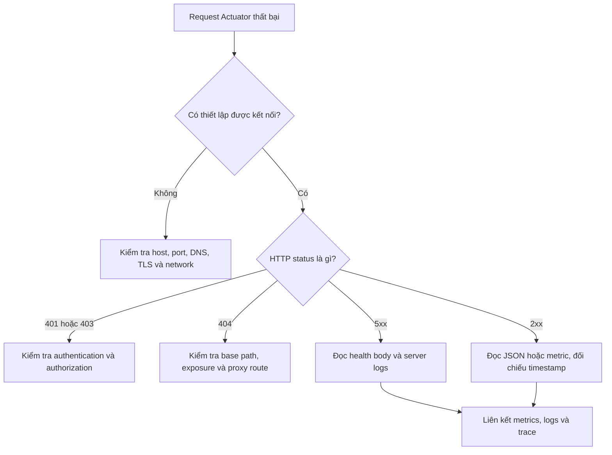

# Kiểm tra bằng curl và Actuator

Trong chương **Chẩn đoán sự cố** của module `SPRING_BOOT_OBSERVABILITY`, bài này hướng dẫn dùng `curl` để gọi các endpoint của Spring Boot Actuator, đọc health check và metrics, kiểm tra cấu hình logging, rồi liên kết kết quả với logs và distributed traces. Đây là thao tác thực hành trong quy trình observability của Spring Boot: Micrometer Observation tạo ngữ cảnh quan sát, metrics mô tả xu hướng và độ trễ, logs ghi lại sự kiện, còn distributed tracing cho biết một request đi qua các thành phần nào.

Actuator cung cấp dữ liệu vận hành qua HTTP; `curl` giúp gửi request và xem chính xác status code, response header, body cùng thời gian phản hồi. Hai công cụ này hỗ trợ khoanh vùng sự cố nhanh, nhưng chỉ trả về dữ liệu mà ứng dụng đã bật, cấu hình và cho phép người gọi truy cập.

## 1. Mục tiêu và phạm vi kiểm tra

Sau bài học, bạn có thể:

- Xác định địa chỉ Actuator và kiểm tra endpoint có được bật, expose và bảo vệ đúng cách hay không.
- Phân biệt trạng thái health của ứng dụng với trạng thái liveness và readiness.
- Liệt kê metric, đọc measurement và lọc metric theo tag.
- Kiểm tra log level trong runtime và tạm thời tăng mức log khi cần điều tra.
- Dùng status code, response time, trace context và timestamp để nối một request với metrics, logs và traces.
- Nhận diện các lỗi phổ biến như connection refused, timeout, 401, 403, 404 và 503.

`curl` là HTTP client, không tự tạo ra telemetry. Actuator cũng không tự thay thế hệ thống lưu trữ và phân tích logs hoặc traces. Để có dữ liệu đầy đủ, ứng dụng cần được instrument bằng Micrometer, cấu hình registry hoặc tracing bridge phù hợp, và gửi tín hiệu tới backend quan sát tương ứng.

## 2. Xác định địa chỉ và quyền truy cập Actuator

Với cấu hình mặc định phổ biến, Actuator có base path `/actuator` trên cùng cổng HTTP với ứng dụng. Ví dụ, nếu ứng dụng chạy tại `http://localhost:8080`, URL health là `http://localhost:8080/actuator/health`.

Địa chỉ có thể thay đổi theo cấu hình:

```yaml
management:
  endpoints:
    web:
      base-path: /actuator
      exposure:
        include: health,info,metrics,prometheus,loggers
```

`exposure.include` quyết định endpoint nào được expose qua web. Một endpoint có trong classpath hoặc được bật không có nghĩa là endpoint đó tự động truy cập được qua HTTP. Endpoint `prometheus` còn cần registry Prometheus tương ứng, thường là dependency `micrometer-registry-prometheus`.

Nếu muốn tách cổng quản trị khỏi cổng phục vụ request, có thể cấu hình:

```yaml
management:
  server:
    port: 8081
```

Khi đó, URL Actuator trong ví dụ là `http://localhost:8081/actuator`. Hãy kiểm tra đúng host, port, scheme (`http` hay `https`) và base path của môi trường đang điều tra. Nếu hệ thống đặt Actuator sau reverse proxy hoặc ingress, URL bên ngoài có thể khác URL nội bộ.

Ví dụ dưới đây dùng biến `BASE_URL` cho địa chỉ Actuator:

```bash
BASE_URL="http://localhost:8080"
curl -i "$BASE_URL/actuator"
```

Endpoint gốc có thể trả về tài liệu discovery với các liên kết tới endpoint đang được expose. Nếu discovery bị tắt hoặc bị chặn, hãy gọi trực tiếp một endpoint đã biết:

```bash
curl -i "$BASE_URL/actuator/health"
```

Các tùy chọn `curl` thường dùng khi chẩn đoán:

| Tùy chọn | Ý nghĩa |
| --- | --- |
| `-i` | Hiển thị cả HTTP response header và body. |
| `-v` | Hiển thị chi tiết quá trình kết nối và header request/response. |
| `-sS` | Ẩn progress bar nhưng vẫn hiển thị lỗi của `curl`. |
| `-G` | Gửi dữ liệu `--data-urlencode` dưới dạng query string của GET. |
| `-u user:password` | Gửi HTTP Basic Authentication. |
| `-H 'Header: value'` | Thêm HTTP header, ví dụ `Authorization` hoặc `traceparent`. |
| `-w '...'` | In thông tin tổng kết như HTTP status và thời gian request. |

Trên Windows PowerShell, nên gọi `curl.exe` để chắc chắn sử dụng chương trình curl thay vì alias `curl` của PowerShell. Các lệnh bên dưới dùng cú pháp shell kiểu POSIX; trong PowerShell, thay biến và cách quote theo cú pháp PowerShell.

Nếu endpoint yêu cầu xác thực, dùng cơ chế mà môi trường đã cấu hình. Ví dụ với Basic Authentication:

```bash
curl -i -u "$ACTUATOR_USER:$ACTUATOR_PASSWORD" \
  "$BASE_URL/actuator/health"
```

Hoặc với bearer token:

```bash
curl -i -H "Authorization: Bearer $ACTUATOR_TOKEN" \
  "$BASE_URL/actuator/health"
```

Không đưa mật khẩu hoặc token thật vào tài liệu, log chia sẻ hay lệnh được lưu trong shell history. Hãy dùng secret store hoặc cơ chế cấp credential của môi trường và chỉ thực hiện truy vấn trên endpoint mà tài khoản của bạn được phép truy cập.

## 3. Kiểm tra health, liveness và readiness

Health endpoint cho biết ứng dụng và các health contributor đang báo trạng thái gì:

```bash
curl -i "$BASE_URL/actuator/health"
```

Một response đơn giản có thể giống như sau:

```json
{
  "status": "UP"
}
```

Nếu được cấp quyền xem chi tiết, response có thể chứa trạng thái của các thành phần như database, disk space hoặc health indicator do ứng dụng tự định nghĩa. Khi chi tiết bị ẩn, chỉ thấy `status` là hành vi bình thường, không phải bằng chứng rằng các contributor không tồn tại.

Để hiển thị chi tiết có kiểm soát, có thể cấu hình:

```yaml
management:
  endpoint:
    health:
      show-details: when-authorized
```

Ứng dụng cần có cơ chế phân quyền phù hợp để người vận hành được phép xem chi tiết. Không nên bật `always` trên endpoint có thể truy cập công khai vì health contributor có thể tiết lộ tên dịch vụ, trạng thái hạ tầng hoặc thông tin nội bộ.

### 3.1. Liveness và readiness

Khi bật health probes, Spring Boot cung cấp các health group cho liveness và readiness:

```yaml
management:
  endpoint:
    health:
      probes:
        enabled: true
```

Kiểm tra từng nhóm:

```bash
curl -i "$BASE_URL/actuator/health/liveness"
curl -i "$BASE_URL/actuator/health/readiness"
```

- **Liveness** trả lời câu hỏi tiến trình có còn hoạt động đủ để tiếp tục chạy hay không. Nếu liveness thất bại, nền tảng điều phối có thể khởi động lại container hoặc tiến trình.
- **Readiness** trả lời câu hỏi instance đã sẵn sàng nhận traffic hay chưa. Một ứng dụng đang khởi động hoặc chưa kết nối được dependency thiết yếu có thể chưa sẵn sàng.

Không nên đưa mọi dependency bên ngoài vào liveness. Ví dụ, database tạm thời mất kết nối thường không có nghĩa JVM đã chết; nếu liveness phụ thuộc database, hệ thống điều phối có thể liên tục restart các instance và làm sự cố nghiêm trọng hơn. Chỉ đưa dependency vào readiness khi dependency đó thực sự cần thiết để instance phục vụ request.

Theo cấu hình status mapping mặc định, `UP` thường trả HTTP 200; `DOWN` hoặc `OUT_OF_SERVICE` thường trả HTTP 503. Ứng dụng có thể tùy chỉnh mapping, vì vậy hãy đọc cả HTTP status lẫn trường `status` trong JSON. Không kết luận chỉ từ một trong hai giá trị.

## 4. Đọc và lọc metrics

Endpoint metrics giúp xem metric name mà ứng dụng đang công bố:

```bash
curl -sS "$BASE_URL/actuator/metrics"
```

Response trả về danh sách tên metric, chẳng hạn `jvm.memory.used`, `process.uptime`, `system.cpu.usage` hoặc `http.server.requests`, tùy dependency, phiên bản và loại instrumentation đang dùng. Nếu không thấy một metric mong đợi, hãy kiểm tra instrumentation, registry và việc metric có được tạo trong tiến trình hiện tại hay chưa.

Đọc một metric cụ thể bằng cách đưa tên metric vào path:

```bash
curl -sS "$BASE_URL/actuator/metrics/http.server.requests"
```

Một response Timer có thể chứa `measurements` như `COUNT`, `TOTAL_TIME`, `MAX`, cùng `availableTags`. Tên measurement và đơn vị phụ thuộc loại metric. Với Timer, hãy xem `baseUnit` và ý nghĩa của từng measurement trước khi so sánh. `COUNT` là số lần ghi nhận, `TOTAL_TIME` là tổng thời gian, còn `MAX` là giá trị lớn nhất trong cửa sổ theo dõi của meter; `MAX` không đại diện cho toàn bộ lịch sử chạy ứng dụng.

### 4.1. Lọc theo tag

Metric thường có nhiều chiều phân tích. Với `http.server.requests`, các tag thường gặp gồm `method`, `uri`, `status`, `outcome` và `exception`; danh sách thực tế phụ thuộc instrumentation. Trường `availableTags` cho biết tag key và các giá trị hiện có.

Có thể lọc theo nhiều tag bằng cách gửi nhiều tham số `tag`:

```bash
curl -G -sS "$BASE_URL/actuator/metrics/http.server.requests" \
  --data-urlencode 'tag=method:GET' \
  --data-urlencode 'tag=status:500'
```

Ví dụ trên tìm các request GET có status 500 nếu hai tag và giá trị đó tồn tại trong metric. Hãy dùng đúng giá trị xuất hiện trong `availableTags`; nếu query không khớp tag, response có thể không chứa measurement tương ứng.

Tag `uri` nên dùng route template như `/api/orders/{id}` thay vì URL có giá trị ID thực tế. Gắn user ID, order ID, email hoặc chuỗi ngẫu nhiên vào metric tag sẽ tạo cardinality rất cao, làm tăng bộ nhớ và chi phí lưu trữ của metrics backend. Với dữ liệu cần định danh từng request, hãy dùng trace hoặc log có kiểm soát thay vì tạo một time series cho mỗi định danh.

### 4.2. Kiểm tra endpoint Prometheus

Nếu ứng dụng có Prometheus registry và expose endpoint tương ứng:

```bash
curl -sS "$BASE_URL/actuator/prometheus"
```

Response là văn bản theo định dạng Prometheus exposition, không phải JSON. Có thể lọc nhanh một metric bằng `grep` trên Linux/macOS:

```bash
curl -sS "$BASE_URL/actuator/prometheus" | grep 'http_server_requests'
```

Trong PowerShell, dùng `curl.exe` và `Select-String`:

```powershell
curl.exe -sS "$BASE_URL/actuator/prometheus" | Select-String 'http_server_requests'
```

Tên metric Prometheus có thể được chuẩn hóa từ tên Micrometer, ví dụ dấu chấm được chuyển thành dấu gạch dưới và Timer có các series count hoặc sum. Vì vậy, tên hiển thị trong `/actuator/metrics` và tên trong `/actuator/prometheus` không nhất thiết giống hệt nhau. Endpoint này cho phép Prometheus scrape dữ liệu; nó không tự lưu lịch sử hay vẽ dashboard.

## 5. Kiểm tra logger trong runtime

Actuator `loggers` cho biết mức log đang được áp dụng cho một logger. Ví dụ:

```bash
curl -sS "$BASE_URL/actuator/loggers/com.example.orders"
```

Response có thể gồm `configuredLevel` và `effectiveLevel`. `configuredLevel` thể hiện mức được cấu hình trực tiếp cho logger; `effectiveLevel` là mức thực tế sau khi xét kế thừa từ logger cha.

Trong một phiên điều tra được cho phép, có thể tạm thời tăng mức log của một package lên `DEBUG`:

```bash
curl -i -X POST "$BASE_URL/actuator/loggers/com.example.orders" \
  -H 'Content-Type: application/json' \
  -d '{"configuredLevel":"DEBUG"}'
```

Sau khi thu thập đủ bằng chứng, khôi phục mức log đã cấu hình. Gửi `null` để xóa cấu hình riêng của logger và quay lại mức kế thừa:

```bash
curl -i -X POST "$BASE_URL/actuator/loggers/com.example.orders" \
  -H 'Content-Type: application/json' \
  -d '{"configuredLevel":null}'
```

Thay đổi qua endpoint này tác động đến runtime; không nên coi nó là thay đổi lâu dài trong file cấu hình. Log level DEBUG có thể làm tăng lượng log, tải I/O và nguy cơ ghi dữ liệu nhạy cảm. Hãy giới hạn package, thời gian và quyền truy cập, đồng thời khôi phục mức phù hợp sau khi điều tra.

## 6. Dùng curl đo response và kiểm tra request lỗi

Khi một API có biểu hiện chậm hoặc lỗi, trước hết hãy ghi nhận status code và thời gian phản hồi:

```bash
curl -sS -o /dev/null \
  -w 'http=%{http_code} total=%{time_total}s connect=%{time_connect}s\n' \
  --connect-timeout 3 \
  --max-time 10 \
  "$BASE_URL/api/orders/42"
```

`time_connect` cho biết thời gian thiết lập kết nối; `time_total` là tổng thời gian từ lúc bắt đầu đến khi hoàn tất request. Lệnh trên bỏ body để kết quả gọn. Khi cần xem body và header để phân tích lỗi, dùng:

```bash
curl -i "$BASE_URL/api/orders/42"
```

Để xem chi tiết TLS, DNS, kết nối và header, dùng `-v`. Header hoặc body có thể chứa cookie, token hay dữ liệu nghiệp vụ; hãy rà soát trước khi chia sẻ output:

```bash
curl -v "$BASE_URL/api/orders/42"
```

`curl` đo thời gian từ phía client. Thời gian này có thể gồm DNS lookup, kết nối TCP, TLS handshake, thời gian xử lý ở server và độ trễ mạng. Để xác định phần nào gây chậm, hãy đối chiếu với metrics server-side và trace spans thay vì coi `time_total` là thời gian xử lý thuần của ứng dụng.

## 7. Liên kết request với logs và distributed traces

Actuator metrics cho biết xu hướng tổng thể; để tìm nguyên nhân của một request cụ thể, cần liên kết request với log và trace. Trong cấu hình có Micrometer Tracing và propagation tương ứng, ứng dụng có thể nhận W3C Trace Context qua header `traceparent`, rồi truyền context đó sang các service tiếp theo.

Ví dụ gửi một trace context hợp lệ theo định dạng W3C:

```bash
curl -i "$BASE_URL/api/orders/42" \
  -H 'traceparent: 00-4bf92f3577b34da6a3ce929d0e0e4736-00f067aa0ba902b7-01'
```

Đây là trace context mẫu để minh họa cách truyền header, không phải mã định danh cần dùng lại trong production. Khi tracing được cấu hình đúng và request được sampling, trace ID có thể xuất hiện trong log qua MDC và trong tracing backend. Tên field hoặc cách hiển thị phụ thuộc logging pattern, bridge và exporter. Nếu request bị loại bởi sampling, trace có thể không xuất hiện trong backend dù ứng dụng vẫn xử lý request.

Actuator `/metrics` không phải endpoint để đọc toàn bộ logs hoặc tìm trace theo ID. Hãy dùng công cụ lưu trữ logs để tìm `traceId`/`spanId`, và tracing backend để mở trace cùng các span. Một quy trình điều tra điển hình:

1. Gửi request bằng `curl`, ghi lại timestamp, URL, HTTP status và `time_total`.
2. Kiểm tra `/actuator/health` cùng `/actuator/health/readiness` để xác định instance có khỏe và sẵn sàng nhận traffic hay không.
3. Kiểm tra `/actuator/metrics/http.server.requests`, lọc theo `uri`, `method` và `status` để xem số lượng request và thời gian được ghi nhận.
4. Tìm log theo khoảng thời gian và trace ID nếu đã có. Đọc các lỗi, exception và thông tin dependency quanh thời điểm request.
5. Mở trace trong backend để xem span nào chiếm thời gian, service nào phát sinh lỗi và context có được truyền qua các ranh giới service hay không.

Nếu metrics cho thấy latency tăng nhưng không có một trace cụ thể, hãy thu hẹp khoảng thời gian, route và status trước. Nếu trace dừng ở một service, kiểm tra instrumentation và propagation tại ranh giới gọi tiếp theo. Nếu log không có trace ID, kiểm tra cấu hình tracing, logging MDC và sampling; đừng suy luận rằng request chắc chắn không được xử lý.

## 8. Chẩn đoán lỗi thường gặp khi gọi Actuator

| Kết quả | Nguyên nhân thường gặp | Cách kiểm tra tiếp |
| --- | --- | --- |
| Không kết nối được hoặc HTTP code `000` | Sai host/port, service chưa chạy, DNS/TCP lỗi, cổng quản trị không mở hoặc timeout. | Kiểm tra địa chỉ, cổng, trạng thái tiến trình, network policy và `--connect-timeout`/`--max-time`. |
| `301` hoặc `302` | Reverse proxy chuyển hướng HTTP sang HTTPS, hoặc base path đã thay đổi. | Xem `Location` trong response header bằng `-i`; gọi đúng scheme và path. |
| `401 Unauthorized` | Thiếu hoặc sai credential. | Kiểm tra loại xác thực, token hết hạn và header được gửi. |
| `403 Forbidden` | Đã xác thực nhưng principal không có quyền gọi endpoint. | Kiểm tra authorization rule và quyền dành cho tài khoản vận hành. |
| `404 Not Found` | Sai base path, endpoint chưa expose, endpoint không có trong phiên bản/dependency đang chạy hoặc proxy không route tới management port. | Gọi endpoint health đã biết, kiểm tra cấu hình exposure và đường dẫn qua proxy. |
| `405 Method Not Allowed` | Dùng sai HTTP method cho endpoint. | Dùng GET để đọc; chỉ dùng POST cho thao tác endpoint có hỗ trợ, như thay đổi log level. |
| `429 Too Many Requests` | Rate limit ở proxy, gateway hoặc lớp bảo vệ. | Giảm tần suất polling và kiểm tra chính sách giới hạn request. |
| `500 Internal Server Error` | Lỗi trong endpoint, health contributor hoặc ứng dụng. | Đối chiếu server log tại timestamp request và kiểm tra contributor liên quan. |
| `503 Service Unavailable` | Health status có thể là `DOWN`/`OUT_OF_SERVICE`, hoặc management service chưa sẵn sàng. | Đọc body health nếu được phép, kiểm tra readiness và dependency thiết yếu. |

HTTP status chỉ là điểm bắt đầu. Ví dụ, 404 có thể do proxy route sai chứ không phải Actuator chưa được bật; 503 có thể đến từ health status hoặc từ một lớp hạ tầng phía trước. Luôn đối chiếu response header, body, log server và cấu hình môi trường.

### Sơ đồ quyết định nhanh



## 9. Những endpoint hỗ trợ điều tra sâu hơn

Tùy phiên bản Spring Boot, dependency và cấu hình exposure, một số endpoint khác có thể hữu ích:

| Endpoint | Mục đích | Lưu ý |
| --- | --- | --- |
| `/actuator/info` | Thông tin build, phiên bản hoặc metadata do ứng dụng cung cấp. | Body có thể rỗng nếu chưa cấu hình nguồn thông tin. |
| `/actuator/conditions` | Xem kết quả đánh giá auto-configuration condition. | Hữu ích khi bean hoặc cấu hình tự động không được áp dụng như mong đợi. |
| `/actuator/mappings` | Xem các HTTP handler mapping đã đăng ký. | Có thể tiết lộ cấu trúc API nội bộ. |
| `/actuator/env` | Kiểm tra property source và giá trị cấu hình đã được xử lý. | Dữ liệu nhạy cảm phải được bảo vệ và sanitization phải được kiểm tra. |
| `/actuator/configprops` | Kiểm tra các `@ConfigurationProperties` đã bind. | Có thể tiết lộ cấu hình nội bộ. |
| `/actuator/threaddump` | Xem trạng thái thread khi nghi ngờ deadlock hoặc nghẽn thread pool. | Output lớn; cần phân tích cẩn thận và quyền truy cập phù hợp. |
| `/actuator/heapdump` | Tạo heap dump để phân tích bộ nhớ. | Có thể rất lớn và chứa dữ liệu nhạy cảm; chỉ thực hiện theo quy trình vận hành được kiểm soát. |

Không expose hàng loạt endpoint chỉ để tiện debug. Các endpoint như `env`, `configprops`, `mappings`, `threaddump` và `heapdump` có thể tiết lộ thông tin hoặc tiêu tốn tài nguyên đáng kể. Hãy chỉ bật endpoint thật sự cần thiết, giới hạn mạng truy cập, dùng TLS và xác thực/phân quyền phù hợp. Với môi trường production, thường chỉ expose một tập nhỏ như `health` và các endpoint metrics cần cho monitoring.

## 10. Quy trình thực hành tổng hợp

Giả sử API tạo đơn hàng phản hồi chậm và thỉnh thoảng trả HTTP 500. Có thể thực hiện theo trình tự sau:

**Bước 1 — Xác nhận management endpoint có thể truy cập.**

```bash
curl -i "$BASE_URL/actuator/health"
```

Nếu request không kết nối được, xử lý host/port/network trước. Nếu nhận 401 hoặc 403, dùng đúng tài khoản và quyền. Nếu nhận 404, xác minh base path và exposure.

**Bước 2 — Kiểm tra instance sẵn sàng.**

```bash
curl -i "$BASE_URL/actuator/health/readiness"
```

Nếu readiness thất bại, đọc chi tiết khi được cấp quyền và xác định contributor nào đang báo lỗi. Kiểm tra dependency đó trước khi kết luận API business logic có lỗi.

**Bước 3 — Gửi request tái hiện lỗi và ghi thời gian.**

```bash
curl -sS -o /dev/null \
  -w 'http=%{http_code} total=%{time_total}s\n' \
  "$BASE_URL/api/orders"
```

Ghi lại timestamp, method, route và status. Nếu endpoint cần payload hoặc xác thực, thêm header và body phù hợp với API thực tế.

**Bước 4 — Kiểm tra metric theo route và status.**

```bash
curl -sS "$BASE_URL/actuator/metrics/http.server.requests"
```

Đọc `availableTags`, sau đó lọc theo giá trị có thật, ví dụ `method:POST`, `uri:/api/orders` và `status:500`. So sánh COUNT và các measurement thời gian trong cùng khoảng quan sát; không so sánh số tích lũy ở hai thời điểm như thể đó là latency của một request.

**Bước 5 — Tìm nguyên nhân trong logs và traces.**

Tìm exception và trace ID quanh timestamp đã ghi nhận. Nếu có trace, kiểm tra span của database, HTTP client hoặc message broker để xác định thời gian bị tiêu tốn ở đâu. Nếu chưa có trace, xác minh tracing bridge, exporter, sampling và propagation trước khi dùng trace làm bằng chứng.

**Bước 6 — Khôi phục cấu hình điều tra.**

Nếu đã tăng log level qua Actuator, đưa logger về mức kế thừa hoặc mức vận hành ban đầu. Gỡ các endpoint debug khỏi exposure nếu chúng chỉ được bật tạm thời, và bảo đảm quyền truy cập quản trị phù hợp.

## 11. Checklist khi điều tra bằng curl và Actuator

- [ ] Đã xác nhận đúng host, port, scheme và management base path.
- [ ] Đã xác nhận endpoint được expose và tài khoản có quyền truy cập.
- [ ] Đã đọc cả HTTP status và body của health response.
- [ ] Đã kiểm tra readiness/liveness nếu ứng dụng dùng health probes.
- [ ] Đã xem metric name, measurement, base unit và `availableTags` trước khi lọc.
- [ ] Đã tránh tag có cardinality cao như user ID hoặc order ID.
- [ ] Đã ghi timestamp, HTTP status và thời gian request để đối chiếu.
- [ ] Đã liên kết logs và traces bằng trace context khi tracing được cấu hình.
- [ ] Đã khôi phục log level và exposure tạm thời sau khi điều tra.

Khi kết hợp đúng, `curl` cho phép tái hiện và đo request; Actuator cung cấp health và metrics tại thời điểm chạy; logs cung cấp sự kiện và exception; distributed traces cho thấy đường đi cùng thời gian của request qua nhiều service. Việc đối chiếu các tín hiệu theo cùng timestamp, route và trace context giúp thu hẹp nguyên nhân sự cố mà không phải suy đoán từ một chỉ số riêng lẻ.
