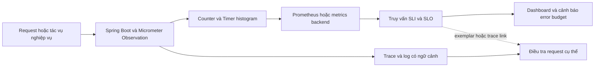

# Chọn metric cho SLI trong Spring Boot Observability

Metric dùng cho SLI phải phản ánh điều người dùng thực sự nhận được từ service. Một ứng dụng có CPU thấp và JVM khỏe mạnh vẫn có thể trả lỗi hoặc phản hồi quá chậm. Ngược lại, CPU tăng cao chưa chắc làm trải nghiệm người dùng suy giảm. Vì vậy, khi thiết kế observability cho Spring Boot, hãy bắt đầu từ hành vi và cam kết của service, sau đó mới chọn meter, nhãn và cách truy vấn.

Bài này thuộc chương **Thiết kế kiến trúc** của module **SPRING_BOOT_OBSERVABILITY**. Module hướng dẫn thiết lập observability cho Spring Boot bằng Micrometer Observation, metrics, logs và distributed tracing; bao gồm propagation ngữ cảnh, tag và cardinality, exporter, sampling và liên kết tín hiệu để điều tra lỗi, độ trễ và hành vi ứng dụng trên môi trường thực. Trọng tâm ở đây là chọn đúng metric để tính Service Level Indicator (SLI), cấu hình Micrometer và kiểm chứng cách đo.

## 1. Phân biệt SLI, SLO và error budget

Ba khái niệm này liên quan chặt chẽ nhưng có vai trò khác nhau:

- **SLI (Service Level Indicator):** chỉ số đo chất lượng dịch vụ thực tế, chẳng hạn tỷ lệ request thành công hoặc tỷ lệ request hoàn thành trong 300 ms.
- **SLO (Service Level Objective):** mục tiêu đặt ra cho SLI trong một khoảng thời gian, chẳng hạn 99,9% request hợp lệ thành công trong 30 ngày.
- **Error budget:** phần chất lượng còn được phép suy giảm theo SLO. Với SLO 99,9%, tỷ lệ sự kiện lỗi cho phép là 0,1% trong cửa sổ đo.

SLI cần có một định nghĩa đo lường rõ ràng: sự kiện nào được tính, sự kiện nào là tốt, mẫu số gồm những gì, đo trong cửa sổ nào và dữ liệu đến từ đâu. Nếu các nhóm dùng định nghĩa khác nhau cho cùng một SLI, dashboard và cảnh báo sẽ không thể so sánh đáng tin cậy.

### 1.1. Công thức dựa trên sự kiện

Với một service xử lý request, cách định nghĩa phổ biến là:

\[
SLI = \frac{\text{số sự kiện tốt}}{\text{tổng số sự kiện đủ điều kiện}} \times 100\%
\]

Ví dụ, nếu có 100.000 request hợp lệ và 99.920 request được xử lý thành công, availability SLI là 99,92%. Nếu SLO là 99,9%, service đang nằm trong mục tiêu ở cửa sổ đo đó.

Đừng để mẫu số thay đổi tùy ý. Hãy quyết định trước cách xử lý health check, request nội bộ, request bị hủy, request không hợp lệ và các lỗi do client. Với HTTP, phản hồi 4xx thường là kết quả hợp lệ của một yêu cầu không hợp lệ, nhưng 429 có thể phản ánh giới hạn năng lực của service. Quy tắc phải phù hợp với hợp đồng dịch vụ và được áp dụng nhất quán.

### 1.2. SLI theo thời gian và SLI theo sự kiện

SLI theo sự kiện tính trên từng request hoặc từng công việc đã xử lý. SLI theo thời gian tính phần thời gian service đáp ứng một điều kiện, thường được dùng cho uptime hoặc phép kiểm tra tổng hợp (synthetic probe). Hai cách đo trả lời những câu hỏi khác nhau.

Ví dụ, tỷ lệ request thành công có trọng số theo lưu lượng: một endpoint có nhiều request ảnh hưởng nhiều hơn endpoint ít request. Một phép kiểm tra uptime mỗi phút lại cho mỗi khoảng thời gian một trọng số tương đương. Hãy chọn cách đo theo cam kết với người dùng, không trộn hai mẫu số trong cùng một công thức.

## 2. Bắt đầu từ hành trình người dùng

Chọn SLI bằng cách xác định thao tác quan trọng mà người dùng cần hoàn thành. Với `orders-service`, hành trình có thể là tạo đơn hàng, xem trạng thái đơn và thanh toán. Một endpoint trả HTTP 200 chưa chắc đồng nghĩa với đơn hàng đã được tạo thành công; nghiệp vụ có thể thất bại sau khi request đã được chấp nhận.

Quy trình thiết kế nên đi theo các bước:

1. Xác định người dùng hoặc hệ thống phụ thuộc vào service và thao tác họ cần hoàn thành.
2. Xác định ranh giới sự kiện: một HTTP request, một giao dịch nghiệp vụ, một message hay một lần kiểm tra tổng hợp.
3. Mô tả điều kiện để sự kiện được xem là tốt, bao gồm tính đúng đắn, trạng thái thành công và giới hạn độ trễ.
4. Xác định mẫu số và các trường hợp loại trừ, đặc biệt là retry, hủy request và lỗi do client.
5. Chọn metric có thể đếm đủ các sự kiện đó với chi phí và cardinality chấp nhận được.
6. Đối chiếu metric với log, trace và dữ liệu nghiệp vụ để xác nhận cách đo phản ánh thực tế.

Ví dụ với thao tác tạo đơn:

| SLI | Sự kiện tốt | Mẫu số |
|---|---|---|
| Availability | Đơn được service chấp nhận theo hợp đồng nghiệp vụ | Tổng lần gửi yêu cầu tạo đơn hợp lệ |
| Latency | Yêu cầu tạo đơn được xử lý thành công trong tối đa 500 ms | Tổng lần gửi yêu cầu tạo đơn hợp lệ |
| Correctness | Đơn được lưu với trạng thái và dữ liệu thỏa quy tắc nghiệp vụ | Tổng lần tạo đơn được xử lý |
| Freshness cho luồng bất đồng bộ | Message được xử lý trong vòng 2 phút từ khi phát sinh | Tổng message đủ điều kiện xử lý |

Mỗi SLI nên có một định nghĩa và mục tiêu riêng. Không gộp availability, latency và correctness thành một tỷ lệ duy nhất nếu nhóm vận hành không thể giải thích nguyên nhân khi chỉ số giảm.

## 3. Chọn loại metric phù hợp

Micrometer cung cấp các loại meter khác nhau. Chọn loại phù hợp với cách tính SLI giúp giữ được dữ liệu cần thiết và tránh suy diễn sai từ metric chẩn đoán.

| Loại meter | Dùng để đo | Vai trò trong SLI |
|---|---|---|
| `Counter` | Số sự kiện tích lũy, chỉ tăng | Đếm tổng request, request thành công, công việc hoàn thành hoặc thất bại |
| `Timer` | Số lần thực hiện và tổng thời gian; có thể xuất histogram | Đo latency và tính tỷ lệ sự kiện nằm dưới ngưỡng |
| `DistributionSummary` | Phân phối của một giá trị số không nhất thiết là thời gian | Đo kích thước payload, số bản ghi hoặc dung lượng xử lý nếu đó là chỉ tiêu dịch vụ |
| `Gauge` | Giá trị hiện tại tại một thời điểm | Theo dõi độ sâu queue, số connection đang dùng hoặc trạng thái hiện thời; thường là tín hiệu chẩn đoán |

### 3.1. Counter cho tỷ lệ thành công

Counter phù hợp với SLI dạng tỷ lệ vì nó lưu được số sự kiện tốt và tổng sự kiện. Ví dụ, metric `orders.submissions` có tag `result` với tập giá trị hữu hạn như `accepted` và `rejected`:

```java
import io.micrometer.core.instrument.MeterRegistry;
import org.springframework.stereotype.Component;

@Component
class OrderSubmissionMetrics {
    private final MeterRegistry registry;

    OrderSubmissionMetrics(MeterRegistry registry) {
        this.registry = registry;
    }

    void record(String result) {
        registry.counter("orders.submissions", "result", result).increment();
    }
}
```

Ở nơi gọi `record`, chỉ truyền các giá trị đã quy định, ví dụ `accepted` hoặc `rejected`. Không truyền message lỗi, mã đơn hàng hay tên người dùng vào tag. Trong ứng dụng thực tế, hãy đặt việc ghi nhận ở ranh giới nghiệp vụ đã thống nhất để một lần tạo đơn chỉ được đếm đúng một lần.

Nếu SLI tính theo HTTP request, Spring Boot Actuator cùng Micrometer thường đã cung cấp timer `http.server.requests`. Có thể tận dụng meter này thay vì tự tạo counter trùng lặp, miễn là tag và ranh giới request phù hợp với định nghĩa SLI.

### 3.2. Timer và histogram cho latency

`Timer` là lựa chọn phù hợp để đo thời gian xử lý. Histogram lưu số quan sát nằm trong các bucket thời gian; nhờ đó có thể tính tỷ lệ request hoàn thành dưới một ngưỡng cụ thể.

Với SLI có điều kiện “hoàn thành trong 300 ms”, cần có bucket đúng tại ngưỡng 300 ms. Khi đó:

\[
SLI_{latency} = \frac{\text{số request tốt có thời gian} \leq 300\text{ ms}}{\text{tổng request đủ điều kiện}} \times 100\%
\]

Histogram cũng hữu ích cho điều tra phân phối độ trễ. Percentile như p95 hoặc p99 trả lời câu hỏi về điểm phân vị, nhưng không tự thay thế tỷ lệ sự kiện đáp ứng một ngưỡng SLO. Đặc biệt, không lấy trung bình p95 từ nhiều instance để tạo p95 toàn service; hãy tổng hợp bucket trước rồi mới tính phân phối ở cấp service.

### 3.3. Gauge và metric hạ tầng

CPU, heap, garbage collection, thread pool, connection pool và queue depth rất hữu ích để tìm nguyên nhân latency hoặc error tăng. Tuy nhiên, chúng thường là metric chẩn đoán hoặc saturation indicator, không trực tiếp mô tả chất lượng người dùng nhận được.

Ví dụ, queue depth bằng 0 không chứng minh message được xử lý đúng hạn; queue depth tăng cũng chưa chắc là vi phạm SLO nếu tốc độ xử lý vẫn đáp ứng cam kết. Nếu queue freshness là SLI, hãy đo thời gian từ lúc message được tạo đến lúc xử lý xong hoặc tỷ lệ message hoàn thành trong ngưỡng. Dùng queue depth để giải thích nguyên nhân khi SLI freshness suy giảm.

## 4. Dùng metric HTTP mặc định của Spring Boot

Với ứng dụng Spring MVC hoặc WebFlux có Actuator và Micrometer phù hợp, Spring Boot thường ghi nhận request phía server bằng meter `http.server.requests`. Đây là điểm bắt đầu hữu ích cho availability và latency của HTTP API.

Các tag thường gặp gồm:

- `method`: phương thức HTTP như `GET` hoặc `POST`.
- `uri`: route hoặc URI đã được chuẩn hóa, thường là mẫu route như `/api/orders/{id}`.
- `status`: mã trạng thái HTTP.
- `outcome`: nhóm kết quả của response.
- `exception`: loại exception nếu có.

Tag thực tế có thể khác theo phiên bản Spring Boot, framework web, convention và cấu hình. Kiểm tra dữ liệu đang xuất ra thay vì giả định mọi ứng dụng đều có cùng bộ tag. Với Prometheus, endpoint `/actuator/prometheus` cho phép xem tên metric và nhãn đã được chuyển đổi.

Để xuất endpoint phục vụ kiểm tra trong môi trường phát triển, cấu hình có thể gồm:

```yaml
management:
  endpoints:
    web:
      exposure:
        include: health,metrics,prometheus
```

Endpoint cần được bảo vệ theo chính sách truy cập của môi trường. Chỉ expose những endpoint cần thiết và không đưa endpoint chẩn đoán nhạy cảm ra Internet.

### 4.1. Cấu hình bucket theo ngưỡng SLO

Giả sử SLI latency yêu cầu request tốt hoàn thành trong 300 ms. Có thể cấu hình histogram và các bucket SLO cho timer HTTP:

```yaml
management:
  metrics:
    distribution:
      percentiles-histogram:
        "http.server.requests": true
      slo:
        "http.server.requests":
          - 100ms
          - 300ms
          - 1s
```

Các bucket phải bao gồm ngưỡng được dùng trong công thức SLI. Nếu ngưỡng SLO là 300 ms nhưng histogram không có bucket tương ứng, truy vấn tỷ lệ request dưới ngưỡng sẽ không thể tính chính xác từ các bucket đã xuất. Cấu hình phân phối cần được kiểm tra với phiên bản Spring Boot và registry đang sử dụng.

## 5. Tính SLI từ Prometheus histogram

Với Prometheus registry, timer `http.server.requests` thường được chuẩn hóa thành metric dạng `http_server_requests_seconds_count`, `http_server_requests_seconds_sum` và `http_server_requests_seconds_bucket`. Tên cuối cùng và nhãn phụ thuộc registry cùng phiên bản; hãy xác minh tại `/actuator/prometheus`.

Ví dụ dưới đây giả định route được xuất với nhãn `uri="/api/orders"`, mã HTTP nằm trong nhãn `status` và histogram có bucket `le="0.3"`. Điều chỉnh các nhãn theo dữ liệu thực tế của ứng dụng.

### 5.1. Availability SLI

Nếu quy ước của API xem response 5xx là lỗi service và các response còn lại là kết quả hợp lệ, truy vấn tỷ lệ request không trả 5xx có thể là:

```promql
sum(rate(http_server_requests_seconds_count{
  uri="/api/orders",
  status!~"5.."
}[5m]))
/
sum(rate(http_server_requests_seconds_count{
  uri="/api/orders"
}[5m]))
```

Truy vấn này minh họa cửa sổ 5 phút để theo dõi ngắn hạn. Trước khi dùng làm SLI chính thức, hãy xác định rõ cách phân loại 4xx, 429, request bị hủy và request nội bộ. Nếu `status` không có trong metric hoặc tên tag khác, điều chỉnh bộ lọc cho đúng dữ liệu đang xuất.

### 5.2. Latency SLI

Nếu sự kiện tốt phải vừa không trả 5xx vừa hoàn thành trong 300 ms, có thể tính tỷ lệ như sau:

```promql
sum(rate(http_server_requests_seconds_bucket{
  uri="/api/orders",
  status!~"5..",
  le="0.3"
}[5m]))
/
sum(rate(http_server_requests_seconds_count{
  uri="/api/orders"
}[5m]))
```

Bucket histogram là bucket tích lũy: `le="0.3"` đếm các quan sát có thời gian không vượt quá 0,3 giây. Tử số ở ví dụ này chỉ tính request có response được xem là tốt và đủ nhanh; mẫu số là mọi request đủ điều kiện theo phạm vi route. Quy tắc phân loại response phải giống với định nghĩa SLI đã công bố.

### 5.3. SLI theo cửa sổ dài hơn

Để xem kết quả trong 30 ngày, có thể thay `rate(...[5m])` bằng `increase(...[30d])` trong cả tử số và mẫu số. `increase` tính số lần counter tăng trong khoảng thời gian và xử lý counter reset theo cách phù hợp cho truy vấn Prometheus.

Không nên dùng một cửa sổ ngắn để kết luận SLO 30 ngày đã đạt hay chưa. Dashboard có thể hiển thị cả SLI ngắn hạn để phát hiện sự cố và SLI theo cửa sổ SLO để đánh giá cam kết. Cảnh báo burn rate có thể kết hợp nhiều cửa sổ ngắn và dài để phát hiện mức tiêu thụ error budget bất thường.

## 6. Chọn phạm vi và tag để tránh sai lệch

### 6.1. Chọn đúng tập sự kiện

Không phải mọi request đều đại diện cho trải nghiệm người dùng. Thông thường cần cân nhắc loại trừ:

- Health check, readiness probe, liveness probe và request scrape metrics.
- Route nội bộ không nằm trong cam kết dịch vụ.
- Request thử nghiệm hoặc traffic tổng hợp, nếu SLI được định nghĩa riêng cho traffic người dùng thật.
- Request bị hủy trước khi service nhận trách nhiệm xử lý, nếu hợp đồng SLI quy định loại trừ.

Đừng loại trừ request lỗi chỉ vì chúng làm giảm SLI. Mẫu số phải bao gồm các sự kiện mà service đã cam kết phục vụ. Nếu không có request trong một cửa sổ, tỷ lệ sự kiện không có mẫu số và không thể diễn giải là 100%; hãy xác định cách hiển thị trạng thái no-data hoặc dùng synthetic probe bổ sung.

### 6.2. Đặt tag có cardinality thấp

Tag giúp phân tích SLI theo route, phương thức hoặc kết quả. Tuy nhiên, mỗi tổ hợp tag tạo thêm một time series. Tránh dùng các giá trị thay đổi theo từng request như:

- `userId`, email, session ID hoặc IP đầy đủ.
- `orderId`, `paymentId`, request ID hoặc trace ID.
- URL nguyên bản chứa ID động hoặc query string.
- Exception message hoặc nội dung lỗi tùy ý.

Ưu tiên route template, mã trạng thái, phương thức HTTP, outcome và các nhóm nghiệp vụ có tập giá trị hữu hạn. Dùng log và trace để tìm chi tiết theo request; metric nên giữ nhãn ổn định để tổng hợp trong thời gian dài.

`service.name`, `service.namespace` và môi trường triển khai là thuộc tính định danh hữu ích ở cấp Resource hoặc nhãn được chuẩn hóa của hệ thống metric. Tránh gắn thông tin instance không cần thiết vào mọi truy vấn tổng hợp nếu mục tiêu là SLI toàn service; vẫn có thể giữ `service.instance.id` cho điều tra theo replica.

### 6.3. Phân biệt metric SLI và metric chẩn đoán

| Metric | Nên dùng làm gì | Lý do |
|---|---|---|
| Tỷ lệ request thành công | SLI availability | Phản ánh request có được xử lý theo hợp đồng không |
| Tỷ lệ request tốt dưới ngưỡng latency | SLI latency | Đo trực tiếp tốc độ người dùng nhận được |
| Tỷ lệ message xử lý trong ngưỡng tuổi | SLI freshness | Phản ánh độ mới của dữ liệu hoặc công việc |
| CPU, heap, GC pause | Chẩn đoán | Giải thích nguyên nhân suy giảm, không trực tiếp đo kết quả người dùng |
| Queue depth, thread pool usage | Chẩn đoán/saturation | Cảnh báo áp lực trước khi hoặc trong khi SLI suy giảm |
| Request rate | Bối cảnh tải | Giúp hiểu lưu lượng và mẫu số; chỉ là SLI nếu hợp đồng yêu cầu mức throughput cụ thể |

## 7. Kết hợp metrics, logs và distributed tracing

Metrics phù hợp để tính SLI vì chúng tổng hợp được số lượng lớn sự kiện với chi phí thấp. Logs và traces bổ sung ngữ cảnh để giải thích vì sao SLI thay đổi.

Một luồng quan sát điển hình:



Khi SLI latency giảm, dashboard metrics cho biết route nào và khoảng thời gian nào bị ảnh hưởng. Trace giúp tìm span chậm ở service hoặc dependency; log có `traceId` và `spanId` giúp xem lỗi cụ thể. Nếu backend hỗ trợ exemplars, histogram có thể gắn một số quan sát với trace ID để chuyển từ điểm dữ liệu sang trace mẫu.

Không tính SLI tổng thể bằng cách đếm các trace đã thu thập nếu hệ thống đang sampling. Trace sampling có thể loại bỏ phần lớn request hoặc ưu tiên một số loại request, nên tập trace không đại diện cho toàn bộ lưu lượng. Dùng counter và histogram metrics để đo tỷ lệ; dùng trace để điều tra nguyên nhân. Tail sampling hoặc head sampling vẫn có thể hữu ích cho chẩn đoán, nhưng không biến tập trace được lấy mẫu thành mẫu số SLI đáng tin cậy.

## 8. Các trường hợp cần thiết kế SLI riêng

### 8.1. API có retry

Một request HTTP có thể được thử lại nhiều lần trong client hoặc gateway. Nếu mục tiêu là chất lượng của từng lần gọi service, mỗi attempt có thể là một sự kiện. Nếu mục tiêu là khả năng người dùng hoàn thành thao tác, nên đo một lần cho toàn bộ giao dịch logic và tính cả thời gian retry. Ghi rõ ranh giới đo để không đếm một thao tác thành nhiều sự kiện ngoài ý muốn.

### 8.2. Xử lý bất đồng bộ

Với consumer, đo số message hoàn thành thành công và tổng message đủ điều kiện. Đối với freshness, ghi nhận thời điểm tạo message và thời điểm xử lý xong; tính tỷ lệ message hoàn tất trong ngưỡng đã chọn. Queue depth là tín hiệu hỗ trợ, nhưng không thể thay thế tuổi message hoặc thời gian chờ thực tế.

### 8.3. Service phụ thuộc nhiều hệ thống

Một request có thể gọi database, cache và service khác. SLI ở ranh giới service nên phản ánh kết quả cuối cùng mà caller nhận được. Metric dependency như connection timeout, pool exhaustion và downstream latency giúp xác định thành phần gây lỗi. Không cộng trực tiếp latency của các dependency nếu chúng chạy song song hoặc có retry; dùng trace để hiểu đường đi thực tế.

## 9. Ví dụ thiết kế SLI cho `orders-service`

Giả sử service cung cấp API tạo đơn hàng và mục tiêu sản phẩm là đơn hợp lệ được chấp nhận nhanh, ổn định. Một thiết kế ban đầu có thể như sau:

| Thành phần | Định nghĩa |
|---|---|
| Ranh giới sự kiện | Một yêu cầu tạo đơn hợp lệ tại API nghiệp vụ |
| Availability SLI | Tỷ lệ yêu cầu được chấp nhận theo hợp đồng nghiệp vụ |
| Latency SLI | Tỷ lệ yêu cầu được chấp nhận trong tối đa 500 ms |
| Cửa sổ SLO | 30 ngày |
| Metric kỹ thuật | Counter theo kết quả nghiệp vụ và Timer histogram cho thời gian xử lý |
| Tag được phép | `operation`, `result`, `method`, route template, môi trường |
| Tag bị cấm | `orderId`, `userId`, email, request ID và exception message |
| Metric chẩn đoán | DB connection pool, downstream latency, queue age, JVM GC và thread pool |

Ví dụ, nhóm có thể đặt mục tiêu ban đầu 99,9% yêu cầu được chấp nhận và 99% yêu cầu được chấp nhận trong 500 ms. Các con số này chỉ là ví dụ để minh họa cách chuyển cam kết sản phẩm thành SLO; mục tiêu thực tế cần dựa trên nhu cầu người dùng, dữ liệu hiện tại và khả năng vận hành.

Với SLO availability 99,9%, error budget cho phép 0,1% sự kiện đủ điều kiện là sự kiện xấu trong cửa sổ 30 ngày. Nếu tỷ lệ lỗi thực tế là 1%, tốc độ tiêu thụ error budget bằng khoảng 10 lần tốc độ cho phép. Có thể dùng burn rate để quyết định mức độ khẩn cấp của cảnh báo và việc có nên tạm dừng rollout.

## 10. Checklist trước khi đưa SLI vào vận hành

- [ ] SLI mô tả một hành vi hoặc kết quả mà người dùng quan tâm.
- [ ] Ranh giới sự kiện, điều kiện tốt và mẫu số được ghi rõ.
- [ ] Health check, traffic nội bộ, 4xx, 429, retry và request bị hủy có quy tắc xử lý nhất quán.
- [ ] Loại meter phù hợp: Counter cho sự kiện, Timer/histogram cho latency, hoặc metric nghiệp vụ cho kết quả chuyên biệt.
- [ ] Histogram có bucket đúng tại ngưỡng latency của SLO.
- [ ] Tag dùng tập giá trị hữu hạn và route đã được chuẩn hóa.
- [ ] Truy vấn SLI được kiểm chứng với dữ liệu thật và kết quả được đối chiếu với nghiệp vụ.
- [ ] SLI ngắn hạn, cửa sổ SLO và cách xử lý no-data đã được xác định.
- [ ] Trace và log có thể hỗ trợ điều tra nhưng không được dùng làm mẫu số thay cho metrics khi trace sampling đang bật.
- [ ] Dashboard, cảnh báo và error budget dùng cùng định nghĩa SLI.

Metric tốt cho SLI là metric đo đúng sự kiện, có mẫu số rõ ràng và giữ được độ chính xác khi tổng hợp trên toàn service. Trong Spring Boot, Micrometer Counter và Timer histogram thường là nền tảng phù hợp cho SLI theo request; metric nghiệp vụ cần thiết khi kết quả HTTP chưa phản ánh thao tác người dùng. Hãy giữ metrics làm nguồn đo chất lượng tổng thể, sau đó liên kết logs và traces để tìm nguyên nhân khi SLI suy giảm.
