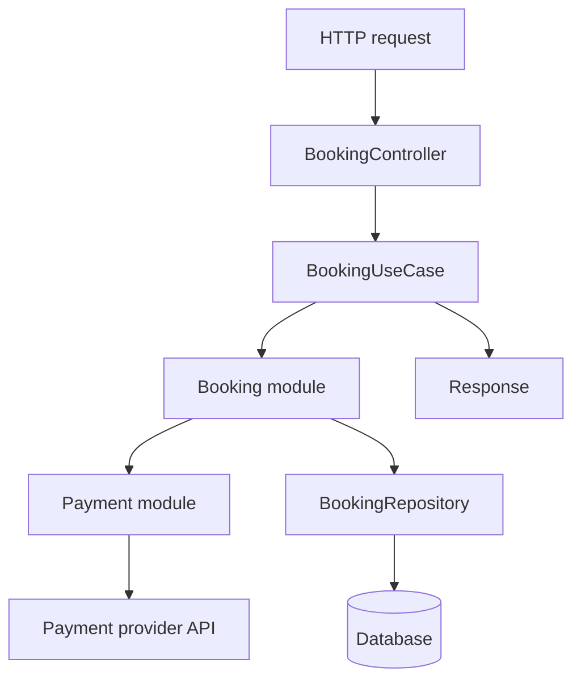

# Observability trong monolith

Một ứng dụng Spring Boot theo kiến trúc monolith thường được triển khai như một đơn vị, nhưng bên trong vẫn có nhiều module, luồng xử lý và ranh giới nghiệp vụ. Một yêu cầu xác nhận đơn thuê có thể đi qua API, application service, module đặt chỗ, module thanh toán, repository và một dịch vụ bên ngoài. Khi có lỗi hoặc độ trễ, việc biết ứng dụng đang chạy không đủ để giải thích yêu cầu đã đi qua những bước nào và vì sao kết quả không như mong đợi.

Observability giúp trả lời câu hỏi đó bằng cách kết hợp metrics, logs và distributed tracing. Trong monolith, các tín hiệu này vẫn có đầy đủ giá trị dù nhiều bước chạy trong cùng một tiến trình. Điểm khác biệt là phần lớn lời gọi giữa các module là lời gọi nội bộ, không phải một network hop. Vì vậy, cần chọn ranh giới quan sát phù hợp để trace phản ánh luồng xử lý thật mà không tạo quá nhiều span, log hoặc metric.

Bài học này thuộc module Spring Boot Observability, tập trung vào cách thiết lập và vận hành Micrometer Observation, metrics, logs và tracing trong một ứng dụng monolith. Sau bài học, bạn có thể:

- Giải thích vai trò của từng tín hiệu observability trong một monolith.
- Chọn ranh giới instrumentation ở HTTP, use case, tích hợp và truy cập dữ liệu.
- Dùng Micrometer Observation để liên kết thao tác với metrics và tracing.
- Truyền trace context qua executor, scheduler, message listener và luồng bất đồng bộ.
- Kiểm soát cardinality, sampling, volume log và chi phí lưu trữ.
- Thiết kế quy trình điều tra từ cảnh báo đến log và trace.

## 1. Monolith vẫn cần observability

Monolith mô tả cách tổ chức và triển khai ứng dụng: các chức năng thường được đóng gói trong một đơn vị có thể triển khai. Nó không có nghĩa toàn bộ mã nguồn phải nằm trong một module duy nhất. Một modular monolith có thể chia thành các module như booking, payment, customer và inventory, mỗi module sở hữu quy tắc và dữ liệu của mình, nhưng các module vẫn chạy trong cùng ứng dụng.

Một monolith có thể có nhiều replica để chịu tải hoặc dự phòng. Các replica vẫn thường đại diện cho cùng một dịch vụ logic và dùng cùng service.name; mỗi replica cần có định danh instance riêng để phân biệt khi điều tra. Không nên coi từng module Java là một microservice chỉ vì module có tên hoặc package riêng.

Ví dụ, luồng xác nhận đơn thuê có thể diễn ra như sau:



Các bước từ controller đến module nghiệp vụ thường là lời gọi trong cùng tiến trình. Gọi payment provider và database mới tạo ranh giới I/O qua mạng hoặc driver. Nếu trace chỉ có một span HTTP tổng thể, ta khó biết thời gian nằm ở đâu. Nếu tạo span cho mọi method nhỏ, trace sẽ quá dày và khó đọc. Mục tiêu là quan sát những ranh giới có ý nghĩa với hiệu năng, lỗi và trách nhiệm nghiệp vụ.

## 2. Ba tín hiệu bổ sung cho nhau

| Tín hiệu | Trả lời câu hỏi | Ví dụ trong monolith |
|---|---|---|
| Metrics | Xu hướng chung đang diễn ra thế nào? | Tỷ lệ xác nhận thành công giảm; độ trễ p95 của use case tăng. |
| Logs | Sự kiện cụ thể nào đã xảy ra và với dữ liệu gì? | Đơn bị từ chối vì trạng thái CANCELLED; payment provider trả mã lỗi đã chuẩn hóa. |
| Traces | Một lần xử lý đã đi qua những bước nào và mất thời gian ở đâu? | HTTP span chứa các span con cho use case, truy vấn database và lời gọi payment provider. |

Metrics giúp phát hiện vấn đề mà không cần đọc từng request. Logs cung cấp chi tiết của một sự kiện cụ thể. Traces thể hiện quan hệ thời gian giữa các thao tác trong một lần xử lý. Một cảnh báo metrics có thể dẫn đến việc tìm log theo khoảng thời gian và trace theo trace ID.

Không nên dùng một tín hiệu để thay thế hai tín hiệu còn lại. Đưa mọi mã đơn hàng vào metric tag sẽ làm tăng cardinality. Chỉ ghi log một câu tổng quát sẽ thiếu chi tiết để giải thích lỗi. Chỉ dựa vào trace sampling có thể bỏ lỡ một số lần xử lý cần điều tra.

## 3. Chọn ranh giới quan sát trong monolith

Một trace tốt cho thấy các bước có ý nghĩa, không phải toàn bộ call stack Java. Hãy bắt đầu từ các ranh giới sau.

### 3.1. Điểm vào ứng dụng

Các điểm vào thường là:

- HTTP controller hoặc endpoint.
- Message listener nhận sự kiện từ broker.
- Scheduled job hoặc batch job.
- Consumer của một tác vụ nền.

Đây là nơi tạo hoặc tiếp nhận context của một lần xử lý. Spring Boot cùng các thư viện Micrometer có thể tự động instrument một số điểm vào và client phổ biến khi dependency và cấu hình phù hợp. Trước khi thêm instrumentation thủ công, hãy kiểm tra tín hiệu tự động đã có để tránh tạo span trùng.

### 3.2. Ranh giới use case

Một application service hoặc use case là nơi tốt để đo thời gian và kết quả của một hành động người dùng hiểu được, ví dụ booking.confirm, payment.refund hoặc inventory.reserve.

Không nhất thiết tạo Observation cho mọi getter, mapper hoặc helper method. Chỉ tạo ở nơi có ý nghĩa về nghiệp vụ, hiệu năng hoặc điều tra. Nếu một use case gọi nhiều module nội bộ, các span con có thể giúp xác định module nào tiêu tốn thời gian, nhưng chỉ nên thêm khi dữ liệu đó thực sự giúp chẩn đoán.

### 3.3. Ranh giới tích hợp và I/O

Database, HTTP client, message broker, cache và file storage là các ranh giới thường cần quan sát vì chúng có độ trễ, lỗi và retry riêng. Ưu tiên instrumentation tự động của thư viện tương ứng. Nếu cần tạo Observation thủ công, tránh bọc một lời gọi đã được instrument sẵn bằng một span khác có cùng ý nghĩa.

### 3.4. Sự kiện nghiệp vụ quan trọng

Không phải mọi sự kiện đều cần span riêng. Các sự kiện như đơn thuê được xác nhận, thanh toán bị từ chối hoặc retry cạn số lần thường phù hợp với log có cấu trúc. Nếu cần một chỉ số tổng hợp, hãy tăng counter với nhãn có tập giá trị hữu hạn. Chỉ tạo span khi cần đo thời gian hoặc thể hiện quan hệ nhân quả trong một lần xử lý.

Một nguyên tắc thực tế là: span mô tả một thao tác có thời lượng; log mô tả một sự kiện; metric tổng hợp nhiều lần xảy ra.

## 4. Thiết lập nền tảng observability trong Spring Boot

Với Spring Boot 3 trở lên, Micrometer Observation là điểm tích hợp chung cho các handler tạo metrics và tracing. ObservationRegistry điều phối các Observation; các handler được cấu hình sẽ chuyển thông tin phù hợp sang meter registry hoặc tracer.

Thông thường, dự án bắt đầu với Actuator:

```gradle
dependencies {
    implementation("org.springframework.boot:spring-boot-starter-actuator")
    runtimeOnly("io.micrometer:micrometer-registry-prometheus")
}
```

Dependency Prometheus chỉ cần khi ứng dụng xuất metrics cho Prometheus. Spring Boot quản lý phiên bản tương thích qua dependency management của dự án; không tự chọn một phiên bản Micrometer khác nếu không có lý do rõ ràng.

Nếu cần distributed tracing qua OpenTelemetry, có thể bổ sung Micrometer Tracing bridge và OTLP exporter theo phiên bản Spring Boot đang dùng:

```gradle
dependencies {
    implementation("io.micrometer:micrometer-tracing-bridge-otel")
    runtimeOnly("io.opentelemetry:opentelemetry-exporter-otlp")
}
```

Có các bridge khác, chẳng hạn Brave. Chọn một bridge phù hợp với hệ sinh thái exporter và backend của tổ chức. Không thêm nhiều bridge chỉ để thử nghiệm vì có thể tạo cấu hình không nhất quán.

Ví dụ cấu hình endpoint Actuator và sampling trong file cấu hình:

```properties
management.endpoints.web.exposure.include=health,info,metrics,prometheus
management.tracing.sampling.probability=0.10
```

Endpoint prometheus chỉ hoạt động khi registry tương ứng có mặt. Chỉ expose các endpoint cần thiết và bảo vệ chúng bằng mạng nội bộ, xác thực hoặc cơ chế kiểm soát truy cập của môi trường triển khai. Không mở endpoint quản trị và dữ liệu observability ra Internet công khai.

Giá trị sampling 0.10 trong ví dụ có nghĩa là chọn khoảng 10% trace theo chính sách head sampling đang cấu hình. Đây là giá trị minh họa, không phải mặc định phù hợp cho mọi hệ thống. Môi trường production cần cân nhắc lưu lượng, chi phí, yêu cầu điều tra và khả năng tail sampling ở collector.

## 5. Tạo Observation cho use case

Khi cần quan sát một thao tác nội bộ, có thể dùng ObservationRegistry được Spring Boot cấu hình và inject vào application service.

Ví dụ:

```java
@Service
public class BookingUseCase {

    private final ObservationRegistry observationRegistry;
    private final BookingRepository bookingRepository;

    public BookingUseCase(
            ObservationRegistry observationRegistry,
            BookingRepository bookingRepository
    ) {
        this.observationRegistry = observationRegistry;
        this.bookingRepository = bookingRepository;
    }

    public Booking confirm(UUID bookingId, BookingType bookingType) {
        return Observation.createNotStarted(
                        "booking.confirm",
                        observationRegistry
                )
                .lowCardinalityKeyValue(
                        "booking.type",
                        bookingType.name()
                )
                .observe(() -> confirmInternal(bookingId));
    }

    private Booking confirmInternal(UUID bookingId) {
        Booking booking = bookingRepository.findById(bookingId)
                .orElseThrow(() -> new BookingNotFoundException(bookingId));

        booking.confirm();
        return bookingRepository.save(booking);
    }
}
```

Tên Observation booking.confirm mô tả một use case ổn định. booking.type là low-cardinality key-value vì nó nên thuộc một tập loại đơn thuê nhỏ và được kiểm soát. Khi có các handler tương ứng, Observation này có thể tạo dữ liệu cho metrics và span tracing.

Trong ứng dụng thực tế, cần xử lý trạng thái không hợp lệ, transaction và lỗi theo quy tắc nghiệp vụ. Ví dụ trên tập trung vào vị trí đặt Observation. Hãy bảo đảm Observation bao trùm đúng thời gian thao tác cần đo, kể cả phần chờ I/O nếu mục tiêu là đo tổng thời gian use case.

Không dùng tên Observation chứa ID, ví dụ booking.confirm.bkg_123. Tên phải ổn định để backend gom dữ liệu cùng loại. Không đưa bookingId, customerId, email hoặc URL đầy đủ vào low-cardinality key-value.

Micrometer Observation hỗ trợ high-cardinality key-value cho những thông tin chỉ phù hợp ở một số handler, thường là tracing. Tuy vậy, trace backend cũng có giới hạn về kích thước và chi phí. Chỉ thêm định danh đã được phép và thực sự cần để điều tra; không dùng high-cardinality key-value như cách né giới hạn của metrics.

## 6. Tránh instrument trùng lặp

Trong Spring Boot, nhiều thư viện đã có instrumentation tự động. HTTP server, HTTP client, JDBC, messaging hoặc cache có thể đã tạo metrics hay spans tùy dependency và cấu hình.

Trước khi thêm Observation thủ công, hãy kiểm tra:

1. Thư viện đã phát Observation hoặc span tự động chưa?
2. Span hiện tại có đủ thông tin để xác định thao tác và thời gian không?
3. Observation mới có thêm ranh giới nghiệp vụ hay chỉ lặp lại tên method?
4. Nếu có span lồng nhau, quan hệ cha-con có phản ánh đúng luồng xử lý không?

Ví dụ, một HTTP request có server span, use case span, database span và outbound HTTP span là cấu trúc dễ hiểu. Nếu mỗi method nhỏ trong use case lại tạo một span, trace có thể chứa hàng trăm span mà không giúp ích cho điều tra.

Cũng cần tránh tạo metrics trùng tên cho cùng một thao tác bằng cả auto instrumentation và code thủ công. Một thao tác được đo hai lần có thể khiến dashboard hiểu sai số request hoặc thời gian.

## 7. Metrics cho một ứng dụng monolith

Metrics nên mô tả hành vi của dịch vụ và các use case quan trọng. Một bộ chỉ số cơ bản có thể gồm:

| Nhóm | Chỉ số | Dùng để |
|---|---|---|
| HTTP | Request rate, error rate, latency histogram | Theo dõi sức khỏe API và SLO. |
| Use case | Số lần thực hiện, kết quả, thời gian | Phát hiện use case chậm hoặc thất bại. |
| JVM | Heap, GC pause, thread, CPU process | Tìm áp lực tài nguyên trong tiến trình. |
| Database | Pool active/idle, timeout, query latency | Phát hiện nghẽn kết nối hoặc truy vấn chậm. |
| Outbound | Request rate, lỗi, latency theo dependency | Phân biệt lỗi nội bộ với lỗi hệ thống ngoài. |
| Queue/job | Backlog, thời gian xử lý, retry, job failure | Theo dõi tác vụ nền và xử lý bất đồng bộ. |

Trong monolith, metrics cấp dịch vụ cho thấy tình trạng tổng thể. Nếu cần phân tích module, thêm nhãn module với số lượng giá trị nhỏ, ổn định, chẳng hạn booking, payment hoặc inventory. Không tạo một meter riêng cho từng instance object hoặc từng request.

### 7.1. Kiểm soát cardinality

Cardinality là số lượng chuỗi thời gian riêng biệt sinh ra từ các tổ hợp metric name và tag. Mỗi tag có thêm nhiều giá trị sẽ làm số chuỗi thời gian tăng theo tích các tổ hợp.

Các tag thường phù hợp:

- operation=booking.confirm|payment.refund.
- result=success|rejected|error.
- module=booking|payment|inventory.
- payment.provider=provider_a|provider_b, nếu danh sách provider được kiểm soát.
- HTTP method, status và route template đã chuẩn hóa.

Các tag cần tránh:

- booking.id, customer.id, user.id.
- Request ID, trace ID, session ID.
- Email, số điện thoại hoặc giá trị do người dùng nhập.
- URL đầy đủ có path variable hoặc query string.
- SQL statement động hoặc thông điệp exception không giới hạn.

Dùng route template như /bookings/{id} thay vì URL thực /bookings/8a2.... Đối với kết quả nghiệp vụ, chuyển thành enum hoặc mã lý do có tập giá trị hữu hạn.

Ví dụ, counter cho kết quả xác nhận có thể dùng result với ba giá trị success, rejected và error. Không thêm bookingId vào tag chỉ để lọc một đơn cụ thể; hãy tìm chi tiết đơn trong log.

## 8. Logs có cấu trúc và liên kết với trace

Log trong monolith cần cung cấp chi tiết của sự kiện, nhưng vẫn phải đủ gọn để tìm kiếm. Nên dùng trường ổn định thay vì ghép toàn bộ dữ liệu vào message.

Ví dụ một sự kiện:

```json
{
  "timestamp": "2026-11-22T07:15:30.412Z",
  "level": "INFO",
  "service.name": "rental-api",
  "service.instance.id": "rental-api-7c9d",
  "event.name": "booking.confirmed",
  "module": "booking",
  "booking.id": "bkg_7f31",
  "result": "success",
  "traceId": "4f2c...",
  "spanId": "91ad..."
}
```

service.name nhận diện dịch vụ logic. service.instance.id giúp xác định replica hoặc tiến trình phát log. module cho biết module nội bộ sở hữu sự kiện. traceId và spanId nối log với trace. Định danh đơn thuê chỉ được ghi khi chính sách dữ liệu cho phép và có ích cho điều tra.

Với SLF4J 2.x, có thể dùng fluent logging API để thêm key-value:

```java
log.atInfo()
        .addKeyValue("event.name", "booking.confirmed")
        .addKeyValue("module", "booking")
        .addKeyValue("booking.id", bookingId)
        .addKeyValue("result", "success")
        .log("Booking confirmed");
```

Key-value chỉ xuất hiện thành trường riêng nếu logging backend hoặc encoder được cấu hình để ghi chúng. Kiểm tra output thực tế của Logback hoặc backend đang dùng; một dòng console text không tự động trở thành JSON có cấu trúc.

Khi Micrometer Tracing được cấu hình, trace context có thể được đưa vào MDC để logging backend thêm traceId và spanId vào log. Kiểm tra log pattern hoặc encoder để bảo đảm các trường này được xuất ra. Không tự sinh trace ID cho mỗi log và không tự ghi đè context hiện tại.

Không đưa password, access token, refresh token, API key, cookie, dữ liệu thẻ, thông tin cá nhân hoặc toàn bộ request/response vào log. Dữ liệu nhạy cảm có thể xuất hiện qua message, exception, MDC hoặc payload của thư viện, vì vậy cần lọc tại nhiều tầng.

## 9. Truyền context trong cùng tiến trình

Trong luồng xử lý đồng bộ, các Observation lồng nhau thường chia sẻ trace context hiện tại. Ví dụ controller gọi use case, use case gọi repository, các span con có thể nằm trong cùng trace.

Khó khăn xuất hiện khi ứng dụng chuyển sang thread khác. Nhiều thư viện lưu context trong ThreadLocal; MDC cũng thường gắn với thread. Nếu submit một task sang executor mà không truyền context, log trong task có thể mất traceId, hoặc thao tác có thể tạo trace mới không liên kết với request ban đầu.

Các điểm cần kiểm tra:

- @Async và custom Executor.
- CompletableFuture và callback chạy trên thread pool.
- Scheduled job.
- Message listener và consumer.
- Reactor pipeline nếu ứng dụng dùng WebFlux.
- Callback từ thư viện bên ngoài.

Micrometer Context Propagation cung cấp cơ chế capture và restore context qua ranh giới thực thi khi được cấu hình với context accessor phù hợp. Spring Boot và các integration có thể cấu hình sẵn cho một số executor; custom executor cần được kiểm tra riêng. Có thể dùng ContextPropagatingTaskDecorator cho executor của Spring khi phù hợp với phiên bản và cấu hình.

Ví dụ khai báo executor có task decorator:

```java
import org.springframework.context.annotation.Bean;
import org.springframework.context.annotation.Configuration;
import org.springframework.core.task.TaskDecorator;
import org.springframework.core.task.support.ContextPropagatingTaskDecorator;
import org.springframework.scheduling.annotation.EnableAsync;
import org.springframework.scheduling.concurrent.ThreadPoolTaskExecutor;

@Configuration
@EnableAsync
public class AsyncConfiguration {

    @Bean
    public TaskDecorator contextPropagatingTaskDecorator() {
        return new ContextPropagatingTaskDecorator();
    }

    @Bean
    public ThreadPoolTaskExecutor applicationTaskExecutor(
            TaskDecorator contextPropagatingTaskDecorator
    ) {
        ThreadPoolTaskExecutor executor = new ThreadPoolTaskExecutor();
        executor.setCorePoolSize(4);
        executor.setMaxPoolSize(8);
        executor.setQueueCapacity(100);
        executor.setThreadNamePrefix("app-async-");
        executor.setTaskDecorator(contextPropagatingTaskDecorator);
        return executor;
    }
}
```

Đây là ví dụ cho Spring Framework 6.1 trở lên; lớp ContextPropagatingTaskDecorator nằm trong package org.springframework.core.task.support. Cần bảo đảm dependency Micrometer Context Propagation và các accessor tương ứng có mặt trong ứng dụng. Nếu ứng dụng dùng executor khác do thư viện tạo, task decorator này không tự động áp dụng cho executor đó.

Với message được xử lý sau khi request ban đầu kết thúc, không phải lúc nào cũng nên tiếp tục cùng một trace như một lời gọi đồng bộ. Có thể tạo trace mới cho consumer và dùng message context, parent context hoặc span link theo mô hình messaging của hệ thống. Điều quan trọng là quan hệ nhân quả được giữ rõ ràng và trace không bị nối sai giữa các công việc độc lập.

## 10. Context giữa các replica và hệ thống ngoài

Trong môi trường có nhiều replica, một request có thể đi vào replica A rồi gọi một dịch vụ ngoài; request khác có thể đi vào replica B. service.name nên ổn định trên các replica, trong khi service.instance.id phân biệt từng instance.

Với HTTP client được instrument, Micrometer Tracing có thể inject và extract trace context qua propagation format được cấu hình, thường là W3C Trace Context. Khi gọi dịch vụ ngoài, kiểm tra header traceparent hoặc format tương ứng có được gửi và nhận đúng không. Không tự tạo header riêng nếu nền tảng đã có chuẩn propagation.

Trong monolith, các module nội bộ không cần truyền trace qua HTTP vì chúng không giao tiếp qua network. Chúng cùng tham gia context hiện tại trong tiến trình. Nếu một module được tách thành service riêng trong tương lai, ranh giới giao tiếp mới sẽ cần propagation qua network. Việc dùng Observation có tên ổn định từ đầu giúp quá trình chuyển đổi dễ kiểm soát hơn, nhưng không biến module nội bộ thành service độc lập.

## 11. Sampling và lưu giữ trace

Trace thường tốn tài nguyên hơn metrics vì mỗi lần xử lý có thể chứa nhiều span và attribute. Sampling quyết định trace nào được giữ hoặc gửi đến backend.

Các cách tiếp cận phổ biến:

- Head sampling quyết định sớm khi trace bắt đầu. Cách này đơn giản và giảm tải từ đầu, nhưng có thể bỏ qua trace lỗi vì chưa biết kết quả cuối cùng.
- Tail sampling quyết định sau khi collector đã nhận các span. Có thể ưu tiên giữ trace lỗi, trace chậm hoặc một nhóm nghiệp vụ quan trọng, nhưng cần collector và tài nguyên lưu đệm phù hợp.
- Sampling theo môi trường có thể khác nhau giữa development, staging và production.

Không dùng sampling để thay thế metrics. Metrics cần tiếp tục phản ánh toàn bộ lưu lượng theo cấu hình ghi nhận, ngay cả khi chỉ một phần trace được lưu. Nếu cần giữ log cho một sự kiện quan trọng, chính sách log phải độc lập với trace sampling.

Khi đánh giá sampling, theo dõi tỷ lệ trace thực sự được lưu, kích thước span, số lượng attribute và khả năng truy vấn. Không tăng sampling lên 100% trên production mà không đánh giá lưu lượng và chi phí backend.

## 12. Bảo vệ và quản lý chi phí dữ liệu observability

Một monolith có thể tạo ra lượng log và span lớn dù chỉ có một deployable unit. Chi phí phụ thuộc vào request rate, số span mỗi trace, kích thước log, thời hạn lưu trữ và số replica.

Một số biện pháp thực tế:

- Đặt log level theo package và môi trường; chỉ bật DEBUG/TRACE trong phạm vi và thời gian cần thiết.
- Tránh log từng vòng lặp hoặc từng bản ghi trong batch lớn; ưu tiên log tổng kết hoặc log ngoại lệ.
- Dùng metric tag có tập giá trị hữu hạn.
- Giới hạn số lượng và kích thước span attribute.
- Chọn sampling dựa trên lưu lượng và mục tiêu điều tra.
- Đặt retention khác nhau cho metrics, logs và traces theo nhu cầu.
- Bảo vệ endpoint Actuator và giới hạn quyền truy cập hệ thống quan sát.
- Che hoặc loại bỏ dữ liệu nhạy cảm trước khi xuất ra backend.

Định danh nghiệp vụ trong log có thể hữu ích khi hỗ trợ khách hàng, nhưng cần được phê duyệt theo chính sách dữ liệu. Nếu một giá trị có thể nhận diện cá nhân, hãy xem xét mã hóa, tokenization, masking hoặc bỏ trường đó. Không ghi nội dung bí mật vào trace attribute chỉ vì nó không phải metric tag.

## 13. Sức khỏe ứng dụng và tín hiệu observability

Actuator health endpoint cho biết các thành phần được kiểm tra có đang ở trạng thái được coi là khỏe hay không. Nó không thay thế metrics, logs hoặc traces. Một ứng dụng có thể trả về UP nhưng vẫn có tỷ lệ lỗi nghiệp vụ cao, độ trễ tăng hoặc một use case cụ thể đang thất bại.

Nên phân biệt:

- Liveness: tiến trình còn hoạt động và có thể tiếp tục chạy hay không.
- Readiness: instance có sẵn sàng nhận traffic hay không.
- Business health: các luồng nghiệp vụ quan trọng có đang đạt mục tiêu không; thường được đánh giá bằng metrics và cảnh báo riêng.

Không đưa mọi dependency vào liveness check. Một dịch vụ ngoài tạm thời không sẵn sàng không nhất thiết có nghĩa JVM cần khởi động lại. Readiness có thể phản ánh một số dependency bắt buộc, nhưng phải tránh làm toàn bộ replica bị loại khỏi traffic vì một dependency tùy chọn.

## 14. Quy trình điều tra sự cố trong monolith

Giả sử đội vận hành nhận cảnh báo tỷ lệ xác nhận đơn thuê giảm và độ trễ p95 tăng. Có thể điều tra như sau:

1. Xem dashboard metrics để xác định thời điểm bắt đầu, phạm vi ảnh hưởng, replica, phiên bản và use case bị tác động.
2. Kiểm tra metrics của JVM, connection pool, database và outbound dependency để tìm tài nguyên hoặc ranh giới I/O bất thường.
3. Tìm log theo event.name, result, khoảng thời gian và định danh nghiệp vụ được phép sử dụng. Xác định mã lý do hoặc lỗi đã chuẩn hóa.
4. Mở trace liên quan bằng traceId. So sánh thời gian của server span, use case span, database span và outbound span.
5. Kiểm tra context propagation nếu log trong tác vụ nền thiếu trace ID hoặc trace bị đứt tại executor/message listener.
6. Sau khi xử lý, xác nhận metrics và log phản ánh đúng kết quả. Kiểm tra thêm một số trace để chắc rằng instrumentation không tạo span trùng hoặc bỏ sót ranh giới quan trọng.

Trong monolith, nếu thời gian nằm trong use case span nhưng không nằm ở database hoặc outbound span, hãy xem xét xử lý CPU, lock contention, đồng bộ hóa hoặc logic nội bộ. Nếu thời gian tập trung ở database span, xem query, pool và transaction. Nếu outbound span chiếm phần lớn thời gian, kiểm tra timeout, retry và trạng thái dependency.

## 15. Kiểm tra observability trước khi đưa lên production

Một thiết lập observability chỉ có ích khi dữ liệu thực sự được phát ra, truyền đi, lưu và truy vấn được. Trước khi triển khai, hãy kiểm tra:

- Metrics của HTTP và JVM xuất hiện tại registry và được scrape thành công.
- Endpoint Actuator chỉ expose những gì cần thiết và được bảo vệ.
- Observation của use case có tên ổn định và tạo dữ liệu mong đợi.
- Trace có server span, span của use case và span của dependency theo đúng quan hệ cha-con.
- Log có cấu trúc, có timestamp, service identity và trace correlation khi context tồn tại.
- Context được giữ qua executor và các luồng bất đồng bộ quan trọng.
- Metric tag không chứa ID hoặc giá trị không giới hạn.
- Sampling và retention đáp ứng nhu cầu điều tra cùng ngân sách.
- Lỗi instrumentation không làm thay đổi kết quả nghiệp vụ hoặc gây lỗi dây chuyền.
- Dashboard và cảnh báo tập trung vào SLI/SLO có ý nghĩa với người dùng.

Có thể kiểm tra một luồng end-to-end trong môi trường test: gửi một yêu cầu xác nhận đơn thuê, xác nhận counter tăng, log sự kiện xuất hiện, trace có các span mong đợi và trace ID trong log mở được trace tương ứng. Sau đó thử một trường hợp bị từ chối hoặc dependency timeout để kiểm tra log level, mã kết quả và cách trace mô tả lỗi.

## 16. Các sai lầm thường gặp

| Sai lầm | Hệ quả | Cách xử lý |
|---|---|---|
| Coi mỗi package/module là một service độc lập | Tạo service identity và dashboard sai mô hình triển khai. | Dùng một service.name cho monolith; thêm nhãn module có giới hạn nếu cần. |
| Tạo span cho mọi method | Trace quá lớn, khó đọc, tăng chi phí. | Instrument điểm vào, use case và ranh giới I/O có ý nghĩa. |
| Chỉ có một server span tổng thể | Khó biết bước nội bộ hoặc dependency nào chậm. | Thêm Observation cho use case và kiểm tra auto instrumentation. |
| Ghi ID vào metric tag | Cardinality tăng mạnh. | Giữ định danh trong log hoặc thuộc tính trace đã được phê duyệt. |
| Dùng trace sampling thay cho metric | Bỏ sót xu hướng tổng thể và làm sai tỷ lệ. | Dùng metrics cho tổng hợp, sampling chỉ cho trace. |
| Mất context khi chuyển thread | Log và trace của tác vụ nền không còn liên kết. | Cấu hình context propagation cho executor và pipeline tương ứng. |
| Expose toàn bộ Actuator endpoint | Rò rỉ thông tin vận hành hoặc cho phép truy cập ngoài ý muốn. | Chỉ expose endpoint cần thiết và bảo vệ chúng. |
| Dựa vào health UP để kết luận nghiệp vụ bình thường | Bỏ qua lỗi nghiệp vụ và độ trễ tăng. | Kết hợp SLI, metrics, logs và traces. |

## 17. Checklist thiết kế

Khi thiết lập observability cho một monolith Spring Boot, hãy tự trả lời:

- Dịch vụ được nhận diện bằng service.name nào và từng replica được phân biệt ra sao?
- Những điểm vào nào tạo hoặc tiếp nhận trace context?
- Use case nào cần Observation để đo thời gian và kết quả?
- Database, HTTP client, messaging và cache đã có auto instrumentation chưa?
- Span nào đang lặp hoặc không mang giá trị điều tra?
- Log có trường sự kiện, kết quả, định danh tương quan và trace context không?
- Context có được truyền qua executor, scheduler và message listener không?
- Metric tag có tập giá trị hữu hạn không?
- Sampling, retention và quyền truy cập có phù hợp không?
- Có thể đi từ một cảnh báo metrics đến log và trace của một lần xử lý cụ thể không?

Observability trong monolith không đòi hỏi phải biến mọi module thành một dịch vụ riêng. Hãy giữ một định danh dịch vụ nhất quán, quan sát các ranh giới nội bộ có ý nghĩa, instrument I/O và use case, rồi liên kết metrics, logs và traces bằng context chung. Khi làm đúng, đội ngũ có thể tìm ra vấn đề trong một tiến trình phức tạp mà không bị ngập trong dữ liệu không cần thiết.

