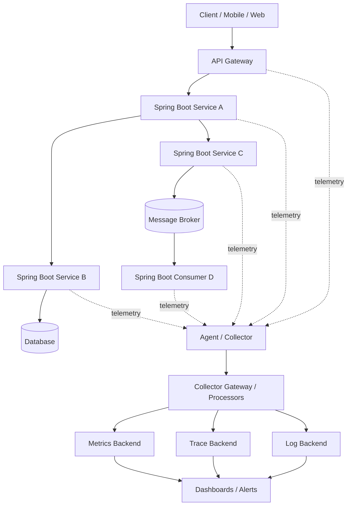
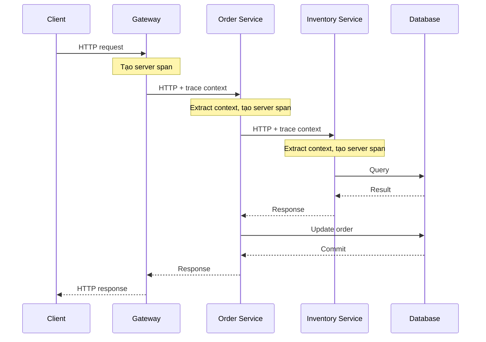
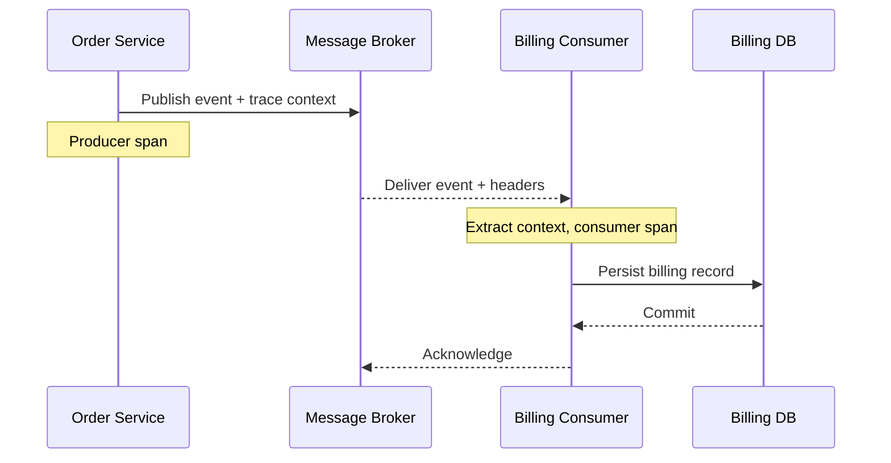

# Observability trong microservices

Trong hệ thống microservices, một request của người dùng thường đi qua nhiều tiến trình: API gateway, service xử lý nghiệp vụ, service phụ trợ, database, cache và message broker. Mỗi service chỉ nhìn thấy một phần hoạt động. Một request có thể thành công ở gateway nhưng thất bại ở service phía sau; một message có thể được publish thành công nhưng consumer xử lý chậm; một truy vấn có thể chậm do dependency ở xa. Nếu metrics, logs và traces được thu thập riêng lẻ, đội vận hành sẽ mất nhiều thời gian ghép các mảnh thông tin để tìm ra nguyên nhân.

Observability trong microservices là cách thiết kế để mỗi service phát ra tín hiệu có ngữ cảnh thống nhất và các tín hiệu đó có thể liên kết xuyên qua ranh giới tiến trình. Với Spring Boot, Micrometer Observation cung cấp mô hình chung để instrumentation tạo observation, từ đó kết nối metrics và tracing; logging bổ sung thông tin sự kiện và ngữ cảnh tương quan. Các tín hiệu được chuyển qua registry, exporter, collector và backend để phục vụ dashboard, cảnh báo và điều tra.

Mục tiêu kiến trúc không phải là tạo càng nhiều telemetry càng tốt. Mục tiêu là trả lời được các câu hỏi vận hành: request đi qua những service nào, độ trễ phát sinh ở đâu, service nào gây lỗi, message đang bị tồn đọng ở đâu, thay đổi nào làm SLO suy giảm và dữ liệu nào cần được giữ lại để điều tra.

## 1. Vì sao microservices cần observability xuyên service

Trong ứng dụng nguyên khối, một request thường đi qua một tiến trình và một tập log tương đối tập trung. Trong microservices, các đặc điểm sau làm cho việc điều tra khó hơn:

- **Nhiều ranh giới mạng:** mỗi lần gọi HTTP/gRPC có thể phát sinh timeout, retry, lỗi DNS, TLS hoặc lỗi từ service đích.
- **Nhiều vòng đời độc lập:** mỗi service được triển khai, scale và restart riêng; một request có thể đi qua nhiều phiên bản cùng lúc.
- **Xử lý bất đồng bộ:** message queue, event stream và scheduled job tách thời điểm phát sinh sự kiện khỏi thời điểm xử lý.
- **Lưu lượng không đồng đều:** một service có thể nhận ít request trực tiếp nhưng chịu tải lớn từ nhiều service khác.
- **Failure mode lan truyền:** retry, queue đầy, connection pool cạn hoặc dependency chậm có thể tạo hiệu ứng dây chuyền.
- **Dữ liệu phân tán:** metrics, logs và traces có thể nằm ở nhiều backend hoặc tenant khác nhau.

Do đó, chỉ xem log của service đang lỗi thường không đủ. Cần có định danh service thống nhất, trace context xuyên ranh giới, metrics theo từng service và dependency, cùng log có thể tra cứu theo trace ID hoặc request ID.

## 2. Kiến trúc tổng thể

Một kiến trúc tham khảo cho hệ thống Spring Boot có thể được tổ chức như sau:



Các service phát tín hiệu tại chỗ. Agent hoặc collector gần workload tiếp nhận dữ liệu, thực hiện xử lý phù hợp rồi chuyển tiếp đến backend tập trung. Backend có thể khác nhau cho metrics, traces và logs, nhưng cần thống nhất các trường nhận diện để người vận hành chuyển từ một tín hiệu sang tín hiệu khác.

### 2.1. Các lớp kiến trúc

| Lớp | Trách nhiệm | Ví dụ thành phần |
|---|---|---|
| Instrumentation trong service | Tạo observation, meter, span và log context | Spring Boot Actuator, Micrometer Observation, Micrometer Tracing |
| Export trong tiến trình | Chuyển tín hiệu ra ngoài ứng dụng | Meter registry, tracing exporter, logging appender/agent |
| Thu nhận tại workload | Nhận telemetry từ một hoặc nhiều tiến trình gần nhau | OpenTelemetry Collector agent, sidecar hoặc daemon |
| Xử lý và định tuyến | Batch, filter, enrich, sampling, retry và route theo signal | Collector processors và exporters |
| Lưu trữ và truy vấn | Lưu metrics, traces, logs và phục vụ truy vấn | Metrics, tracing và log backend |
| Vận hành | Dashboard, alert, SLO, runbook và điều tra | Nền tảng giám sát và quy trình on-call |

Không nhất thiết phải dùng một sản phẩm duy nhất cho mọi lớp. Điều quan trọng là hợp đồng dữ liệu, định dạng truyền, bảo mật và ownership phải rõ ràng. Cần phân biệt exporter chạy trong ứng dụng với exporter chạy trong collector vì chúng có cấu hình, giới hạn tài nguyên và cách xử lý lỗi khác nhau.

## 3. Định danh service và tài nguyên

Mọi tín hiệu cần mang thông tin cho biết dữ liệu đến từ service nào, phiên bản nào và môi trường nào. Nếu định danh không thống nhất, cùng một service có thể xuất hiện dưới nhiều tên trong dashboard; ngược lại, nhiều service có thể bị gộp nhầm thành một.

Các resource attributes thường cần chuẩn hóa:

| Thuộc tính | Ý nghĩa | Ví dụ |
|---|---|---|
| `service.name` | Tên logic của service | `order-service` |
| `service.version` | Phiên bản đang chạy | `2.4.1` hoặc image tag |
| `deployment.environment` | Môi trường triển khai | `production`, `staging` |
| `service.instance.id` | Định danh một instance | Pod UID hoặc instance ID |
| `cloud.region` | Vùng hạ tầng | `ap-southeast-1` |
| `host.name` hoặc thuộc tính container | Nơi workload chạy | Node hoặc container identity |

Tên và giá trị cần theo quy ước thống nhất giữa các service. `service.name` nên ổn định qua các lần scale; `service.version` thay đổi theo release; `service.instance.id` phân biệt instance nhưng thường không phù hợp làm metric label vì có thể tạo nhiều time series.

Trong Spring Boot, cấu hình resource attributes thường được thực hiện qua Micrometer registry/tracing hoặc OpenTelemetry SDK tùy stack. Tên property cụ thể phụ thuộc phiên bản Spring Boot và thư viện đang dùng. Hãy kiểm tra cấu hình theo dependency thực tế thay vì giả định một property dùng được cho mọi phiên bản.

## 4. Trace context propagation qua các service

Distributed tracing cho phép liên kết các thao tác thuộc cùng một request phân tán. Một trace gồm nhiều span; mỗi span mô tả một thao tác như nhận HTTP request, gọi HTTP client, truy vấn database hoặc xử lý message.

### 4.1. Trace, span và parent-child

- **Trace:** toàn bộ hành trình logic của một request hoặc công việc phân tán, được nhận diện bằng trace ID.
- **Span:** một thao tác có thời điểm bắt đầu/kết thúc, tên, kind, attributes, events và status.
- **Parent span:** span tạo ra hoặc gọi thao tác con; quan hệ parent-child thể hiện cấu trúc đồng bộ của luồng xử lý.
- **Span context:** thông tin cần truyền để liên kết span giữa các tiến trình, thường gồm trace ID, span ID và trace flags.

Một trace ID phải được giữ nguyên khi request chuyển từ service này sang service khác. Mỗi service tạo span riêng với span ID mới và tham chiếu đến parent context được nhận.

### 4.2. Luồng request đồng bộ



Khi gateway gọi Order Service, gateway cần inject context vào request outbound. Order Service extract context từ request inbound rồi tạo server span. Khi Order Service gọi Inventory Service, client instrumentation tiếp tục inject context. Nếu một đoạn không inject hoặc extract đúng, trace sẽ bị đứt thành nhiều trace hoặc tạo root span không liên quan.

W3C Trace Context là định dạng phổ biến cho HTTP propagation, sử dụng các header như `traceparent` và có thể có `tracestate`. Các thư viện instrumentation thường xử lý inject/extract tự động khi được cấu hình đúng. Với giao thức hoặc framework tùy chỉnh, cần kiểm tra propagator và interceptor tương ứng.

Không tự tạo trace ID mới ở mỗi service nếu đã có context hợp lệ. Cũng không ghi đè context của request đến một cách tùy tiện; việc này phá vỡ liên kết và làm khó điều tra.

### 4.3. Luồng bất đồng bộ qua message broker

Trong messaging, producer và consumer không hoạt động đồng thời. Producer tạo message và truyền context trong message headers hoặc metadata; consumer extract context khi nhận message và tạo span xử lý.



Với message processing, cần thống nhất:

- Header hoặc metadata nào chứa trace context và cách serialize.
- Producer span và consumer span dùng span kind phù hợp.
- Context có được giữ qua retry, dead-letter queue và redelivery không.
- Message có thể được xử lý nhiều lần hay không; mỗi lần xử lý cần được nhận diện ra sao.
- Với batch chứa nhiều message thuộc các trace khác nhau, quan hệ span link có thể phù hợp hơn một quan hệ parent-child đơn giản.

Message broker có thể lưu event lâu trước khi consumer xử lý. Trace thể hiện mối liên hệ logic, còn metrics của broker và consumer cần thể hiện thời gian chờ trong queue, số lần redelivery, số message đang tồn và tốc độ xử lý. Không nên suy ra toàn bộ queue latency chỉ từ duration của một span consumer nếu khoảng chờ trước khi consume không được instrument.

### 4.4. Baggage và dữ liệu truyền kèm

Baggage truyền các thuộc tính ngữ cảnh qua nhiều service, ví dụ tenant tier hoặc nhóm xử lý nếu thật sự cần. Baggage có thể bị chuyển tiếp ra ngoài ranh giới tin cậy và làm tăng kích thước header/message. Vì vậy:

- Chỉ cho phép các key đã được phê duyệt.
- Không truyền password, token, cookie, email, số điện thoại hoặc dữ liệu cá nhân.
- Không dùng baggage để truyền payload nghiệp vụ lớn.
- Giới hạn kích thước và thời gian tồn tại của thông tin.
- Kiểm tra quyền truy cập ở các service nhận dữ liệu.

Trace context giúp liên kết thao tác; baggage không phải cơ chế xác thực hoặc phân quyền. Service vẫn phải kiểm tra danh tính và quyền truy cập bằng cơ chế bảo mật của hệ thống.

## 5. Metrics cho từng service và toàn hệ thống

Metrics trả lời câu hỏi về xu hướng, tỷ lệ và mức độ sử dụng tài nguyên. Trong microservices, cần có góc nhìn riêng của từng service và góc nhìn tổng hợp theo hành trình nghiệp vụ.

### 5.1. Bộ chỉ số RED và USE

Với service xử lý request, bộ chỉ số RED là điểm bắt đầu:

- **Rate:** số request hoặc operation trong một đơn vị thời gian.
- **Errors:** số lượng hoặc tỷ lệ request thất bại.
- **Duration:** thời gian xử lý, thường xem các percentile như P50, P95 và P99.

Với tài nguyên hạ tầng, USE giúp theo dõi:

- **Utilization:** mức sử dụng CPU, memory, connection pool, thread pool hoặc worker.
- **Saturation:** mức độ hàng đợi hoặc tài nguyên bị tranh chấp.
- **Errors:** lỗi ở lớp tài nguyên như connection refused, pool timeout hoặc disk error.

Đối với Spring Boot, có thể kết hợp HTTP server metrics, HTTP client metrics, JVM metrics, connection pool metrics, database metrics, messaging metrics và custom business metrics. Tên meter và tags cụ thể phụ thuộc instrumentation, registry và phiên bản.

### 5.2. Đo dependency và ranh giới service

Metrics ở service gọi và service được gọi cần được phân biệt. Một service có thể có latency thấp khi xử lý nội bộ nhưng tổng thời gian request cao do dependency. Nên theo dõi:

- Số lần gọi outbound theo dependency và operation.
- Tỷ lệ lỗi, timeout và retry theo dependency.
- Latency outbound theo percentile.
- Số kết nối đang dùng, idle và chờ trong connection pool.
- Queue depth, consumer lag, processing rate và redelivery với messaging.
- Tỷ lệ thành công của các bước nghiệp vụ quan trọng.

Không tạo label chứa URL đầy đủ hoặc giá trị động như user ID, order ID, trace ID, request ID. Với HTTP server, dùng route template như `/orders/{id}` thay vì path thực tế `/orders/12345`. Với dependency, dùng tên logic ổn định như `inventory-service` thay vì hostname chứa pod ID.

### 5.3. Cardinality là vấn đề kiến trúc

Mỗi tổ hợp tag/label có thể tạo một time series. Nếu một metric có nhiều dimension, số series tăng theo tích số lượng giá trị của các dimension. Ví dụ meter HTTP gắn `method`, `route`, `status` và `region` có thể vẫn kiểm soát được; thêm `userId` với hàng triệu giá trị có thể làm cardinality bùng nổ.

Nên phân loại thuộc tính:

| Loại thuộc tính | Nơi phù hợp | Ví dụ |
|---|---|---|
| Tập giá trị nhỏ, ổn định | Metric tag và trace attribute | method, route template, status class, environment |
| Giá trị thay đổi theo từng request | Trace hoặc log có kiểm soát | request ID, order ID, correlation ID |
| Thông tin nhạy cảm | Không đưa vào telemetry trừ khi có chính sách rõ ràng | access token, password, dữ liệu thanh toán |
| Định danh tài nguyên | Resource attributes | service name, version, region |

Micrometer có thể áp dụng meter filters và convention để chuẩn hóa hoặc giới hạn tags. Nên đặt giới hạn cardinality ở phía ứng dụng trước khi dữ liệu đến backend, đồng thời theo dõi số series ở backend để phát hiện thay đổi bất thường.

## 6. Logs có cấu trúc và correlation

Logs cung cấp chi tiết sự kiện và thông điệp lỗi mà metrics không thể biểu diễn. Trong microservices, log cần có cấu trúc để tìm kiếm và phải giữ được ngữ cảnh khi request đi qua nhiều service.

Một log record thường nên có:

- Timestamp và severity.
- `service.name`, `service.version`, environment và instance khi cần.
- Logger, message và exception/stack trace phù hợp.
- Trace ID và span ID khi đang ở trong trace context.
- Request/correlation ID nếu hệ thống cần định danh request ở lớp nghiệp vụ.
- Các trường nghiệp vụ đã được allowlist và không chứa dữ liệu nhạy cảm.

Ví dụ JSON minh họa:

```json
{
  "timestamp": "2026-11-22T07:30:00Z",
  "level": "ERROR",
  "service.name": "order-service",
  "service.version": "2.4.1",
  "trace_id": "4bf92f3577b34da6a3ce929d0e0e4736",
  "span_id": "00f067aa0ba902b7",
  "message": "Inventory reservation failed",
  "error.type": "TimeoutException"
}
```

Đây là ví dụ cấu trúc, không phải định dạng bắt buộc của mọi logging backend. Tên field có thể khác tùy encoder và schema đã thống nhất.

Khi tracing được cấu hình, log correlation có thể lấy trace ID/span ID từ context hiện tại. Với tác vụ bất đồng bộ, cần bảo đảm context được truyền qua executor, scheduler hoặc message consumer theo cơ chế hỗ trợ của stack. Nếu context bị mất khi chuyển thread, log vẫn được ghi nhưng không thể liên kết với trace ban đầu.

Không nên ghi toàn bộ request/response body theo mặc định. Nội dung có thể chứa thông tin nhạy cảm, kích thước lớn hoặc dữ liệu không cần thiết cho điều tra. Ưu tiên log trạng thái, mã lỗi, định danh đã được kiểm soát và các thuộc tính có giá trị chẩn đoán.

## 7. Micrometer Observation trong kiến trúc Spring Boot

Micrometer Observation cung cấp abstraction để đo một operation và cho phép nhiều handler tiêu thụ cùng một observation. Với cấu hình phù hợp, một observation có thể tạo meter, span và các dữ liệu liên quan. Điều này giúp giảm tình trạng mỗi service tự viết metrics và tracing theo cách riêng.

### 7.1. Vòng đời Observation

Một observation thường có các bước:

1. Tạo observation với tên và context phù hợp.
2. Bổ sung low-cardinality và high-cardinality key-values theo quy ước.
3. Bắt đầu observation để handler mở scope, timer hoặc span tương ứng.
4. Thực hiện operation.
5. Ghi nhận lỗi nếu có và kết thúc observation để handler đóng tài nguyên.

Trong code tùy chỉnh, nên dùng API Observation và các convention/filter phù hợp thay vì tự tạo timer và span rời rạc cho cùng một operation. Điều này hỗ trợ tính nhất quán giữa metrics và tracing.

### 7.2. Low-cardinality và high-cardinality

Micrometer phân biệt hai nhóm key-value:

- **Low-cardinality:** giá trị hữu hạn, phù hợp làm metric tag và cũng có thể xuất hiện trong trace.
- **High-cardinality:** giá trị có thể rất đa dạng, thường chỉ phù hợp với trace hoặc log.

Ví dụ với thao tác đặt hàng:

| Key | Giá trị minh họa | Phân loại |
|---|---|---|
| `operation` | `reserve-inventory` | Low-cardinality |
| `outcome` | `success`, `failure` | Low-cardinality |
| `region` | `south`, `north` | Low-cardinality nếu tập giá trị được giới hạn |
| `order.id` | `ORD-2026-000123` | High-cardinality |
| `customer.id` | `C-839102` | High-cardinality và có thể là dữ liệu nhạy cảm |

Không thêm `order.id` hoặc `customer.id` vào metric tags. Nếu cần điều tra một đơn hàng, dùng trace/log đã được bảo vệ và có retention phù hợp.

### 7.3. Observation tùy chỉnh

Một service có thể tạo observation cho nghiệp vụ không được instrumentation tự động bao phủ, chẳng hạn tính giá, giữ hàng hoặc xác nhận thanh toán. Tên observation nên mô tả operation ổn định; tags low-cardinality nên thể hiện kết quả hoặc loại operation. High-cardinality data chỉ được bổ sung khi có nhu cầu và chính sách phù hợp.

Ví dụ minh họa API theo phong cách Micrometer Observation:

```java
Observation.createNotStarted("order.reserve-inventory", observationRegistry)
    .observe(() -> inventoryService.reserve(order));
```

Đoạn code chỉ minh họa cách bao một operation. Nếu cần ghi `outcome`, hãy đặt giá trị theo kết quả thực tế và ghi nhận exception khi operation thất bại; không gắn sẵn `success` trước khi operation chạy. Với logic phức tạp, dùng API scope/callback phù hợp để kết thúc observation đúng cách. Cách inject `ObservationRegistry` và API overload có thể khác theo phiên bản Micrometer.

### 7.4. Convention và filter

Convention giúp chuẩn hóa tên observation, tên meter và key-values giữa các service. Filter có thể bổ sung hoặc loại bỏ thuộc tính trước khi handler xử lý. Nên quản lý convention dùng chung như một phần của platform library hoặc starter nội bộ, đồng thời cho phép service bổ sung ngữ cảnh nghiệp vụ có kiểm soát.

Không để mỗi nhóm tự đặt tên `http.request`, `http.server.request`, `server.http.request` cho cùng một operation nếu không có quy ước. Tên không nhất quán làm dashboard khó tái sử dụng và khiến so sánh giữa service thiếu tin cậy.

## 8. Sampling và tính toàn vẹn của distributed trace

Trong hệ thống nhiều service, trace volume có thể tăng nhanh theo số request và số hop. Sampling giúp kiểm soát chi phí nhưng phải được thiết kế ở cấp hệ thống.

### 8.1. Head-based sampling

Head-based sampling quyết định giữ trace ở đầu luồng, thường dựa trên xác suất hoặc rule đơn giản. Ưu điểm là quyết định sớm, giảm lượng span phải xử lý và dễ scale. Nhược điểm là khi một trace bị loại ở đầu, các service phía sau thường không thể tự quyết định giữ lại toàn bộ trace nếu chính sách propagation không hỗ trợ thay đổi quyết định.

Với parent-based sampling, service con tôn trọng quyết định sampling từ parent context để trace nhất quán. Không nên cấu hình mỗi service một xác suất độc lập theo cách khiến các đoạn trace bị mất không có chủ đích.

### 8.2. Tail-based sampling

Tail-based sampling quyết định sau khi collector nhận các span của trace. Chính sách có thể giữ trace lỗi hoặc có latency cao thay vì chỉ dựa vào quyết định xác suất ở đầu luồng. Để làm được điều đó, SDK phải gửi các trace cần đánh giá đến collector (thường dùng cấu hình head sampler phù hợp như always-on trong phạm vi được kiểm soát); nếu SDK đã loại trace trước khi export thì collector không thể khôi phục các span chưa từng nhận. Cách này hữu ích cho điều tra lỗi hiếm nhưng yêu cầu collector gom các span liên quan trong một khoảng thời gian, tiêu tốn memory và cần định tuyến span của cùng trace đến đúng collector instance hoặc sampling tier.

Khi dùng tail sampling, cần kiểm tra:

- Các span cùng trace có đến cùng một decision point không.
- Decision wait time có đủ để nhận span đến trễ không.
- Memory limiter, queue và eviction có thể làm mất trace không.
- Trace có thể bị chia giữa nhiều collector do load balancing không ổn định không.
- Chính sách fallback hoạt động ra sao khi collector quá tải.

### 8.3. Sampling phải phù hợp với mục tiêu

Không có một sampling rate phù hợp cho mọi service. Service có lưu lượng cao có thể cần tỷ lệ thấp hơn; service xử lý thanh toán hoặc tác vụ quan trọng có thể cần chính sách giữ trace khác. Cần cân nhắc lưu lượng, số span/request, kích thước span, retention, chi phí và yêu cầu điều tra. Luôn ghi nhận sampling policy để hiểu đúng dữ liệu quan sát.

## 9. Collector topology và đường truyền dữ liệu

Collector tạo lớp đệm giữa ứng dụng và backend. Một kiến trúc thường gặp là collector agent gần workload và collector gateway tập trung.

### 9.1. Agent và gateway

**Agent** thường chạy dạng daemon trên node hoặc sidecar cạnh workload. Nó nhận telemetry từ các ứng dụng gần đó, thực hiện batch hoặc enrichment cục bộ và gửi đến gateway. Agent giảm số kết nối trực tiếp từ từng ứng dụng đến backend và có thể thêm metadata từ môi trường triển khai.

**Gateway** nhận dữ liệu từ nhiều agent, thực hiện routing, filtering, tail sampling hoặc xử lý tập trung rồi gửi đến backend. Gateway cần được scale theo throughput và có chính sách phân vùng để tránh một instance trở thành điểm nghẽn.

Không phải hệ thống nào cũng cần cả hai lớp. Với hệ thống nhỏ, ứng dụng có thể gửi thẳng đến một collector endpoint. Với hệ thống lớn, agent/gateway giúp quản lý cấu hình, bảo mật và lưu lượng tập trung hơn. Lựa chọn phụ thuộc topology, yêu cầu tail sampling, network và khả năng vận hành.

### 9.2. OTLP và giao thức export

OpenTelemetry Protocol (OTLP) là giao thức phổ biến để chuyển metrics, traces và logs đến collector. OTLP có thể dùng gRPC hoặc HTTP/protobuf. Port thường gặp là 4317 cho OTLP/gRPC và 4318 cho OTLP/HTTP, nhưng endpoint thực tế do hệ thống triển khai cấu hình.

Các điểm cần thống nhất giữa ứng dụng và collector:

- Protocol, host, port và path.
- TLS, certificate trust và xác thực.
- Resource attributes và schema.
- Timeout, retry, batch và queue.
- Kích thước payload và giới hạn request.
- Chính sách filter, transform, sampling và routing.

Không đặt endpoint hoặc credential trực tiếp trong source code. Dùng secret management và cấu hình môi trường có kiểm soát. Tránh dùng kết nối plaintext qua network không tin cậy.

### 9.3. Độ tin cậy và backpressure

Exporter và collector phải có giới hạn tài nguyên. Retry không giới hạn hoặc queue vô hạn có thể khiến tiến trình cạn memory khi backend ngừng hoạt động. Cần cấu hình timeout, retry policy, batch, queue capacity và hành vi khi queue đầy theo khả năng của stack.

Theo dõi các tín hiệu sức khỏe pipeline:

- Số lượng telemetry nhận và gửi thành công.
- Export failures, rejected records và dropped items.
- Queue size, queue capacity và thời gian chờ.
- Export latency, retry và timeout.
- CPU, memory, network và số kết nối của collector.
- Độ trễ từ event timestamp đến thời điểm backend nhận dữ liệu.

Telemetry pipeline cũng cần observability riêng. Nếu không có tín hiệu này, dashboard trống có thể bị nhầm là ứng dụng không phát sinh traffic trong khi thực tế exporter hoặc collector đang lỗi.

## 10. Bảo mật và quyền riêng tư

Telemetry có thể chứa dữ liệu nhạy cảm ngoài dự kiến: URL query, exception message, SQL statement, baggage, log context hoặc attribute do người dùng kiểm soát. Kiến trúc cần quy định dữ liệu nào được thu thập, ai được truy cập và thời gian lưu trữ.

Các nguyên tắc cần áp dụng:

- Không đưa credential, token, cookie, session secret hoặc dữ liệu thanh toán vào logs, spans, metrics hay baggage.
- Allowlist các attributes được phép thay vì thu thập mọi header hoặc mọi request field.
- Redact hoặc loại bỏ dữ liệu nhạy cảm ở ứng dụng hoặc collector trước khi export/lưu trữ.
- Bảo vệ OTLP bằng TLS và xác thực phù hợp; giới hạn network access đến receiver.
- Phân quyền backend theo môi trường, tenant và nhóm vận hành.
- Thiết lập retention và audit access cho dữ liệu telemetry.
- Tránh dùng trace ID hoặc request ID làm nhãn metric vì vừa tăng cardinality vừa tạo đường liên kết không cần thiết.

Không dùng trace context hoặc baggage làm bằng chứng xác thực. Một client có thể gửi header tùy ý; service cần xử lý context theo cơ chế propagation đã cấu hình và không tin các giá trị nghiệp vụ nhạy cảm chỉ vì chúng nằm trong baggage.

## 11. Dashboard và cảnh báo theo góc nhìn microservices

Dashboard nên hỗ trợ cả góc nhìn service và góc nhìn hành trình nghiệp vụ.

### 11.1. Service dashboard

Mỗi service nên có một dashboard cơ bản gồm:

- Request rate, error rate và latency percentile.
- JVM CPU, heap, GC, thread và connection pool.
- Outbound dependency latency, error và timeout.
- Queue depth, consumer lag và processing rate nếu có messaging.
- Exporter/collector health và số liệu dropped telemetry.
- Phân tách theo version, environment và region khi cần.

### 11.2. Service map và dependency view

Service map có thể được xây dựng từ span quan hệ gọi service hoặc từ dữ liệu dependency metrics. Nó giúp nhận diện service trung tâm, dependency có lỗi và đường đi có latency cao. Cần hiểu giới hạn của service map: nó chỉ phản ánh những quan hệ được instrumentation ghi nhận và traces được sampling giữ lại.

Không nên coi service map là mô hình phụ thuộc đầy đủ nếu các luồng messaging, scheduled task hoặc kết nối database chưa được instrument. Bổ sung metrics của broker và database để hiểu saturation ở các thành phần không phải service HTTP.

### 11.3. Alert theo SLO và triệu chứng

Ưu tiên cảnh báo dựa trên triệu chứng người dùng cảm nhận: tỷ lệ request lỗi, latency cao, throughput bất thường, job không hoàn thành hoặc queue backlog tăng. Kết hợp burn-rate alert cho error budget khi hệ thống đã xác định SLO.

Alert hạ tầng như CPU cao hoặc memory tăng vẫn hữu ích, nhưng nên liên kết với tác động đến service. Alert riêng cho telemetry pipeline cần phát hiện exporter/collector mất kết nối, dropped data tăng hoặc ingest delay vượt ngưỡng. Không để alert telemetry thay thế alert nghiệp vụ.

## 12. Quy trình điều tra một request xuyên nhiều service

Khi người dùng báo một thao tác chậm hoặc thất bại, có thể điều tra theo trình tự:

1. Lấy timestamp, service entry point, route, environment và request ID nếu có.
2. Tìm trace theo trace ID hoặc tiêu chí tìm kiếm đã được backend hỗ trợ.
3. Xem cây span để xác định service hoặc dependency chiếm nhiều thời gian.
4. Kiểm tra span lỗi, status, exception event và các thuộc tính có liên quan.
5. Mở logs theo trace ID/span ID để đọc stack trace hoặc chi tiết nghiệp vụ đã được phép ghi.
6. Đối chiếu metrics tại cùng thời điểm để xem lỗi chỉ xảy ra ở một request hay là xu hướng rộng.
7. Với messaging, kiểm tra producer, broker queue/lag, consumer, retry và dead-letter queue.
8. Kiểm tra resource attributes để chắc chắn dữ liệu thuộc đúng version, instance và môi trường.

Nếu không tìm thấy trace, không kết luận ngay rằng request chưa được instrument. Kiểm tra sampling, propagation, trace exporter, collector, retention và time range. Nếu trace có nhưng thiếu một service, kiểm tra instrumentation ở service đó, context extraction và cách xử lý bất đồng bộ.

## 13. Ví dụ tổng hợp: xử lý đơn hàng qua nhiều service

Giả sử một request đặt hàng đi qua API Gateway, Order Service, Inventory Service và Payment Service. Order Service cũng publish `OrderCreated` để Billing Consumer xử lý bất đồng bộ.

Kiến trúc tín hiệu có thể thiết kế như sau:

| Thành phần | Metrics cần theo dõi | Span/Log cần có |
|---|---|---|
| API Gateway | Request rate, status, latency, upstream errors | Server span, route, upstream target, trace context |
| Order Service | Order attempts/success/failure, HTTP RED, DB pool | Server span, inventory/payment client spans, order outcome |
| Inventory Service | Reservation success/failure, latency, lock/DB wait | Server span, database span, error details có kiểm soát |
| Payment Service | Payment authorization rate, decline/error, latency | Server/client span, provider response category |
| Message Broker | Queue depth, publish errors, consumer lag, redelivery | Producer/consumer context, message correlation |
| Billing Consumer | Processing rate, failure, duration, retry | Consumer span, database span, billing outcome |

Trace đồng bộ cho request đặt hàng có thể kết thúc sau khi Order Service trả response. Consumer xử lý `OrderCreated` sau đó có thể tiếp tục liên kết với context được truyền trong message, nhưng thời gian chờ queue cần được đo riêng. Nếu consumer xử lý batch hoặc một message được tạo từ nhiều event, span link có thể mô tả quan hệ tốt hơn parent-child.

Khi thanh toán chậm, trace cho thấy Payment Service chiếm phần lớn thời gian; metrics xác nhận P99 latency tăng trên nhiều request; logs theo trace ID cung cấp mã lỗi từ provider. Khi Billing Consumer chậm, dashboard queue lag và processing rate cho thấy backlog tăng dù API đặt hàng vẫn trả thành công. Đây là giá trị của việc kết hợp tín hiệu ở nhiều lớp.

## 14. Những lỗi thiết kế thường gặp

| Lỗi thiết kế | Hệ quả | Hướng xử lý |
|---|---|---|
| Mỗi service tự đặt service name và tags | Dashboard phân mảnh, khó tổng hợp | Chuẩn hóa resource attributes và convention |
| Không truyền trace context qua HTTP hoặc messaging | Trace bị đứt tại ranh giới service | Cấu hình propagator và kiểm thử inject/extract |
| Tạo metric tag từ ID động | Cardinality và chi phí tăng mạnh | Dùng tập giá trị hữu hạn; chuyển ID sang trace/log có kiểm soát |
| Sampling độc lập ở từng service | Trace không đầy đủ | Dùng parent-based policy hoặc thiết kế sampling tập trung |
| Chỉ instrument HTTP | Không nhìn thấy queue, batch và scheduled task | Instrument messaging và background operations |
| Log không có trace ID/span ID | Khó chuyển từ trace sang chi tiết sự kiện | Bật correlation và bảo toàn context qua thread |
| Collector không được giám sát | Pipeline hỏng nhưng dashboard ứng dụng chỉ trống dữ liệu | Thu thập metrics/logs của collector và exporter |
| Retry và queue không giới hạn | Có thể cạn tài nguyên khi backend lỗi | Đặt giới hạn và theo dõi dropped data |
| Ghi toàn bộ header hoặc payload | Rò rỉ dữ liệu và tăng chi phí | Allowlist, redact và giới hạn nội dung |
| Chỉ dùng health endpoint để đánh giá | Không phát hiện telemetry export bị lỗi | Tách health nghiệp vụ và health pipeline |

## 15. Checklist kiến trúc

- [ ] Mỗi service có `service.name`, version, environment và instance identity nhất quán.
- [ ] Metrics có bộ RED cho request và USE cho tài nguyên quan trọng.
- [ ] Dependency outbound, database và messaging có instrumentation phù hợp.
- [ ] Trace context được inject/extract qua HTTP/gRPC và message headers.
- [ ] Async context được bảo toàn qua executor, scheduler và consumer.
- [ ] Observation conventions thống nhất giữa các service Spring Boot.
- [ ] Low-cardinality tags được giới hạn; ID động không được dùng làm metric label.
- [ ] Logs có cấu trúc và correlation ID/trace ID khi phù hợp.
- [ ] Sampling policy nhất quán và phù hợp với lưu lượng, retention, yêu cầu điều tra.
- [ ] Collector topology, protocol, TLS, authentication và retry được xác định.
- [ ] Pipeline có metrics về received, exported, failed, dropped và queue.
- [ ] Dashboard và alert bao phủ service, dependency, queue và SLO.
- [ ] Dữ liệu nhạy cảm được allowlist/redact; quyền truy cập và retention được quản lý.
- [ ] Có runbook để điều tra trace thiếu, context bị đứt và exporter lỗi.

## 16. Kết luận

Observability trong microservices phải được thiết kế như một năng lực xuyên suốt kiến trúc. Mỗi service cần phát metrics có cardinality kiểm soát, logs có cấu trúc và spans mang trace context nhất quán. HTTP, messaging và tác vụ nền đều cần được xem xét để hành trình nghiệp vụ không bị đứt tại ranh giới tiến trình. Collector, exporter và backend phải có giới hạn tài nguyên, bảo mật và tín hiệu sức khỏe riêng.

Với Spring Boot, Micrometer Observation giúp thống nhất cách instrument operation và kết nối metrics với tracing; convention, filter và context propagation giúp giữ dữ liệu nhất quán giữa các service. Khi kết hợp các tín hiệu theo service identity và trace context, đội vận hành có thể chuyển từ triệu chứng tổng thể đến service, dependency hoặc thao tác cụ thể, từ đó rút ngắn thời gian phát hiện và xử lý sự cố trong môi trường phân tán.
