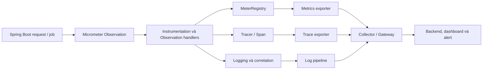

# Chiến lược rollout telemetry

Đưa Micrometer Observation, metrics, logs và distributed tracing vào một hệ thống Spring Boot đang chạy là một thay đổi kiến trúc có ảnh hưởng trực tiếp đến vận hành. Instrumentation mới có thể làm tăng CPU, memory, network và chi phí lưu trữ; thay đổi sampling có thể làm mất khả năng so sánh trace; thay đổi tên meter hoặc resource attributes có thể khiến dashboard và alert hiện tại không còn tìm thấy dữ liệu. Vì vậy, telemetry cần được triển khai theo từng giai đoạn, có tiêu chí đo lường và có đường quay lui rõ ràng.

Chiến lược rollout tốt phải trả lời được bốn câu hỏi: triển khai cho service hoặc instance nào trước, tăng lượng dữ liệu theo cách nào, dựa vào tín hiệu nào để quyết định tiếp tục, và làm gì khi chất lượng ứng dụng hoặc pipeline observability suy giảm. Bài viết trình bày cách thiết kế chiến lược đó cho hệ thống Spring Boot.

## 1. Xác định phạm vi rollout

Telemetry không phải một tính năng đơn lẻ. Một thay đổi có thể tác động đến nhiều lớp:

1. **Instrumentation:** tạo Observation cho HTTP server/client, database, messaging, scheduled task hoặc nghiệp vụ tùy chỉnh.
2. **Tạo tín hiệu:** chuyển Observation thành metrics và spans; ghi log có ngữ cảnh tương quan.
3. **Enrichment:** gắn service identity, environment, version, region và các thuộc tính nghiệp vụ có giới hạn.
4. **Sampling và filtering:** quyết định trace nào được giữ, meter nào được tạo và dữ liệu nào được phép đi tiếp.
5. **Export:** gửi metrics, traces hoặc logs đến collector hay backend.
6. **Tiêu thụ:** dashboard, alert, truy vấn điều tra, retention và quy trình vận hành.

Các lớp này có thể được rollout độc lập. Ví dụ, bật instrumentation cho một nhóm instance trước, sau đó mới tăng sampling hoặc chuyển exporter sang collector mới. Tách các thay đổi giúp xác định nguyên nhân khi có sự cố và giảm số biến thay đổi cùng lúc.

### 1.1. Mô hình đường đi của telemetry



Mỗi mũi tên là một điểm có thể phát sinh lỗi hoặc mất dữ liệu. Khi thiết kế rollout, cần chỉ rõ ai sở hữu từng điểm: nhóm phát triển service, nhóm nền tảng observability hay nhóm vận hành backend. Trách nhiệm phải bao gồm cả cấu hình, theo dõi và xử lý khi export thất bại.

### 1.2. Phân biệt ba phạm vi thay đổi

| Phạm vi | Ví dụ | Rủi ro chính |
|---|---|---|
| Thay đổi trong ứng dụng | Thêm Observation, meter, span hoặc log correlation | Tăng overhead, thay đổi hành vi instrumentation, cardinality |
| Thay đổi pipeline | Đổi endpoint, protocol, collector, processor hoặc exporter | Mất dữ liệu, backlog, lỗi xác thực, tăng độ trễ ingest |
| Thay đổi cách sử dụng dữ liệu | Đổi tên metric, label, service identity, dashboard hoặc alert | Query sai, alert im lặng, khó so sánh trước và sau |

Nếu có thể, không triển khai đồng thời cả ba phạm vi trên toàn bộ fleet. Mỗi đợt rollout nên có một thay đổi chính và một giả thuyết có thể kiểm chứng.

## 2. Nguyên tắc thiết kế rollout an toàn

**Triển khai tăng dần:** bắt đầu từ môi trường phát triển, staging và một nhóm nhỏ instance hoặc service có lưu lượng đại diện. Chỉ mở rộng khi các tiêu chí chất lượng đạt yêu cầu.

**Giữ khả năng tương thích:** dashboard, alert và công cụ downstream cần tiếp tục hoạt động trong giai đoạn chuyển đổi. Nếu đổi schema, tên meter hoặc resource attributes, phải có kế hoạch chuyển đổi và thời gian hỗ trợ song song.

**Giới hạn tác động:** đặt giới hạn cho sampling, cardinality, queue, batch, retry và timeout. Không để lỗi gửi telemetry làm cạn tài nguyên của ứng dụng hoặc gây lỗi request nghiệp vụ.

**Có khả năng quan sát chính pipeline:** exporter và collector cũng cần được theo dõi. Một pipeline không có tín hiệu về số lượng gửi thành công, gửi thất bại, dữ liệu bị drop và backlog sẽ khó tự chẩn đoán khi rollout.

**Có đường quay lui:** giữ cấu hình ổn định trước rollout, biết cách khôi phục endpoint, sampling, instrumentation và dashboard. Rollback phải nhanh hơn tốc độ lan rộng của sự cố.

**Bảo vệ dữ liệu:** chỉ thu thập thuộc tính cần thiết, loại bỏ bí mật và dữ liệu cá nhân khỏi tags, baggage và log fields. Sampling không thay thế chính sách bảo mật.

## 3. Chuẩn bị trước khi triển khai

### 3.1. Lập bản đồ hệ thống

Trước khi thay đổi, thu thập tối thiểu các thông tin sau cho từng service:

- Tên service, môi trường, phiên bản ứng dụng, số instance và vùng triển khai.
- Phiên bản Spring Boot, Micrometer, Micrometer Tracing, registry và exporter đang dùng.
- Loại workload: HTTP request, consumer, scheduled task, batch hay tác vụ dài hạn.
- Lưu lượng bình thường và đỉnh, số request mỗi giây, concurrency và kích thước payload điển hình.
- Các dependency quan trọng: database, cache, message broker, HTTP/gRPC service và collector.
- Các meter, dashboard, alert và quy trình điều tra hiện có.
- Cách trace context được truyền qua HTTP, messaging và các luồng bất đồng bộ.

Thông tin này giúp chọn canary đại diện. Một instance có lưu lượng thấp không đủ để chứng minh exporter hoạt động tốt khi tải cao; một service chỉ xử lý HTTP cũng không đại diện cho consumer hoặc scheduled job.

### 3.2. Chốt hợp đồng dữ liệu

Trước rollout, thống nhất tên và ý nghĩa của các trường nhận diện tài nguyên:

| Thuộc tính | Vai trò | Quy tắc đề xuất |
|---|---|---|
| `service.name` | Nhận diện service | Ổn định giữa các instance của cùng service |
| `service.version` | Phân biệt phiên bản triển khai | Gắn với release hoặc image version |
| `deployment.environment` | Phân biệt môi trường | Dùng tập giá trị chuẩn như dev, staging, production |
| `service.instance.id` | Nhận diện instance khi cần điều tra | Giá trị duy nhất, không dùng làm metric label nếu gây cardinality cao |
| `cloud.region` hoặc vùng triển khai | Phân vùng hạ tầng | Dùng giá trị chuẩn, không thay đổi tùy request |

Tên thuộc tính cần thống nhất với semantic conventions và hệ thống backend đang sử dụng. Không nên tự tạo nhiều biến thể như `app`, `application`, `service_name` cho cùng một khái niệm nếu chưa có quy tắc chuyển đổi.

Xác định trước các meter quan trọng, đơn vị, loại metric, histogram bucket và tags được phép. Với tracing, thống nhất tên span, span kind, status, thuộc tính và cách liên kết span qua service. Với logs, thống nhất timestamp, severity, service identity và cách đưa trace ID/span ID vào bản ghi.

### 3.3. Đặt ngân sách cardinality và sampling

Metric labels phải có tập giá trị hữu hạn. Các giá trị như user ID, email, order ID, session ID, request ID hoặc URL chứa path parameter thường tạo ra số time series rất lớn. Nên chuẩn hóa route thành template như `/orders/{orderId}` và dùng ID trong log hoặc trace khi có lý do nghiệp vụ, đồng thời tuân thủ chính sách dữ liệu.

Với tracing, xác định sampling ban đầu theo lưu lượng, dung lượng backend và nhu cầu điều tra. Head-based sampling quyết định ở đầu trace và thường dễ triển khai, nhưng có thể bỏ lỡ trace lỗi hiếm. Tail-based sampling có thể quyết định sau khi xem toàn bộ trace, nhưng cần collector giữ trạng thái và đủ tài nguyên. Chính sách sampling phải xét đến propagation để các service trong cùng một trace có quyết định nhất quán.

Không chọn sampling probability chỉ dựa trên một con số mặc định. Hãy ước lượng số span mỗi giây, kích thước span, thời gian lưu trữ và phần trăm trace cần giữ cho các luồng quan trọng. Có thể áp dụng chính sách giữ nhiều hơn cho lỗi hoặc latency cao ở tầng tail sampling nếu kiến trúc và ngân sách cho phép.

### 3.4. Ghi nhận đường cơ sở

Đo trước khi bật telemetry mới để có mốc so sánh:

- CPU, heap, allocation rate, garbage collection và memory RSS.
- P50, P95, P99 latency; throughput; tỷ lệ 4xx/5xx và timeout.
- Số kết nối, thread, queue và tải của dependency.
- Lượng network egress, log volume và chi phí backend hiện tại.
- Tỷ lệ request hoặc job thành công theo từng loại workload.

Ghi rõ cửa sổ thời gian và điều kiện tải. So sánh canary với nhóm đối chứng cùng thời điểm sẽ đáng tin cậy hơn việc so sánh với số liệu của một ngày khác có lưu lượng khác biệt.

## 4. Lộ trình rollout theo giai đoạn

Một lộ trình tham khảo gồm các giai đoạn dưới đây. Tỷ lệ instance chỉ là điểm bắt đầu; cần điều chỉnh theo quy mô fleet, mức độ rủi ro và khả năng phân luồng của nền tảng triển khai.

### Giai đoạn 0: Xác minh trong môi trường phát triển

Tích hợp dependency và cấu hình Micrometer Observation, registry, tracing bridge hoặc exporter trong môi trường local/dev. Xác minh một request đi qua các lớp dự kiến có thể tạo meter/span; trace context được truyền qua dependency; log có trace ID khi tracing được bật.

Kiểm tra cả đường lỗi và đường thành công. Một request thất bại có thể tạo span với trạng thái lỗi; một request thành công không nên phát sinh span hoặc log bất thường. Xác nhận endpoint, protocol và resource attributes đúng với service.

### Giai đoạn 1: Staging và kiểm thử tải

Triển khai trên staging có cấu hình gần production. Kiểm tra:

- Metrics, traces và logs đến đúng collector/backend.
- Dashboard và alert đọc đúng service, environment, version và tên meter.
- Sampling, filter và processor không loại bỏ dữ liệu cần thiết.
- Exporter chịu được tải bình thường và tải đỉnh dự kiến.
- Collector hoặc backend chậm/mất kết nối không làm ứng dụng tăng latency bất thường.
- Queue và retry có giới hạn; khi quá tải, hành vi drop có thể quan sát được.

Kiểm thử ngắt kết nối collector trong thời gian có kiểm soát để xác nhận ứng dụng vẫn xử lý nghiệp vụ theo thiết kế. Sau khi kết nối lại, kiểm tra backlog, retry và khả năng phục hồi. Không giả định dữ liệu đã bị drop sẽ tự được gửi lại; điều này phụ thuộc exporter và chính sách queue.

### Giai đoạn 2: Canary trên production

Chọn một hoặc vài instance thuộc service có mức tải và dependency đại diện. Có thể bắt đầu ở một instance hoặc khoảng 1–5% fleet nếu nền tảng hỗ trợ phân nhóm ổn định. Canary cần nhận đủ loại request và workload quan trọng để kết quả có ý nghĩa.

Ưu tiên rollout instrumentation và export với sampling thấp, giới hạn cardinality đã được kiểm tra. Theo dõi đồng thời nhóm canary và nhóm đối chứng. Xác nhận không có khác biệt đáng kể về latency, lỗi ứng dụng, CPU, memory và network; đồng thời xác nhận telemetry thực sự đến được backend.

Không chọn canary chỉ dựa trên số instance. Nếu instance được chọn không nhận traffic hoặc chỉ nhận một loại request hiếm, cần kéo dài thời gian quan sát hoặc chọn thêm instance đại diện.

### Giai đoạn 3: Mở rộng theo nấc

Khi canary đạt tiêu chí, mở rộng theo các nấc phù hợp, ví dụ 5% → 25% → 50% → 100%. Mỗi nấc phải có khoảng quan sát đủ bao phủ chu kỳ traffic và các tác vụ nền quan trọng. Với hệ thống có lịch batch theo ngày hoặc consumer theo giờ, không thể chỉ quan sát vài phút rồi kết luận an toàn.

Sau mỗi nấc, kiểm tra lại:

1. Chất lượng nghiệp vụ có giữ ổn định không?
2. Tín hiệu có đầy đủ và có thể liên kết không?
3. Exporter và collector có chịu được lưu lượng tăng không?
4. Cardinality, storage và chi phí có nằm trong ngân sách không?
5. Dashboard, alert và quy trình on-call có hoạt động đúng không?

Nếu có dấu hiệu bất thường, dừng ở nấc hiện tại. Không tự động mở rộng chỉ vì pipeline triển khai báo instance đã healthy.

### Giai đoạn 4: Ổn định và chuẩn hóa

Sau khi đạt 100%, tiếp tục theo dõi trong một khoảng thời gian đủ dài để phát hiện vấn đề theo chu kỳ. Chuẩn hóa cấu hình, dashboard, alert, runbook, quyền truy cập và ownership. Xóa cấu hình tạm thời sau khi xác nhận không còn thành phần downstream phụ thuộc vào nó.

Nếu rollout có thay đổi schema hoặc backend, chỉ ngừng pipeline cũ sau khi xác nhận dữ liệu mới đã được tiêu thụ ổn định và các dashboard/alert đã chuyển đổi. Thời gian chạy song song cần được giới hạn để tránh nhân đôi chi phí và dữ liệu.

## 5. Điều khiển rollout trong Spring Boot

### 5.1. Tách cấu hình khỏi code

Các tham số có khả năng thay đổi trong rollout nên được externalize qua environment variables, config server hoặc cơ chế cấu hình tập trung phù hợp với nền tảng. Ví dụ:

```yaml
app:
  observability:
    enabled: ${APP_OBSERVABILITY_ENABLED:true}
    export-enabled: ${APP_TELEMETRY_EXPORT_ENABLED:true}
    tracing-sample-probability: ${TRACING_SAMPLE_PROBABILITY:0.05}
    service-version: ${APP_VERSION:local}
```

Đây là nhóm cấu hình minh họa ở cấp ứng dụng, không phải property chuẩn có sẵn của Spring Boot. Code cấu hình cần ánh xạ các giá trị này sang Micrometer, tracer và exporter tương ứng. Property cụ thể của Actuator, Micrometer registry và OTLP thay đổi theo phiên bản Spring Boot và dependency; hãy xác minh với phiên bản đang dùng trước khi triển khai.

Tách ít nhất ba công tắc nếu kiến trúc cho phép:

- Bật/tắt instrumentation hoặc Observation cho phạm vi có thể kiểm soát.
- Bật/tắt export ra ngoài tiến trình.
- Điều chỉnh sampling hoặc filter.

Ba công tắc có mục đích khác nhau. Tắt export không nhất thiết phải tắt việc tạo meter/span; ngược lại, tắt instrumentation có thể làm mất dữ liệu ngay từ đầu. Thiết kế phải nêu rõ tác động của từng công tắc và cách thay đổi có hiệu lực.

### 5.2. Dùng rollout theo service và instance

Nếu có nhiều service, ưu tiên service ít rủi ro nhưng đại diện cho kiến trúc chung để xác minh convention, exporter và collector. Sau đó mở rộng sang service có lưu lượng lớn, nhiều dependency hoặc workload đặc thù.

Trong cùng một service, sử dụng deployment strategy của nền tảng như canary, rolling update hoặc traffic splitting để giới hạn tỷ lệ instance. Đảm bảo có thể xác định chính xác phiên bản/cấu hình của instance phát ra telemetry thông qua `service.version`, deployment metadata hoặc thuộc tính tương đương.

Nếu thay đổi sampling theo instance, phải cân nhắc trace phân tán đi qua nhiều instance. Chính sách parent-based sampling và trace context propagation cần giữ quyết định sampling nhất quán. Tránh đặt các tỷ lệ không tương thích giữa các service khiến trace bị đứt hoặc khó diễn giải.

### 5.3. Di chuyển exporter hoặc backend

Khi đổi collector hoặc backend, có thể chạy song song hai đường export trong giai đoạn ngắn nếu thư viện và kiến trúc hỗ trợ. Trước khi dual-write, đánh giá:

- Lưu lượng egress và chi phí ingest có thể gần như tăng gấp đôi.
- Metrics có thể bị ghi trùng hoặc tạo hai bộ series khác nhau.
- Trace có thể xuất hiện ở hai backend với retention và sampling khác nhau.
- Hai pipeline có thể dùng resource attributes hoặc transform khác nhau.
- Một đích lỗi có thể làm queue và retry tăng nếu cấu hình không tách biệt.

Đặt nhãn hoặc resource identity để phân biệt đích thử nghiệm khi cần, nhưng không thêm nhãn có giá trị thay đổi liên tục. So sánh số lượng nhận, tỷ lệ lỗi, độ trễ ingest, schema và truy vấn giữa hai đích. Chỉ chuyển dashboard và alert sau khi dữ liệu mới đáp ứng hợp đồng đã thống nhất.

## 6. Sampling, cardinality và liên kết tín hiệu trong rollout

### 6.1. Sampling phải có kế hoạch theo tầng

Sampling ảnh hưởng trực tiếp đến khả năng điều tra và chi phí. Một cách triển khai thường gặp là bắt đầu với tỷ lệ thấp trong canary, sau đó tăng dần khi đã xác minh overhead và dung lượng. Tuy nhiên, thay đổi sampling cần được ghi nhận theo version/configuration để người điều tra hiểu vì sao số lượng trace thay đổi.

Với distributed tracing:

- Duy trì trace context propagation qua HTTP, messaging và tác vụ bất đồng bộ.
- Xác định rõ parent-based hay root sampling và vị trí ra quyết định.
- Nếu dùng tail sampling tại collector, đảm bảo collector nhận đủ span của trace trong thời gian cần thiết và có đủ memory/queue.
- Cân nhắc giữ trace lỗi hoặc latency cao theo chính sách phù hợp, nhưng đánh giá chi phí và quyền riêng tư.
- Không so sánh trực tiếp tỷ lệ trace giữa hai giai đoạn nếu sampling policy khác nhau mà chưa chuẩn hóa.

### 6.2. Kiểm soát cardinality trước và sau mỗi nấc

Rollout instrumentation có thể làm tăng số meter do tag mới hoặc do instrumentation bao phủ thêm route. Theo dõi số lượng series theo meter và tag dimensions. Đặt giới hạn cho label values, tránh dùng dữ liệu đầu vào của người dùng làm metric tag. Với histogram, cân nhắc số bucket và số tag vì mỗi tổ hợp tạo thêm series.

Nếu phát hiện cardinality tăng đột biến, xác định meter/tag gây tăng trước khi mở rộng. Sửa cách chuẩn hóa route hoặc loại bỏ tag không cần thiết. Không xử lý bằng cách tăng giới hạn backend một cách mặc định vì điều đó có thể che giấu lỗi thiết kế.

### 6.3. Bảo đảm logs có thể liên kết với traces

Khi tracing được bật, log cần mang trace ID và span ID theo định dạng backend hỗ trợ. Kiểm tra correlation ở cả request đồng bộ và luồng bất đồng bộ. Nếu trace bị sampling bỏ, log vẫn có thể tồn tại; cần xác định cách xử lý trường hợp log có trace ID nhưng backend không có trace tương ứng.

Baggage và log fields phải được allowlist. Không truyền token, cookie, email, số điện thoại hoặc dữ liệu cá nhân qua context chỉ để tiện debug. Việc tăng sampling không được dùng làm lý do để thu thập thêm dữ liệu nhạy cảm.

## 7. Tiêu chí go/no-go cho từng giai đoạn

Quyết định mở rộng cần dựa trên cả sức khỏe ứng dụng và sức khỏe telemetry.

| Nhóm | Chỉ số/bằng chứng | Điều kiện tiếp tục tham khảo |
|---|---|---|
| Nghiệp vụ | Error rate, timeout, job failure, throughput | Không vượt ngưỡng SLO hoặc baseline đã thống nhất |
| Độ trễ | P95/P99 của request và dependency | Không có mức tăng bất thường có liên hệ với rollout |
| Tài nguyên | CPU, heap, GC, memory RSS, network | Còn headroom trong giới hạn vận hành |
| Metrics export | Export success/failure, queue, dropped measurements | Không có lỗi kéo dài; queue không tăng liên tục |
| Tracing | Span received/exported, dropped spans, trace completeness | Trace có thể tìm kiếm và liên kết qua các service chính |
| Logs | Ingest delay, rejected/dropped logs, volume | Không mất log quan trọng và volume nằm trong ngân sách |
| Chất lượng dữ liệu | Resource attributes, meter names, tags, sampling | Tuân thủ hợp đồng dữ liệu và không có cardinality bất thường |
| Vận hành | Dashboard, alert, runbook, ownership | Người trực có thể phát hiện và điều tra sự cố |

Ngưỡng cụ thể phải được đội sở hữu service và nền tảng thống nhất dựa trên SLO, baseline và ngân sách. Không có một ngưỡng CPU, latency hay export failure phù hợp cho mọi hệ thống.

### 7.1. Tách lỗi ứng dụng khỏi lỗi telemetry

Nếu request error rate tăng, hãy kiểm tra exception, dependency và response path. Nếu request ổn định nhưng export failure tăng, kiểm tra exporter, collector và backend. Nếu cả hai tăng, điều tra hai nhánh song song và kiểm tra liệu exporter có chạy đồng bộ hoặc tranh chấp tài nguyên với request path hay không.

Đừng dùng trạng thái `/actuator/health` làm tiêu chí duy nhất. Health endpoint có thể báo `UP` trong khi collector không nhận telemetry. Ngược lại, backend telemetry có thể tạm thời lỗi nhưng nghiệp vụ vẫn hoạt động bình thường. Cần có chỉ số riêng cho từng mặt.

## 8. Thiết kế rollback và hành vi khi suy giảm

Rollback phải được chuẩn bị trước khi bật canary. Ghi lại cấu hình trước rollout, phiên bản exporter/collector, sampling, resource attributes và dashboard query. Đảm bảo có thể khôi phục từng phần.

Các hành động rollback thường gồm:

1. Dừng mở rộng và giữ nguyên tỷ lệ canary hiện tại.
2. Khôi phục cấu hình exporter hoặc endpoint trước đó nếu pipeline mới lỗi.
3. Giảm sampling hoặc tạm dừng export của phạm vi thử nghiệm nếu queue, network hoặc backend quá tải.
4. Khôi phục instrumentation/configuration version trước nếu overhead làm ảnh hưởng request path.
5. Chuyển dashboard/alert về pipeline ổn định nếu dữ liệu mới không tương thích.
6. Xác minh ứng dụng, collector và backend đã trở lại trạng thái ổn định.

Thiết kế exporter cần có timeout, retry có giới hạn, batch và queue có giới hạn. Khi queue đầy hoặc backend mất kết nối kéo dài, cần có chỉ số ghi nhận dữ liệu bị drop. Tránh retry vô hạn hoặc queue không giới hạn vì có thể gây cạn memory và làm sự cố lan rộng.

Trong hầu hết hệ thống, telemetry là năng lực hỗ trợ vận hành. Lỗi export không nên làm request nghiệp vụ thất bại ngoài ý muốn. Tuy nhiên, điều này phụ thuộc cách tích hợp: exporter tùy biến hoặc callback đồng bộ có thể chạy trong request path. Hãy kiểm tra implementation thực tế và kiểm thử hành vi khi exporter ném exception hoặc timeout.

Rollback không đồng nghĩa xóa mọi tín hiệu quan sát. Nếu pipeline mới gây lỗi, duy trì baseline telemetry ổn định nếu có thể để đội vận hành tiếp tục nhìn thấy sức khỏe hệ thống trong khi khắc phục.

## 9. Tình huống rollout mẫu

### Tình huống A: Bổ sung tracing cho một nhóm Spring Boot service

Một hệ thống đã có metrics qua Micrometer nhưng chưa có distributed tracing. Nhóm dự án bổ sung tracing bridge và OTLP exporter.

**Cách triển khai:** trước tiên xác minh trace context qua HTTP client và server trong staging. Chọn một service production có dependency đại diện, bật tracing với sampling thấp trên một nhóm instance. Xác nhận span server/client có cùng trace ID, resource attributes đúng và log có correlation. Sau đó mở rộng sang service gọi và service được gọi để tránh chỉ nhìn thấy một đoạn của trace.

**Điều kiện mở rộng:** latency, CPU và memory không tăng bất thường; collector nhận span; tỷ lệ drop ổn định; sampling và propagation nhất quán. Sau rollout, tăng sampling theo nhu cầu điều tra và ngân sách.

### Tình huống B: Chuyển metrics exporter sang collector mới

Ứng dụng hiện gửi metrics đến backend cũ. Hệ thống muốn chuyển sang collector làm lớp gateway chung.

**Cách triển khai:** dựng receiver và pipeline mới trước, kiểm thử bằng staging. Trong production, chọn một service hoặc nhóm instance để gửi đến collector mới. Nếu cần dual-write, đặt thời hạn rõ ràng và theo dõi số series, ingest delay, export failure và chi phí. Kiểm tra dashboard query theo service/version và xác nhận alert vẫn phát hiện được tình huống thử nghiệm.

**Điều kiện chuyển đổi:** dữ liệu mới có schema tương thích, không bị drop bất thường, dashboard/alert hoạt động và collector có đủ năng lực. Chuyển từng nhóm service, sau đó ngừng đích cũ theo lịch đã công bố.

### Tình huống C: Cardinality tăng sau khi thêm tag nghiệp vụ

Sau một release, số series tăng nhanh do meter HTTP được gắn thêm tag chứa mã đối tượng.

**Cách triển khai xử lý:** dừng mở rộng rollout, xác định meter và tag dimension gây tăng. Thay tag bằng nhóm giá trị hữu hạn hoặc chuyển định danh cần thiết sang log/trace có kiểm soát. Kiểm tra lại số series trong staging và canary trước khi tiếp tục.

**Điều kiện mở rộng:** cardinality trở lại trong ngân sách, dashboard dùng tag mới đúng cách và không có dữ liệu nhạy cảm bị đưa vào telemetry.

## 10. Checklist triển khai

### Trước rollout

- [ ] Xác định service, instance, workload và dependency nằm trong phạm vi.
- [ ] Ghi nhận phiên bản Spring Boot, Micrometer, registry, tracer và exporter.
- [ ] Thống nhất service identity, resource attributes, meter names và span conventions.
- [ ] Xác định sampling, cardinality budget, histogram và chính sách dữ liệu.
- [ ] Đo baseline CPU, memory, latency, error rate, throughput và network.
- [ ] Chuẩn bị collector/backend, dashboard, alert và runbook.
- [ ] Chuẩn bị cấu hình rollback và người chịu trách nhiệm cho từng lớp.

### Trong rollout

- [ ] Xác minh staging và kiểm thử khi collector/backend chậm hoặc mất kết nối.
- [ ] Bắt đầu từ canary có workload đại diện.
- [ ] Theo dõi ứng dụng và telemetry pipeline cùng lúc.
- [ ] Kiểm tra trace context, sampling và log correlation.
- [ ] Theo dõi cardinality, dropped data, queue, retry và chi phí ingest.
- [ ] Chỉ mở rộng sau khi tiêu chí go/no-go đạt yêu cầu.
- [ ] Dừng rollout khi có chỉ số vượt ngưỡng hoặc thiếu bằng chứng.

### Sau rollout

- [ ] Xác nhận toàn bộ service/instance trong phạm vi đã phát dữ liệu đúng.
- [ ] Kiểm tra dashboard, alert, truy vấn điều tra và retention.
- [ ] Xác nhận ownership, runbook và quy trình xử lý lỗi exporter.
- [ ] Gỡ cấu hình tạm thời và pipeline cũ sau khi hết thời gian chuyển đổi.
- [ ] Ghi lại chi phí, overhead và bài học để điều chỉnh rollout tiếp theo.

## 11. Những sai lầm thường gặp

| Sai lầm | Hệ quả | Cách tránh |
|---|---|---|
| Bật instrumentation trên toàn bộ fleet cùng lúc | Overhead hoặc cardinality tăng đột ngột | Dùng canary và mở rộng theo nấc |
| Chỉ kiểm tra dashboard có dữ liệu | Có dữ liệu nhưng trace đứt, sai resource hoặc sai sampling | Kiểm tra chất lượng và khả năng liên kết dữ liệu |
| Chỉ nhìn health endpoint | Không phát hiện exporter/collector bị lỗi | Có chỉ số riêng cho pipeline telemetry |
| Dùng ID động làm metric tag | Tạo quá nhiều time series | Dùng route template và label có tập giá trị hữu hạn |
| Đổi tên meter/resource cùng lúc đổi backend | Khó xác định thay đổi nào làm query hỏng | Tách các đợt thay đổi và duy trì tương thích |
| Dual-write không giới hạn thời gian | Nhân đôi chi phí và dữ liệu | Có tiêu chí so sánh và ngày kết thúc rõ ràng |
| Retry vô hạn hoặc queue không giới hạn | Cạn tài nguyên khi backend lỗi | Giới hạn queue, retry và quan sát dữ liệu bị drop |
| Thay sampling mà không ghi nhận | Số trace thay đổi khó giải thích | Version hóa và ghi nhận sampling policy |
| Đưa thông tin nhạy cảm vào baggage/log/tag | Rủi ro rò rỉ dữ liệu | Allowlist, redaction và review schema |

## 12. Kết luận vận hành

Rollout telemetry là quá trình đưa một năng lực quan sát vào hệ thống mà vẫn giữ được độ tin cậy của nghiệp vụ. Hãy bắt đầu bằng hợp đồng dữ liệu và baseline, xác minh instrumentation cùng exporter trong staging, triển khai canary có đại diện, mở rộng theo nấc dựa trên tiêu chí go/no-go, rồi chuẩn hóa dashboard, alert và runbook. Sampling, cardinality, propagation, queue và quyền riêng tư phải được kiểm soát xuyên suốt.

Một rollout chỉ được xem là thành công khi ứng dụng giữ được SLO, telemetry đến đúng nơi với chất lượng có thể sử dụng, pipeline có thể tự bộc lộ lỗi và đội vận hành có thể quay lui khi cần. Điều đó giúp metrics, logs và distributed tracing trở thành một phần ổn định của kiến trúc Spring Boot trong môi trường thực.
