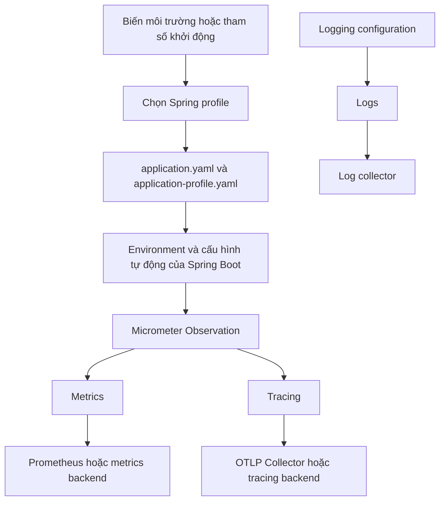

# Cấu hình theo profile

Một ứng dụng Spring Boot thường chạy ở nhiều môi trường: máy cá nhân, môi trường kiểm thử tích hợp, staging và production. Mỗi môi trường có yêu cầu vận hành khác nhau. Khi phát triển, ta cần xem chi tiết health check, bật log debug và lấy đầy đủ trace để lần theo request. Khi chạy production, ta cần giới hạn dữ liệu health check, kiểm soát lượng trace được lấy mẫu và gửi telemetry đến đúng hệ thống thu thập.

Spring Boot profile cho phép chọn một tập cấu hình theo môi trường chạy. Kết hợp profile với externalized configuration, Micrometer Observation, metrics, logging và distributed tracing giúp một ứng dụng giữ nguyên mã nguồn nhưng vẫn có cấu hình observability phù hợp ở từng môi trường.

Sau bài học này, bạn có thể:

- Tổ chức cấu hình chung và cấu hình riêng theo profile.
- Chọn profile lúc khởi động bằng tham số hoặc biến môi trường.
- Điều chỉnh log level, health endpoint, metrics và tracing theo môi trường.
- Đưa endpoint, sampling rate và thông tin nhạy cảm ra khỏi file cấu hình đóng gói trong ứng dụng.
- Kiểm tra cấu hình đã được áp dụng và phát hiện những lỗi thường gặp.

## 1. Profile giải quyết vấn đề gì?

Profile là nhãn mô tả một nhóm cấu hình cần được kích hoạt khi ứng dụng khởi động. Ví dụ, profile `local` có thể bật log chi tiết và lấy mẫu toàn bộ trace; profile `staging` gửi trace đến collector dùng cho kiểm thử; profile `prod` giảm sampling, giới hạn endpoint được công khai và dùng địa chỉ collector của production.

Profile không tự tạo ra môi trường hay tài nguyên bên ngoài. Nó chỉ quyết định cấu hình nào được nạp. Collector, Prometheus, hệ thống quản lý log, quyền truy cập Actuator và các biến môi trường vẫn phải được triển khai, cấp quyền và vận hành riêng.

Một cấu trúc thường dùng trong `src/main/resources` là:

```text
src/main/resources/
├── application.yaml
├── application-local.yaml
├── application-staging.yaml
└── application-prod.yaml
```

`application.yaml` chứa giá trị mặc định dùng chung. Khi profile `prod` được kích hoạt, Spring Boot nạp thêm `application-prod.yaml`; các thuộc tính cùng tên trong cấu hình riêng sẽ ghi đè giá trị mặc định tương ứng. Những thuộc tính không được khai báo trong file riêng vẫn lấy từ cấu hình chung hoặc nguồn cấu hình khác.

Spring Boot hỗ trợ nhiều nguồn cấu hình. Biến môi trường, tham số dòng lệnh và cấu hình bên ngoài có thể ghi đè giá trị trong file nằm trong JAR. Vì vậy, có thể đóng gói cùng một artifact rồi cung cấp cấu hình khác nhau khi triển khai mà không cần build lại ứng dụng.

## 2. Đặt cấu hình nền trong `application.yaml`

Nên bắt đầu bằng một cấu hình nền nhỏ, an toàn và có thể dùng ở mọi môi trường. Ví dụ:

```yaml
spring:
  application:
    name: observability-demo

management:
  endpoints:
    web:
      exposure:
        include: health,info
  endpoint:
    health:
      probes:
        enabled: true
  metrics:
    tags:
      application: ${spring.application.name}
```

Trong ví dụ này:

- `spring.application.name` đặt tên dịch vụ. Tên này có thể được dùng để nhận diện ứng dụng trong dashboard và dữ liệu telemetry.
- Chỉ expose `health` và `info` qua HTTP ở cấu hình nền. Các endpoint khác cần được bật có chủ đích trong môi trường phù hợp.
- Health probes cung cấp trạng thái liveness và readiness để nền tảng triển khai có thể kiểm tra ứng dụng.
- Tag `application` được gắn vào các meter, giúp phân biệt số liệu của dịch vụ khi nhiều ứng dụng cùng gửi về một hệ thống metrics.

Không nên đặt `spring.profiles.active` trong `application.yaml` chỉ để ép mọi lần chạy dùng một môi trường. Profile cần được chọn từ lệnh khởi động hoặc môi trường triển khai. Nhờ vậy, cùng một artifact có thể chạy ở local, staging và production.

## 3. Tạo cấu hình cho từng môi trường

### Local: ưu tiên khả năng quan sát khi phát triển

`application-local.yaml` có thể bật log debug cho package của ứng dụng, hiển thị health detail và lấy mẫu toàn bộ trace:

```yaml
logging:
  level:
    root: INFO
    com.example: DEBUG

management:
  endpoints:
    web:
      exposure:
        include: health,info,metrics,prometheus
  endpoint:
    health:
      show-details: always
  tracing:
    sampling:
      probability: 1.0
```

`probability: 1.0` có nghĩa là sampler lấy mẫu tất cả trace đủ điều kiện. Điều này hữu ích khi debug một luồng request ngắn trên máy cá nhân. Nếu dự án không có dependency Prometheus Registry, endpoint `/actuator/prometheus` sẽ không được tạo dù đã khai báo trong danh sách exposure; endpoint này cần registry tương ứng trên classpath.

Nếu local dùng OpenTelemetry Collector, có thể cấu hình endpoint OTLP riêng trong profile local. Nếu không có collector, hãy bỏ cấu hình exporter hoặc dùng chế độ quan sát phù hợp với dependency của dự án; việc đặt sampling rate không tự khởi tạo một exporter.

### Staging: kiểm tra gần với production

Staging thường cần cùng kiểu tích hợp với production để phát hiện lỗi cấu hình, propagation hoặc kết nối collector trước khi phát hành. Sampling có thể cao hơn production nhưng vẫn nên có giới hạn:

```yaml
logging:
  level:
    root: INFO

management:
  endpoints:
    web:
      exposure:
        include: health,info,prometheus
  endpoint:
    health:
      show-details: when-authorized
  metrics:
    tags:
      environment: staging
  tracing:
    sampling:
      probability: ${TRACING_SAMPLING_PROBABILITY:0.2}
```

Giá trị `0.2` là ví dụ để lấy mẫu khoảng 20% trace đầu vào. Tỷ lệ thực tế cần dựa trên lưu lượng, dung lượng lưu trữ, mục tiêu điều tra và chính sách sampling của hệ thống tracing. Biến `TRACING_SAMPLING_PROBABILITY` cho phép điều chỉnh mà không phải sửa file YAML.

### Production: giới hạn dữ liệu và kiểm soát chi phí

`application-prod.yaml` có thể giữ log ở mức `INFO`, ẩn health detail và gửi trace đến collector production:

```yaml
logging:
  level:
    root: INFO

management:
  endpoints:
    web:
      exposure:
        include: health,info,prometheus
  endpoint:
    health:
      show-details: never
      probes:
        enabled: true
  metrics:
    tags:
      environment: ${APP_ENV:prod}
  tracing:
    sampling:
      probability: ${TRACING_SAMPLING_PROBABILITY:0.05}
  otlp:
    tracing:
      endpoint: ${OTEL_EXPORTER_OTLP_TRACES_ENDPOINT:http://otel-collector:4318/v1/traces}
```

Địa chỉ OTLP ở trên là ví dụ cho collector nhận OTLP/HTTP. Hãy thay bằng địa chỉ mà môi trường production thực sự cung cấp. Thuộc tính `management.otlp.tracing.endpoint` chỉ có tác dụng khi ứng dụng có các dependency tracing bridge và OTLP exporter tương thích với phiên bản Spring Boot đang dùng. Ví dụ phổ biến trong hệ sinh thái Micrometer là `micrometer-tracing-bridge-otel` và `opentelemetry-exporter-otlp`; hãy để Spring Boot dependency management quản lý phiên bản tương thích.

Trong ví dụ này, Prometheus lấy metrics bằng cách scrape endpoint `/actuator/prometheus`, còn trace được gửi qua OTLP. Hai đường xuất dữ liệu có thể cùng tồn tại. Để dùng Prometheus endpoint, thêm `micrometer-registry-prometheus` và expose endpoint như trên. Nếu hệ thống metrics nhận dữ liệu qua OTLP hoặc một registry khác, hãy cấu hình exporter tương ứng và bỏ endpoint Prometheus khi không dùng.

Sampling `0.05` chỉ là giá trị khởi đầu minh họa, không phải tỷ lệ production phù hợp cho mọi hệ thống. Tỷ lệ thấp làm giảm lượng trace và chi phí lưu trữ nhưng cũng giảm khả năng quan sát các request hiếm. Cần đánh giá lưu lượng, ngân sách telemetry, yêu cầu điều tra sự cố và cơ chế sampling ở collector. Nếu cần ưu tiên giữ trace lỗi hoặc trace chậm, hãy thiết kế chính sách phù hợp ở tầng collector thay vì mặc định kỳ vọng head-based sampling sẽ giữ lại mọi trường hợp đó.

## 4. Kích hoạt profile khi chạy ứng dụng

Có thể chọn profile bằng biến môi trường:

```bash
SPRING_PROFILES_ACTIVE=prod java -jar app.jar
```

Hoặc truyền tham số dòng lệnh:

```bash
java -jar app.jar --spring.profiles.active=prod
```

Khi chạy bằng Maven ở máy local, có thể dùng:

```bash
SPRING_PROFILES_ACTIVE=local ./mvnw spring-boot:run
```

Trong PowerShell trên Windows:

```powershell
$env:SPRING_PROFILES_ACTIVE = "local"
.\mvnw spring-boot:run
```

Với Docker hoặc Kubernetes, đặt `SPRING_PROFILES_ACTIVE` trong cấu hình triển khai của container. Ví dụ, deployment production đặt biến này thành `prod`, còn deployment staging đặt thành `staging`. Không cần tạo image riêng chỉ vì khác profile.

Nếu cần bật nhiều nhóm cấu hình, Spring Boot hỗ trợ profile group. Khai báo group trong tài liệu cấu hình không gắn với profile, ví dụ:

```yaml
spring:
  profiles:
    group:
      production:
        - prod
        - tracing-remote
```

Khi kích hoạt `production`, Spring Boot cũng kích hoạt `prod` và `tracing-remote`. Cách này hữu ích khi một môi trường được ghép từ nhiều mối quan tâm cấu hình. Tránh tạo quá nhiều profile chồng lấn khiến khó xác định giá trị cuối cùng.

## 5. Dùng `spring.config.activate.on-profile` khi cần nhiều tài liệu YAML

Ngoài các file `application-{profile}.yaml`, có thể chia một file YAML thành nhiều tài liệu bằng dấu `---` và điều kiện `spring.config.activate.on-profile`:

```yaml
spring:
  application:
    name: observability-demo

management:
  tracing:
    sampling:
      probability: 0.1

---
spring:
  config:
    activate:
      on-profile: local

management:
  endpoint:
    health:
      show-details: always
  tracing:
    sampling:
      probability: 1.0
```

Tài liệu thứ hai chỉ được áp dụng khi profile `local` đang hoạt động. Cách viết này phù hợp với cấu hình nhỏ. Khi mỗi môi trường có nhiều thuộc tính riêng, các file `application-local.yaml`, `application-staging.yaml` và `application-prod.yaml` thường dễ đọc và dễ review hơn.

Không đặt `spring.profiles.active` hoặc `spring.profiles.include` bên trong tài liệu cấu hình chỉ được kích hoạt theo profile. Các thuộc tính dùng để chọn profile phải nằm trong tài liệu không gắn điều kiện profile; hãy chọn profile từ môi trường triển khai hoặc tham số khởi động.

## 6. Cấu hình profile tác động đến các tín hiệu observability như thế nào?

Profile quyết định giá trị thuộc tính mà Spring Boot dùng để cấu hình các thành phần observability. Sau khi ứng dụng khởi động, các thành phần này hoạt động cùng nhau:



**Metrics.** Metrics thường được thu thập liên tục và dùng để theo dõi xu hướng, tỷ lệ lỗi, throughput và latency. Có thể gắn tag ổn định như tên ứng dụng và môi trường để lọc dashboard. Không đưa `userId`, `orderId`, `requestId` hoặc URL chứa định danh động vào tag metrics: mỗi giá trị mới có thể tạo thêm một time series và làm tăng cardinality rất nhanh. Dùng trace hoặc log để tra cứu các định danh có độ biến thiên cao.

**Logs.** Log level có thể khác nhau theo môi trường. Local có thể bật `DEBUG` cho package cần điều tra; production thường giữ `INFO` và chỉ tăng mức log có kiểm soát khi xử lý sự cố. Khi Micrometer Tracing được tích hợp, trace ID và span ID có thể được đưa vào MDC để liên kết log với trace. Nếu dự án tùy biến Logback pattern, cần bảo đảm pattern vẫn ghi các trường correlation này. Log vẫn nên được chuyển đến hệ thống thu thập qua stdout hoặc agent theo kiến trúc triển khai.

**Tracing.** `management.tracing.sampling.probability` điều chỉnh tỷ lệ lấy mẫu cho tracing bridge được cấu hình. Local thường dùng tỷ lệ cao để dễ debug; production thường dùng tỷ lệ thấp hơn và điều chỉnh theo lưu lượng. Sampling không thay thế việc kiểm tra propagation qua HTTP client, message broker và các ranh giới dịch vụ. Nếu context không được truyền tiếp, các span có thể bị tách thành những trace riêng dù sampling được cấu hình đúng.

**Actuator và health check.** Exposure quyết định endpoint nào có thể truy cập qua web. `show-details` điều khiển mức chi tiết của health response; `probes.enabled` bật nhóm health probe cho liveness và readiness. Các endpoint quản trị cần được bảo vệ bằng Spring Security, network policy hoặc cả hai. Việc không expose endpoint qua HTTP không đồng nghĩa mọi endpoint đều không thể truy cập qua kênh quản trị khác.

## 7. Đưa cấu hình nhạy cảm ra khỏi file YAML

Không commit mật khẩu, token collector, API key hoặc thông tin xác thực vào `application-prod.yaml`. Dùng biến môi trường, secret của nền tảng triển khai hoặc cơ chế external configuration mà hệ thống đang vận hành hỗ trợ.

Ví dụ, endpoint collector trong YAML dùng placeholder:

```yaml
management:
  otlp:
    tracing:
      endpoint: ${OTEL_EXPORTER_OTLP_TRACES_ENDPOINT}
```

Giá trị được cung cấp lúc chạy bởi môi trường triển khai. Nếu một thuộc tính có giá trị mặc định an toàn, có thể dùng cú pháp `${TEN_BIEN:gia-tri-mac-dinh}`; với thông tin xác thực, không nên đặt secret thật làm giá trị mặc định trong repository.

Profile không phải cơ chế bảo mật. Một endpoint chỉ được expose trong profile `prod` vẫn cần kiểm soát ai có thể truy cập. Không expose hàng loạt endpoint như `env`, `configprops`, `beans`, `heapdump` hoặc `*` trên giao diện quản trị production nếu không có lý do và biện pháp bảo vệ cụ thể.

## 8. Kiểm tra cấu hình đang chạy

Sau khi khởi động, kiểm tra ứng dụng và các endpoint được cấu hình:

```bash
curl http://localhost:8080/actuator/health
curl http://localhost:8080/actuator/metrics
curl http://localhost:8080/actuator/prometheus
```

Endpoint `/actuator/metrics` liệt kê các meter có sẵn; có thể truy vấn một meter cụ thể, chẳng hạn `/actuator/metrics/http.server.requests`. Endpoint Prometheus chỉ hoạt động khi registry Prometheus có trên classpath và endpoint được expose. Trong production, các URL này có thể nằm sau management port, reverse proxy hoặc lớp xác thực nên cần dùng địa chỉ và thông tin truy cập của môi trường thực tế.

Để xác minh tracing, gửi một request qua ứng dụng rồi kiểm tra collector hoặc tracing backend có nhận span hay không. Kiểm tra trace có tên service đúng, span liên kết theo cùng trace ID và log có trường trace ID/span ID tương ứng. Nếu endpoint health hoạt động nhưng không có trace, hãy kiểm tra dependency exporter, địa chỉ collector, quyền truy cập mạng và propagation.

Trong test tích hợp, có thể chọn profile riêng:

```java
@SpringBootTest
@ActiveProfiles("test")
class ObservabilityConfigurationTests {
    // Kiểm tra hành vi cấu hình trong môi trường test.
}
```

`application-test.yaml` có thể đặt các thuộc tính phù hợp cho test, ví dụ tắt gửi telemetry ra hệ thống dùng chung hoặc thay endpoint bằng collector giả lập. Tránh để test tự gửi dữ liệu đến backend production.

## 9. Lỗi thường gặp và cách xử lý

| Hiện tượng | Nguyên nhân thường gặp | Cách kiểm tra |
|---|---|---|
| Cấu hình trong `application-prod.yaml` không được áp dụng | Profile `prod` chưa được kích hoạt hoặc tên file không khớp | Kiểm tra `SPRING_PROFILES_ACTIVE` và tên profile |
| Ứng dụng báo lỗi khi đọc cấu hình profile | Đặt `spring.profiles.active` trong tài liệu profile-specific | Chuyển lựa chọn profile sang biến môi trường hoặc tham số khởi động |
| `/actuator/prometheus` trả về 404 | Thiếu Prometheus Registry hoặc chưa expose endpoint | Kiểm tra dependency `micrometer-registry-prometheus` và exposure |
| Không thấy trace ở backend | Thiếu bridge/exporter, sai endpoint, collector không thể truy cập hoặc context không được truyền tiếp | Kiểm tra dependency, cấu hình OTLP, log collector và trace ID qua từng dịch vụ |
| Log production quá nhiều | Root/package log level quá chi tiết hoặc có log lặp | Kiểm tra `logging.level`, sampling ở tầng phù hợp và chính sách log |
| Metrics backend có quá nhiều time series | Dùng tag có cardinality cao như ID hoặc giá trị tự do | Chuyển định danh động sang log/trace và giữ tag metrics ở tập giá trị nhỏ |
| Health response làm lộ thông tin nội bộ | `show-details` quá rộng hoặc endpoint không được bảo vệ | Giới hạn chi tiết, xác thực và network access |
| Đổi biến môi trường nhưng ứng dụng vẫn dùng cấu hình cũ | Profile/config được nạp lúc khởi động | Khởi động lại instance với cấu hình mới và xác minh deployment đã cập nhật |

Khi một giá trị không như mong đợi, hãy kiểm tra theo thứ tự: profile đang hoạt động, tên file profile, biến môi trường, tham số khởi động và các nguồn cấu hình bên ngoài. Nhớ rằng nguồn có độ ưu tiên cao hơn có thể ghi đè giá trị trong YAML; sửa file đúng nhưng vẫn giữ một biến môi trường cũ cũng có thể khiến ứng dụng tiếp tục dùng giá trị cũ.

## 10. Nguyên tắc vận hành

- Giữ cấu hình chung tối thiểu và an toàn; chỉ override những thuộc tính thực sự khác nhau giữa các môi trường.
- Dùng cùng artifact cho các môi trường và truyền profile cùng cấu hình lúc triển khai.
- Giữ endpoint Actuator ở mức cần thiết, bảo vệ endpoint quản trị và không công khai health detail trong production.
- Chọn sampling rate dựa trên lưu lượng và ngân sách telemetry; kiểm tra khả năng điều tra khi giảm sampling.
- Giữ tag metrics có cardinality thấp; dùng log và trace cho dữ liệu định danh chi tiết.
- Quản lý secret bên ngoài repository và xác minh endpoint exporter từ chính môi trường chạy.
- Kiểm tra health, metrics, log correlation và trace end-to-end sau mỗi thay đổi cấu hình vận hành.

Khi tổ chức profile theo các nguyên tắc này, cấu hình observability có thể thay đổi theo môi trường mà không làm phân nhánh mã nguồn. Nhóm phát triển vẫn quan sát được hành vi ứng dụng ở local, staging và production, đồng thời kiểm soát được dữ liệu được thu thập, nơi dữ liệu được gửi đến và chi phí vận hành.
