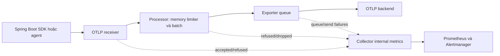

# Thiết lập cảnh báo khi OpenTelemetry Collector gặp lỗi

OpenTelemetry Collector nằm giữa ứng dụng Spring Boot và hệ thống lưu trữ telemetry. Nếu Collector dừng, từ chối dữ liệu hoặc không gửi được dữ liệu đến backend, log, metric và trace có thể bị thiếu dù ứng dụng vẫn phục vụ request bình thường. Vì vậy, môi trường production cần giám sát chính Collector và từng chặng của pipeline, đồng thời cảnh báo trước khi hàng đợi đầy hoặc dữ liệu bị loại bỏ.

Bài này thuộc chương **Vận hành production** của module **SPRING_BOOT_OBSERVABILITY**. Module hướng dẫn thiết lập observability cho Spring Boot bằng Micrometer Observation, metrics, logs và distributed tracing; bao gồm propagation ngữ cảnh, tag và cardinality, exporter, sampling và liên kết tín hiệu để điều tra lỗi, độ trễ và hành vi ứng dụng trên môi trường thực. Trọng tâm ở đây là phát hiện sự cố Collector, phân biệt lỗi tạm thời với mất dữ liệu và xây dựng quy trình xử lý cảnh báo.

## 1. Xác định điều gì cần được cảnh báo

Collector có thể gặp sự cố ở nhiều lớp: tiến trình dừng, receiver không nhận được dữ liệu, processor từ chối dữ liệu do thiếu tài nguyên, exporter không kết nối được backend hoặc hàng đợi gửi dữ liệu bị đầy. Một cảnh báo chung kiểu “Collector unhealthy” không đủ để xác định nguyên nhân và mức độ ảnh hưởng.

Hãy phân nhóm tín hiệu vận hành:

| Nhóm | Điều cần phát hiện | Hậu quả có thể xảy ra |
|---|---|---|
| Tính sẵn sàng | Collector không chạy hoặc không scrape được | Không có telemetry đi qua instance đó |
| Receiver | Receiver từ chối dữ liệu hoặc đột ngột không nhận traffic dự kiến | SDK/agent không chuyển được telemetry vào pipeline |
| Processor | Processor từ chối hoặc loại bỏ dữ liệu | Dữ liệu mất trước khi đến exporter |
| Exporter | Gửi thất bại, enqueue thất bại hoặc backend không phản hồi | Dữ liệu bị trì hoãn, hàng đợi tăng hoặc bị loại bỏ |
| Hàng đợi | Queue tiến gần dung lượng tối đa | Không còn chỗ cho dữ liệu mới nếu backend tiếp tục chậm |
| Tài nguyên | Bộ nhớ, CPU, file descriptor hoặc dung lượng lưu queue cạn | Collector bị throttling, restart hoặc mất dữ liệu |
| Đầu cuối | Dữ liệu kiểm thử không xuất hiện ở backend trong thời hạn | Pipeline có thể lỗi dù các tiến trình vẫn báo healthy |

Nên giám sát theo từng loại tín hiệu: traces, metrics và logs. Collector có thể gửi trace bình thường nhưng exporter metrics hoặc logs gặp lỗi riêng. Với kiến trúc agent Collector trên node và gateway Collector tập trung, cần thu thập trạng thái của cả hai tầng.

## 2. Giám sát Collector bằng chính telemetry của nó

Collector phát ra internal telemetry để mô tả hoạt động của receiver, processor, exporter và tiến trình. Hãy cấu hình một endpoint metrics dạng pull để Prometheus hoặc hệ thống giám sát độc lập scrape trực tiếp các chỉ số này.

Một số metric thường gặp với Collector Prometheus internal telemetry:

| Metric | Ý nghĩa | Cách sử dụng |
|---|---|---|
| `otelcol_receiver_accepted_spans` | Số span receiver đã chấp nhận | Xác nhận dữ liệu đang đi vào pipeline |
| `otelcol_receiver_refused_spans` | Số span receiver từ chối | Phát hiện dữ liệu không vào được Collector |
| `otelcol_processor_refused_spans` | Số span processor từ chối | Phát hiện backpressure hoặc giới hạn xử lý |
| `otelcol_exporter_sent_spans` | Số span exporter gửi thành công | Theo dõi lưu lượng ra khỏi Collector |
| `otelcol_exporter_send_failed_spans` | Số span trong các lần gửi thất bại | Phát hiện lỗi gửi đến backend; có thể được retry sau đó |
| `otelcol_exporter_enqueue_failed_spans` | Số span không enqueue được vào hàng đợi exporter | Dấu hiệu rõ ràng cho thấy dữ liệu không vào được queue để gửi |
| `otelcol_exporter_queue_size` | Số phần tử hiện có trong queue exporter | Theo dõi backlog |
| `otelcol_exporter_queue_capacity` | Dung lượng tối đa của queue exporter | Làm mẫu số để tính mức sử dụng queue |
| `otelcol_process_uptime` | Thời gian tiến trình Collector đã chạy | Phát hiện tiến trình khởi động lại hoặc chạy không ổn định |
| `otelcol_process_memory_rss` | Bộ nhớ resident của tiến trình | Theo dõi xu hướng sử dụng bộ nhớ |

Tên metric và nhãn có thể thay đổi theo phiên bản Collector, cấu hình mức chi tiết telemetry và loại exporter. Với metric, tên hậu tố thường dùng `metric_points`; với log thường dùng `log_records`, thay cho `spans`. Hãy mở endpoint metrics của đúng phiên bản đang chạy và xác nhận tên metric, đơn vị, nhãn trước khi triển khai alert rule.

### 2.1. Scrape internal telemetry độc lập

Collector cần bật internal metrics theo schema cấu hình của phiên bản đang sử dụng. Các bản Collector khác nhau có thể dùng cấu hình telemetry pull khác nhau, vì vậy hãy lấy ví dụ từ tài liệu đúng phiên bản thay vì sao chép một block `service.telemetry.metrics` cũ sang bản mới.

Prometheus nên scrape endpoint metrics này trực tiếp. Không gửi duy nhất internal metrics của Collector qua chính pipeline Collector đang được giám sát. Nếu pipeline hỏng, hệ thống có thể mất luôn tín hiệu báo rằng pipeline đang hỏng. Một Prometheus hoặc hệ thống giám sát độc lập giúp giữ được đường quan sát khi Collector gặp sự cố.

Chỉ bind endpoint metrics vào interface cần thiết và giới hạn quyền truy cập bằng network policy, firewall hoặc cơ chế bảo vệ phù hợp. Endpoint internal telemetry có thể tiết lộ tên component, exporter và trạng thái hạ tầng.

### 2.2. Health check không thay thế metrics

Có thể bật `health_check` extension để nền tảng kiểm tra tiến trình Collector:

```yaml
extensions:
  health_check:
    endpoint: 0.0.0.0:13133

service:
  extensions: [health_check]
```

Kubernetes hoặc load balancer có thể dùng endpoint này cho liveness/readiness theo cấu hình triển khai. Cần xác minh chính xác hành vi health check của phiên bản và extension đang dùng.

Health check chủ yếu phản ánh trạng thái của Collector theo cơ chế extension. Một tiến trình vẫn có thể trả lời health check trong khi exporter liên tục retry, queue tăng hoặc backend không nhận được dữ liệu. Do đó, hãy kết hợp probe với metrics receiver/exporter và một kiểm tra đầu cuối.

## 3. Đọc tín hiệu ở từng chặng pipeline

Một pipeline traces điển hình:



Ở mỗi chặng, hãy đặt câu hỏi khác nhau:

1. **Receiver:** Collector có nhận được dữ liệu từ SDK hoặc agent không? `accepted` tăng theo traffic dự kiến hay `refused` bắt đầu tăng?
2. **Processor:** memory limiter hoặc processor khác có từ chối dữ liệu không? CPU và bộ nhớ có tăng trước thời điểm lỗi không?
3. **Exporter:** backend có phản hồi không? `send_failed` tăng trong khi `sent` chững lại hay không?
4. **Queue:** queue có tăng liên tục và tiến gần capacity không? Queue có giảm sau khi backend phục hồi không?
5. **Backend:** telemetry mới có xuất hiện trong truy vấn hoặc giao diện backend không?

Nếu receiver accepted tăng nhưng exporter sent không tăng, hãy kiểm tra processor, exporter và queue. Nếu receiver accepted cũng bằng không, có thể ứng dụng không gửi dữ liệu, network đến Collector bị lỗi, receiver không lắng nghe hoặc đơn giản là không có traffic. Cần so sánh với lưu lượng ứng dụng và một canary để phân biệt các trường hợp này.

## 4. Xây dựng các alert rule cơ bản

Các ví dụ PromQL sau giả định Prometheus scrape Collector với `job="otel-collector"` và Collector xuất internal telemetry theo tên phổ biến. Điều chỉnh metric, label, cửa sổ và ngưỡng theo phiên bản, tải thực tế và SLO vận hành.

### 4.1. Collector không scrape được

```promql
up{job="otel-collector"} == 0
```

Quy tắc này phát hiện target đã được Prometheus biết đến nhưng lần scrape hiện tại thất bại. Nếu toàn bộ target biến mất khỏi service discovery, series `up` có thể biến mất thay vì có giá trị `0`; cần có thêm cảnh báo kiểm tra sự vắng mặt:

```promql
absent(up{job="otel-collector"})
```

Với hệ thống autoscaling, không nên giả định một số lượng replica cố định nếu số replica thay đổi hợp lệ. Hãy kiểm tra service discovery hoặc so sánh số target hiện có với số target mong đợi từ nền tảng triển khai.

### 4.2. Receiver từ chối dữ liệu

```promql
sum(rate(otelcol_receiver_refused_spans[5m])) > 0
```

Đây là dấu hiệu dữ liệu trace bị receiver từ chối. Với metrics và logs, thay hậu tố bằng metric tương ứng được xuất từ Collector, chẳng hạn `metric_points` hoặc `log_records` nếu phiên bản hỗ trợ. Điều tra nguyên nhân từ log Collector, giới hạn request, memory pressure, cấu hình receiver và trạng thái upstream.

### 4.3. Processor từ chối dữ liệu

```promql
sum(rate(otelcol_processor_refused_spans[5m])) > 0
```

Nếu metric này tăng, kiểm tra processor nào đang từ chối dữ liệu và tài nguyên tại thời điểm đó. Với `memory_limiter`, xem bộ nhớ RSS, giới hạn container, tốc độ nhận telemetry và cấu hình batch. Đừng chỉ tăng memory limit nếu container không có đủ memory limit ở cấp nền tảng; điều đó có thể khiến tiến trình bị OOM kill.

### 4.4. Exporter gửi thất bại kéo dài

```promql
sum(rate(otelcol_exporter_send_failed_spans[5m])) > 0
```

`send_failed` cho biết có dữ liệu trong các lần gửi thất bại. Exporter có thể retry và gửi thành công sau đó, vì vậy metric này biểu thị lỗi gửi hoặc độ bất ổn của backend, không tự động đồng nghĩa với toàn bộ số span đó đã mất. Dùng `for` để tránh cảnh báo vì một lần timeout ngắn, sau đó đối chiếu queue và enqueue failure để xác định có mất dữ liệu hay không.

### 4.5. Không enqueue được dữ liệu

```promql
sum(rate(otelcol_exporter_enqueue_failed_spans[5m])) > 0
```

Đây là tín hiệu nghiêm trọng vì dữ liệu không được đưa vào hàng đợi exporter. Kiểm tra queue capacity, tốc độ nhận, tốc độ gửi, backend và bộ nhớ. Nếu queue đầy liên tục, tăng queue capacity chỉ giúp trì hoãn thời điểm đầy; cần khôi phục backend, tăng năng lực gửi hoặc giảm tải có kiểm soát.

### 4.6. Queue tiến gần dung lượng tối đa

```promql
max(
  otelcol_exporter_queue_size
  /
  clamp_min(otelcol_exporter_queue_capacity, 1)
) > 0.8
```

Ngưỡng 80% chỉ là ví dụ ban đầu. Hãy xem xu hướng queue và thời gian cần để xử lý backlog trước khi chọn ngưỡng cảnh báo. Nếu queue capacity không được bật hoặc không xuất metric, biểu thức có thể không có dữ liệu; cần cấu hình queue và kiểm tra metric thực tế. Có thể thêm một alert mức critical khi queue gần đầy và duy trì trong một khoảng thời gian ngắn hơn.

### 4.7. Dữ liệu đầu vào đột ngột biến mất

```promql
sum(rate(otelcol_receiver_accepted_spans[10m])) == 0
```

Chỉ dùng cảnh báo này khi Collector được kỳ vọng luôn nhận trace. Một service ít traffic hoặc không có request vào ban đêm có thể hợp lệ khi không có span. Với production, một canary định kỳ gửi trace, metric hoặc log mẫu qua toàn bộ pipeline rồi kiểm tra dữ liệu xuất hiện ở backend thường đáng tin cậy hơn việc suy luận từ lưu lượng tự nhiên.

## 5. Ví dụ Prometheus alert rules

Có thể gom các rule cơ bản vào một group. Ví dụ dưới đây minh họa cách đặt thời gian duy trì và severity; ngưỡng cuối cùng cần được hiệu chỉnh theo tải production:

```yaml
groups:
  - name: otel-collector
    rules:
      - alert: OTelCollectorTargetDown
        expr: up{job="otel-collector"} == 0
        for: 2m
        labels:
          severity: critical
        annotations:
          summary: "OpenTelemetry Collector không scrape được"
          description: "Prometheus không scrape được Collector target trong ít nhất 2 phút."

      - alert: OTelCollectorExporterSendFailures
        expr: sum by (cluster, namespace) (rate(otelcol_exporter_send_failed_spans[5m])) > 0
        for: 5m
        labels:
          severity: warning
        annotations:
          summary: "Collector đang gặp lỗi gửi trace"
          description: "Exporter có các lần gửi span thất bại liên tục. Kiểm tra backend và queue."

      - alert: OTelCollectorExporterEnqueueFailures
        expr: sum by (cluster, namespace) (rate(otelcol_exporter_enqueue_failed_spans[5m])) > 0
        for: 1m
        labels:
          severity: critical
        annotations:
          summary: "Collector không enqueue được trace"
          description: "Một phần span không vào được exporter queue. Kiểm tra queue capacity và backend."

      - alert: OTelCollectorExporterQueueHigh
        expr: max by (cluster, namespace) (otelcol_exporter_queue_size / clamp_min(otelcol_exporter_queue_capacity, 1)) > 0.8
        for: 10m
        labels:
          severity: warning
        annotations:
          summary: "Exporter queue của Collector gần đầy"
          description: "Queue vượt 80% capacity trong 10 phút. Kiểm tra tốc độ gửi và trạng thái backend."
```

Các label `cluster` và `namespace` trong ví dụ phải tồn tại trong dữ liệu scrape hoặc được thêm bằng relabeling. Nếu không có, hãy bỏ chúng khỏi `sum by` hoặc thay bằng label thực tế. Một số metric không có nhãn giống nhau giữa các phiên bản hoặc loại exporter; xác minh trước khi áp dụng rule.

Các rule trên tập trung vào trace để dễ đọc. Trong hệ thống gửi cả ba tín hiệu, tạo rule tương ứng cho metric points và log records hoặc dùng recording rule chuẩn hóa để giảm lặp. Đừng gộp lỗi của mọi pipeline vào một alert nếu cần người trực xác định tín hiệu nào đang bị ảnh hưởng.

## 6. Chọn severity và tránh cảnh báo nhiễu

Không phải mọi lần gửi thất bại đều có cùng mức độ nghiêm trọng. Có thể bắt đầu với cách phân loại sau:

| Mức | Điều kiện ví dụ | Hành động |
|---|---|---|
| Critical | Collector không chạy ở toàn bộ replica cần thiết; receiver refused hoặc exporter enqueue failed tăng; queue đầy và dữ liệu bị mất | Đánh thức người trực, kiểm tra pipeline ngay và đánh giá phạm vi mất dữ liệu |
| Warning | Exporter send failed kéo dài nhưng queue còn chỗ; queue tăng; bộ nhớ hoặc CPU tiến gần giới hạn | Điều tra backend, network và xu hướng tải trước khi mất dữ liệu |
| Informational | Một lần retry ngắn, rollout có kế hoạch hoặc restart đã được kiểm soát | Ghi nhận trong dashboard hoặc sự kiện triển khai |

Để giảm alert noise:

- Dùng `for` phù hợp với độ dài của một lần retry hoặc dao động ngắn.
- Đặt ngưỡng theo tốc độ tăng queue và thời gian còn lại trước khi queue đầy, không chỉ theo một con số cố định.
- Group alert theo cluster, namespace, Collector và pipeline để một sự cố không tạo hàng trăm thông báo giống nhau.
- Dùng inhibition để hạ các cảnh báo phụ khi đã có cảnh báo gốc như Collector target down.
- Phân biệt sự cố một replica với sự cố toàn gateway; tránh gộp mất thông tin vị trí lỗi.
- Thêm link dashboard và runbook vào annotation để người trực có thể hành động ngay.

Nếu có nhiều Collector replica, alert `max` hoặc `sum` toàn cụm có thể che khuất một replica lỗi. Hãy giữ alert theo instance cho lỗi target và queue, đồng thời có dashboard tổng hợp theo cluster để nhìn sức khỏe toàn hệ thống.

## 7. Kiểm tra đầu cuối bằng canary telemetry

Internal metrics cho biết Collector đang hoạt động ở từng chặng, nhưng chúng không chứng minh dữ liệu đã được lưu và truy vấn thành công ở backend. Một canary giúp kiểm tra toàn bộ đường đi.

Một cách triển khai:

1. Tạo một workload hoặc job nhỏ gửi telemetry mẫu theo lịch, có thuộc tính nhận diện cố định như `service.name="observability-canary"` và môi trường production.
2. Gửi một span có tên dễ tìm, một metric có giá trị đã biết và một log record có timestamp cùng định danh canary.
3. Kiểm tra backend nhận được từng tín hiệu trong thời hạn, ví dụ 2 phút.
4. Xuất metric trạng thái canary như thời điểm kiểm tra thành công gần nhất hoặc số lần kiểm tra thất bại.
5. Cảnh báo khi canary không xuất hiện đúng hạn hoặc một loại tín hiệu bị thiếu.

Canary nên đi qua cùng receiver, processor, exporter và network path với telemetry production. Nếu canary dùng một pipeline riêng, nó có thể xanh trong khi pipeline thật đang lỗi. Dùng tên service và tag có cardinality thấp; không tạo ID ngẫu nhiên mới cho mỗi lần kiểm tra.

Canary kiểm tra khả năng chuyển và lưu telemetry, còn metric SLI của ứng dụng đo chất lượng request người dùng. Hai loại kiểm tra bổ sung cho nhau và không thay thế lẫn nhau.

## 8. Runbook khi cảnh báo Collector

Khi nhận cảnh báo, trước hết xác định tín hiệu nào bị ảnh hưởng, Collector nào và thời điểm bắt đầu. Sau đó lần theo pipeline theo thứ tự:

1. **Xác nhận phạm vi:** xem `up`, số replica, pod restart, rollout gần nhất và dashboard theo cluster/namespace. Kiểm tra agent Collector hay gateway Collector gặp lỗi.
2. **Kiểm tra tiến trình:** xem log Collector, exit code, OOMKilled, CPU throttling, memory RSS, file descriptor và probe health check.
3. **Kiểm tra receiver:** đối chiếu accepted/refused, trạng thái OTLP gRPC/HTTP, kết nối từ ứng dụng và network policy. Xác nhận upstream có gửi traffic hay không.
4. **Kiểm tra processor:** tìm log về memory limiter, batch, transform hoặc lỗi cấu hình; đối chiếu lượng dữ liệu nhận và tài nguyên.
5. **Kiểm tra exporter:** xác nhận endpoint backend, DNS, TLS certificate, credentials, quota, rate limit và trạng thái backend. Kiểm tra lỗi 4xx/5xx hoặc timeout trong log exporter.
6. **Kiểm tra queue:** xem queue size, capacity, tốc độ tăng và khả năng drain sau khi backend phục hồi. Nếu dùng persistent queue, kiểm tra extension lưu trữ, volume và dung lượng đĩa.
7. **Xác minh đầu cuối:** gửi hoặc chờ canary mới và truy vấn backend để xác nhận trace, metric và log đã xuất hiện trở lại.
8. **Đánh giá mất dữ liệu:** so sánh receiver accepted, exporter sent, enqueue failed, refused và thời gian canary bị gián đoạn; ghi nhận khoảng thời gian và pipeline bị ảnh hưởng.

Không xóa queue hoặc restart hàng loạt Collector trước khi xác định trạng thái backlog và cơ chế lưu trữ. Với queue trong bộ nhớ, restart có thể làm mất phần dữ liệu đang chờ gửi. Với persistent queue, thao tác xóa volume có thể xóa backlog đã lưu. Nếu cần thay đổi cấu hình, triển khai theo từng replica và theo dõi queue drain sau mỗi bước.

## 9. Khắc phục theo nguyên nhân thường gặp

| Nguyên nhân | Dấu hiệu | Hướng xử lý |
|---|---|---|
| Backend không truy cập được | `send_failed` tăng, queue tăng | Kiểm tra DNS, route mạng, TLS, credentials và trạng thái backend |
| Backend rate limit hoặc quá tải | Lỗi gửi lặp lại, queue tăng theo thời gian | Kiểm tra quota và giới hạn ingest; phối hợp điều chỉnh năng lực hoặc tốc độ gửi |
| Queue quá nhỏ | Queue nhanh chóng chạm capacity khi backend chậm | Tính lại capacity theo lưu lượng và thời gian gián đoạn dự kiến; kiểm tra bộ nhớ hoặc persistent storage |
| Collector thiếu memory | RSS tăng, processor refused, OOMKilled | Điều chỉnh batch, memory limiter, giới hạn container và số replica dựa trên tải đo được |
| Receiver quá tải | Receiver refused, CPU cao hoặc kết nối timeout | Kiểm tra kích thước request, số kết nối, năng lực CPU và topology agent/gateway |
| Cấu hình exporter sai | Lỗi khởi động hoặc lỗi kết nối liên tục | Xác minh endpoint, protocol, TLS, auth và tên pipeline |
| Scrape internal metrics thất bại | `up` bằng 0 nhưng Collector có thể vẫn xử lý dữ liệu | Kiểm tra địa chỉ bind, port, network policy và Prometheus service discovery |
| Canary không xuất hiện | Tiến trình có thể healthy nhưng backend thiếu dữ liệu | Kiểm tra toàn bộ đường đi và từng tín hiệu ở backend |

Nếu cần mở rộng Collector, hãy xác định bottleneck trước. Tăng replica gateway có thể giúp tăng năng lực xử lý, nhưng cần bảo đảm load balancing, queue và backend chịu được lưu lượng tăng. Với agent Collector, chú ý giới hạn tài nguyên trên từng node và tránh để nhiều agent cùng scrape hoặc xử lý trùng dữ liệu ngoài ý muốn.

## 10. Checklist trước khi đưa cảnh báo vào production

- [ ] Prometheus hoặc hệ thống giám sát độc lập scrape internal metrics của từng Collector.
- [ ] Metrics endpoint và health check được giới hạn truy cập phù hợp.
- [ ] Có cảnh báo Collector target down và target biến mất khỏi service discovery.
- [ ] Có cảnh báo receiver refused, processor refused và exporter enqueue failed cho từng tín hiệu cần giám sát.
- [ ] Có cảnh báo exporter send failure kéo dài và queue utilization cao.
- [ ] Có dashboard theo instance, pipeline, exporter và cluster.
- [ ] Metric name, label và đơn vị đã được xác minh với đúng phiên bản Collector.
- [ ] Ngưỡng `for`, severity, grouping và inhibition đã được thử nghiệm.
- [ ] Có canary kiểm tra dữ liệu thực sự xuất hiện ở backend.
- [ ] Runbook hướng dẫn kiểm tra receiver, processor, exporter, queue, backend và tài nguyên.
- [ ] Đã thử nghiệm tình huống backend mất kết nối, queue tăng và backend phục hồi.
- [ ] Đã xác định cách đánh giá backlog và mất dữ liệu sau sự cố.

Cảnh báo Collector hiệu quả cần kết hợp health check, internal metrics và kiểm tra đầu cuối. `send_failed` giúp phát hiện lỗi gửi, queue cho biết nguy cơ backlog, còn `enqueue_failed` và `refused` cảnh báo dữ liệu không đi tiếp được. Khi kết hợp các tín hiệu này với runbook rõ ràng, đội vận hành có thể phát hiện sớm sự cố telemetry và khôi phục đường quan sát trước khi mất khả năng điều tra hệ thống production.
