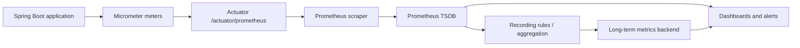

# Retention metrics

Metrics giúp đội vận hành theo dõi sức khỏe dịch vụ theo thời gian: request rate, tỷ lệ lỗi, độ trễ, mức sử dụng CPU, bộ nhớ và trạng thái các thành phần phụ thuộc. Tuy nhiên, một metric chỉ có giá trị khi dữ liệu của nó được lưu đủ lâu để trả lời câu hỏi vận hành. Nếu dữ liệu bị xóa trước khi cửa sổ SLO kết thúc, nhóm không thể tính chính xác tỷ lệ đạt SLO trong toàn bộ kỳ. Nếu giữ mọi chuỗi thời gian ở độ phân giải cao vô thời hạn, chi phí lưu trữ và truy vấn sẽ tăng nhanh.

Retention metrics là chính sách xác định dữ liệu metrics được giữ trong bao lâu, ở độ phân giải nào và trong hệ thống nào. Với ứng dụng Spring Boot, cần phân biệt hai phần: ứng dụng tạo và xuất metrics qua Micrometer/Actuator; hệ thống thu thập hoặc lưu trữ như Prometheus hay một metrics backend quyết định thời gian giữ dữ liệu. Cấu hình trong ứng dụng ảnh hưởng trực tiếp đến số lượng và chất lượng time series, còn retention thường được đặt ở backend.

Sau bài học này, bạn có thể:

- Xác định thời gian lưu metrics dựa trên SLO, điều tra sự cố và nhu cầu phân tích.
- Ước lượng số samples từ số time series và scrape interval.
- Hiểu tác động của label cardinality, histogram và recording rules đến dung lượng.
- Cấu hình retention ở Prometheus hoặc backend lưu trữ tương ứng.
- Thiết kế các tầng dữ liệu raw và aggregate để cân bằng độ chi tiết với chi phí.
- Kiểm tra dữ liệu, dung lượng và khả năng truy vấn sau khi thay đổi retention policy.

## 1. Retention metrics nằm ở đâu trong kiến trúc?

Một luồng metrics điển hình của dịch vụ Spring Boot gồm các bước:



Spring Boot và Micrometer ghi nhận các meter như counter, gauge, timer và distribution summary. Nếu dùng Prometheus Registry, Actuator có thể xuất các meter ở định dạng Prometheus tại `/actuator/prometheus`. Prometheus scrape endpoint theo chu kỳ rồi ghi samples vào time-series database (TSDB). Backend có thể giữ dữ liệu cục bộ, chuyển dữ liệu sang remote storage hoặc dùng một nền tảng metrics khác.

Retention thuộc về nơi lưu dữ liệu. Ví dụ, thuộc tính `management.endpoints.web.exposure.include` quyết định endpoint Actuator nào được expose; nó không quy định Prometheus giữ samples trong bao lâu. Tương tự, `management.metrics.distribution.*` điều chỉnh cách meter phân phối dữ liệu hoặc tạo histogram, chứ không đặt thời hạn xóa dữ liệu ở TSDB.

Đừng nhầm retention của metrics với retention của logs hoặc traces. Log collector có thể xoay vòng file hoặc đặt lifecycle cho index; tracing backend có thể đặt thời hạn lưu span. Mỗi tín hiệu có định dạng, dung lượng và chính sách lưu trữ riêng. Việc cấu hình một hệ thống không tự động áp dụng cho hai hệ thống còn lại.

## 2. Chọn thời gian lưu theo mục đích vận hành

Không có một thời hạn đúng cho mọi hệ thống. Hãy bắt đầu từ câu hỏi mà dữ liệu cần trả lời:

| Nhu cầu | Dữ liệu cần có | Điều cần cân nhắc |
|---|---|---|
| Theo dõi sự cố vừa xảy ra | Metrics độ phân giải cao trong vài ngày hoặc vài tuần gần nhất | Cần đủ chi tiết để xem spike, deploy và thay đổi lưu lượng |
| Đánh giá SLO theo tháng | Dữ liệu bao phủ toàn bộ cửa sổ SLO và khoảng đệm | Retention phải dài hơn cửa sổ truy vấn và thời gian điều tra trễ |
| So sánh xu hướng theo quý/năm | Dữ liệu aggregate theo phút, giờ hoặc ngày | Có thể giảm độ phân giải sau khi tổng hợp |
| Phân tích mùa vụ và tăng trưởng | Chuỗi aggregate ổn định trong nhiều tháng | Giữ các chiều phân tích hữu ích, tránh label biến thiên cao |
| Điều tra sự cố kéo dài | Raw metrics và các bản tổng hợp trước/sau sự cố | Cần tính cả thời gian phát hiện, phản hồi và hậu kiểm |

Ví dụ, nếu SLO được đánh giá theo cửa sổ 30 ngày, chỉ giữ raw metrics trong 14 ngày sẽ khiến truy vấn trực tiếp trên dữ liệu raw không còn đủ samples cho toàn bộ cửa sổ. Có thể giải quyết bằng cách tăng thời hạn raw hoặc tạo recording rules/aggregate phù hợp và giữ kết quả đủ lâu. Bản aggregate phải giữ đúng ngữ nghĩa của phép tính SLO; không phải phép trung bình đơn giản nào cũng có thể thay thế dữ liệu gốc.

Một chính sách minh họa cho dịch vụ web có thể giữ raw metrics 15 ngày, dữ liệu tổng hợp theo 5 phút trong 90 ngày và dữ liệu tổng hợp theo giờ trong 13 tháng. Đây chỉ là ví dụ để thảo luận với đội vận hành. Thời hạn thực tế phụ thuộc vào quy định tổ chức, chi phí backend, mục tiêu phân tích và khả năng tái tạo dữ liệu. Lưu ý rằng retention của Prometheus local TSDB thường áp dụng chung cho các block trong cùng TSDB, không tự đặt thời hạn khác nhau cho từng metric hoặc recording rule. Muốn giữ từng tầng với thời hạn riêng, cần dùng backend/tenant riêng hoặc nền tảng long-term storage có hỗ trợ chính sách theo tầng.

Trước khi chốt thời hạn, hãy trả lời các câu hỏi sau:

- Cửa sổ SLI/SLO dài nhất là bao lâu? Dashboard hoặc báo cáo nào cần truy vấn dài hơn?
- Sau khi cảnh báo xuất hiện, nhóm thường mất bao lâu để bắt đầu và hoàn tất điều tra?
- Có cần so sánh cùng kỳ tuần trước, tháng trước hoặc năm trước không?
- Backend có hỗ trợ downsampling hoặc recording rules không? Phép tổng hợp có giữ được thông tin cần thiết không?
- Dữ liệu có chứa thông tin nhạy cảm hoặc chịu chính sách lưu trữ riêng không?
- Ai sở hữu retention policy và ai chịu trách nhiệm khi dung lượng gần chạm giới hạn?

## 3. Ước lượng dung lượng từ time series và scrape interval

Một time series được nhận diện bởi tên metric và tập label của nó. Mỗi tổ hợp label khác nhau có thể tạo một series riêng. Prometheus scrape một sample cho mỗi series trong mỗi lần scrape mà series đó hiện diện.

Ước lượng số samples theo công thức:

\[
\text{samples} \approx \text{active series} \times
\frac{86\,400}{\text{scrape interval (seconds)}} \times
\text{retention days}
\]

Ví dụ, backend có 100.000 active series, scrape mỗi 15 giây và giữ dữ liệu 30 ngày:

\[
100\,000 \times \frac{86\,400}{15} \times 30
= 17.280.000.000\text{ samples}
\]

Đây là ước lượng số samples trước khi tính đến series xuất hiện không liên tục, scrape thất bại, recording rules và những thay đổi trong tập label. Nó cho thấy tác động của cardinality và scrape interval: tăng số series gấp đôi hoặc giảm scrape interval một nửa có thể làm lượng samples tăng xấp xỉ gấp đôi.

Không thể chuyển số samples thành dung lượng byte bằng một hằng số chính xác cho mọi backend. Kích thước thực tế phụ thuộc vào cách mã hóa và nén chunks, độ dài label, index, WAL, block compaction, số lượng series thay đổi theo thời gian và các bản sao HA. Hãy dùng số liệu thực tế của backend để dự báo, sau đó chừa headroom cho tăng trưởng và quá trình compaction.

### Cardinality thường là yếu tố quyết định

Giả sử một metric request có các label `method`, `status` và `uri`. Nếu `uri` được chuẩn hóa thành route như `/orders/{id}`, số giá trị thường giới hạn. Nếu đưa URL thực chứa order ID vào label, mỗi request có thể tạo thêm một series. Những label nguy hiểm thường là:

- ID người dùng, ID đơn hàng, session ID hoặc request ID.
- URL đầy đủ có path parameter hoặc query string biến thiên.
- Email, địa chỉ IP client, nội dung tìm kiếm hoặc giá trị tự do.
- Exception message chứa dữ liệu thay đổi theo từng request.

Trong metrics, ưu tiên label có tập giá trị nhỏ và ổn định như HTTP method, status code, service, environment hoặc route đã chuẩn hóa. Dữ liệu cần định danh từng request nên nằm trong logs hoặc traces, nơi có cơ chế truy vấn và retention riêng.

### Histogram làm tăng số series

Timer và distribution summary có thể xuất histogram để backend tính quantile từ các bucket. Với classic Prometheus histogram, mỗi tổ hợp label của meter tạo nhiều series bucket, cộng thêm các series `_sum` và `_count`. Số bucket càng nhiều, số series càng tăng. Nếu một meter đã có cardinality lớn, bật histogram có thể làm dung lượng tăng đáng kể.

Ví dụ cấu hình Spring Boot có thể bật histogram và các bucket SLO cho HTTP server request:

```yaml
management:
  metrics:
    distribution:
      percentiles-histogram:
        http.server.requests: true
      slo:
        http.server.requests: 100ms,250ms,500ms,1s
```

Tên meter và khả năng cấu hình chi tiết phụ thuộc phiên bản Spring Boot/Micrometer và registry được dùng. Hãy kiểm tra meter thực tế tại `/actuator/metrics` hoặc `/actuator/prometheus`. Trước khi bật histogram diện rộng, xác định câu hỏi latency cần trả lời, số bucket cần thiết và tác động lên active series. Với Prometheus histogram, có thể tính quantile tổng hợp từ bucket; client-side percentile đã tính sẵn thường không thể cộng gộp chính xác giữa nhiều instance.

## 4. Cấu hình retention trong Prometheus

Prometheus lưu samples vào TSDB cục bộ. Thời gian lưu được cấu hình ở tiến trình Prometheus, thường qua command-line flags hoặc cấu hình triển khai của container/Helm chart.

Ví dụ khởi chạy Prometheus với thời hạn 15 ngày và giới hạn kích thước TSDB blocks 40 GB:

```bash
prometheus \
  --config.file=/etc/prometheus/prometheus.yml \
  --storage.tsdb.path=/prometheus \
  --storage.tsdb.retention.time=15d \
  --storage.tsdb.retention.size=40GB
```

Hai giới hạn trên là ví dụ minh họa. Khi đặt cả thời gian và kích thước, giới hạn nào khiến dữ liệu cũ phải bị xóa trước sẽ quyết định việc dọn block. Vì vậy, cấu hình `retention.time=30d` không bảo đảm luôn giữ đủ 30 ngày nếu giới hạn dung lượng đã chạm trước.

Giới hạn `retention.size` không nên được xem là hạn mức tuyệt đối cho toàn bộ dung lượng filesystem. WAL, dữ liệu head, compaction và overhead khác vẫn cần dung lượng. Hãy cấp persistent volume có headroom, theo dõi dung lượng đĩa và kiểm tra hành vi của đúng phiên bản Prometheus đang triển khai. Không đặt giới hạn sát dung lượng volume vì có thể khiến hệ thống chạm ngưỡng trước khi có thời gian xử lý.

Một cấu hình scrape cơ bản cho ứng dụng Spring Boot có thể như sau:

```yaml
global:
  scrape_interval: 15s

scrape_configs:
  - job_name: spring-boot
    metrics_path: /actuator/prometheus
    static_configs:
      - targets:
          - observability-demo:8080
```

Đoạn cấu hình này quyết định Prometheus lấy dữ liệu từ đâu và theo chu kỳ nào. Nó không thay đổi retention. Endpoint Actuator nên được đặt trong mạng quản trị hoặc được bảo vệ bằng cơ chế xác thực và network policy phù hợp; không mở endpoint quản trị ra Internet chỉ để Prometheus scrape.

Nếu dùng `remote_write`, Prometheus gửi samples sang hệ thống lưu trữ từ xa. `remote_write` chỉ là cơ chế chuyển dữ liệu; retention dài hạn được quyết định bởi backend nhận dữ liệu và chính sách của backend đó. Cần kiểm tra cả hàng đợi remote write, tình trạng gửi lỗi và retention ở đích. Cấu hình retention của Prometheus local không tự động áp dụng cho dữ liệu đã được chuyển sang remote storage.

## 5. Giữ dữ liệu dài hạn bằng recording rules và downsampling

Giữ toàn bộ raw series ở độ phân giải 15 giây trong một năm thường tốn kém và không cần thiết cho mọi câu hỏi. Một cách phổ biến là giữ raw metrics trong thời gian ngắn, tạo series tổng hợp cho truy vấn dài hạn và lưu aggregate lâu hơn.

Ví dụ recording rule tính request rate theo ứng dụng và môi trường:

```yaml
groups:
  - name: service-rollups
    interval: 1m
    rules:
      - record: application_environment:http_requests:rate5m
        expr: |
          sum by (application, environment) (
            rate(http_server_requests_seconds_count[5m])
          )
```

Tên metric và label trong biểu thức phải khớp với dữ liệu thực tế của registry. Micrometer Prometheus thường chuẩn hóa tên timer thành dạng có đơn vị và hậu tố `_count`, nhưng cần xác nhận trên endpoint của ứng dụng trước khi triển khai rule. Recording rule tạo thêm time series mới; nó không tự xóa series gốc và cũng không tự đặt retention riêng.

Khi tổng hợp, chọn các chiều cần giữ cho câu hỏi tương lai. Ví dụ, giữ `application` và `environment` có thể đủ để xem xu hướng tổng thể, nhưng bỏ `status` sẽ khiến aggregate đó không thể trả lời câu hỏi phân chia request thành công và lỗi. Nếu cần phân tích latency theo route hoặc status, hãy giữ các chiều đó trong aggregate phù hợp và kiểm soát số giá trị của chúng.

Downsampling có thể giảm số điểm dữ liệu bằng cách chuyển dữ liệu raw thành khoảng thời gian lớn hơn, chẳng hạn từ 15 giây sang 5 phút hoặc 1 giờ. Tuy nhiên, cách tổng hợp phải phù hợp với loại metric:

- Counter: dùng rate/increase trên cửa sổ thời gian trước khi tổng hợp; không lấy trung bình trực tiếp các giá trị counter tích lũy.
- Gauge: chọn phép tổng hợp theo ý nghĩa, ví dụ average, min, max hoặc last value. Average có thể che mất spike ngắn, vì vậy đôi khi cần lưu cả min/max.
- Timer/histogram: giữ bucket hoặc aggregate đủ để tính quantile cần thiết. Trung bình của các p95 không tương đương p95 của toàn bộ request.
- SLO/error ratio: tổng hợp numerator và denominator riêng, sau đó tính tỷ lệ; tránh lấy trung bình các tỷ lệ có trọng số khác nhau.

Prometheus recording rules chỉ tạo thêm chuỗi đã tính toán trong cùng hệ thống. Việc tự động downsample block hoặc lưu lâu dài thường cần tính năng của backend/long-term storage. Hãy đọc chính sách retention và downsampling của nền tảng đang dùng thay vì giả định Prometheus local TSDB tự tạo các tầng dữ liệu.

## 6. Liên hệ retention với SLI và SLO

Retention phải bao phủ mọi cửa sổ truy vấn mà nhóm cam kết theo dõi. Nếu SLO availability dùng cửa sổ 30 ngày, hệ thống cần dữ liệu đủ để tính tỷ lệ thành công và tổng request trong 30 ngày. Với histogram latency, cần giữ bucket phù hợp để đánh giá tỷ lệ request đáp ứng ngưỡng thời gian.

Ví dụ, nếu SLO yêu cầu 99,9% request hoàn thành dưới 500 ms, một cách biểu diễn là đếm số request trong các bucket không vượt quá 500 ms so với tổng số request. Khi dùng histogram, các bucket và label cần được cấu hình nhất quán giữa các instance. Nếu chỉ lưu p95 đã tính tại từng instance rồi lấy trung bình, kết quả không đại diện chính xác cho p95 của toàn bộ lưu lượng.

Recording rule có thể lưu các đại lượng đã tổng hợp để truy vấn SLO dài hạn. Ví dụ, nếu histogram có bucket 500 ms, có thể lưu tỷ lệ request hoàn thành trong ngưỡng đó:

```yaml
groups:
  - name: slo-rollups
    interval: 1m
    rules:
      - record: application_environment:http_requests_under_500ms:ratio_rate5m
        expr: |
          sum by (application, environment) (
            rate(http_server_requests_seconds_bucket{le="0.5"}[5m])
          )
          /
          sum by (application, environment) (
            rate(http_server_requests_seconds_count[5m])
          )
```

Biểu thức trên giả định meter có bucket `le="0.5"` (500 ms), label `application` và `environment`, đồng thời có request trong cửa sổ tính toán. Đây là ví dụ về latency SLI, chưa phải phép tính SLO hoàn chỉnh cho mọi dịch vụ. Để tính availability, cần phân loại request tốt/xấu theo định nghĩa SLI của dịch vụ và giữ cả hai đại lượng. Định nghĩa SLI phải được thống nhất trước khi chọn aggregate và retention.

Nếu dữ liệu raw bị xóa sau 15 ngày nhưng SLO cần 30 ngày, hãy kiểm tra rằng aggregate đã được tạo liên tục và có đủ 30 ngày dữ liệu trước khi giảm raw retention. Không nên đổi retention rồi mới phát hiện recording rule thiếu dữ liệu hoặc bị lỗi trong một khoảng thời gian.

## 7. Thiết kế chính sách lưu trữ theo tầng

Một mô hình nhiều tầng thường cân bằng được khả năng điều tra và chi phí:

| Tầng | Độ phân giải gợi ý | Thời hạn minh họa | Mục đích |
|---|---|---|---|
| Raw | Theo scrape interval, ví dụ 15 giây | 7–30 ngày | Điều tra spike, deploy và sự cố gần đây |
| Short aggregate | 1–5 phút | 30–90 ngày | Dashboard vận hành và SLO theo tháng |
| Long aggregate | 1 giờ hoặc 1 ngày | 6–13 tháng | Xu hướng, mùa vụ và capacity planning |

Đây là các khoảng tham khảo, không phải mặc định của Spring Boot hoặc Prometheus. Nền tảng có thể cung cấp downsampling tự động, recording rules hoặc retention theo tenant. Cần xác định rõ tầng nào là nguồn dữ liệu chính cho dashboard, alert và báo cáo để tránh kết quả khác nhau do truy vấn các độ phân giải khác nhau.

Khi thiết kế nhiều tầng:

1. Liệt kê dashboard, alert, SLI/SLO và báo cáo đang dùng; ghi lại cửa sổ truy vấn dài nhất.
2. Phân loại metric nào cần raw lâu, metric nào có thể tổng hợp sớm.
3. Xác định label cần giữ trong aggregate và loại bỏ chiều không phục vụ truy vấn.
4. Tạo recording rule hoặc cấu hình downsampling, rồi kiểm tra kết quả trong khoảng thời gian đủ dài.
5. Chỉ giảm raw retention sau khi xác nhận tầng aggregate có dữ liệu liên tục và phép tính đúng.
6. Theo dõi chi phí, query latency và dung lượng để điều chỉnh chính sách.

Không nên giữ mọi metric lâu chỉ vì backend cho phép. Cũng không nên xóa quá sớm các series phục vụ điều tra lỗi hiếm, kiểm toán vận hành hoặc đánh giá SLO. Chính sách tốt cần có chủ sở hữu, mục đích và tiêu chí xem xét lại.

## 8. Bảo vệ dữ liệu và quản trị vòng đời

Metrics thường được xem là dữ liệu tổng hợp, nhưng label vẫn có thể chứa dữ liệu nhạy cảm nếu thiết kế sai. Không ghi email, số điện thoại, token, session ID hoặc định danh cá nhân vào label. Retention ngắn không thay thế việc giảm thiểu dữ liệu nhạy cảm ngay từ nguồn.

Hãy xác định ai có quyền truy vấn metrics, ai được sửa retention policy và ai có quyền xóa dữ liệu. Với hệ thống multi-tenant, cần kiểm tra chính sách retention theo tenant nếu backend hỗ trợ. Với dữ liệu phải tuân thủ quy định nội bộ hoặc pháp luật, phối hợp với chủ sở hữu dữ liệu để xác định thời hạn lưu, xóa và audit trail.

Retention không phải backup. Nếu TSDB mất volume, việc đặt retention 30 ngày không giúp khôi phục dữ liệu. Nếu yêu cầu khôi phục metrics quan trọng, cần có chiến lược backup hoặc remote storage phù hợp và kiểm tra khả năng phục hồi. Ngược lại, backup quá lâu có thể giữ lại dữ liệu đã hết hạn theo policy; vòng đời backup cần được đồng bộ với chính sách lưu trữ dữ liệu.

## 9. Kiểm tra retention và sức khỏe backend

Trước khi thay đổi policy, ghi lại trạng thái hiện tại: active series, số samples ingest, dung lượng TSDB, tốc độ tăng trưởng và thời gian truy vấn dashboard. Sau khi thay đổi, theo dõi cùng các chỉ số đó trong vài chu kỳ compaction và scrape.

Với Prometheus, có thể kiểm tra các metrics nội bộ nếu phiên bản đang chạy cung cấp, ví dụ:

- `prometheus_tsdb_head_series`: số series hiện có trong head block.
- `prometheus_tsdb_head_samples_appended_total`: tổng số samples được thêm vào head.
- Các metrics dung lượng WAL, block, compaction và remote write do phiên bản/backend cung cấp.

Các tên metrics nội bộ có thể thay đổi theo phiên bản. Hãy kiểm tra `/metrics` của chính Prometheus thay vì giả định mọi tên đều có mặt. Ngoài metrics, kiểm tra dung lượng filesystem, trạng thái PVC, log compaction và lỗi remote write.

Một quy trình kiểm tra thực tế:

1. Xác minh Prometheus đang scrape đúng endpoint Spring Boot và sample mới tiếp tục xuất hiện.
2. Kiểm tra dashboard truy vấn khoảng thời gian ngắn, sau đó truy vấn cửa sổ SLO dài nhất.
3. Kiểm tra recording rules có trạng thái hoạt động và kết quả aggregate được cập nhật liên tục.
4. Đối chiếu số series và dung lượng trước/sau khi bật histogram hoặc thêm label.
5. Kiểm tra disk usage và cảnh báo dung lượng còn lại, kể cả WAL và head data.
6. Nếu dùng remote write, kiểm tra hàng đợi, lỗi gửi và dữ liệu đã xuất hiện ở backend đích.
7. Kiểm tra một khoảng thời gian cũ hơn retention để xác nhận hành vi truy vấn đúng như policy đã công bố.

Đừng dùng một truy vấn trả về rỗng làm bằng chứng duy nhất rằng retention đã hoạt động. Kết quả rỗng cũng có thể do sai label, metric name, timezone, scrape gián đoạn hoặc query sai. Đối chiếu thời điểm sample cuối, metadata backend và log của hệ thống lưu trữ.

## 10. Lỗi thường gặp

| Hiện tượng | Nguyên nhân có thể | Cách xử lý |
|---|---|---|
| Không truy vấn được dữ liệu cũ | Retention đã xóa block hoặc backend đích có policy ngắn hơn | Kiểm tra policy ở cả local TSDB và remote backend; xác nhận thời hạn cần cho SLO |
| Dung lượng tăng nhanh dù retention không đổi | Active series tăng, label cardinality cao hoặc histogram có quá nhiều bucket | Kiểm tra series mới, chuẩn hóa label và giảm bucket không cần thiết |
| Prometheus xóa dữ liệu sớm hơn thời hạn mong muốn | Giới hạn retention size chạm trước retention time | Kiểm tra cả hai flags và tốc độ tăng dung lượng; tăng headroom hoặc giảm ingest |
| Đĩa đầy dù đã đặt retention size | WAL, head data, compaction và overhead chiếm thêm dung lượng | Theo dõi filesystem riêng, cấp volume có headroom và kiểm tra compaction |
| Dashboard dài hạn có khoảng trống | Recording rule mới triển khai, rule lỗi hoặc backend aggregate chưa nhận dữ liệu | Kiểm tra trạng thái rule và tính liên tục của samples trước khi giảm raw retention |
| SLO dài hạn sai sau khi downsample | Aggregate không giữ đúng numerator/denominator hoặc bucket cần thiết | Xác minh ngữ nghĩa phép tổng hợp và so sánh với dữ liệu raw còn tồn tại |
| Remote backend thiếu dữ liệu | Remote write bị lỗi, queue bị nghẽn hoặc đích từ chối samples | Kiểm tra trạng thái queue, log và dung lượng/backend quota |
| Số series tăng đột biến sau một lần phát hành | Thêm label có giá trị biến thiên hoặc route chưa chuẩn hóa | Xác định label mới, giới hạn tập giá trị và đánh giá tác động trước khi rollout rộng |

Một thay đổi metric có thể ảnh hưởng retention mà không hề sửa cấu hình lưu trữ. Ví dụ, thêm label `customerId` làm số series tăng mạnh; bật histogram cho nhiều meter làm số bucket tăng; tăng số instance cũng làm số series có label `instance` tăng. Vì vậy, review instrumentation và review retention phải đi cùng nhau.

## 11. Checklist trước khi đưa policy vào production

- Đã ghi lại cửa sổ SLO, dashboard và thời gian điều tra cần hỗ trợ.
- Đã phân biệt retention raw, aggregate và dữ liệu ở remote backend.
- Đã ước lượng active series, scrape interval, số bucket và tốc độ tăng trưởng.
- Label metrics có cardinality thấp và không chứa dữ liệu định danh nhạy cảm.
- Recording rules giữ đúng ngữ nghĩa của counter, gauge, histogram và SLI.
- Dung lượng volume có headroom cho WAL, head data và compaction.
- Đã kiểm tra remote write hoặc pipeline chuyển dữ liệu nếu có.
- Dashboard và alert đã được thử với các cửa sổ thời gian thực tế.
- Có chủ sở hữu policy, cảnh báo dung lượng và quy trình xem xét lại định kỳ.
- Có kế hoạch backup/restore nếu dữ liệu metrics cần được khôi phục.

Retention metrics là một phần của thiết kế observability production. Khi thời hạn lưu, độ phân giải và cardinality được quyết định dựa trên mục tiêu vận hành, đội ngũ có thể điều tra sự cố đủ sâu, đánh giá SLO chính xác và kiểm soát chi phí lưu trữ theo thời gian.
