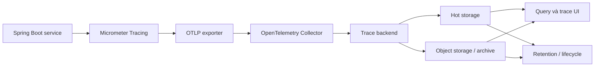
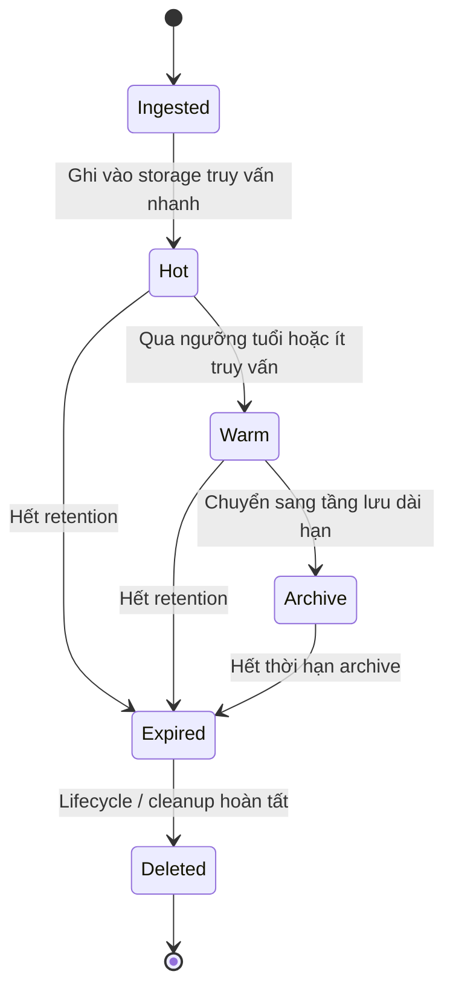

# Retention traces

Trong chương **Vận hành production** của module `SPRING_BOOT_OBSERVABILITY`, bài này giải thích cách thiết kế và vận hành chính sách lưu trữ distributed traces. Traces giúp lần theo một request qua nhiều service, xác định span gây chậm và liên kết lỗi với logs, metrics. Tuy nhiên, lưu mọi trace vô thời hạn làm tăng chi phí ingest, lưu trữ, lập chỉ mục và truy vấn. Retention xác định dữ liệu trace được giữ trong bao lâu trước khi backend loại bỏ nó.

Với Spring Boot, Micrometer Observation và Micrometer Tracing tạo ra ngữ cảnh quan sát và span; exporter gửi span tới OpenTelemetry Collector hoặc tracing backend. Chính sách retention thường được thực thi ở tầng lưu trữ trace, chẳng hạn backend hoặc object storage, chứ không phải chỉ bằng cách thay đổi cấu hình exporter trong ứng dụng. Vì vậy, cần hiểu toàn bộ đường đi từ ứng dụng đến nơi dữ liệu được lưu và xóa.

## 1. Retention traces là gì?

Một trace gồm nhiều span mô tả các bước xử lý của một request hoặc một công việc phân tán. Mỗi span thường chứa trace ID, span ID, parent span ID, thời điểm bắt đầu, thời lượng, trạng thái, tên operation, resource attributes và span attributes. Backend lưu những span đã nhận để hỗ trợ tìm kiếm, xem waterfall, phân tích lỗi và tương quan với các tín hiệu khác.

**Retention** là khoảng thời gian backend giữ dữ liệu trace có thể truy vấn. Khi hết thời hạn, backend thực hiện xóa hoặc đánh dấu dữ liệu hết hạn theo cơ chế của storage engine. Retention có thể được cấu hình chung, theo tenant, theo namespace hoặc theo nhóm dữ liệu tùy sản phẩm. Cách áp dụng chính xác phụ thuộc backend và tầng lưu trữ phía dưới.

Ví dụ, chính sách 14 ngày có nghĩa trace được giữ trong cửa sổ lưu trữ 14 ngày theo cách tính thời gian của backend. Một trace đã cũ hơn cửa sổ đó có thể không còn tìm kiếm được, kể cả khi ứng dụng vẫn gửi trace mới bình thường.

Retention cần được phân biệt với các khái niệm liên quan:

| Khái niệm | Quyết định điều gì? | Thời điểm tác động |
| --- | --- | --- |
| Sampling | Trace hoặc span nào được chọn để thu thập? | Trước hoặc trong quá trình tạo/tiếp nhận trace. |
| Filtering | Span hoặc thuộc tính nào bị loại theo điều kiện? | Trong instrumentation, Collector hoặc backend tùy kiến trúc. |
| Retention | Dữ liệu đã được nhận sẽ được giữ bao lâu? | Sau khi dữ liệu đi vào tầng lưu trữ. |
| Archiving | Dữ liệu cũ được chuyển sang tầng lưu trữ dài hạn nào? | Trong vòng đời lưu trữ. |
| Deletion | Dữ liệu nào phải bị xóa và khi nào? | Theo TTL, lifecycle hoặc quy trình xóa riêng. |

Sampling thấp không thay thế retention. Nếu hệ thống giữ 100% trace trong 30 ngày, dữ liệu vẫn có thể rất lớn. Ngược lại, retention 7 ngày không làm giảm số trace được ingest mỗi giây; nó giới hạn thời gian dữ liệu tồn tại trong storage.

## 2. Xác định nhu cầu lưu trữ trước khi đặt retention

Không có một thời hạn phù hợp cho mọi hệ thống. Hãy chọn retention dựa trên thời gian cần điều tra, tần suất sự cố, lưu lượng, chi phí và yêu cầu quản trị dữ liệu.

Các câu hỏi cần trả lời:

- Sự cố thường được phát hiện sau bao lâu kể từ khi bắt đầu xảy ra?
- Đội vận hành cần tra cứu trace trong bao nhiêu ngày sau khi phát hiện sự cố?
- Có yêu cầu điều tra incident, đối soát hoặc hỗ trợ khách hàng kéo dài hơn cửa sổ truy vấn thông thường không?
- Có thể lưu trace dài hạn ở tầng rẻ hơn rồi truy xuất khi cần không?
- Có tenant, môi trường hoặc nhóm service nào cần thời hạn khác nhau không?
- Backend có hỗ trợ retention riêng theo tenant, trace attribute hoặc storage class không?
- Việc xóa dữ liệu có cần đáp ứng yêu cầu về dữ liệu cá nhân, hợp đồng hoặc chính sách nội bộ không?

Một cách xác định thời hạn là lấy thời gian phát hiện sự cố lớn nhất dự kiến, cộng thời gian phân tích và một khoảng đệm. Ví dụ, nếu sự cố có thể được phát hiện muộn 5 ngày, nhóm cần thêm 4 ngày để điều tra và cần 2 ngày dự phòng, cửa sổ tra cứu tối thiểu nên khoảng 11 ngày. Sau đó làm tròn theo chu kỳ lifecycle mà backend hỗ trợ và kiểm tra chi phí thực tế.

Retention có thể khác nhau giữa production, staging và development. Production thường cần cửa sổ đủ dài để hỗ trợ điều tra incident; staging có thể ngắn hơn vì dữ liệu ít giá trị vận hành lâu dài. Tuy nhiên, không nên đặt production retention quá ngắn chỉ để giảm chi phí nếu điều đó khiến đội ngũ không thể điều tra lỗi được phát hiện muộn.

## 3. Tính dung lượng và chi phí trace

Chi phí lưu trữ phụ thuộc số span được ingest, kích thước trung bình, compression, indexing, replication và cách backend tổ chức block hoặc shard. Ước lượng ban đầu có thể dùng công thức:

\[
S_{raw/day} = N_{spans/day} \times B_{avg}
\]

Trong đó:

- `N_spans/day` là số span được backend nhận trong một ngày, sau sampling và filtering.
- `B_avg` là kích thước trung bình mỗi span trước khi tính compression và overhead của storage.

Ước lượng dung lượng lưu trữ:

\[
S_{stored} \approx S_{raw/day} \times D \times C \times R
\]

Trong đó `D` là số ngày retention, `C` là hệ số dung lượng sau compression và indexing, còn `R` là hệ số replication hoặc redundancy. Đây là mô hình ước lượng sơ bộ; `C` có thể nhỏ hơn hoặc lớn hơn 1 tùy cách tính overhead, và không thay thế số liệu thực đo từ backend.

Ví dụ giả định hệ thống nhận 20 triệu span/ngày, kích thước trung bình 700 byte/span và retention 14 ngày:

\[
20{,}000{,}000 \times 700 \times 14 = 196\,GB
\]

Đây là dung lượng dữ liệu thô xấp xỉ trước compression, index và replication. Dung lượng thực tế có thể khác đáng kể. Hãy dùng số liệu ingest và storage growth thực tế để hiệu chỉnh mô hình.

Ngoài storage, cần tính các khoản chi phí khác:

- Ingest và xử lý span ở Collector/backend.
- Indexing các thuộc tính dùng để tìm trace.
- Query CPU, cache và I/O khi mở trace hoặc tìm theo tag.
- Replication, backup và lưu trữ dự phòng.
- Egress khi truy xuất dữ liệu từ object storage hoặc archive.
- Chi phí vận hành lifecycle, compaction và deletion.

Tăng retention làm tăng dữ liệu tồn tại, nhưng chi phí không nhất thiết tăng tuyến tính nếu backend có compaction, compression hoặc tiered storage. Hãy đo storage growth theo ngày và kiểm tra chi phí index/query trước khi quyết định.

## 4. Retention nằm ở đâu trong kiến trúc observability?

Một luồng trace điển hình:



Ứng dụng tạo span và gửi qua exporter. Collector có thể batch, enrich, filter, sample hoặc route telemetry. Backend tiếp nhận dữ liệu và ghi vào storage. Retention thường được áp dụng trong backend hoặc storage lifecycle để xóa block, index, object hoặc record đã hết hạn.

Không nhầm các cơ chế sau:

- `batch` processor gom nhiều span thành batch để giảm overhead truyền dữ liệu; nó không quy định thời gian lưu trace.
- `memory_limiter` processor giới hạn bộ nhớ Collector; nó không phải chính sách retention.
- Retry queue hoặc persistent queue giúp chịu lỗi khi gửi dữ liệu; chúng không phải kho lưu trace dài hạn.
- Tail sampling quyết định giữ hay loại trace sau khi quan sát đủ các span theo chính sách; nó không tự đặt TTL cho trace đã lưu.
- TTL hoặc lifecycle ở backend/storage quyết định dữ liệu đã được lưu còn tồn tại bao lâu.

Nếu chỉ thay cấu hình Collector mà backend vẫn giữ dữ liệu vô thời hạn, retention chưa được giải quyết. Ngược lại, giảm retention ở backend không ngăn Collector nhận một lượng telemetry quá lớn trong giờ cao điểm.

## 5. Chọn chiến lược retention

Các chiến lược phổ biến gồm:

| Chiến lược | Cách hoạt động | Khi phù hợp |
| --- | --- | --- |
| Fixed retention | Giữ mọi trace trong cùng một thời hạn, ví dụ 7 hoặc 14 ngày. | Hệ thống có yêu cầu điều tra tương đối đồng nhất. |
| Retention theo tenant | Mỗi tenant có thời hạn hoặc quota riêng nếu backend hỗ trợ. | Nền tảng multi-tenant với yêu cầu và mức dịch vụ khác nhau. |
| Retention theo môi trường | Production giữ lâu hơn staging/development. | Có thể tách dữ liệu theo tenant, namespace hoặc storage policy. |
| Tiered retention | Dữ liệu mới nằm ở hot storage; dữ liệu cũ chuyển sang archive hoặc cold storage. | Cần lưu dài hạn nhưng ít truy vấn dữ liệu cũ. |
| Selective retention | Chỉ giữ lâu một số trace được đánh dấu theo chính sách backend. | Cần lưu trace lỗi hoặc giao dịch quan trọng lâu hơn. |

Selective retention có thể được triển khai bằng tail sampling trước khi ghi dữ liệu, hoặc bằng tính năng policy của backend. Hai cách có ý nghĩa khác nhau: tail sampling quyết định trace có được gửi vào storage hay không; backend retention policy quyết định dữ liệu đã lưu sẽ được giữ bao lâu. Hãy kiểm tra backend có thực sự hỗ trợ retention theo thuộc tính trước khi thiết kế chính sách dựa vào `service.name`, status hoặc span attribute.

## 6. Cấu hình retention ở tracing backend

Không có một property Spring Boot chung để đặt retention cho mọi tracing backend. Property `management.otlp.tracing.endpoint` chỉ định nơi gửi span; nó không điều khiển TTL của dữ liệu ở đích nhận. Retention phải được cấu hình theo backend đang sử dụng.

### 6.1. Backend dùng block storage và object storage

Một số backend ghi trace thành block trên object storage rồi chạy compactor hoặc lifecycle job để loại bỏ block quá hạn. Khi cấu hình, cần xác định:

- Thời hạn block được giữ trước khi xóa.
- Chu kỳ compaction và thời điểm chạy cleanup.
- Bucket hoặc prefix chứa block nào thuộc tenant/environment nào.
- Cơ chế xử lý block đang được query hoặc chưa hoàn tất ghi.
- Lifecycle policy ở object storage có đồng bộ với retention của backend hay không.

Ví dụ khái niệm sau mô tả một policy 14 ngày, không phải file cấu hình có thể dùng nguyên trạng cho mọi sản phẩm:

```yaml
trace_storage:
  retention: 14d
  cleanup_interval: 1h
  archive:
    enabled: false
```

Tên key, đơn vị, mặc định và phạm vi áp dụng phải lấy từ tài liệu của backend cùng phiên bản đang chạy. Nếu object storage có lifecycle rule xóa object sớm hơn backend, query có thể lỗi dù metadata vẫn còn. Nếu backend đã xóa metadata nhưng object cũ chưa bị lifecycle dọn, chi phí lưu trữ vẫn tiếp tục phát sinh.

### 6.2. Backend dùng Elasticsearch hoặc OpenSearch

Với backend lưu span vào Elasticsearch/OpenSearch, retention thường được thực hiện bằng index lifecycle hoặc index state management policy. Một quy trình phổ biến là rollover index theo tuổi hoặc dung lượng, sau đó xóa index đã vượt thời hạn.

Các bước thiết kế:

1. Xác định index pattern chứa span và cách backend đặt tên index.
2. Đặt điều kiện rollover theo kích thước hoặc thời gian để tránh index quá lớn.
3. Gắn lifecycle policy vào đúng index template hoặc index pattern.
4. Đặt thời gian chuyển tier nếu có warm/cold storage.
5. Đặt thời gian xóa cuối cùng theo retention đã duyệt.
6. Kiểm tra policy đã được gắn vào index mới và index cũ hay chưa.

Không áp dụng policy xóa cho toàn bộ cluster hoặc index pattern dùng chung nếu chưa xác minh phạm vi. Index có thể chứa nhiều loại dữ liệu; xóa nhầm có thể ảnh hưởng logs, metrics hoặc dữ liệu nghiệp vụ. Hãy kiểm tra mapping, alias, template và index lifecycle status trước khi thay đổi.

### 6.3. Backend dùng Cassandra hoặc database TTL

Một số storage backend có thể sử dụng TTL ở cấp record hoặc table. Với mô hình này, cần xác định TTL được đặt khi ghi hay qua cấu hình backend, cách TTL lan tới dữ liệu phụ trợ và độ trễ thực tế trước khi dữ liệu được compact hoặc giải phóng dung lượng.

TTL hết hạn không nhất thiết đồng nghĩa dung lượng đĩa được thu hồi ngay lập tức. Database có thể đánh dấu dữ liệu hết hạn trước, sau đó compaction mới giải phóng storage. Cần theo dõi cả số record hết hạn và dung lượng thực tế.

## 7. Tail sampling và retention phối hợp với nhau

Tail sampling là cách chọn trace dựa trên thông tin thu được sau khi các span đã đến Collector hoặc sampling tier. Ví dụ, có thể ưu tiên giữ trace có status lỗi, duration cao hoặc thuộc service quan trọng. Điều này giúp tăng tỷ lệ giữ các trace có giá trị điều tra mà không cần lưu mọi trace.

Quy trình khái quát:

1. Các service tạo span và truyền cùng trace context.
2. Collector nhận các span của trace trong một khoảng chờ.
3. Tail sampling đánh giá điều kiện như error status hoặc latency.
4. Trace được chọn sẽ tiếp tục tới backend; trace không được chọn bị loại.
5. Backend lưu trace được nhận theo retention policy.

Tail sampling cần cấu hình routing để các span thuộc cùng trace đến cùng một sampling decision point, thường thông qua load balancing theo trace ID. Nếu span của một trace bị chia sang nhiều Collector độc lập, quyết định sampling có thể thiếu dữ liệu hoặc tạo trace không đầy đủ. Tham số chờ quyết định phải đủ cho độ trễ đến của span nhưng cũng cần giới hạn memory và số trace đồng thời.

Head sampling ở ứng dụng đưa ra quyết định sớm. Khi trace bị loại ở head sampler, backend không nhận được các span đó để tail sampling hoặc retention xử lý. Không thể khôi phục trace đã bị loại chỉ bằng cách tăng retention.

Một chính sách có thể giữ 10% trace thông thường và ưu tiên giữ trace lỗi hoặc chậm qua tail sampling, sau đó lưu tất cả trace được chọn trong 14 ngày. Đây chỉ là ví dụ về cách phối hợp hai quyết định; tỷ lệ và điều kiện thực tế cần dựa trên traffic, backend và ngân sách.

## 8. Retention theo tenant và môi trường

Nếu backend hỗ trợ multi-tenancy, retention riêng theo tenant có thể giúp đáp ứng các mức dịch vụ khác nhau. Tuy nhiên, cần bảo đảm tenant identity được truyền và xác thực ở lớp ingest, không chỉ dựa trên một span attribute do client tự gửi.

Với các môi trường khác nhau, có thể chọn chính sách như sau:

| Môi trường | Ví dụ retention | Mục đích |
| --- | --- | --- |
| Development | 1–3 ngày | Debug ngắn hạn và kiểm thử instrumentation. |
| Staging | 3–7 ngày | Kiểm tra release, performance và regression. |
| Production | 14–30 ngày | Điều tra incident và so sánh hành vi theo thời gian. |

Các khoảng trên chỉ là ví dụ khởi điểm, không phải chuẩn bắt buộc. Hãy điều chỉnh theo thời gian phát hiện sự cố, lưu lượng và chi phí. Nếu nhiều môi trường dùng chung backend hoặc bucket, hãy tách tenant, namespace, index pattern hoặc storage prefix để tránh policy của môi trường này tác động tới dữ liệu môi trường khác.

Đối với trace có dữ liệu nhạy cảm, không nên dựa vào retention dài hơn để thay thế kiểm soát dữ liệu. Hãy giảm thu thập thuộc tính không cần thiết, masking hoặc redaction trước khi lưu, giới hạn quyền query và định nghĩa quy trình xóa theo yêu cầu áp dụng. Việc xóa trong storage chính có thể chưa xóa ngay bản sao backup, cache, replica hoặc archive; cần hiểu vòng đời của tất cả bản sao.

## 9. Vận hành TTL, archive và xóa dữ liệu

Một chính sách retention production cần mô tả rõ các trạng thái trong vòng đời dữ liệu:



Nếu không cần archive, dữ liệu có thể chuyển trực tiếp từ hot hoặc warm sang expired. Nếu có archive, cần quyết định trace cũ có thể truy vấn trực tiếp hay phải restore trước, thời gian restore và chi phí egress.

Lưu ý các vấn đề vận hành:

- **Thời điểm bắt đầu tính TTL:** backend có thể tính từ thời gian span, thời gian ingest hoặc thời điểm tạo block/index. Trace đến trễ có thể bị xóa sớm hoặc tồn tại lâu hơn dự kiến tùy cách tính.
- **Độ trễ cleanup:** compactor, lifecycle job hoặc database compaction thường chạy theo chu kỳ. Dữ liệu có thể biến mất khỏi query trước hoặc sau thời điểm TTL danh nghĩa.
- **Backup và replica:** bản sao có thể giữ dữ liệu lâu hơn storage chính. Phải đưa backup retention vào cùng mô hình dữ liệu.
- **Restore:** khôi phục snapshot cũ có thể đưa dữ liệu đã hết hạn trở lại. Quy trình restore cần chạy lifecycle cleanup sau đó nếu yêu cầu retention vẫn áp dụng.
- **Xóa theo yêu cầu:** TTL định kỳ không đáp ứng ngay yêu cầu xóa một trace cụ thể. Cần biết backend có hỗ trợ xóa theo trace ID/tenant hay phải thực hiện quy trình riêng.
- **Đồng hồ hệ thống:** đồng bộ thời gian giữa ứng dụng, Collector và backend giúp xác định tuổi trace và đối chiếu sự cố chính xác.

Không nên hứa rằng dữ liệu được xóa chính xác tại giây TTL kết thúc nếu backend chỉ chạy cleanup theo chu kỳ. Hãy công bố thời hạn và độ trễ xóa thực tế dựa trên đặc tính của storage.

## 10. Theo dõi hiệu quả của retention

Sau khi áp dụng policy, theo dõi cả dữ liệu ingest, dung lượng lưu và hành vi cleanup. Các chỉ số hữu ích tùy backend gồm:

| Nhóm | Chỉ số cần theo dõi | Dấu hiệu cần điều tra |
| --- | --- | --- |
| Ingest | Spans/second, bytes/second, rejected spans | Tăng đột biến hoặc dữ liệu bị từ chối. |
| Storage | Dung lượng hot/warm/archive, số block/index, tăng trưởng theo ngày | Dung lượng tăng nhanh hơn dự báo dù retention không đổi. |
| Retention | Dữ liệu cũ nhất còn query được, số block/index đã hết hạn, cleanup lag | Trace quá hạn vẫn còn hoặc dữ liệu mới bị xóa sớm. |
| Query | Query latency, timeout, số trace không tìm thấy | Cleanup, compaction hoặc index policy ảnh hưởng truy vấn. |
| Collector | Queue size, export failures, dropped spans, memory | Collector quá tải trước khi dữ liệu tới storage. |

Nên kiểm tra một trace mẫu theo từng mốc tuổi: trace mới, trace gần ngưỡng retention và trace đã vượt ngưỡng. Ghi lại thời điểm ingest, thời điểm span xảy ra và thời điểm trace không còn truy vấn được. Điều này giúp xác định backend tính TTL theo thời điểm nào và cleanup trễ bao lâu.

Có thể kiểm tra retention bằng một trace thử có định danh rõ ràng trong môi trường kiểm thử:

1. Tạo request có trace ID có thể nhận diện.
2. Xác nhận trace đã đến backend và lưu timestamp ingest.
3. Đợi tới gần ngưỡng retention hoặc dùng môi trường test có thời hạn ngắn.
4. Truy vấn lại trace và xác minh hành vi hết hạn.
5. Kiểm tra object/index/record đã được lifecycle cleanup theo cơ chế backend.

Không giảm retention production xuống vài phút chỉ để thử nghiệm. Hãy dùng tenant hoặc môi trường test riêng với dữ liệu giả lập.

## 11. Quy trình thay đổi retention trong production

Một thay đổi retention có thể ảnh hưởng trực tiếp tới dữ liệu lịch sử và chi phí. Thực hiện theo trình tự có kiểm soát:

**Bước 1 — Xác định phạm vi.** Ghi rõ tenant, service, environment, index, bucket hoặc dataset sẽ chịu tác động. Xác nhận các loại dữ liệu khác có dùng chung storage không.

**Bước 2 — Ghi nhận baseline.** Thu thập ingest rate, storage growth, index size, query latency, cleanup lag và thời hạn retention hiện tại.

**Bước 3 — Đánh giá thời gian điều tra.** Đối chiếu retention mới với thời gian phát hiện incident, thời gian phân tích và yêu cầu lưu trữ dài hạn. Nếu cần giữ lâu nhưng ít truy vấn, xem xét archive thay vì kéo dài hot retention.

**Bước 4 — Kiểm tra policy ở môi trường test.** Xác minh policy gắn đúng index/bucket/tenant, thời gian bắt đầu tính TTL và hành vi cleanup. Kiểm tra cả dữ liệu cũ lẫn dữ liệu mới.

**Bước 5 — Triển khai có kiểm soát.** Thay đổi policy theo quy trình release của backend. Theo dõi log compactor/lifecycle, lỗi query và storage trong thời gian đầu.

**Bước 6 — Xác minh kết quả.** Tạo hoặc chọn trace kiểm thử, kiểm tra cửa sổ query và xác nhận dữ liệu ngoài thời hạn được xử lý đúng. Đối chiếu storage growth với dự báo.

**Bước 7 — Ghi lại policy và rollback.** Lưu lại thời hạn, phạm vi, người sở hữu, ngày hiệu lực và cách phục hồi. Lưu ý rằng tăng retention trở lại không thể khôi phục dữ liệu đã bị xóa; chỉ có thể phục hồi nếu còn backup/archive phù hợp.

## 12. Lỗi thường gặp khi cấu hình retention

| Triệu chứng | Nguyên nhân có thể | Cách xử lý |
| --- | --- | --- |
| Trace biến mất sớm hơn dự kiến | TTL tính từ ingest hoặc span timestamp khác với giả định; policy gắn sai tenant/index. | Xác minh cách backend tính tuổi, thời điểm ingest và policy thực tế. |
| Trace cũ vẫn tìm thấy sau TTL | Cleanup chạy theo chu kỳ, index chưa rollover hoặc object lifecycle chưa chạy. | Kiểm tra compactor, lifecycle job, alias/template và cleanup lag. |
| Storage không giảm dù trace đã hết hạn | Database chưa compaction, object còn bản sao, index/backup khác vẫn tồn tại. | Kiểm tra physical storage, replica, snapshot và archive. |
| Trace bị thiếu span | Sampling, filtering, Collector routing hoặc export failure. | Kiểm tra sampling decision, load balancing theo trace ID, queue và exporter logs. |
| Trace không còn query được nhưng bucket vẫn lớn | Metadata đã hết hạn nhưng object chưa được lifecycle xóa. | Đồng bộ retention backend với object storage lifecycle. |
| Policy xóa nhầm dữ liệu khác | Index pattern, bucket prefix hoặc tenant selector quá rộng. | Thu hẹp selector, xác minh tài nguyên trước khi áp dụng và kiểm thử policy. |
| Không tìm thấy trace trong thời gian incident | Cửa sổ retention ngắn hơn thời gian phát hiện hoặc sampling đã loại trace. | Điều chỉnh cửa sổ, sampling hoặc archive theo yêu cầu điều tra. |
| Dung lượng tăng vượt dự báo | Span volume, attribute size, index overhead hoặc replication tăng. | Đo ingest thực tế, xem lại sampling, cardinality và storage factor. |

## 13. Checklist thiết kế và vận hành

- [ ] Đã xác định thời gian tối đa từ lúc sự cố bắt đầu đến khi được phát hiện.
- [ ] Đã chọn retention dựa trên nhu cầu điều tra, chi phí và yêu cầu dữ liệu.
- [ ] Đã phân biệt sampling, filtering, retention, archive và deletion.
- [ ] Đã xác định đúng tầng thực thi retention: backend, database hoặc object storage lifecycle.
- [ ] Đã kiểm tra TTL được tính theo span timestamp, ingest time hay block/index creation.
- [ ] Đã tính đến replication, backup, cache, archive và độ trễ cleanup.
- [ ] Đã tách policy theo tenant hoặc môi trường khi kiến trúc hỗ trợ.
- [ ] Đã kiểm tra tail sampling và routing để tránh mất span của cùng trace.
- [ ] Đã theo dõi ingest, storage growth, cleanup lag và query latency.
- [ ] Đã thử policy trong môi trường test và ghi nhận cách rollback.

Retention traces là một phần của thiết kế vận hành observability. Sampling quyết định trace nào được thu thập; retention quyết định trace đã lưu tồn tại bao lâu; archive giữ dữ liệu cũ ở tầng phù hợp; deletion hoàn tất vòng đời dữ liệu. Khi chính sách được đặt đúng ở tầng storage, theo dõi bằng số liệu thực tế và phối hợp với yêu cầu điều tra, đội vận hành có thể cân bằng khả năng truy vết production với chi phí và trách nhiệm quản lý dữ liệu.
