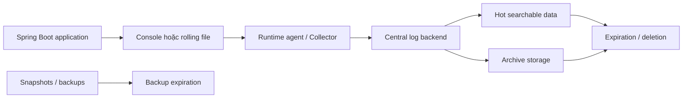

# Retention logs

Log retention là chính sách xác định log nào được giữ lại, giữ trong bao lâu, lưu ở đâu và được xóa như thế nào khi hết hạn. Với một dịch vụ Spring Boot, log có thể đi từ ứng dụng ra console hoặc file, qua agent/collector, rồi tới nền tảng lưu trữ tập trung và kho archive. Nếu chỉ cấu hình xoay vòng file ở ứng dụng mà không quản lý các bản sao ở backend, snapshot và backup, dữ liệu vẫn có thể tồn tại lâu hơn dự kiến. Ngược lại, nếu xóa log quá sớm, nhóm vận hành có thể mất bằng chứng cần thiết để điều tra sự cố.

Spring Boot cung cấp logging system và tích hợp Logback mặc định trong nhiều ứng dụng. Các cấu hình logging của Spring Boot giúp quản lý file và rolling policy ở mức ứng dụng. Thời hạn lưu trữ tổng thể thường còn phụ thuộc nền tảng log tập trung, container runtime, collector, object storage và quy định nội bộ. Vì vậy, cần thiết kế retention xuyên suốt vòng đời dữ liệu.

## Mục tiêu và khái niệm

Sau bài học, bạn có thể:

- Phân loại log theo mục đích sử dụng và xác định thời hạn lưu giữ phù hợp.
- Cấu hình rolling file và giới hạn dung lượng bằng Spring Boot/Logback khi ứng dụng cần ghi file.
- Thiết kế retention ở nền tảng log tập trung, archive và backup.
- Giảm dữ liệu nhạy cảm, kiểm soát quyền truy cập và xử lý yêu cầu xóa dữ liệu.
- Theo dõi dung lượng, tuổi dữ liệu, tình trạng rollover và việc thực thi chính sách retention.

Các khái niệm cần phân biệt:

| Khái niệm | Ý nghĩa |
|---|---|
| Log rotation / rollover | Đóng file hoặc index hiện tại và bắt đầu một file/index mới theo thời gian hay dung lượng |
| Retention | Khoảng thời gian dữ liệu được phép hoặc cần được giữ trước khi hết hạn |
| Archive | Lưu bản log cũ ở tầng lưu trữ khác, thường tối ưu chi phí hoặc phục vụ yêu cầu tra cứu dài hạn |
| Deletion / expiration | Xóa dữ liệu đã hết hạn khỏi các tầng lưu trữ và bản sao thuộc phạm vi chính sách |
| Backup / snapshot | Bản sao phục vụ khôi phục; cần có thời hạn riêng và phải tính vào vòng đời dữ liệu |

Rotation không tự động đồng nghĩa với retention. Việc đổi tên file mỗi ngày chỉ tạo ra các file lịch sử; nếu không có giới hạn số ngày hoặc dung lượng, chúng vẫn có thể chiếm đầy ổ đĩa.

## Thiết kế chính sách lưu giữ

### 1. Phân loại log theo mục đích

Không nên áp dụng cùng một thời hạn cho mọi loại log. Trước khi chọn số ngày, hãy xác định log được tạo ra để giải quyết vấn đề gì, ai sở hữu dữ liệu và ai cần truy cập.

| Nhóm log | Ví dụ | Điều cần cân nhắc |
|---|---|---|
| Application diagnostic | Startup, exception, timeout, trạng thái xử lý request | Thời gian điều tra lỗi, SLO, dung lượng và khả năng tái hiện sự cố |
| Access log | HTTP method, route, status, thời gian xử lý, client metadata | Mục đích bảo mật/vận hành, dữ liệu định danh và chính sách quyền riêng tư |
| Security/audit log | Đăng nhập, thay đổi quyền, thao tác quản trị, truy cập dữ liệu | Yêu cầu kiểm toán, tính toàn vẹn, quyền truy cập hạn chế và quy trình legal hold |
| Business event log | Sự kiện nghiệp vụ hoặc lịch sử trạng thái | Có nên lưu như dữ liệu nghiệp vụ riêng thay vì phụ thuộc log chẩn đoán |
| Platform/infrastructure log | Container runtime, node, gateway, database | Chủ sở hữu nền tảng và vòng đời riêng của từng hệ thống |

Log chẩn đoán giúp giải thích điều gì xảy ra trong ứng dụng, nhưng không mặc nhiên thay thế audit trail. Nếu cần chứng minh ai đã thực hiện hành động nhạy cảm, audit log phải có schema, kiểm soát truy cập, bảo vệ tính toàn vẹn và quy trình lưu trữ phù hợp. Không dùng log text thông thường làm nguồn duy nhất cho dữ liệu nghiệp vụ quan trọng.

### 2. Chọn thời hạn và điểm bắt đầu tính hạn

Thời hạn retention phải được thống nhất với chủ sở hữu dịch vụ, bảo mật, quyền riêng tư và bộ phận phụ trách yêu cầu pháp lý của tổ chức. Hãy cân nhắc:

- Khoảng thời gian cần để phát hiện, điều tra và xử lý sự cố.
- SLO, chu kỳ release, lịch đối soát và thời gian phát hiện bất thường của hệ thống.
- Mục đích thu thập, phân loại dữ liệu, yêu cầu hợp đồng và quy định áp dụng.
- Chi phí ingest, index, truy vấn, archive, snapshot và khôi phục.
- Khả năng xóa dữ liệu ở mọi bản sao khi hết hạn hoặc khi có yêu cầu hợp lệ.

Không có một số ngày retention đúng cho mọi ứng dụng. Hãy ghi rõ thời hạn được phê duyệt cho từng nhóm log thay vì sao chép một giá trị mặc định giữa các dịch vụ.

Chính sách cũng phải nêu rõ thời điểm bắt đầu tính hạn. Thông thường có thể tính từ timestamp của sự kiện (`event time`) hoặc từ lúc hệ thống nhận log (`ingest time`). Hai mốc có thể khác nhau khi collector bị gián đoạn hoặc log được gửi lại. Dùng timestamp UTC, đồng bộ đồng hồ giữa các máy và xác định cách xử lý log đến muộn để tránh xóa nhầm hoặc giữ quá hạn.

Một chính sách có thể được ghi thành bảng quản trị như sau:

| Thuộc tính | Nội dung cần xác định |
|---|---|
| Log category | Nhóm log và service phát sinh |
| Purpose / owner | Mục đích sử dụng và nhóm chịu trách nhiệm |
| Classification | Mức độ nhạy cảm, dữ liệu cá nhân hoặc bí mật có thể xuất hiện |
| Hot retention | Thời gian dữ liệu có thể tìm kiếm nhanh trong backend |
| Archive retention | Thời gian giữ ở tầng lưu trữ chi phí thấp, nếu có |
| Expiration rule | Mốc bắt đầu tính hạn và điều kiện xóa |
| Backup/snapshot | Thời hạn, vị trí và cách hết hạn của bản sao |
| Legal hold / exception | Người phê duyệt, phạm vi và cách gỡ ngoại lệ |

Mọi ngoại lệ cần có chủ sở hữu, lý do, ngày xem xét lại và ngày kết thúc. Legal hold phải được xử lý theo quy trình được tổ chức phê duyệt; không tự động xóa dữ liệu đang thuộc phạm vi bảo toàn.

### 3. Thiết kế các tầng lưu trữ

Một luồng phổ biến có dạng:



Mỗi tầng có trách nhiệm khác nhau:

- Ứng dụng phát log với timestamp, level, service identity và context cần thiết.
- Container runtime hoặc agent thu thập log, theo dõi vị trí đọc và chuyển dữ liệu tới backend.
- Backend tập trung áp dụng rollover, retention, quyền truy cập và truy vấn.
- Archive lưu dữ liệu ít được truy cập hơn nếu có nhu cầu đã được phê duyệt.
- Snapshot/backup có lịch hết hạn riêng; không được bỏ qua khi đánh giá tổng thời gian lưu giữ.

Hãy xác định tầng nào là nguồn chính thức, tầng nào chỉ là cache hoặc bản sao. Nếu một log bị xóa khỏi index nhưng vẫn còn trong snapshot vô thời hạn, chính sách retention chưa được thực thi đầy đủ.

## Cấu hình retention file với Spring Boot và Logback

Spring Boot dùng Logback làm logging implementation mặc định khi dependency logging tương ứng có mặt. Nếu ứng dụng cần ghi log ra file, có thể cấu hình đường dẫn và rolling policy bằng các thuộc tính Spring Boot.

### 1. Cấu hình rolling file

Ví dụ `application.yaml`:

```yaml
logging:
  file:
    name: /var/log/order-service/application.log
  logback:
    rollingpolicy:
      file-name-pattern: ${LOG_FILE}.%d{yyyy-MM-dd}.%i.gz
      max-file-size: 100MB
      max-history: 14
      total-size-cap: 2GB
      clean-history-on-start: true
```

Với cấu hình này:

- `logging.file.name` xác định file log đang ghi. Spring Boot cung cấp thuộc tính `LOG_FILE` cho cấu hình logging khi tên file được thiết lập.
- `file-name-pattern` dùng ngày và chỉ số để đặt tên file archive; hậu tố `.gz` yêu cầu nén file đã rollover.
- `max-file-size` giới hạn kích thước file trước khi rollover trong một chu kỳ.
- `max-history` giới hạn số chu kỳ lịch sử được giữ. Với pattern theo ngày ở ví dụ này, giá trị `14` tương ứng tối đa 14 chu kỳ ngày.
- `total-size-cap` giới hạn tổng dung lượng file archive được giữ bởi rolling policy; archive cũ có thể bị xóa sớm hơn khi chạm giới hạn.
- `clean-history-on-start` yêu cầu dọn lịch sử cũ khi logging system khởi động.

Đây là ví dụ minh họa, không phải thời hạn khuyến nghị. Chọn đường dẫn, số ngày và dung lượng theo chính sách đã phê duyệt, dung lượng volume và tốc độ phát sinh log thực tế. Đảm bảo user chạy ứng dụng có quyền ghi thư mục và volume còn đủ chỗ cho file đang hoạt động cùng archive.

`max-history` và `total-size-cap` trong rolling policy chỉ quản lý file archive thuộc appender đó. Chúng không xóa log đã được chuyển tới backend tập trung, bản sao do agent tạo, snapshot hoặc backup. Nếu dùng một file pattern tùy chỉnh trong `logback-spring.xml`, hãy bảo đảm chính sách rolling và cleanup tương ứng vẫn được khai báo.

### 2. Container và Kubernetes

Trong container, lựa chọn thường phù hợp là ghi log ra console (`stdout`/`stderr`) để container runtime và agent trên node thu thập. Khi đó không cần cấu hình `logging.file.name` chỉ để giữ log cục bộ. Việc xoay vòng file log của container runtime, giới hạn dung lượng trên node và retention của backend là các cấu hình riêng ở nền tảng triển khai.

Nếu ứng dụng ghi file bên trong container, hãy xác định volume có persistent hay không, ai chịu trách nhiệm rotate, agent đọc file theo cách nào và điều gì xảy ra khi pod bị thay thế. File trên filesystem tạm của container có thể biến mất cùng pod; giữ file tại đó không tạo thành một cơ chế lưu trữ bền vững.

Tránh để cả ứng dụng và runtime cùng rotate một file theo cách không phối hợp. Hai cơ chế rotation có thể đổi tên, xóa hoặc truncate file khi collector vẫn đang đọc, gây mất log hoặc đọc lặp. Chỉ định một thành phần sở hữu việc rotate tại mỗi điểm ghi và kiểm tra cách agent theo dõi file sau rollover.

## Retention ở nền tảng log tập trung

Khi log đã được gửi tới backend, hãy cấu hình retention tại chính backend đó. Tên chính sách và cú pháp khác nhau giữa Elasticsearch/OpenSearch, Loki, Splunk, Cloud logging và các dịch vụ quản lý khác, nhưng các quyết định cơ bản thường giống nhau:

1. **Chọn phạm vi dữ liệu:** index, stream, tenant, bucket hoặc log group theo service và category.
2. **Đặt điều kiện rollover:** theo tuổi, kích thước hoặc số lượng tài liệu để tránh một index/segment tăng không giới hạn.
3. **Đặt thời hạn searchable:** dữ liệu được giữ ở tầng truy vấn nhanh trong khoảng đã phê duyệt.
4. **Chuyển tầng hoặc archive:** nếu yêu cầu cần giữ lâu hơn nhưng không cần truy vấn thường xuyên, chuyển sang tầng phù hợp và kiểm tra khả năng khôi phục.
5. **Xóa khi hết hạn:** xác minh backend xóa index/stream và archive theo đúng mốc, bao gồm các bản sao được quản lý.

Ví dụ thiết kế chính sách ở mức khái niệm:

| Giai đoạn | Hành động | Câu hỏi cần xác minh |
|---|---|---|
| Ingest | Gắn service, environment, version, category và timestamp | Log có đúng tenant/index/stream không? |
| Rollover | Tạo index/segment mới theo ngưỡng đã chọn | Index có được rollover trước khi quá lớn không? |
| Hot | Giữ dữ liệu có thể tìm kiếm nhanh | Thời hạn có khớp policy đã duyệt không? |
| Archive | Chuyển dữ liệu ít truy cập nếu cần | Có thể phục hồi và truy vấn lại không? |
| Expire | Xóa dữ liệu hết hạn | Index, archive, replica và snapshot có cùng vòng đời không? |

Đối với Elasticsearch/OpenSearch, có thể dùng cơ chế lifecycle management của nền tảng để phối hợp rollover và xóa index. Với Loki hoặc dịch vụ cloud logging, retention thường được cấu hình theo tenant, stream, bucket hay log group và có thể cần bật thành phần compactor/lifecycle tương ứng. Hãy dùng tài liệu đúng phiên bản backend đang chạy; không sao chép policy syntax giữa các sản phẩm vì tên field và hành vi có thể khác nhau.

Không đặt retention dựa trên tên index đơn thuần nếu index pattern không bao phủ các index cũ hoặc index được tạo bởi một pipeline khác. Kiểm tra policy đã được gắn vào đúng đối tượng dữ liệu và trạng thái thực thi của từng đối tượng.

## Bảo vệ dữ liệu trong log

Retention càng dài thì phạm vi dữ liệu nhạy cảm có thể bị lưu lại càng lớn. Kiểm soát tốt nhất bắt đầu từ lúc log được tạo:

- Không ghi password, access token, refresh token, API key, private key, session cookie hoặc secret cấu hình.
- Hạn chế ghi payload request/response đầy đủ. Chỉ ghi field cần thiết cho mục đích chẩn đoán.
- Mask hoặc loại bỏ dữ liệu cá nhân và định danh nhạy cảm theo quy định nội bộ trước khi gửi log ra ngoài ứng dụng.
- Dùng quyền truy cập theo vai trò; giới hạn người có thể tìm kiếm, tải xuống, thay đổi policy hoặc xóa log.
- Bảo vệ dữ liệu khi truyền và khi lưu bằng TLS và encryption phù hợp với nền tảng.
- Ghi nhận hoạt động truy cập quản trị và thay đổi retention policy.
- Xác định cách xử lý dữ liệu trong archive, snapshot, replica và bản export do người dùng tải xuống.

Log có thể mang trace ID, span ID, request ID và deployment/version để liên kết với metrics hoặc traces. Các ID này hữu ích khi điều tra, nhưng không nên đưa dữ liệu cá nhân hoặc bí mật vào tag/field chỉ để tiện tìm kiếm. Cần giữ nguyên khả năng tương quan mà không làm lộ nội dung request.

Việc sampling log, giảm log level hoặc loại bỏ event lặp có thể giảm ingest, nhưng không thay thế retention policy. Sampling có thể làm mất bằng chứng về một lỗi hiếm; hãy xác định rõ loại log nào được sampling và loại log nào phải giữ đầy đủ theo yêu cầu vận hành hoặc audit.

## Theo dõi việc thực thi retention

Một policy tồn tại trong cấu hình chưa chứng minh dữ liệu đã được xóa đúng hạn. Hãy giám sát cả dung lượng lẫn trạng thái thực thi.

| Chỉ số hoặc kiểm tra | Dấu hiệu cần điều tra |
|---|---|
| Log ingest rate và bytes/day | Tăng đột biến sau release, log loop hoặc debug level bị bật ngoài dự kiến |
| Dung lượng theo index/stream/tier | Tăng liên tục dù retention đã được cấu hình |
| Tuổi của log cũ nhất | Dữ liệu vượt thời hạn searchable hoặc archive đã duyệt |
| Collector lag và dropped events | Log đến trễ, mất log hoặc không theo kịp tốc độ phát sinh |
| Trạng thái rollover/retention job | Policy lỗi, chưa gắn vào index hoặc cleanup bị gián đoạn |
| Disk usage và free space | Volume tiến gần giới hạn, nguy cơ ứng dụng ngừng ghi log |
| Archive restore test | Không thể khôi phục dữ liệu đã chuyển tầng khi cần điều tra |

Nên kiểm tra định kỳ bằng một log thử nghiệm có timestamp và nhãn nhận diện riêng. Xác minh log đi vào đúng stream, có thể tìm kiếm trong thời hạn dự kiến và biến mất sau khi hết hạn trong môi trường kiểm thử hoặc theo quy trình được phê duyệt. Không tạo dữ liệu giả trên production có thể bị hiểu nhầm là audit event.

Đối với log cục bộ, kiểm tra kích thước file hiện tại, số archive, tuổi file cũ nhất và dung lượng volume. Đối với backend tập trung, kiểm tra policy assignment, trạng thái lifecycle, tuổi index/stream, archive và snapshot. Đồng thời kiểm tra log đến muộn: retention dựa trên ingest time có thể giữ lâu hơn event time; retention dựa trên event time có thể xóa ngay khi một bản ghi rất cũ vừa được ingest.

## Xử lý các tình huống thường gặp

### Dung lượng log tăng dù đã cấu hình max-history

`max-history` của Logback chỉ quản lý archive do rolling policy tạo ra. Kiểm tra ứng dụng có thực sự dùng Logback và file appender đó không, file pattern có chứa ngày không, logging configuration có bị profile khác ghi đè không, và file đang quan sát có đúng đường dẫn không. Sau đó kiểm tra các bản sao ở container node, collector buffer, backend, archive và snapshot.

### Log cũ không bị xóa ở backend

Kiểm tra policy đã được gắn vào index/stream hiện tại, rollover có diễn ra, điều kiện xóa có đúng timezone và mốc thời gian, lifecycle worker/compactor có hoạt động, và có legal hold hoặc exception đang áp dụng không. Kiểm tra cả index cũ không khớp pattern và snapshot được giữ theo lịch riêng.

### Log bị mất sau khi pod restart

Nếu log chỉ được ghi vào filesystem tạm trong container, dữ liệu có thể biến mất khi pod bị thay thế. Chuyển sang console logging và thu thập tập trung, hoặc dùng persistent volume cùng quy trình rotation/backup được quản lý. Không coi file trong container là bản lưu trữ lâu dài.

### Ứng dụng hết dung lượng vì log file

Kiểm tra tốc độ phát sinh log, file appender, quyền ghi, rolling policy, `max-file-size`, `max-history`, `total-size-cap` và dung lượng volume. Nếu log tăng do exception lặp hoặc log level quá chi tiết, xử lý nguyên nhân phát sinh. Không xóa thủ công file đang được appender sử dụng nếu chưa có runbook phối hợp với logging system và collector.

### Có yêu cầu giữ lại log để điều tra

Xác định chính xác service, thời gian, category và phạm vi log cần bảo toàn. Thực hiện archive/export theo quy trình có kiểm soát, ghi lại người phê duyệt, checksum hoặc bằng chứng toàn vẹn nếu cần, vị trí lưu và thời hạn của bản sao. Nếu cần legal hold, áp dụng quy trình của tổ chức và ghi nhận khi nào được phép gỡ hold. Sau khi điều tra kết thúc, đánh giá lại ngoại lệ để dữ liệu không bị giữ vô thời hạn.

## Ví dụ: xây dựng chính sách cho order-service

Giả sử `order-service` phát sinh application diagnostic logs, access logs và security audit logs. Nhóm vận hành bắt đầu bằng việc phân loại ba nhóm, xác định owner và xin phê duyệt thời hạn theo mục đích và yêu cầu của tổ chức. Nhóm chọn lưu log có thể tìm kiếm nhanh ở backend trong thời gian phục vụ điều tra thường ngày; audit log có cơ chế bảo vệ và retention riêng; archive chỉ áp dụng khi có nhu cầu đã được phê duyệt.

Khi triển khai, nhóm:

1. Chuẩn hóa log có cấu trúc với `service.name`, `service.version`, `environment`, timestamp UTC, level và trace context phù hợp.
2. Loại bỏ token và dữ liệu nhạy cảm khỏi log trước khi gửi đi.
3. Cấu hình ứng dụng container ghi ra console để agent thu thập; nếu có môi trường chạy dạng VM ghi file, áp dụng Logback rolling policy với giới hạn dung lượng và số chu kỳ theo policy.
4. Gắn lifecycle policy vào đúng index/stream ở backend, kiểm tra rollover và expiration.
5. Đặt cảnh báo cho ingest rate bất thường, dung lượng tăng, collector lag và tuổi log cũ nhất vượt giới hạn.
6. Chạy kiểm tra định kỳ để xác minh log cũ hết hạn ở backend và các bản archive/snapshot liên quan.

Khi dashboard báo dung lượng tăng dù file appender chỉ giữ số ngày đã cấu hình, nhóm kiểm tra backend và phát hiện index cũ không được gắn lifecycle policy. Họ gắn đúng policy, theo dõi trạng thái rollover/expiration và kiểm tra snapshot retention. Trường hợp này minh họa vì sao retention phải được kiểm tra ở từng tầng dữ liệu.

## Checklist vận hành

- [ ] Mỗi nhóm log có mục đích, owner, phân loại dữ liệu và thời hạn được phê duyệt.
- [ ] Policy xác định rõ mốc tính hạn, timezone, xử lý log đến muộn và ngoại lệ/legal hold.
- [ ] Ứng dụng chỉ ghi những field cần thiết; secret và dữ liệu nhạy cảm được loại bỏ hoặc mask.
- [ ] Cách ghi console/file phù hợp với môi trường chạy và có một thành phần chịu trách nhiệm rotation tại mỗi điểm ghi.
- [ ] Rolling file có giới hạn dung lượng, số chu kỳ và cleanup; volume đủ chỗ cho file đang hoạt động.
- [ ] Backend policy được gắn đúng index/stream/tenant và rollover/expiration đang hoạt động.
- [ ] Archive, replica, snapshot, backup và export có vòng đời được xác định.
- [ ] Quyền tìm kiếm, tải xuống, quản trị và xóa log được giới hạn và ghi nhận.
- [ ] Dashboard/alert theo dõi ingest rate, dung lượng, collector lag, tuổi dữ liệu và lỗi lifecycle.
- [ ] Có kiểm tra định kỳ chứng minh dữ liệu được giữ đúng hạn, xóa đúng hạn và có thể khôi phục khi cần.

Retention logs là một phần của vận hành observability: nó phải bảo đảm log còn sẵn khi nhóm cần điều tra, đồng thời giới hạn dung lượng và thời gian lưu dữ liệu theo mục đích đã phê duyệt. Hãy xem lại chính sách khi service, mức traffic, kiến trúc lưu trữ hoặc yêu cầu dữ liệu thay đổi.
