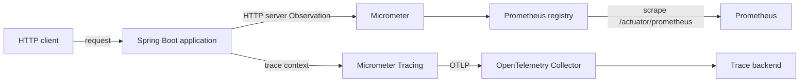
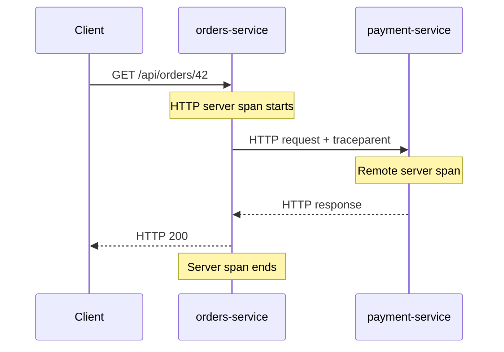

# Bật metrics và trace cho HTTP

HTTP là ranh giới quan trọng để bắt đầu quan sát một ứng dụng Spring Boot. Tại đây, ta cần biết request nào đang đến, endpoint nào chậm, response có status nào và request đã gọi những dependency nào. Metrics cho biết xu hướng tổng thể theo thời gian; distributed tracing cho phép lần theo một request qua các thành phần và dịch vụ.

Spring Boot tích hợp Micrometer Observation và Actuator để tự động ghi nhận nhiều hoạt động HTTP. Khi thêm registry metrics và tracing bridge/exporter phù hợp, ứng dụng có thể xuất metrics cho Prometheus và gửi trace tới hệ thống nhận OTLP. Bài thực hành này bật cả hai tín hiệu, tạo một request để sinh dữ liệu, rồi xác minh kết quả qua Actuator và trace backend.

Bài học thuộc chương **Thực hành tổng hợp** của module **SPRING_BOOT_OBSERVABILITY**. Module hướng dẫn thiết lập observability cho Spring Boot bằng Micrometer Observation, metrics, logs và distributed tracing; bài này kết hợp cấu hình, instrumentation HTTP, export và kiểm tra để điều tra lỗi cũng như độ trễ trong môi trường chạy thực tế.

## Mục tiêu

Sau bài này, bạn có thể:

- Bật HTTP server metrics bằng Spring Boot Actuator và Micrometer.
- Xuất metrics theo định dạng Prometheus.
- Cấu hình Micrometer Tracing với OpenTelemetry bridge và OTLP exporter.
- Tạo request HTTP và kiểm tra trace được gửi tới collector.
- Hiểu sự khác nhau giữa metrics và trace, cũng như ảnh hưởng của sampling.
- Bảo vệ endpoint quản trị và tránh tạo tag có cardinality cao.

## Kiến trúc của bài thực hành

Luồng dữ liệu được triển khai như sau:



Spring Boot/Micrometer ghi nhận hoạt động HTTP. Registry Prometheus cung cấp endpoint scrape metrics. Micrometer Tracing tạo và truyền trace context, sau đó OTLP exporter gửi span tới collector. Prometheus và trace backend là hai hệ thống tiêu thụ dữ liệu độc lập; sampling của trace không làm giảm số lần ghi nhận HTTP metrics.

Ví dụ dùng Spring Boot 3.x với dependency versions được quản lý bởi Spring Boot dependency management. Nếu dự án dùng phiên bản khác, hãy đối chiếu tên property và dependency với phiên bản Spring Boot đang chạy.

## 1. Chuẩn bị dependencies

Giả sử ứng dụng đã có Spring Web. Thêm Actuator, registry Prometheus và OpenTelemetry tracing bridge/exporter.

Với Gradle:

```groovy
dependencies {
    implementation("org.springframework.boot:spring-boot-starter-web")
    implementation("org.springframework.boot:spring-boot-starter-actuator")

    runtimeOnly("io.micrometer:micrometer-registry-prometheus")

    implementation("io.micrometer:micrometer-tracing-bridge-otel")
    runtimeOnly("io.opentelemetry:opentelemetry-exporter-otlp")
}
```

Nếu `spring-boot-starter-web` đã có trong dự án thì không cần khai báo lần thứ hai. Spring Boot quản lý các phiên bản tương thích thông qua BOM/plugin; tránh tự ghim các phiên bản Micrometer và OpenTelemetry khác nhau khi chưa kiểm tra ma trận tương thích.

Vai trò của từng dependency:

| Dependency | Vai trò |
|---|---|
| `spring-boot-starter-actuator` | Cung cấp endpoint quản trị và tích hợp Micrometer |
| `micrometer-registry-prometheus` | Chuyển meter thành định dạng Prometheus để scrape |
| `micrometer-tracing-bridge-otel` | Kết nối Micrometer Tracing với OpenTelemetry |
| `opentelemetry-exporter-otlp` | Gửi span qua giao thức OTLP |

Chỉ có Actuator thì ứng dụng đã có thể cung cấp nhiều metrics nội bộ qua `/actuator/metrics`. Registry Prometheus bổ sung endpoint `/actuator/prometheus`. Tracing cần bridge và exporter tương ứng; chỉ bật endpoint metrics không tự tạo distributed traces.

## 2. Cấu hình Actuator, metrics và tracing

Thêm cấu hình sau vào `application.yml`:

```yaml
spring:
  application:
    name: orders-service

management:
  endpoints:
    web:
      exposure:
        include: health,metrics,prometheus

  metrics:
    distribution:
      percentiles-histogram:
        "http.server.requests": true

  tracing:
    sampling:
      probability: 1.0

  otlp:
    tracing:
      endpoint: http://localhost:4318/v1/traces
```

Ý nghĩa cấu hình:

- `spring.application.name` đặt tên service để phân biệt resource trong trace backend.
- `endpoints.web.exposure.include` chỉ công khai ba endpoint cần cho bài thực hành: health, metrics và prometheus.
- `percentiles-histogram` bật histogram cho HTTP server timer, giúp backend metrics tính phân vị từ bucket khi registry hỗ trợ.
- `sampling.probability: 1.0` yêu cầu lấy mẫu toàn bộ trace trong môi trường thực hành để dễ quan sát. Giá trị này thường quá cao cho production có lưu lượng lớn.
- `otlp.tracing.endpoint` chỉ tới OTLP HTTP receiver của collector. Cổng và đường dẫn phải khớp với cấu hình receiver thực tế.

Đặt xác suất sampling 100% giúp dễ kiểm tra trong môi trường local, nhưng metrics vẫn được ghi nhận độc lập. Trong production, hãy chọn tỷ lệ sampling dựa trên lưu lượng, ngân sách lưu trữ, nhu cầu điều tra và khả năng tail-based sampling của hệ thống. Không tăng sampling chỉ để khắc phục một trace bị thiếu khi chưa kiểm tra exporter, collector và điều kiện lọc.

Nếu collector ở máy hoặc container khác, thay `localhost` bằng hostname có thể truy cập từ tiến trình ứng dụng. `localhost` bên trong container trỏ về chính container ứng dụng, không tự động trỏ đến máy host hoặc container collector khác.

## 3. HTTP server metrics được tạo tự động

Khi ứng dụng dùng Spring MVC hoặc WebFlux và có Actuator/Micrometer phù hợp, Spring Boot tự động ghi nhận HTTP server requests. Meter phổ biến là:

```text
http.server.requests
```

Đây thường là một timer, ghi nhận số lần request và thời gian xử lý. Các tag mặc định có thể bao gồm:

| Tag | Ý nghĩa |
|---|---|
| `method` | HTTP method như `GET`, `POST` |
| `uri` | Route template đã chuẩn hóa, ví dụ `/orders/{id}` |
| `status` | HTTP response status như `200`, `404`, `500` |
| `outcome` | Nhóm kết quả HTTP như `SUCCESS`, `CLIENT_ERROR`, `SERVER_ERROR` |
| `exception` | Tên loại exception hoặc giá trị mặc định khi không có exception |

Tên tag và tập tag cụ thể phụ thuộc phiên bản Spring Boot, framework web và convention đang cấu hình. Hãy xem dữ liệu thực tế trên endpoint metrics trước khi viết truy vấn dashboard.

Không cần tạo một Observation thủ công quanh mọi controller chỉ để đo thời gian HTTP server. Hãy dùng meter tự động này cho câu hỏi về lưu lượng, độ trễ và status theo endpoint. Chỉ thêm Observation nghiệp vụ khi muốn đo một hoạt động có ý nghĩa riêng, chẳng hạn `checkout.submit`.

## 4. Bật HTTP client instrumentation

Nếu ứng dụng gọi dịch vụ khác, HTTP client metrics và trace giúp xác định dependency nào đang chậm. Với các client được Spring Boot hỗ trợ, hãy dùng builder do Spring Boot inject để nhận cấu hình observation và instrumentation tự động.

Ví dụ dùng `RestClient`:

```java
import org.springframework.context.annotation.Bean;
import org.springframework.context.annotation.Configuration;
import org.springframework.web.client.RestClient;

@Configuration
class PaymentClientConfiguration {
    @Bean
    RestClient paymentRestClient(RestClient.Builder builder) {
        return builder
                .baseUrl("http://payment-service")
                .build();
    }
}
```

`RestClient.Builder` được Spring Boot cấu hình có thể kết nối client với Micrometer Observation. Khi gọi qua client này, HTTP client instrumentation có thể tạo meter `http.client.requests` và span tương ứng nếu tracing đã được cấu hình. Với `WebClient`, dùng `WebClient.Builder` được inject; với `RestTemplate`, dùng `RestTemplateBuilder` của Spring Boot.

Tránh tự tạo client bằng factory hoặc constructor không nhận builder đã cấu hình nếu muốn dùng auto instrumentation. Nếu dùng thư viện HTTP khác hoặc client tự viết, hãy kiểm tra hỗ trợ instrumentation của thư viện hoặc thêm Observation tại boundary của lời gọi đó.

HTTP client instrumentation cũng giúp truyền trace context qua request. Với W3C Trace Context, header `traceparent` mang thông tin trace và span hiện tại. Khi client được instrument đúng, ứng dụng thường không cần tự tạo header này bằng tay. Tự ghi đè hoặc xóa header propagation có thể làm đứt liên kết trace giữa các dịch vụ.

## 5. Khởi động và tạo HTTP traffic

Khởi động ứng dụng theo cách thường dùng trong dự án. Gửi request tới một endpoint có thật trong ứng dụng, ví dụ:

```bash
curl -i http://localhost:8080/api/orders
```

Nếu ứng dụng không có `/api/orders`, thay bằng route thực tế. Gửi một vài request thành công và một request tạo response lỗi có kiểm soát, chẳng hạn một ID không tồn tại. Việc tạo traffic là cần thiết vì timer HTTP thường chỉ xuất hiện sau khi endpoint đã được gọi.

Với mỗi request, HTTP server instrumentation ghi nhận method, route, status, outcome và thời gian. Nếu request gọi thêm dịch vụ payment qua client đã instrument, trace có thể chứa server span và client span liên quan.

## 6. Xác minh metrics qua Actuator

Trước tiên, xem danh sách meter hoặc đọc trực tiếp meter HTTP server:

```bash
curl -s http://localhost:8080/actuator/metrics/http.server.requests
```

Response thường chứa tên meter, measurements và các tag có sẵn. Có thể lọc theo một tag cụ thể nếu biết giá trị thực tế, ví dụ:

```bash
curl -G \
  --data-urlencode "tag=method:GET" \
  http://localhost:8080/actuator/metrics/http.server.requests
```

Tiếp theo, kiểm tra định dạng Prometheus:

```bash
curl -s http://localhost:8080/actuator/prometheus
```

Tìm chuỗi tương ứng với HTTP server timer. Với Prometheus registry, meter `http.server.requests` thường được biểu diễn bằng tên dạng:

```text
http_server_requests_seconds_count
http_server_requests_seconds_sum
```

Khi histogram được bật, có thể có thêm các series `_bucket`. Tên chính xác và tag xuất ra phụ thuộc registry, convention và phiên bản. `_count` biểu thị số lần ghi nhận; `_sum` biểu thị tổng thời gian. Có thể dùng tỷ lệ giữa hai giá trị trong một khoảng thời gian để ước lượng thời gian trung bình.

Ví dụ dạng dữ liệu minh họa:

```text
http_server_requests_seconds_count{method="GET",status="200",uri="/api/orders"} 12
http_server_requests_seconds_sum{method="GET",status="200",uri="/api/orders"} 0.438
```

Các con số trên chỉ minh họa cấu trúc; kết quả thực tế đến từ request bạn đã gửi. Đảm bảo `uri` là route template, không phải URL chứa ID tài nguyên.

## 7. Xác minh trace qua OTLP

Khi tracing bridge và exporter được cấu hình, request HTTP có thể tạo server span. Nếu request gọi một dependency qua client được instrument, trace có thể có thêm client span. OTLP exporter gửi span đến collector theo endpoint đã cấu hình.

Để kiểm tra:

1. Bảo đảm collector đang chạy và OTLP HTTP receiver lắng nghe tại địa chỉ cấu hình.
2. Gửi request mới sau khi ứng dụng khởi động.
3. Mở trace backend được kết nối với collector.
4. Tìm resource có service name `orders-service`.
5. Mở trace gần thời điểm gửi request và kiểm tra server span, route, method, status và duration.
6. Nếu request gọi payment service, kiểm tra client span và trace context có liên kết đúng.

Một trace HTTP cơ bản có thể được biểu diễn như sau:



Đây là luồng minh họa. Trace thực tế phụ thuộc việc service đích có tracing instrumentation và exporter hay không. Nếu chỉ service gọi đi được instrument, trace có thể chứa client span mà không có server span tương ứng ở phía đích.

Nếu trace không xuất hiện, kiểm tra theo thứ tự: dependency bridge/exporter có trên classpath; sampling probability có lớn hơn 0; endpoint collector có truy cập được; collector có bật receiver OTLP đúng protocol; backend có nhận dữ liệu; và log ứng dụng có lỗi export hay không. Một request không có span trong backend chưa đủ để kết luận HTTP instrumentation không hoạt động.

## 8. Liên kết trace với logs

Khi Micrometer Tracing hoạt động, trace ID và span ID hiện tại có thể được đưa vào logging context (MDC) để log có thể đối chiếu với trace. Điều này giúp chuyển từ một lỗi trong log sang trace tương ứng.

Ví dụ log có correlation fields:

```text
INFO [orders-service,traceId=4f...a2,spanId=91...0c] OrderController - Loaded order
```

Định dạng cụ thể phụ thuộc logging system và pattern. Nếu ứng dụng dùng pattern tùy chỉnh, hãy bảo đảm các trường MDC tương ứng được in ra. Không ghi token, dữ liệu thanh toán hoặc payload nhạy cảm vào log chỉ để làm trace dễ tìm hơn.

Trace ID và span ID có cardinality cao. Chúng phù hợp để liên kết một log event với trace, nhưng không được thêm vào metric tags. Metrics cần các chiều tổng hợp như route, method, status hoặc outcome.

## 9. Sampling và tác động đến quan sát HTTP

Sampling quyết định trace nào được giữ và export. Với `probability: 1.0`, mọi trace đủ điều kiện đều được chọn ở head sampling tại ứng dụng. Với tỷ lệ thấp hơn, một số request sẽ không có trace được export dù HTTP metrics vẫn tăng.

| Tín hiệu | Bị ảnh hưởng bởi trace sampling? | Mục đích |
|---|---|---|
| HTTP server metrics | Không | Đếm request và đo latency theo nhóm |
| HTTP client metrics | Không | Đếm lời gọi dependency và đo thời gian |
| Distributed traces | Có | Lần theo đường đi của request được chọn mẫu |
| Logs | Không tự động bị loại theo trace sampling | Ghi sự kiện; có thể có trace/span ID khi context hiện diện |

Trong production, chọn sampling rate dựa trên lưu lượng và dung lượng lưu trữ. Nếu hệ thống cần giữ trace của lỗi hoặc request chậm, có thể cân nhắc tail-based sampling ở collector khi kiến trúc hỗ trợ. Head sampling ở ứng dụng quyết định sớm nên collector không thể khôi phục những span chưa được gửi.

Sampling thấp cũng không nên được bù bằng cách thêm ID request vào metric tags. Dùng trace ID để tra cứu trace đã được lưu và dùng metrics để quan sát xu hướng tổng thể.

## 10. Bảo vệ endpoint và dữ liệu telemetry

Các endpoint `/actuator/metrics` và `/actuator/prometheus` có thể tiết lộ tên service, route, lưu lượng và đặc điểm hoạt động nội bộ. Chỉ expose endpoint cần thiết, giới hạn truy cập qua mạng quản trị hoặc Spring Security, và không để endpoint metrics mở công khai nếu không có kiểm soát.

Một số nguyên tắc khi triển khai:

- Dùng endpoint health/readiness phù hợp với nền tảng orchestration; chỉ mở chi tiết health cho nhóm được phép.
- Giới hạn `/actuator/metrics` và `/actuator/prometheus` cho Prometheus hoặc mạng quản trị.
- Bảo vệ OTLP receiver và exporter bằng network policy, TLS hoặc xác thực theo hạ tầng.
- Không thêm user ID, order ID, email, token hoặc raw URL vào metric tags.
- Kiểm tra baggage và span attributes trước khi export để tránh chuyển dữ liệu nhạy cảm qua các dịch vụ.
- Chọn sampling và retention phù hợp với lưu lượng, mục đích điều tra và ngân sách lưu trữ.

## 11. Lỗi thường gặp và cách xử lý

| Hiện tượng | Nguyên nhân cần kiểm tra | Hướng xử lý |
|---|---|---|
| `/actuator/metrics/http.server.requests` trả 404 | Chưa có Actuator, chưa có request được ghi nhận hoặc endpoint chưa được expose | Kiểm tra dependency, gửi request và cấu hình exposure |
| `/actuator/prometheus` trả 404 | Thiếu Prometheus registry hoặc endpoint chưa expose | Thêm `micrometer-registry-prometheus` và kiểm tra cấu hình Actuator |
| Có metrics nhưng không có trace | Chưa có tracing bridge/exporter, sampling bằng 0 hoặc export thất bại | Kiểm tra classpath, sampling, collector và log export |
| Trace có server span nhưng thiếu client span | Client không dùng builder đã instrument hoặc thư viện chưa được hỗ trợ | Dùng builder Spring Boot hoặc bổ sung instrumentation phù hợp |
| Hai span giống nhau cho cùng một HTTP call | Có cả auto instrumentation và Observation thủ công bao quanh cùng thao tác | Loại bỏ lớp đo trùng, giữ boundary có ý nghĩa riêng |
| Không tìm thấy trace ID trong logs | Logging pattern không in MDC hoặc request không có sampled tracing context | Kiểm tra tracing và cấu hình pattern của logging system |
| Metrics có nhiều URI khác nhau theo từng ID | Đang dùng raw path thay route template hoặc custom tag động | Chuẩn hóa URI và loại bỏ ID khỏi metric tags |
| Trace giữa hai service bị tách | Header propagation bị mất hoặc service đích không instrument | Kiểm tra `traceparent`, client builder và tracing ở service đích |

## Checklist hoàn thành

- [ ] Ứng dụng có Actuator và HTTP server metrics xuất hiện sau khi gửi request.
- [ ] Prometheus registry hoạt động và `/actuator/prometheus` trả dữ liệu.
- [ ] HTTP server timer có tag route, method và status phù hợp.
- [ ] Tracing bridge và OTLP exporter được cấu hình tương thích.
- [ ] Collector nhận span và trace backend hiển thị service đúng tên.
- [ ] HTTP client dùng builder đã instrument và truyền trace context khi gọi dependency.
- [ ] Trace ID/span ID liên kết được logs với trace nếu logging pattern hỗ trợ.
- [ ] Sampling rate phù hợp với môi trường; metrics vẫn có dữ liệu khi trace bị sampling.
- [ ] Endpoint quản trị được giới hạn truy cập và metric tags không chứa định danh động.

## Kết luận

Bật HTTP metrics và tracing trong Spring Boot bắt đầu bằng Actuator cùng Micrometer, sau đó chọn registry phù hợp cho metrics và tracing bridge/exporter cho distributed traces. HTTP server instrumentation cung cấp lưu lượng, status và latency; HTTP client instrumentation giúp theo dõi dependency và truyền trace context. Xác minh cả endpoint metrics lẫn trace backend, đồng thời kiểm soát sampling, cardinality và quyền truy cập để telemetry hữu ích trong production.
