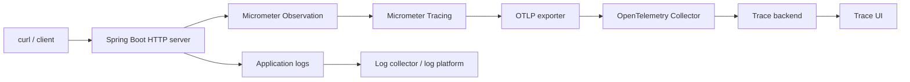

# Cấu hình OTLP trace export

Trong chương **Thực hành tổng hợp** của module `SPRING_BOOT_OBSERVABILITY`, bài này hướng dẫn cấu hình Spring Boot xuất distributed traces qua OpenTelemetry Protocol (OTLP), đưa dữ liệu qua OpenTelemetry Collector và xác minh trace đã đến đích. Bài thực hành kết nối các phần đã học về Micrometer Observation, Micrometer Tracing, context propagation, sampling, exporter và liên kết logs với traces.

Mục tiêu là hoàn thành một luồng có thể kiểm tra được: request HTTP đi vào ứng dụng Spring Boot, tracing tạo span, OTLP exporter gửi span tới Collector, Collector xử lý và chuyển tiếp dữ liệu, cuối cùng backend hoặc exporter kiểm thử xác nhận trace đã nhận. Các ví dụ dùng OTLP/HTTP để dễ quan sát request và endpoint; OTLP/gRPC cũng được giới thiệu để bạn biết cách chọn đúng transport.

## 1. Kiến trúc và yêu cầu trước khi bắt đầu

Luồng dữ liệu trong bài thực hành:



Spring Boot instrument các request được hỗ trợ và tạo trace context. Micrometer Tracing kết nối API quan sát của Micrometer với tracing implementation. OTLP exporter tuần tự hóa và gửi span. Collector nhận telemetry, có thể batch hoặc enrich, rồi gửi tới backend. Logs là pipeline riêng; nếu logging integration đưa trace ID và span ID vào log, bạn có thể dùng hai tín hiệu để điều tra cùng một request.

Trước khi bắt đầu, cần có:

- JDK và một ứng dụng Spring Boot có HTTP endpoint để tạo request.
- Spring Boot Actuator, Micrometer Tracing bridge cho OpenTelemetry và OpenTelemetry OTLP exporter.
- Docker hoặc một OpenTelemetry Collector có thể truy cập từ ứng dụng.
- Một đích nhận trace. Trong phần đầu, dùng `debug` exporter của Collector để xem trace trong log; phần sau có thể thay bằng tracing backend.
- Quyền đọc log ứng dụng và Collector để xác minh quá trình export.

Ví dụ giả định ứng dụng dùng Spring Boot 3.x với dependency management của Spring Boot. Property và auto-configuration có thể khác giữa các dòng phiên bản; hãy đối chiếu Spring Boot reference đúng phiên bản của dự án trước khi triển khai production.

## 2. Thêm dependency cho tracing và OTLP

Với Gradle Kotlin DSL, thêm các dependency sau vào module ứng dụng:

```kotlin
dependencies {
    implementation("org.springframework.boot:spring-boot-starter-actuator")
    implementation("io.micrometer:micrometer-tracing-bridge-otel")
    runtimeOnly("io.opentelemetry:opentelemetry-exporter-otlp")

    // Nếu ứng dụng cung cấp HTTP API bằng Spring MVC:
    implementation("org.springframework.boot:spring-boot-starter-web")
}
```

Với Maven, các dependency tương đương:

```xml
<dependencies>
    <dependency>
        <groupId>org.springframework.boot</groupId>
        <artifactId>spring-boot-starter-actuator</artifactId>
    </dependency>
    <dependency>
        <groupId>io.micrometer</groupId>
        <artifactId>micrometer-tracing-bridge-otel</artifactId>
    </dependency>
    <dependency>
        <groupId>io.opentelemetry</groupId>
        <artifactId>opentelemetry-exporter-otlp</artifactId>
        <scope>runtime</scope>
    </dependency>
</dependencies>
```

Hãy để Spring Boot dependency management quản lý phiên bản tương thích, trừ khi dự án có quy trình quản lý BOM riêng. Tránh tự ghép các phiên bản Micrometer và OpenTelemetry không tương thích.

Vai trò từng dependency:

| Dependency | Vai trò |
| --- | --- |
| `spring-boot-starter-actuator` | Cung cấp cơ sở hạ tầng Actuator và tích hợp observability của Spring Boot. |
| `micrometer-tracing-bridge-otel` | Kết nối Micrometer Tracing với OpenTelemetry. |
| `opentelemetry-exporter-otlp` | Cung cấp OTLP exporter để gửi span. |
| `spring-boot-starter-web` | Cung cấp HTTP server cho ví dụ request; có thể đã tồn tại trong dự án. |

Chỉ thêm tracing bridge mà thiếu exporter thì ứng dụng có thể tạo trace context nhưng không có OTLP sender tương ứng. Ngược lại, chỉ có exporter mà thiếu tracing bridge và instrumentation thì không có span ứng dụng để gửi.

## 3. Cấu hình endpoint OTLP bằng application.yml

Trong `src/main/resources/application.yml`, khai báo endpoint và sampling:

```yaml
spring:
  application:
    name: orders-api

management:
  tracing:
    sampling:
      probability: 1.0
  otlp:
    tracing:
      endpoint: http://localhost:4318/v1/traces
      timeout: 10s
```

Ý nghĩa:

- `spring.application.name` cung cấp tên service để phân biệt ứng dụng trong backend.
- `management.tracing.sampling.probability` đặt tỷ lệ sampling đầu vào theo cấu hình Spring Boot. Giá trị `1.0` dùng trong bài thực hành để mọi trace phù hợp với sampler được chọn; production cần đánh giá traffic và chi phí.
- `management.otlp.tracing.endpoint` là URL OTLP/HTTP nhận traces. Với Collector HTTP receiver mặc định, endpoint traces thường là `http://<host>:4318/v1/traces`.
- `management.otlp.tracing.timeout` giới hạn thời gian exporter chờ thao tác gửi theo hỗ trợ của phiên bản đang dùng.

Một số phiên bản Spring Boot hỗ trợ thêm headers và compression trong cấu hình OTLP tracing. Chỉ khai báo các property này khi phiên bản dự án có hỗ trợ. Endpoint HTTP cần có path `/v1/traces`; nếu Collector nhận OTLP/gRPC trên cổng `4317`, cấu hình transport và exporter phải khớp với giao thức đó. Không gửi OTLP/HTTP vào cổng gRPC hoặc ngược lại.

### 3.1. Cấu hình qua environment variables

Khi triển khai cùng một image ở nhiều môi trường, có thể truyền property qua environment variables:

```bash
export SPRING_APPLICATION_NAME=orders-api
export MANAGEMENT_TRACING_SAMPLING_PROBABILITY=1.0
export MANAGEMENT_OTLP_TRACING_ENDPOINT=http://localhost:4318/v1/traces
export MANAGEMENT_OTLP_TRACING_TIMEOUT=10s

java -jar build/libs/orders-api.jar
```

Trong Docker hoặc Kubernetes, thay `localhost` bằng DNS service của Collector nếu Collector chạy trong container hoặc Pod khác. Ví dụ `http://otel-collector:4318/v1/traces` trong cùng Docker Compose network hoặc `http://otel-collector.observability.svc:4318/v1/traces` trong Kubernetes, tùy tên service và namespace thực tế.

Không đưa token thật vào file cấu hình hoặc command line. Nếu backend yêu cầu authentication, dùng secret store và cấu hình headers theo property được hỗ trợ bởi phiên bản Spring Boot. Khi gửi token qua mạng, dùng TLS và giới hạn quyền ingest của credential.

## 4. Khởi chạy OpenTelemetry Collector để nhận trace

Tạo file cấu hình Collector, ví dụ `otel-collector-config.yaml`:

```yaml
receivers:
  otlp:
    protocols:
      grpc:
        endpoint: 0.0.0.0:4317
      http:
        endpoint: 0.0.0.0:4318

processors:
  memory_limiter:
    check_interval: 1s
    limit_mib: 256
    spike_limit_mib: 64
  batch:
    timeout: 5s
    send_batch_size: 512

exporters:
  debug:
    verbosity: basic

service:
  pipelines:
    traces:
      receivers: [otlp]
      processors: [memory_limiter, batch]
      exporters: [debug]
```

Collector mở cả hai receiver protocol:

- OTLP/gRPC: cổng `4317`.
- OTLP/HTTP: cổng `4318`, với path traces `/v1/traces`.

`memory_limiter` giúp bảo vệ Collector trước áp lực bộ nhớ; `batch` gom span trước khi chuyển tiếp; `debug` exporter in thông tin trace ra log để xác minh. Đây là pipeline kiểm thử, chưa phải cấu hình backend production. Trong production, thay hoặc bổ sung `debug` bằng exporter của tracing backend và cấu hình authentication, TLS, queue/retry, resource limit và monitoring phù hợp. Tránh in toàn bộ telemetry nhạy cảm vào log production.

Có thể chạy Collector bằng Docker:

```bash
docker run --rm --name otel-collector \
  -p 4317:4317 \
  -p 4318:4318 \
  -v "$(pwd)/otel-collector-config.yaml:/etc/otelcol/config.yaml:ro" \
  otel/opentelemetry-collector:0.120.0 \
  --config=/etc/otelcol/config.yaml
```

Image version ở ví dụ là phiên bản minh họa đã pin; hãy chọn phiên bản Collector được tổ chức kiểm thử và quản lý nâng cấp. Nếu image hoặc bản phân phối Collector của bạn dùng đường dẫn config khác, điều chỉnh tham số `--config` theo image đó. Kiểm tra log khởi động để xác nhận receiver đã listen trên đúng cổng.

Nếu ứng dụng chạy trong cùng máy host, `localhost:4318` có thể truy cập cổng đã publish. Nếu ứng dụng chạy trong container khác, dùng tên service/container trong cùng network thay vì `localhost`.

## 5. Chạy ứng dụng và tạo request đầu tiên

Khởi động Collector trước, sau đó chạy ứng dụng với profile và cấu hình ở phần trên. Khi ứng dụng đã sẵn sàng, gửi request tới một endpoint HTTP hiện có. Ví dụ:

```bash
curl -i http://localhost:8080/actuator/health
curl -i http://localhost:8080/api/orders
```

Endpoint `/api/orders` là ví dụ; hãy thay bằng route thực tế của ứng dụng. Request health cũng có thể được instrument tùy cấu hình, nhưng nên tạo một request nghiệp vụ để xác minh trace có route và span mong đợi.

Nếu chưa có route nghiệp vụ, có thể tạo một controller nhỏ để phát sinh request:

```java
package com.example.orders;

import org.springframework.web.bind.annotation.GetMapping;
import org.springframework.web.bind.annotation.RestController;

@RestController
class OrderController {

    @GetMapping("/api/orders")
    String listOrders() {
        return "orders";
    }
}
```

Với Spring MVC và tracing auto-configuration phù hợp, request HTTP được instrument tự động. Khi gọi `/api/orders`, Spring Boot tạo server span và exporter gửi span tới Collector. Bạn không cần tự tạo span cho mọi controller method.

Kiểm tra log Collector:

```bash
docker logs otel-collector
```

Với `debug` exporter, log sẽ có thông tin resource và span đã nhận. Hãy tìm service name `orders-api`, tên span tương ứng route, trace ID, span ID và status. Output chính xác phụ thuộc phiên bản Collector và mức verbosity.

## 6. Xác minh trace context và propagation

Trace export chỉ là một phần của distributed tracing. Khi request đi qua nhiều service, trace context cần được truyền qua các ranh giới HTTP hoặc messaging để các span có cùng trace ID và quan hệ parent-child phù hợp.

Có thể gửi một `traceparent` theo W3C Trace Context để kiểm tra inbound propagation:

```bash
curl -i http://localhost:8080/api/orders \
  -H 'traceparent: 00-4bf92f3577b34da6a3ce929d0e0e4736-00f067aa0ba902b7-01'
```

Đây là giá trị mẫu hợp lệ về định dạng để minh họa header. Trong một ứng dụng được cấu hình W3C propagation, server có thể tiếp tục trace context này và tạo span con. Hãy tìm trace ID `4bf92f3577b34da6a3ce929d0e0e4736` trong output Collector hoặc backend. Nếu hệ thống tạo trace mới, kiểm tra propagation type, instrumentation và middleware xử lý header.

Nếu ứng dụng gọi service khác bằng HTTP client được instrument, client span sẽ là span con trong cùng trace. Các client thư viện không được instrument hoặc tự tạo HTTP header không đúng có thể làm đứt trace. Hãy kiểm tra cả server span ở service gọi và server span ở service nhận.

Không tự thêm `traceparent` cố định cho tất cả request production. Trace ID phải duy nhất theo trace; việc tái sử dụng ID làm nhiều request bị gộp hoặc gây nhầm lẫn khi điều tra.

## 7. Liên kết trace với logs

Khi Micrometer Tracing tích hợp với logging framework, trace ID và span ID có thể được đưa vào MDC để xuất hiện trong log pattern. Hãy kiểm tra log của ứng dụng sau request:

```text
2026-11-22T10:15:30.120Z INFO  [orders-api,4bf92f3577b34da6a3ce929d0e0e4736,00f067aa0ba902b7] request completed
```

Đây là log minh họa; format thực tế phụ thuộc cấu hình logging. Dùng trace ID để tìm tất cả log liên quan request, sau đó mở trace trong backend để xem thời gian và quan hệ giữa các span. Nếu log không có trace ID, kiểm tra logging correlation pattern, MDC integration và cách log được ghi trong thread hoặc tác vụ bất đồng bộ.

Không ghi access token, mật khẩu, session ID hoặc dữ liệu cá nhân vào span attributes hay log fields. Các thuộc tính được gửi tới tracing backend có thể được lưu, index và truy cập bởi nhiều người vận hành.

## 8. Chuyển Collector từ debug exporter sang tracing backend

Khi xác minh pipeline đầu vào thành công, thay `debug` exporter bằng exporter phù hợp với backend. Ví dụ Collector chuyển tiếp OTLP/gRPC đến một backend có OTLP receiver:

```yaml
receivers:
  otlp:
    protocols:
      grpc:
        endpoint: 0.0.0.0:4317
      http:
        endpoint: 0.0.0.0:4318

processors:
  memory_limiter:
    check_interval: 1s
    limit_mib: 512
    spike_limit_mib: 128
  batch:
    timeout: 5s

exporters:
  otlp/backend:
    endpoint: tracing-backend:4317
    tls:
      insecure: true

service:
  pipelines:
    traces:
      receivers: [otlp]
      processors: [memory_limiter, batch]
      exporters: [otlp/backend]
```

Đây là ví dụ cho backend OTLP/gRPC trong network tin cậy của môi trường thử nghiệm. `insecure: true` tắt xác minh TLS và chỉ phù hợp khi backend không dùng TLS trong môi trường test cô lập. Với production, cấu hình TLS và CA phù hợp, không truyền credential qua kết nối không bảo vệ, và thêm authentication headers nếu backend yêu cầu. Một số backend có endpoint, port hoặc exporter riêng; hãy dùng cấu hình chính thức của backend đang triển khai.

Nếu dùng backend yêu cầu OTLP/HTTP, cấu hình exporter `otlphttp` với endpoint HTTP phù hợp thay vì exporter gRPC. Không dùng cùng một URL cho mọi giao thức nếu backend tách port/path.

## 9. Kiểm tra lỗi export và cách xử lý

| Triệu chứng | Nguyên nhân có thể | Cách kiểm tra |
| --- | --- | --- |
| Ứng dụng không khởi động sau khi thêm dependency | Phiên bản Micrometer/OpenTelemetry không tương thích hoặc dependency conflict. | Kiểm tra dependency tree và dùng Spring Boot dependency management. |
| Không thấy trace trong Collector | Thiếu tracing bridge/exporter, request không được instrument hoặc sampling bằng 0. | Kiểm tra dependencies, sampling probability và request được instrument. |
| `Connection refused` | Collector chưa chạy, sai port hoặc receiver chưa listen. | Kiểm tra log Collector và cổng `4317`/`4318`. |
| DNS lookup thất bại trong container | Dùng `localhost` cho Collector ở container khác hoặc sai service DNS. | Dùng hostname trong cùng container network và kiểm tra DNS từ workload. |
| HTTP `404` khi export | Thiếu `/v1/traces` hoặc cấu hình sai receiver path. | Kiểm tra endpoint OTLP/HTTP và cấu hình Collector. |
| HTTP `401` hoặc `403` | Thiếu token, token hết hạn hoặc thiếu quyền ingest. | Kiểm tra secret và headers theo yêu cầu backend. |
| Collector nhận span nhưng backend không có trace | Pipeline traces chưa cấu hình đúng, exporter lỗi hoặc backend từ chối dữ liệu. | Đọc log exporter Collector và xác nhận backend receiver. |
| Trace thiếu span ở service downstream | Context propagation bị ngắt hoặc client instrumentation chưa hoạt động. | Kiểm tra `traceparent`, HTTP client instrumentation và propagation format. |
| Không tìm thấy trace dù export thành công | Sampling loại trace, truy vấn sai service/time range hoặc retention đã hết. | Kiểm tra sampling, resource attributes, timestamp và retention backend. |

Một HTTP 200 từ endpoint Actuator không chứng minh trace đã được export. Cần xác minh Collector thực sự nhận span và backend có thể truy vấn trace. Tương tự, log ứng dụng không có trace ID không nhất thiết có nghĩa không có trace; log pattern hoặc MDC có thể chưa được cấu hình.

## 10. Chuyển từ cấu hình thử nghiệm sang production

Trong bài thực hành, sampling `1.0` và debug exporter giúp nhìn thấy mọi trace được chọn trong log Collector. Khi triển khai production, cần đánh giá lại:

- **Sampling:** chọn tỷ lệ head sampling phù hợp với traffic và chi phí; cân nhắc tail sampling nếu cần ưu tiên trace lỗi hoặc chậm.
- **Collector:** chạy nhiều replica, giới hạn memory/CPU, cấu hình queue/retry và phân phối span theo trace ID khi dùng tail sampling.
- **Network:** dùng DNS/service discovery ổn định, TLS, authentication và NetworkPolicy phù hợp.
- **Exporter:** đặt timeout, batch và retry theo đặc tính backend; theo dõi export failures và dropped spans.
- **Resource attributes:** giữ `service.name`, `service.version` và environment nhất quán giữa các tín hiệu.
- **Data governance:** lọc hoặc redaction thuộc tính nhạy cảm trước khi lưu; giới hạn quyền query và đặt retention phù hợp.
- **Logs:** thu thập logs qua pipeline riêng và giữ trace ID/span ID để tương quan.

Không dùng `debug` exporter trong production nếu nó làm lộ nội dung span hoặc tạo lượng log lớn. Cũng không đặt sampling `1.0` theo thói quen cho toàn bộ traffic mà chưa đánh giá ingest rate, storage và chi phí.

## 11. Bài thực hành và tiêu chí hoàn thành

Thực hiện lần lượt các bước sau trong môi trường local hoặc test:

1. Thêm Actuator, tracing bridge và OTLP exporter vào ứng dụng.
2. Đặt `spring.application.name`, OTLP endpoint và sampling probability.
3. Khởi động Collector với OTLP receiver và `debug` exporter.
4. Chạy Spring Boot và gửi request tới một HTTP route.
5. Xác nhận Collector nhận server span với service name và trace ID.
6. Gửi request có `traceparent` và xác nhận trace context được tiếp tục.
7. Kiểm tra log ứng dụng có correlation ID nếu logging pattern đã bật.
8. Thay `debug` exporter bằng backend thử nghiệm và xác nhận có thể mở trace trong UI.
9. Ghi nhận sampling, timeout, endpoint, resource attributes và cách xác minh trong tài liệu triển khai.

Checklist:

- [ ] Dependency tracing bridge và OTLP exporter đã được thêm đúng phiên bản.
- [ ] Ứng dụng bind đúng endpoint OTLP/HTTP hoặc OTLP/gRPC.
- [ ] Collector receiver listen đúng host và port.
- [ ] Collector pipeline có `traces` receiver, processor và exporter.
- [ ] Request HTTP tạo ra span và span đến được Collector.
- [ ] Trace ID được propagation qua request khi có `traceparent`.
- [ ] Service name và resource attributes xuất hiện đúng.
- [ ] Có thể tìm trace trong backend hoặc xác minh bằng debug exporter.
- [ ] Đã kiểm tra log, timeout, authentication và lỗi export.
- [ ] Đã điều chỉnh sampling, bảo mật và retention trước production.

Khi hoàn thành, bạn đã có một pipeline OTLP trace export có thể quan sát từ Spring Boot tới Collector và backend. Việc xác minh cả span nhận được, trace context, service identity và log correlation giúp phân biệt lỗi instrumentation, sampling, kết nối và lưu trữ; đây là nền tảng để vận hành distributed tracing đáng tin cậy trong production.
