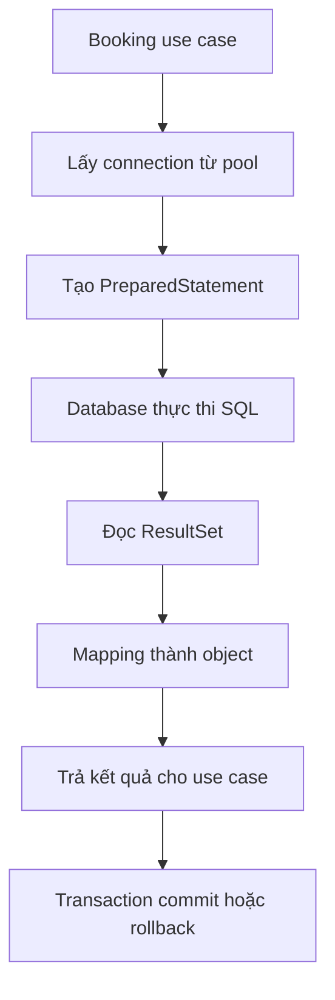

# Instrument database call

Trong một ứng dụng Spring Boot, database thường là một trong những nơi tạo ra độ trễ và lỗi khó điều tra nhất. Một API có thể chậm vì chờ lấy connection từ pool, chạy truy vấn lâu, đọc nhiều dòng, mapping kết quả hoặc chờ transaction commit. Chỉ nhìn thời gian HTTP tổng thể không cho biết bước nào gây ra vấn đề.

Instrument database call giúp đo và liên kết thao tác truy cập dữ liệu với metrics, logs và distributed tracing. Trong Spring Boot, cần phân biệt ba lớp dữ liệu: sức khỏe connection pool, thời gian của thao tác JDBC và thời gian của use case nghiệp vụ. Mỗi lớp trả lời một câu hỏi khác nhau.

Bài học này hướng dẫn instrument lời gọi database trong Spring Boot bằng Micrometer Observation và Actuator, đồng thời chỉ ra cách kiểm tra dữ liệu, tránh cardinality cao và xử lý các tình huống đặc thù của JDBC/JPA. Sau bài học, bạn có thể:

- Phân biệt metrics của connection pool với observation của truy vấn.
- Bật và kiểm tra instrumentation cho JDBC trong Spring Boot.
- Tạo Observation cho thao tác truy cập dữ liệu khi cần instrument thủ công.
- Liên kết database span với use case span và trace context.
- Chọn tag ổn định, tránh đưa SQL động hoặc dữ liệu nhạy cảm vào telemetry.
- Điều tra độ trễ, timeout, lỗi truy vấn và tình trạng cạn connection pool.

## 1. Cần quan sát phần nào của database call?

Một thao tác đọc đơn thuê có thể đi qua các bước:



Các bước này có thể nằm trong cùng một method ở góc nhìn ứng dụng, nhưng nguyên nhân gây chậm khác nhau:

- Chờ connection: pool đang bận, connection bị giữ quá lâu hoặc giới hạn pool quá thấp.
- Thực thi SQL: truy vấn thiếu index, query plan không phù hợp, lock hoặc database quá tải.
- Đọc và mapping kết quả: truy vấn trả quá nhiều dòng hoặc object mapping tốn CPU.
- Transaction: transaction giữ lock lâu hoặc commit chậm.
- Mạng: độ trễ giữa ứng dụng và database tăng.

Không phải instrumentation nào cũng đo riêng được tất cả các bước. Một Observation ở mức JDBC thường đo khoảng thời gian của lời gọi JDBC mà thư viện quan sát được. Metrics của pool mô tả trạng thái connection. Observation ở use case đo tổng thời gian nghiệp vụ. Kết hợp các tín hiệu này giúp khoanh vùng nguyên nhân.

## 2. Phân biệt pool metrics, JDBC observation và use case observation

| Loại dữ liệu | Đo điều gì? | Ví dụ câu hỏi |
|---|---|---|
| Connection pool metrics | Số connection active/idle, giới hạn pool và trạng thái sử dụng. | Pool có gần cạn connection không? |
| JDBC Observation | Thời gian và kết quả một thao tác JDBC được instrument. | Truy vấn đọc booking mất bao lâu? |
| Use case Observation | Tổng thời gian một thao tác nghiệp vụ, có thể gồm nhiều query và xử lý. | Xác nhận đơn thuê mất bao lâu từ đầu đến cuối? |

Pool metrics không cho biết câu SQL nào chậm. JDBC observation không thay thế pool metrics vì thời gian chờ lấy connection có thể chỉ là một phần của tổng thời gian. Use case observation có thể bao trùm nhiều thao tác, nhưng nếu chỉ có nó thì khó xác định truy vấn nào gây ra độ trễ.

Một trace có cấu trúc hợp lý có thể gồm span của HTTP request, span của use case và các span JDBC ở bên dưới. Các span database cho thấy thao tác nào mất thời gian; pool metrics giúp xác định có áp lực connection hay không.

## 3. Bật các thành phần cần thiết

Với Spring Boot, Actuator cung cấp hạ tầng metrics và Observation. Ví dụ dependency Gradle:

```gradle
dependencies {
    implementation("org.springframework.boot:spring-boot-starter-jdbc")
    implementation("org.springframework.boot:spring-boot-starter-actuator")

    runtimeOnly("io.micrometer:micrometer-registry-prometheus")

    // Chỉ thêm bridge và exporter nếu cần distributed tracing qua OpenTelemetry.
    implementation("io.micrometer:micrometer-tracing-bridge-otel")
    runtimeOnly("io.opentelemetry:opentelemetry-exporter-otlp")
}
```

Dùng dependency management của Spring Boot để chọn các phiên bản tương thích. Nếu ứng dụng chỉ cần metrics, không bắt buộc thêm tracing bridge và OTLP exporter. Nếu đã có dependency tương ứng từ starter hoặc platform nội bộ, tránh khai báo trùng.

Cấu hình expose các endpoint cần kiểm tra:

```properties
management.endpoints.web.exposure.include=health,info,metrics,prometheus
management.tracing.sampling.probability=0.10
```

Endpoint Prometheus chỉ xuất hiện khi registry Prometheus được cấu hình. Sampling 10% trong ví dụ là giá trị minh họa cho tracing; không ảnh hưởng đến việc pool metrics được ghi nhận. Trong production, bảo vệ endpoint Actuator và chọn sampling dựa trên lưu lượng, yêu cầu điều tra và chi phí backend.

Spring Boot thường tự bind metrics cho các DataSource pool được hỗ trợ. Với HikariCP, các metrics có thể bao gồm số connection active, idle, max và min. Tên metric phổ biến ở lớp DataSource là **jdbc.connections.active**, **jdbc.connections.idle**, **jdbc.connections.max** và **jdbc.connections.min**; registry hoặc pool cụ thể cũng có thể cung cấp nhóm metric riêng. Hãy kiểm tra danh sách metric thực tế của phiên bản và pool đang dùng.

## 4. Dùng JDBC Observation có sẵn trong Spring Boot

Spring Framework 6.1 trở lên bổ sung Observation cho JdbcTemplate. Khi dùng JdbcTemplate được Spring Boot auto-configure cùng Observation infrastructure, lời gọi JDBC có thể được quan sát và tạo dữ liệu cho metrics/tracing theo các handler đã cấu hình.

Ví dụ repository dùng JdbcTemplate:

```java
import java.util.List;
import java.util.Optional;
import java.util.UUID;

import org.springframework.jdbc.core.JdbcTemplate;
import org.springframework.stereotype.Repository;

@Repository
public class JdbcBookingRepository {

    private final JdbcTemplate jdbcTemplate;

    public JdbcBookingRepository(JdbcTemplate jdbcTemplate) {
        this.jdbcTemplate = jdbcTemplate;
    }

    public Optional<Booking> findById(UUID bookingId) {
        List<Booking> rows = jdbcTemplate.query(
                """
                select id, status
                from booking
                where id = ?
                """,
                (rs, rowNum) -> new Booking(
                        rs.getObject("id", UUID.class),
                        BookingStatus.valueOf(rs.getString("status"))
                ),
                bookingId
        );

        return rows.stream().findFirst();
    }
}
```

Trong ví dụ, câu SQL dùng placeholder và truyền bookingId riêng để JDBC bind tham số. Không nối giá trị đầu vào vào SQL string. Việc dùng query cố định cũng giúp tên và cấu trúc thao tác ổn định hơn.

Với Spring Boot và Spring Framework có hỗ trợ JDBC Observation, hãy xác minh JdbcTemplate đang dùng ObservationRegistry được cấu hình. Các ứng dụng dùng template tự tạo hoặc tự thay thế bean cần kiểm tra cấu hình này. Nếu framework cũ hơn hoặc đường truy cập dữ liệu không được instrument tự động, có thể cần tạo Observation thủ công ở ranh giới repository.

Không giả định rằng mọi thao tác database đều tự động tạo span chỉ vì đã thêm Actuator. Khả năng quan sát phụ thuộc phiên bản Spring Framework, cách tạo DataSource/JdbcTemplate, dependency tracing và handler đang hoạt động. Kiểm tra output metrics và trace trên ứng dụng thực tế trước khi kết luận instrumentation đã bật.

## 5. Tạo Observation thủ công khi cần

Có những trường hợp lời gọi database nằm trong thư viện riêng, custom client hoặc phiên bản framework chưa có JDBC Observation phù hợp. Khi đó có thể bọc thao tác bằng Micrometer Observation.

Ví dụ:

```java
@Repository
public class LegacyBookingStore {

    private final LegacySqlClient sqlClient;
    private final ObservationRegistry observationRegistry;

    public LegacyBookingStore(
            LegacySqlClient sqlClient,
            ObservationRegistry observationRegistry
    ) {
        this.sqlClient = sqlClient;
        this.observationRegistry = observationRegistry;
    }

    public Optional<Booking> findById(UUID bookingId) {
        return Observation.createNotStarted(
                        "booking.db.find_by_id",
                        observationRegistry
                )
                .lowCardinalityKeyValue("db.system", "postgresql")
                .lowCardinalityKeyValue("db.operation", "SELECT")
                .lowCardinalityKeyValue("db.table", "booking")
                .observe(() -> sqlClient.findBooking(bookingId));
    }
}
```

Tên Observation **booking.db.find_by_id** ổn định và mô tả mục đích truy cập dữ liệu. Các low-cardinality key-value là những giá trị có tập lựa chọn hữu hạn: hệ quản trị, loại thao tác và bảng nghiệp vụ. Khi Observation có meter handler, thời gian có thể được ghi thành Timer; khi có tracing handler, nó có thể trở thành span.

LegacySqlClient ở đây đại diện cho client riêng của ứng dụng. Nếu lời gọi bên trong đã tạo JDBC Observation tự động, Observation bao ngoài có thể hữu ích như một ranh giới repository nhưng sẽ tạo thêm một span cha. Hãy đặt tên khác nhau và chỉ giữ span bổ sung khi nó giúp phân biệt trách nhiệm nghiệp vụ.

Không bọc JdbcTemplate bằng một Observation trùng lặp chỉ để tạo thêm span. Trước tiên hãy kiểm tra instrumentation có sẵn. Nếu cần một span nghiệp vụ bao trùm nhiều câu SQL, đặt Observation ở use case hoặc repository boundary với tên phản ánh thao tác cấp cao hơn.

### 5.1. Observation đo thời gian nào?

Khi bọc một lời gọi đồng bộ bằng observe, khoảng đo bao gồm thời gian từ lúc bắt đầu thực thi callback đến khi callback trả về hoặc ném exception. Với một lời gọi JDBC, thời gian đó có thể bao gồm lấy connection, gửi câu lệnh, chờ database, đọc ResultSet và mapping kết quả tùy API được dùng.

Nó không nhất thiết bao gồm transaction commit nếu commit diễn ra sau khi method repository trả về. Ví dụ, transaction interceptor có thể commit sau khi method @Transactional hoàn tất phần thân. Nếu cần đo toàn bộ transaction, hãy quan sát ở ranh giới transaction/use case phù hợp và hiểu thứ tự interceptor. Không cộng thời gian của các span lồng nhau như thể chúng là các khoảng độc lập; chúng có thể chồng lấp.

## 6. Chọn tag và query name an toàn

Tag giúp phân nhóm dữ liệu. Chúng phải ổn định và có số lượng giá trị dự đoán được.

| Thuộc tính | Ví dụ phù hợp | Lý do |
|---|---|---|
| db.system | postgresql, mysql | Tập hệ quản trị nhỏ, ổn định. |
| db.operation | SELECT, INSERT, UPDATE, DELETE | Loại thao tác hữu hạn. |
| db.table | booking, payment | Tên bảng đã biết trước. |
| result | success, error, timeout | Kết quả được chuẩn hóa. |
| query.name | booking.find_by_id | Tên truy vấn logic cố định. |

Không đưa các giá trị sau vào metric tag:

- booking.id, customer.id, user.id.
- Trace ID, request ID, session ID.
- SQL string chứa literal hoặc tham số thực.
- Nội dung exception message, giá trị do người dùng nhập hoặc URL động.
- Tên bảng/cột được ghép từ đầu vào không kiểm soát.

Mỗi giá trị tag mới có thể tạo thêm chuỗi thời gian. Nếu có hàng triệu booking ID, dùng ID làm tag sẽ tạo cardinality rất lớn và làm tăng bộ nhớ, chi phí scrape và lưu trữ. Định danh cần thiết để tìm một lần xử lý nên nằm trong log hoặc trace attribute đã được chính sách cho phép, không nằm trong metric tag.

Nếu cần nhận diện truy vấn trong dashboard, dùng query name cố định do ứng dụng đặt, ví dụ **booking.find_by_id**. Không dùng toàn bộ câu SQL làm tên Observation. SQL có thể chứa literal, schema nội bộ hoặc thông tin nhạy cảm, đồng thời mỗi biến thể câu lệnh có thể làm tăng số series hoặc span attribute.

## 7. Connection pool metrics và cách đọc

Connection pool như HikariCP tái sử dụng kết nối database. Pool metrics giúp xác định ứng dụng có đang thiếu connection hoặc giữ connection quá lâu hay không.

Một số chỉ số cần quan sát:

| Metric | Ý nghĩa | Dấu hiệu cần xem xét |
|---|---|---|
| Active connections | Số connection đang được mượn. | Liên tục sát giới hạn pool. |
| Idle connections | Số connection đang rảnh. | Thường xuyên bằng 0 trong lúc tải cao. |
| Max connections | Giới hạn tối đa được cấu hình. | Cần đối chiếu với giới hạn database và tổng replica. |
| Min connections | Mức connection tối thiểu được duy trì. | Giúp hiểu cấu hình warm pool. |
| Pending threads / acquire wait | Số luồng đang chờ lấy connection hoặc thời gian chờ. | Tăng cao cho thấy pool có thể bị nghẽn. |

Tên metric cụ thể phụ thuộc pool và phiên bản. Với HikariCP, có thể xem nhóm metric bắt đầu bằng **hikaricp.connections** nếu binder tương ứng đang hoạt động.

Ví dụ cấu hình pool:

```properties
spring.datasource.hikari.maximum-pool-size=20
spring.datasource.hikari.minimum-idle=5
spring.datasource.hikari.connection-timeout=3000
spring.datasource.hikari.idle-timeout=600000
spring.datasource.hikari.max-lifetime=1800000
```

Các con số chỉ là ví dụ. Không sao chép giới hạn pool vào production mà chưa tính tổng số replica, giới hạn connection của database, số ứng dụng cùng truy cập và mức song song của workload. Ví dụ 5 replica với pool tối đa 20 có thể mở tối đa 100 connection từ ứng dụng này.

Pool active cao không tự động chứng minh database chậm. Có thể ứng dụng đang giữ connection trong transaction quá lâu, chạy nhiều truy vấn song song hoặc pool được cấu hình quá nhỏ. Đối chiếu active, idle, pending/acquire wait với JDBC latency, query latency và database-side metrics.

## 8. Phân biệt thời gian truy vấn và thời gian transaction

Với JDBC, thời gian của một query observation thường kết thúc khi lời gọi API trả về. Transaction có thể còn tiếp tục thực hiện các câu lệnh khác và chỉ commit sau đó.

Ví dụ:

```java
@Transactional
public void confirmBooking(UUID bookingId) {
    Booking booking = bookingRepository.findById(bookingId)
            .orElseThrow();

    booking.confirm();
    bookingRepository.save(booking);

    paymentRepository.recordAuthorization(bookingId);
}
```

Use case trên có thể tạo ra nhiều lời gọi database trong cùng một transaction. Nếu mỗi lời gọi có Observation riêng, trace cho thấy thời gian của từng thao tác. Một Observation cấp use case cho thấy tổng thời gian nghiệp vụ. Transaction commit có thể xảy ra sau khi method trả về qua proxy; nếu commit chậm, cần instrument hoặc theo dõi ở tầng transaction/driver phù hợp.

Với JPA/Hibernate, lệnh save không phải lúc nào cũng gửi SQL ngay. ORM có thể trì hoãn SQL đến flush hoặc commit. Do đó, thời gian của method repository không nhất thiết là thời gian thực thi câu SQL. Khi điều tra, hãy kiểm tra thời điểm flush, transaction boundary và instrumentation ở provider. Không gọi flush chỉ để làm số liệu trông chính xác hơn vì thao tác đó thay đổi hành vi và hiệu năng của ứng dụng.

## 9. Ghi nhận lỗi database mà không làm lộ dữ liệu

Một database call có thể thất bại do timeout, mất kết nối, deadlock, vi phạm constraint hoặc lỗi cú pháp. Observation nên kết thúc với trạng thái lỗi phù hợp và exception tiếp tục được xử lý theo luồng nghiệp vụ. Với Observation.observe, exception từ callback được ghi nhận trong Observation rồi được ném lại cho caller.

Khi tạo log cho lỗi, hãy dùng nhóm lỗi đã chuẩn hóa:

- connection: không lấy được hoặc mất connection.
- timeout: hết thời gian chờ.
- constraint: vi phạm constraint đã biết.
- deadlock: transaction bị database hủy do deadlock.
- other: lỗi chưa phân loại.

Không dùng exception message làm tag vì message có thể chứa SQL, giá trị tham số hoặc nội dung không giới hạn. SQLState có thể hữu ích trong log để điều tra, nhưng nếu dùng trong metrics hãy chuẩn hóa về nhóm mã có số lượng nhỏ.

Không ghi password, connection string có credential, token, dữ liệu cá nhân hoặc giá trị bind parameter vào log. Câu SQL có thể chứa thông tin schema nội bộ; tham số truy vấn có thể chứa email, số điện thoại hoặc định danh người dùng. Chỉ ghi query name, operation, mã lỗi và thông tin đã được cho phép.

Nếu một lỗi như EmptyResultDataAccessException được coi là kết quả bình thường trong use case, hãy xử lý nó theo ngữ nghĩa nghiệp vụ trước khi quyết định mức log hoặc phân loại lỗi. Đừng để một lần tìm không có dữ liệu làm tăng cảnh báo database error nếu đó là hành vi dự kiến.

## 10. Liên kết database span với trace và log

Một database span nên là span con của thao tác gọi nó, ví dụ use case booking.confirm. Khi request đến qua HTTP, trace context được tạo ở server instrumentation và truyền trong luồng đồng bộ. Các Observation con có thể tiếp tục cùng trace.

Trong log, trace ID và span ID giúp chuyển từ một dòng log đến trace tương ứng. Khi ghi log tại repository, có thể thêm tên query logic, kết quả và định danh nghiệp vụ đã được phép. Không tự tạo trace ID mới trong repository; hãy lấy context từ tracing integration.

Nếu database call được thực hiện trong executor hoặc tác vụ nền, cần bảo đảm context được truyền qua ranh giới thread. Nếu context bị mất, span database có thể trở thành root trace mới và log không còn liên kết với request ban đầu. Với tác vụ độc lập như scheduled cleanup, một trace riêng có thể phù hợp hơn; với tác vụ phát sinh từ request, cần mô hình parent context hoặc span link rõ ràng.

Không đưa trace ID vào metric tag. Trace ID có cardinality gần như mỗi request một giá trị; nó phù hợp để tương quan log và trace, không phù hợp để phân nhóm metric.

## 11. Kiểm tra instrumentation

Sau khi bật instrumentation, cần xác nhận dữ liệu thật sự được ghi nhận.

Với Actuator, có thể xem danh sách metric và một metric cụ thể:

```bash
curl http://localhost:8080/actuator/metrics
curl http://localhost:8080/actuator/metrics/jdbc.connections.active
curl http://localhost:8080/actuator/metrics/jdbc.connections.max
```

Tên metric và tag có thể khác theo DataSource implementation. Nếu endpoint trả về 404, kiểm tra registry, binder và endpoint exposure. Nếu metric không xuất hiện, kiểm tra xem pool có được Spring Boot nhận diện hay DataSource đã bị thay thế bởi wrapper tùy chỉnh chưa.

Với tracing, gửi một request thực hiện thao tác đọc booking rồi kiểm tra backend trace:

1. Có server span của HTTP request không?
2. Có span hoặc Observation của use case không?
3. Có JDBC span/observation tương ứng với lời gọi repository không?
4. Quan hệ cha-con có đúng không?
5. Trace có duration hợp lý và không có span trùng không?
6. Log có cùng trace ID khi được phát trong context đó không?

Với metrics, kiểm tra Timer của Observation hoặc metric query tương ứng nếu handler được cấu hình. Không giả định tên metric chính xác chỉ từ tên Observation; registry có thể chuẩn hóa dấu chấm, dấu gạch và đơn vị. Xem danh sách metric thực tế và tag được xuất.

## 12. Quy trình điều tra một database call chậm

Giả sử API đọc đơn thuê có p95 tăng từ 100 ms lên 1,5 giây. Hãy tiến hành theo thứ tự:

1. Dùng HTTP metrics để xác định endpoint, phiên bản và thời điểm bị ảnh hưởng.
2. Kiểm tra use case observation để xem tổng thời gian tăng ở mọi request hay chỉ một luồng.
3. Mở một số trace chậm. So sánh JDBC span với phần xử lý ứng dụng và outbound dependency.
4. Nếu JDBC span dài, kiểm tra pool active/idle, pending threads và thời gian acquire connection.
5. Nếu pool không nghẽn, kiểm tra query plan, index, lock, số dòng trả về và database-side metrics.
6. Kiểm tra mapping kết quả và lượng dữ liệu truyền về ứng dụng.
7. Đối chiếu log lỗi, timeout, deadlock và retry trong cùng trace hoặc khoảng thời gian.
8. Sau khi thay đổi, so sánh p50/p95/p99, tỷ lệ lỗi và pool utilization trước/sau.

Một số dấu hiệu thường gặp:

| Dấu hiệu | Hướng điều tra |
|---|---|
| Pool active chạm max, pending tăng | Transaction dài, connection leak, pool quá nhỏ hoặc tải đồng thời tăng. |
| JDBC span dài, pool còn idle | Query chậm, lock, database quá tải hoặc network latency. |
| JDBC span ngắn nhưng use case dài | Xử lý CPU, lock ứng dụng, gọi service khác hoặc logic nội bộ. |
| Nhiều query nhỏ trong một trace | N+1 query, lặp truy vấn hoặc thiếu batch/fetch strategy. |
| Timeout tăng cùng connection errors | Database/network không ổn định, pool lifetime hoặc timeout cấu hình chưa phù hợp. |
| JPA repository nhanh nhưng commit chậm | SQL bị trì hoãn đến flush/commit hoặc transaction có nhiều thay đổi. |

Không kết luận query chậm chỉ từ p95 của API. Dùng trace và pool metrics để phân biệt thời gian chờ connection, thời gian database thực thi và phần xử lý sau truy vấn.

## 13. Các lỗi instrumentation thường gặp

| Cách làm | Vấn đề | Cách cải thiện |
|---|---|---|
| Chỉ bật pool metrics rồi kết luận đã đo query | Pool state không cho biết thời gian từng câu lệnh. | Bật JDBC Observation hoặc instrument ranh giới truy vấn phù hợp. |
| Tạo Observation thủ công quanh JdbcTemplate đã được instrument | Tạo span lồng nhau trùng ý nghĩa và khó đọc. | Dùng instrumentation sẵn có; chỉ thêm span cấp use case khi có giá trị. |
| Đưa SQL đầy đủ và tham số vào tag | Cardinality cao, có thể lộ dữ liệu. | Dùng query name và operation cố định. |
| Đưa booking ID vào metric tag | Tạo một chuỗi thời gian cho từng đơn. | Giữ ID trong log/trace attribute đã được duyệt. |
| Đo mỗi method repository nhưng bỏ qua transaction | Có thể bỏ sót flush và commit sau method. | Quan sát cả use case/transaction khi cần tổng thời gian. |
| Tăng pool size để xử lý mọi độ trễ | Có thể làm database quá tải hơn. | Đo pool wait, query latency và database capacity trước khi chỉnh. |
| Log toàn bộ exception message và SQL parameters | Có thể ghi credential hoặc dữ liệu cá nhân. | Chuẩn hóa error category và lọc dữ liệu. |
| Bật sampling 100% để tìm một query chậm | Tăng chi phí lớn và có thể không cần thiết. | Dùng metrics để phát hiện, sampling phù hợp và tail sampling nếu có. |

## 14. Bài thực hành: instrument thao tác đọc booking

Thực hiện bài tập trên một ứng dụng Spring Boot có JDBC và DataSource pool.

### Bước 1: Bật Actuator và metrics registry

Thêm Actuator và registry mà môi trường quan sát đang dùng. Expose health, metrics và endpoint scrape cần thiết. Xác nhận endpoint Actuator được bảo vệ theo môi trường.

### Bước 2: Kiểm tra connection pool

Gửi một số request đọc booking. Mở /actuator/metrics và tìm các metric pool như jdbc.connections.active, jdbc.connections.idle, jdbc.connections.max. Ghi lại giá trị khi ứng dụng nhàn rỗi và khi có tải.

### Bước 3: Instrument lời gọi JDBC

Dùng JdbcTemplate được Spring Boot cấu hình trên phiên bản hỗ trợ JDBC Observation. Nếu đường truy cập dữ liệu không có instrumentation tự động, bọc thao tác ở repository bằng một Observation có tên cố định, chẳng hạn booking.db.find_by_id.

Chỉ thêm các key-value có số lượng giá trị hữu hạn như database system, operation và query name. Không thêm booking ID hoặc giá trị bind parameter vào metric tag.

### Bước 4: Liên kết trace và log

Bật tracing bridge và exporter nếu bài thực hành có backend trace. Gửi một request đọc booking, kiểm tra server span, use case span và JDBC span. Ghi một log sự kiện trong cùng context và xác nhận trace ID xuất hiện trong log.

### Bước 5: Tạo tình huống lỗi có kiểm soát

Trong môi trường test, thử một truy vấn timeout hoặc ngắt kết nối database. Xác nhận Observation ghi nhận lỗi, exception vẫn được truyền đến tầng xử lý và log không chứa thông tin nhạy cảm. Không thực hiện thử nghiệm gây gián đoạn trên database production.

### Bước 6: Đọc kết quả

So sánh pool metrics, JDBC duration và use case duration. Xác định liệu độ trễ đến từ pool, truy vấn, mapping hay phần xử lý khác. Ghi lại một giả thuyết và bằng chứng từ trace/metrics trước khi thay đổi cấu hình.

### Tiêu chí hoàn thành

- Pool metrics xuất hiện và thay đổi khi có tải.
- Database call được quan sát bằng instrumentation tự động hoặc Observation thủ công phù hợp.
- Trace thể hiện quan hệ đúng giữa use case và database operation.
- Tag chỉ chứa giá trị hữu hạn, ổn định.
- Lỗi database được ghi nhận và vẫn được xử lý đúng ở tầng nghiệp vụ.
- Log và trace không chứa password, token hoặc tham số nhạy cảm.
- Có thể phân biệt pool wait với query duration và tổng thời gian use case.

## 15. Checklist trước khi đưa lên production

- DataSource pool được nhận diện và xuất metrics.
- JDBC instrumentation hoạt động đúng với phiên bản Spring Framework và cách cấu hình DataSource.
- Observation name và query name ổn định.
- Không có span trùng lặp cho cùng một thao tác.
- Pool metrics được đọc cùng JDBC duration và use case duration.
- Metric tag không chứa ID, SQL động hoặc dữ liệu không giới hạn.
- SQL và bind parameter không bị ghi vào log ngoài chính sách cho phép.
- Exception được phân loại mà không làm mất stack trace cần thiết.
- Trace context được giữ qua executor và tác vụ nền có liên quan.
- Timeout, pool size và sampling được chọn dựa trên số liệu thực tế.
- Endpoint Actuator được bảo vệ và retention phù hợp với yêu cầu vận hành.

Instrument database call hiệu quả khi mỗi lớp dữ liệu có mục đích rõ ràng: pool metrics cho biết khả năng cấp connection, JDBC Observation cho biết thời gian thao tác dữ liệu, còn use case Observation cho biết tác động lên luồng nghiệp vụ. Khi liên kết chúng bằng trace context và giữ tag có cardinality thấp, đội ngũ có thể xác định nguyên nhân database chậm mà vẫn kiểm soát được chi phí và dữ liệu nhạy cảm.

