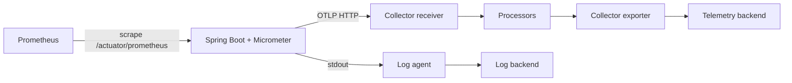

# Mô phỏng mất exporter

Trong production, ứng dụng có thể vẫn xử lý request bình thường trong khi một phần telemetry không đến được hệ thống quan sát. Một exporter bị lỗi có thể làm trace biến mất, metric không được chuyển đi hoặc dữ liệu bị dồn trong hàng đợi rồi bị loại bỏ. Nếu không chủ động thử tình huống này, đội vận hành dễ nhầm “không thấy dữ liệu” với “ứng dụng không phát sinh hoạt động”.

Bài thực hành này dựng một đường truyền telemetry đơn giản cho Spring Boot, sau đó lần lượt làm gián đoạn exporter hoặc backend để quan sát hành vi. Bạn sẽ phân biệt lỗi ở ứng dụng, Collector và backend; kiểm tra mức độ ảnh hưởng đến request; đọc log và metric vận hành; cuối cùng khôi phục pipeline và xác nhận dữ liệu được gửi lại.

Trong phạm vi module `SPRING_BOOT_OBSERVABILITY`, bài học sử dụng Micrometer Observation, metrics, logs và distributed tracing. Mục tiêu là biết cách kiểm chứng toàn bộ đường đi của telemetry trong một sự cố thực tế.

## Kết quả cần đạt

Sau bài thực hành, bạn có thể:

- Mô tả được đường đi của trace, metric và log từ ứng dụng đến nơi lưu trữ.
- Mô phỏng lỗi kết nối từ ứng dụng đến OpenTelemetry Collector.
- Phân biệt Collector không nhận dữ liệu với Collector nhận được nhưng không xuất tiếp được.
- Kiểm tra xem exporter có làm ảnh hưởng đến request, độ trễ, bộ nhớ hoặc thread của ứng dụng hay không.
- Nhận biết giới hạn của retry, queue, timeout và sampling khi pipeline bị gián đoạn.
- Khôi phục exporter và xác minh luồng telemetry đã hoạt động trở lại.

## Kiến trúc và điểm có thể hỏng

Trong lab, ứng dụng gửi trace và metric qua OTLP HTTP đến OpenTelemetry Collector. Collector nhận dữ liệu, xử lý theo pipeline và ghi tóm tắt ra log bằng debug exporter. Log ứng dụng đi theo luồng stdout riêng. Nếu dùng Prometheus, Prometheus chủ động scrape endpoint metrics của ứng dụng theo một đường khác.



| Chặng | Ví dụ sự cố | Dấu hiệu cần kiểm tra |
|---|---|---|
| Instrumentation trong ứng dụng | Observation không được tạo hoặc context bị đứt | Không có meter/span tương ứng; trace không liên kết giữa các service |
| Exporter trong ứng dụng → Collector | Sai host/port, Collector dừng, timeout hoặc sai giao thức | Log export thất bại ở ứng dụng; Collector không nhận tín hiệu |
| Collector receiver/processors | Receiver không mở cổng, cấu hình pipeline sai, bộ nhớ vượt giới hạn | Collector báo lỗi cấu hình hoặc từ chối dữ liệu |
| Collector exporter → backend | Backend dừng, DNS lỗi, xác thực sai hoặc hết quota | Collector nhận dữ liệu nhưng export lỗi, queue tăng hoặc dữ liệu bị drop |
| Backend và truy vấn | Ingest chậm, sai tenant, sai bộ lọc hoặc truy vấn nhầm khoảng thời gian | Không thấy dữ liệu trên giao diện dù tầng trước đã nhận |
| Đường log riêng | Agent/sidecar dừng hoặc backend log không nhận dữ liệu | Log còn ở stdout nhưng không xuất hiện trong hệ thống tìm kiếm |
| Prometheus scrape | Prometheus dừng hoặc không truy cập được endpoint | Target down hoặc có khoảng trống trong chuỗi metric |

Một điểm quan trọng: Prometheus thường scrape endpoint `/actuator/prometheus`; đây không phải luồng OTLP push từ ứng dụng. Nếu Prometheus ngừng scrape, endpoint trong ứng dụng vẫn có thể hoạt động. Tương tự, log ứng dụng ghi ra stdout không tự động đi qua Micrometer Tracing exporter. Hệ thống thu thập log thường dùng agent, sidecar hoặc runtime logging driver riêng.

## Chuẩn bị lab

Bạn cần một ứng dụng Spring Boot có Actuator và một endpoint HTTP có thể gọi lặp lại. Phiên bản Spring Boot và các dependency phải được quản lý đồng nhất bằng BOM hoặc dependency management của dự án.

Các dependency thường dùng cho đường OTLP trong Spring Boot 3.x gồm:

- `spring-boot-starter-actuator`
- `micrometer-tracing-bridge-otel`
- `opentelemetry-exporter-otlp`
- `micrometer-registry-otlp` nếu muốn đẩy metrics bằng OTLP

Nếu bài lab dùng Prometheus scrape thay cho OTLP metrics, dùng `micrometer-registry-prometheus` và expose endpoint Prometheus. Không cần cài cả hai registry nếu mục tiêu chỉ là kiểm tra một đường metrics. Tên dependency và property có thể thay đổi theo phiên bản Spring Boot/Micrometer; hãy dùng phiên bản do dự án quản lý và kiểm tra cấu hình tương ứng với phiên bản đó.

### Cấu hình Collector tối thiểu

Tạo file `otel-collector-config.yaml` trong thư mục lab:

```yaml
receivers:
  otlp:
    protocols:
      grpc:
        endpoint: 0.0.0.0:4317
      http:
        endpoint: 0.0.0.0:4318

processors:
  memory_limiter:
    check_interval: 1s
    limit_mib: 256
  batch:

exporters:
  debug:
    verbosity: basic

service:
  pipelines:
    traces:
      receivers: [otlp]
      processors: [memory_limiter, batch]
      exporters: [debug]
    metrics:
      receivers: [otlp]
      processors: [memory_limiter, batch]
      exporters: [debug]
```

Debug exporter giúp nhìn thấy Collector đã nhận trace và metric trong log của container. Đây là đích kiểm tra cho lab, không phải backend lưu trữ lâu dài.

Tạo file `compose.yaml`:

```yaml
services:
  otel-collector:
    image: otel/opentelemetry-collector-contrib:0.120.0
    command: ["--config=/etc/otelcol-contrib/config.yaml"]
    volumes:
      - ./otel-collector-config.yaml:/etc/otelcol-contrib/config.yaml:ro
    ports:
      - "4317:4317"
      - "4318:4318"
```

Phiên bản image được ghim để lab có thể lặp lại. Khi dùng trong dự án thực, chọn phiên bản Collector được tổ chức hỗ trợ và cập nhật có kiểm soát.

### Cấu hình ứng dụng

Ví dụ dưới đây dành cho ứng dụng chạy trực tiếp trên máy host, còn Collector publish cổng 4318 ra localhost:

```yaml
management:
  endpoints:
    web:
      exposure:
        include: health,metrics,prometheus
  tracing:
    sampling:
      probability: 1.0
  otlp:
    tracing:
      endpoint: http://localhost:4318/v1/traces
    metrics:
      export:
        url: http://localhost:4318/v1/metrics
```

Sampling 100% chỉ dùng để dễ quan sát trong lab có lưu lượng nhỏ. Production cần chọn sampling phù hợp với ngân sách và mục tiêu điều tra. Nếu ứng dụng chạy trong container cùng network với Collector, dùng hostname service `otel-collector` thay cho `localhost`. Trong container ứng dụng, `localhost` trỏ về chính container ứng dụng.

Nếu dự án chỉ export trace qua OTLP nhưng metrics dùng Prometheus, bỏ cấu hình OTLP metrics và cấu hình registry Prometheus. Khi đó metrics sẽ được scrape từ endpoint `/actuator/prometheus`; không suy luận rằng Collector nhận OTLP metrics chỉ vì endpoint Prometheus có dữ liệu.

## Bước 1: Xác nhận trạng thái bình thường

Khởi động Collector:

```bash
docker compose up -d otel-collector
docker compose ps
docker compose logs --tail=100 otel-collector
```

Khởi động ứng dụng Spring Boot. Kiểm tra health endpoint:

```bash
curl -i http://localhost:8080/actuator/health
```

Gọi endpoint nghiệp vụ có sẵn trong ứng dụng vài lần để sinh request. Thay `/api/your-endpoint` bằng route thực tế:

```bash
curl -i http://localhost:8080/api/your-endpoint
```

Kiểm tra metric HTTP tại Actuator:

```bash
curl -s http://localhost:8080/actuator/metrics/http.server.requests
```

Mở log Collector và xác nhận debug exporter đã ghi nhận trace hoặc metric. Nếu dùng Prometheus registry, kiểm tra endpoint scrape:

```bash
curl -s http://localhost:8080/actuator/prometheus
```

Endpoint Prometheus chỉ tồn tại khi ứng dụng đã cài registry tương ứng và expose endpoint đó.

Ghi lại baseline trước khi gây lỗi:

- Request có nhận được response như dự kiến không?
- Metric request có tăng sau khi gọi endpoint không?
- Collector có nhận trace/metric không?
- Trace có service name, operation và quan hệ span phù hợp không?
- Log ứng dụng có trace ID khi request nằm trong trace không?

Nếu chưa thấy tín hiệu ở trạng thái bình thường, hãy sửa cấu hình lab trước khi mô phỏng sự cố. Nếu không có baseline, bạn sẽ khó phân biệt lỗi mới với cấu hình vốn đã sai.

## Bước 2: Mô phỏng Collector dừng

Đây là tình huống exporter trong ứng dụng không thể kết nối đến Collector.

Dừng Collector:

```bash
docker compose stop otel-collector
```

Gọi lại endpoint nghiệp vụ và health endpoint. Sau đó kiểm tra log ứng dụng:

```bash
curl -i http://localhost:8080/actuator/health
curl -i http://localhost:8080/api/your-endpoint
```

Tìm các thông báo liên quan đến export, chẳng hạn connection refused, connection timeout, failed to export hoặc retry. Tên log cụ thể phụ thuộc exporter và phiên bản thư viện.

Quan sát các kết quả sau:

1. Request nghiệp vụ có tiếp tục thành công không?
2. Latency của request có tăng đột biến không?
3. Ứng dụng có ghi nhận lỗi export trong log không?
4. Collector không chạy nên không có dữ liệu mới trong log debug của Collector.
5. Log ứng dụng trên stdout vẫn có thể xuất hiện dù trace hoặc metric OTLP không đến Collector.

Với cấu hình tracing batch thông thường, việc gửi span thường diễn ra bất đồng bộ. OTLP metrics registry cũng thường export theo chu kỳ. Vì vậy lỗi export không nhất thiết làm request hiện tại thất bại. Tuy nhiên, hành vi thực tế phụ thuộc exporter, timeout, queue, scheduler và cách ứng dụng tích hợp. Hãy đo bằng lab thay vì giả định rằng mọi exporter đều không ảnh hưởng đến request.

Nếu request bắt đầu chậm hoặc thất bại, xác định thread nào đang chờ, thời gian timeout, exception và đường gọi exporter. Một exporter được cấu hình đồng bộ hoặc một custom handler thực hiện I/O trên request thread có thể làm tăng latency. Telemetry nên được thiết kế để lỗi ở đường xuất dữ liệu không làm mất khả năng phục vụ nghiệp vụ.

## Bước 3: Khôi phục và kiểm tra dữ liệu sau gián đoạn

Khởi động lại Collector:

```bash
docker compose start otel-collector
docker compose ps
docker compose logs --tail=100 otel-collector
```

Gửi thêm request mới và kiểm tra Collector nhận dữ liệu trở lại. So sánh thời điểm log lỗi export ở ứng dụng với thời điểm Collector bắt đầu nhận dữ liệu.

Không mặc định rằng toàn bộ telemetry phát sinh trong lúc Collector dừng sẽ được gửi bù. Kết quả phụ thuộc loại tín hiệu và exporter:

- Trace có thể nằm trong batch queue đến khi queue đầy hoặc process kết thúc; span vượt giới hạn queue có thể bị drop.
- Metrics push có thể giữ dữ liệu tổng hợp của một chu kỳ, nhưng không bảo đảm khôi phục mọi điểm dữ liệu đã lỡ gửi.
- Log stdout có thể còn trong runtime hoặc được agent thu thập sau đó, tùy cấu hình và giới hạn lưu giữ.
- Nếu ứng dụng restart trong lúc mất kết nối, queue trong bộ nhớ thường mất theo process trừ khi có cơ chế lưu bền được thiết kế riêng.

Hãy ghi rõ khoảng thời gian thiếu dữ liệu trong báo cáo lab. Việc dữ liệu mới xuất hiện sau khi Collector phục hồi không chứng minh dữ liệu cũ đã được replay đầy đủ.

## Bước 4: Mô phỏng backend phía sau Collector không khả dụng

Trong kiến trúc thực tế, Collector có thể vẫn nhận OTLP từ ứng dụng nhưng không gửi được đến backend. Đây là lỗi khác với việc ứng dụng không kết nối được Collector.

Để thử tình huống này, thay debug exporter bằng OTLP exporter trỏ tới một backend trong lab. Ví dụ cấu hình phần exporter có thể dùng dạng:

```yaml
exporters:
  otlp/backend:
    endpoint: telemetry-backend:4317
    tls:
      insecure: true
    sending_queue:
      enabled: true
      queue_size: 1000
    retry_on_failure:
      enabled: true
```

Thay `telemetry-backend:4317` bằng địa chỉ backend trong môi trường thử nghiệm. Cập nhật danh sách exporter của pipeline để dùng `otlp/backend`. Sau khi xác nhận đường truyền hoạt động, dừng backend hoặc làm cho địa chỉ backend không thể truy cập.

Trong khi backend dừng, gửi request mới vào ứng dụng và kiểm tra log cùng telemetry nội bộ của Collector. Bạn cần xác nhận:

- Ứng dụng vẫn gửi dữ liệu tới receiver của Collector.
- Collector ghi nhận lỗi khi export sang backend.
- Queue tăng khi retry chưa thành công, nếu sending queue được bật.
- Khi queue đạt giới hạn hoặc dữ liệu vượt chính sách retry, Collector có thể loại bỏ dữ liệu.
- Backend không có dữ liệu mới trong khoảng thời gian bị gián đoạn.

Tên metric nội bộ của Collector thay đổi theo phiên bản và cấu hình telemetry. Hãy tìm các nhóm chỉ số về số lần export thành công/thất bại, kích thước queue, số phần tử enqueue thất bại, dung lượng bộ nhớ và số dữ liệu bị drop. Log Collector thường cho biết exporter, endpoint và nguyên nhân thất bại.

Không tăng queue vô hạn để che giấu backend chậm. Queue lớn làm tăng nhu cầu bộ nhớ và có thể khiến Collector bị OOM. Chọn queue, retry, timeout và giới hạn bộ nhớ dựa trên lưu lượng, thời gian gián đoạn dự kiến và khả năng phục hồi của backend.

## Bước 5: Phân biệt lỗi của từng loại tín hiệu

Không phải mọi tín hiệu đều đi qua cùng exporter. Dùng bảng sau để xác định đúng đường kiểm tra:

| Tín hiệu | Đường truyền thường gặp | Khi đường truyền lỗi |
|---|---|---|
| Trace | Micrometer Tracing → OTLP exporter → Collector → trace backend | Trace mới không xuất hiện; kiểm tra exporter log, sampling, queue và Collector |
| Metrics qua OTLP | Micrometer OTLP registry → Collector → metrics backend | Chu kỳ export lỗi hoặc điểm dữ liệu bị thiếu; kiểm tra registry và exporter |
| Metrics qua Prometheus | Actuator Prometheus endpoint ← Prometheus scrape | Endpoint có thể vẫn trả dữ liệu nhưng Prometheus target down hoặc có gap |
| Logs | Logging framework → stdout/file → agent/sidecar → log backend | Log có thể còn tại stdout/file nhưng thiếu trong giao diện tìm kiếm |
| Collector self-telemetry | Collector → backend giám sát Collector | Không quan sát được chính Collector nếu chỉ dùng cùng backend đang gặp lỗi |

Khi log tìm kiếm không có một exception, kiểm tra stdout hoặc file gốc trước khi kết luận ứng dụng không ghi log. Khi metrics biến mất, kiểm tra target scrape và trạng thái ingest. Khi trace không xuất hiện, kiểm tra sampling và exporter. Mỗi lần chỉ thay đổi một chặng trong lab để kết quả có thể giải thích được.

## Bước 6: Ghi nhận kết quả và khôi phục hoàn toàn

Sau mỗi lần thử, lưu lại:

- Thời điểm bắt đầu và kết thúc sự cố theo UTC.
- Chặng bị làm gián đoạn và cách mô phỏng.
- Request success/error rate và latency trong lúc thử.
- Log lỗi ở ứng dụng hoặc Collector.
- Queue, retry và số lượng dữ liệu bị drop nếu có.
- Khoảng thời gian dữ liệu thiếu ở backend.
- Thời điểm khôi phục và bằng chứng xác nhận export hoạt động lại.

Khôi phục endpoint và cấu hình ban đầu, sau đó kiểm tra lần cuối:

```bash
docker compose up -d otel-collector
docker compose ps
docker compose logs --tail=100 otel-collector
```

Gửi request mới, xác nhận Collector nhận trace và metrics, kiểm tra log ứng dụng, rồi xác nhận backend truy vấn được dữ liệu mới. Nếu có thay đổi cấu hình tạm thời, hoàn nguyên và kiểm tra diff trước khi kết thúc lab.

## Chẩn đoán nhanh theo triệu chứng

| Triệu chứng | Vùng cần kiểm tra đầu tiên | Câu hỏi xác minh |
|---|---|---|
| Request thành công nhưng trace không thấy | Sampling và app exporter | Có span được tạo không? Export endpoint có đúng không? |
| Ứng dụng báo connection refused | App → Collector | Collector có chạy và listen đúng port không? |
| Collector nhận OTLP nhưng backend trống | Collector exporter/backend | Endpoint, auth, TLS, quota và queue có đúng không? |
| Metrics Actuator có nhưng Prometheus trống | Prometheus scrape | Target có up không? Path, port và quyền truy cập có đúng không? |
| Log có trong stdout nhưng tìm kiếm không thấy | Log agent/backend | Agent có đọc đúng stream/file và gửi thành công không? |
| Sau khi phục hồi chỉ có dữ liệu mới | Queue và chính sách lưu giữ | Dữ liệu cũ đã bị drop, hết hạn hay không có cơ chế replay? |
| Export lỗi làm request chậm | Exporter integration | I/O có chạy trên request thread? Timeout và batch queue là bao nhiêu? |

## Thiết kế khả năng chịu lỗi cho telemetry

Sau khi quan sát lab, áp dụng các nguyên tắc sau khi cấu hình môi trường thật:

**Đặt timeout có giới hạn.** Exporter không nên chờ vô hạn khi Collector hoặc backend không phản hồi. Timeout phải phù hợp với giao thức, chu kỳ export và ngân sách độ trễ của hệ thống.

**Dùng batch và queue có giới hạn.** Batch giảm overhead gửi dữ liệu; queue hấp thụ gián đoạn ngắn. Cần theo dõi queue utilization, retry và drop để biết lúc nào hệ thống bắt đầu mất telemetry.

**Theo dõi exporter và Collector bằng đường độc lập.** Nếu backend chính đang lỗi, dashboard của backend đó có thể cũng không truy cập được. Duy trì log cục bộ, health check, metric nội bộ hoặc cảnh báo ngoài băng để phát hiện pipeline hỏng.

**Tạo tín hiệu kiểm tra định kỳ.** Một synthetic request có trace ID dễ nhận biết giúp xác minh toàn bộ đường đi. Chỉ kiểm tra endpoint health của ứng dụng không chứng minh exporter và backend đang hoạt động.

**Giữ sampling phù hợp.** Sampling thấp làm giảm chi phí nhưng có thể khiến trace của sự cố hiếm không được giữ. Cân nhắc chính sách giữ lỗi hoặc trace chậm ở collector nếu kiến trúc hỗ trợ; không tăng sampling vô hạn trong production.

**Không để telemetry làm hỏng nghiệp vụ.** Tránh ghi log đồng bộ tới dịch vụ từ xa trên request thread. Giới hạn tài nguyên của exporter, queue và Collector; thử nghiệm khi mất mạng và khi backend phục hồi chậm.

**Bảo vệ dữ liệu.** Không dùng log hoặc trace làm nơi dự phòng để ghi token, mật khẩu hay payload nhạy cảm. Khi cần lưu cục bộ trong thời gian gián đoạn, đặt quyền truy cập và thời gian lưu phù hợp.

## Bài tập kiểm chứng

Thực hiện lần lượt từng tình huống và điền kết quả vào bảng. Chỉ chuyển sang tình huống tiếp theo sau khi đã khôi phục trạng thái bình thường.

| Tình huống | Request nghiệp vụ | Trace/metrics tại backend | Bằng chứng lỗi |
|---|---|---|---|
| Baseline, mọi thành phần hoạt động | Ghi nhận | Ghi nhận | Không có |
| Collector dừng | Ghi nhận kết quả thực tế | Dự kiến thiếu dữ liệu mới | Log export ở ứng dụng |
| Collector chạy, backend dừng | Ghi nhận kết quả thực tế | Backend thiếu dữ liệu | Log/queue của Collector |
| Prometheus không scrape được | Ứng dụng vẫn có thể phục vụ | Chuỗi metric có khoảng trống | Target scrape |
| Log agent dừng | Ứng dụng vẫn có thể ghi stdout | Log backend thiếu dữ liệu | stdout/file và agent |

Trả lời các câu hỏi sau trong ghi chú thực hành:

1. Khi Collector dừng, request có tiếp tục thành công không? Có thay đổi latency không?
2. Exporter dùng batch và queue nào? Khi queue đầy, dữ liệu được xử lý ra sao?
3. Làm sao phân biệt Collector không nhận dữ liệu với Collector không gửi được đến backend?
4. Những metric hoặc log nào giúp phát hiện exporter đang retry hoặc drop dữ liệu?
5. Khi pipeline phục hồi, dữ liệu phát sinh trong thời gian gián đoạn có được replay không? Bằng chứng nào xác nhận điều đó?
6. Nếu chỉ có dashboard backend, làm thế nào phát hiện dashboard cũng đang mất dữ liệu?
7. Bạn sẽ đặt cảnh báo và synthetic check nào để phát hiện sớm lần gián đoạn tiếp theo?

## Tiêu chí hoàn thành

Bài thực hành đạt yêu cầu khi bạn có thể chứng minh bằng dữ liệu rằng:

- Pipeline hoạt động bình thường trước khi mô phỏng.
- Đã làm gián đoạn ít nhất một lần đường app → Collector và xác định tác động đến request.
- Phân biệt được lỗi ở receiver với lỗi ở exporter phía Collector.
- Đã ghi nhận khoảng trống telemetry và giải thích được giới hạn replay.
- Đã khôi phục pipeline và xác nhận dữ liệu mới xuất hiện trở lại.
- Có ít nhất một hành động cải thiện khả năng phát hiện exporter lỗi, kèm tiêu chí kiểm chứng.

Một hệ thống observability đáng tin cậy cần tự bộc lộ khi chính đường truyền telemetry gặp sự cố. Khi đã mô phỏng được các điểm hỏng, đo được tác động và xác nhận quá trình phục hồi, bạn có thể đánh giá độ tin cậy của telemetry bằng bằng chứng thay vì chỉ dựa vào việc dashboard đang có dữ liệu.

