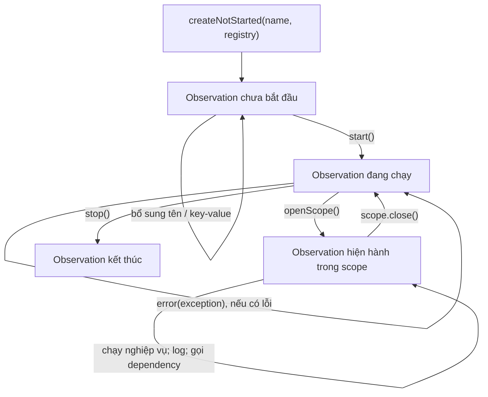

# Tạo observation chưa bắt đầu

Trong chương **Vòng đời observation** của mô-đun **SPRING_BOOT_OBSERVABILITY**, ta tìm hiểu bước đầu tiên khi tự instrument một thao tác nghiệp vụ bằng Micrometer: **tạo một `Observation` nhưng chưa bắt đầu đo**. Bước này hữu ích khi cần đặt tên, bổ sung thuộc tính và quyết định chính xác phần công việc nào thuộc thời gian đo.

Mô-đun observability cho Spring Boot sử dụng Micrometer Observation để liên kết metrics với distributed tracing, đồng thời dùng logs và trace context để điều tra lỗi, độ trễ và hành vi ứng dụng. Việc hiểu `createNotStarted(...)` giúp tránh ba lỗi thường gặp: tưởng đã bắt đầu đo ngay khi tạo đối tượng, quên mở scope để liên kết ngữ cảnh, hoặc không gọi `stop()` khiến dữ liệu thiếu.

## 1. Mục tiêu học tập

Sau bài này, bạn có thể:

1. Giải thích sự khác nhau giữa **tạo**, **bắt đầu**, **mở scope** và **kết thúc** observation.
2. Tạo observation chưa bắt đầu bằng `Observation.createNotStarted(...)` với `ObservationRegistry`.
3. Gắn tên và các key-value có cardinality phù hợp trước khi đo.
4. Điều khiển vòng đời bằng `start()`, `openScope()`, `error(...)` và `stop()` trong mã Spring Boot.
5. Nhận diện tác động của observation lên metrics, spans và logs khi tracing/exporter được cấu hình.
6. Kiểm tra các lỗi vận hành liên quan đến context propagation, sampling và thời điểm đo.

## 2. Observation là gì, và tại sao có trạng thái “chưa bắt đầu”?

Một **observation** đại diện cho một hoạt động đáng quan sát, chẳng hạn `inventory.lookup`, `payment.authorize` hoặc `order.calculate-total`. Nó chứa tên, ngữ cảnh và các thuộc tính mô tả hoạt động. Các `ObservationHandler` đăng ký trong `ObservationRegistry` nhận callback theo vòng đời; tùy handler, cùng một observation có thể được dùng để ghi metrics, tạo tracing span hoặc kích hoạt tích hợp khác.

API trọng tâm:

```java
Observation observation =
        Observation.createNotStarted("inventory.lookup", observationRegistry);
```

Lời gọi này **tạo observation ở trạng thái chưa bắt đầu**. Không nên hiểu rằng timer hay tracing span của thao tác đã được bắt đầu ngay tại dòng lệnh trên. Các tác động đo đạc và callback theo vòng đời phụ thuộc vào `start()`, `stop()` và cách cấu hình handlers.

Ta thường muốn chuẩn bị một observation trước khi bắt đầu vì:

- Cần xác định **tên ổn định** và một số tag từ thông tin đã biết.
- Muốn tách phần chuẩn bị khỏi phần nghiệp vụ thực sự cần đo.
- Muốn điều khiển chính xác thời điểm bắt đầu và kết thúc khi một hàm có nhiều giai đoạn.
- Muốn sử dụng cùng một API cho metrics và tracing, tùy handlers hiện diện ở runtime.

**Lưu ý:** khoảng thời gian đo bắt đầu từ `start()`, không bắt đầu từ `createNotStarted(...)`. Nếu việc kiểm tra input, lấy khóa hay dựng request diễn ra trước `start()`, thời gian của các bước đó không nằm trong duration của observation. Đây là quyết định về phạm vi phép đo, không phải chỉ là chi tiết kỹ thuật.

## 3. Sơ đồ vòng đời



Các thao tác không đồng nghĩa với nhau:

| Lệnh | Tác dụng chính | Điểm cần nhớ |
| --- | --- | --- |
| `Observation.createNotStarted(name, registry)` | Tạo observation để có thể cấu hình trước. | Chưa bắt đầu khoảng đo. |
| `lowCardinalityKeyValue(k, v)` | Thêm thuộc tính có ít giá trị phân biệt. | Phù hợp để nhóm metrics; nên chọn giá trị ổn định và hữu hạn. |
| `highCardinalityKeyValue(k, v)` | Thêm thuộc tính có thể có nhiều giá trị phân biệt. | Thường hữu ích cho tracing; vẫn cần kiểm soát dữ liệu nhạy cảm và chi phí. |
| `contextualName(name)` | Đặt tên dễ đọc theo ngữ cảnh cho tracing khi handler hỗ trợ. | Không thay thế yêu cầu đặt tên observation ổn định. |
| `start()` | Bắt đầu vòng đời, phát callback bắt đầu cho handlers thích hợp. | Thời gian đo thường tính từ đây. |
| `openScope()` | Đưa observation vào ngữ cảnh hiện hành trong scope của thread thực thi. | Hỗ trợ xác định parent span và liên kết context khi có tracing integration. |
| `error(exception)` | Thông báo lỗi cho observation/handlers. | Không tự nuốt hoặc xử lý thay exception nghiệp vụ. |
| `stop()` | Kết thúc vòng đời, phát callback hoàn tất. | Phải được gọi trên mọi nhánh đã `start()` thành công. |

Một observation đang chạy có thể được mở scope trong một phần thời gian của nó. Vì vậy **`start()` và `openScope()` là hai hành động riêng**: một hành động điều khiển thời lượng; hành động còn lại xác định observation hiện hành trong ngữ cảnh thực thi. Scope thường được đóng bằng `try-with-resources`, và việc đóng scope **không thay thế** `stop()`.

## 4. Chuẩn bị ObservationRegistry trong Spring Boot

Trong một ứng dụng Spring Boot 3.x có Actuator, `ObservationRegistry` thường được Spring Boot cung cấp dưới dạng bean để các thành phần inject vào service. Với Gradle:

```groovy
dependencies {
    implementation 'org.springframework.boot:spring-boot-starter-actuator'
}
```

Dependency trên giúp tích hợp observation và metrics theo cấu hình của ứng dụng. Nếu cần tracing phân tán với OpenTelemetry, dự án còn phải có tracing bridge và exporter phù hợp, ví dụ:

```groovy
dependencies {
    implementation 'io.micrometer:micrometer-tracing-bridge-otel'
    implementation 'io.opentelemetry:opentelemetry-exporter-otlp'
}
```

Những dependency này minh họa mô hình thường dùng với Spring Boot 3.x; hãy sử dụng version do Spring Boot BOM quản lý và kiểm tra property/exporter theo phiên bản đang triển khai. Tạo `Observation` trong mã **không tự tạo ra backend lưu metric/trace**, không tự cấu hình collector và không bảo đảm mọi request đều được trace.

Tại một service, nhận registry qua constructor:

```java
import io.micrometer.observation.ObservationRegistry;
import org.springframework.stereotype.Service;

@Service
public class InventoryService {
    private final ObservationRegistry observationRegistry;

    public InventoryService(ObservationRegistry observationRegistry) {
        this.observationRegistry = observationRegistry;
    }
}
```

Phần sau sẽ mở rộng service này thành ví dụ hoàn chỉnh. Nếu ứng dụng không đăng ký handler xuất metrics/tracing, thao tác với observation vẫn có thể chạy nhưng không có dữ liệu tương ứng để xem ở backend. **Registry là điểm tập hợp handlers và cấu hình**, không phải nơi lưu traces hoặc time series.

## 5. Tạo observation chưa bắt đầu và cấu hình trước khi `start()`

Giả sử hệ thống `order-api` cần gọi một hệ thống tồn kho. Ta muốn đo thời gian **gọi hệ thống tồn kho**, còn việc xác thực đầu vào ở tầng controller không thuộc phép đo này.

```java
Observation observation =
        Observation.createNotStarted("inventory.lookup", observationRegistry)
                .contextualName("lookup inventory")
                .lowCardinalityKeyValue("component", "inventory")
                .lowCardinalityKeyValue("operation", "lookup");
```

Ý nghĩa từng phần:

- `"inventory.lookup"` là tên kỹ thuật ổn định của hoạt động. Nên đặt tên theo **loại thao tác**, không theo một request riêng.
- `"lookup inventory"` là tên theo ngữ cảnh, có thể giúp span dễ đọc hơn khi tracing handler có hỗ trợ.
- `component=inventory` và `operation=lookup` chỉ có một tập giá trị nhỏ, phù hợp cho việc nhóm số liệu.
- Đối tượng trả về vẫn đang **chưa bắt đầu**. Ta có thể cấu hình thuộc tính trước khi gọi `start()`.

Sau khi đã chuẩn bị xong:

```java
observation.start();  // Bắt đầu đo hoạt động
try (Observation.Scope scope = observation.openScope()) {
    // Thực hiện phần nghiệp vụ muốn đo.
} finally {
    observation.stop(); // Kết thúc đo sau khi scope được đóng
}
```

Cấu trúc này là khung cơ bản. Khi mã nghiệp vụ có thể ném exception, nên thông báo lỗi qua `observation.error(exception)` trước khi kết thúc; ví dụ đầy đủ ở phần kế tiếp.

### Vì sao không dùng ID request làm low-cardinality tag?

Giả sử hệ thống xử lý hàng triệu đơn hàng. Nếu thêm:

```java
// Không nên: tạo giá trị tag gần như duy nhất cho từng request.
observation.lowCardinalityKeyValue("order.id", orderId);
```

thì registry metrics có thể phải duy trì số lượng time series rất lớn. Tương tự, URL thô chứa ID, email, token và UUID request không nên được đưa vào low-cardinality tag.

Thay vào đó, dùng tập nhãn có số lượng giá trị hữu hạn:

```java
observation.lowCardinalityKeyValue("operation", "lookup");
observation.lowCardinalityKeyValue("backend", "inventory-service");
```

Nếu phải gắn một giá trị nhiều biến thể để tìm một request cụ thể trong trace, chỉ cân nhắc `highCardinalityKeyValue(...)` khi thật cần, có quy tắc bảo mật và giới hạn lưu trữ phù hợp. **High cardinality không có nghĩa là dữ liệu nhạy cảm được phép ghi tự do.**

## 6. Ví dụ hoàn chỉnh: đo một thao tác nghiệp vụ có lỗi

Đoạn mã dưới đây là ví dụ minh họa một Spring service. `StockGateway` và `Stock` là các kiểu nghiệp vụ do ứng dụng tự định nghĩa, không thuộc API Micrometer.

```java
import io.micrometer.observation.Observation;
import io.micrometer.observation.ObservationRegistry;
import org.springframework.stereotype.Service;

@Service
public class StockService {
    private final ObservationRegistry observationRegistry;
    private final StockGateway stockGateway;

    public StockService(ObservationRegistry observationRegistry,
                        StockGateway stockGateway) {
        this.observationRegistry = observationRegistry;
        this.stockGateway = stockGateway;
    }

    public Stock loadStock(String sku) {
        Observation observation =
                Observation.createNotStarted(
                        "stock.load", observationRegistry)
                    .contextualName("load stock")
                    .lowCardinalityKeyValue("component", "stock-service")
                    .lowCardinalityKeyValue("backend", "inventory");

        // Đối tượng đã được mô tả, nhưng chưa đo thời gian.
        observation.start();

        try (Observation.Scope scope = observation.openScope()) {
            return stockGateway.findStock(sku);
        } catch (RuntimeException exception) {
            observation.error(exception);
            throw exception;
        } finally {
            observation.stop();
        }
    }
}
```

Diễn tiến khi gọi `loadStock("SKU-123")`:

1. Mã tạo observation `stock.load` ở trạng thái chưa bắt đầu.
2. Các thuộc tính chung được thêm vào trước khi đo.
3. `start()` đánh dấu bắt đầu; handler phù hợp nhận sự kiện bắt đầu.
4. `openScope()` cho phép mã thực thi bên trong thấy observation hiện hành.
5. `stockGateway.findStock(sku)` là phần công việc được đo.
6. Khi có `RuntimeException`, `error(exception)` báo lỗi cho observation và exception vẫn được ném lại để tầng xử lý phía trên quyết định phản hồi.
7. `try-with-resources` đóng scope; `finally` luôn gọi `stop()` sau khi observation được bắt đầu.

Đặt `stop()` trong `finally` giúp tránh tình trạng một lỗi giữa chừng khiến timer/span không được đóng. Mẫu `catch` này xử lý `RuntimeException`; nếu API nghiệp vụ có checked exception, cần bổ sung nhánh ghi nhận và ném lại lỗi phù hợp với chữ ký phương thức.

**Không dùng `sku` làm low-cardinality tag** vì số lượng SKU có thể rất lớn. Nếu cần điều tra một SKU đặc biệt, ưu tiên logs có chính sách phân quyền/ẩn thông tin phù hợp và liên kết log–trace bằng `traceId`, hoặc thêm thuộc tính tracing đã được xem xét về dữ liệu.

### Điều gì xảy ra nếu chỉ tạo mà không start?

```java
Observation observation =
        Observation.createNotStarted("stock.load", observationRegistry);

// Không gọi observation.start().
// Không thực hiện vòng đời observation cho stock.load.
```

Đoạn mã này chưa đo một hoạt động. Không nên kỳ vọng nhận duration hoặc span hoàn chỉnh của `stock.load` chỉ nhờ gọi `createNotStarted(...)`. Tùy registry và các quy tắc bật/tắt observation, đối tượng có thể hoạt động theo cơ chế no-op; vì vậy sự tồn tại của biến Java không phải bằng chứng hệ thống đã phát telemetry.

### Điều gì xảy ra nếu start nhưng quên stop?

Observation có thể không hoàn tất việc ghi nhận kết quả ở handlers cần callback kết thúc; span cũng có thể bị bỏ dở. Điều này đặc biệt nguy hiểm vì request nghiệp vụ có thể vẫn thành công nhưng dashboard lại thiếu dữ liệu hoặc hiển thị không nhất quán. Hãy đặt `stop()` trong `finally` và chỉ bắt đầu một lần cho một vòng đời logic.

## 7. Khi nào dùng `observe(...)` thay cho điều khiển thủ công?

Với một khối công việc đơn giản, API `observe(...)` giúp quản lý việc bắt đầu, mở scope, ghi lỗi và kết thúc khi chạy khối được truyền vào.

```java
public Stock loadStock(String sku) {
    return Observation.createNotStarted("stock.load", observationRegistry)
            .lowCardinalityKeyValue("backend", "inventory")
            .observe(() -> stockGateway.findStock(sku));
}
```

Mẫu rút gọn phù hợp nếu toàn bộ phần cần đo nằm trong một lambda và không cần thao tác riêng trước/sau khi bắt đầu. Chọn `createNotStarted(...)` với `start/openScope/stop` thủ công khi cần chuẩn bị observation rồi quyết định **chính xác thời điểm** bắt đầu, hoặc cần bổ sung sự kiện và xử lý lỗi theo các bước đặc thù.

Không kết hợp `observe(...)` với một vòng `start()/stop()` thủ công cho cùng observation khi chưa có lý do và hiểu rõ vòng đời: dễ tạo các callback lặp hoặc mốc đo không đúng mong muốn.

## 8. Scope và sự liên kết với logs, traces

Bên trong `try (Observation.Scope scope = observation.openScope())`, observation hiện hành có thể được truy cập bởi instrumentation thích hợp trong cùng execution context. Khi có Micrometer Tracing và logging integration, `traceId` và `spanId` có thể được đưa vào MDC để logs của thao tác liên kết với một trace.

Ví dụ log mô phỏng:

```text
2026-11-22T09:15:13.221Z INFO  stock-service traceId=4b2fe50af9d44c37ab610ebecc803e92 spanId=8ac04bcbd191ad22 Calling inventory
2026-11-22T09:15:13.586Z ERROR stock-service traceId=4b2fe50af9d44c37ab610ebecc803e92 spanId=8ac04bcbd191ad22 Inventory timeout
```

Đây chỉ là ví dụ định dạng. Log có `traceId` khi có tracing context thực sự, logging pattern hỗ trợ MDC và request/span được instrument phù hợp. `Observation` tự thân không phải một logger, và `openScope()` không tự biến mọi dòng log thành dữ liệu trace nếu tracing bridge chưa được cấu hình.

Với một request HTTP đã có observation cha, việc tạo observation con bên trong scope đúng có thể giúp trace backend hiển thị cây span:

```text
HTTP GET /orders/{id}
└── stock.load
    └── HTTP GET inventory-service /stock
```

Cần chú ý thời điểm và context parent được lấy bởi handler thực tế. Nếu tự tạo client, chạy `@Async`, `CompletableFuture`, thread pool hoặc message listener, **scope của thread hiện tại không tự động truyền sang thread khác**. Phải kiểm tra giải pháp context propagation và instrumentation hỗ trợ trong stack đang dùng; không chia sẻ bừa một `Observation.Scope` qua nhiều thread.

### Mốc thời gian đo khác thời gian scope

Giả sử mã lần lượt:

```java
observation.start();
prepareRemoteCall();

try (Observation.Scope scope = observation.openScope()) {
    invokeRemoteCall();
} finally {
    observation.stop();
}
```

Nếu toàn bộ mã chạy tuần tự và không có hành vi bất thường, duration của observation bao gồm cả `prepareRemoteCall()` và `invokeRemoteCall()`. Nhưng observation chỉ là **ngữ cảnh hiện hành được mở** trong phần `invokeRemoteCall()`. Do đó, nếu muốn chỉ đo lời gọi từ xa, hãy chuyển `start()` xuống ngay trước lời gọi hoặc dùng `observe(...)` quanh lời gọi.

## 9. Liên hệ với metrics, tracing, exporter và sampling

Giả sử `stock.load` được xử lý nhiều lần. Tín hiệu quan sát được phụ thuộc các handler, registry và pipeline xuất dữ liệu:

| Thành phần | Vai trò trong ví dụ | Điều có thể quan sát |
| --- | --- | --- |
| Micrometer Observation | Diễn tả hoạt động `stock.load` và phát callback vòng đời. | Một nguồn mô tả chung cho instrumentation. |
| Metrics handler/registry | Ghi nhận timing và tags phù hợp. | Số lần, duration và phân bố latency tùy cấu hình. |
| Tracing handler/bridge | Tạo và hoàn tất span khi có cấu hình tracing. | Span `stock.load` và mối quan hệ cha–con nếu context được truyền đúng. |
| Logging integration | Gắn trace context vào MDC khi thích hợp. | Logs có thể tra cứu bằng `traceId`. |
| Exporter / collector / backend | Gửi, thu nhận và lưu dữ liệu quan sát. | Dashboard metrics, waterfall trace, tìm kiếm logs. |

Đừng nhầm **vòng đời Java** của observation với **việc dữ liệu đã đến backend**. Một `stop()` thành công không bảo đảm exporter gửi thành công; có thể xảy ra lỗi mạng, collector quá tải hoặc backend từ chối dữ liệu. Ngược lại, sampling có thể làm **một số traces không được xuất** dù metric về hoạt động vẫn có số liệu.

Hai vấn đề quyết định chất lượng dữ liệu ngay từ lúc chuẩn bị observation:

- **Cardinality:** Tên và low-cardinality tags phải hữu hạn, ổn định. Không gắn timestamp, ID đơn hàng hoặc request ID làm giá trị metrics.
- **Propagation:** Dịch vụ phụ thuộc chỉ hiện trong cùng distributed trace khi context được truyền xuyên các ranh giới HTTP, messaging hoặc async theo cơ chế instrumentation tương ứng.

Khi cần điều tra lỗi sản xuất, quy trình thực tế thường là: tìm bất thường về tỉ lệ lỗi/độ trễ ở **metrics**, lọc **logs** theo khoảng thời gian và `traceId`, rồi mở **distributed trace** để biết `stock.load` tiêu tốn bao lâu và phụ thuộc nào có vấn đề. Observation tạo ra nền tảng cho các tín hiệu này, nhưng phải có đường cấu hình/thu thập riêng cho từng tín hiệu.

## 10. Lỗi phổ biến khi dùng `createNotStarted(...)`

| Triệu chứng | Nguyên nhân thường gặp | Hướng xử lý |
| --- | --- | --- |
| Không thấy metric/span của thao tác mới | Chỉ gọi `createNotStarted(...)`; quên `start()`, `stop()` hoặc chưa có handlers. | Kiểm tra đường đi thực thi, handlers và pipeline; xác nhận start–stop bao quanh công việc. |
| Độ trễ đo thấp hơn thời gian người dùng chờ | `start()` được gọi sau bước chuẩn bị tốn thời gian. | Xác định lại phạm vi phép đo; đo cả bước chuẩn bị nếu nằm trong SLO nghiệp vụ. |
| Span tồn tại nhưng không có parent như mong đợi | Observation cha không ở trong context đang active hoặc context bị mất qua async hop. | Kiểm tra scope, instrumentation và propagation. |
| Log thiếu `traceId` | Chưa có tracing integration, thiếu MDC pattern hoặc scope/context không đúng. | Xác minh cấu hình tracing và thời điểm ghi log. |
| Tăng mạnh số time series | Gắn ID cụ thể vào low-cardinality tags. | Dùng các nhãn có số lượng giá trị hữu hạn và chuẩn hóa tên route. |
| Có metrics nhưng thiếu traces | Sampling, exporter, collector/backend hoặc instrumentation khác nhau. | Kiểm tra sampling và đường xuất trace theo từng hop. |
| Scope bị giữ mở sau khi thao tác kết thúc | Không đóng `Observation.Scope` đúng cách. | Dùng `try-with-resources`; xem xét lỗi quản lý context ở thread. |

Cũng cần tránh tạo nhiều observation cho các thao tác quá nhỏ, như mỗi phép gán biến trong một vòng lặp. Hãy chọn ranh giới có ý nghĩa vận hành: tính giá, đọc kho, gọi thanh toán, truy vấn quan trọng hoặc xử lý message. Quá nhiều spans làm chi phí tăng và khiến trace khó đọc.

## 11. Bài tập thực hành

### Bài tập 1: Xác định thời điểm phép đo bắt đầu

Xem đoạn mã:

```java
Observation observation =
        Observation.createNotStarted("price.calculate", registry);
loadExchangeRates();
observation.start();

try (Observation.Scope scope = observation.openScope()) {
    calculatePrice();
} finally {
    observation.stop();
}
```

**Câu hỏi:** `loadExchangeRates()` có nằm trong duration của `price.calculate` không?

**Đáp án:** Không. Hoạt động diễn ra trước `start()`, nên không thuộc khoảng đo. Nếu việc tải tỷ giá là một phần cần phản ánh trong SLO tính giá, hãy chuyển `start()` lên trước bước tải hoặc tạo observation riêng cho `loadExchangeRates()` để nhìn rõ từng thành phần.

### Bài tập 2: Đánh giá nhãn

Chọn nhãn low cardinality phù hợp cho thao tác `payment.authorize`:

- A. `payment.id=8f29e...` (mỗi thanh toán một ID).
- B. `payment.provider=bank_a` hoặc `bank_b`.
- C. `customer.email=person@example.com`.
- D. `status=success` hoặc `error`.

**Đáp án:** B và D phù hợp về cardinality nếu tập provider/status được quản lý hữu hạn. A và C có cardinality cao và có nguy cơ lộ thông tin nhạy cảm. Với kết quả chỉ biết sau khi xử lý, hãy ghi nhận thuộc tính đúng thời điểm và xác nhận handler ghi nhận dữ liệu đó như mong muốn.

### Bài tập 3: Tìm lỗi vòng đời

```java
Observation observation =
        Observation.createNotStarted("invoice.generate", registry);
observation.start();
Invoice invoice = invoiceClient.generate();
observation.stop();
return invoice;
```

**Câu hỏi:** Điều gì xảy ra nếu `invoiceClient.generate()` ném exception?

**Đáp án:** `observation.stop()` không chạy; lỗi cũng chưa được chuyển tới `observation.error(...)`. Dùng `try/catch/finally` và `openScope()` khi cần gắn context cho logs/các lời gọi phụ thuộc. Nếu chỉ cần đo một lambda đơn giản, dùng `observe(...)` để giảm sai sót vòng đời.

## 12. Checklist trước khi hoàn tất instrumentation

1. Tên observation mô tả **loại thao tác**, có thể tái sử dụng qua các request.
2. Low-cardinality tags không chứa ID, URL thô, thời điểm hoặc dữ liệu cá nhân.
3. `start()` được gọi tại đúng ranh giới cần đo.
4. `openScope()` được dùng khi cần ngữ cảnh hiện hành cho trace/logs hoặc thao tác con.
5. Scope được đóng và `stop()` được gọi cả khi thành công lẫn thất bại.
6. Exception được báo qua `error(...)` mà vẫn giữ cách xử lý lỗi nghiệp vụ.
7. Registry có handlers phù hợp và telemetry được cấu hình tới backend tương ứng.
8. Nếu có async/messaging, context propagation được kiểm tra ở từng ranh giới.
9. Kết quả được kiểm tra bằng metrics, logs và traces, có tính đến sampling.

**Điểm cốt lõi:** `Observation.createNotStarted(...)` chỉ **chuẩn bị** một hoạt động để quan sát. `start()` xác định lúc bắt đầu đo; `openScope()` xác định ngữ cảnh hiện hành; `stop()` hoàn tất vòng đời. Nắm rõ ba ranh giới này giúp dữ liệu Micrometer trong Spring Boot phản ánh đúng hành vi ứng dụng, từ đó kết nối metrics, logs và distributed tracing khi điều tra lỗi hoặc độ trễ ngoài thực tế.
