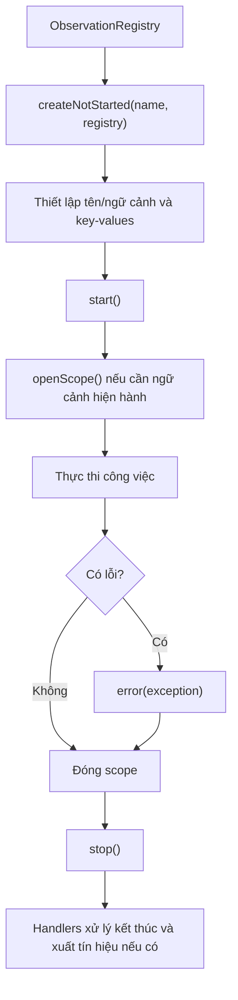
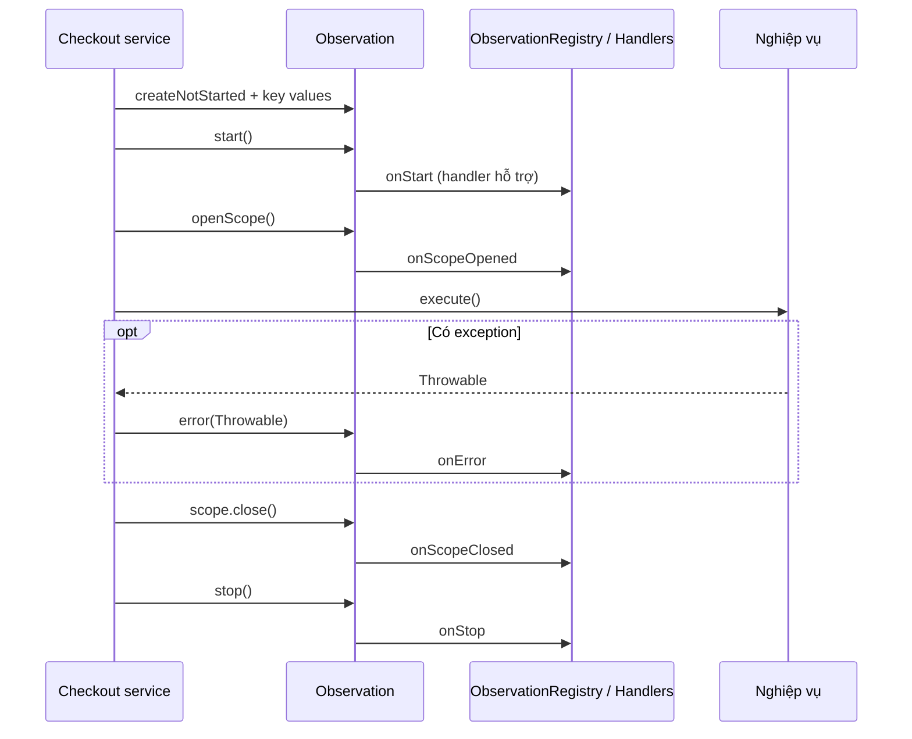

# Bắt đầu observation

> **Chương:** Vòng đời observation  
> **Module:** `SPRING_BOOT_OBSERVABILITY` — thiết lập observability cho Spring Boot bằng Micrometer Observation, metrics, logs và distributed tracing.

## Mục tiêu bài học

Sau bài này, bạn có thể:

- Giải thích thời điểm **bắt đầu một observation** và phân biệt `createNotStarted()`, `start()`, `openScope()` và `stop()`.
- Xác định ranh giới nghiệp vụ phù hợp để đo bằng Micrometer Observation trong ứng dụng Spring Boot.
- Tạo observation từ `ObservationRegistry`, đặt tên, gắn các key-value có cardinality phù hợp, rồi bắt đầu và kết thúc vòng đời an toàn.
- Hiểu observation đang hoạt động liên hệ thế nào với **metrics, logs, distributed tracing**, context propagation, exporter và sampling.
- Nhận diện các lỗi thường gặp khi khởi động observation, nhất là với thao tác lồng nhau và xử lý bất đồng bộ.

## 1. Observation là gì và vì sao có bước bắt đầu?

Khi người dùng gọi API tạo đơn hàng, ứng dụng thực hiện kiểm tra tồn kho, tính tiền, thanh toán và lưu dữ liệu. Ta muốn biết thao tác nào tốn thời gian, bước nào lỗi, các bước có thuộc cùng một request hay không.

Trong Micrometer, một **observation** mô tả một hoạt động cần quan sát bằng **tên**, **ngữ cảnh** và **vòng đời**. Việc bắt đầu observation tạo ra mốc thời gian để các `ObservationHandler` được cấu hình có thể xử lý hoạt động đó. Khi vòng đời kết thúc, handler có thể dùng thời lượng, lỗi và metadata để tạo tín hiệu phù hợp.

Một observation không đồng nghĩa với một trace span hay một metric. Đây là **API quan sát chung**. Tùy handler được đăng ký trong `ObservationRegistry`, một observation có thể đóng góp vào metrics, spans hoặc không sinh dữ liệu xuất ra bên ngoài.

Ví dụ, một nghiệp vụ được instrument có thể dùng tên:

```text
checkout.submit
```

và các thuộc tính:

```text
channel=web
result=success
```

Nếu đã có handler metrics, hệ thống có thể đo số lần và thời lượng của `checkout.submit`. Nếu có handler tracing phù hợp, hoạt động có thể xuất hiện dưới dạng span và được nối với HTTP request đang chạy. Bản thân `start()` **chưa bảo đảm** metrics hay traces sẽ nhìn thấy trong backend: còn phụ thuộc handler, bridge, exporter, pipeline và sampling.

## 2. Vòng đời: tạo, bắt đầu, vào scope, dừng

Một vòng đời Micrometer Observation thường gồm:



Đây là cách tổ chức vòng đời để hiểu các bước, không phải yêu cầu mọi observation đều phải có scope hay nhất thiết có lỗi. Các API được phân biệt như sau:

| Thành phần/API | Tác dụng chính | Điều cần nhớ |
| --- | --- | --- |
| `Observation.createNotStarted(name, registry)` | Tạo đối tượng observation, chưa kích hoạt đo lường | Thích hợp để gắn tên/metadata trước khi bắt đầu. |
| `lowCardinalityKeyValue(...)` và `highCardinalityKeyValue(...)` | Gắn các thuộc tính vào observation | Chọn cardinality phù hợp, tránh thông tin nhạy cảm. |
| `start()` | Bắt đầu vòng đời; kích hoạt callback bắt đầu ở handler phù hợp | **Không mặc nhiên đưa observation vào scope hiện hành.** |
| `openScope()` | Đặt observation làm ngữ cảnh hiện hành trong phạm vi scope | Quan trọng cho nesting, trace/log correlation khi handler tích hợp. |
| `error(Throwable)` | Thông báo lỗi cho observation và handler | Gọi khi thao tác được quan sát thất bại. |
| `stop()` | Kết thúc vòng đời; handler có thể tính duration và hoàn tất dữ liệu | Phải được gọi đúng một lần cho observation đã start. |
| `observe(...)` | API tiện ích bọc thao tác, quản lý start/scope/error/stop | Phù hợp cho đa số thao tác đồng bộ. |

**Phân biệt cốt lõi:** `start()` đánh dấu **hoạt động bắt đầu**; `openScope()` đánh dấu **observation nào đang là ngữ cảnh hiện hành trên luồng thực thi**. Hai việc này liên quan nhưng không đồng nhất. Bạn có thể bắt đầu đo mà không mở scope; khi đó child observation hoặc log trong cùng đoạn code không nhất thiết kế thừa ngữ cảnh mà bạn mong muốn.

Với thao tác đồng bộ, một mẫu an toàn là **tạo → gắn metadata → start → mở scope → thực thi → ghi lỗi nếu có → đóng scope → stop**, sử dụng `try-with-resources` và `finally` để bảo đảm dọn dẹp.

## 3. Chọn điểm bắt đầu observation

Điểm bắt đầu tốt là **ranh giới thực sự có ý nghĩa** với người dùng hoặc đội vận hành, chứ không phải mọi lời gọi hàm.

Ví dụ một hệ thống thanh toán:

| Hoạt động | Có nên tạo observation? | Lý do |
| --- | --- | --- |
| `checkout.submit` | Thường có | Một luồng nghiệp vụ rõ ràng, cần đo thành công và độ trễ. |
| `payment.authorize` | Có, khi cần nhìn riêng bước này | Phụ thuộc quan trọng, dễ gây timeout hoặc lỗi. |
| HTTP server xử lý `POST /orders` | Thường đã được framework instrument | Kiểm tra instrumentation tự động trước khi tự tạo observation tương đương. |
| Getter hoặc phép tính cộng đơn giản | Thường không | Giá trị điều tra thấp, tăng số lượng phép đo và chi phí. |
| Một job đồng bộ hóa dữ liệu định kỳ | Có nếu có mục tiêu vận hành | Cần biết job nào chậm, thất bại và ảnh hưởng tới bao nhiêu bản ghi. |

Điểm bắt đầu cần nằm **ngay trước phần công việc định đo**, sao cho duration không vô tình bao gồm những thao tác nằm ngoài phạm vi. Ví dụ, nếu muốn đo thời gian gọi cổng thanh toán, chỉ bắt đầu quanh lời gọi payment; nếu muốn đo toàn bộ checkout, bắt đầu ở ranh giới nghiệp vụ checkout.

Tên observation nên **ổn định và diễn đạt loại hoạt động**, chẳng hạn `checkout.submit`, `payment.authorize`, `inventory.reserve`. Tránh dùng tên chứa order ID, URL với path parameter thực hoặc một giá trị riêng của từng request; tên động làm số lượng metric tăng không kiểm soát.

### 3.1. Instrumentation tự động và instrumentation thủ công

Spring Boot Actuator có thể kích hoạt instrumentation sẵn có cho một số lớp như HTTP server và HTTP client thông qua các tích hợp phù hợp. Tùy phiên bản và dependency, những thao tác này đã có observation.

**Instrumentation thủ công** phù hợp với các ranh giới *nghiệp vụ* không tự động được quan sát, ví dụ `checkout.submit`. Nó giúp đặt tên và nhãn thể hiện ý nghĩa người dùng thay vì chỉ biết HTTP request.

Nếu đã có observation HTTP request, bạn có thể tạo observation nghiệp vụ **bên trong scope của request** để thu được thêm cấp chi tiết. Đừng tự bọc lại toàn bộ request theo cùng ý nghĩa với instrumentation có sẵn, vì điều đó dễ tạo metrics hoặc spans trùng lặp và gây khó đọc.

## 4. Bắt đầu observation bằng Micrometer API

Trong ứng dụng Spring Boot đã cấu hình Micrometer Observation, bạn thường nhận `ObservationRegistry` thông qua dependency injection.

### 4.1. Ví dụ đầy đủ với `start()`

Đoạn code bên dưới tạo observation cho một thao tác checkout đồng bộ, đặt tag trước khi bắt đầu, mở scope khi thực thi và luôn dừng observation. `action` đại diện cho nghiệp vụ thật, ví dụ kiểm tra giỏ hàng, gọi thanh toán hoặc lưu đơn.

```java
import java.util.function.Supplier;

import io.micrometer.observation.Observation;
import io.micrometer.observation.ObservationRegistry;
import org.springframework.stereotype.Service;

@Service
public class CheckoutObservationService {
    private final ObservationRegistry observationRegistry;

    public CheckoutObservationService(ObservationRegistry observationRegistry) {
        this.observationRegistry = observationRegistry;
    }

    public <T> T submit(String inputChannel, Supplier<T> action) {
        // Tập giá trị hữu hạn, tránh dùng nhãn nhận trực tiếp từ client.
        String channel = "web".equals(inputChannel)
                || "mobile".equals(inputChannel)
                ? inputChannel
                : "other";

        Observation observation = Observation
                .createNotStarted("checkout.submit", observationRegistry)
                .contextualName("submit checkout")
                .lowCardinalityKeyValue("channel", channel)
                .start();

        try {
            try (Observation.Scope scope = observation.openScope()) {
                try {
                    return action.get();
                } catch (RuntimeException | Error failure) {
                    observation.error(failure);
                    throw failure;
                }
            }
        } finally {
            observation.stop();
        }
    }
}
```

Các điểm cần quan sát trong code:

1. `createNotStarted(...)` chọn **tên observation** và registry nhận thông báo vòng đời.
2. `contextualName("submit checkout")` cung cấp tên có tính mô tả trong ngữ cảnh, có thể được tracing handler dùng làm tên span. `checkout.submit` là tên đo lường ổn định.
3. `lowCardinalityKeyValue("channel", channel)` thêm nhãn có **tập giá trị nhỏ và biết trước** cho metrics.
4. `start()` đánh dấu hoạt động bắt đầu. Handler đã đăng ký có cơ hội nhận callback tương ứng.
5. `openScope()` thiết lập observation hiện hành để các thao tác lồng nhau có thể được liên hệ đúng ngữ cảnh.
6. `observation.error(failure)` báo lỗi cho handler trước khi ném lại exception; không làm thay đổi quyết định xử lý lỗi của ứng dụng.
7. `scope.close()` được gọi tự động bởi `try-with-resources`, rồi `stop()` được gọi trong `finally` kể cả khi nghiệp vụ thất bại.

Đoạn code minh họa **thao tác đồng bộ**. Nó không tự truyền ngữ cảnh khi `action` khởi động thread, gửi message hoặc trả về tác vụ bất đồng bộ. Thời lượng ở đây đo đến khi `action.get()` kết thúc; nếu nó chỉ trả về một future chưa hoàn thành, cần thiết kế lại ranh giới đo để phản ánh thời gian thực sự mong muốn.

### 4.2. Dùng `observe(...)` khi không cần điều khiển thủ công

Với một thao tác đồng bộ đơn giản, API `observe(...)` giúp quản lý vòng đời ngắn gọn hơn:

```java
import java.util.function.Supplier;

import io.micrometer.observation.Observation;
import io.micrometer.observation.ObservationRegistry;

public class CheckoutActions {
    private final ObservationRegistry registry;

    public CheckoutActions(ObservationRegistry registry) {
        this.registry = registry;
    }

    public <T> T run(Supplier<T> action) {
        return Observation.createNotStarted("checkout.submit", registry)
                .lowCardinalityKeyValue("channel", "web")
                .observe(action);
    }
}
```

`observe(...)` là cách thuận tiện để **bắt đầu, đưa observation vào scope, thực thi, ghi nhận exception rồi dừng** trong luồng đồng bộ. Nếu muốn bổ sung thông tin ngay trước hoặc sau từng pha, hoặc đo công việc bất đồng bộ, bạn có thể cần quản lý vòng đời tường minh.

**Không gọi `start()` trước rồi bọc cùng observation bằng `observe(...)`** nếu không hiểu chính xác hành vi API: bạn có nguy cơ điều khiển vòng đời trùng. Chọn **một** cơ chế nhất quán cho một observation.

### 4.3. Khi bắt đầu mà không mở scope

Một ví dụ thiếu phần ngữ cảnh:

```java
Observation observation =
        Observation.start("payment.authorize", observationRegistry);

try {
    paymentGatewayCall.run();
} finally {
    observation.stop();
}
```

Observation vẫn được bắt đầu và dừng, nhưng nếu không có scope phù hợp, log hoặc observation con được khởi tạo trong `paymentGatewayCall.run()` có thể không nhìn thấy observation này là ngữ cảnh hiện hành. Điều đó làm liên kết trace/span dễ bị đứt hoặc không có quan hệ cha–con như kỳ vọng.

Khi bạn muốn công việc bên trong sử dụng observation hiện hành, mở scope trong phạm vi thực thi rồi đóng nó an toàn:

```java
Observation observation =
        Observation.start("payment.authorize", observationRegistry);

try (Observation.Scope scope = observation.openScope()) {
    paymentGatewayCall.run();
} finally {
    observation.stop();
}
```

Ví dụ trên giả định có biến `paymentGatewayCall` kiểu `Runnable` và `observationRegistry` đã được cung cấp. Với code thực tế, cũng cần ghi lỗi bằng `observation.error(...)` hoặc dùng `observe(...)` như các ví dụ trước.

## 5. Điều gì xảy ra trong `ObservationRegistry` khi start?

`ObservationRegistry` là nơi các handler, predicate và convention liên quan đến observation được kết nối. Khi một observation được bắt đầu, handler tương thích với context có thể nhận callback vòng đời; khi mở/đóng scope và khi có lỗi cũng có callback tương ứng.

Một cái nhìn khái niệm:



Bảng liên hệ với các tín hiệu trong Spring Boot:

| Tín hiệu | Vai trò của observation khi được bắt đầu | Điều kiện để thấy kết quả |
| --- | --- | --- |
| **Metrics** | Handler metrics có thể ghi nhận thời điểm bắt đầu và đo thời lượng, số lần, kết quả khi dừng. | Có MeterRegistry và ObservationHandler phù hợp; cấu hình exporter/backend nếu cần xem từ ngoài. |
| **Distributed tracing** | Handler tracing có thể tạo và kích hoạt span theo vòng đời observation. | Có Micrometer Tracing bridge, sampler và exporter; propagation hoạt động khi qua ranh giới dịch vụ. |
| **Logs** | Trong scope, logging framework có thể dùng MDC và trace context để tạo bản ghi có liên kết. | Log thực sự được ghi, pattern/structured logging và tích hợp MDC được cấu hình phù hợp. |

**Không nên kỳ vọng cứ gọi `start()` là một dòng log sẽ tự xuất hiện.** Micrometer Observation không thay thế việc ghi log sự kiện nghiệp vụ. Tương tự, nếu registry không có handler phù hợp, đoạn code vẫn có thể chạy bình thường mà không có metrics hoặc spans xuất ra.

Một ứng dụng Spring Boot thường dùng Actuator để cấu hình phần lớn nền tảng đo lường. Nếu thêm tracing, cần bridge và exporter phù hợp với stack/phiên bản đang dùng. Cấu hình exporter và hệ thống quan sát được sử dụng quyết định dữ liệu thực sự được thu thập và truy vấn.

## 6. Ngữ cảnh hiện hành và observation lồng nhau

Một request có thể chứa nhiều cấp:

```text
HTTP POST /orders                 (observation HTTP do framework tạo)
└── checkout.submit               (observation nghiệp vụ)
    ├── inventory.reserve         (observation nghiệp vụ)
    └── payment.authorize         (observation nghiệp vụ)
```

Giả sử HTTP observation đã có scope hiện hành. Khi `checkout.submit` được tạo và mở scope trong scope đó, handler tracing có thể tạo child span phù hợp. Khi scope của checkout đóng, observation hiện hành trước đó được khôi phục.

Vì vậy:

- Bắt đầu observation **bên trong ngữ cảnh có parent** nếu muốn nó liên kết với một request/operation đang chạy.
- Dùng `openScope()` khi những hoạt động lồng bên trong cần thừa hưởng ngữ cảnh.
- Đóng scope đúng lúc và đúng thứ tự. Đừng giữ scope mở lâu hơn công việc cần quan sát.
- Khi không có handler tracing, các observation vẫn có thể dùng để đo metrics nhưng không nhất thiết tạo được cây spans.

### 6.1. Ranh giới bất đồng bộ

`Observation.Scope` thường liên quan đến ngữ cảnh hiện hành trên luồng xử lý. Đoạn code chuyển sang `@Async`, `CompletableFuture`, executor, Reactor hay một consumer message **không mặc nhiên** thấy cùng ngữ cảnh.

Ví dụ sai về kỳ vọng:

```java
try (Observation.Scope scope = observation.openScope()) {
    // Task chạy ở thread khác; chưa chắc được truyền context.
    executor.execute(() -> log.info("processing payment"));
}
```

Vòng đời của đoạn code bên ngoài có thể kết thúc **trước khi task thực sự chạy**, và tracing/logging context không tự động theo thread mới. Với xử lý bất đồng bộ, cần:

1. Quyết định muốn đo **thời gian lên lịch**, **thời gian xử lý**, hay **toàn bộ thời gian chờ + xử lý**.
2. Sử dụng cơ chế context propagation có trong framework/tích hợp để **capture và restore** ngữ cảnh ở đúng ranh giới.
3. Khởi động và dừng observation ở nơi thực sự bao quanh phần công việc định đo.
4. Kiểm tra trace ID/span ID trong logs và các spans sau khi qua thread hoặc message boundary.

Đối với distributed tracing xuyên HTTP, Micrometer Tracing và HTTP client/server instrumentation có thể inject/extract các header như W3C `traceparent`. Observation khởi động ở một service **không tự** làm cho service khác nhận cùng trace nếu HTTP/message instrumentation và propagation chưa được cấu hình.

## 7. Đặt tag từ lúc bắt đầu: cardinality và tên thống nhất

Để metrics tổng hợp được, các observation cùng loại nên dùng tên và tag nhất quán. Hai nhóm key-value thường gặp:

- **Low-cardinality:** giá trị nằm trong tập hữu hạn và được kiểm soát. Ví dụ `channel=web|mobile|other`, `operation=submit`, `outcome=success|error`.
- **High-cardinality:** giá trị có thể thay đổi rất nhiều, ví dụ một mã giao dịch cụ thể. Nó có thể hỗ trợ tìm kiếm trong tracing nếu được cấu hình để chuyển thành span attribute, nhưng phải xem xét chi phí và an toàn dữ liệu.

Ví dụ gắn metadata trước `start()`:

```java
Observation observation = Observation
        .createNotStarted("checkout.submit", registry)
        .lowCardinalityKeyValue("channel", "web")
        .lowCardinalityKeyValue("operation", "submit")
        .start();
```

Tránh:

```java
// Không làm thế này: orderId gần như luôn khác nhau ở mỗi request.
Observation observation = Observation
        .createNotStarted("checkout.submit", registry)
        .lowCardinalityKeyValue("orderId", orderId)
        .start();
```

Dữ liệu có cardinality cao như `orderId` có thể làm số time series trong Prometheus hoặc backend metrics tăng đột biến, tốn bộ nhớ và khiến truy vấn chậm. Không gắn mật khẩu, token, dữ liệu thanh toán hoặc thông tin cá nhân vào observation context.

**Thời điểm đặt tags:** nên đặt các thuộc tính đã biết **trước khi bắt đầu** để handler có cơ hội đọc đầy đủ từ đầu. Thuộc tính chỉ biết sau khi xử lý (chẳng hạn kết quả thành công/thất bại) có thể bổ sung trong quá trình chạy; cần nhớ một số handler/convention sẽ đánh giá tags ở thời điểm khác nhau. Hãy kiểm tra tín hiệu thực tế trong phiên bản Micrometer đang dùng.

## 8. Lỗi, thời lượng và việc kết thúc observation

Tại thời điểm `start()`, observation mới chỉ có điểm bắt đầu. Thời lượng hoàn chỉnh thường chỉ có khi `stop()` được gọi. Nếu quên stop, hệ thống có thể thiếu số đo hoàn thành hoặc giữ span chưa kết thúc.

Một số vấn đề cần phân biệt:

- **Exception của nghiệp vụ**: cần truyền cho observation bằng `error(e)` nếu quản lý vòng đời thủ công, rồi xử lý/ném lại theo hợp đồng của ứng dụng.
- **HTTP status lỗi**: không phải mọi response 4xx/5xx tự động tương đương exception tại observation nghiệp vụ; ý nghĩa “thất bại” cần được định nghĩa và instrument đúng.
- **Timeout của dependency**: việc timeout có thể ném exception, trả mã lỗi hoặc phát tín hiệu bất đồng bộ; vị trí start/stop quyết định duration đang đo gì.
- **Sampling của tracing**: trace không được lưu do sampling không có nghĩa observation chưa chạy. Metrics có thể vẫn phản ánh hoạt động nếu handler metrics được cấu hình, nhưng pipeline metrics cũng có những giới hạn riêng.
- **Exporter**: việc handler tạo dữ liệu không có nghĩa collector/backend đã nhận; cần giám sát chính pipeline export.

Ví dụ, một luồng `payment.authorize` mất 3 giây. Nếu đặt `start()` trước khi đưa tác vụ vào hàng đợi nhưng `stop()` ngay sau khi enqueue, metric chỉ đo chi phí **enqueue**, không đo thời gian **thanh toán thực sự**. Hãy chọn ranh giới phù hợp và nhất quán với mục tiêu vận hành.

## 9. Cấu hình và kiểm chứng trong Spring Boot

Để chạy các ví dụ dùng `ObservationRegistry`, dự án cần các dependency Micrometer/Actuator phù hợp với phiên bản Spring Boot. Khi muốn thu metrics cho Prometheus hoặc traces tới backend, cần bổ sung registry, tracing bridge và exporter tương ứng.

Ví dụ cấu hình ở một ứng dụng dùng Actuator và các tích hợp tương thích:

```yaml
spring:
  application:
    name: checkout-service

management:
  endpoints:
    web:
      exposure:
        include: health,info,prometheus
  tracing:
    sampling:
      probability: 0.1
```

Cấu hình trên chỉ mang tính minh họa:

- `/actuator/prometheus` chỉ khả dụng khi có dependency Prometheus registry và endpoint được cho phép.
- `management.tracing.sampling.probability=0.1` yêu cầu sampler trace lấy mẫu xác suất 10% trong cấu hình tracing tương thích. Nó không quyết định tần suất ghi metric.
- Tracing spans chỉ tới được backend khi bridge, exporter và điểm nhận được cấu hình đúng.
- Các endpoint quản trị/metrics cần được bảo vệ theo môi trường; không nên phơi dữ liệu vận hành nhạy cảm ra Internet.

### 9.1. Bài thực hành: quan sát checkout thất bại

Trong một dịch vụ Spring Boot thử nghiệm có instrumentation thích hợp:

1. Tạo `ObservationRegistry` qua cấu hình framework hoặc inject bean được quản lý; tạo `CheckoutObservationService` theo ví dụ trên.
2. Gọi `submit("web", () -> { ... })` với một tác vụ giả lập chạy 200 ms và trả về kết quả bình thường.
3. Gọi lại, nhưng tác vụ ném `IllegalStateException`; xác nhận luồng xử lý vẫn ném exception như ban đầu.
4. Quan sát metrics của tên `checkout.submit` (nếu handler metrics và registry được cấu hình), kiểm tra thời lượng và các tag cardinality thấp.
5. Nếu đã bật tracing, mở trace của HTTP request và tìm span nghiệp vụ `checkout.submit`; xem mối quan hệ với span HTTP cha và các spans con.
6. Ghi một log bên trong scope rồi kiểm tra trace ID/span ID có được đưa vào MDC/logging pattern hay không.
7. Thử bỏ `openScope()` trong một bản thử nghiệm: so sánh ngữ cảnh trong log và sự liên kết của observation con.
8. Thử chuyển nghiệp vụ sang executor: kiểm tra thời gian và context propagation, sau đó đặt lại ranh giới start/stop cho đúng loại thời gian muốn đo.

**Tiêu chí đạt:** Bạn giải thích được `start()` đã bắt đầu đo **hoạt động nào**, `openScope()` làm thay đổi **ngữ cảnh hiện hành** nào, `stop()` kết thúc hoạt động khi nào; từ metrics, logs và traces có thể kiểm chứng các quyết định instrumentation nếu pipeline được cấu hình đầy đủ.

## 10. Lỗi thường gặp khi bắt đầu observation

| Hiện tượng | Nguyên nhân có thể | Cách xử lý |
| --- | --- | --- |
| Code đã gọi `start()` nhưng không thấy metrics | Registry chưa có metrics handler, exporter chưa cấu hình, backend chưa thu nhận | Kiểm tra Actuator/Micrometer, registry, handler, endpoint và pipeline. |
| Không thấy trace hoặc span | Thiếu tracing bridge/exporter, trace bị sampling hoặc observation không được instrument như mong đợi | Kiểm tra tracing configuration, sampling và khả năng quan sát tại backend. |
| Span nghiệp vụ không nằm dưới span HTTP | Không có parent observation hiện hành hoặc không mở scope ở ranh giới thích hợp | Kiểm tra thứ tự `start()`/`openScope()` và context propagation. |
| Log không có trace ID | Log nằm ngoài tracing scope hoặc chưa cấu hình MDC/log format | Kiểm tra scope, logging configuration và async boundary. |
| Timer/span không có thời gian hoàn thành | Thiếu `stop()` ở một nhánh trả về/exception | Dùng `finally` hoặc `observe(...)` để đóng vòng đời. |
| Metrics tạo quá nhiều series | Tên/tag chứa ID hoặc giá trị biến thiên theo request | Dùng tên chuẩn hóa, low-cardinality tags có tập giá trị hữu hạn. |
| Thời gian đo thấp hơn độ trễ người dùng | Start/stop chỉ bao quanh thao tác enqueue hoặc bước quá nhỏ | Chọn lại ranh giới theo hành vi cần đo. |
| Thao tác bị đo hai lần | Tạo observation thủ công trùng instrumentation tự động | Xác định ownership instrumentation; giữ observation nghiệp vụ có ý nghĩa riêng. |

## 11. Tự kiểm tra

**Câu 1.** `createNotStarted("checkout.submit", registry)` có nghĩa là quá trình đo thời gian đã bắt đầu chưa?  
**Gợi ý:** Chưa. Observation được tạo nhưng `start()` chưa được gọi.

**Câu 2.** Gọi `start()` rồi có bắt buộc `openScope()` không?  
**Gợi ý:** Không bắt buộc về mặt API. Nhưng nếu muốn observation trở thành ngữ cảnh hiện hành để các thao tác con/logs liên kết, cần mở scope phù hợp.

**Câu 3.** Tại sao `stop()` nên nằm trong `finally` khi điều khiển thủ công?  
**Gợi ý:** Để hoạt động được kết thúc kể cả khi code trả về sớm hoặc có exception; tránh thiếu dữ liệu duration/unfinished spans.

**Câu 4.** Có nên đặt `transactionId` riêng từng request làm `lowCardinalityKeyValue`?  
**Gợi ý:** Không. Nó có thể tạo rất nhiều metric series; dùng tags hữu hạn cho metrics và xử lý ID có cardinality cao trong hệ thống tương quan phù hợp khi thật sự cần.

**Câu 5.** Nếu không có span ở backend, có thể kết luận `start()` chưa chạy không?  
**Gợi ý:** Không. Có thể thiếu handler/bridge/exporter, sampling loại bỏ trace hoặc pipeline truyền dữ liệu gặp lỗi.

**Câu 6.** Khi `@Async` chạy sau khi method ban đầu kết thúc, liệu observation bắt đầu ở thread gọi có tự đo đúng toàn bộ thời gian xử lý async không?  
**Gợi ý:** Không. Cần xác định ranh giới thời gian muốn đo và thiết lập context propagation/lifecycle phù hợp với cách thực thi bất đồng bộ.

**Ghi nhớ:** Trong Micrometer Observation, **`start()` đánh dấu hoạt động bắt đầu**, còn **`openScope()` thiết lập ngữ cảnh hiện hành** để các bước liên quan có thể kế thừa. Chọn đúng ranh giới, dùng tên/tags ổn định, ghi lỗi và kết thúc vòng đời an toàn. Metrics, logs và distributed tracing chỉ liên kết hiệu quả khi ObservationRegistry, handlers, context propagation, exporter và sampling được cấu hình đúng với môi trường Spring Boot.
